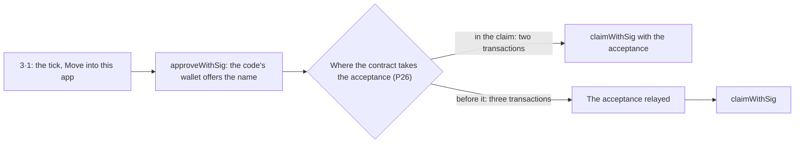
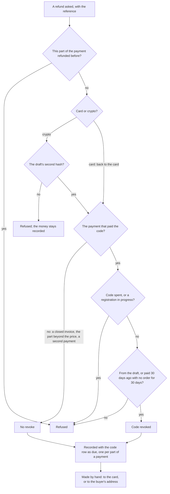
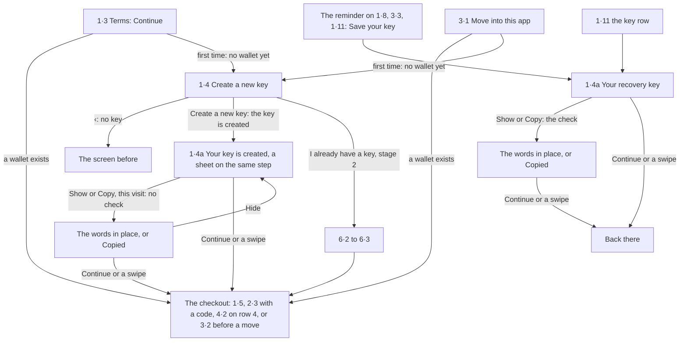
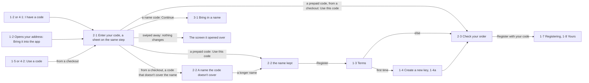
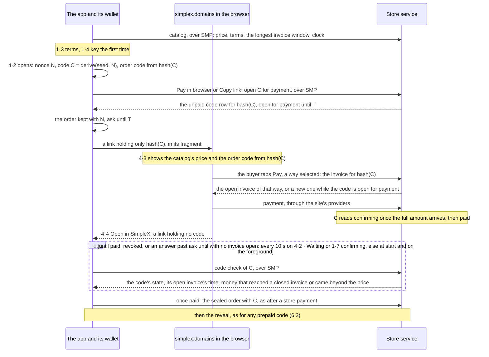
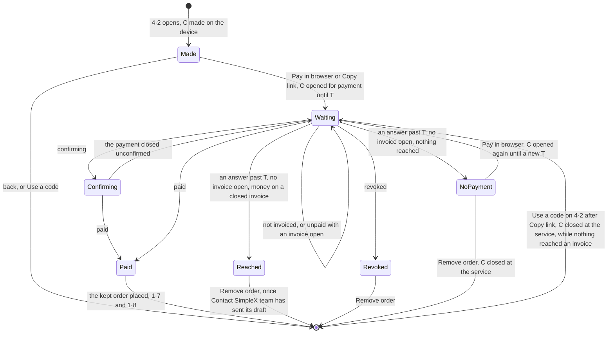

# Selling SimpleX names in the apps

Base: `names` · Repos: simplex-chat, simplexmq, and simplex.domains for the site's part. Builds on the store service (https://github.com/simplex-chat/simplex-chat/pull/7979, with its terms on chain from https://github.com/simplex-chat/simplex-chat/pull/7889), the device wallet (https://github.com/simplex-chat/simplex-chat/pull/7684, merged into `names`, https://github.com/simplex-chat/simplex-chat/pull/7703) and the terms in the resolver's answer (https://github.com/simplex-chat/simplexmq/pull/2003).

## Summary

What a user does in the mobile and desktop apps once this is built: search a name, pay for it in the app store or with a code, own it, point it at an address or a channel, back up the key that owns it, and bring in a name bought on simplex.domains.

| Stage | What it gives | What it holds |
|---|---|---|
| Stage 1, v1, the beta | A name in the app and on the address or channel | Search over SMP; one store product, $100 for 2 years, for any name; prepaid codes; a site-bought name's code; builds that can't pay take the app's steps, then pay in the browser; buying and codes starting from the address and a channel's info; the main path: search, terms, the recovery key the first time, checkout, payment, registering, yours |
| Stage 2, v1.1, usable | A place for names, a way back on a new phone, and changing a name | The "SimpleX names" hub under Advanced settings; restore from the 24 words with a scan of the wallet's accounts; a name moved in or restored attaches to the profile's address or channel; changing what a name opens; giving a name to another profile |
| Stage 3, later | What the first names need before they expire on 31 Dec 2028 | Transfers to another person, 3 a year; renewal; reminders |

A store payment, end to end:

1. The app derives a prepaid code from its wallet's seed and a random nonce, sets a token on the purchase that binds the purchase to that code, and opens the store's sheet.
2. The app signs a sealed order for the chosen name, paid with that code.
3. The app sends the store receipt and the sealed order in one request to the store service, over SMP.
4. The service checks the receipt, saves the paid code, and only then looks at the order. It answers the two separately, so a refused order keeps the payment.
5. After at least a minute, the app reveals the name in its own request. The service registers it to the wallet's account, and the address or channel claims it.

Section 5 lists the decisions, section 8 cuts the work into pull requests by stage, and section 11 lists what the lead still decides.

## 1. Goal, stages and acceptance criteria

The goal: a person in a store build registers a SimpleX name for their address or channel, paying with the store, without a wallet, ether or a browser; and every build has a working way to get a name, or to bring in one bought on the site.

### Stage 1, v1, the beta

- Search in the app, over SMP.
- Buy in the app with Google Play and the App Store: one product, $100 for 2 years, for any name. iOS store payment is built in this stage and ships hidden in a normal release until it is tested.
- After a store payment, the app sends the payment and the sealed order in one request. The service saves the paid code before it looks at the order and answers the two separately. The reveal is its own later request.
- A prepaid code registers a name.
- A site-bought name's code moves the name into the app only if the name already opens this profile's address or channel. Or the name shows on the profile without moving, as today.
- Builds that can't pay in the app (F-Droid, desktop, and iOS while its store payment is hidden) search in the app, take the terms, the key the first time and the checkout in the app, priced from the service's catalog, then pay in the browser for a prepaid code the buyer never sees (question Q24). Google Play and iOS in the US offer the same as "Buy in browser". Google Play and iOS show no link to the site outside the US, and iOS there, while its payment is hidden, takes a code with no search before it.
- Buying and codes start from the address and a channel's info, as today; no names place in settings yet (D14). Registering a name that opens nothing (question Q12) stays open for the lead; the screens keep D15 until it is answered.
- The app creates the 24-word recovery key after the terms and before the checkout, the first time only, never before a name is found. A half-screen sheet then offers to save it: the words show only on Show, saving is optional, and the app reminds quietly until Copy or Show has been used. No restore yet.
- Terms: one tick on a step of its own for each order, linking to one document with a section on community names.

### Stage 2, v1.1, usable

- A "SimpleX names" place under Advanced settings: the profile's names, Register a name, Import, Restore purchases and the recovery key.
- Restore on a new phone from the 24 words: the app asks what each of the wallet's accounts owns, until 20 unused accounts in a row.
- A name moved in or restored attaches to the profile's address or channel, with one link edit SimpleX pays for.
- Changing what a name opens, and giving a name to another profile.
- Moving in a name that opens another profile's address.

### Stage 3, later

- Transfers to another person, with the allowance of moves: 3 a year per name.
- Renewal ("add a year") and reminders, built and released before mid-2028.

### Acceptance criteria

Stage 1:

- AC1: In the Android Play build, a user with no wallet finds a name, pays once with Play Billing, and ends with the name registered for two years to a key of the device wallet, opening their address, which shows it as verified. Test: end to end with the store service, the fake Play verifier and the fake chain node.
- AC2: A payment is never credited twice and never lost: the same request sent twice gives one code and one order; a request whose answer was lost is sent again and gets the same answers; a refused order keeps the payment; a name taken before the order or before the registration keeps the payment for another name. Tests: service and core tests for each case.
- AC3: The one product pays for any name of 6 to 63 characters for 2 years, and the product, never the client, decides the years. Test: a service test with a 6-character and a 63-character name.
- AC4: With iOS store payment hidden, the iOS build shows no store purchase button; the US storefront pays in the browser (row 4), and every storefront takes a code. The purchase lane compiles and runs behind the build-time switch. Test: previews of both storefronts, and a sandbox run of the lane with the switch on.
- AC5: A name bought on the site reaches the app: its owner code, pasted on the code sheet or arriving by link, never scanned, moves the name to the device wallet once the name opens this profile's address or channel; a name that doesn't is refused with its next step; a name left on the site shows on the profile as today. Test: end to end with the owner code flow and the fake chain node.
- AC6: The app never opens the store sheet while the service is in codes-only mode, or closed for the day, or before the sale, and a receipt that was paid is never refused for a mode: its order waits until the sale opens. Test: the catalog's states in previews, and a service test crediting a paid receipt in codes-only and answering its order `sale_closed`.
- AC7: A build that can't pay searches in the app, ticks the terms, creates the key the first time, and reaches 4·2, priced from the service's catalog; "Pay in browser" opens an invoice that the link names only by a prepaid code's hash, with the order code the app shows; once the invoice is paid, the app sees it through the code check, whether or not the buyer came back through the link, and registers the name with that code. "Buy in browser" on 1·2 takes the same path where the build, store and country allow it. iOS outside the US, while its payment is hidden, takes a code with no search before it. Google Play and iOS outside the US show no link to the site anywhere in the name flows: the alerts, the name screen and the search. Test: a service test of an invoice for a code's hash, found again by that hash, confirming, then paid; end to end with the fake chain node, from the invoice to the name registered with no link back; previews per build and storefront, the alerts' and What's New's included.
- AC8: No key material exists before 1·4, which appears only after a name is found and its terms are ticked, before the checkout, the first time. "Create a new key" creates the key, so it exists before the checkout. The words show only on Show; opened later, Copy and Show ask for the device's passcode or Face ID, and straight after the key is created they don't. The reminder stays until Copy or Show has been used. Test: a core test that search and the terms step create no wallet, that ‹ on 1·4 creates none, and that a store sheet cancelled after 1·4a keeps the key and the next order skips 1·4; previews; a device check of Copy and Show (section 9).
- AC9: Each order signs the terms the user ticked for it on 1·3, in the kind of its name, general or community. Test: service and core tests for changed terms and for each kind.

Stage 2:

- AC10: On a new phone, the 24 words bring back every name the wallet's accounts own, found by the scan with its gap of 20, attached to this profile's address or channel by one relayed edit. Test: end to end with the fake chain node and ROWN.
- AC11: "Set what it opens" changes a name's records within its yearly allowance, and a name can be given to another profile. Test: end to end with the record edit relay.

Stage 3:

- AC12: A transfer to another person and a store-paid renewal reach the chain within their rules (section 6.11). Test: end to end. Reminders follow section 6.11. Test: previews and a core test.

## 2. Non-goals

- Subscriptions of any kind.
- Prices by name length in the app.
- Paying with cryptocurrency inside a store build.
- Changing the contracts.
- Following an order placed on the site inside the app: the site finishes its own orders.
- Blind-signed codes (section 7).
- Stealth transfers (https://github.com/simplex-chat/simplex-chat/pull/7519 stays open, outside this plan).

## 3. Current state

Facts below were read at these commits: simplex-chat `names` `b4c177fb5`; the store service `sh/names-deploy` `720b5b41b`; the store spec `sh/names-design` `158f22c7e`; simplexmq `names` `d75f5686d`, the pin in `cabal.project`; the site, simplex-chat/simplex.domains `sh/names-webapp` `5228f9d6f`. Paths under `StoreService/` are in `apps/simplex-store-service/src/` at `sh/names-deploy`, and paths under `webapp/` are in simplex.domains.

The contract source is not in a public branch: ens-contracts `simplex` is not on simplex-chat/ens-contracts. Contract facts below come from the service's code and the store spec; the renewal rules in section 6.11 are the names work's reading of `contracts/simplex/SimplexController.sol` and `SimplexSponsor.sol`.

### 3.1 What a name is

- A record in an ENS fork on Ethereum; `.testing` and `.simplex` are separate deployments of the same contracts.
- Only the owner key can change or transfer a name. The service registers a name to the buyer's address through the sponsor's `registerWithCredit`, which needs the owner's signed intent; the registrar key pays the gas and the sponsor's allowance pays the price, so no ether moves for the buyer.
- At least two years: the controller refuses a registration under 730 days (`StoreService/Config.hs:287-289`, `minNameYears`). A prepaid code carries 2 to 10 years (`StoreService/Group/Command.hs:42`). A community name registers for 2 paid years whatever its code gives (`communityYears`, `StoreService/Names/Community.hs:55-56`).
- Paid years start on 1 January 2027 or at the order, whichever is later (`defaultTermStart`, `Config.hs:299-300`). The days before cost the buyer nothing. An order's duration must match within the slack (`checkDuration`, `StoreService/Names/Orders.hs:270-274`).
- Prices come from the chain. `SimplexPriceOracle` holds cents a year per label length with a base for other lengths, and the service quotes `rentPriceUSD` with a placeholder of the name's length (`StoreService/Names/Contracts.hs:175-182`). Setting one price is a chain operation: `setPrices` with base 5000 cents a year and no per-length entry. Every reader follows: the site's search, the resolver's `NamePricing`, and the allowance spent per registration. The store spec's list of $100, $200 and $400 (`2026-10-21-store-api.md:103`) is replaced by the lead's decision of one price.
- A name is 6 to 63 characters: letters, digits and hyphens (`minNameLength`, `maxNameLength`).
- After expiry, a grace period (`GRACE_PERIOD()` on the registrar, 90 days in the terms draft): the name stays its owner's, can be renewed and can't be transferred. Then anyone can register it.

### 3.2 How a name is bought on the site today

- simplex.domains, served by the store service. One term: the search answer gives `years` and `termStart`. Payment by card, Bitcoin or Monero; Lightning, proposed in https://github.com/simplex-chat/simplex-chat/pull/8010, was closed unmerged; a separate dApp takes ETH (`webapp/src/views/checkout.ts:32, 466`). A prepaid code `SN<length>-…` pays too; only the operator issues them.
- The browser makes a fresh wallet for each order. Its secret is the owner code, `SN-` and 30 characters, whose 128 bits are the entropy of a 12-word BIP-39 phrase (`src/Simplex/Chat/Badges/Code.hs`). The name registers to that wallet.
- Every registration accepts the name terms on chain: an order signs the hash of its name kind's terms, the reveal carries the owner's acceptance, the service relays it before the register. `terms_unavailable` and `terms_changed` refuse an order (`StoreService/Names/Orders.hs:283-290`). The terms' text is `docs/NAMES-TERMS.md` in the draft https://github.com/simplex-chat/simplex-chat/pull/8002 (closed 5 November, at `672d13e9e`); the name policy links whichever file is current.
- The search reads `/#/?name=<label>` (`webapp/src/views/search.ts:44`, `views/shell.ts:122`). It takes no link yet. Its "is yours" page tells the buyer to set the name on their address and shows the code (`webapp/src/views/order.ts:1262`).
- Before the full launch the service can run codes-only, refusing paid orders (`nCodesOnly`, `StoreService/Web/Names/Orders.hs:87, 239`).

### 3.3 The store service

- The app reaches the service over SMP with `sendServiceRequestAsync`: one connection per request, with PQ on, whose connection info bounds the request and its answer at 11106 bytes each (`e2eEncConnInfoLength PQSupportOn`, simplexmq `Agent/Protocol.hs:339-343`), and a timeout the caller can set, 30 s by default (`serviceRequestTimeout`), inside the service's 180 s reply window. The commands are badge commands only (`src/Simplex/Chat/StoreService.hs:77-106`). Names are served over HTTP only (`StoreService/Web/Names.hs`).
- Requests run on lanes of one thread each: Play purchases and Apple subscriptions and transfers on the purchase lane, due renewals on the renewal lane, everything else on the main lane (`requestLane`, `StoreService/Service.hs:564-590`).
- Store receipts are verified for badges: Apple signed transactions against a configured root, Play purchases through the Play Developer API; the product decides what is granted (`storeProduct`, `StoreService/Catalog.hs:146-160`). `payments(provider, provider_ref)` is unique, so one transaction funds one purchase. An Apple payment is keyed by `originalTransactionId` for an auto-renewable and by `transactionId` for any other (`applePayloadRef`, `src/Simplex/Chat/PaymentService.hs:95-98`). Play reads for subscriptions are bounded at 300 a minute (`maxPlayPurchaseReads`, `Service.hs:1345`). Purchases made in Apple's test environment are refused unless a dev setting credits them (`creditTestPurchases`).
- Play one-time purchases are acknowledged by the service before crediting, never consumed by it (`StoreService/StoreReceipts/Google.hs:96-100`), acknowledged by the Android app once its core holds the receipt, and consumed by the app when finished (`views/badges/BadgeStore.kt:47-48, 293-295`).
- Prepaid name codes: one row per code hash with the shortest length it covers, its years and a payment state; reserved while a registration holds it, spent when the name lands, released when the name is taken, kept 30 days after a failure for Try again (`StoreService/Names/Codes.hs`, `failedCodeHold`, `Names/Worker.hs:104-105`). An order sends the plain code and the service hashes it (`parseCodeOrder`, `Web/Names/Orders.hs:230-233`).
- An exact resend of an order is found by its hash before its timestamp is checked, so a lost answer is safe however late it is resent (`Web/Names/Orders.hs:209-214`). A signed request's timestamp is within 600 s of the service's clock (`signedRequestSeconds`).
- Another name is allowed only for a failed order or one whose links were refused (`movable`, `Names/Orders.hs:315-319`), at most 3 times (`max_order_moves`). A committed order past `revealBefore` with no reveal reads failed (`registrationAt`, `Names/View.hs:148-156`). Code orders have no cancel command.
- Record edits are relayed one transaction each, within `record_edits_per_year`, 3 by default (`StoreService/Names/Records.hs`, `Config.hs:283`). Name transfers aren't relayed: `approveWithSig` and `claimWithSig` are designed in the store spec, not built.

### 3.4 The core and the apps

- The core on `names` has the device wallet: one 24-word master per device, one hardened account per name at `m/44'/60'/n'/0/0`, each bound to a profile, with `APIGetWallet`, `APICreateWallet`, `APICreateWalletAccount`, `APIExportWalletMnemonic`, `APIDeleteWallet` (`src/Simplex/Chat/Controller.hs:451-455`). It can't sign or import yet (`docs/rfcs/2026-09-10-wallet-keys.md`, known limits 2 and 5).
- The registration encoder and the order signatures are part of the store-service app (https://github.com/simplex-chat/simplex-chat/pull/7693). The core makes and reads prepaid and owner codes (`src/Simplex/Chat/Badges/Code.hs`).
- A name is claimed on the profile's address with `/_set domain` (`APISetUserDomain`, `Commands.hs:1642`), and in a channel's own profile for a channel. Name lookup goes through `resolveNameRecord`; its RSLV is sent as `sendOrProxySMPCommand` (simplexmq `Agent/Client.hs:2018`).
- The apps set, show and verify names, with a countdown to the sale, 12 December 2026 18:00 UTC (iOS `UserAddressView.swift:923-932`; Kotlin `SetSimplexNameView.kt:33, 205`).
- These open the site in every storefront: the name alerts' Register, Renew and Re-register, and the "available" alert, which also prints the resolver's USD price (iOS `NewChatView.swift:1320, 1335`; Kotlin `ConnectPlan.kt:62-67, 117`); "How to register a test name" and the sale's footer (iOS `UserAddressView.swift:893, 932`; Kotlin `SetSimplexNameView.kt:178, 219`); the names entry in What's New (iOS `WhatsNewView.swift:721`; Kotlin `WhatsNewView.kt:1012`). P30 replaces each one.
- The badge buy pattern: on Android the Play build sells in the app and shows "Buy in browser" only for the Play country "US" (`badgeBrowserAllowed`, `BadgeStore.kt:60-67`), and FOSS and desktop show "Buy in browser" and "Redeem badge code". On iOS at `names` store purchases are commented out (`BadgesSupportSimplexView.swift:48-70`), while the 7.1 release branch sells badges in App Store builds (https://github.com/simplex-chat/simplex-chat/pull/8044); the US check is `BadgeStore.swift:39-41`. The badge site's link back is routed by `ContentView.swift:508` and Kotlin `ChatListView.kt:816`, and the app confirms it before redeeming.
- The badge lanes sweep the store's transactions, on iOS at launch, on foreground, on a profile switch, on `Transaction.updates` and on Restore (`BadgeStore.swift:367, 380, 411-412, 467`; Kotlin `BadgeStore.kt:415, 430-441`). So the lanes need to skip each other's products (P37, P46).

### 3.5 simplexmq

- BIP-32, BIP-39, BIP-44, recoverable secp256k1, keccak, EIP-55 addresses, EIP-712 hashing, RLP and EIP-1559 transactions.
- The resolver answers `RSLV` with the name's record, expiry, grace and reserved reason; for an available name, `NRAvailable {pricing, nameTerms}`, where `NamePricing` holds `registrationPrices`, `basePrice` and `minLabelLength` (`src/Simplex/Messaging/Names/Record.hs:94-114`). `NameTerms` holds the terms' link and, when it fits the answer, the file in one zstd frame (`termsZstd`). The type is there since https://github.com/simplex-chat/simplexmq/pull/2003; the resolver doesn't fill it yet.
- Finding the names an address owns is the draft https://github.com/simplex-chat/simplexmq/pull/1875.

### 3.6 The sketches and the site's design

- The two canvases are on this branch: `plans/sketches/2026-09-18-names-phase3a-registration.excalidraw` and `plans/sketches/2026-09-23-names-backup-restore.excalidraw`, moved from https://github.com/simplex-chat/simplex-chat/pull/7530 and normalized by `plans/sketches/normalize-excalidraw.py`, with every string unchanged. They are the tentatively approved flow. The screens follow them, and depart only for a good reason, usually one learned building the site. Section 6.7 shows each difference with its reason.
- The site's design: `plans/names-codes/2026-10-19-webapp-redesign.md` on `sh/names-design`, built in `webapp/` on `sh/names-webapp`. The app's badge purchase already follows the badge webapp's steps and words in the app's own components (`BadgesCheckOrderView.swift`, `BadgesHowLongView.swift`); the name screens do the same.

### 3.7 Pull requests at this plan's entry points, and earlier work

| Pull request | Relation |
|---|---|
| https://github.com/simplex-chat/simplex-chat/pull/7979 the store service selling names, base `names` | Extended: the SMP commands and the name purchase (section 6.3) |
| https://github.com/simplex-chat/simplex-chat/pull/7889 names under the name terms, merged into `sh/names-deploy` | Followed |
| https://github.com/simplex-chat/simplex-chat/pull/7675 store spec | Followed: codes, terms; its price list is replaced (3.1) |
| https://github.com/simplex-chat/simplex-chat/pull/8002 names terms of use, closed; https://github.com/simplex-chat/simplex-chat/pull/7994 placeholder texts, closed | The app reads whatever the policy links; its age rule is question Q3, its purchase terms question Q4 |
| https://github.com/simplex-chat/simplex-chat/pull/8010 Lightning, closed unmerged | Not among the site's ways to pay; nothing in the app |
| https://github.com/simplex-chat/simplex.domains/pull/6 the site | Followed; gains the link parameter and "Open in SimpleX" (section 6.8) |
| https://github.com/simplex-chat/simplex-chat/pull/7703 names feature branch, with the wallet of https://github.com/simplex-chat/simplex-chat/pull/7684 | The wallet the app registers to |
| https://github.com/simplex-chat/simplex-chat/pull/7693 registration primitives, merged into `names` | Moved into the library (P5, P6) |
| https://github.com/simplex-chat/simplex-chat/pull/7932 app test backend, merged into `names` | Used by the app tests |
| https://github.com/simplex-chat/simplex-chat/pull/8026 delivery plan | Merged into this plan |

Earlier pull requests:

| Pull request | Disposition |
|---|---|
| https://github.com/simplex-chat/simplex-chat/pull/7530 minimal name registration API | To close; the store's order path replaces its declarations. Its two canvases are on this branch. |
| https://github.com/simplex-chat/simplex-chat/pull/7390, https://github.com/simplex-chat/simplex-chat/pull/7425 names CLI MVP with codes | To close. The wallet and the store service replace the mock registrar, the lazy seed, the purchase-key credits and the `/0/k` paths. The CLI command shapes are kept (D8). |
| https://github.com/simplex-chat/simplex-chat/pull/7428 blind-signed codes | Left out (section 7). |
| https://github.com/simplex-chat/simplex-chat/pull/7355, https://github.com/simplex-chat/simplex-chat/pull/7382 names v2 core, TUI and GUIs | To close. The stealth derivation and the gift flow stay in the RFC for later work; this plan's screens supersede these. |
| https://github.com/simplex-chat/simplex-chat/pull/7561, https://github.com/simplex-chat/simplexmq/pull/1875 scan for names owned by a wallet | Replaced by P3, P4 and P12, in stage 2. |
| https://github.com/simplex-chat/simplex-chat/pull/7566 wallet names model | Replaced by P11. |
| https://github.com/simplex-chat/simplex-chat/pull/7509 wallet for hidden profiles | To close; hidden profiles are refused. |
| https://github.com/simplex-chat/simplex-chat/pull/7519 stealth transfers RFC | Left open, outside this plan. |
| https://github.com/simplex-chat/simplexmq/pull/1942 names-web example | Left open, outside this plan. |

## 4. What is missing

| # | Missing | Layer | Stage |
|---|---|---|---|
| M1 | Signing an EIP-191 message or EIP-712 typed data with an account key | core wallet | 1 |
| M2 | Restoring a wallet from the 24 words | core wallet | 2 |
| M3 | The names an account holds, with each name's expiry | core wallet | 1 |
| M4 | Finding the accounts a phrase owns | core wallet, simplexmq | 2 |
| M5 | The registration encoder and the order messages, reachable by the core | library | 1 |
| M6 | A names surface over SMP | store service, core | 1 |
| M7 | A name code bought with a store receipt, in one request with its order | store service, core | 1 |
| M8 | Relays over SMP: a name code's transfer; record edits | store service, core | 1; 2 |
| M9 | An order's life in the core: place, follow, reveal, retry, another name, claim | core | 1 |
| M10 | The terms of an available name in the resolver's answer | simplexmq | 1 |
| M11 | The screens for the search, the purchase, the codes, the hub, the key and the expiry date | apps | 1, 2, 3 |
| M12 | The site's "Open in SimpleX" on its "is yours" page, and the verified link back | simplex.domains, website | 1 |
| M13 | One price on chain: `setPrices` with a base and no per-length entry | chain operation | 1 |
| M14 | Renewal and transfers to another person | store service, core, apps | 3 |
| M15 | Paying in the browser for a prepaid code: the catalog's price, an invoice for a code's hash, found again by that hash, a confirming state, the site's pages, and the app noticing payment | store service, simplex.domains, core, apps | 1 |

## 5. Decisions

The lead decides, and the lead's instructions come first; the decisions of 4, 5 and 6 November are marked with their date.

- **D1. One product, one-time.** One store product for any name: $100 for 2 years, Apple's non-renewing subscription and Play's one-time product (5 November). Nothing renews by itself. Section 6.2 holds the store rules.
- **D2. A paid receipt becomes a prepaid code,** derived from the wallet's seed, and the name registers as with any prepaid code. A token on the purchase binds the receipt to that code (question Q9).
- **D3. The payment and the sealed order go in one request** (5 November), answered separately, the payment saved first. The reveal is its own later request.
- **D4. The app orders through the store service over SMP.** The service holds the registrar key, pays the gas and spends the allowance, as it does for the web. The app signs the order, the registration intent and the terms acceptance with its wallet; the service sends every transaction. Over SMP the service process receives no IP address; section 7 says what its operator can link.
- **D5. The service's name routes serve two transports.** The handlers for the code order, the view, the reveal, Try again, `find`, another name, the record edit and the code check become functions. The page and the app are answered by one implementation.
- **D6. The search answer comes from the resolver.** Availability, the minimum length, the grace date, the reserved reason and the terms come from the name lookup the app already makes, so the store service gets no request per searched name. The service's catalog answers the sale's state, the store product, the term start and the clock. The app compares the catalog's terms hash with the resolver's before it signs.
- **D7. The registration encoder is shared.** The ABI encoding, the commitment and the `RegisterName` intent move into the chat library, so the commitment the core signs and the calldata the service sends come from one encoder.
- **D8. The CLI first, then Kotlin, then Swift** (4 November). Each core pull request adds its `/name …` form and a terminal test. One pass over the Kotlin screens covers Android and desktop, and the Swift pass mirrors it.
- **D9. A code registers a name on every build.** A code is pasted on one half-screen sheet; nothing in the app scans a code (6 November). Builds that can't pay in the app search in the app, take the terms, the key the first time and the checkout in the app, and then pay in the browser for a prepaid code the buyer never sees, which registers the chosen name (6 November); iOS outside the US, while its payment is hidden, takes a code with no search before it. A name bought directly on the site comes in with its name code (D11). How the browser takes the payment, as row 4 draws it (6.8), is question Q24.
- **D10. Signing stays inside the core.** A library function takes an account index and uses the account key only inside it. Named commands build their own messages and sign them; no chat command signs text its caller gives, so a paired device can't ask for a signature.
- **D11. A name code is a wallet, and redeeming one is a transfer** (4 November). A name code stays on the device, and the app sends only that wallet's signatures; a prepaid code is sent as it is; the app tells the two apart on the device (6 November). Every build imports such a code: the app derives the code's key, and the name moves to an account of the device wallet, the code's wallet offering it with `approveWithSig` and the app's account taking it with `claimWithSig`, both relayed by the service. After the move the recovery key owns the name. In stage 1 the name moves only if it already opens this profile's address or channel (5 November).
- **D12. The recovery key comes after a name is found** (5 November), after the terms and before the checkout, the first time only, so that nobody pays without a wallet to hold the name (6 November). One screen creates it, and a half-screen sheet on the same step offers to save it: saving is optional, the words show only on Show, and the app reminds quietly until Copy or Show has been used (6 November). Restore comes in stage 2, with its scan (5 November).
- **D13. Each order signs the terms it was placed under** (5 November), ticked on a step of their own for each order: one tick and one link, to one document with a section on community names (6 November).
- **D14. Buying and codes start from the address and a channel's info,** on today's name screen, in stage 1. The hub comes in stage 2, under Advanced settings (5 November; no hub in v1, decided 6 November).
- **D15. Every name opens something from the start** in stage 1 (question Q12, which recommends a list of names instead).
- **D16. A taken name shows no pictures,** with a separate button for what it is used for (5 November). Question Q18 asks for text in the row instead.
- **D17. iOS store payment is built in stage 1 and ships hidden** behind a build-time switch in a normal release, until it is tested (5 November).
- **D18. Links to the site:** always on F-Droid and desktop; in the US only on Google Play and iOS (5 November).
- **D19. Yearly allowances.** SimpleX pays the fee for every registration, move, link edit and renewal, so each name has 3 link edits a year (a default the service can change) and the same for moves in and transfers. A failed registration can try another name up to 3 times. Registrations and renewals have no allowance: the buyer pays for each.
- **D20. Renewal is stage 3.** The expiry date shows from stage 1. Reminders and `renewWithCredit` with its store products come before the first names expire.
- **D21. The main path** (6 November), wherever a name is bought or registered: search → terms → create key (first time only) → checkout → payment → registering → yours. In row 3: the tick on 3·1 → create key (first time only) → moving. The screens serve regular users who know nothing about crypto (6.6).
- **D22. Stage 1 first** (6 November): the stages are built in order, starting with the beta, planned as one stage 1. Whether codes ship before paying in the app is question Q16.
- **D23. The app's two checks on the store service are later work** (6 November): looking for the commit on the chain, and a time limit on registering. Commit and reveal stay separate steps in the API now, and the app verifies once the resolver can answer (section 7).
- **D24. A code is never worth money** (6 November): redeeming a code makes a name cost $0. No screen, page or receipt offers, prices or describes a code as worth an amount, and a browser payment pays for a name, never for a code the buyer sees.

### The answers of 4 November

1. The CLI ships, and comes first, then Kotlin, then Swift (D8).
2. The scan ships with restore, which the decisions of 5 November place in stage 2 (P3, P4, P12).
3. A desktop build links to simplex.domains (D9); a name bought directly there comes in with its name code (D11).
4. Every build imports a name code, and redeeming one transfers the name from the code's wallet to the device wallet (D11, P20, P34).
5. The delivery plan and this plan are merged into one: this document.

### Ruled out

- **Auto-renewing subscriptions:** one renewing name per store account and product group, and at most a year per period against the two-year minimum.
- **Play's prepaid plans:** one per account and product, at most a year.
- **The site alone on store builds:** outside the US a store user couldn't buy in the app at all. It stays for desktop and F-Droid.
- **Cryptocurrency inside a store build:** Apple forbids apps to use "their own mechanisms to unlock content or functionality, such as … cryptocurrencies and cryptocurrency wallets" (3.1.1); Google requires Play Billing outside the US and its alternative-billing countries.

## 6. Design

### 6.1 New mechanisms, each with the requirement it serves

| Mechanism | Requirement |
|---|---|
| A names catalog in the service: the store product → `NameProduct {minLength = 6, years = 2}` | AC3 |
| A prepaid code derived from the wallet's seed | AC2: a lost answer or a restored wallet recomputes the same code, with no re-keying |
| A token on the purchase that binds it to that code | Another device or profile on the store account presents only what it can use, and a held receipt credits only the wallet it was bought for |
| One service command, purchase a name: a receipt with a code's hash or a sealed order, answered in two parts | AC1, AC2, D3 |
| One column, the payment that paid a prepaid code (`payment_id`, unique) | AC2: one receipt, one code |
| A row per UTC day counting store-paid registrations, and a counter of each code's commits | The daily cap and its bound on gas (6.3) |
| A catalog command and a terms text command | AC6, AC9: orders built by the service's clock, and the terms shown are the terms signed |
| SMP forms of the web's code check, code order, registration view, reveal, Try again, `find` and another name | D4, D5 |
| Two lanes of their own for name commands, one for orders and one for reads | Chain and store reads hold up neither badge requests nor a reveal |
| Owner-code relays for `approveWithSig` and `claimWithSig`, with their chain reads and a yearly bound | AC5 |
| Core commands: keep the order, hand over the receipt, read the catalog, order, follow, retry, another name, claim, redeem | AC1, AC2, AC5 |
| The purchase lanes in the apps, after the badge lanes | AC1, AC4 |
| The site's "Open in SimpleX" on its "is yours" page, and a verified link back | AC5 |
| The catalog's price for one name | AC7: 4·2 is priced by the service, as no store prices it |
| An invoice for a name's prepaid code by the code's hash, at most one open per code, found again by that hash, with a confirming state | AC7: the browser pays for the app's code; a reopened link, another way to pay or an expired invoice doesn't make a second payable invoice, and money that reaches a closed one goes to support |
| The app noticing payment through the code check | AC7: a payment made on another device, or with no link back, still registers the name |

The bridge from a receipt to a registration is the prepaid code. A fourth payment kind would add a case to every phase and to the taken and failed handling. A code the service makes and returns would be lost with a lost answer. A random code re-keyed on a second presentation would let any device on the store account revoke another's unused code.

**The code and the token.** Before the sheet opens, the core makes a random 6-byte nonce and derives the code from it: 19 bytes of HKDF-SHA512 over the BIP-39 seed, salted with the nonce, under a `SimpleX…` info string of its own; each byte taken mod 32, then the Luhn character over the length digits and the payload, in the text `SN6-…`. The app sets the store's account field (Apple's `appAccountToken`, a UUID; Play's `obfuscatedAccountId`, the same text) to a version-4 UUID: the nonce in bytes 0–5, byte 6 `0x40`, byte 8 `0x80`, and the first 8 bytes of SHA-256 of the code's hash in bytes 7 and 9–15. The token is new for every purchase and random-looking, so it links nothing for the store or the service, and it reveals nothing of the code.

- **Recognising.** Any device lists every open purchase of the store account. It recomputes the token from the nonce and its own seed, and presents by itself only those that match and whose profile is this one.
- **Binding.** The service reads the token from the store's signed transaction or Play's purchase read, and refuses a first presentation whose hash doesn't match it, as `receipt_used`, crediting nothing. So a receipt carrying a token credits only the wallet it was bought for, whoever holds the receipt, short of a search of 2^64 hashes (question Q9). An empty or absent field counts as no token.
- **No token** (a promo or offer code redeemed in the store): the code is derived with the store's reference as the salt, under the same info string; the reference is the one the service keys the payment by. The first presentation binds it, so such a purchase is presented only when the user taps "Restore purchases", from stage 2.
- The seed is the input, never an account key, so one account key reveals nothing else. A browser payment's code (6.8) is derived the same way from its own nonce, under an info string of its own. The wallet RFC gains the derivation, simplexmq's `protocol/crypto-registry.md` gains the info strings, and test vectors pin both.

### 6.2 The store product

| | App Store | Google Play |
|---|---|---|
| Type | Non-renewing subscription ("a service with a limited duration") | One-time product, marked in its details as a Tokenized Digital Asset, with the Financial features declaration updated for NFT sales |
| Identifier | `NAME_2Y_01` | `name_2y_01` |
| Display | "SimpleX name" | "SimpleX name" |
| Description | "Registers one name for 2 years." | "Registers one name for 2 years." |
| Price | The site's, $100, at each store's nearest price point | The same |

- The store's commission is SimpleX's cost: 15% of each sale while SimpleX's store earnings stay under $1M a year, once enrolled (Apple's Small Business Program; Google's first $1M, where Google's billing fee in the US, EEA and UK since 30 June 2026 makes it 10% + 5%), up to 30% above that.
- Multi-quantity is off. Play won't sell a product again until it is consumed, so one account holds one unused name purchase at a time. The app consumes (Play) or finishes (Apple) the purchase when its name registers.
- Each name is one purchase. Apple: "credits … purchased via in-app purchase may not expire", so a code row has no expiry.
- A name never unlocks a feature in the app (Apple 3.1.1, on NFTs).
- The product stays unavailable in each store until codes-only is off, so the stores themselves refuse a sheet before the sale. For iOS, it stays unsubmitted until the switch (6.9). Apple lets neither a product's ID nor its type be edited once created, and a deleted product's ID can't be reused, so the type is settled first.
- Review notes say a registered name comes back from the recovery key, from stage 2, not with "Restore purchases".

### 6.3 The service

```
App                                Store              Store service                    Ethereum
 | catalog -------------------------------------------> state, product, years, terms, clock
 | search the name (RSLV through the resolver)
 | 1·3: the terms ticked
 | 1·4: the recovery key created, the first time
 | 1·5 Check your order: Pay
 | catalog again, the name looked up again: sale closed or name gone -> no sheet
 | the name kept; nonce N; code C = derive(seed, N); token T = N, tag(hash(C))
 | buy the product, token T -> sheet, payment
 | <-------------------------------- receipt
 | order signed by the service's clock
 | purchase a name {receipt, order(C, owner, commitment, sealed, terms, signature)} ->
 |                                                    verify the receipt with the store
 |                                                    product -> any name, 2 years; T matches hash(C)
 |                                                    commit: payment row, code row {hash(C), paid}
 |                                                    the order: sale, terms, name, code
 |                                                    reserve the code, queue the commit --> commit
 | <------------------------------------------------- payment: unused; order: registration id, or a refusal
 |   poll the registration; wait at least 60 s
 | reveal: label, links, signed intent, terms acceptance -> acceptance relayed, registerWithCredit -> name to the account
 | <------------------------------------------------- registered, expires
 | claim the name on the address or channel; consume (Play) or finish (Apple) the purchase
```

**Purchase a name.** `STCPurchaseName {payment :: ServicePayment, code :: NamePurchaseCode}`, where `NamePurchaseCode` is either a code's hash or a `NameCodeOrder`, the fields of `POST /api/name/register` with the plain code among them, whose hash is then the code's. It is sent with no purchase key: a name purchase has no ledger for one to sign. A request with a hash alone is a payment alone: a restored promo purchase with no name chosen, a purchase presented again after its order was answered, or an order too large to fit (below). The store's product identifier is public, so all of this runs for any client, within the bounds below.

The payment part, in order:

1. The same receipt and the same hash: answered with the years and the code's state as it reads now (unused, reserved, used, revoked), whatever its age.
2. The product is looked up in the names catalog (Play: from the request, before any call to Play; Apple: after the signed transaction's offline check). An unknown one is refused. A product retired later stays in the catalog, so a payment still pending for it is credited.
3. The store verifies, with the badge refusals: invalid, pending, test purchase; and a quantity other than 1. A Play read takes a slot of the names' own per-minute bound.
4. The same receipt with another hash, or a token that doesn't match the hash: `receipt_used`, only after the store vouches for it, and nothing is written.
5. Play is acknowledged, then one transaction inserts the payment (unique by store and transaction, keyed for this product by `originalTransactionId`, since Apple gives a restored purchase a new `transactionId`) and the prepaid code row `{code_hash, min_length 6, years 2, payment status paid, no expiry, payment_id}`, and commits. A verified, paid receipt of a known product is credited whatever state the service is in, so no payment is stranded. A hash another code row holds is refused `bad_request`, and nothing is credited.

The order part runs only after that commit, and only when the payment part answered a code state:

6. The code order's own function, the one D5 extracts from `codeOrderHandler`, runs as on the web: an exact resend is answered with its registration id; otherwise the signature, the timestamp, the duration, the terms, the name and the code are checked, in the contract's order.
7. A failure in the order part leaves the payment committed, and is answered in the order part.

The answer: `STPNamePurchase {payment, order}`. `payment` is the years and the code's state, or a refusal. `order` is the registration id, or a refusal, or absent when the request held a hash alone or the payment was refused.

| Payment part | Next step in the app |
|---|---|
| unused, reserved | Follow the order's answer. With none (a hash alone): `unused` places the kept order, or asks for a name; `reserved` finds the order with `find` |
| used | Its name registered before the app could consume it: consume or finish, find the name with the owner-signed `find` |
| revoked | "This payment can no longer register a name."; consume or finish |
| `receipt_used` | "Bought with another recovery key"; never consumed here |
| `receipt_invalid`, `test_purchase`, `product_unavailable` | "Payment not confirmed"; unconsumed until support refunds it (iOS: the transaction finishes once its reference shows, since support credits a code) |
| `payment_pending` | Waits, nothing charged; presented again when the store says paid |
| `bad_request` | The core's own defect, or a modified app: logged, and shown as "Payment not confirmed" with the reference |
| `internal`, `provider_not_configured`, `rate_limited` | Sent again later, by the badge worker's retry interval, once the network is up (`waitForUserNetwork`) |

| Order part | Meaning and next step in the app |
|---|---|
| registration id | Following the order |
| `sale_closed`, with the catalog state and when it reopens, if known | "Paid, waiting for the sale"; nothing written; placed again as a plain code order when the catalog opens |
| `terms_unavailable` | "Paid, waiting to order"; placed again when the catalog has the terms |
| `terms_changed` | 1·3's tick comes back unticked, in place on 1·7; placed again once ticked |
| `name_taken` | Taken, no stage started; the payment kept for another name |
| `order_exists` | The app finds its own order with `find` and opens it |
| `name_check_unavailable` | Retried in place |
| `bad_request` | The answer gives no reason, so the core compares its timestamp and duration with the catalog's clock. Past the 600 s or the term slack (a request that waited offline): built again with a new duration and commitment if the term moved, signed, and placed once as a plain code order. Otherwise the order reads failed, and its "Try again" signs again and places a plain code order |
| `commit_limit` | The code's commits are used up: failed, with "Contact SimpleX team" |
| `code_reserved`, `code_used` | A timed-out request landed after the app moved on: the core finds its order with `find` |
| `code_invalid` | The purchase is presented again, whose answer says why: `revoked` or `receipt_used` |

Repeats are safe by construction: step 1 answers the payment and step 6 the order, so after a lost answer the core resends the exact bytes of the first request; the signed order is kept with the purchase record. Once any order answer is recorded, a presentation holds the hash alone, so a stale order can't reserve the code. After a refusal the paid code stays, and every later attempt is an ordinary code order: the path every prepaid code uses. After a timed-out Try again, which isn't repeatable, the core reads the view before sending again.

The order's refusals never reach the store, and the name isn't held while a payment waits.

**Sizes.** A request and its answer are each bounded by 11106 bytes of connection info (3.3).

- A request: an Apple signed transaction takes several kilobytes, since its header holds a certificate chain; a Play token is short; an order with one short link takes about a kilobyte, while `sealed` may reach 11095 characters for two 4096-byte links on the web. The core measures the encoded request before sending. When it doesn't fit, it sends the hash alone, then the order as a plain code order. P19 measures a real sandbox transaction with the longest short link the app makes.
- An answer: an oversized one fails at the service's encryption and reaches the app as a timeout, so the bound is checked where the answer is made. The catalog holds at most about 36 full-length community texts; past its bound it carries none, the ⓘ then reads "This name is for its community.", and the operator is alerted at service start. A terms text is answered in one zstd frame, as the resolver's `termsZstd` is, and read with a limit on its decompressed size (`maxTermsBytes`, 256 KiB); a file that doesn't fit reads as `terms_unavailable`, and alerts the operator. `find` answers the newest rows that fit, with a flag for the rest, since each row holds its `sealed`; the view measures itself and refuses by name.

**Time.** The core sets the purchase request's timeout at 60 s, past the Play verify and the chain reads and inside the service's reply window, and sends again on timeout by the same retry interval. Each view is a new connection, so the core asks for a registration's view every 10 s, on each order's own schedule, waiting until `revealAfter` before the reveal; while a revealed order waits at the cap, it next asks at the catalog's reopen time, or with none at the next UTC midnight.

**Store-paid codes in the code order.** `placeCodeOrder`, which the site's order and the app's both reach, checks a code row with a `payment_id`, so a derived code typed into the site meets the same checks:

- While codes-only is on or the day's cap is reached, it answers `sale_closed` before anything is written. The code stays paid.
- Try again (the worker's `requeue`, after `confirmLanded`, so a register that went through stays registered) and another name (retarget) of a store-paid code meet the same refusal, answered `sale_closed` rather than the `registration_changed` that `requeue` gives other refusals.
- A code past its bound of commits answers `commit_limit` at the order, Try again and another name.
- While the terms of the name's kind can't be read, it answers `terms_unavailable` before anything is written, as every order does.
- An order, its reveal and a move's claim sign only the terms hash and kind the user ticked. When the catalog read before the sheet, before a signature, or before a waiting order is placed again gives another hash or kind, 1·3's tick comes back unticked: on 1·3 before paying, and in place on the registering screen after.

**Browser-paid codes in the code order** (row 4, P65). A code row paid by an invoice for its hash is marked by that invoice, and `placeCodeOrder` treats it as it treats a store-paid code, except for the daily cap: while codes-only is on it answers `sale_closed` and the code stays paid; it has no expiry, as a store-paid code has none (6.2); and its commits are counted and bounded across its orders, as below. The daily cap doesn't apply: it bounds store refunds, and the site's own card orders have no cap either.

**Daily cap.** At most a set number of store-paid registrations per UTC day (a setting, starting at 50, raised as refunds prove rare).

- **The bound on loss.** The worker counts one when it sends the register, once per registration, in a row per UTC day. The count is written inside `submitTransaction`'s save, under `snQueue`, before the broadcast (`StoreService/Names/Sender.hs:150-177`), through a gate that function takes; a dry-run revert, a fee over the cap or a failed read counts nothing. `sendRegister` (`Names/Worker.hs:313`) verifies the intent, reads the row with no chain call and waits if it is full, and then the gate decides. So a reveal is always accepted and the buyer may close the app; waiting registers go out oldest first; an order whose commitment lapses meanwhile reads failed, its payment kept.
- **The gate on new orders.** The order, Try again and another name are refused `sale_closed` while registers sent today plus store-paid orders queued, committing or committed reach the cap. So few registers ever wait, and an order that holds a place until it lapses, held on purpose or by a buyer who left the app on iOS, is part of section 7's denial. The catalog answers closed for the day by the same sum, with the operator alerted as it nears, and gives a reopening time only where orders in flight don't hold places past midnight. Refunds are watched by hand in the stores' reports at launch.

**Commits.** Each commit of a store-paid or browser-paid code costs gas, so its row counts them, in the same save, across orders of that code, so a release by a taken name or the 30-day sweep doesn't reset the count. A failed read, a fee over the cap and a Try again that reuses a live commitment count nothing. The bound (`max_code_commits`, 7) is enforced only at the requests, so an accepted Try again never sticks in the queue with its code reserved.

**Catalog.** The answer the site's search gives, without a name: open, codes-only, or closed for the day, with its reopening time when the gate allows one; years; term start; the price of one name for those years in US cents, which the site's search reads from the chain for each available name (`chainPriceCents`, `Names/Contracts.hs:175-182`; `Web/Names/Search.hs:69, 91`) and the catalog reads once for the minimum length, for row 4's checkout, with the longest invoice window, for the "pay until" that opening a row 4 code sets (P58); the namespace (`tld`); the chain id and the resolver and sponsor addresses the commitment and the intent sign; the hash and link of the general and the community terms (null for a kind whose text the service can't read now); what each community name is for (the service's texts); the product identifiers; the service's current time. "Before the sale" isn't a catalog state: the app's existing countdown to 12 December keeps its own date. A background thread fills a cache every few seconds, and the main lane answers from it with no chain read. The app keeps its offset to that clock and fetches the catalog again before each signature, since an order must be within ±600 s of the service's clock and its duration within the term slack.

The app's build fixes the chain id, the sponsor, resolver and base registrar addresses and `tld` per namespace, as it fixes the service's address (`storeServiceAddress`, `src/Simplex/Chat.hs:74`), and refuses a catalog that differs, reading it as "Names can't be ordered right now. Try again later." So a modified service can't have the owner sign for another resolver or another chain. The name policy's address can move on chain, so it comes from the registration's view; the acceptance signs the terms hash the user ticked, so another address only makes the acceptance fail. Test builds set their own.

A name's kind before paying comes from the resolver's answer once the resolver fills `nameTerms` (P2), its hash checked against the catalog's; where an answer lacks it (a router before v24), from the catalog's community texts. Either mismatch meets `terms_changed` at the order, after paying, and the app then shows 1·3's tick in the name's kind, in place, with "Choose another name" as the secondary, which keeps the payment for a buyer who won't accept them. The app makes no per-name request to the service.

**Terms text.** The app takes the text from the resolver's `termsZstd` when the answer has it; otherwise a second command answers a terms text by its hash, as the site's `GET /api/terms/<hash>` does. The app shows it only after checking, as the site does (`webapp/src/api.ts:382-385`), that the answer's link is the catalog's and a git.simplex.chat raw-commit link to a `.md` file, that the link's keccak256 is the hash the order signs, and that the text's sha256 is the link's `#sha256=`. Otherwise it shows the terms as unavailable, so a modified service can withhold the text but not change what the user accepts. Only test builds accept the site's local `http://127.0.0.1` form.

**One document, one tick.** The name policy holds two terms links, general and community (`generalTermsLink()`, `communityTermsLink()`, `Names/Contracts.hs:204-209`), and each terms hash is the keccak256 of its link (`termsOf`, `:211-214`). An order signs the hash of its name's kind, with the `community/` prefix for a name the policy lists (`termsFor`, `Names/Community.hs:40-48`; `checkTerms`, `Names/Orders.hs:283-290`), and the acceptance has two EIP-712 types, `AcceptGeneralTerms` and `AcceptCommunityTerms` (`termsKind`, `Names/Registration.hs:89-112`). One document maps onto this as follows:

- The operator sets both of the policy's links to the one document, which holds a section on community names (`docs/NAMES-TERMS.md` at `672d13e9e`). A chain operation, as M13 is.
- The one tick on 1·3 signs the kind of the name ordered: the general kind for an ordinary name, the community kind for a listed one. The app reads the kind as before (above), and the link "SimpleX names terms" opens the text of that kind's link.
- The service, the catalog and the resolver are unchanged: the catalog still answers both kinds, and the resolver's `NameTerms` holds the link of the name's kind.
- The contract source isn't public, so whether it accepts one link for both kinds is settled when the operator sets them. If it refuses, the two links name the same file at two commits, and the app still shows one link, that of the name's kind.

**The other SMP commands** call the functions D5 extracts:

| Command | Web route it shares | Stage |
|---|---|---|
| Catalog | The search answer's fields | 1 |
| Terms text | `GET /api/terms/<hash>` | 1 |
| Code check | `POST /api/code/check` | 1 |
| Code order | `POST /api/name/register` | 1 |
| Registration view | `GET /api/registration/:id`, answered at once with no hold; the app polls | 1 |
| Reveal | `POST /api/registration/:id/reveal` | 1 |
| Try again | `POST /api/registration/:id/retry` | 1 |
| Find | `POST /api/registration/find` | 1 |
| Another name | `POST /api/registration/:id/name` | 1 |
| Move approve and claim, with the chain reads the app signs against | New | 1 |
| Record edit, with the edits left, their next date and the resolver nonce | `POST /api/name/records` | 2 |
| Renewal purchase | New | 3 |

**Lanes and bounds.** Name commands are matched explicitly in the service's dispatch and lane choice, whose catch-alls would otherwise take them silently. The catalog runs on the main lane, from its cache, and the code check too, since it reads only the database. An order lane holds what changes an order: the purchase, the code order, the reveal, Try again, another name, and the relays. A read lane holds what only reads the chain: the view, `find` and the terms text. Each is serial like the others, so a slow node holds up neither a badge request, nor a reveal behind someone's poll.

The service's limits on the site's routes are per IP address, which private routing hides, so each lane has a service-wide per-minute bound no higher than it can serve in a minute, and the catalog a much larger one. The bound applies at routing, before the queue, since a backlog past the 180 s reply window answers nobody. A flood denies that lane while it lasts and loses no money. A Play read takes a slot of a Play bound of the names' own, so invented tokens neither use up the Play quota nor refuse badge subscriptions; the SMP code order checks the code's state before any chain read; an Apple transaction is verified offline before anything else.

**Owner-code relays.** Commands relay the code wallet's `approveWithSig` and the app wallet's `claimWithSig`, each checked as the site's record edits are: signer, nonce, deadline, the `from` address owning the token, and for a claim, that the taker is the name's offered address. Each is a transaction whose gas the service pays, so moves are bounded per name per 365 days, 3 by default. A move counts once, not per transaction, and a dry run that reverts doesn't count. The commands also return the code wallet's nonce, the name's offer, the app account's nonce, and whether the name policy lists the name, with its community text. The terms draft says receiving a name accepts the terms, recorded on the blockchain, and that a reserved name can be transferred but not renewed. The contract makes the receiving account sign the terms on chain before ownership moves (confirmed in review), so the claim relay takes the app account's acceptance signature, as the reveal does, signed with 3·1's tick. Its typed-data form is new work in P26, read from the contract: the service has acceptance types only for a registration's commitment (`StoreService/Names/Registration.hs:104-110`). P26 also reads whether the acceptance goes in the claim's own call or, as a registration's does, in a relayed transaction of its own before it; in the second case a move takes three transactions.



**Refunds** are made in the stores, by their rules; a registered name can't be taken back.

- A receipt is refused when the verifiers see its refund at presentation: Apple's `revocationDate` in the transaction the app sends, which a modified app could send from before the refund; Play's purchase state tied to a revoked purchase. Nothing relies on that beyond the first presentation.
- A refund after the receipt is credited isn't detected at launch: before registration as after it, it costs SimpleX that name, and the daily cap bounds both. Counting refunds automatically (App Store Server Notifications, Play's voided purchases), which would then revoke unspent codes, is later work.
- Support refunds a Play order only with revocation, which cancels the purchase in Play, so a refused or never-presented receipt can't be credited later and stops blocking the account's purchases.

**The operator command,** `//store-payment`, apart from the existing `//refund`, which records refunds of name balances. It is keyed by the payment's reference, and shows the payment and its code row. While no registration of the code is in progress (one queued, committing, committed or registering is answered "registering") it can:

- revoke the code and clear a failed order's reservation, so an abuser's code stops counting and retrying;
- refund a Play payment: it takes the order number the buyer gives support and checks it with Play's `orders.get` against the reference, keeping nothing else `orders.get` returns; in the code's turn it revokes the code row by its id, clears a failed order's reservation and records the refund as due; then it calls `orders.refund` with `revoke=true`, and a failed call is retried by running the command again;
- consume a Play purchase that can't be used and needn't be refunded (`purchases.products.consume`): a promo purchase it has replaced, or one whose name registered on a phone since lost. Otherwise such a purchase stays listed and blocks buying on the account;
- credit or replace a code: on iOS after "Payment not confirmed" where Apple declines a refund, and for a lost promo purchase. A purchase with a token is credited only to a hash whose tag matches the token, carried by that state's contact draft, once the App Store Server API's transaction lookup says the transaction is paid and uncredited. A tokenless one is credited only with a `payments` row in the same transaction, so it can't be credited later; an unused code row is revoked first, and a spent one refuses it;
- raise the bound of commits of a code at `commit_limit`, so the same wallet's Try again works, with no new code, proof or link for support.

A purchase stranded on a lost wallet is refunded (Play through this command; Apple through its sheet). The service account needs Play's permission to manage orders.

**The operator command for a browser payment,** `//name-invoice` (P66), keyed by row 4's reference (6.8), the first 12 characters of the code's hash, listing every code row that matches it, since the buyer never sees the code (the existing revoke takes the plain code, `GCRevokeName`, `StoreService/Group/Command.hs:50`). It shows the code row, its invoices and their payments, money that reached a closed invoice, and money beyond the price. The refund itself is made by the operator: a card payment to its card at the processor; crypto to an address the buyer gives, once the buyer names the payment's transaction and the support draft holds the code's second hash (6.8), which no link holds, so someone who only saw the link can't claim a crypto refund. Every row 4 support draft holds it (6.6, "Support drafts"). Where no draft exists, as after a phone lost after paying (question Q21), crypto isn't refunded, and the money stays recorded with the code row: for Bitcoin, anyone who saw the page can read the paying transaction and its inputs at the address it shows; for Monero, the transaction can be guessed among those mined while the invoice was open, so naming it proves nothing. A card payment still goes back to its card. Each refund is recorded with the code row, as due, before the operator makes it by hand, at most once per part of a payment, in P66's record and migration on both backends. The command:

- refuses a second refund of the same part of a payment, the part that paid the price or the part beyond it: the record is unique per payment and part;
- refunds the payment that paid the code only after revoking the code, while no registration of the code is in progress, clearing a failed order's reservation, so a phone found again, or anyone else holding the code, can't also register a name with it; without a draft, only once the code was paid at least 30 days ago and has had no order for 30 days, as long as a failed order's code is kept (`failedCodeHold`, `Names/Worker.hs:104-105`), so nobody holding only the link can have the code of an order in progress, or failed within 30 days, revoked; a spent code's payment isn't refunded this way, as its name registered;
- records a refund, with no revoke, of any other money: money that reached a closed invoice, the part of a payment beyond the price, and a second payment that reached the code after it was paid, so the code and its name stay the buyer's;
- raises the bound of commits of a code at `commit_limit`, as `//store-payment` does for a store-paid code.



**Records.** The service keeps, per payment, the store, the transaction's reference, the product, and for App Store payments the price and currency. It stores no receipt.

### 6.4 The core

The purchase record: product, the token's nonce, the store's reference, the receipt, code, state (paid, used), the name being bought with what it opens and the terms the user ticked, the exact signed order and request, and the registration it funds. It is kept with the database, so a backup or migration carries it.

Signing is a library function, never a chat command (D10): EIP-191 for the order messages, 65 bytes with a low `s`; EIP-712 for the `RegisterName` intent, the terms acceptance under the `SimplexNamePolicy` domain (`acceptanceDigest`, `policyDomain`, `termsKind`), and the record-edit and transfer intents. Each new wallet and name command is listed in `allowRemoteCommand` (`src/Simplex/Chat/Controller.hs:755-797`), refused from a paired device, as `APICreateWallet` and `APIExportWalletMnemonic` are, with a test. A paired device still receives all chat events, so the workers' progress events hold the order's id and phase only, never a code, a secret, `sealed` or a receipt.

| Command | CLI form | Does | Stage |
|---|---|---|---|
| Wallet names | `/_wallet names` | The names an account holds, with expiry refreshed whenever the name is verified | 1 |
| Catalog | `/_name catalog` | The catalog, with the clock offset; the terms text checked against its link and hash | 1 |
| Keep the order | `/_name keep` | The chosen name, what it opens and the ticked terms, recorded before the sheet opens; makes the nonce and the code, and returns the token | 1 |
| Purchase | `/_name purchase` | Takes a receipt, records the purchase, signs the kept order if one waits, sends both from a worker | 1 |
| Pay in the browser | `/_name browser` | On 4·2, makes the nonce and the code and returns the order code; on Pay or Copy link, opens the code for payment at the service, keeps the order with them and its "ask until", and returns the invoice link; while that order waits, returns its code again; a worker asks the code check by 6.8's rule, places the kept order with that code once it reads paid, and stops when it is paid or revoked, or an answer after "ask until" shows no invoice open, asking once more when the name registers; on "Remove order", or "Use a code" while nothing reached an invoice, closes the code at the service, then removes the order; once the name registers, keeps the browser payment's record with the reference and the code's second hash, never the code, and returns both for 1·11's "Payment" row | 1 |
| Order with a code | `/_name order` | The order record, the secret, the commitment, the signed order | 1 |
| Follow | `/_name follow` | A worker per user: polls, reveals with the terms acceptance, keeps the signed reveal and resends it unchanged, sends progress events, recovers after a restart | 1 |
| Try again, another name | `/_name retry`, `/_name other` | The order's next step, as the screens ask | 1 |
| Claim | `/_name claim` | The address or channel claims the name once registered | 1 |
| Redeem | `/_name redeem` | The code's wallet, the names it holds read with `find` and the chain, the transfer, recorded before the first relay and resumed by its worker | 1 |
| Import | `/_wallet import` | Restores from the phrase, refused where a wallet exists, the counter set past the accounts found | 2 |
| Scan | `/_wallet find names` | Over ROWN, with a gap limit, a start index, progress events and a stop | 2 |
| Set what it opens | `/_name set links` | The relayed record edit, and the edits left | 2 |

- The purchase, browser payment, follow and redeem workers run only in the main app, wait with `waitChatStartedAndActivated`, and resume at start or on the return to the foreground.
- The wallet's row records that Copy or Show has been used on 1·4a, in P11's migration, so it moves with the database; the reminder and the hub's key row read it. Its command is refused from a paired device.
- The purchase command answers once the purchase is recorded and sends from a worker, as the badge hand-over does, so the app's Play acknowledgement never waits on the network.
- The commitment secret and the sealed label and links are derived for the account, under info strings of their own. The order signs its terms' hash, and the reveal carries the owner's terms acceptance, of the new terms after the user ticks them when they changed since the commit. If the service refuses the signed registration three times, the app stops signing, as the site does, and the user decides.
- The wallet is created by "Create a new key" on 1·4, after the terms and before the checkout, never at app start, by a search or by the terms step. A name's account is created when its order is kept or placed, or its move recorded.
- **The app controls each step.** The reveal needs the app to run, so a closed app stops the registration at the next step. On iOS, entering the background suspends the core (`apps/ios/Shared/SimpleXApp.swift:71-85`), so leaving the app stops it the same way; background refresh runs the core only briefly, at times iOS picks, and nothing relies on it. The state survives; the worker resumes at start or on the return to the foreground, within the order's `revealBefore`, 24 hours. Past it, the order reads failed: Try again orders again and charges nothing.
- **After a reinstall** with no database, stage 1 has no wallet to recognise a purchase: an open purchase with another wallet's token shows "Bought with another recovery key" (6.6), and support refunds the Play payment, or Apple's sheet does. From stage 2 the wallet comes back from the 24 words, recognises its open store purchases by their tokens, recomputes each code and gets the same answers; a registration under way is found again with `find`.
- **A kept code.** The order record holds the code until it registers a name, so a prepaid code released by a taken name stays on the name's row, "Your kept code · Find a name".
- A purchase answered `receipt_used` (a promo purchase that another device presented first) is never consumed here.
- Hidden profiles are refused (section 7).

### 6.5 The apps: store lanes and open purchases

Android first; iOS gets the same code behind a build-time switch (6.9). Desktop and F-Droid never show store purchases. The app loads no store product until the catalog says the sale is open, and shows the store's price in the store's currency.

- **Purchase lane.** Android: `launchBillingFlow` for the product; the result goes to the core command; the purchase is acknowledged once the core holds it, as badges do, and consumed when its name registers. iOS: `product.purchase(options: [.appAccountToken(token)])`; the transaction is finished when its name registers. Both set the store's account field to the token of 6.1, never to an identifier of the user. The badge lanes skip name products and the name lanes skip badge products, on both platforms, since each lane's sweep sees every purchase.
- **An open purchase** (paid, name not registered) is found at start from the store's own list and continues. On Play, its purchases query. On Apple, `Transaction.currentEntitlements`, whose latest transaction per product counts as open when it carries this wallet's token and no local record says it was used (only then does the app ask the service, so it doesn't tell the service each time the app opens); `Transaction.unfinished` is read too, but nothing depends on it, since another build on the Apple Account can have finished the transaction. When the database still holds the chosen name, registration resumes for it; otherwise the app asks for a name.
- **One product, one open purchase.** Play sells the product again only after consumption, so any open purchase on the account blocks buying on that account. On both platforms the app offers the held payment of the same profile instead of a second one, and on iOS too it sells no second purchase while one is open, so Apple's latest-per-product list never hides an earlier payment.
- **The store-account lines.** In a shown profile, whatever another profile on the device or another wallet holds gets one line, the same whoever made it, true of the store account and naming no profile, in the place of the footer, with Pay off:

| State | Android line and secondary | iOS |
|---|---|---|
| Another profile's or wallet's open purchase | "This Google Play account already has an unused purchase of a name. Use it where it was bought. If you can't, contact the SimpleX team." · "Contact SimpleX team" (the draft carries only the purchase's reference, never its order number, so it doesn't tell a promo purchase from a paid one) | "This Apple Account … If you can't, ask Apple for a refund." · "Request a refund", StoreKit's refund sheet |
| Another's pending purchase | "This Google Play account has a purchase of a name waiting for payment. Use it where it was made once it's paid." · no contact, as nothing is charged | Blocks nothing and shows nothing; if both are later paid, each is a held payment of its own profile |
| A purchase with no token that no profile here records | Stage 1: "This Google Play account has an unused purchase of a name. Contact the SimpleX team." · "Contact SimpleX team". From stage 2: "This Google Play account has an unused purchase of a name. Restore purchases to use it here." | The same with "This Apple Account" |
| A purchase the store did not confirm | "This Google Play account has a purchase of a name that the store did not confirm. Contact the SimpleX team." · "Contact SimpleX team" | Finished once its reference shows; blocks nothing |

- A purchase the store reports refunded (on Play: no longer listed after a refund with revocation) is no longer open: the app drops its record, offers no held payment, and it blocks nothing.
- **Restore purchases** comes with the hub in stage 2, in store builds, as for badges. Stage 1 issues no store promo codes, so what it would serve doesn't arise there. A payment with no name → the search with the payment kept; one whose name is known → its order; a purchase with another wallet's token → on a phone with no key, "Bought with another recovery key" (with "Enter recovery key" from stage 2); on a phone with its own key, the store-account line "This Google Play account has an unused name purchase that can't be used in this profile. Use it where it was bought. If you can't, contact the SimpleX team."; nothing found → the badges' "Nothing to restore", adding on a phone with no key "Names you registered come back with your recovery key.", with "Enter recovery key" → 6·2.
- A sandbox test settles what Apple doesn't document: a reinstall, a second device, an older build on the same Apple Account, whether a restored non-renewing purchase gets a new `transactionId` and keeps its `originalTransactionId`, whether the token survives a restore, Ask to Buy and an interrupted purchase, two purchases of one product, another profile's Ask to Buy approved after a second purchase, how StoreKit lists a refunded purchase; with Play's slow test card for pending purchases and the token from a pending to a purchased read. If another device's open purchases aren't listed on iOS, the iOS store-account line for an open purchase could only mean a profile here, so iOS then blocks nothing with it, as for pending ones.

### 6.6 Screens

The screens are for regular users who know nothing about crypto: buying a name stays simple, and people still see that they have a key they can save. The main path wherever a name is bought or registered has seven steps, six after the first order: search (1·2), terms (1·3), create key (1·4, the first time only), checkout (1·5), payment (1·6), registering (1·7), yours (1·8). A code skips the payment; row 4's payment is the browser's invoice; in row 3 the path is the tick on 3·1, create key the first time, moving. Anything optional sits on that path as a half-screen sheet on the same step, never as a step of its own: saving the key (1·4a) and entering a code (2·1).

The screens follow the two canvases, keep the site's way where the site taught something (6.7), and are built with the app's own components, as the badge screens follow the badge webapp: a centred title, a card of rows ending in the total, one main button. The rows below are journeys, one screen per number; words in quotes are the screen's.

On every screen: one main action at the bottom, in the same place in every state, the secondary's slot kept under it even when empty; outcomes appear in place on the same screen; names are counted in characters, never "letters"; every price is the store's, in its currency, or on row 4 the service's, in US dollars. A state not named here is one of the listed states' words.

A code is never worth money (D24): wherever a code appears, the words say that it registers a name, or that the name is free, never that it is worth an amount, spent or kept as money.

The terms tick sits on its own step, 1·3, for every order of rows 1, 2 and 4, and on 3·1 for a move. On `terms_changed` the tick comes back unticked under the site's "The terms changed. Agree to them again.": on 1·3 before paying, and in place on 1·7 after.

The footer of 1·5: "Alice's address shows the name once it is registered, and your contacts get your updated profile. Anyone can look up what a name opens." From a channel the first sentence reads "#Bakery Deals shows the name once it is registered." The store's line, with an act paid in the store, is pinned just above the button so it shows whenever the button can pay: "Paying with your Google Play account lets Google and SimpleX Chat link this payment to the name. SimpleX Chat can also link every name and badge this account buys, in any profile." (iOS: "Apple Account", "Apple"). A code involves no store and doesn't add it.

#### Row 1, buy in the app (Google Play; iOS when its payment is on). Stage 1, except "I already have a key" on 1·4

- **1·1 Your address.** The app's address screen, its row "Get SimpleX name" without "BETA" → 1·2, or 4·1 where the build can't pay. From a channel's info, the channel's row, "SimpleX name", "Let people join via name registered with this channel link.", where the channel has a link and the user owns it. Register from the "available" alert and Re-register from an expired own name open 1·2 with the name searched, or 4·1 where the build can't pay, in the form that build shows; the alert names no price, since the store sets it. The expired alert's Renew gives way to "Renewing isn't available in this version yet." until stage 3. "How to register a test name" and the sale's footer go.
- **1·2 Your SimpleX name** (today's name screen, for a profile with no name yet). Three controls at the bottom: main "Register" → 1·3, off until a free name; under it "I have a code" → the code sheet, 2·1, a secondary button styled as "Buy in browser"; under that "Buy in browser" → 1·3, 1·4 the first time, then 4·2, only where the platform, store and country allow it (D18). Their frames stay in place across states, the third slot kept when empty. Field and `.simplex`; "Let people connect to you via name registered with your SimpleX address." The name is checked for length and grammar while typed, with no request, and looked up over SMP on Return or Search, with "Checking the name…". One answer row under the field: the name, "Available", "$100.00", "2 years"; a community name followed by "Community ⓘ", whose ⓘ says what the name is for. While a desktop is paired to a phone, the search reads "Use SimpleX names on the phone.", as each new command is refused from a paired device; today's Save stays. The price slot and the row keep the height of their tallest content across states, measured at the largest text size, so the main button never moves. While the product loads, the slot reads "…" and Register stays in place, off. Other answers:

| Answer | Words | Action |
|---|---|---|
| Too short, too long, not valid | "5 characters. A name has 6 characters or more: a–z, 0–9 and single hyphens between them."; "64 characters. A name has at most 63."; "Use only a–z, 0–9 and single hyphens between them." | Register off |
| Taken (an expired name reads as taken) | "Taken", no pictures (D16; question Q18) | "What it's used for" → its address or channel, a tap from opening or connecting; Register off; "I have a code" stays |
| Opens your address | "Opens your address"; "If you bought it on the site, you edit what it opens there, with its name code." | Main "Show on your profile" → 1·1 with the name; secondary "Bring it into the app" → the code sheet, 2·1 |
| This profile holds it (matched against the active profile's accounts only; another profile's name reads as taken) | "Your name" | Opens its own screen |
| This profile has an order for it | "You already have an order for this name." | "Open that order" → 1·7 in its state |
| Reserved | "Reserved names are not sold here. If it is yours to use, contact the SimpleX team." | "Contact SimpleX team" |
| No answer | "This name could not be checked." | "Try again" |
| No server resolves names | Today's alert: "None of your servers are set to resolve SimpleX names. Configure servers, or use a connection link." | Network & servers |
| The terms can't be read | "Names can't be ordered right now. Try again later." | Register off; read again when the connection returns or the screen reopens |
| Before the sale | "SimpleX name sale starts in" over "12 days 03 hrs 41 min 07 sec" | "Register with code" → 2·1 |
| Codes-only | "Names can be registered with an investor code for now." | "Register with code" |
| Closed for the day | "Paying in the app reopens in 5 hrs", by the service's clock, or "Paying in the app reopens later." with no reopening time | "Register with code" |
| The store can't sell | "The store could not be reached."; "Purchases are off on this device."; "Paying with Google Play isn't available right now."; "Can't load name prices. Check your connection." | "Register with code"; read again when the connection returns or the screen reopens |
| Hidden profile | "A hidden profile can't register a name. Unhide it, or switch to another profile." | In place of Register |

When the sale opens, the price and "Register" take the place of the line and "Register with code", in place. "Buy in browser" is off before the sale and while names sell for codes only, as the browser can't sell then either, and stays on when only the store's sale is closed for the day, since the day's cap counts store-paid registrations only.

- **1·3 Terms** (for each order: from 1·2's Register and "Buy in browser", 2·2's Register, 4·1's Register and 1·10). Title "Terms"; the name under it; the tick: "I agree to the SimpleX names terms and do not knowingly violate any trademarks.", whose link "SimpleX names terms" opens, inside the app, the text the order signs: the one document, by the link of the name's kind (6.3, "One document, one tick"). Main "Continue", off until ticked → 1·4 the first time, else the checkout: 1·5, 2·3 with a code, 4·2 on row 4. The order signs the terms ticked here.
  - A community name: the same step in its own words: "bakery.simplex is a community name: for its community, not for one person or business."; a card with what the name is for, "For bakers and bakeries.", whose ⓘ says which community the name is for; the tick "I agree to the SimpleX names terms, including community names, and will use this name for its community." A community name registers for 2 paid years.
  - The text the link opens shows only after its checks (6.3, "Terms text"), with "Loading the terms…" while it loads, and "The terms can't be shown now. Try again in a moment." with "Try again" when it can't.
  - Other terms at 1·5's re-check, or `terms_changed`: back here, unticked, under "The terms changed. Agree to them again."
- **1·4 Create a new key** (the first payment, code or move only: it shows when the core reports no wallet, after the terms and before the checkout, so that nobody pays without a wallet to hold the name). Title "Set up your recovery key"; in stage 1, "Your names live on this device, and this key controls them. A later version brings them back from it if you lose your phone. SimpleX does not hold this key."; from stage 2, "Your names live on this device. With this key you get them back if you lose your phone, or move them to another device. SimpleX does not hold this key."; a picture of a key on a ring, tied to a phone. Main "Create a new key", which creates the key and opens 1·4a on the same step; ‹ creates none. From stage 2, secondary "I already have a key" → 6·2, with "A phone holds one key: if you had names on another phone, enter its key first.", then the checkout once 6·3 is done.
- **1·4a Your key is created** (a half-screen sheet over 1·4, on the same step: iOS's sheet, full height on iOS 15; Android's modal, as for attachments). Title "Your key is created"; "It's on this device and controls your names. Save it now, or later from your name's screen."; a masked field, "•••••• •••••• ••••••", with a copy icon inside it; "Show" under it; main "Continue" → the checkout (1·5, 2·3 with a code, 4·2 on row 4), or 3·2 before a move. Swiping the sheet away is Continue, as the key already exists. The main button only continues, so saving never looks required.
  - Show opens the words in place: the sheet grows; "Write the words down, in order, and keep them somewhere safe. Anyone who has them can take your names."; the 24 words, numbered; "Hide" in Show's place; Continue stays where it is. Hide masks the field again.
  - The copy icon puts the 24 words on the clipboard, and the field reads "Copied" in place.
  - Opened later, from the reminder's "Save your key" or 1·11's key row, the title reads "Your recovery key", and Continue or a swipe returns there.
  - Alternatives drawn on the decision page and not planned: B, "Continue" and "Show the key" only, with Copy beside the shown words; C, the 24 words blurred on the sheet, with Copy and Show buttons.
  - **The check.** Opened later, Copy and Show ask for the device's own passcode or Face ID, with SimpleX Lock on or off and its passcode set or not (iOS `systemAuthenticate`, `LocalAuthenticationUtils.swift:60-81`; Android `authenticate` with `LAMode.SYSTEM`, `LocalAuthentication.android.kt:22-29`). Opening the sheet asks nothing, as the field stays masked until Show. They use neither `authenticate` with the lock's mode nor Kotlin's `doWithAuth`. 5·3's Reveal and "Look for my names", and each act of stage 2 that names 1·4a's check, take the same check.
  - Where the device has no lock (`LAError.passcodeNotSet`, `BIOMETRIC_ERROR_NONE_ENROLLED`), on Android 8 (`LocalAuthentication.android.kt:28`) and on desktop, with `LAMode.PASSCODE` and never `LAMode.SYSTEM`, they ask for the app's passcode where SimpleX Lock is on with one, and otherwise go on. Any other answer leaves the field masked and nothing copied, with its reason. The shared functions return no such reason today (iOS `.unavailable` holds only the localized text, `LocalAuthenticationUtils.swift:77-80`; Android maps every failure of `canAuthenticate` to `LAResult.Unavailable()`), so P35a makes them return it: iOS `LAError.Code`, Android the `canAuthenticate` result. On iOS the sheet hosts its own `LocalAuthView` overlay for the app's passcode, as `ChatListView.swift:115-119` does, and clears `laRequest` when it closes.
  - A failed or cancelled check leaves the field masked and nothing copied, with Show and the icon in place, and a wrong app passcode shows `laFailedAlert`. In Kotlin `Failed` fires on each failed attempt with the prompt still up and changes nothing; `Error` is the failed check.
  - **The exception.** Straight after the key is created on 1·4, Copy and Show don't ask. It holds only when `APICreateWallet` succeeded in that step, so `SEDuplicateWallet` asks. It is held in the sheet's memory, never saved, for that visit of the sheet: Show, Hide and Copy within it don't ask, and Continue, a swipe or leaving the app ends it (iOS `AppSheetState.shared.scenePhaseActive`, Kotlin `AppLock.appWasHidden`).
  - **While the words show.** The app reads the words with `log: false`, for Show and for Copy, so they enter neither the chat console's list nor the logs, and drops them from memory on Hide and when the sheet closes. Leaving the app masks the field again. The sheet is protected from capture while the words show, where the platform allows (Android `FLAG_SECURE`, set on Show and restored on Hide or closing); on iOS the words are redacted whenever the scene isn't active, whatever "Protect app screen" says, and while the screen is recorded or mirrored (`UIScreen.isCaptured` with `capturedDidChangeNotification` on the versions that have it, and the trait `sceneCaptureState` on those that replace it, as the app supports iOS 15 and later). On iOS the copy expires after 60 seconds and stays off the user's other devices (`expirationDate`, `localOnly`), and is set `concealed` once the SDK has that option (iOS 27.3, in beta), whose effect Apple doesn't document. On Android 13 and newer it is marked sensitive (`EXTRA_IS_SENSITIVE`), so it is hidden where the clipboard is shown, and the system clears the clipboard an hour after it was last copied or read, by default; on Android 8 to 12 it stays until replaced. On Windows the text and the format `ExcludeClipboardContentFromMonitorProcessing` are placed in one clipboard session, through a Win32 binding of JNA, which the desktop app already uses for X11 (`WindowActivation.kt`), so the copy enters neither the clipboard's history nor its sync to other devices. On macOS and Linux nothing marks it: it stays until replaced, macOS's Universal Clipboard can pass it to the user's other Apple devices, and on Linux it ends when the app quits unless a clipboard manager, such as KDE's Klipper, has kept it in its history (question Q17).
  - Copy or Show, once used, ends the reminder (6.4).



- **1·5 Check your order.** Main "Pay $100.00" (the badge's `payText`) → 1·6; secondary "Use a code" → the code sheet, 2·1, then 2·3, with no step repeated. Rows: Name; Opens, the address or channel it started from, as "Alice's address"; Term "2 years"; Registered until "31 Dec 2028"; Total "$100.00", with "Nothing renews automatically." on the line under it. Under the card the footer and the store's line. States:
  - Opens: "Replaces alice.simplex on your profile." under it where the name replaces one. With no address and no channel, "Create an address first", which opens the address screen and returns here; Pay stays off until the name opens something. An address or channel without a short link isn't offered: the row says it needs one, with the address screen's upgrade, since a name's records hold one short link per kind (`webapp/src/names.ts:30-36`).
  - A code from 2·1, which is 2·3: the row "Code" with the shortened code; Total becomes "Free SimpleX name", the term is the code's ("5 years", "Registered until 31 Dec 2031"; a community name 2 years, with "A community name is registered for 2 years, not your code's 5."), main "Register with your code", with "Nothing renews automatically." under the button in place of under the total; a code that doesn't cover the name goes to 2·2's state "A name the code doesn't cover".
  - A kept payment: Total "Covered by your payment", main "Register with your payment"; while the sale is closed, "Waits for the sale to open; open the app then to register it. dynamism.simplex isn't held meanwhile."
  - Loading: the total reads "…", the button in place, off, "Loading…"; the footer appears once the button can act.
  - The re-check: right before the sheet opens, the app reads the catalog again and looks the name up again; while that runs the button reads "Loading…", off. A name registered or reserved since: the site's "This name is no longer available", "dynamism.simplex became unavailable after you searched for it. Nothing was charged.", main "Search another name", no sheet. A failed lookup: "This name could not be checked." with "Try again", no sheet. Other terms: back to 1·3, unticked. Sale closed or store gone: the total row keeps the reason, and the button gives way to "Register with code" → 2·1.
  - Store-account lines (6.5): in the footer's place, Pay off.
  - "Use a code" shows while the main button reads "Pay", on or off, and while the total first loads, since a code needs no store; so it stays beside the store-account lines. With a kept payment, during the re-check, and where the button has given way ("Register with code", "Search another name", "Try again"), its slot is empty; with a kept code, the slot holds "Nothing renews automatically."
  - Extremes, at the largest text size: a 63-character name wraps in the card and the content scrolls under the pinned lines and button; the longest store price string ("Rp 1.649.000,00") in a translated label; the button's bottom stays anchored.
- **1·6 The store's sheet.** The platform's. Dismissed, nothing is charged → 1·5.
- **1·7 Registering.** Title "Registering dynamism.simplex"; "You can close this screen. If you leave the app, come back within 24 hours to finish." Three stages, each showing its number before it starts, its number highlighted while it runs, ✓ when done, ✕ where it failed: "Ordering" ("Ordered"), "Waiting", "Registering" ("Registered"). Under them one notice, its height kept for its longest text; then the card: "Paid", "$100.00 · Google Play" (row 4: "$100.00 · simplex.domains"; "Price" until the service confirms; with a code, "Code", the shortened code, and "Free SimpleX name"); "Term", "2 years"; "Reference" and the payment's reference (row 4: the code's hash, shortened, 6.8). Main "Close", which only leaves the screen → 1·9. The title, the lead and the notice keep the height of their longest text across states, and the card keeps its three rows, measured for the shown name, so the stages stay where 1·8 has them and nothing moves. The notice runs through: "Confirming your payment."; "Placing your order. The wait starts once it is in."; the countdown "0:42" with "Every new name waits a little, so nobody watching the public records can take the name first."; "Registering the name. It is yours in a moment."; "This is taking longer than usual. It continues by itself."; offline after paying, "No connection: your payment is safe and is confirmed when you are back online." While the app still has a step to send, that is until the reveal is sent, the notice ends in bold "Keep the app open until the name is yours.": always on the first three, and on the last two before the reveal. States of this screen:

| State | Title and lead | Notice and rows | Main; secondary |
|---|---|---|---|
| Waiting (Ask to Buy; Play's pending purchase, paid later) | "Waiting for approval" (Play: "Waiting for your payment"); "Nothing has been charged." | No stage started. "dynamism.simplex isn't held meanwhile: if someone registers it first, this payment, once made, pays for another name." "Price" row | "Close"; on iOS after a day "Stop waiting", since Apple lets a request lapse after 24 hours |
| Purchase cancelled by the store | "The purchase was cancelled." → 1·5 | | |
| Paid, the sale closed | "Paid, waiting for the sale"; "Your payment waits for the sale to open; open the app then to register the name." (or "to reopen in 5 hrs") | No stage started. "dynamism.simplex isn't held meanwhile." | "Close" |
| Paid, terms unreadable | "Paid, waiting to order"; "Your payment is kept. Names can't be ordered right now; open the app later to order it." | No stage started | "Close" |
| Terms changed while waiting | "Agree to the terms again"; "Your payment is kept." | "dynamism.simplex isn't held meanwhile."; 1·3's tick, in the name's kind, in place; asked only once the order can be placed | Order goes in once ticked; secondary "Contact SimpleX team", or "Choose another name" when the name's kind changed |
| Terms changed at the reveal | Registering | "The registration is not signed yet."; 1·3's tick, in place | Signed once ticked |
| The register past the day's cap | Registering | ✓ "Ordered", "Waiting". "Registering waits for today's limit and goes on by itself when it can, within this order's 24 hours. dynamism.simplex isn't held meanwhile." | "Close" |
| Signing refused three times | Registering | "The name could not be signed", "The service refused the signed registration." | "Try again", which reads the clock and signs again; "Close" |
| Taken | "dynamism.simplex was taken"; "Someone registered it before your order could." (a reserved name "dynamism.simplex is reserved"; before the order went in, no stage started, "dynamism.simplex became unavailable before your order went in.") | ✕ "Taken". "What you paid is kept for another name. For a refund, contact the SimpleX team with its reference." (iOS: "For a refund, ask Apple." with "Request a refund"). "Paid", "$100.00 · Google Play"; "Kept for", "One name, 2 years" | "Choose another name" → 1·10; "Close" |
| Failed | "Paid, not registered"; "Your payment is kept. Trying again charges nothing." | ✕ on the stage that failed. The service's reason, or "The name could not be registered yet. If Try again still fails, contact the SimpleX team with its reference."; "Charged again", "Never" | "Try again"; "Close", or "Choose another name" when the name went since |
| Try again while the sale is closed | "Paid, not registered"; "Your payment is kept. Trying again charges nothing." | ✕ on the stage that failed. "Try again when the sale reopens in 5 hrs." (with no reopening time, "Try again when the sale reopens.") | "Try again", off until it reopens; "Close" |
| Another name refused by the move limit | "Your payment is kept." | "This order cannot move again", "The payment comes back for another name 30 days after the failure." | "Contact SimpleX team"; "Close" |
| The code's commits used up | "Paid, not registered"; "Your payment is kept." | "This order cannot try again. Contact the SimpleX team with its reference." | "Contact SimpleX team"; "Close". Support raises the code's bound, or refunds it on Play; on iOS, Apple's sheet; on row 4, `//name-invoice` raises the bound or refunds. The registration view reports a code at its bound, and the core reads the view each time this state opens: once the bound is raised, the state reads Failed, with "Try again" |
| Not confirmed | "Payment not confirmed"; "The store did not confirm this purchase. If you were charged, contact the SimpleX team." | Reference; the draft carries it, the code's hash, and Play's order number when the purchase has one | "Contact SimpleX team"; "Close". The core presents the purchase again each time this state opens, so a credit shows with no restart |
| Revoked | "Payment can't be used"; "This payment can no longer register a name. If you didn't ask for this, contact the SimpleX team with its reference." | Reference | "Contact SimpleX team"; "Close" |
| Bought with another recovery key, no key here | "Bought with another recovery key"; from stage 2 "This purchase belongs to another recovery key. Enter it here to use it."; in stage 1 "This purchase belongs to another recovery key. Contact the SimpleX team with the reference below." (iOS: "… Ask Apple for a refund.") | Reference | "Enter recovery key" → 6·2 from stage 2; "Contact SimpleX team" (iOS "Request a refund") |
| Bought with another recovery key, after `receipt_used` (a promo purchase another device presented first) | The same title; "This purchase belongs to another recovery key. Use it on the device that has that key." | Reference | "Contact SimpleX team"; "Close" |

  A store promo purchase, which was free, says "purchase" and "What you bought" where these say "payment" and "What you paid", drops "Paid, " from titles, and its card's first row reads "Store promo code", "Free SimpleX name".
- **The app closed right after paying:** at its next start the order goes on, and 1·9's row reads "Registering". On iOS, leaving it in the background stops it too, until it comes back (6.4). Not opened within 24 hours, the order lapses and reads Failed.
- **1·8 Yours.** Title "dynamism.simplex is yours"; "Registered until 31 Dec 2028. It opens Alice's address."; the three stages ✓; "Alice's address shows the name now."; the card. Main "Close" → the address, its row "Until 31 Dec 2028", or the channel's info. Add to calendar isn't drawn.
- **The reminder.** From the key's creation until Copy or Show has been used on 1·4a, the screens 1·8, 3·3 and 1·11 add "You can still save your recovery key." with "Save your key" → 1·4a, titled "Your recovery key", then back. It is a quiet line, not a warning: on 1·8 it ends the notice, and "Save your key" is the secondary under Close. A paired desktop shows no reminder.
- **1·9 Your address, after Close.** The name's row with the order's state: "Registering", "Waiting for approval" (Play: "Waiting for your payment"), "Waiting for your payment", "Confirming your payment", "No payment arrived", "Payment needs the SimpleX team" and "Payment can't be used" for a payment in the browser, "Waiting for the sale", "Waiting to order", "Not registered · Try again", "Terms changed · Agree again", "Taken first · Choose another name", "Your kept payment · Find a name", "Your kept code · Find a name", "Moving"; once registered "Until 31 Dec 2028", under today's header "Your SimpleX name". No alert appears over another screen. An order's row opens 1·7 in its state, a browser payment's opens 4·2 · Waiting for your payment in its state, "Moving" opens 3·2, a kept payment's opens 1·10, and a kept code's opens 2·2 with the code. A registered name's row opens 1·11.
- **1·10 Your SimpleX name, payment kept.** Above the field "Your payment is kept. It pays for another name, for 2 years."; on a free name "Covered by your payment", main "Register with your payment" → 1·3, then 1·5 with "Covered by your payment".
- **1·11 Your SimpleX name** (today's name screen, for a registered name). The name with Copy; "Until" and its date; "Opens" and what it opens; under the header "Your recovery key", the row "The key that protects your names" → 1·4a, titled "Your recovery key" (its check on Copy and Show); "One key for every profile on this device."; "Remove name" for the name the profile shows. The key row stays, so the key can always be found, as stage 1 has no hub, and shows only once the app has a key. Until Copy or Show has been used, the screen adds the reminder. A name the profile shows that the app doesn't hold (set with today's Save) adds "Bring it into the app" → 2·1. A name paid in the browser adds the row "Payment", with its reference as the value, and under it "Contact SimpleX team", whose draft holds the reference and the code's second hash (`/_name browser`, 6.4), for money that reached the code once the order was done.

Support drafts add one line, "This reference links this chat to the payment", and the contact flow offers an incognito connection. On row 4, every "Contact SimpleX team" button and every "contact the SimpleX team" link in a screen's words opens a draft that holds the reference and the code's second hash (6.8), which a crypto refund needs (6.3): on 4·2 · Waiting and its states, on 1·7 and 1·8 in every state, from 1·9's row, and from 1·11's "Payment" row once the name is registered. The core keeps both in the browser payment's record, kept after its name registers, the second hash and never the code.

Money: the store sheet is the explicit act; the name, the code and the token are kept before the sheet opens, so an interruption after payment is recovered from the store's purchase list; one store transaction makes one code and one registration (AC2).

#### Row 2, a prepaid code, from "I have a code" on 1·2 or "Use a code" on 1·5. Stage 1

- **2·1 Enter your code** (a half-screen sheet on the same step, so that a code doesn't leave the buying journey: over 1·2 from "I have a code" and the "Register with code" of any answer, over 1·2's "Opens your address" from "Bring it into the app", over 4·1 on iOS outside the US, and over the checkouts, 1·5 and 4·2, from "Use a code"). Title "Enter your code"; the field with "Paste": only a place to paste, with no QR code and no scanning anywhere. One field takes an owner code (`SN-` and 30 characters) or a prepaid code (`SN<length>-` and 20); the core's parser tells them apart on the device, before anything is sent. A prepaid code is sent as it is, to the service's code check. A name code is the private key of the wallet that holds the name, so it stays on the device: the app derives that wallet and sends only its signatures, to the owner-signed `find`, and reads the chain (as the site does, `codeOrderOf`, `webapp/src/flow.ts:236-245`; `findHandler`, `StoreService/Web/Names/Owner.hs:43-58`). `find` still lists a code's registered order after its name has moved, which 3·1 · Refused relies on: the service deletes a registration only when creating it fails, or when it was never paid and its invoice expired (`StoreService/Names/Store.hs:534-558, 854-893`). Checked, "This code allows you to register a free name of 8 or more characters, for 5 years."; main "Use this code" → 2·2 with the name kept, or, opened from a checkout, back to 2·3 with no step repeated. An owner code: "Name code of dynamism.simplex."; main "Continue" → 3·1. "Checking…" in the result's place; offline "Can't check the code. Check your connection.", the button off; before a paste, the button off; swiped away, nothing changes. Only an order uses the code. Refusals, on the screen, the button off: "This code is not valid" ("Check it for a mistyped character."), "This code is being used for a name now" ("Each code registers one name; this one is held by an unfinished registration."), "This code was already used" ("Each code registers one name."), "This code is not valid: SimpleX withdrew it", "This code has expired" ("It can no longer register a name."), "This code is not paid for yet" ("It works once its payment is confirmed."), "This code is not valid: SimpleX did not issue it", "This is not a SimpleX names code" ("Check it and try again."), "The code could not be checked" ("Try again in a moment."), "Too many checks just now" ("Your code may be fine."), and a badge code, "This is a badge code. Redeem it in Support SimpleX."
- **2·2 Your SimpleX name, with the code.** 1·2 with its typed name kept. "Your code SN8-4K2P7…8HJ52 covers names of 8 or more characters.", the code shortened; the row "Free", "5 years"; main "Register" → 1·3, then 1·4 the first time, then 2·3; secondary "Remove code" → 1·2, or 4·1, a kept code staying on its row. A code with no name searched yet, the only way from 4·1 on iOS outside the US, applies, and 2·2 waits for a name.
  - **A name the code doesn't cover.** A searched name shorter than the code covers, here or from a checkout: "Your code allows you to register a free name of 8 or more characters. This name has 6.", marked as an error under the answer; Register off; the person searches a longer name on this screen.
- **2·3 Check your order.** 1·5 with the code, no store line: the row "Code" with the shortened code; Total "Free SimpleX name", with no price anywhere; main "Register with your code" → 1·7 and 1·8, whose cards read "Code", the shortened code, and "Free SimpleX name"; "Nothing renews automatically." under the button, in the secondary's slot.
- **2·4 Taken, with a code.** 1·7's layout: "Someone registered it first", "dynamism.simplex was registered just before your order."; "Your code wasn't used: the app keeps it for another name."; the row "Code", the code with "Copy". Main "Search another name" → 2·2; "Close", after which the row reads "Your kept code · Find a name" (6.4). A failed registration: "Not registered", "Your code is kept. Trying again uses nothing more.", "Try again". A code no longer usable: "Your code can no longer be used for it, so trying again cannot register it.", its reason, main "Search a name". A code another registration holds: "Your code is held by another registration; try again later".



#### Row 3, a name bought on the site. Stage 1, except what is marked

For someone who bought directly on the site. The path: the tick on 3·1 → 1·4 the first time → 3·2 moving → 3·3.

- **3·0 On the site.** The site's "is yours" page; its card "Use in the app", "Open it in SimpleX to show it on your profile, or to move it into the app. Once it moves, its links can't be edited here."; the code masked, "Show · Copy"; main "Open in SimpleX" → 3·1 with the code filled in (on a computer, "Copy", for the code sheet on 1·2); "Edit links". The card and the button are the site's change (P47).
- **3·1 Bring in a name** (from 2·1 with an owner code, or 3·0's "Open in SimpleX", as a sheet, as the badges' link sheet, with Cancel at its top; nothing moves until the user taps "Move into this app"). Rows: Name code, shortened, ✓; Name; Until; Opens. In stage 1: "Move into this app: after that only your recovery key controls it, and a later version brings it back on a new phone from that key. Show on your profile: it stays on the site, where you edit its links." From stage 2: "Move into this app: it attaches to Alice's address, and your recovery key holds it and brings it back on a new phone. Show on your profile: it stays on the site, where you edit its links." A name from someone else comes with their choice of name and records, so nothing moves or shows until the tap. The terms tick, for moving only: Show on your profile moves nothing and signs nothing. Main "Move into this app" → 1·4 the first time, else 3·2; secondary "Show on your profile" → 1·1 with the name (today's Save, `APISetUserDomain`).
  - A name that opens a channel of this profile shows on that channel; one that opens both an address and a channel has two Opens rows.
  - A name that opens another address: in stage 1, "Move into this app" stays off until its links are set on the site, and Show on your profile stays off, with "It opens an address that isn't this profile's. Set its links on the site first, or switch to the profile whose address it opens." From stage 2, moving attaches it here.
  - Proposed, for the edge cases of a moved name: a name with no links (the site's "Skip for now"), or with a link that isn't this profile's, takes the path of another address: in stage 1 "Move into this app" stays off until its links are set on the site, since neither the site nor the app can edit them after the move, and from stage 2 moving attaches it here; with no links, Show on your profile stays off too, with "It opens nothing yet. Set its links on the site first." From stage 2, a profile with no address reads 1·5's "Create an address first" before moving attaches the name.
  - Before anything moves: a name past its expiry, "dynamism.simplex expired on" its date and "Renewing isn't available in this version yet."; a code that holds no registered name, "This code holds no registered name yet. Finish its order on the site, then open the code here again."; a name this profile already holds, "dynamism.simplex is already in this app.", "Close" (matched against the active profile's accounts only); a hidden profile, "A hidden profile can't add a name. Switch to another profile, then open the link again."; a reserved name says it can't be renewed; while the terms can't be read, "Names can't be ordered right now. Nothing changed. Try again later."
  - Refused, read from the code's order, which `find` still lists after the move (2·1), and the chain, where the code's wallet no longer owns the name: "This name code no longer holds dynamism.simplex: it was moved." On a phone with its own key, "The name is in the app on the phone you moved it to."; on a phone with none, from stage 2, "If you moved it to this app on a phone you no longer have, that phone's recovery key brings it here.", with "Enter recovery key" → 6·2.
- **1·4 before a move.** The first move only, as on row 1: "Create a new key" → the sheet 1·4a → Continue → 3·2.
- **3·2 Moving.** 1·7's layout. "Moving dynamism.simplex"; "You can close this screen: the move goes on while the app is open, and when you open it again."; stages "Allowed", "Moving" ("Moved"), "Shown"; "The name code allows the move, then this app on this device takes the name. SimpleX does both steps for you, at no charge."; rows Name code and Until, with no Reference, as a move has no payment. Main "Close" → 1·9, "Moving". The core records the move, with the terms ticked, before the first relay and resumes it at start until the claim lands; a move whose terms changed since waits here with 3·1's tick back. Offline, "No connection.". Failed, "Not moved", "dynamism.simplex is still held by its name code."; "The move could not finish. If Try again still fails, contact the SimpleX team with the name."; "Try again"; "Close".
- **3·3 Moved.** "The name is in your app"; "dynamism.simplex is yours, held by your recovery key. The code no longer controls it."; ✓ "Allowed", "Moved", "Shown"; "Alice's address shows the name now."; rows Name code and Until; main "Close" → 1·9. Until Copy or Show has been used, it adds the reminder.
  - Proposed: the line names what the name opens, "#Bakery Deals shows the name now." or "Alice's address and #Bakery Deals show the name now."; a name that moves but then can't show, as its links changed during the move or the step failed, keeps "The name is in your app", with "Shown" not ticked, "It doesn't show on Alice's address yet." and "Try again"; if its links changed, only stage 2's "Set what it opens" can fix it.

The yearly bound of moves can't stop a first move: in stage 1 a name moves in once, as nothing moves it out.

#### Row 4, builds that can't pay in the app (F-Droid and desktop; iOS while its store payment is hidden), and "Buy in browser" on 1·2. Stage 1

The buyer pays for a name, never for a code: the prepaid code behind 4·2 is a step the buyer never sees, and no screen, page or receipt shows it with a price (D24). The path: search → terms → create key the first time → checkout → the invoice in the browser → back to the app → registering → yours. The browser repeats none of the app's steps. How it works is 6.8.

- **4·1 Your SimpleX name.** 1·2, with the price from the service's catalog: the row "Available", "$100.00", "2 years". Main "Register" → 1·3, 1·4 the first time, then 4·2; "I have a code" → the code sheet, 2·1; the third slot empty. Other answers as on 1·2. Before the sale, or while the site sells for codes only, "Register with code" takes Register's place, as the browser can't sell then either (P59 refuses the invoice). The day's cap doesn't close this path: it counts store-paid registrations only. A name that already opens this address gets 1·2's answer, with "Show on your profile" (today's Save). Offline, the search waits for the connection, and so does a code on 2·1. In these builds 1·1's "Get SimpleX name" and, from stage 2, the hub's "Register a name" open 4·1.
- **4·1 on iOS outside the US, while its payment is hidden.** No search before a code: "One name for your public channel and contact address. Paying in the app isn't available in this version: a code from SimpleX registers one."; "Have a name that opens your address? Show it on your profile" → today's name screen; main "I have a code" → the code sheet, 2·1. Nothing names a site.
- **4·2 Check your order.** 1·5, priced by the service's catalog, as no store prices it here. Rows: Name; Opens; Term "2 years"; Registered until "31 Dec 2028"; Order "7F3K", the order code (6.8); Total "$100.00", with "Nothing renews automatically." under it. Footer: "Alice's address shows the name once it is registered, and your contacts get your updated profile. Anyone can look up what a name opens. You pay on simplex.domains. The payment's processor and SimpleX Chat can link this payment to the name." Three controls: main "Pay in browser" → 4·3; "Use a code" → the code sheet, 2·1, then 2·3, which first closes and removes a browser order "Copy link" recorded (6.8), while no money reached its invoice, and is off once money did; "Copy link", on a phone only → copies 4·3's link, to open on a computer, and reads "Copied" in place. The re-check of 1·5 runs before the link opens, with the same states.
- **4·2 · Waiting for your payment.** Back in the app after "Pay in browser" or "Copy link", with nothing paid yet: 1·7's waiting state for this payment. Title "Waiting for your payment"; "This moves on by itself once your payment is confirmed, here or on another device."; the three stages, none started; "dynamism.simplex isn't held meanwhile: if someone registers it first, this payment, once made, pays for another name."; card "Price", "$100.00 · simplex.domains", "Term", "2 years", and "Order", "7F3K", three rows in every state below. Main "Pay in browser" → 4·3; secondary "Close" → 1·9, whose row reads "Waiting for your payment". Once the full amount reaches the invoice → 1·7 at "Confirming your payment." (1·9's row "Confirming your payment"), then "Paid", "$100.00 · simplex.domains". Money that reached an earlier, closed invoice while another is open adds the line "A payment also reached a closed invoice. For a refund, contact the SimpleX team.", whose link opens the draft with the reference and the code's second hash. The core asks by 6.8's rule.
  - **No payment arrived.** An answer past the order's "ask until", with no invoice open and nothing confirming, paid or reached (6.8): title "No payment arrived"; "No payment has reached this order. Pay in browser to try again, or remove this order."; main "Pay in browser" → 4·3, opening the same code for payment again, with a new "ask until"; secondary "Remove order", which closes the code at the service, then drops the kept order and its code → 1·9, whose row reads "Get SimpleX name" again. 1·9's row reads "No payment arrived" meanwhile.
  - **Your payment reached a closed invoice.** An answer past the order's "ask until", with no invoice open and money on an invoice that closed unpaid, or short, or while it was cancelled (6.8): title "Your payment reached a closed invoice"; "It didn't pay for this order. Contact the SimpleX team with the reference for a refund."; the card's third row "Reference" and the reference, in place of "Order"; main "Contact SimpleX team", whose draft holds the reference and the refund proof (6.3); secondary "Close", which becomes "Remove order" once that draft has been sent. 1·9's row reads "Payment needs the SimpleX team".
  - **Payment can't be used.** A revoked code: 1·7's Revoked words, "This payment can no longer register a name. If you didn't ask for this, contact the SimpleX team with its reference."; the card's third row "Reference"; main "Contact SimpleX team"; secondary "Remove order". 1·9's row reads "Payment can't be used".
- **4·3 The invoice** (simplex.domains, the site's change, P60). The browser starts here and repeats no step. Title "Pay for your SimpleX name"; "One SimpleX name, for 2 years."; Order "7F3K"; Total "$100.00"; "Pay with": the site's ways to pay as its checkout has them, Card, Bitcoin and Monero, with Bitcoin selected first (`webapp/src/screens/checkout.ts:149`, `views/search.ts:220`); no "Pay with ETH", which opens the dApp, where the name registers to a wallet the app doesn't know (below), not to the code. Main "Pay $100.00 with Bitcoin", naming the way selected (`views/checkout.ts:41`) → the site's payment screens → 4·4. The invoice is made when Pay is tapped, for the way selected, one open at a time, and only while the app keeps the code open for payment (6.8): opened twice, the link shows the one open invoice; another way to pay ends the open one first; after an invoice expires with nothing paid, tapping Pay makes a new one for the same code; money that reached a closed invoice shows as a line with the reference and where to ask for a refund (6.8, question Q20); past the code's time, "Open this again from SimpleX."
- **4·4 Payment received** (simplex.domains). "Payment received"; "Go back to SimpleX: it registers your name."; "Reference" and the reference; with more than the price received, "More than the price arrived." and 4·3's refund line (6.8), as only the app's drafts hold the proof a crypto refund needs, and 1·8 shows a line of its own; main "Open in SimpleX" → 1·7, a link that only brings the app forward and holds no code. On a computer, text in the button's place: "Now open SimpleX on the device you ordered from. It carries on by itself." The app asks about the code until its time passes with no invoice open, and an invoice is made only while the code is open for payment, so a payment that pays the code is one the app still asks about.
- A name paid with ETH on the site's own checkout, through the dApp, registers to a wallet the app doesn't know. It comes back the same way as any name kept on the site: searched here, it reads "Opens your address" once its link is set to this address, and Show on your profile confirms it; until then it reads "Taken", as anyone else's name does.

#### Row 5, SimpleX names, the sketches' hub. Stage 2

- **5·1 Your settings.** The row "SimpleX names" under Advanced settings, after Network & servers and Notifications → 5·2, or 5·1a with no names. While a desktop is paired to a phone, the hub reads only "Use SimpleX names on the phone."
- **5·1a SimpleX names, no names yet.** "Your names", "You do not have a name yet", "A SimpleX name lets people find you without sharing a link."; "Register a name" ("Pay in the app, or with a code.") → 1·2, or 4·1 where the build can't pay; "Import" ("Recover your names from a different device, or attach names you manage elsewhere.") → 6·1.
- **5·2 SimpleX names.** "Your names": each row the name, one line and a chip: "Until 31 Dec 2028 · opens Alice's address"; "#Bakery Deals", "Moving"; each order's state as on 1·9; a name the profile shows that the site still holds, "On the site". A row opens as on 1·9, a registered name's its own screen. Then "Register a name" → 1·2, or 4·1 where the build can't pay; "Import" → 6·1; "Restore purchases", store builds only (6.5); "Your recovery key", "The key that protects your names", "Not saved yet" in orange from the key's creation until Copy or Show has been used, and no such line after that, as the app can't know that the key was saved → 5·3; "One key for every profile on this device." Each profile has its list. Started from here, the name opens the active profile's address, with no picker, and Close returns here. Another key entered on a phone that has its own: "This device already has a recovery key, and a device holds one key.", "Show the key" → 5·3; it names no name, which could be a hidden profile's.
- **5·3 Your recovery key** (from 5·2's key row and "Show the key"). "This key protects every name on this device, in every profile. Anyone who has it controls them too."; the words hidden, as placeholders, since the app reads the words only after Reveal's check; "Make sure no one can see your screen."; main "Reveal" → the words in place, with 1·4a's protections while they show; secondary "Look for my names" → 6·2a. Reveal and "Look for my names" ask for 1·4a's check, with no exception, as the key existed before. Reveal sets the record that Copy or Show sets on 1·4a, so the reminder and "Not saved yet" end. ‹ returns to 5·2.
- **A name's own screen.** 1·11, with changing what it opens (6.10).

#### Row 6, a new phone. Stage 2

- **6·1 Import** (from the hub). "I lost my phone": "Reclaim names from my recovery key", "Brings back every name those words own, and lets this device manage them." "I already own a name": "Bought on the web or in another app", "For a name that already points at one of your profiles." → the name's field and Save.
- **6·2 Enter your recovery key.** "Enter the 24 words in the order they were shown to you."; one field, each word checked on the device as it's typed, nothing leaving the device: "11 of 24 words.", "abilty is not a recovery word.", "These 24 words do not make a key: check their order.", "24 words."; "Names found are added to Alice, the profile you are using now. Use the key on this device only: two devices with one key can register two names to the same key."; main "Get my names back" → 6·2a, after 1·4a's check. A key entered here counts as saved: the import sets the record that Copy or Show sets on 1·4a, so no reminder shows.
- **6·2a Looking for your names** (from 6·2, "Look for my names" on 5·3, or "Look for your names again"). "Looking for names this key owns. This takes a minute."; "Found so far", each name with what it opens; "Checking key 9 …"; "SimpleX servers are asked about every address this key could hold a name at, so together they can see them."; main "Stop looking" → 6·3 with what it found. Offline, "No connection.", and it looks again when the app is back online.
- **6·3 Your names are back.** "Found 2 names", with each name's date and what it opens; "Added to Alice. Alice's address shows dynamism.simplex now."; "Stopped after 20 unused keys in a row. If you had more names, look further."; main "Done" → 5·2, or the order from 1·4; secondary "Look further" → 6·2a, from where it stopped. "Added to Alice" names only names newly bound. None found, for a key entered on 6·2 from the hub, under the title "No names found": "No names for this key. It may be a key from another app, or its names expired and were taken. Keep it as this phone's key, or try another."; main "Try another key" → 6·2; secondary "Keep this key", after which it is this phone's key (question Q1). Opened from 1·4, a key with no names yet becomes this phone's key and the order goes on; opened from 5·3 or "Look for your names again", the key is this phone's and stays: "No names for this key yet.", main "Done" → back there, secondary "Look further" → 6·2a, from where it stopped. A hidden profile: "Alice is hidden, and hidden profiles cannot own names. Switch to another profile first."
- A phone migrated with its chat database needs no restore: the key moves with it. After restoring an older chat database: "Look for your names again", "needed before registering", with Register a name off until it has run, so a key that already owns a name isn't used again; it asks for 1·4a's check.

### 6.7 Against the sketches and the site

| Step | Sketches | Site | Here | Why |
|---|---|---|---|---|
| Where it starts | Address, settings or a channel open the hub ("Register a name", "Import") | | Address or channel open the search; the hub comes in stage 2 | Decided: no hub in v1 (D14) |
| Search (1·2) | Its own screen; Register off until a free name; "I have a code" | The search page | The same steps on today's name screen; "I have a code" under Register, above "Buy in browser" where allowed | As sketch; its place changed, so that a code is easy to find |
| From a lookup (1·2) | The "available" alert's Register, and Re-register on an expired own name, open the search with the name searched | | The same; the alert names no price | As sketch; the store sets the price |
| A taken name | "Taken, used by address and channel" in the row | Pictures of what it opens | A "What it's used for" button | Asked in review: neither fits a long name. Question Q18 asks for the sketch's text |
| What it opens (1·5) | "Points at" row; ✕ registers it opening nothing, after a warning | "Your name's links": one link field; "Skip for now" leaves it empty | "Opens" row: the address or channel it started from | Question Q12: in the app, a name's links can't change until stage 2 |
| Terms (1·3) | Own screen, once per device | Tick on Check your order; "Community terms" step for community names | Own step for each order: one tick, one link to one document | Each order signs the terms it was placed under, which can change; community names came after the sketches |
| Recovery key (1·4, 1·4a) | Right before the first payment or code; a switch for later; then hidden until Reveal; then the words | "Save your name code" before Check your order | After the terms and before the checkout, the first time only; a half-screen sheet offers to save it; the words only on Show; opened later, the device's passcode before Copy and Show | As sketch: no key before a name is chosen. Changed: one screen and a sheet, and the screen's text, to what is true in stage 1. The passcode is new: the words control every name |
| Paying (1·6) | The store's sheet; a code skips it | Card, Bitcoin or Monero; a code makes the name $0 | The store's sheet; a code skips it | As sketch |
| Registering (1·7) | Committing · Waiting 60s · Registering; on reopening, "Still registering" with Continue or Cancel | Three stages with bars; "Keep this page open until the name is yours, or come back within 24 hours" (`webapp/src/views/order.ts:1118`) | Ordered · Waiting, with a countdown · Registering; the site's warning, for the app, in the notice until the reveal is sent; Close only leaves the screen; on reopening, it carries on without asking | As sketch, plus the warning: the app sends each step itself. "Ordered" is plainer. No Cancel: the service has no cancel for a code order |
| Done (1·8, 1·9) | An alert: "The name is yours", until its date, Add to calendar; a key reminder once, with an alert, then the hub's key row carries it; the address shows it | "… is yours" | A screen with the same facts, a quiet key reminder until the key has been shown or copied, then the address | A screen, as the site: outcomes stay in place. The hub comes in stage 2, so the reminder stays, and 1·11 keeps a key row. Add to calendar not drawn |
| Taken, failed | "Name already taken", payment kept; "Paid, not registered", Try again | The same outcomes | The same; a refund contact added | As both; a store payment has no balance to refund on the site's page |
| A code (row 2) | "I have a code" on the search and "Use a code" on the order open "Your code" | "I have a code" | The same, on a half-screen sheet, with only a place to paste | Same steps. A sheet with no QR keeps the code in the buying journey; "Get a code on the web" is gone, as row 4 pays in the browser without showing a code |
| Can't pay (row 4) | Pay with a code; codes sold by length on the web | Sells names | Search, terms, key and checkout in the app; the browser shows only the invoice, for a prepaid code the buyer never sees | As sketch for the path, with fewer chain transactions than moving a site-bought name. Changed: one price, and no visible code (D24) |
| A site-bought name (row 3) | "I already own a name": shown on the profile | Its name code edits it | Show it on the profile, or move it in with its name code | New: moved in, the recovery key holds it |
| The link back (3·0, 4·4) | The link brings a prepaid code, which registers the chosen name | The "is yours" page | 3·0's link brings a name code for a name already bought, which moves it or shows it; 4·4's link only brings the app forward, as the app already holds its code | 3·0's card and "Open in SimpleX" and the pages of 4·3 and 4·4 are the site's change |
| SimpleX names (row 5) | Among the main settings; your names, Register a name, Import; the key row orange until written down | | Under Advanced settings; the rest as the sketch, plus each name's date and state on its row, and Restore purchases | The settings place, asked in review; the rows read as on 1·9; the stores require Restore purchases |
| Restore (row 6) | Import, 24 words in one field, looking, found, Look further; a found name "still points" at the old phone's address; nothing found keeps the key | | As the sketch, but a found name attaches to this phone's address, and a key that finds nothing is kept after a warning | The name attaches, by decision; keeping the key is question Q1 |
| Older database, migrating | "Look for your names again" before registering; migrating needs no restore | | The same from stage 2, in words | As sketch from stage 2. In stage 1 the search isn't built, so after an older backup is restored, two names can share an owner address, which links them publicly (section 10) |
| Words changed | The recovery key screen's sentence about SimpleX's servers, and "the only way to get them back"; the refusal naming the key's names; 6·2a's "names service"; "Too short: at least 6 characters." | The registering notice's "nobody who sees your order" | "SimpleX does not hold this key."; stage 1's own words on 1·4 and 3·1; no name on the refusal; "SimpleX servers … together they can see them"; "nobody watching the public records"; "this app on this device" on 3·2; the site's "5 characters. A name has 6 characters or more: …" | The service keeps the order, the name and its links, and it sees the order; stage 1 has no restore; the refusal could name a hidden profile's name; routers answer the scan, each account's request at one router; "public records" says it without crypto words; the site's says what was typed and what is allowed |
| Pending on Play | | | "Waiting for your payment" | A Play pending purchase waits for the buyer to pay, not for an approval |
| A code not used (2·4) | "Name already taken", kept for another name | "Your code was not spent" | "Your code wasn't used: the app keeps it for another name."; kept on the name's row | A code is never money, so it isn't "spent"; it registers a name, and a closed screen shouldn't lose it |

Also from the site: the order's rows, and the terms tick on a step of its own; the store's sheet in place of its payment screens, with no "Pay with ETH"; no transaction rows or block explorer links, since opening an explorer would show the user's IP address with the name to a third party; no "Use in the app" card, name code or QR on 1·8, since the name is already in the app's wallet; no "Being registered" on the search answer, since only the service knows an order in progress, and asking it for each searched name would tell it what users search; the name looked up again right before the store sheet, since the app's order follows the payment.

### 6.8 The browser path

Row 4, for F-Droid and desktop always, for iOS in the US while its store payment is hidden, and as "Buy in browser" on 1·2 for Google Play and iOS in the US (`badgeBrowserAllowed`, reused). The app runs the search, the terms, the key the first time and the checkout; the browser shows only the invoice for a prepaid code the buyer never sees; the name registers straight into the app's wallet with that code. This is the recommended answer to question Q24, which asks whether to build it this way.



- **Pay in browser** (4·2, and "Buy in browser" after 1·3 and 1·4): when 4·2 opens, the core makes a nonce and the prepaid code C from the wallet's seed, as for a store payment (6.1), under an info string of the browser code's own and with no token, and returns the order code, all on the device (`/_name browser`). "Pay in browser" or "Copy link" opens C for payment at the service (below) and records the order (the name, what it opens, the ticked terms, the nonce); while that order waits, the command returns its code again, so reopening never makes a second code. The app opens 4·3's link on simplex.domains, which holds only C's hash, in its fragment (its path is P60's): the page's server sees nothing until the page asks, and the page sees neither the name nor the address. The page clears the hash from the address before any provider's script loads, as the name code's page does (below). "Copy link" copies the same link, to open on a computer.
- **The order code and the reference** have one written form: C's hash in the alphabet of the codes' text. The reference is its first 12 characters, and the order code its first 4, computed by the app from C and by the page from the link. The order code shows on 4·2, 4·2 · Waiting and 4·3; the reference on 1·7, 4·2 · Waiting's closing states, 4·3, 4·4 and in support drafts, and `//name-invoice` takes it (6.3). A link holds only a hash, so anyone could send someone a link that pays for the sender's code: the order code lets the buyer check that the invoice is for their own order.
- **Open for payment** (P59). On "Pay in browser" or "Copy link" the core sends C over SMP, in a command beside the code check. In the code's turn the service writes the unpaid prepaid code row for C's hash, for any name of 6 characters or more and 2 years, marked as a browser code, or finds it, and sets its "pay until" to now plus the longest invoice window (60 minutes by default, `StoreService/Config.hs:227-234`). It also stores a second hash of C under an info string of its own, which no link holds, as the proof a crypto refund asks for (6.3). Only the app holds C, so a page can't open a hash for payment, and a link stops making invoices once its time passes, until the app opens it again. "Remove order", and "Use a code" on 4·2, send C to close it first: the service cancels an open invoice at its provider, as another way to pay does, refused while money has reached it, and sets "pay until" to now; the app drops C only after that answer.
- **The invoice** (P59). The page shows the price from the catalog and the order code, and asks the service for an invoice of C's hash when the buyer taps Pay ("Pay $100.00 with Bitcoin", or with Card or Monero selected instead, 4·3), not on load, as each invoice is for one way to pay. The service makes one only while the code is open for payment, and otherwise the page reads "Open this again from SimpleX." In the code's turn it writes the invoice at the catalog's price (P58), by card, Bitcoin or Monero through the site's providers, marking the code row by it. A code row holds at most one open invoice:
  - a hash with an open invoice of the same way to pay gets that invoice, so a link opened twice shows one invoice;
  - another way to pay first cancels the open invoice at its provider, as the site's own reorder does (`webapp/src/views/order.ts:908-937`), and is refused while money has reached that invoice;
  - after an invoice expires with no money on it, a new invoice comes only when the buyer taps Pay again, while the code is open for payment;
  - money that reached an expired or cancelled invoice: the page shows the open invoice, if one is, and a line that a payment reached a closed invoice, with the reference: "For a refund, contact the SimpleX team from SimpleX: from your order, or from your name's screen once it is registered. Without the device you ordered from, a card payment can still be refunded: write to chat@simplex.chat with this reference." The site's support address is `CONTACT_EMAIL` (`webapp/src/views/shell.ts:10`). Only the app's drafts hold the proof a crypto refund needs (6.3, questions Q20 and Q21);
  - a hash already paid gets its paid invoice, so the page shows 4·4, with the same line when more than the price arrived; a revoked one says it can no longer be used;
  - a hash held by a code row of another kind (one the operator issued, or one a store paid) is refused.

  Badges pay for a code by its hash through an invoice too, but refuse a hash they know (`createInvoiceHandler`, `StoreService/Web/Server.hs:402-423`), so finding the invoice again by its hash is new. Once the full amount reaches the invoice and while crypto confirms, the code reads "confirming", a state that is new; at settlement it reads paid, with no expiry, and the row gains the time it was paid, which the code row lacks today (`PrepaidCode`, `StoreService/Names/Store.hs:384-396`) and a refund without a draft counts from. A short payment on an open invoice leaves the code unpaid, and the page shows what is still due. Money that reaches a paid code invoice later, and the part of a payment above the price, are recorded with the code row and alert the operator, where today such money on a paid invoice is written nowhere and only a name invoice's alerts (`moneyAfterPaid`, on `names` at ad75fe706 only, `apps/simplex-store-service/src/StoreService/Poller.hs:234-244`; `decide ISPaid _ = Nothing`, `StoreService/Orders.hs:55`); `//name-invoice` lists them. Unpaid rows that no money reached are swept once their "pay until" and invoice windows pass, as the site's unpaid orders are (`cleanupUnpaid`, `StoreService/Poller.hs:297-308`). The service refuses a new invoice while codes-only is on, as it refuses the site's name invoices (`nameInvoiceHandler`, `StoreService/Web/Names/Orders.hs:87`). The invoice page has no "Pay with ETH", which stays on the site's own checkout.
- **The app notices the payment** by asking the code check about C, over SMP (P22's command), whether or not the buyer came back through 4·4, so paying on a computer works too. The code check already reports a prepaid code's state, "unpaid" and "revoked" among them (`codeState`, `StoreService/Names/Codes.hs:45-56`; `codeAnswer`, `StoreService/Web/Names/Codes.hs:37-39`). For a browser code P59 adds "confirming", the code's "pay until", its open invoice's expiry, and, as facts apart from the code's state, money that reached a closed invoice of the code and money beyond the price. The code's state comes first: paid, then confirming, then revoked, then unpaid. One rule decides when the core asks:
  - **Ask until.** The kept order holds an "ask until" time: the "pay until" that opening the code answered, moved later by each answer with a later open invoice's expiry, and for crypto the provider's late window after it.
  - **How often.** Every 10 s while 4·2 · Waiting, or 1·7 at "Confirming your payment.", is open; otherwise at start and on the return to the foreground.
  - **Paid.** The core places the kept order with C, as after a store payment, and 1·7 follows it. Confirming shows 1·7 at "Confirming your payment.", with "Price" on its card. When the name registers, the core asks the code check once more, so money that arrived while it registered is known too. Money that also reached a closed invoice, or came beyond the price, adds to 1·8's notice "More than this order's payment reached us. For a refund, contact the SimpleX team.", whose link opens the draft with the reference and the code's second hash. Money that arrives later is reported by the page, and its refund is asked from 1·11's "Payment" row.
  - **Revoked.** The asking stops, and 4·2 · Waiting shows 1·7's Revoked words, "Payment can't be used", with the reference, "Contact SimpleX team" and "Remove order".
  - **Unpaid, with an invoice open.** The asking goes on; money that reached an earlier, closed invoice shows as a line on 4·2 · Waiting with the reference, and support refunds it with no revoke (question Q20).
  - **Past "ask until", decided only on an answer received after it,** with no invoice open and nothing confirming or paid, the asking stops: with money on a closed invoice, 4·2 · Waiting turns to "Your payment reached a closed invoice"; with none, to "No payment arrived", whose "Pay in browser" opens the code for payment again, with a new time, and returns to waiting.


- **4·4's link back** is `https://simplex.chat/name/paid`, a verified https link of the app's, routed beside the name code's link below, holding no code: it only brings the app forward, to the waiting order. On a computer the page says to open SimpleX on the device the order came from.
- **The name isn't held** while the buyer pays, as with a store payment: the order goes in after the payment. If someone registers the name first, what was paid is kept for another name (1·7 · Taken, 1·10).
- **What the path saves:** the name registers straight into the app's wallet, with a commit, the terms acceptance and a register, as every registration takes (`StoreService/Names/Worker.hs:5`). A name bought on the site takes two or three more transactions to move in, which SimpleX pays for: approve and claim, and the claim's terms acceptance where that is a transaction of its own (6.3). The browser holds nothing the buyer can lose: the code comes from the app's wallet.
- **Not solved yet** (questions Q20 and Q21): Bitcoin or Monero that arrives after the invoice closes, or short of its amount, has no order to credit, where the site credits a late payment to its order's balance (`StoreService/Names/LateCredits.hs`); and a phone lost after paying, as a store's token holds a purchase's nonce and here nothing does.

**A name bought directly on the site** comes back through row 3:

- **The site's change** (simplex.domains, P47): on the "is yours" page (3·0), the card "Use in the app" and "Open in SimpleX", whose words replace "tap Set SimpleX name" with the current "Get SimpleX name"; on a computer, Copy.
- **The link back** is a verified https link the app owns where the platform has one (Android App Links, iOS universal links), `https://simplex.chat/name/code#<code>`, with the owner code in the fragment, routed beside the badge's `/badge/code/`, so where the platform has verified the link, only the app it names receives the code. Android 11 and lower verify all the manifest's hosts together, so a release check confirms that every listed host serves the asset file. The website's association files (`apple-app-site-association`, Android's asset links) and the Android manifest gain the path; the apps' link routers handle it before connection links; the page at that address is a file of its own, outside the website's shared layouts, loading no third-party script, clearing the code from the address before anything else and telling a visitor without the app to paste it. On desktop, where https links don't open the app, the site shows the code to paste.
- **Back in the app** a name shows on the profile as today, through today's name screen and its Save, or moves in through 3·1.

### 6.9 iOS and Apple's test environment

iOS gets the same code behind a build-time switch, as the badge buttons are at `names`, off in stage 1's release and turned on in the version submitted with the product; a switch at run time would be a dormant feature under guideline 2.5.19. While it is off, iOS is a build that can't pay (row 4): the US storefront pays in the browser, and elsewhere the screen offers a code, with no search.

Every purchase made by App Review or a TestFlight tester is a test purchase, which the service refuses in production; crediting one would register a real `.simplex` name for nothing. So switching on needs one of:

- **Register test purchases as test names** (recommended): the reviewer completes the whole flow and receives `dynamism.testing`, shown as such; real payments register `.simplex`. Cost: a second, small deployment of the store service, set to the `testing` namespace, Apple's sandbox host and crediting test purchases, with the app sending a transaction marked sandbox to that deployment's address; since `credit_test_purchases` credits badges too, signed with an issuer key every app trusts, that deployment answers badge commands with `unsupported_version`, or the setting applies to name products only. Anyone can join SimpleX's public TestFlight and buy in the sandbox for nothing, so that deployment credits test purchases only while the operator has opened it for a build in review, registers a few names a day for the whole service, and refuses the rest.
- Refuse test purchases: App Review can't complete a purchase.
- Show the browser path to test builds only: Apple treats a hidden feature as grounds for removal (2.5.19).

Until iOS sells names, its code path relies on App Review accepting it: Apple lets an app use what was bought on the developer's site "provided those items are also available as in-app purchases within the app" (3.1.3(b)), and forbids "their own mechanisms to unlock content or functionality, such as license keys" (3.1.1). Switching on removes that risk (question Q5).

### 6.10 Stage 2 mechanics

- **The hub** (row 5) opens from Advanced settings, while the address and a channel's info keep opening the search, with the profile's names, Register a name, Import, Restore purchases (6.5) and the key row. Import's "Bought on the web" holds today's field and Save.
- **Restore.** `/_wallet import` restores the wallet from the 24 words, refused where a wallet exists, the counter set past the accounts found. The scan walks the wallet's accounts in order and asks what each owns, over the new `ROWN` command (P4; the resolver's `/v2/owned-by/<address>`, P3; the agent's `ownedSimplexNames`, each account's request to one relay, spread across them), until 20 unused accounts in a row, at most 200, with a start index for "Look further", progress events and a stop. What it finds binds to the active profile: the words don't say which profile held a name. A scan of the key already on this device, from "Look for my names" or "Look for your names again", skips accounts bound to another profile, so it neither shows nor rebinds another profile's name, and leaves accounts bound to this profile as they are, with no relayed edit. More than 8 names per address stays open from https://github.com/simplex-chat/simplex-chat/pull/7561.
- **Attach.** A name moved in or restored, when it opens something else, attaches to this profile's address or channel with one relayed record edit, signed by the account, within its yearly allowance. Moving in no longer needs the name to open this profile already.
- **Set what it opens** on the name's own screen, as the site's Edit links: what it opens now, its address and its channel ("Opens nothing yet" when neither); the offered address or channel of the screen it was opened from; "Replaces" or "Adds #Bakery Deals"; "Already opens Alice's address" with "Save" off; under "Save", "2 edits left this year." "Save" asks for 1·4a's check, sends one relayed edit and reads "Signing and sending…" in place, then returns to the row. A failure (`record_reverted`, `rate_limited`): "The links were not saved.", "Try again in a moment."; offline, "No connection." with "Save" off; a lost answer or `edit_pending`: "No answer yet", "The change may still go through. Open this again in a few minutes to see whether it did before saving again.", "Save" off until the app reads the name again; the year's edits used: "You can set what it opens again on 31 Mar 2027."
- **Give to another profile:** after 1·4a's check, the name's account is rebound to the other profile (a database change), and its record re-pointed at that profile's address (one relayed edit).

### 6.11 Stage 3 mechanics

- **Transfers to another person:** the same relayed transactions as a move (approve and claim, and the receiving account's terms acceptance where that is a transaction of its own, 6.3), counted in the same allowance, 3 a year per name. The receiving account accepts the terms current for that name (the terms draft's Transfer). During the grace period a name can't be transferred.
- **Renewal.** "Add a year" one-time products, sold from the name's own screen and from the expiry warning, available to the owner during the term and the grace period; in desktop, F-Droid and the iOS US storefront, "Renew in browser" once the site sells it. The contract fixes the shape, as the names work read it in ens-contracts `simplex`:
  - a renewal is at least 365 days (`MIN_RENEWAL_DURATION`, refused at `_renewCore`), so a product adds whole years and a month can't be sold;
  - a renewal leaves the expiry at most one horizon ahead of the block: 1095 days for a paid renewal and for a sponsored community name, 4015 days for any other sponsored name (`_sponsoredHorizon`);
  - a reserved name is refused (`NameReserved`);
  - `renewWithCredit(label, duration, referrer)` takes no owner signature and spends the registrar's allowance, so the service checks that the asking wallet holds the name, and that the renewal stays within those bounds, before crediting; a renewal it can't send is refunded through support; the renewal screen carries the terms line, since new terms apply from a renewal.
- **Reminders.** The row shows "Until 31 Dec 2028" from stage 1, from the expiry stored beside each wallet account, refreshed whenever the name is verified, since anyone can renew a name. In stage 3, from 30 days before: the row turns to "Expires in 21 days"; a chat-list banner with a dismiss control, dismissible once a week and above promotional banners in the last 7 days; local notifications at 30 and 7 days. Reminders belong to the profile that owns the name: the row, the hub and the banner show only the active profile's names; a notification is scheduled only for a profile whose notifications are on and removed when it is hidden or they are turned off; a hidden profile's names raise none. Notifications follow the app's preview setting. A "Renew" button appears only where a renewal can be bought; until then the warning says "Renewing isn't available in this version yet." In the grace period the rows read "Expired 31 Dec 2028", and the alert "Your name dynamism.simplex expired on 31 Dec 2028. Renew it before 31 Mar 2029.", with Renew where it can be bought. After the grace, "Re-register". The chain decides expiry, so the app warns from the stored date, without the network.

### 6.12 Where badges and names meet

In what a buyer gets, nowhere: separate products, no discount, no shared purchase. A name never unlocks an app feature, and a badge never pays for a name. They share the store service and its receipt verifiers, and in the apps each lane's sweep sees the other's purchases, so each skips the other's products (6.5).

## 7. Compatibility and security

- **Protocol.** The store service's app protocol gains the name commands of 6.3 under one version bump, `currentStoreServiceVersion` to 2, so an app can tell a service that sells names from an older one. Chat protocol and agent are unchanged in stage 1. P2 fills an optional field; the version the type's comment names, v24, is settled there, since routers are at 23. Stage 2 adds `ROWN` to SMP at the next free version (P4).
- **Database.** The core gains the order and purchase records, the browser payment's record, kept after its name registers for the reference and the code's second hash, the wallet's record that its words have been shown or copied, and, beside each wallet account, the name it holds and its expiry (SQLite and Postgres, P11, P15, P19, P62). The service gains two columns on prepaid codes, the paying payment, added with a named unique index as the payments migration does (SQLite can't add a unique column), and the count of commits; a column on registrations marking the cap's count; a row per UTC day counting the cap (both backends, P27a, P27c); and, for row 4, a browser code row's "pay until", its second hash, its extra money and the time it was paid, an invoice for a name's prepaid code found by the code's hash, and the confirming state of a code (both backends, P59), and a refund record per code row, one per part of a payment (both backends, P66).
- **Older apps** never send the new commands. Each lane skips the other's products, and iOS reads open purchases from `Transaction.currentEntitlements` first (6.5), so nothing depends on what another build on the store account does with a name purchase.
- **Threat model.** This design accepts and states what follows; changing it is the lead's decision (question Q6).
  - *The stores* learn that the account bought "SimpleX name", registering one name for 2 years, when, at what price, and from which device and network; the app never sends them the name. The name is registered on the public chain minutes after the payment, or hours after where the buyer left the app on iOS, by SimpleX's registrar key, so a store that compares its purchase times with the chain can find the name a purchase paid for, unless many names are registered in the same minutes. The app also consumes or finishes the purchase when its name registers, and the store learns that time, so a payment held for days is still matched to its name. So can anyone who sees the account's purchase history or receipts.
  - *The store service* learns the store transaction, and in the same request the name's hash and length, against which it can test any name it guesses, and the owner's wallet address; at the reveal, the name and what it opens. So SimpleX links each payment to its name, as on the site. One request fixes that link in the protocol for a payment made with its order; it adds nothing the service didn't see from two requests, and a payment alone stays possible (6.3). The service sends the terms text the app shows, but can't change what the user accepts: the app checks the text against the hash it signs. It can't have the owner sign for another resolver or chain, since the build fixes them (6.3). The receipt doesn't say who holds the store account, but with every receipt it gets the product and the buyer's store country (Apple's storefront, Play's billing region), and from Apple the price and currency. Each request names the reply queue's router, which on a self-hosted server identifies the user across their accounts; the catalog reads and polls of several orders can be linked by their times, and each order polls on its own schedule to lessen that, except on a return from the background, when overdue orders go together.
  - *What the buyer is told:* the store's line on 1·5 says what the two together can link, names and badges, in any profile (question Q6).
  - *Google Play:* SimpleX as the developer can search Play Console's orders by a buyer's full email address, and each order's purchase token hashes to the service's payment key, so SimpleX alone can find the names a Google account paid for. Google's payments privacy notice says it shares the buyer's personal information with the developer on Play purchases, without listing the fields, so this design assumes Play Console shows who paid for each order; P27a checks which fields and states them here. `orders.get` also returns the buyer's address fields, which the service discards. A buyer who gives support the order number or the payment's reference links that chat to the payment. The service account's permission to manage orders means a stolen service key can refund Play orders with revocation.
  - *The App Store:* every transaction carries Apple's identifier of the buyer's Apple Account in this app (`appTransactionId`), the same in every purchase that account makes, on any device; so on iOS the service can tell which names one Apple Account paid for, and which addresses those names point at. Apple's API returns every purchase of the same Apple Account. The service reads the token and nothing else new from a receipt: that is how the service is written, not something a user can check.
  - *The store and the service together:* the store keeps who paid, the service which name the payment registered, and the store's transaction or order number joins the two records, so whoever obtains both learns who registered the name.
  - *The store service as the registrar* is trusted to send the registration it is given. It learns the name and links at the reveal, and can test guesses from the order. So it can register that name first, to any owner including itself, hold the buyer's register until then, report a commit it never sent, or let the commitment lapse. It can't make the buyer's signature register another name or owner, and can't change or move a name the buyer holds.
  - *An order waiting for the app:* a commit holds no name. Until the reveal, anyone who registers the name first takes it, and the order ends as Taken with its payment kept. On iOS the wait lasts as long as the buyer stays away, up to 24 hours, so whoever saw the name's hash and guessed the name has that long.
  - *A moved-in name's earlier records:* a name moved in keeps the records and subnames its previous owner set, as a move changes only its owner: a previous owner's subname keeps opening their links, and their profile fields and donation addresses stay on it. From stage 2 the app changes the name's links (6.10), and clears its records on a move only if question Q23 is answered so; a name moved in during stage 1 keeps them until its owner edits them. No stage of this plan removes subnames unless question Q23 is answered so, at a call per subname through a relay the service doesn't have yet.
  - *Chain observers* see each name, its owner address and its records, the owner's acceptance of the terms, and that SimpleX's registrar registered it. One wallet account per name keeps two names of one person from sharing an address, but two names registered one after the other can be linked by their times. The history of where a name pointed stays on the chain after it changes. A move is public: from the site's wallet to the app's account.
  - *The service's chain node,* or a hosted RPC provider if one is configured, sees each ordered name's hash when the service reads the chain at the order.
  - *The search:* the app sends the name's hash over SMP, so the router that answers sees a hash it can test guesses against. The store service gets no request for it, though SimpleX runs preset names routers and the service, so when one of those answers, one operator sees both.
  - *Codes from SimpleX:* a code support credits or the operator issues links whoever received it to the name it registers.
  - *Network:* over SMP the service process receives no IP address; the site, served by the same process, sees the browser's. With private routing, the apps' default, the service's router and the router that answers a search don't see the device's either; a user can turn it off, and the CLI uses it only for unknown routers. The proxy sees the IP and the destination router, and the reply queue's router sees the IP. The reply queue's router is SimpleX's by preset (`Operators/Presets.hs`). The proxy is picked among the user's enabled routers, and by preset the service's router isn't one of them, so nothing prefers another operator: about 4 in 7 are SimpleX's with Flux enabled, and all with it off. A request names its reply queue, so SimpleX, running those and the service, can link the device's IP to the request, its payment and its name; and since a queue shares its connection with the user's other queues on that router, to those queues too. Tor hides the IP from all of them, though not that sharing. A router of one's own removes the link only with private routing on and no SimpleX router used to receive or to proxy. The stores see the device and network at purchase.
  - *The browser path* (row 4): the page sees the browser's IP address with the code's hash, and a card payment's processor sees the card holder. From the app's first request, opening the code for payment, which sends the code itself over SMP, the service can link the invoice, the browser's IP address and the card holder to the device's requests, and once the app orders with that code, to the name, as it can for the site's own orders; 4·2's footer says so. The checks repeat, each a new connection, by 6.8's rule: every 10 s while 4·2 · Waiting or 1·7's confirming state is open and at each start and return to the foreground, until the code is paid or revoked, or an answer after the order's "ask until" shows no invoice open, so for that time they link the device's sessions to one another at the reply queue's router (*Network*, above). The name registers minutes after the payment, so the card's processor, anyone who sees a Bitcoin payment to SimpleX's address, and anyone holding the link, which shows when the invoice is paid, can match the payment to the name among those registered then, as the stores can (above). A card payment can also be disputed after the name registers, as on the site today; the name stays registered. The link holds only the code's hash, so neither the browser's history nor the page holds the name or the address, and the hash can pay the code's invoice, only while the app keeps the code open for payment, but can't use the code; it does show whoever holds it when the invoice is paid. A crypto refund requires the code's second hash, which only the app's support drafts hold, so a link holder who read the payment's transaction from the chain can't claim it, and without a draft, as after a lost phone, crypto isn't refunded (6.3, question Q21); a card refund goes back to the card. Without a draft, the payment that paid the code is refunded only once the code was paid at least 30 days ago and has had no order for 30 days, so a link holder who claims a lost phone can't have the code of an order in progress, or failed within 30 days, revoked; past that, they can have an unspent code revoked and its payment returned to the buyer's card, as for a payment kept for another name (1·10), or an order waiting in the app, which writes nothing at the service, for the user's new tick or for the sale. Each part of a payment is refunded at most once, recorded as due before it is made by hand. Writing to chat@simplex.chat with the reference links that email address to the payment and its name, as a chat with support does. "Copy link" moves the link to another device, whose IP address the page then sees. Anyone can send someone a link that pays for the sender's code: the buyer would pay for the sender's name, and their own app keeps waiting. The order code on 4·2 and 4·3 lets the buyer check: its four characters stop a mistaken or a sent link, but not someone who also knows the buyer's order code and searches for a code whose hash starts the same, about a million tries (question Q7).
  - *A paired device* is refused every new wallet and name command and `export master`, and no chat command signs text its caller gives (D10), so it can't sign or read the seed; it receives the workers' events, which hold an order's id and phase only. *A local client* (the terminal, a bot, the local websocket server) has the app's full authority: it can read the 24 words with `export master` and run every name command.
  - *Later protections,* not in v1 (D23): the app looks for the commit on the chain, and a time limit on registering ends in the app saying the store service is unavailable and guiding the user to register another way, once the resolver can answer. Until then the store service is trusted on both.
  - *The recovery key:* its 24 words control every name of every profile on the device, in the app or in other wallet software, and they list those names, hidden profiles' included. No stage replaces a key, so a copy stays valid for every name the key later holds. Saving it is optional: a user who never shows or copies the words and loses the device with no chat backup loses the names until they find the words, and a held payment can only be refunded: through support on Play, through Apple's sheet on iOS. 1·4 says the key is what controls them, and the app reminds quietly until Copy or Show has been used. 1·4a keeps the words masked until Show, and 5·3 until Reveal, in every stage. Opened later, Copy and Show, and 5·3's Reveal, ask for the device's own passcode or Face ID, with SimpleX Lock's passcode set or not, and whoever knows the phone's passcode, or can use the owner's face or finger, passes it. Stopping the chat, exporting from a stopped chat, and migration ask for SimpleX Lock's check with the lock on and the device's with it off, once a wallet exists, and the chat console asks when a wallet or database command is sent (question Q14). So someone holding the unlocked phone meets a check on each of those routes. A phone with no lock, Android 8, and a desktop with no app passcode show the words on Show with no check; in stage 2, 5·3 adds "Make sure no one can see your screen." SimpleX Lock adds a check when the app returns after its delay, 30 seconds by default, and none while the app is open. Straight after the key is created on 1·4, Copy and Show don't ask, since that key holds no name yet (question Q22). Reaching 1·4 needs no payment and no code on any build that searches before a code: a free name searched and the terms ticked are enough, as the key comes before the checkout. So someone holding an unlocked phone that has no key, at any time with SimpleX Lock off and with the app open or within its delay with it on, can walk to 1·4 on any build but iOS outside the US, where a valid code comes first, create the key, and copy or read its words, at no cost. Copy or Show ends the reminder, so the owner's later first order meets no recovery key screen or reminder, the hub's row shows no "Not saved yet", and the copy controls whatever that key registers, in the app or outside it, where it can point a name elsewhere with ether for gas; signing as the owner, it also reads the key's open orders and moves a failed order's payment to another name. The same step creates a wallet for anyone who stops at the checkout without buying, and every profile can see that the device has a recovery key. The check is the app's, not the core's: a local client outside the app reads the words as above, and a paired device is refused them. Stage 2's link edits, giving a name to another profile, and entering words on 6·2, and stage 3's transfers, ask for the same. Copy puts the words on the clipboard, where other apps can read them whatever the mark (1·4a): the iOS copy expires after 60 seconds; Android 13 and newer clear it an hour after it was last copied or read, by default, and with the sensitive mark only hide it where the clipboard is shown; on Windows it stays out of the clipboard's history and sync; on Android 8 to 12 and macOS it stays until replaced, and macOS's Universal Clipboard can pass it to the user's other Apple devices; on Linux it ends when the app quits, unless a clipboard manager has kept it (question Q17). A database backup holds the seed, as the wallet does today.
  - *A store receipt* with a token credits only the wallet it was bought for: the service checks the code's hash against the store-signed token, so someone signed in to the store account on another device, with a modified app, can't take the payment, even while the buyer is offline or the purchase is pending, short of a search of 2^64 hashes, far above the price (question Q9). Support credits a token's payment only to the wallet it was bought for. A purchase with no token, a promo purchase, goes to whichever device presents it first, or to whoever asks support first. Anyone on the store account can ask for a refund, and the money returns to that account. One through support ends an unused code; one made directly in the store isn't detected at launch (6.3).
  - *A forged receipt* is refused by the verifiers; a repeated one gets its own answer, whatever its age. One transaction funds one code (the unique payment, keyed for this product by `originalTransactionId`); the years come from the product, never the client. The service looks the product up before asking the store. An order inside a request is checked as every order is: a refused payment leaves it unread. A refund is seen only in what the verifier reads: on Apple, the transaction the app sends, so a modified app that kept its transaction from before the refund shows none.
  - *A stolen code* before registration pays someone else's name; the code lives in the app's database, as wallet keys do. The service sees it when the app orders a name with it, in the request that pays it when a name waits.
  - *A refund after registration* returns the whole price, so repeating it costs the buyer nothing, while each costs SimpleX the name's chain price from the registration budget and the gas, and the buyer keeps the name for two years. Both stores grant refunds on the buyer's request, by their own rules. A refund before registration isn't detected at launch either. Both are bounded by the daily cap, enforced by the service. On iOS the service could refuse repeat refunders by Apple's account identifier, but the design keeps no account identifier, so the cap is global.
  - *The daily cap* is a shared resource: it closes the sale for store buyers for the day, so someone can close it by buying names and refunding them, at no net cost, for as long as the store grants refunds. 50 registrations a day keep the store closed. A slot means a register was sent: the chain price spent is SimpleX's, so it deters nobody, but it bounds SimpleX's loss each day. An order placed and never revealed also holds a place until it lapses, at no cost beyond its refund. Orders held and revealed late count again on the day their registers are sent, so one batch can close a second day, and Try again after each lapse up to about 7 days. The operator can revoke an abuser's codes with no registration in progress, and prepaid codes and the site's other payments stay open (question Q10). A store-paid code commits at most 7 times, across its orders.
  - *Apple test purchases* never register a `.simplex` name (6.9), and the test deployment credits no badge.
  - *Users attacking the service over SMP:* private routing hides the client's address, so per-address limits don't apply; each lane has a service-wide per-minute bound, applied before the queue, and a code order is checked for its code before any chain read. A sustained flood denies that lane, buyers included, for as long as it lasts, and loses no money. Invented Play tokens spend only the names' Play bound.
  - *The owner code:* whoever has it owns the name until the app has moved it, after the user confirms and the move's two or three relayed transactions land; after the move it no longer controls the name, but it still opens the site's order (the name and its links) and owns any balance left on it. Where the app doesn't take the link back (a phone without the app), the code opens in the browser and stays in its history; the page at that address loads no third-party script and clears the code from the address before anything else. On Android 11 and lower, a link whose verification failed opens a chooser, where another app can receive the code. Anyone can send such a link for a name of theirs that opens a victim's public address: opening it runs `find` and chain reads with no tap, and nothing moves or shows until the victim taps, after which the name and its records stay theirs to show or remove.
  - *The scan* (stage 2) asks routers about up to 200 of a person's accounts, each account's request to one relay, spread across them, which undoes "one wallet account per name" for whoever sees them together: their times and a shared proxy session can link them. `find` after a reinstall links accounts at the service the same way. What it finds binds to the active profile, and a scan of the key already on this device skips accounts bound to another profile.
  - *Notifications* about expiry (stage 3) follow the app's preview setting, so a hidden preview never shows the name on the lock screen, and a hidden profile's names raise none.
  - Not done: blind-signed codes. The service would sign a code against a payment without seeing it, so it couldn't tell which payment, and so which store account, paid for which name; this holds only if the name is also registered at a time unrelated to the payment, since the service and the store see both times. It would use the payment-alone form of the request. Listed as later work, together with that delay.
- **Hidden profiles** can't buy or register a name, and the canvases keep them out. Open store purchases are matched against every profile's records and continue only in the profile that made them; a held payment is offered only there (a hidden profile's waits until that profile is shown again); "Restore purchases" answers another profile's purchase and another wallet's with the same line; a purchase no profile records (a reinstall) is offered in the active profile, never a hidden one. In a shown profile, whatever another profile holds gets only the store-account line (6.5), which hides which profile made a purchase only as far as another device or wallet could have made it: on a store account's only SimpleX device, it can only mean a profile here. A name of another profile reads as taken on 1·2, and 3·1 and the key's refusal name no name. Every profile can also see whether the device has a recovery key, and those 24 words recover every profile's names, hidden ones included.

## 8. Pull requests

Each row is one pull request. Size is the diff a reviewer reads, apart from moved lines. Risk marks signing, money, the database, transfers and protocol as high. Each core pull request carries the CLI form of its command and a terminal test (D8), and each user-visible one updates `docs/guide`. A rough estimate of implementing, building and testing, at this container's pace: stage 1 about two and a half weeks, with the browser path's pull requests, stage 2 and stage 3 about one week each. Pull requests with simplex-chat code on `names` follow https://github.com/simplex-chat/simplex-chat/pull/7979, merged into `names`.

### Stage 1

| # | Pull request | Size | Risk |
|---|---|---|---|
| P1 | simplexmq: `eth: the EIP-191 message digest`. `Simplex.Messaging.Eth.EIP191`, moved from the store service's `personalDigest`, with viem vectors | small | high |
| P2 | simplexmq: `resolver: the terms of an available name`. The resolver reads the name policy's terms link and the community list and fills `nameTerms`; routers that resolve names run a release with it | medium | low |
| P5 | `names: move the registration encoding into the library`. `Simplex.Chat.Names.Registration`: the ABI encoding, the commitment, the `commit` and `registerWithCredit` calldata, the `RegisterName` intent, and the terms acceptance's digest, `acceptanceDigest`, `policyDomain` and `termsKind`; the service imports it | move | low |
| P6 | `names: move the order messages into the library`. `Simplex.Chat.Names.Order`: the order, `find`, another-name and spend messages, and the signature format | move | low |
| P7 | `names: the name codes in the library`. `NameCode` with both kinds, its hash, the wallet a name code derives, the constructor deriving a prepaid code from a seed and a nonce or a store reference, under the store's or the browser's own info string, the token, and the order code, with vectors; the wallet RFC's section and the crypto registry's info strings | small | high |
| P8 | `wallet: sign a message with an account`. A library function, EIP-191, 65 bytes with a low `s`, with a vector; no chat command | small | high |
| P9 | `wallet: sign typed data with an account`. A library function, EIP-712: the `RegisterName` intent, the terms acceptance of a registration and of a claim, the record-edit intent and the transfer intents, with vectors; no chat command | small | high |
| P11 | `wallet: the names an account holds`. The migration, `/_wallet names`, the expiry refreshed whenever the name is verified, and the wallet's record that Copy or Show has been used | medium | high |
| P13 | `names: the store service's name commands`. The request and response types and the two-part purchase answer; types only | medium | high |
| P14 | `names: the catalog and the terms text`. `/_name catalog`, the clock offset, and the terms text checked against its link and its hash | medium | high |
| P15 | `names: order a name with a prepaid code`. The order record and its migration, the secret, the commitment, the signed order, `/_name order` | large | high |
| P16 | `names: follow an order`. The worker in the main app, the poll, the reveal with the terms acceptance, kept and resent unchanged, progress events, and recovery after a restart or a suspension | large | high |
| P17 | `names: Try again, another name, and the kept payment` | medium | high |
| P18 | `names: claim a registered name`. The address and the channel claim it once the name is registered | small | low |
| P19 | `names: pay with a store receipt, in one request`. The purchase record, the code and the token before the sheet, the signed order kept and sent with the receipt, resending after a lost answer, the size check, and the answers to a used or a revoked receipt | large | high |
| P20 | `names: import a name code`. The code's wallet, the names it holds read with `find` and the chain, the transfer by `approveWithSig` and `claimWithSig`, with the terms acceptance relayed before the claim where P26 finds the contract needs that, only for a name that opens this profile's address or channel | large | high |
| P22 | `store: names over SMP — the catalog, the terms text and the code check`. The dispatch, the two names lanes, the per-lane bound at routing, the catalog's cache and its size check at start, the version | medium | high |
| P23 | `store: names over SMP — the code order and the view` | medium | high |
| P24 | `store: names over SMP — the reveal, Try again, find and another name` | medium | high |
| P26 | `store: names over SMP — the name code's approve and claim`, with their yearly bound and chain reads, and the receiving account's terms acceptance, in the claim's call or relayed before it, its typed-data form and its place read from the contract | medium | high |
| P27a | `store: a name code bought in a store`. The product, the purchase command with a hash alone, the payment column, the migration, keying by `originalTransactionId`, the token's check, and which buyer details Play Console shows | medium | high |
| P27b | `store: the order in the purchase request`. The order part, its answers, and the names' Play bound | medium | high |
| P27c | `store: the sale's gates for store-paid codes`. `sale_closed` with its gate, the counts written in the Sender's save with their columns and row, the worker's wait in `sendRegister`, oldest first, and the commits' bound at the requests | medium | high |
| P28 | `store: the operator command for a store payment`. Show, revoke and refund with the failed order's reservation cleared, consume, credit or replace a code with the App Store Server API's transaction lookup, and raise a code's bound of commits | medium | high |
| P58 | `store: the price in the names catalog`. The chain price of one name for the catalog's years, read into the catalog's cache, and the longest invoice window, on the web and over SMP | small | low |
| P59 | `store: an invoice for a name's prepaid code`. Opening and closing a code for payment over SMP, with the code (the unpaid browser code row, its "pay until" and its second hash); the invoice for a code's hash at the catalog's price, per way to pay, made when Pay is tapped and only while the code is open for payment, in the code's turn, with its migration on both backends; at most one open invoice per code row, the open one found again by its hash, another way cancelling it first unless money reached it, a new one after it expires empty, the paid one for a paid hash, and a refusal for another kind's code row or while codes-only is on; the confirming state once the full amount arrives; settlement marking the code paid, with the time paid and no expiry; money on a closed invoice and money beyond the price recorded with the code row, with the operator's alert; the code check's answers for such a code; the sweep of rows no money reached | large | high |
| P65 | `store: browser-paid codes in the code order`. `placeCodeOrder` answering `sale_closed` under codes-only for an invoice-marked code, and its commits counted and bounded across orders, in P27c's columns | small | high |
| P66 | `store: the operator command for a browser payment`. `//name-invoice` by the reference's prefix: show; refund the paying payment after a revoke; record a refund of any other payment with no revoke; the second hash before a crypto refund; without a draft, only a card payment, and for the paying payment only once the code was paid 30 days ago and has had no order for 30 days; the refund record, written as due before the refund is made by hand, one per part of a payment (the price, the part beyond it), and its migration on both backends; raise the bound of commits | small | high |
| P62 | `names: pay in the browser`. `/_name browser`: the code and the order code made on 4·2; on Pay or Copy link, the code opened for payment and the order kept with its nonce and "ask until", in a record and migration of its own on both backends; the same code returned while it waits; the worker asking the code check by 6.8's rule, placing the kept order once paid, and stopping when paid or revoked, or on an answer after "ask until" with no invoice open, with one more check when the name registers; closing the code before removing the order; the support drafts' reference and second hash, in the browser payment's record, kept after its name registers | medium | high |
| P47 | simplex.domains: `webapp: Open in SimpleX on the is-yours page`. The card "Use in the app" and the button (3·0) | small | low |
| P60 | simplex.domains: `webapp: the invoice for a code, and Payment received`. 4·3, starting at the link's hash, cleared from the address before any provider's script loads, with the catalog's price, the order code, the site's ways to pay with Bitcoin selected first, the invoice asked for when Pay is tapped, "Open this again from SimpleX." past the code's time, and the lines for money on a closed invoice and beyond the price, with the reference; 4·4 with the reference and its link back holding no code | medium | high |
| P57 | `docs: names through the store service`. The registrar and the stores in `docs/protocol/names-overview.md`, names data and retention in `PRIVACY.md`, and the wallet RFC's hidden-profile line, worded as properties, from section 7 | small | low |
| P30 | `ui: search a name`. On today's name screen: the field, the checks made while typing, the answer's states, and the paired-desktop state; Register, "I have a code" and, where the build allows, "Buy in browser", their frames kept across states; every link of 3.4 replaced or gated by the storefront; 1·10, 2·2 with its state for a name the code doesn't cover, and 4·1 in both forms | medium | low |
| P32 | `ui: terms and Check your order`. 1·3 with its community form and the terms text, 1·5's card with its Opens row, the term, the store's line and "Use a code", and 2·3 | medium | low |
| P33 | `ui: registering, done, taken and failed`. One screen with its states, 2·4, the name's row on 1·9, and the reminder on 1·8 | large | low |
| P34 | `ui: the code sheet, and Bring in a name`. 2·1, paste only, telling the kinds apart on the device; 3·1, the verified links back, `/name/code` and row 4's `/name/paid` (with the website's association files and page), and the move's progress with the reminder on 3·3, with a release check that every host in the manifest serves the asset file; in every build | large | high |
| P35a | `ui: the recovery key`. 1·4, the sheet 1·4a with Copy, Show and their check, Copy's clipboard marks per platform with the desktop's Win32 clipboard binding, and 1·11 with its key row and the reminder | medium | high |
| P61 | `ui: pay in the browser`. 4·2 with its order code and "Copy link", 4·2 · Waiting for your payment with its states "No payment arrived", "Your payment reached a closed invoice" and "Payment can't be used", the row's states on 1·9, 1·11's "Payment" row, the support drafts with the reference and the second hash, and 4·4's link back routed to the waiting order | medium | low |
| P35c | `ui: the chat console, a database export and migration ask with the lock off` (question Q14) | small | high |
| P36a | `ui: the expiry date` on the name's row | small | low |
| P37 | `android: the Play purchase lane`. First the badge lane skips name products; then the product, the sheet, pending purchases, the store-account lines, acknowledge and consume | medium | high |
| P39, P41–P45, P63, P64 | The screens of P30, P32 to P36a, P61 and P35c in Swift, in the same order and with the same states | — | low |
| P46 | `ios: the App Store purchase lane`. First the badge lane skips name products, in every build; then the lane, behind the build-time switch | medium | high |

The chain operation M13 (`setPrices`, one base price) is the operator's, before the sale.

### Stage 2

| # | Pull request | Size | Risk |
|---|---|---|---|
| P3 | simplexmq: `resolver: the names an address owns`. `/v2/owned-by/<address>`, with its tests | medium | low |
| P4 | simplexmq: `smp: ROWN, the names an address owns`. The command, the server, the client, the agent's `ownedSimplexNames`, each account's request going to one relay, spread across them, at the next free SMP version | large | high |
| P10 | `wallet: restore from the recovery phrase`. `/_wallet import`, refused where a wallet exists and from a paired device, the counter set past the accounts found, and the record that the words were shown set | medium | high |
| P12 | `wallet: find the names a phrase owns`. The scan over ROWN, with a gap limit, a start index, progress events and a stop; and an `ArchiveConfig` field set only by the database import screen, not by device migration, which the app keeps in its preferences until the next start, whose counter can be behind, so "Look for your names again" asks before registering | large | high |
| P21 | `names: set what a name opens`. The relayed record edit, and the edits left this year | medium | high |
| P25 | `store: names over SMP — the record edit` | small | high |
| P48 | `names: attach a name on move or restore`. One relayed edit to this profile's address or channel, and moving in a name that opens something else | small | high |
| P49 | `names: give a name to another profile`. The account rebound, the record re-pointed | small | high |
| P29 | `ui: the names hub`. The Advanced settings row, the empty and full hub, its paired-desktop state, the names owned, a name's own screen, the key row, Restore purchases with the lanes' part, and Import with "Bought on the web" | medium | high |
| P35b | `ui: enter the 24 words`. The field, the scan with its progress, found and nothing found, 5·3 with Reveal, which sets the record that the words were shown, and "Look for my names", and "Look for your names again" | large | high |
| P50 | `ui: set what it opens`, and giving a name to another profile, on the name's own screen | medium | low |
| P38, P51 | The screens of P29, P35b and P50 in Swift | — | low |

### Stage 3

| # | Pull request | Size | Risk |
|---|---|---|---|
| P52 | `store, names: transfers to another person`. The relay of a transfer, its allowance, the receiving account's acceptance | medium | high |
| P53 | `store: renew a name`. The renewal products, `renewWithCredit`, and the checks of 6.11 | medium | high |
| P54 | `names: renew a name`. The core command | medium | high |
| P36b | `ui: reminders`. The row's warning, the banner, and the notifications per profile, in Kotlin, then Swift | medium | low |
| P55 | `ui: transfer and renew`. In Kotlin, then Swift | large | low |

And when iOS is switched on, whichever stage it falls in: P56, `store: the test-purchase deployment` (6.9), and the App Store product submitted with that version.

### Fall away, from the delivery plan's cut of 46

- P31 `ui: what the name opens` and its Swift mirror P40: the Opens row is in P32; setting it later is P50.
- P20's following and revealing of an order placed on the site in the app: the site finishes its own orders.
- P20's pointing the records at this profile: P48, stage 2.
- The per-length products and checks that P27 and P19 would have held.
- P28's move of a payment to another wallet, and P27's table of presentations: a purchase on a lost wallet is refunded.

### Order

Three streams run at once:

| Stream | Pull requests |
|---|---|
| simplexmq | P1, P2 |
| library and service | P5, P6, P13, P22, P23, P24, P26, P27a, P27b, P27c, P28, P58, P59, P65, P66 |
| core wallet | P7, P8, P9, P11 |

| Pull request | Preceded by |
|---|---|
| P6, P8 | P1 |
| P9 | P5 |
| P26 | P9, P23 |
| P14 | P2, P13, P22 |
| P15 | P5, P6, P7, P8, P9, P13, P14, P22, P23 |
| P16 | P11, P15, P23, P24 |
| P17 | P16, P24 |
| P18 | P16 |
| P27b | P23, P27a |
| P27c | P27a |
| P57 | P27c |
| P19 | P7, P16, P17, P27b |
| P20 | P7, P9, P16, P26 |
| P30 | P11, P14, P15, P17 |
| P35a | P30 |
| P35c | P35a |
| P28 | P27a, P27c |
| P58 | P22 |
| P59 | P58 |
| P65 | P27c, P59 |
| P66 | P59, P65 |
| P60 | P59 |
| P62 | P15, P16, P22, P58, P59 |
| P61 | P30, P32, P34, P35a, P62 |
| P32 | P19, P30, P35a |
| P33 | P16, P17, P18, P32 |
| P34 | P20, P30, P32, P33, P35a |
| P47 | P34 |
| P36a | P11, P30 |
| P37 | P19, P32, P33, P35a |
| P39, P41–P45, P63, P64 | The Kotlin pull request each mirrors |
| P46 | P19, P32, P33, P35a |
| P29 | P30, P35a, P36a, P37 |
| P4 | P3 |
| P12 | P4, P10 |
| P25 | P22 |
| P21 | P9, P25 |
| P48 | P20, P21 |
| P49 | P21 |
| P35b | P10, P12, P29 |
| P50 | P21, P29, P49 |
| P38, P51 | P29, P35b, P50 |
| P52 | P26 |
| P53 | P27a |
| P54 | P53 |
| P36b | P36a |
| P55 | P52, P54 |

The first end-to-end result follows P1, P2, P5, P6, P7, P8, P9, P11, P13, P14, P15, P16, P18, P22, P23 and P24: a CLI user with a prepaid code registers a name, and the address claims it.

Pace, from risk: P5 to P16 with one lean review after each high-risk one, since later work builds on them; P19 and P27a to P27c together, reviewed as money; P58 to P62, P65 and P66 together, reviewed as money; P37 on its own; the screens batched, not compiled in the container, each checked on its app's runner workflow; one review loop over each stage at its end.

Console work for P37 and P46: the product, multi-quantity off, the display name and description of 6.2, review notes, Google's tokenized-asset marking and declaration; the product stays unavailable until codes-only is off; for iOS, it stays unsubmitted until the switch. No store promo codes are issued before "Restore purchases" ships in stage 2.

## 9. Test plan

- **Vectors,** against viem and the deployed ABIs: the commitment, the `commit` and `registerWithCredit` calldata, the `RegisterName` digest, the terms acceptance's digest, the record-edit and transfer digests, the EIP-191 order digest, the wallet a name code derives, the derived prepaid code and the token.
- **Service:** the request with an order answered in two parts; a refused order keeping the paid code, for each refusal of 6.3; the same request resent, at any age, answered by both parts, and answered `used` once the name registered; the same receipt with another hash answered `receipt_used`, its order unread; a token that doesn't match the hash answered `receipt_used`, crediting nothing, and the matching hash then credited; an empty token field reading as no token; a second receipt with a hash another row holds refused, nothing credited; a new `transactionId` with the same `originalTransactionId` answered as the same payment; a failure in the order part leaving the payment committed; a request with a hash alone; promo purchases credited and other purchase types refused; a retired product's pending payment credited; an Apple transaction from before its refund credited, within the cap; a test purchase refused; a quantity of 2 refused; an unknown product refused before any store call; a 6-character and a 63-character name paid by the product; a paid receipt credited while codes-only is on, its order refused with `sale_closed` and nothing written, then placed as a plain code order and registered once codes-only is off; an order refused with `sale_closed` after the day's cap, placed the next UTC day, with the catalog closed meanwhile; a Try again and another name past the cap refused with `sale_closed`, Try again answered so rather than `registration_changed`; the cap counted when a register is sent, once per registration, a restart between the save and the phase's write counting once, the node down or a fee above the bound counting nothing; a reveal past the cap accepted and its register sent the next UTC day, oldest first, and one whose commitment lapses meanwhile reading failed; orders refused while sent plus in-flight orders reach the cap; a code past its bound of commits answered `commit_limit`, the bound holding across a release, a failed read and a Try again that reuses a commitment not counted; the operator crediting a token's payment only to a matching hash, once the App Store Server API says paid and uncredited, a tokenless one writing its `payments` row and refused for a spent code, consuming a purchase it replaced, and raising a code's bound of commits, whose Try again then goes through; a Try again after a refund of a failed order's code answered `code_invalid`; a store-paid code typed into the site while codes-only is on refused; an unspent code revoked by the operator command refused at its order, and a failed order's Try again answered `code_invalid` after a revoke; concurrent registers at the cap, one sent; a refund refused when `orders.get` doesn't match the reference, a refund whose Play call fails retried, and a refunded receipt with no payment row refused later; a Try again whose register went through, made while the sale is closed, answered registered; `terms_unavailable` with nothing written, then placed; one signed under older terms answered `terms_changed` and placed under the new hash; terms changed between the commit and the reveal, the reveal waiting; a community name ordered with a 5-year code registered for 2 years; the owner-code relays' checks and bounds; a store-paid code's order refused `name_taken` before any commit, its code kept; another name refused `move_limit`, and the code released by the sweep 30 days after the failure, then paying a new order; the per-lane bounds at routing, and an order with a used code refused before any chain read; the names lanes holding up no badge request, and a view holding up no reveal; a catalog past its bound answered without texts, with the operator alerted; a terms text larger than the bound answering `terms_unavailable`; `find` answering the newest rows that fit, with its flag; the test-purchase deployment refusing badge commands; the catalog's price equal to the chain price of a 6-character name for its years; an invoice for a code's hash at that price, with its unpaid code row written in the same transaction; the same hash answered with its open invoice, a new invoice after it expires unpaid, a paid hash answered with its paid invoice, and a hash held by another kind's code row refused; two concurrent requests for one hash making one invoice; another way to pay cancelling the open invoice first, and refused once money reached it; an expired invoice that money reached getting no new invoice; the invoice refused while codes-only is on; the code reading confirming while crypto confirms and paid at settlement, with no expiry, and then ordered as a plain code order; a browser-paid code's order answered `sale_closed` while codes-only is on, its commits bounded across orders, and the daily cap not counting it; a short payment on an open invoice leaving the code unpaid; opening a code for payment only with the code, and no invoice made for a hash past its "pay until" or never opened; closing a code cancelling its open invoice, refused once money reached it; the code check answering the code's state first, and money on a closed invoice (late, short, and during a cancel) and beyond the price as separate facts, with the open invoice's expiry; money on a paid code invoice and above the price recorded and alerted; a crypto refund refused without the second hash; a card refund without a draft of the paying payment refused before its code was paid 30 days ago and had no order for 30 days; a second refund of the same part of a payment refused, and both refunds of one overpaid payment, its part beyond the price and then its price, accepted; each refund recorded; unpaid rows no money reached swept; `//name-invoice` found by the reference's prefix, refunding the paying payment only after a revoke and refusing while a registration is in progress, recording a refund of a late, extra or second payment with no revoke, and raising a code's bound of commits; late or short crypto for such an invoice credited to no balance (question Q20).
- **Core:** the code derived from the wallet and the nonce or the reference, and the token, against their vectors; search and the terms step creating no wallet, the wallet existing before the checkout, ‹ on 1·4 creating none, and a store sheet cancelled after 1·4a keeping the key, the next order skipping 1·4; the wallet's record of Copy or Show surviving a restart and a migration; a browser payment's code made on 4·2 with nothing recorded, the order kept on Pay or Copy link, the same code returned while it waits; the code check asked until the code reads paid, an opened code with no invoice yet and unpaid and confirming placing nothing, then the kept order placed with that code once, at start and on the return to the foreground too; the "ask until" set from opening the code and moved by the code check's answers, the stop decided only on an answer received after it (an app in the background past it asks first), a link never used stopping the asking once it passes, money on a closed invoice while another is open not stopping it, a revoked code stopping it with "Remove order", 1·7's confirming state asked every 10 s, money on a closed invoice stopping the asking, with "Remove order" only after its draft was sent, "Pay in browser" after "No payment arrived" setting a new "ask until" and a payment made then registering the name, "Remove order" dropping the order and its code, and "Use a code" on 4·2 removing a recorded browser order while nothing reached its invoice; one more code check when the name registers, its extra money shown on 1·8; every row 4 support draft, on 4·2 · Waiting's states, 1·7, 1·8 and 1·11's "Payment" row, holding the reference and the second hash, which stay in the browser payment's record, kept after its name registers, and never the code; each new wallet and name command refused from a paired device; a catalog naming another resolver, sponsor or chain refused; the exact request resent after a lost answer and after a restart; a request larger than the bound sent as a hash, then a plain order; a stale timestamp, and a duration past the slack, rebuilt and placed once as a plain order; `code_reserved` and `code_used` from a request that landed late, finding the order; a presentation after an order answer holding the hash alone; a timed-out Try again reading the view before sending again; a `termsZstd` frame past the limit or with no declared size shown as unavailable; the search's state on a paired desktop; the workers' progress events holding no code, secret, `sealed` or receipt; the terms changed while a paid order waited, nothing signed until the new tick; a paid order waiting across a restart, placed without a new tick when the terms are unchanged and only after one when they changed; terms changed between "Move into this app" and a resumed claim; a name listed as a community name between the commit and the reveal, signing nothing until the community tick; a terms text whose sha256 or link doesn't match the signed hash shown as unavailable; a restart in each phase; a registration past 24 hours reading failed and Try again ordering again; a promo-code purchase presented through "Restore purchases" with no name waiting; a purchase with another wallet's token never presented; a tokenless purchase restored on a second device after the first presented it, answered `receipt_used`; an open purchase answered `used` consumed and its name found; a refunded purchase dropped from the app's records; hidden profiles refused, with their open and pending purchases showing elsewhere only as the store-account line; a name code imported and its name moved; a name that opens another address refused in stage 1; a code order for a community name signing its community terms after 1·3's community form, from 2·2 and from 1·10; an ordinary name's order signing the general kind with the same document's link; suspending and activating in each phase of an order, a move and a purchase, a lost answer to a reveal resent unchanged; a `commit_limit` order reading Failed once its bound is raised; a credited "Not confirmed" purchase showing with no restart.
- **Wallet:** a signature against its vector; in stage 2, the phrase restored, the counter set past the accounts found, the scan's gap limit and its start index, a scan of the device's own key skipping a hidden profile's account, a restored database detected before registering, and a reinstall with the restored wallet recovering an open purchase by its token, without "Restore purchases", and a registration under way.
- **Core and service end to end,** with the fake Play and App Store verifiers, the fake BTCPay and Stripe and the fake chain node: AC1, AC5 and AC7, the browser path from the invoice to the name registered with no link back; a store receipt through to registered; a name taken between the search and the order; taken then another name; failed then Try again; a lost answer; a name registered with a prepaid code.
- **Apps:** previews for each screen of 6.6 and its states, the store-account lines and the hub's rows, in light and dark, the shortest and longest names, the smallest and largest widths, the largest text size, including 1·7 and 3·1 with a 63-character name; iOS storefront US and not US; Google Play US and not US; no list layout changes, so one layout. They are snapshot scenes, as the repo's are (iOS `previewScenes()` in `SimpleX Snapshots`; Kotlin `SnapshotTest.kt` up to the largest font scale), references committed, with a snapshot test asserting that the main button's, the stages' and the card's frames are equal across 1·7's states and 1·8, with and without the reminder, and the frames of 1·2's three controls across its states, at the default and the largest text size; 1·4a masked, after Show, and opened later; 2·1's states; 4·2 with and without "Copy link", and 4·2 · Waiting with its states "No payment arrived", "Your payment reached a closed invoice" and "Payment can't be used". The Android lane against the fake verifier, and each lane skipping the other's products. A sandbox run on iOS covers 6.5's undocumented cases. A device check of Copy and Show on 1·4a on each app: straight after 1·4 they show and copy the words with no prompt, Show, Hide and Copy within that visit too; after Continue, a swipe or leaving the app, the sheet opened again asks on Copy and on Show, and opening it asks nothing; a key that already exists asks; ‹ on 1·4 creates no key; from the reminder and from 1·11's key row they ask, with SimpleX Lock on and off; with the lock off and its mode set to passcode, and after a new app passcode is set, they still ask the device; on iOS, the app's passcode prompt shows over the sheet, also from a channel's info; a cancelled prompt, or a cancelled or wrong app passcode, leaves the field masked and nothing copied; a phone with no lock shows them; on desktop and on Android 8, with the lock on the app's passcode is asked and off it goes on; leaving the app masks the field; capture is blocked while the words show, the app switcher's image shows none, and on iOS the words hide while the screen is recorded or mirrored; with no lock, P35a's reason lets the check go on, and any other unavailable answer leaves the field masked; the chat console lists no words after Show or Copy; Copy's marks: hidden in Android 13's clipboard preview, gone from the iOS clipboard after 60 seconds and absent on a second Apple device, and absent from Windows' clipboard history; the reminder ends after Copy or Show, and stays after Continue alone; in stage 2, 5·3's Reveal, "Look for my names", "Look for your names again" and "Get my names back" ask the same, and none found from 5·3 returns there. For question Q14: with the lock off the console's wallet and database commands, desktop's floating console among them, the stop, an export from a stopped chat, and migration ask the device; with the lock in passcode mode they still ask the app's passcode. The verified link back: the routers handling it before connection links, and the page clearing the code from the address before anything else loads.
- **Regeneration:** the schema dump, the query plans and the API docs. Postgres builds and tests run on the host.

## 10. Risks

- **Apple's product type** is settled before the product is made (question Q8). Apple doesn't say whether the same non-renewing product can be bought while an earlier one is unfinished; the app offers the held payment before a second sheet anyway.
- **One product, one open purchase:** on Play, an unused purchase in another profile or on another device blocks buying on that account until it is used or refunded. The store-account line offers support.
- **Another build on the same store account** can finish a name's transaction on iOS, which leaves `Transaction.currentEntitlements` as the only list; the sandbox test checks it.
- **A held payment on a lost wallet** is refunded, which on iOS only Apple can do.
- **Apple's open purchases after a reinstall:** Apple doesn't document that unfinished transactions reach a reinstalled app or another device; the app reads both lists, and a sandbox test settles it.
- **Saving the key is optional:** a user who never shows or copies the words and loses the device loses their names; in stage 1 even the words don't bring them back until stage 2 ships, though they keep owning them.
- **The browser path's unsolved cases** (questions Q20 and Q21): crypto that arrives late or short ends at support with a refund; after a phone lost after paying, a card payment is refunded and crypto isn't, until a mechanism is decided.
- **The wallet's known limit 5** (a database restored from an older backup can hand out an account already in use) is reachable by a purchase before stage 2's scan: two names then share an owner address, which links them publicly. Stage 2's "Look for your names again" closes it for a database imported on the app's database screen; a file restored outside the app stays undetected.
- **One price on chain:** the store spec's launch list has three. Until `setPrices` holds one, a short name costs the registration budget more than the store takes.
- **The contract source** isn't public. A 729-day registration refused is added to the store's end-to-end tests against the contracts; the renewal rules are rechecked when stage 3 is built.
- **Store policy on blockchain items.** Apple allows in-app purchase "to sell and sell services related to non-fungible tokens (NFTs), such as minting, listing, and transferring", and lets users view their own "provided that NFT ownership does not unlock features or functionality within the app" (3.1.1). Google requires the product to be marked as a Tokenized Digital Asset and declared. Whether an app holding the keys that own names counts as a "software wallet" under Google's cryptocurrency policy is not stated in Google's pages; the declaration form offers "my app is a non-custodial software wallet". It applies to the wallet whether or not names are sold, and is for the names work to settle before release.
- **iOS's code path before iOS sells names** (6.9): an App Review risk under 3.1.3(b). Apple also asks for a restore mechanism for restorable purchases, which the hub's "Restore purchases" gives from stage 2 (question Q5).
- **Refund abuse** after registration: bounded by the daily cap and watched by hand (section 7).
- **Linking by time** (section 7): accepted and stated at launch (question Q6).

## 11. Open questions, for the lead

The decision page asks the lead to answer four first: Q24, paying in the browser; Q12, a name that opens nothing; Q23, clearing a moved-in name's earlier records; Q16, a release of codes first. They come first below, and every question keeps its number. Q7, Q20 and Q21 are details of Q24. Q3 to Q6, Q8 to Q10, Q14 and Q22 are deferred: the decision page leaves them out for now, and each is marked so.

Each carries the recommended answer this plan uses, except where the recommendation would reverse a decision already in the plan: then the screens keep the decision, and the question carries the recommendation (Q12, against D14 and D15; Q18, against D16's button; Q22, against 1·4a's rule; Q23, against 3·1 as drawn and 6.10's and 6.11's moves and transfers). Questions decided on 6 November are in section 5: the hub (D14), stage 1 first (D22), the two checks on the store service (D23).

### Answer first

- **Q24. Pay in the browser as row 4 draws it?** For F-Droid, desktop and iOS in the US while its store payment is hidden, which can't take the payment in the app, and as "Buy in browser" beside the store's payment on Google Play and iOS in the US (D9, D18): the buyer searches, ticks the terms, creates the key the first time and checks out in the app, pays one invoice in the browser for a prepaid code the app made and never shows, and the app then registers the name with that code (row 4, 6.8). It is new work in the service, the site and the app (P58 to P62, P65, P66), so this answer is the costliest to change later. Recommended: yes, as drawn: the site's ways to pay as they are (4·3); a link holding only the code's hash, so the browser never sees the name or the address (Q7); the name registered straight into the app's wallet, with a commit, the terms acceptance and a register; support refunding crypto that arrives late, short or beyond the price (Q20), and a card payment from a phone lost right after paying (Q21). If something else, for example:
  - The site's existing order, owned by the app's wallet: the app signs, as the name's owner, the order the site's checkout sends today, and the service invoices it as it does for the site (`nameInvoiceHandler`, `StoreService/Web/Names/Orders.hs:85-117` at `sh/names-deploy` 720b5b41b). Less new work in the service, as that order already has its invoice and its payment states, with the same three transactions; but the link holds the order's id, in its query (`webapp/src/store.ts:40`), so the page's server receives it, and the order's page shows whoever holds the link the owner's wallet address and, once revealed, the name (`nameInvoiceView`; `StoreService/Names/View.hs:86-90`); and crypto that arrives late or beyond the price is credited to the order's balance (`StoreService/Names/LateCredits.hs:5-6`), credit the app must never show as money (D24). It changes 6.8, row 4's 4·2 to 4·4, P59 to P62, P65 and P66.
  - Buying on the site, then bringing the name into the app with its name code (row 3): nothing new to build, but more steps for the buyer, and two or three transactions SimpleX pays for per name to move it in (6.3), after the site's three to register it. It removes row 4 and "Buy in browser": 4·1's search priced by the catalog, 4·2 to 4·4, 6.8, AC7, D9's browser path, M15, and P58 to P62, P65 and P66.
- **Q12. Allow registering a name that opens nothing in v1?** The sketches allow it, with ✕ and a warning, and the site with "Skip for now"; the sketches' author notes this was decided earlier, and that such a name must be listed in the app, or it looks lost. In the app, changing what a name opens comes in stage 2, and giving it to someone else in stage 3. Each name's account is bound to the profile that bought it (3.4), so a name is listed in that profile only: listing it in every profile would show one profile's names in the others, hidden profiles' included (section 7, "Hidden profiles"). Recommended: yes, with a list of names: the "SimpleX names" row under Advanced settings opens only the profile's names and the recovery key row, 5·2 without "Register a name", "Import" and "Restore purchases", which stay in stage 2; it lists a name that opens nothing and one replaced by a newer name on the same address, which stage 1 already allows; one list screen in each app, filled from `/_wallet names` (P11), plus the ✕ state and its warning. If not in v1: every name opens something from the start, ✕ can come in stage 2 with changing a name, and a name replaced by a newer one on the same address shows nowhere until stage 2. If yes, as the sketches: a name can be bought before deciding what it opens, opening nothing until stage 2, with one more state to build and the warning; such a name shows on no address or channel, so no screen lists it until stage 2. The list puts a reduced "SimpleX names" row in stage 1, where D14 has none. D14, D15 and the screens keep "every name opens something" and no names place in stage 1 until this is answered.
- **Q23. Clear a name's earlier records and subnames when it moves in?** A moved-in name, and later a transferred one, keeps what the previous owner set: both links, profile fields and donation addresses (`docs/protocol/names-overview.md:83-87` at `sh/names-deploy` 720b5b41b), and subnames, which move with the name (`:89`, `:176`) and which the apps resolve (simplexmq `upstream/names` `src/Simplex/Messaging/SimplexName.hs:47-51, 112-122`). The app can't tell whether a name comes from its owner or from someone else, and the sketches' author suggests clearing all of it by default, with a choice to keep it. Recommended: from stage 2, moves and transfers clear them by default, with "Keep them", `clearRecordsWithSig` and the new link in one relayed transaction (`StoreService/Names/Records.hs:384-397`); in stage 1, 3·1 lists everything the name holds besides this profile's link before the move, so nobody moves a name in unaware. Both parts cost more for subnames: that clear covers the name's own node only, so clearing subnames takes a call per subname through the subname registrar, with a relay the service doesn't have, and 3·1 can list subnames only from a new resolver field or from P26's relay answer, as the record RSLV returns holds none (simplexmq `upstream/names` `src/Simplex/Messaging/Names/Record.hs:45-58`). If in stage 1: record edits move from stage 2 into stage 1, and each move costs one more transaction SimpleX pays for, more with subnames. The screens keep 3·1 as it is until this is answered.
- **Q16. Release codes before paying in the app?** Codes work in the app in stage 1 either way (row 2); the question is only whether a codes-only release must ship before the sale opens on 12 December, for investors holding prepaid codes. Section 8 builds the code path first either way, so the answer changes the releases and no pull request, and the site can already run for codes only before the sale (3.2). Recommended: no, one release: until that release, investors register on the site, and each name brought into the app later costs two or three transactions SimpleX pays for (6.3). If yes, codes first and paying in the app next, as the sketches' author suggests: two releases, and investors' names register straight into the app's wallet from the start.

### The other questions

- **Q1. On a new phone, keep a recovery key that finds no names?** Restore comes in stage 2. In the sketches, a key that finds nothing stays as the phone's key from then on, and a phone refuses a second key. Recommended: yes, after a warning, as the sketches' author suggests: the app says no names were found and asks whether to keep this key or try another (6·3), so a phrase kept for other reasons stays usable, and a mistyped one can still be corrected, which lessens the risk of a wrong key blocking the right one. If no: the app asks for another key, so a mistyped key can't stick, and a key with no names is kept only when entered while buying (6·3 opened from 1·4). If yes with no warning: a key with no names yet is used from the start.
- **Q2. "Move", "claim" or "transfer" for your own name coming into the app?** On chain both are the same ownership transfer. Recommended: "move" for your own name, "transfer" to someone else, so people can tell the two apart. If "transfer" for both: one word, as on chain. If "claim" for your own name: it reads well, but this plan uses "claim" for an address or channel taking on a name.
- **Q3. Does the app say buyers must be 18 or older?** Deferred. The terms draft says you must be at least 18 to register or receive a name; the site's tick doesn't mention age. Apple's Ask to Buy lets a parent approve a child's purchase, and 1·7 treats it as an ordinary wait. Recommended: no, the terms say it, as on the site. If yes: 1·3's tick reads "I am 18 or older and agree to…", on 3·1 too, and on the site.
- **Q4. Purchase terms at checkout?** Deferred. The terms draft says it covers the use of names, not their purchase; the site shows no purchase terms. Recommended: as on the site, none of the app's own at launch: a store purchase is under the store's terms, shown in its sheet, and refunds follow the stores' rules. If wanted: a link beside 1·3's link, on the site too.
- **Q5. When iOS store payment is switched on.** Deferred. Recommended: once a sandbox run passes and stage 2's restore has shipped, with Apple's test purchases registering a few test names a day through a second, small service deployment (6.9), since Apple's duty to restore on the user's devices is met only from stage 2. If sooner: App Review may ask about restoring purchases and registered names. Without that deployment, App Review can't complete a purchase.
- **Q6. Linking a payment to its name.** Deferred. Recommended: register at once and say so on the screen that pays, as 6.6's store line does, with section 7's statements. If the link should be weakened: delay each registration by a random time or register in batches, and consume or finish purchases at times unrelated to their registrations, so a store must guess among the names of an hour or a day (buyers wait longer, and more names are taken meanwhile); blind-signed codes then also unlink the payment from the name for SimpleX.
- **Q7. What the invoice's link holds.** A detail of Q24. "Pay in browser" opens the invoice with a link that holds only the prepaid code's hash, so neither the page, nor the browser's history, nor anyone the link is sent to learns the name or the address from it; whoever holds it can see when the invoice is paid, and so find the name among those registered then (section 7). Anyone can send someone a link that pays for the sender's code. Recommended: the hash alone, with the four-character order code on 4·2 and 4·3 for the buyer to compare, which stops a mistaken or a sent link but not someone who also knows the buyer's order code (section 7). If the link also holds the name: the invoice shows the name being paid for, which is easier to check, while the page and the browser's history then see the name with the browser's IP address before the order.
- **Q8. Apple product type.** Deferred. Recommended: non-renewing subscription, Apple's type for "a service with a limited duration", which a two-year registration is; the duties Apple gives that type (tracking the period, restoring it on the user's devices) are met by the chain and, from stage 2, the recovery key. If consumable instead ("used once, after which it becomes depleted"): the same service path, the risk that App Review reads a time-limited service sold as a consumable, and a payment lost when another build finishes it, since a finished consumable leaves both of StoreKit's lists.
- **Q9. Binding a receipt to its wallet.** Deferred. The token's tag is a hash of the code's hash, and the service refuses a first presentation that doesn't match it. Someone signed in to the store account can then not take a payment that carries a token, and a held payment on a lost wallet is refunded rather than moved. Recommended: yes; the service reads one random-looking field. If no: the token only tells the app which purchases are its own, a receipt goes to whoever presents it first, as it does with no token, and support would need a way to move a payment.
- **Q10. The daily cap.** Deferred. It bounds refund abuse by closing the store for everyone once reached, so a person refunding names can close it every day. Recommended: the bound counts when a register is sent, the gate also counts orders in flight, which can hold a place until they lapse, and the operator watches the stores' reports. If the sale should stay open: raise the cap as refunds prove rare, or detect refunds automatically first (App Store Server Notifications, Play's voided purchases).
- **Q14. Once a wallet exists, do the chat console, a database export and migration ask for a check with SimpleX Lock off?** Deferred. With the lock on they ask for the lock's check, and that stays. With the lock off they ask for nothing, and they reach the words or the seed, so the check on Copy and Show alone covers one screen. Recommended: yes. Stopping the chat, exporting from a stopped chat, and migration ask for the device's check with the lock off once a wallet exists; any answer other than `SEWalletNotFound` counts as one. The console asks when a `/_wallet`, `/sql`, `/db` or `/_db` command is sent (`consoleSendMessage`, `sendCommand`), with or without a wallet: the lock's check with the lock on, the device's with it off. If no: section 7 says the check on Copy and Show covers that screen alone, and that whoever holds the unlocked phone with the lock off reaches the words through the console and the seed through an export or migration.
- **Q17. Copy on the key sheet?** Copy puts the 24 words on the clipboard, where other apps can read them. Recommended: Copy and Show on the sheet (1·4a), the copy marked sensitive where the system has such a mark: Android 13 and newer (`EXTRA_IS_SENSITIVE`), and iOS once its SDK has `concealed` (27.3, in beta, its effect undocumented). The iOS copy also expires after 60 seconds and stays off the user's other devices, Android 13 and newer clear it an hour after it was last copied or read, by default, and on Windows it stays out of the clipboard's history and sync; on Android 8 to 12 and macOS it stays until replaced, and macOS's Universal Clipboard can pass it to the user's other Apple devices; on Linux it ends when the app quits, unless a clipboard manager has kept it (1·4a). The apps do none of this yet. The mark is no protection: with Android's, the words are only hidden where the clipboard is shown, and it "does not change clipboard behavior or add additional security". One tap to a password manager. If Copy beside the shown words only: one more tap, and a person sees the words before they copy them; the clipboard's risk stays once they do. If no Copy: the words never reach the clipboard, and people write them down or type them into a password manager.
- **Q18. Show a taken name's use as text on 1·2?** The row says "Taken", with a separate "What it's used for" button, as asked in review, since the site's pictures don't fit a long name (D16). The sketches' author suggests text instead, as the sketch has: the resolver's answer already holds the links. Recommended: text in the row, "Taken, used by address and channel": one step fewer, a tap opens it, and a long name takes a second line. The screens keep D16's button until this is answered. If the button stays: the row stays one line, with one more tap to see what the name opens.
- **Q19. Show a kept payment as a code, with Copy?** After a store payment, a taken name keeps the payment for another name in the app (1·7 · Taken, 1·10); the payment already is a prepaid code the app derived. Recommended: no, not in v1: the app uses it for the next name, or support refunds it, and it can't be used on the site or another device. If yes: it works on the site or another device, but a code would then stand for money paid, which it must never read as (D24), and the stores' rules on passing on a purchase need checking first.
- **Q20. Money for a browser payment that arrives late, short, or beyond the price?** A detail of Q24. Bitcoin or Monero can reach an invoice after it closed or a cancelled one, fall short, exceed the price, or reach a code already paid. On the site, a late payment and an overpayment are credited to the order's balance (`StoreService/Names/LateCredits.hs`); on the browser path no order exists until the code is paid. Recommended: support refunds it through `//name-invoice` (6.3), with no revoke, as it isn't the payment that paid the code, and no balance shows. What the buyer sees, with the reference each time: money on a closed invoice while nothing else paid, 4·2 · Waiting's "Your payment reached a closed invoice"; money on a closed invoice while another invoice is open, a line on 4·2 · Waiting and on the page; money beyond the price, or a second payment, at the time the order completes, a line on 1·8 and on 4·4; money that reaches a paid code after the app stopped asking, on the page when the link is opened, with the refund asked from 1·11's "Payment" row, while the operator is alerted; with no app at all, crypto isn't refunded (6.3, Q21). If late money that covers the price marks the code paid, at `LateCredits.hs`'s rate rule: the buyer's order goes on with no support, and no balance shows, so D24 holds; money that falls short is still refunded. If credited to a balance: it would need a screen and would read as money, against D24.
- **Q21. A phone lost after paying in the browser?** A detail of Q24. A store's token holds a purchase's random nonce, so a restored wallet finds its store payment again (6.1); a browser payment's nonce is only on the phone. A lost phone has no support draft, so the code's second hash is gone. For Bitcoin, anyone who saw the link's invoice can read the paying transaction at its address; for Monero, the transaction can be guessed among those mined while the invoice was open; so naming the transaction proves nothing. Recommended: a card payment goes back to its card through `//name-invoice` (6.3), after revoking the code, once the code was paid at least 30 days ago and has had no order for 30 days, so nobody holding the link can have the code of an order in progress, or failed within 30 days, revoked; crypto isn't refunded, and the money stays recorded with the code row. The refund is asked by the reference, which a buyer without the device has only if they kept it from the page they paid on (4·3, 4·4). If the payer's own proof is accepted for crypto: a Monero spend proof (`get_spend_proof`) or a BIP-322 signature for every input's address, each over the reference and the refund address, with the refund only to that address, stored by P66. The operator then needs a monero-wallet-rpc on a daemon for `check_spend_proof`, and a BIP-322 verifier of its own, as Bitcoin Core signs and verifies messages only for legacy addresses; most Bitcoin wallets can't make such a signature, and a payer from an exchange's wallet, Bitcoin or Monero, can give neither proof. If the nonce comes from a counter the recovery key can recompute: stage 2's restore finds the paid code again, at the cost of one more scan, which sends each candidate code to the code check; it must be answered before P62, or it covers only codes made after the change.
- **Q22. Ask for the device's check on Copy and Show straight after the key is created?** Deferred on 6 November. The plan's rule, which 1·4a follows: straight after "Create a new key", Copy and Show don't ask, since the key holds no name yet; opened later, they ask. Section 7 states the cost: someone holding an unlocked phone with no key can create the key, copy its words and silence the reminder, and the copy controls every name the owner later registers. Recommended: ask straight after creation too: a key whose creator can't read it gains them nothing, the prompt falls only on people who choose to save, never on the main path, and the exception's state, its bounds, a diagram branch and a device check go. If the rule stays: one prompt fewer for people who save at once, and section 7's statement stands. If the check is on "Create a new key" instead: the same protection, with a prompt on the main path for everyone, the first time. The screens keep the plan's rule until this is answered.

## 12. Out of scope (noticed, not doing)

- A reminder before an unfinished order's 24 hours end is not designed.
- "Add to calendar", which the sketch draws on the name's success, is not drawn.
