# Selling SimpleX names in the apps

Base: `names` · Repos: simplex-chat, simplexmq, simplex.domains (the site).

Builds on:

- the store service, https://github.com/simplex-chat/simplex-chat/pull/7979, merged into `names` as ad75fe706, under the name terms of https://github.com/simplex-chat/simplex-chat/pull/7889;
- the device wallet, https://github.com/simplex-chat/simplex-chat/pull/7684, in `names` (https://github.com/simplex-chat/simplex-chat/pull/7703);
- the terms in the resolver's answer, https://github.com/simplex-chat/simplexmq/pull/2003.

## Summary

Once built, a user of the mobile and desktop apps searches a name, pays for it in the app store, in the browser or with a code, owns it, points it at an address or a channel, backs up the key that owns it, and brings in a name bought on simplex.domains.

- Stage 1, v1, the beta, in two releases from the address and a channel's info: codes and a site-bought name's move, then buying.
- Stage 2, v1.1, usable: the names hub, restore, changing what a name opens.
- Stage 3, later: transfers, renewal and reminders, before the first names expire on 31 Dec 2028.

Words:

- The store service: SimpleX's service that sells badges and names, reached by the app over SMP and serving the site; it registers names on chain.
- RSLV: SMP's name lookup; ROWN, from stage 2: its lookup of the names an address owns.
- A prepaid code (`SN<length>-…`) pays for one name; a name code (`SN-…`) holds a name bought on the site.
- Commit and reveal: a registration's transactions, the name's hash first and the name at least 60 s later, so that nobody watching the chain registers it first; the order carries the name sealed until the reveal.
- Codes-only: the service's state before the sale, when it registers names only for prepaid codes.
- Row 1 to row 6 and N·M: the screens' journeys and screens (6.6).
- AC: acceptance criteria (1); M: what is missing (4); D: decisions (5); P: pull requests (8), keeping earlier numbers, so P1, P31 and P40 are unused; Q: open questions (11).

A name's life:

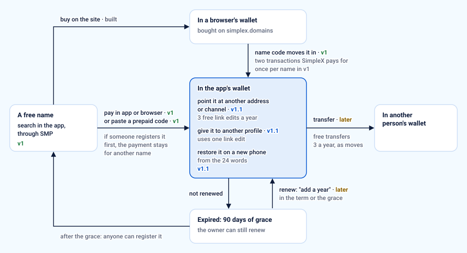

## 1. Goal, stages and acceptance criteria

Goal: a person in a store build registers a SimpleX name for their address or channel, paying in the store, without a wallet, ether or a browser; every build has a working way to get a name, or to bring in one bought on the site.

### Stage 1, v1, the beta

Two releases, each of its own pull requests (D22).

The codes release:

- Search in the app, over SMP.
- The app registers a name with a prepaid code.
- A site-bought name's owner code moves the name into the app only if the name already opens this profile's address or channel; otherwise the name shows on the profile without moving, as today.
- "Buy in browser" opens the site's search for the name where D18 allows; Google Play and iOS outside the US link nowhere to the site.
- iOS outside the US, while its payment is hidden: a code, with no search before it.
- Buying and codes start from the address and a channel's info (D14).
- Every name opens something from the start (D15).
- The 24-word recovery key, the first time only, before the checkout; saving it is optional (D12).
- Terms: one tick on each order's checkout (D13).

The payments release:

- Paying in the app with Google Play and the App Store: one product, $100 for 2 years, for any name.
- iOS store payment: built in this release, shipped hidden behind a build-time switch until tested (D17).
- After a store payment, the payment and the sealed order go in one request, answered separately (D3).
- Builds that can't pay in the app (F-Droid, desktop, iOS while its payment is hidden) take the app's steps, priced from the service's catalog, then pay in the browser for a prepaid code the buyer never sees (row 4, D9).
- "Buy in browser" on Google Play and iOS in the US takes row 4's path, beside the store's payment.

### Stage 2, v1.1, usable

- "SimpleX names" under Advanced settings: the profile's names, Register a name, Import, Restore purchases, the recovery key.
- Restore on a new phone from the 24 words: the app asks what each wallet account owns, until 20 unused accounts in a row.
- A moved-in or restored name attaches to the profile's address or channel, by one link edit SimpleX pays for.
- Changing what a name opens, to any contact or channel link, also one outside the app.
- Giving a name to another profile.
- Moving in a name that opens another profile's address.

### Stage 3, later

- Transfers to another person, within the moves' allowance: 3 a year per name.
- Renewal ("add a year") and reminders, built and released before mid-2028.

### Acceptance criteria

| # | Criterion | Test |
|---|---|---|
| AC1 | In the Play build, a user with no wallet finds a name, pays once with Play Billing, and the name registers for 2 years to a key of the device wallet, opening their address, shown as verified | End to end: the store service, the fake Play verifier, the fake chain node |
| AC2 | A payment is credited once and never lost: the same request twice gives one code and one order; a request whose answer was lost, sent again, gets the same answers; a refused order keeps the payment; a name taken before the order or the registration keeps the payment for another name | Service and core tests, one per case |
| AC3 | The one product pays for any name of 6 to 63 characters for 2 years; the service takes the years from the product, never from the client | Service test: a 6-character and a 63-character name |
| AC4 | iOS with its payment hidden: the store purchase button is absent; the US storefront pays in the browser (row 4); every storefront takes a code; the purchase lane compiles and runs behind the switch | Previews of both storefronts; a sandbox run of the lane with the switch on |
| AC5 | A site-bought name's owner code, pasted on the code sheet or arriving by link, never scanned, moves the name to the device wallet once the name opens this profile's address or channel; any other name is refused with its next step; a name left on the site shows on the profile as today | End to end: the owner code flow, the fake chain node |
| AC6 | The app opens the store sheet only after its countdown to the sale ends and while the catalog reads open; a paid receipt is credited in every mode, its order waiting until the sale opens | Previews of the catalog's states; service test: a paid receipt credited under codes-only, its order answered `sale_closed` |
| AC7 | A build that can't pay searches, creates the key the first time and reaches 4·2, priced from the catalog, where the user ticks the terms; "Pay in browser" opens an invoice the link names only by a prepaid code's hash; once paid, the app sees it through the code check, with or without the link back, and registers the name with that code; "Buy in browser" on 1·2 takes the same path where allowed; Google Play and iOS outside the US link nowhere to the site in the alerts, the name screen and the search | Service test: an invoice for a code's hash, found again by that hash, confirming, paid; end to end from the invoice to the registered name with no link back; previews per build and storefront, the alerts and What's New included |
| AC8 | Key material appears only on 1·4, after a name is found, before the checkout, the first time; "Create a new key" creates the key; the words show only on Show; opened later, Copy and Show ask for the device's check, straight after creation they don't; the reminder stays until Copy or Show | Core test: search and the terms text create no wallet, ‹ on 1·4 creates none, a store sheet cancelled after 1·4a keeps the key and the next order skips 1·4; previews; the device check, by hand (section 8) |
| AC9 | The app signs each order with the terms the user ticked for it on its checkout, in its name's kind, general or community | Service and core tests: changed terms; each kind |
| AC10 | Stage 2: on a new phone the 24 words bring back every name the wallet's accounts own, found by the scan with its gap of 20, attached to this profile's address or channel by one relayed edit | End to end: the fake chain node, ROWN |
| AC11 | Stage 2: "Set what it opens" changes a name's records to any contact or channel link within its yearly allowance; a name goes to another profile | End to end: the record edit relay |
| AC12 | Stage 3: a transfer and a store-paid renewal reach the chain within 6.11's rules; reminders follow 6.11 | End to end; previews; a core test |
| AC13 | The codes release, in every build: a user finds a name, creates the key the first time, ticks the terms on 2·3 and registers the name with a prepaid code to a key of the device wallet, opening their address or channel | End to end: a CLI user, the fake chain node; the app runners on the names test backend (9.2) |

The codes release meets AC5, AC8 (its store-sheet case with the payments release), AC9 and AC13; the payments release AC1 to AC4, AC6 and AC7.

## 2. Non-goals

- Subscriptions of any kind, auto-renewing ones and Play's prepaid plans included.
- Prices by name length in the app.
- Paying with cryptocurrency inside a store build.
- The site as the only way to pay in store builds.
- Changes to the contracts.
- Following, in the app, an order placed on the site.
- Blind-signed codes (section 7).
- Stealth transfers (https://github.com/simplex-chat/simplex-chat/pull/7519).

## 3. Current state

Read at: simplex-chat `names` ad75fe706; the store spec `sh/names-design` 158f22c7e; simplexmq d75f5686d, the pin in `cabal.project`; simplex.domains `sh/names-webapp` 5228f9d6f. `StoreService/` stands for `apps/simplex-store-service/src/StoreService/`; `webapp/` is in simplex.domains.

The contract source, ens-contracts `simplex`, is outside the public repos: contract facts come from the service's code and the store spec, and 6.11's renewal rules from the names work's reading of `SimplexController.sol` and `SimplexSponsor.sol`.

### 3.1 A name

- A record in an ENS fork on Ethereum; `.testing` and `.simplex` are two deployments of the same contracts.
- Only the owner key changes or transfers a name.
- The service registers a name to the buyer's address with the sponsor's `registerWithCredit` and the owner's signed intent; the registrar key pays the gas, the sponsor's allowance the price.
- At least 2 years: the controller refuses under 730 days (`minNameYears`, `StoreService/Config.hs:291-293`).
- A prepaid code carries 2 to 10 years (`StoreService/Group/Command.hs:42`).
- A community name registers for 2 paid years whatever its code gives (`communityYears`, `StoreService/Names/Community.hs:55-56`).
- Paid years start on 1 January 2027 or at the order, whichever is later (`defaultTermStart`, `Config.hs:303-304`); the days before cost nothing.
- An order's duration matches within the slack (`checkDuration`, `Names/Orders.hs:271-275`).
- Prices come from the chain: `SimplexPriceOracle` holds cents a year per label length, with a base for other lengths; the service quotes `rentPriceUSD` with a placeholder label of the name's length and refuses a price under a cent (`chainPriceCents`, `Names/Contracts.hs:182-188`); since https://github.com/simplex-chat/simplex-chat/pull/8093 (`names` at 6a8ae41d0), a price under `[names] min_price_cents_per_year`, 5000 by default, for each year.
- One price is a chain operation (M13): `setPrices` with base 5000 cents a year and no per-length entry. The site's search, the resolver's `NamePricing` and the allowance spent per registration follow it. It replaces the store spec's $100, $200 and $400 (`2026-10-21-store-api.md:103`).
- 6 to 63 characters: letters, digits and hyphens (`minNameLength`, `maxNameLength`, in the service and in `src/Simplex/Chat/Badges/Code.hs`).
- After expiry, a grace period (`GRACE_PERIOD()`, 90 days in the terms draft): the owner keeps the name and can renew it, and it can't be transferred; then anyone can register it.

### 3.2 Buying on the site today

- simplex.domains, served by the store service; one term, from the search answer's `years` and `termStart`.
- Payment by card, Bitcoin or Monero; a separate dApp takes ETH (`webapp/src/views/checkout.ts:32, 466`); Lightning (https://github.com/simplex-chat/simplex-chat/pull/8010) is left out.
- A prepaid code `SN<length>-…` pays too. Group admins issue them free (`issueNameCode … CPSFree`, `StoreService/Group.hs:278-279`; `runFor`, `StoreService/Group/Command.hs`); the operator's `//issue name` issues them paid or free, never unpaid (`issueNameCmdP`, `StoreService/Service.hs:536-543`).
- The browser makes a wallet per order. Its secret is the owner code, `SN-` and 30 characters, the 128-bit entropy of a 12-word BIP-39 phrase (`src/Simplex/Chat/Badges/Code.hs`). The name registers to that wallet.
- Terms on chain: the buyer signs each order with the hash of its kind's terms; the reveal carries the owner's acceptance, which the service relays before the register; `terms_unavailable` and `terms_changed` refuse an order (`checkTerms`, `Names/Orders.hs:284-291`).
- The terms text: `docs/NAMES-TERMS.md` in the closed draft https://github.com/simplex-chat/simplex-chat/pull/8002, at 672d13e9e; the name policy links whichever file is current.
- The search reads `/#/?name=<label>` (`webapp/src/views/search.ts:44`, `views/shell.ts:122`). Its "is yours" page tells the buyer to set the name on their address and shows the code (`webapp/src/views/order.ts:1262`).
- Codes-only refuses paid orders before the full launch (`nCodesOnly`, `StoreService/Web/Names/Orders.hs:88, 240`).

### 3.3 The store service

- The app reaches it over SMP with `sendServiceRequestAsync`: one connection per request, PQ on; the request and the answer are each bounded at 11106 bytes (`e2eEncConnInfoLength PQSupportOn`, simplexmq `Agent/Protocol.hs:339-343`); the caller sets the timeout, 30 s by default (`serviceRequestTimeout`), inside the service's 180 s reply window.
- Its SMP commands are badge commands (`src/Simplex/Chat/StoreService.hs:77-106`); names are served over HTTP (`StoreService/Web/Names.hs`).
- Lanes of one thread each: Play purchases, Apple subscriptions and transfers on the purchase lane; due renewals on the renewal lane; the rest on the main lane (`requestLane`, `StoreService/Service.hs:595-621`).
- HTTP limits: per client address and route (`limited`, `Web/Names.hs`); service-wide ceilings on new invoices, 30 a minute (`invoicesLimit`, `StoreService/Web/Http.hs:153-155`), on concurrent chain-reading searches, and on held polls.
- Badge receipts: Apple signed transactions checked against a configured root; Play purchases read through the Play Developer API; the product decides the grant (`storeProduct`, `StoreService/Catalog.hs:146-160`).
- `payments(provider, provider_ref)` is unique. Apple keys an auto-renewable by `originalTransactionId`, any other by `transactionId` (`applePayloadRef`, `src/Simplex/Chat/PaymentService.hs:95-98`).
- Play subscription reads: 300 a minute (`maxPlayPurchaseReads`, `Service.hs:1375`).
- Apple test purchases are refused unless `creditTestPurchases` is set.
- Play one-time purchases: the service acknowledges them before crediting and never consumes them (`StoreService/StoreReceipts/Google.hs:96-100`); the Android app acknowledges once its core holds the receipt and consumes when finished (`views/badges/BadgeStore.kt:47-48, 293-295`).
- Prepaid name codes: a row per code hash with the shortest length covered, the years and a payment state; reserved by a registration, spent when the name lands, released when the name is taken, held 30 days after a failure for Try again (`StoreService/Names/Codes.hs`; `failedCodeHold`, `Names/Worker.hs:102-103`).
- An order sends the plain code; the service hashes it (`parseCodeOrder`, `Web/Names/Orders.hs:231-234`).
- An exact resend of an order is found by its hash before its timestamp is checked (`Web/Names/Orders.hs:210-215`).
- A signed request's timestamp is within 600 s of the service's clock (`signedRequestSeconds`).
- Another name: only for a failed order or one whose links were refused (`movable`, `Names/Orders.hs:316-320`), at most 3 times (`max_order_moves`; past it, the refusal `move_limit`).
- A committed order past `revealBefore` without a reveal reads failed (`registrationAt`, `Names/View.hs:148-156`).
- Code orders can't be cancelled.
- An order sends at most 5 transactions of each kind (commit, terms acceptance, register), counted per nonce, its moves included; past that it fails, and Try again and another name are refused, `bad_request` on the web (`maxSendsPerKind`, `Names/Worker.hs:430-451`; `Web/Names/Registration.hs:138`).
- A registration waits while the sponsor allowance is used up, logged as an error (`Stalled`, `Names/Worker.hs`).
- Record edits: one relayed transaction each, within `record_edits_per_year`, 3 by default (`StoreService/Names/Records.hs`, `Config.hs:287`).
- Name transfers (`approveWithSig`, `claimWithSig`): designed in the store spec, unbuilt.

### 3.4 The core and the apps

- The device wallet: one 24-word master per device; one hardened account per name at `m/44'/60'/n'/0/0`, each bound to a profile; `APIGetWallet`, `APICreateWallet`, `APICreateWalletAccount`, `APIExportWalletMnemonic`, `APIDeleteWallet` (`src/Simplex/Chat/Controller.hs:451-455`). Signing and import are unbuilt (`docs/rfcs/2026-09-10-wallet-keys.md`, known limits 2 and 5).
- The registration encoder and the order signatures are in the store-service app (https://github.com/simplex-chat/simplex-chat/pull/7693).
- Name codes in the core: `NameCode = NCOwner NameOwnerCode | NCPrepaid NamePrepaidCode`; `parseNameCode` tells the kinds apart; `randomNamePrepaidCode`; `namePrepaidCodeHash` (`src/Simplex/Chat/Badges/Code.hs:165, 224, 249`).
- An address claims a name with `/_set domain` (`APISetUserDomain`, `Commands.hs:1642`); a channel claims it in its own profile.
- Name lookup: `resolveNameRecord`, its RSLV sent with `sendOrProxySMPCommand` (simplexmq `Agent/Client.hs:2018`).
- The apps set, show and verify names, with a countdown to the sale, 12 December 2026 18:00 UTC (iOS `UserAddressView.swift:923-932`; Kotlin `SetSimplexNameView.kt:33, 205`).
- Links to the site in every storefront, each replaced or gated by P30:
  - the name alerts' Register, Renew and Re-register, and the "available" alert with the resolver's USD price (iOS `NewChatView.swift:1320, 1335`; Kotlin `ConnectPlan.kt:62-67, 117`);
  - "How to register a test name" and the sale's footer (iOS `UserAddressView.swift:893, 932`; Kotlin `SetSimplexNameView.kt:178, 219`);
  - What's New's names entry (iOS `WhatsNewView.swift:721`; Kotlin `WhatsNewView.kt:1012`).
- The badge buy pattern on Android: the Play build sells in the app and shows "Buy in browser" only for the Play country "US" (`badgeBrowserAllowed`, `BadgeStore.kt:60-67`); FOSS and desktop show "Buy in browser" and "Redeem badge code".
- The badge buy pattern on iOS: store purchases commented out at `names` (`BadgesSupportSimplexView.swift:48-70`); sold in App Store builds on the 7.1 release branch (https://github.com/simplex-chat/simplex-chat/pull/8044); the US check at `BadgeStore.swift:39-41`.
- The badge site's link back: routed by `ContentView.swift:508` and Kotlin `ChatListView.kt:816`, confirmed before redeeming.
- The badge lanes sweep every store transaction: on iOS at launch, on foreground, on a profile switch, on `Transaction.updates` and on Restore (`BadgeStore.swift:367, 380, 411-412, 467`; Kotlin `BadgeStore.kt:415, 430-441`).

### 3.5 simplexmq

- BIP-32, BIP-39, BIP-44, recoverable secp256k1, keccak, EIP-55 addresses, EIP-712 hashing, RLP and EIP-1559 transactions.
- `RSLV` answers the name's record, expiry, grace and reserved reason; an available name gets `NRAvailable {pricing, nameTerms}`; `NamePricing` holds `registrationPrices`, `basePrice`, `minLabelLength` (`src/Simplex/Messaging/Names/Record.hs:94-114`).
- `NameTerms` holds the terms link and, when it fits the answer, the file in one zstd frame (`termsZstd`); typed since https://github.com/simplex-chat/simplexmq/pull/2003, unfilled by the resolver.
- Finding the names an address owns: the draft https://github.com/simplex-chat/simplexmq/pull/1875.

### 3.6 Designs

- The two canvases in https://github.com/simplex-chat/simplex-chat/pull/7530 (`names-phase3a-registration`, `names-backup-restore`), tentatively approved; the screens follow them, with the departures of 6.7.
- The site's design: `plans/names-codes/2026-10-19-webapp-redesign.md` on `sh/names-design`, built in `webapp/`.
- The badge purchase follows the badge webapp's steps and words in the app's own components (`BadgesCheckOrderView.swift`, `BadgesHowLongView.swift`); the name screens do the same.

### 3.7 Pull requests at this plan's entry points

| Pull request | Relation |
|---|---|
| https://github.com/simplex-chat/simplex-chat/pull/7675 store spec | Followed: codes, terms; its price list replaced (3.1) |
| https://github.com/simplex-chat/simplex-chat/pull/8002 terms of use, https://github.com/simplex-chat/simplex-chat/pull/7994 placeholder texts, both closed | The app reads whatever the policy links (Q3, Q4) |
| https://github.com/simplex-chat/simplex-chat/pull/8010 Lightning, closed | Left out |
| https://github.com/simplex-chat/simplex.domains/pull/6 the site | Followed; gains the link parameter and "Open in SimpleX" (6.8) |
| https://github.com/simplex-chat/simplex-chat/pull/7693 registration primitives | Moved into the library (P5, P6) |
| https://github.com/simplex-chat/simplex-chat/pull/7932 app test backend | Used by the app tests; P67 adds names to it |
| https://github.com/simplex-chat/simplex-chat/pull/8038 scripted tests per feature, open into `names` | The app pull requests add their cases (9.1); P67 follows it |
| https://github.com/simplex-chat/simplex-chat/pull/7561, https://github.com/simplex-chat/simplexmq/pull/1875 scan; https://github.com/simplex-chat/simplex-chat/pull/7566 wallet names model | Replaced by P3, P4, P12; by P11 |
| To close: https://github.com/simplex-chat/simplex-chat/pull/8026 delivery plan; https://github.com/simplex-chat/simplex-chat/pull/7530 minimal registration API; https://github.com/simplex-chat/simplex-chat/pull/7390, https://github.com/simplex-chat/simplex-chat/pull/7425 CLI MVP; https://github.com/simplex-chat/simplex-chat/pull/7355, https://github.com/simplex-chat/simplex-chat/pull/7382 names v2; https://github.com/simplex-chat/simplex-chat/pull/7509 wallet for hidden profiles | Merged into this plan; its canvases are the sketches; their CLI shapes kept (D8); stealth derivation and gifts stay in the RFC; hidden profiles are refused |
| Left out: https://github.com/simplex-chat/simplex-chat/pull/7428 blind-signed codes (section 7); outside this plan: https://github.com/simplex-chat/simplex-chat/pull/7519 stealth transfers, https://github.com/simplex-chat/simplexmq/pull/1942 names-web example | — |

## 4. What is missing

| # | Missing | Layer | Stage |
|---|---|---|---|
| M1 | Signing an EIP-191 message or EIP-712 typed data with an account key | core wallet | 1 |
| M2 | Restoring a wallet from the 24 words | core wallet | 2 |
| M3 | The names an account holds, with each name's expiry | core wallet | 1 |
| M4 | Finding the accounts a phrase owns | core wallet, simplexmq | 2 |
| M5 | The registration encoder and the order messages, reachable by the core | library | 1 |
| M6 | A names surface over SMP | store service, core | 1 |
| M7 | A name code bought with a store receipt, in one request with its order | store service, core | 1 |
| M8 | Relays over SMP: a name code's transfer (stage 1); record edits (stage 2) | store service, core | 1, 2 |
| M9 | An order's life in the core: place, follow, reveal, retry, another name, claim | core | 1 |
| M10 | The terms of an available name in the resolver's answer | simplexmq | 1 |
| M11 | The screens: search, purchase, codes, hub, key, expiry date | apps | 1, 2, 3 |
| M12 | The site's "Open in SimpleX" on its "is yours" page, and the verified link back | simplex.domains, website | 1 |
| M13 | One price on chain: `setPrices` with a base and no per-length entry | chain operation | 1 |
| M14 | Renewal and transfers to another person | store service, core, apps | 3 |
| M15 | Paying in the browser for a prepaid code: the catalog's price, an invoice for a code's hash, found again by that hash, a confirming state, the site's pages, the app noticing payment | store service, simplex.domains, core, apps | 1 |

## 5. Decisions

- **D1.** One store product, one-time: $100 for 2 years, any name; Apple's non-renewing subscription, Play's one-time product; nothing renews by itself (6.2).
- **D2.** The service credits a paid receipt as a prepaid code that the app derives from the wallet's seed, and registers the name as with any prepaid code; it binds the receipt to that code by the token the app sets on the purchase (Q9).
- **D3.** The payment and the sealed order go in one request, answered separately, the payment saved first; the reveal is a later request.
- **D4.** The app orders through the store service over SMP. The service holds the registrar key, pays the gas, spends the allowance and sends every transaction; the app signs the order, the registration intent and the terms acceptance with its wallet.
- **D5.** One implementation serves the web and SMP: the handlers of the code order, the view, the reveal, Try again, `find`, another name, the record edit and the code check become functions.
- **D6.** The search answer comes from the resolver: availability, the minimum length, the grace date, the reserved reason, the terms. The catalog answers the sale's state, the product, the term start and the clock. The app compares the catalog's terms hash with the resolver's before it signs.
- **D7.** One registration encoder: the ABI encoding, the commitment and the `RegisterName` intent move into the chat library.
- **D8.** The CLI first, then Kotlin, then Swift: each core pull request adds its `/name …` form and a terminal test; one Kotlin pass covers Android and desktop; Swift mirrors it.
- **D9.** Every build registers a name with a code, pasted on one half-screen sheet, never scanned. Builds that can't pay in the app take the app's steps, then pay in the browser for a prepaid code the buyer never sees (row 4, Q24). iOS outside the US, while its payment is hidden, takes a code with no search. A site-bought name comes in with its name code (D11).
- **D10.** Signing stays in the core: a library function takes an account index and uses the account key only inside it; named commands build and sign their own messages; no chat command signs text its caller gives.
- **D11.** A name code is a wallet, and redeeming one is a transfer. The name code stays on the device and the app sends only that wallet's signatures; a prepaid code is sent as it is. The code's wallet offers the name with `approveWithSig`, the app's account takes it with `claimWithSig`, both relayed by the service; then the recovery key owns the name. In stage 1 only a name that already opens this profile's address or channel moves.
- **D12.** The recovery key comes after the search and before the checkout, the first time only. 1·4 creates it; a half-screen sheet over it, 1·4a, offers to save it; saving is optional; the words show only on Show; a quiet reminder until Copy or Show. Restore comes in stage 2, with its scan.
- **D13.** The app signs each order with the terms the user ticked for it on the checkout: one tick, two obligations and a third for a community name (A; B is Q25), one link to one document with a section on community names, opened as onboarding's conditions of use; the checkout's buttons stay off until ticked. The obligations' words are placeholders for the terms' own.
- **D14.** In stage 1 buying and codes start from the address and a channel's info; the hub comes in stage 2, under Advanced settings.
- **D15.** In stage 1 every name opens something from the start (Q12).
- **D16.** A taken name shows "Taken", without pictures, and a separate "What it's used for" button (Q18).
- **D17.** iOS store payment is built in stage 1 and ships hidden behind a build-time switch until tested.
- **D18.** Links to the site: always on F-Droid and desktop; on Google Play and iOS only in the US.
- **D19.** Yearly allowances per name, defaults the service can change: 3 link edits; 3 moves in or transfers. A failed registration tries another name up to 3 times. Each registration and renewal is paid.
- **D20.** Renewal is stage 3. The expiry date shows from stage 1. Reminders and `renewWithCredit` with its store products come before the first names expire.
- **D21.** The main path: search → create key (first time only) → checkout with the terms tick → payment → registering → yours. A change to these steps is an open question in section 11 first. Row 3: the tick on 3·1 → create key (first time only) → moving. The screens use no crypto words, except "public blockchain" on 1·4.
- **D22.** Stage 1 ships in two releases, each of its own pull requests: codes first, then payments; stages 2 and 3 follow (section 8).
- **D23.** Later work: the app checks on the chain that the service sent the commit, and limits how long registering may take before it says the service failed. Commit and reveal stay separate steps of the API (section 7).
- **D24.** A code is never worth money: redeeming one makes a name cost $0; no screen, page or receipt offers, prices or describes a code as an amount; a browser payment pays for a name.

## 6. Design

The parts stage 1 touches, step by step; the figure numbers its own rows, one per step:

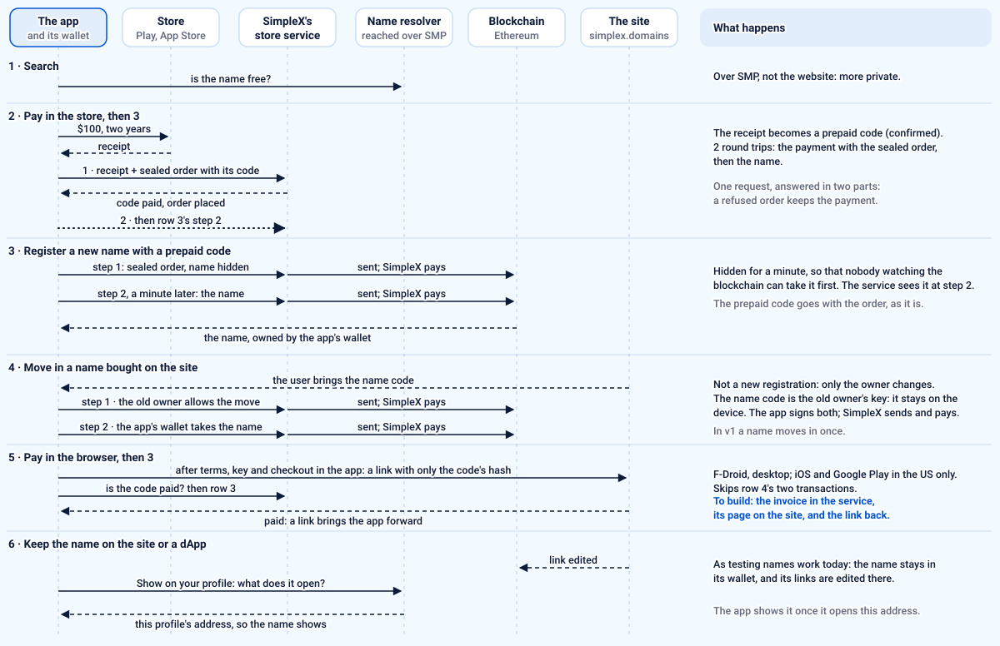

### 6.1 The code and the token

A store payment and a browser payment each pay for a prepaid code the app derives from the wallet's seed:

```
nonce   6 random bytes, made by the core before the store sheet opens
payload HKDF-SHA512(ikm = BIP-39 seed, salt = nonce, info = an info string of its own), 19 bytes, each mod 32
code    "SN6-" + payload + the Luhn character over the length digits and the payload
token   version-4 UUID: bytes 0–5 nonce; byte 6 0x40; byte 8 0x80; bytes 7 and 9–15 the first 8 bytes of SHA-256(hash(code))
```

- The app sets the token in the store's account field: Apple's `appAccountToken` (a UUID), Play's `obfuscatedAccountId` (the same text). A new token per purchase.
- Recognising: a device lists every open purchase of the store account, recomputes each token from its nonce and its own seed, and presents by itself only those that match and belong to the active profile.
- Binding: the service reads the token from Apple's signed transaction or Play's purchase read, and refuses a first presentation whose code hash doesn't match it, as `receipt_used`, crediting nothing (Q9). An empty or absent field counts as no token.
- No token (a promo or offer code redeemed in the store): the code derives with the store's reference, the one the service keys the payment by, as the salt, under the same info string. The first presentation binds it, so the app presents such a purchase only on "Restore purchases", from stage 2.
- The input is the seed, never an account key.
- A browser payment's code (6.8) derives the same way from its own nonce, under an info string of its own.
- The wallet RFC gains the derivation, simplexmq's `protocol/crypto-registry.md` the info strings; test vectors pin both.

### 6.2 The store product

| | App Store | Google Play |
|---|---|---|
| Type | Non-renewing subscription | One-time product, marked as a Tokenized Digital Asset; the Financial features declaration updated for NFT sales |
| Identifier | `NAME_2Y_01` | `name_2y_01` |
| Display | "SimpleX name" | "SimpleX name" |
| Description | "Registers one name for 2 years." | "Registers one name for 2 years." |
| Price | $100, at the nearest price point | The same |

- Multi-quantity off. One unused name purchase per store account (Play sells the product again only after consumption).
- The store's commission: 15% while SimpleX's store earnings stay under $1M a year, once enrolled (Apple's Small Business Program; Google's first $1M, as 10% + 5% billing fee in the US, EEA and UK since 30 June 2026); up to 30% above that.
- One purchase per name; a code row never expires.
- The product stays unavailable in each store until codes-only is off; on iOS, unsubmitted until the switch (6.9).
- Apple allows editing neither a product's ID nor its type, and a deleted ID can't be reused; the type is settled before the product is created (Q8).
- Review notes: a registered name comes back from the recovery key from stage 2, not with "Restore purchases".

### 6.3 The service

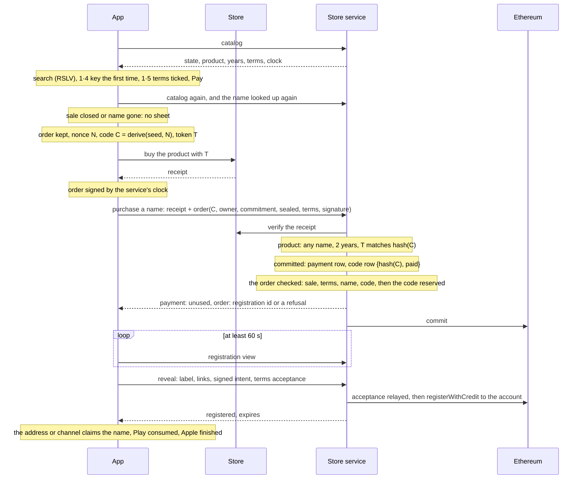

**Purchase a name:** `STCPurchaseName {payment :: ServicePayment, code :: NamePurchaseCode}`.

- `NamePurchaseCode`: a code's hash, or a `NameCodeOrder`, the fields of `POST /api/name/register` with the plain code, whose hash is the code's.
- Sent without a purchase key.
- A hash alone is a payment alone: a restored promo purchase without a chosen name; a purchase presented again after its order was answered; an order too large to fit.
- Any client can send it, within the bounds below.

The payment part, in order:

1. The same receipt with the same hash: the years and the code's state now (unused, reserved, used, revoked), at any age.
2. The product, looked up in the names catalog, which maps it to `NameProduct {minLength = 6, years = 2}` (Play: the product id the request names, before any call to Play; Apple: after the signed transaction's offline check). An unknown one is refused. A retired product stays in the catalog.
3. The store verifies it, with the badge refusals (invalid, pending, test purchase) and a quantity other than 1. A Play read takes a slot of the names' own per-minute bound.
4. The same receipt with another hash, or a token that doesn't match the hash: `receipt_used`, after the store vouches for it; nothing written.
5. Play acknowledged; one transaction inserts the payment (unique by store and transaction; keyed for this product by `originalTransactionId`) and the code row, and commits:

```
code_hash
min_length   6
years        2
payment      paid
expires      never
payment_id   the payment, unique
```

- A verified paid receipt of a known product is credited in every service state.
- A hash another code row holds: `bad_request`; nothing credited.

The order part, only after that commit and when the payment part answered a code state:

6. The code order's function (D5, from `codeOrderHandler`): an exact resend answers its registration id; else the signature, the timestamp, the duration, the terms, the name and the code are checked, in the contract's order.
7. A failure leaves the payment committed and is answered in the order part.

The answer: `STPNamePurchase {payment, order}`. `payment`: the years and the code's state, or a refusal. `order`: the registration id, a refusal, or absent (a hash alone, or a refused payment).

| Payment part | The app's next step |
|---|---|
| unused, reserved | Follows the order part. With a hash alone: `unused` places the kept order or asks for a name; `reserved` finds the order with `find` |
| used | Its name registered before the app consumed it: consume or finish; the owner-signed `find` finds the name |
| revoked | "This payment can no longer register a name."; consume or finish |
| `receipt_used` | "Bought with another recovery key"; kept unconsumed |
| `receipt_invalid`, `test_purchase`, `product_unavailable` | "Payment not confirmed"; kept unconsumed until support refunds it; on iOS the transaction finishes once its reference shows |
| `payment_pending` | Waits, nothing charged; presented again when the store says paid |
| `bad_request` | Logged; "Payment not confirmed" with the reference |
| `internal`, `provider_not_configured`, `rate_limited` | Sent again by the badge worker's retry interval once the network is up (`waitForUserNetwork`) |

| Order part | The app's next step |
|---|---|
| registration id | Follows the order |
| `sale_closed`, with the catalog state and the reopening time when known | "Paid, waiting for the sale"; placed again as a plain code order when the catalog opens |
| `terms_unavailable` | "Paid, waiting to order"; placed again when the catalog has the terms |
| `terms_changed` | The checkout's tick unticked, in place on 1·7; placed again once ticked |
| `name_taken` | Taken, no stage started; the payment kept for another name |
| `order_exists` | Finds its own order with `find` and opens it |
| `name_check_unavailable` | Retried in place |
| `bad_request` | The core compares its timestamp and duration with the catalog's clock. Past the 600 s or the term slack: rebuilt (a new duration and commitment if the term moved), signed, placed once as a plain code order. Otherwise the order reads failed; its Try again signs again and places a plain code order |
| `commit_limit` | Failed, with "Contact SimpleX team" |
| `code_reserved`, `code_used` | A timed-out request landed late: `find` finds the order |
| `code_invalid` | The purchase is presented again; its answer says `revoked` or `receipt_used` |

**Repeats:**

- After a lost answer the core resends the exact bytes of the first request: step 1 answers the payment, step 6 the order. The signed order is kept with the purchase record.
- Once any order answer is recorded, a presentation holds the hash alone.
- After a refusal the paid code stays; every later attempt is an ordinary code order.
- After a timed-out Try again the core reads the view before sending again.
- The order's refusals never reach the store; the name isn't held while a payment waits.

**Sizes:** a request and its answer are each bounded at 11106 bytes (3.3).

- An Apple signed transaction takes several kilobytes; a Play token is short; an order with one short link about a kilobyte; `sealed` reaches 11095 characters for two 4096-byte links.
- The core measures the encoded request; one that doesn't fit goes as the hash alone, then the order as a plain code order. The Apple sandbox run (section 8, the payments release's checks by hand) measures a real transaction with the longest short link the app makes.
- The service checks each answer's size where it makes it.
- The catalog holds at most about 36 full-length community texts; past its bound it carries none, the ⓘ reads "This name is for its community.", and the service alerts the operator at start.
- A terms text is answered as one zstd frame, read with a limit on its decompressed size (`maxTermsBytes`, 256 KiB); a larger file reads as `terms_unavailable` and alerts the operator.
- `find` answers the newest rows that fit, with a flag for the rest; the view measures itself and refuses by name.

**Time:**

- The purchase request's timeout: 60 s; resent on timeout by the same retry interval.
- The core asks for a registration's view every 10 s, on each order's own schedule, and waits until `revealAfter` before the reveal.
- A revealed order waiting at the cap: next asked at the catalog's reopening time, or at the next UTC midnight.

**Store-paid codes in the code order.** `placeCodeOrder`, reached by the site's order and the app's, checks a code row with a `payment_id`:

- Under codes-only or at the day's cap: `sale_closed` before anything is written; the code stays paid.
- Try again (the worker's `requeue`, after `confirmLanded`) and another name meet the same refusal, answered `sale_closed`, not `registration_changed`.
- Past its bound of commits: `commit_limit` at the order, Try again and another name.
- Terms of the name's kind unreadable: `terms_unavailable` before anything is written.
- An order, its reveal and a move's claim sign only the terms hash and kind the user ticked. When the catalog, read before the sheet, before a signature, or before a waiting order is placed again, gives another hash or kind, the checkout's tick comes back unticked: on the checkout before paying, in place on 1·7 after.

**Sends per order (P24):** over SMP, Try again and another name of an order past 5 sends of one kind (3.3) answer `sends_used_up`, and the registration view reports it. 1·7 shows "This order cannot try again"; the code is released 30 days after the failure (`failedCodeHold`) for another name.

**Browser-paid codes in the code order (P65):** a code row paid by an invoice for its hash is marked by that invoice:

- Under codes-only: `sale_closed`; the code stays paid.
- Never expires.
- Its commits are counted and bounded across its orders, as below.
- The daily cap doesn't apply.

**Daily cap:** at most a set number of store-paid registrations per UTC day, a setting starting at 50.

- The bound on loss: the worker counts one when it sends the register, once per registration, in a row per UTC day, inside `submitTransaction`'s save, under `snQueue`, before the broadcast (`StoreService/Names/Sender.hs:151-178`), through a gate that function takes. A dry run that reverts, a fee over the cap or a failed read count nothing.
- `sendRegister` (`Names/Worker.hs:297`) verifies the intent, reads the row without a chain call, and waits while it is full; then the gate decides. A reveal is always accepted and the buyer may close the app; waiting registers go out oldest first; a commitment that lapses meanwhile is committed again, as below.
- The gate on new orders: the order, Try again and another name are refused `sale_closed` while registers sent today plus store-paid orders queued, committing or committed reach the cap.
- The catalog answers "closed for the day" by the same sum, with a reopening time only where orders in flight hold no places past midnight; the service alerts the operator as it nears.
- Refunds are watched by hand in the stores' reports at launch.

**Commits:** each commit of a store-paid or browser-paid code costs gas.

- Its row counts them in the same save, across that code's orders, so a release by a taken name or the 30-day sweep keeps the count.
- A failed read, a fee over the cap and a Try again that reuses a live commitment count nothing.
- The bound, `max_code_commits`, 7 commits across the code's orders, is enforced at the requests only; each order's own sends stay bounded at 5 a kind (3.3).
- P27c and P65 share the commits column on prepaid codes; the first of them to land adds it.

**A lapsed commitment** (decided on 11 Nov 2026): the service commits the same commitment again, with no new signature, and the order stays live; the buyer taps nothing.

- The controller takes the same hash once the old commitment lapsed (`commit`, `SimplexController.sol:391-396`, ens-contracts 6ccb5c52).
- Without a reveal: the worker commits again a second past the lapse, as `fromCommitment` does today only after Try again (`Names/Worker.hs:175-184`); the view gives the new `revealAfter` and `revealBefore`, and the app reveals in the new window.
- With a reveal: the app signs the `RegisterName` intent, and the terms acceptance whose deadline is the reveal's, with a deadline that covers the order's 5 commits: `revealBefore` plus 4 times the commitments' maximum age. The worker keeps the reveal across a re-commit while its deadline covers the new window (`servingReveal`, `Names/Worker.hs:483-501`), where `lapsedFields` drops it today; the reveal check takes a deadline at or after `revealBefore` (`checkIntent`, `Names/Reveal.hs:119-122`).
- Bound: the order's 5 commits (`maxSendsPerKind`) and the signed deadline (`verifyRegisterIntent`, `Names/Registration.hs:142-147`); past either, the order fails as today, and Try again orders again at no charge.
- Each re-commit counts in the code's commits (below).
- https://github.com/simplex-chat/simplex-chat/pull/8091 keeps "a lapsed commitment ends failed"; P24 replaces that rule.

**Catalog:** the site's search answer without a name, from a cache a background thread fills every few seconds; the main lane answers from it without a chain read.

```
state            open | codes-only | closed for the day, with its reopening time when the gate allows one
years
term start
price            one name's chain price for those years, in US cents, for the minimum length
                 (chainPriceCents, Names/Contracts.hs:182-188; Web/Names/Search.hs:71, 93)
invoice window   the longest, for the "pay until" that opening a row 4 code sets (P58)
tld
chain id
resolver address
sponsor address
terms            general and community: hash and link; null for a kind the service can't read now
community texts  what each community name is for
products         the product identifiers
time             the service's current time
```

- "Before the sale" is the app's own countdown to 12 December, outside the catalog.
- The app keeps its offset to the service's clock and fetches the catalog again before each signature.
- The app's build fixes the chain id, the sponsor, resolver and base registrar addresses, and `tld` per namespace, as it fixes the service's address (`storeServiceAddress`, `src/Simplex/Chat.hs:74`); a catalog that differs reads as "Names can't be ordered right now. Try again later." Test builds set their own.
- The app reads the name policy's address from the registration's view, and signs the acceptance of the ticked terms hash.

**A name's kind before paying:** from the resolver's answer once it fills `nameTerms` (P2), its hash checked against the catalog's; from the catalog's community texts where an answer lacks it (a router before v24). A mismatch meets `terms_changed` at the order, after paying; the app then shows the checkout's tick in the name's kind, in place on 1·7, with "Choose another name" as the secondary. The app makes no per-name request to the service.

**Terms text:** from the resolver's `termsZstd` when the answer has it; otherwise a second command answers a terms text by its hash, as `GET /api/terms/<hash>` does. The app shows it only after these checks, as the site does (`webapp/src/api.ts:382-385`):

- the link is the catalog's;
- the link is a git.simplex.chat raw-commit link to a `.md` file;
- the link's keccak256 is the hash the app signs in the order;
- the text's sha256 is the link's `#sha256=`.

Otherwise the terms read as unavailable. Only test builds accept the site's local `http://127.0.0.1` form.

**One document, one tick:**

- The name policy holds two links, general and community (`generalTermsLink()`, `communityTermsLink()`, `Names/Contracts.hs:209-219`); each terms hash is the keccak256 of its link (`termsOf`, `:221-224`).
- The buyer signs an order with the hash of its name's kind, with the `community/` prefix for a listed name (`termsFor`, `Names/Community.hs:40-48`; `checkTerms`, `Names/Orders.hs:284-291`).
- The acceptance has two EIP-712 types, `AcceptGeneralTerms` and `AcceptCommunityTerms` (`termsKind`, `Names/Registration.hs:89-112`).
- The operator sets both links to the one document, with its section on community names (`docs/NAMES-TERMS.md` at 672d13e9e), a chain operation as M13 is. If the contract refuses one link for both kinds, the two links name the same file at two commits.

**The other SMP commands** call the functions D5 extracts:

| Command | Web route it shares | Stage |
|---|---|---|
| Catalog | The search answer's fields | 1 |
| Terms text | `GET /api/terms/<hash>` | 1 |
| Code check | `POST /api/code/check` | 1 |
| Code order | `POST /api/name/register` | 1 |
| Registration view | `GET /api/registration/:id`, answered at once; the app polls | 1 |
| Reveal | `POST /api/registration/:id/reveal` | 1 |
| Try again | `POST /api/registration/:id/retry` | 1 |
| Find | `POST /api/registration/find` | 1 |
| Another name | `POST /api/registration/:id/name` | 1 |
| Move approve and claim, with the chain reads the app signs against | New | 1 |
| Record edit, with the edits left, their next date and the resolver nonce | `POST /api/name/records` | 2 |
| Renewal purchase | New | 3 |

**Lanes and bounds:**

- The service's dispatch and lane choice match each name command explicitly.
- The main lane: the catalog, from its cache; the code check.
- The order lane: the purchase, the code order, the reveal, Try again, another name, the relays.
- The read lane: the view, `find`, the terms text.
- Each lane is serial.
- Each lane has a service-wide per-minute bound, no higher than it serves in a minute, applied at routing, before the queue; the catalog has a much larger one.
- A Play read takes a slot of the names' own Play bound.
- The SMP code order checks the code's state before any chain read; an Apple transaction is verified offline first.
- A P59 invoice takes the shared `invoicesLimit` (3.3).

**Owner-code relays:** commands relay the code wallet's `approveWithSig` and the app wallet's `claimWithSig`.

- Each is checked as the site's record edits are: signer, nonce, deadline, the `from` address owning the token; for a claim, the taker being the name's offered address.
- Moves are bounded per name per 365 days, 3 by default; a move counts once; a dry run that reverts counts nothing.
- The commands also return the code wallet's nonce, the name's offer, the app account's nonce, and whether the name policy lists the name, with its community text.
- The claim relay takes the app account's terms acceptance, signed with 3·1's tick: the contract makes the receiving account sign the terms on chain before ownership moves.
- P26 reads from the contract the acceptance's typed-data form (the service has acceptance types for a registration's commitment only, `StoreService/Names/Registration.hs:104-110`) and its place: in the claim's call (two transactions a move), or relayed before it (three); row 3's diagram draws both.

**Refunds** are made in the stores, by their rules; a registered name stays registered.

- A receipt is refused when the verifier sees its refund at presentation: Apple's `revocationDate` in the transaction the app sends; Play's purchase state of a revoked purchase.
- A refund after crediting goes undetected at launch; the daily cap bounds it. Counting refunds automatically (App Store Server Notifications, Play's voided purchases) and revoking unspent codes is later work.
- Support refunds a Play order only with revocation.

**`//store-payment`**, the operator command, keyed by the payment's reference, beside `//refund`: shows the payment and its code row. While no registration of the code is queued, committing, committed or registering (else "registering"), it can:

- revoke the code and clear a failed order's reservation;
- refund a Play payment: check the buyer's order number with `orders.get` against the reference, keeping nothing else it returns; in the code's turn revoke the code row by id, clear a failed order's reservation and record the refund as due; then call `orders.refund` with `revoke=true`; a failed call is retried by running the command again;
- consume a Play purchase that can't be used and needn't be refunded (`purchases.products.consume`): a replaced promo purchase, or one whose name registered on a lost phone;
- credit or replace a code, for iOS after "Payment not confirmed" where Apple declines a refund, or for a lost promo purchase:
  - a purchase with a token: only to the code hash that state's support draft holds, when the token's tag matches it, once the App Store Server API's transaction lookup says paid and uncredited;
  - a tokenless purchase: only with a `payments` row in the same transaction, after revoking an unused code row; refused for a spent one;
- raise a code's bound of commits at `commit_limit`.

A purchase stranded on a lost wallet is refunded: Play through this command, Apple through its sheet. The service account has Play's permission to manage orders.

**`//name-invoice`** (P66), keyed by row 4's reference (6.8), the first 12 characters of the code's hash, lists every code row that matches it; it shows the code row, its invoices and payments, money on a closed invoice, and money beyond the price.

- The operator makes each refund by hand: a card payment to its card at the processor; crypto to an address the buyer gives, once the buyer names the paying transaction and the support draft holds the code's second hash (6.8).
- Without a draft (Q21): crypto isn't refunded, the money stays recorded with the code row; a card payment still goes back to its card.
- Each refund is recorded with the code row as due before the operator makes it, at most once per part of a payment (the price, the part beyond it), in P66's record and migration on both backends.
- The paying payment is refunded only after revoking the code, while no registration of it is in progress, clearing a failed order's reservation; without a draft, only once the code was paid at least 30 days ago and has had no order for 30 days (`failedCodeHold`, `Names/Worker.hs:102-103`); a spent code's price isn't refunded this way.
- Any other money (on a closed invoice, beyond the price, a second payment after the code was paid) is refunded with no revoke.
- It raises a code's bound of commits at `commit_limit`.
- The existing revoke takes the plain code (`GCRevokeName`, `StoreService/Group/Command.hs:50`), which the buyer never sees.

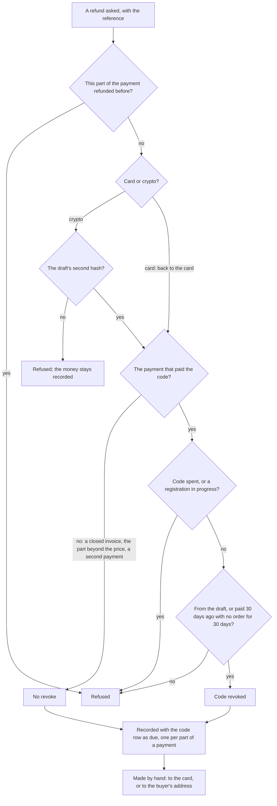

**Records:** per payment, the store, the transaction's reference, the product, and for App Store payments the price and currency; receipts are discarded.

### 6.4 The core

The purchase record, kept in the database, so a backup or migration carries it:

```
product
token nonce
store reference
receipt
code
state            paid | used
name             with what it opens and the ticked terms
signed order     the exact signed order and request
registration     the one it funds
```

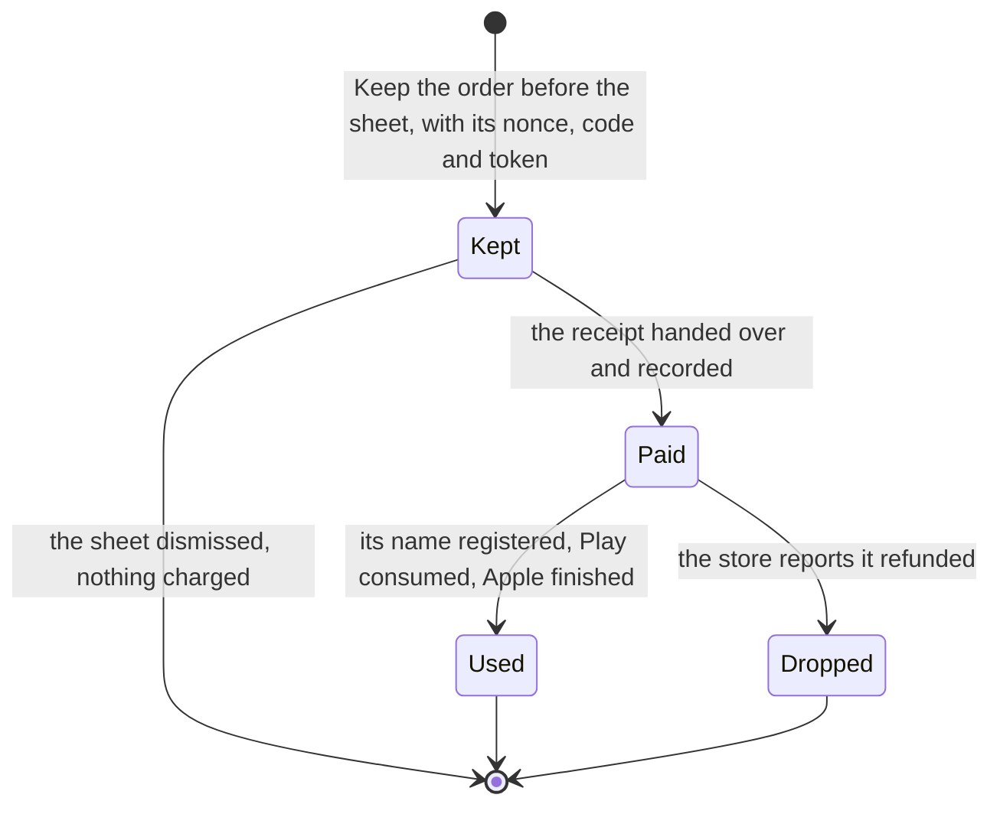

- Signing is a library function (D10): EIP-191 for the order messages, 65 bytes with a low `s`; EIP-712 for the `RegisterName` intent, the terms acceptance under the `SimplexNamePolicy` domain (`acceptanceDigest`, `policyDomain`, `termsKind`), the record-edit intent and the transfer intents.
- Each new wallet and name command is listed in `allowRemoteCommand` (`src/Simplex/Chat/Controller.hs:755-797`) as refused from a paired device, with a test.
- The workers' progress events hold the order's id and phase only.

| Command | CLI form | Does | Stage |
|---|---|---|---|
| Wallet names | `/_wallet names` | The names an account holds, with expiry refreshed whenever the name is verified | 1 |
| Catalog | `/_name catalog` | The catalog, with the clock offset; the terms text checked against its link and hash | 1 |
| Keep the order | `/_name keep` | Records the chosen name, what it opens and the ticked terms before the sheet opens; makes the nonce and the code; returns the token | 1 |
| Purchase | `/_name purchase` | Takes a receipt, records the purchase, signs the kept order if one waits, sends both from a worker | 1 |
| Pay in the browser | `/_name browser` | 6.8: the code on 4·2; opening and closing the code; the kept order and its "ask until"; the asking worker; the browser payment's record, kept after its name registers, with the reference and the code's second hash, never the code | 1 |
| Order with a code | `/_name order` | The order record, the secret, the commitment, the signed order | 1 |
| Follow | `/_name follow` | A worker per user: polls, reveals with the terms acceptance, keeps the signed reveal and resends it unchanged, sends progress events, recovers after a restart | 1 |
| Try again, another name | `/_name retry`, `/_name other` | The order's next step | 1 |
| Claim | `/_name claim` | The address or channel claims the registered name | 1 |
| Redeem | `/_name redeem` | The code's wallet; its names read with `find` and the chain; the transfer, recorded before the first relay and resumed by its worker | 1 |
| Import | `/_wallet import` | Restores from the phrase; refused where a wallet exists; the counter set past the accounts found | 2 |
| Scan | `/_wallet find names` | Over ROWN, with a gap limit, a start index, progress events and a stop | 2 |
| Set what it opens | `/_name set links` | The relayed record edit, and the edits left | 2 |

- The purchase, browser payment, follow and redeem workers run only in the main app, wait with `waitChatStartedAndActivated`, and resume at start and on the return to the foreground.
- The wallet's row records that Copy or Show has been used on 1·4a, in P11's migration; the reminder and the hub's key row read it; its command is refused from a paired device.
- The purchase command answers once the purchase is recorded and sends from a worker, as the badge hand-over does.
- The commitment secret and the sealed label and links derive for the account, under info strings of their own.
- The core signs the order with its terms' hash, and the reveal with the owner's acceptance, of the new terms after the user ticks them when they changed since the commit.
- After the service refuses the signed registration three times, the app stops signing and the user decides.
- "Create a new key" on 1·4 creates the wallet; app start, a search and the terms text create none.
- A name's account is created when its order is kept or placed, or its move recorded.
- The app sends each step: on iOS the core is suspended in the background (`apps/ios/Shared/SimpleXApp.swift:71-85`); background refresh is relied on for nothing. The worker resumes at start or on the return to the foreground; a commitment that lapsed meanwhile was committed again by the service (6.3), and the order reads failed only past its commits or its signed deadline.
- After a reinstall without the database, stage 1: an open purchase with another wallet's token shows "Bought with another recovery key"; support refunds Play, Apple's sheet refunds iOS. From stage 2: the wallet restored from the 24 words recognises its open purchases by their tokens, recomputes each code and gets the same answers; `find` finds a registration under way.
- The order record holds a code until it registers a name: a code released by a taken name shows on the name's row, "Your kept code · Find a name".

### 6.5 The apps: store lanes and open purchases

Android first; iOS gets the same code behind the build-time switch (6.9). Desktop and F-Droid show no store purchases. The app loads the store product only once the catalog reads open, and shows the store's price in the store's currency.

- **Purchase lane, Android:** `launchBillingFlow`; the result goes to the core; acknowledged once the core holds it; consumed when its name registers.
- **Purchase lane, iOS:** `product.purchase(options: [.appAccountToken(token)])`; finished when its name registers.
- Both set the account field to 6.1's token only.
- The badge lanes skip name products and the name lanes skip badge products, on both platforms.
- **An open purchase** (paid, name unregistered) is found at start from the store's own list and continues:
  - Play: its purchases query;
  - Apple: `Transaction.currentEntitlements`, whose latest transaction per product is open when it carries this wallet's token and no local record says it was used (only then does the app ask the service); `Transaction.unfinished` is read too, as a secondary list.
  - With the chosen name in the database, registration resumes; otherwise the app asks for a name.

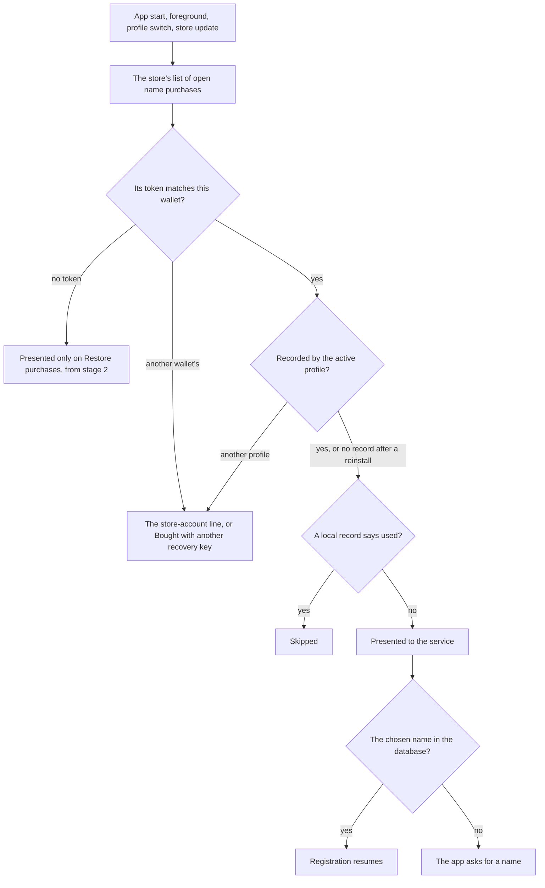
- **One open purchase per store account:** on both platforms the app offers the profile's held payment in place of a second purchase, and sells no second purchase while one is open.
- A purchase the store reports refunded (on Play: unlisted after a refund with revocation) is dropped from the app's records.
- **Store-account lines:** in a shown profile, whatever another profile on the device or another wallet holds gets one line, above the terms block, Pay off, naming no profile:

| State | Android line · secondary | iOS |
|---|---|---|
| Another profile's or wallet's open purchase | "This Google Play account already has an unused purchase of a name. Use it where it was bought. If you can't, contact the SimpleX team." · "Contact SimpleX team", the draft carrying the purchase's reference only | "This Apple Account … If you can't, ask Apple for a refund." · "Request a refund", StoreKit's refund sheet |
| Another's pending purchase | "This Google Play account has a purchase of a name waiting for payment. Use it where it was made once it's paid." · none | Blocks nothing, shows nothing; if both are paid later, each is its own profile's held payment |
| A tokenless purchase no profile here records | Stage 1: "This Google Play account has an unused purchase of a name. Contact the SimpleX team." · "Contact SimpleX team". From stage 2: "This Google Play account has an unused purchase of a name. Restore purchases to use it here." | The same, with "This Apple Account" |
| A purchase the store did not confirm | "This Google Play account has a purchase of a name that the store did not confirm. Contact the SimpleX team." · "Contact SimpleX team" | Finished once its reference shows; blocks nothing |

- **Restore purchases** comes with the hub in stage 2, in store builds:
  - a payment without a name → the search, the payment kept;
  - a known name → its order;
  - another wallet's token, on a phone without a key → "Bought with another recovery key", with "Enter recovery key";
  - another wallet's token, on a phone with its own key → "This Google Play account has an unused name purchase that can't be used in this profile. Use it where it was bought. If you can't, contact the SimpleX team.";
  - nothing found → the badges' "Nothing to restore", and on a phone without a key "Names you registered come back with your recovery key." with "Enter recovery key" → 6·2.
- Stage 1 issues no store promo codes.
- **A sandbox test settles:**
  - a reinstall;
  - a second device;
  - an older build on the same Apple Account;
  - whether a restored non-renewing purchase gets a new `transactionId` and keeps its `originalTransactionId`;
  - whether the token survives a restore;
  - Ask to Buy;
  - an interrupted purchase;
  - two purchases of one product;
  - another profile's Ask to Buy approved after a second purchase;
  - how StoreKit lists a refunded purchase;
  - Play's slow test card for pending purchases, and the token from a pending to a purchased read.
- If iOS lists only this device's open purchases, the iOS line for an open purchase is dropped, as for pending ones.

### 6.6 Screens

Rules for every screen:

- The main path (D21); optional steps are half-screen sheets on the same step: saving the key (1·4a) and entering a code (2·1).
- The screens follow the two canvases, keep the site's way where 6.7 says, and use the app's own components: a centred title, a card of rows ending in the total, one main button.
- One main action at the bottom, in the same place in every state; the secondary's slot is kept under it, even when empty.
- Outcomes appear in place on the same screen.
- Names are counted in characters.
- Every price is the store's, in its currency; on row 4, the service's, in US dollars.
- The terms block, on the checkout of every order (1·5, 2·3, 4·2) and on 3·1 for a move, above the main button:
  - one tick, "I agree to the SimpleX names terms:", then "to use the name lawfully, respecting others' rights;" and "not to use it for fraud or impersonation."; for a community name, "not to use it for fraud or impersonation;" and a third line, "to use it for its community, not as a brand.";
  - the words are placeholders for the terms' own;
  - "SimpleX names terms" opens the text as onboarding's conditions of use do: iOS a `.sheet` (`OnboardingConditionsView`, `ChooseServerOperators.swift:107`); Android and desktop `ModalManager.fullscreen.showModal`, a full-screen modal (`ChooseServerOperators.kt:111, 157`). It shows the text whose hash the app signs, by the link of the name's kind; "Loading the terms…" while it loads; "The terms can't be shown now. Try again in a moment." with "Try again" when it can't;
  - Pay, "Register with your payment", "Register with your code", "Pay in browser" and 3·1's "Move into this app" stay off until ticked;
  - on `terms_changed` the tick comes back unticked under "The terms changed. Agree to them again.": on the checkout before paying, in place on 1·7 after.
- The images show each lane's screens with their numbers and routes; where the words below differ from an image, the words below hold. A state not named here takes a listed state's words.
- 1·4a's alternatives B and C, drawn in lane 1, are not planned. The checkout's alternative B, drawn in lane 1, is Q25.
- Privacy disclosures stay off the checkouts: section 7 states each as a property, and P57a and P57b put them in `PRIVACY.md`. The names terms' text (https://github.com/simplex-chat/simplex-chat/pull/8002) is outside this plan.
- The codes release: 1·1 opens 1·2 in every build, and 4·1's code-only form on iOS outside the US; 1·2 keeps the codes-only state's line and "Register with code" whatever the catalog says, and its "Buy in browser" opens the site's search for the name (`/#/?name=<label>`, 3.2), with no 1·4, where D18 allows and the catalog reads open. 1·5, 1·6, 1·10, 4·1's priced form and the rest of row 4 come with the payments release.

#### Row 1, buy in the app (Google Play; iOS when its payment is on). Stage 1, except 1·4's "I already have a key"

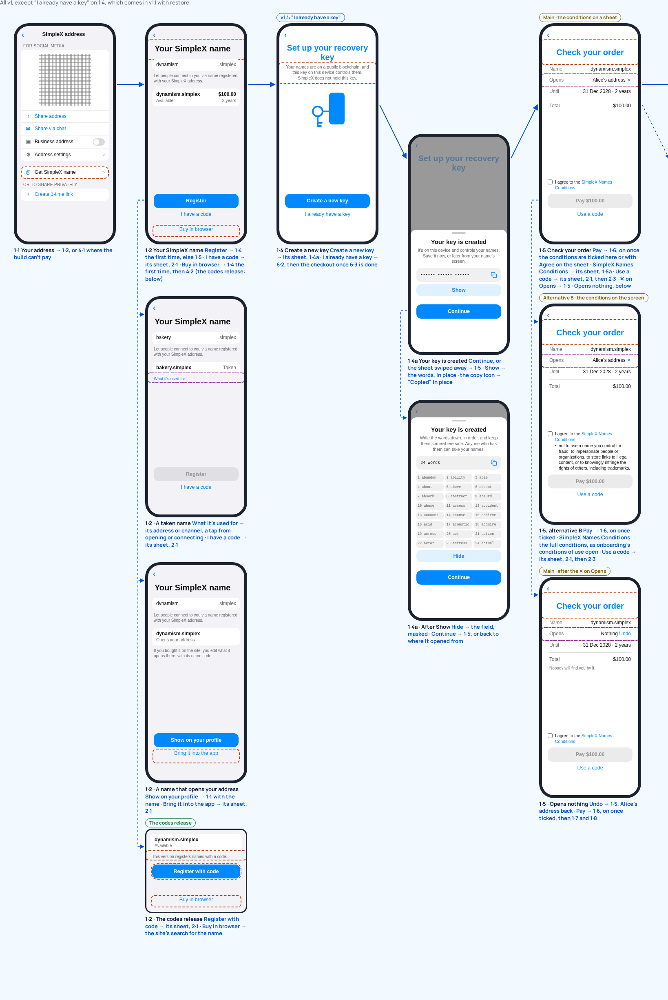

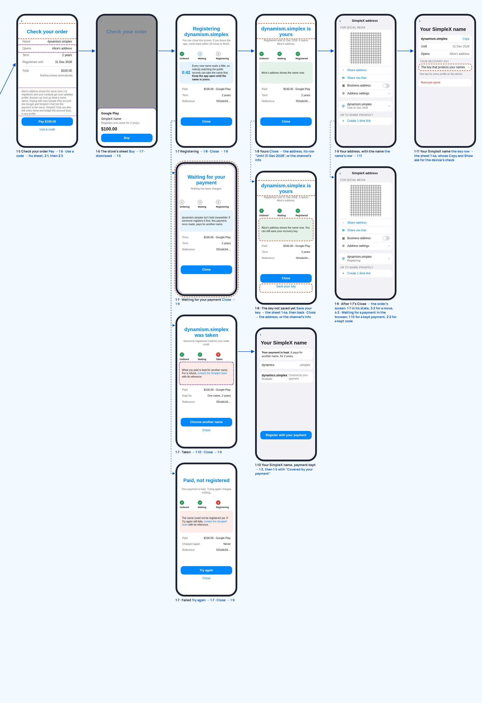

- **1·1** "Get SimpleX name", without "BETA" → 1·2, or 4·1 where the build can't pay.
  - From a channel's info: the channel's row, "SimpleX name", "Let people join via name registered with this channel link.", where the channel has a link the user owns.
  - The "available" alert's Register and an expired own name's Re-register open 1·2 (or 4·1) with the name searched; the alert names no price.
  - The expired alert's Renew gives way to "Renewing isn't available in this version yet." until stage 3.
  - "How to register a test name" and the sale's footer go.
- **1·2** today's name screen, for a profile without a name.
  - Three controls: main "Register" → 1·4 the first time, else 1·5, off until a free name; "I have a code" → 2·1, styled as "Buy in browser"; "Buy in browser" → 1·4 the first time, then 4·2 (in the codes release, the site's search, as this section's rules say), only where D18 allows. Their frames and the third slot stay in place across states.
  - Length and grammar are checked while typing, without a request; the lookup goes over SMP on Return or Search, with "Checking the name…".
  - A community name's row adds "Community ⓘ", whose ⓘ says what the name is for.
  - The price slot and the row keep the height of their tallest content across states, at the largest text size; while the product loads the slot reads "…" and Register stays in place, off.
  - "Buy in browser" is off before the sale and under codes-only, and stays on while only the store's sale is closed for the day.
  - When the sale opens, the price and "Register" replace the line and "Register with code", in place.
  - States not drawn:

| Answer | Words | Action |
|---|---|---|
| Too short, too long, invalid | "5 characters. A name has 6 characters or more: a–z, 0–9 and single hyphens between them."; "64 characters. A name has at most 63."; "Use only a–z, 0–9 and single hyphens between them." | Register off |
| Taken (an expired name too) | "Taken" (D16) | "What it's used for" → its address or channel; "I have a code" stays |
| This profile holds it (matched against the active profile's accounts; another profile's name reads as taken) | "Your name" | Opens its own screen |
| This profile has an order for it | "You already have an order for this name." | "Open that order" → 1·7 in its state |
| Reserved | "Reserved names are not sold here. If it is yours to use, contact the SimpleX team." | "Contact SimpleX team" |
| No answer | "This name could not be checked." | "Try again" |
| No server resolves names | "None of your servers are set to resolve SimpleX names. Configure servers, or use a connection link." | Network & servers |
| Terms unreadable | "Names can't be ordered right now. Try again later." | Register off; read again on reconnecting or reopening |
| Before the sale | "SimpleX name sale starts in" over "12 days 03 hrs 41 min 07 sec" | "Register with code" → 2·1 |
| Codes-only | "Names can be registered with an investor code for now." | "Register with code" |
| Closed for the day | "Paying in the app reopens in 5 hrs", by the service's clock, or "Paying in the app reopens later." | "Register with code" |
| The store can't sell | "The store could not be reached."; "Purchases are off on this device."; "Paying with Google Play isn't available right now."; "Can't load name prices. Check your connection." | "Register with code"; read again on reconnecting or reopening |
| Hidden profile | "A hidden profile can't register a name. Unhide it, or switch to another profile." | In Register's place |
| A desktop paired to a phone | "Use SimpleX names on the phone." | Today's Save stays |

- **1·4** shows when the core reports no wallet, from 1·2's Register and "Buy in browser", 2·2's Register, 4·1's Register and 3·1's "Move into this app"; with a wallet these open the checkout (1·5, 2·3 with a code, 4·2 on row 4), or 3·2 for a move. Its text, a placeholder, is drawn; from stage 2 it reads "Your names are on a public blockchain, and this key on this device controls them. With it you get them back if you lose your phone, or move them to another device. SimpleX does not hold this key."
  - "Create a new key" creates the key and opens 1·4a on the same step; ‹ creates none.
  - From stage 2, "I already have a key" → 6·2, with "A phone holds one key: if you had names on another phone, enter its key first.", then the checkout once 6·3 is done.
- **1·4a** a half-screen sheet over 1·4: iOS's sheet, full height on iOS 15; Android's modal, as for attachments.
  - Continue → the checkout, or 3·2 before a move. Swiping the sheet away is Continue.
  - Show opens the words in place, the sheet grows, "Hide" takes Show's place, Continue stays. Hide masks the field again.
  - The copy icon puts the 24 words on the clipboard; the field reads "Copied" in place.
  - Opened later, from the reminder's "Save your key" or 1·11's key row: titled "Your recovery key"; Continue or a swipe returns there.
  - **The check:** opened later, Copy and Show ask for the device's own passcode or biometrics, with SimpleX Lock on or off (iOS `systemAuthenticate`, `LocalAuthenticationUtils.swift:60-81`; Android `authenticate` with `LAMode.SYSTEM`, `LocalAuthentication.android.kt:22-29`). Opening the sheet asks nothing. Neither `authenticate` with the lock's mode nor Kotlin's `doWithAuth` is used. 5·3's Reveal and "Look for my names", and each stage-2 act that names this check, take it.
  - Without a device lock (`LAError.passcodeNotSet`, `BIOMETRIC_ERROR_NONE_ENROLLED`), on Android 8 (`LocalAuthentication.android.kt:28`) and on desktop: `LAMode.PASSCODE`, asking for the app's passcode where SimpleX Lock is on with one, else going on. Any other answer leaves the field masked, nothing copied, with its reason.
  - P35a makes the shared functions return the reason: iOS `LAError.Code` (today `.unavailable` holds only text, `LocalAuthenticationUtils.swift:77-80`); Android the `canAuthenticate` result (today all `LAResult.Unavailable()`).
  - On iOS the sheet hosts its own `LocalAuthView` overlay for the app's passcode, as `ChatListView.swift:115-119` does, and clears `laRequest` when it closes.
  - A failed or cancelled check leaves the field masked, nothing copied, Show and the icon in place; a wrong app passcode shows `laFailedAlert`. Kotlin's `Failed` fires per failed attempt with the prompt up and changes nothing; `Error` is the failed check.
  - **The exception:** straight after `APICreateWallet` succeeds on 1·4 (`SEDuplicateWallet` asks), Copy and Show don't ask, for that visit only: Show, Hide and Copy within it don't ask; Continue, a swipe or leaving the app end it (iOS `AppSheetState.shared.scenePhaseActive`, Kotlin `AppLock.appWasHidden`). It lives in the sheet's memory, never saved.
  - **While the words show:** the app reads them with `log: false`, so they enter neither the chat console's list nor the logs, and drops them on Hide and on closing; leaving the app masks the field.
  - Android: `FLAG_SECURE` set on Show, restored on Hide or closing.
  - iOS: the words are redacted whenever the scene is inactive, whatever "Protect app screen" says, and while the screen is recorded or mirrored (`UIScreen.isCaptured` with `capturedDidChangeNotification`, and the trait `sceneCaptureState` on the versions that replace it; iOS 15 and later).
  - Copy on iOS: expires after 60 seconds, `localOnly`; `concealed` once the SDK has it (iOS 27.3, in beta).
  - Copy on Android 13 and newer: `EXTRA_IS_SENSITIVE`.
  - Copy on Windows: the text and `ExcludeClipboardContentFromMonitorProcessing` in one clipboard session, through a Win32 binding of JNA, as `WindowActivation.kt` uses JNA for X11.
  - Copy or Show, once used, ends the reminder (6.4).

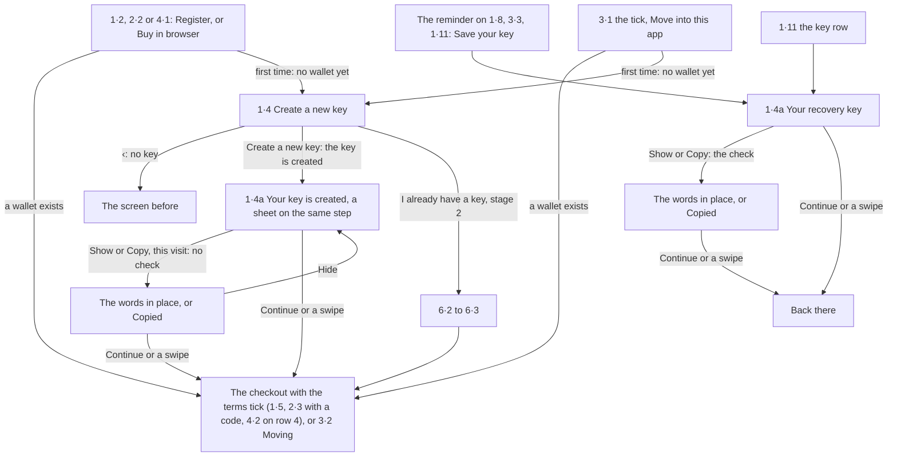

- **1·5** Pay (the badge's `payText`) → 1·6; "Use a code" → 2·1, then 2·3, with no step repeated.
  - Opens: "Replaces alice.simplex on your profile." where the name replaces one. Without an address or channel: "Create an address first", opening the address screen and returning; Pay off until the name opens something. An address or channel without a short link isn't offered: the row says it needs one, with the address screen's upgrade (`webapp/src/names.ts:30-36`).
  - A kept payment: Total "Covered by your payment", main "Register with your payment"; while the sale is closed, "Waits for the sale to open; open the app then to register it. dynamism.simplex isn't held meanwhile."
  - Loading: the total "…", the button in place, off, "Loading…"; the terms block appears once the button can act.
  - The re-check right before the sheet: the catalog read again, the name looked up again, the button "Loading…", off.
    - Registered or reserved since: "This name is no longer available", "dynamism.simplex became unavailable after you searched for it. Nothing was charged.", main "Search another name", no sheet.
    - A failed lookup: "This name could not be checked." with "Try again".
    - Other terms: the tick unticked, in place, with the name's kind's lines.
    - Sale closed or store gone: the total row keeps the reason; the button gives way to "Register with code" → 2·1.
  - Store-account lines (6.5) above the terms block, Pay off.
  - "Use a code" shows while the main button reads "Pay", on or off, and while the total first loads. Its slot is empty with a kept payment, during the re-check, and where the button gave way; with a kept code it holds "Nothing renews automatically."
  - Extremes at the largest text size: a 63-character name wraps and the content scrolls under the pinned lines and button; the longest price ("Rp 1.649.000,00") in a translated label; the button's bottom anchored.
- **1·6** the platform's sheet; dismissed, nothing is charged → 1·5.
- **1·7** stages "Ordering" ("Ordered"), "Waiting", "Registering" ("Registered"), each numbered before it starts, highlighted while running, ✓ done, ✕ failed. One notice under them; the card: "Paid", "$100.00 · Google Play" (row 4 "$100.00 · simplex.domains"; "Price" until the service confirms; a code: "Code", the shortened code, "Free SimpleX name"); "Until", "31 Dec 2028 · 2 years"; in a state that asks to contact the SimpleX team, "Reference" (row 4: the code's hash, shortened). Main "Close", which only leaves → 1·9.
  - The title, the lead and the notice keep the height of their longest text; the card keeps three rows, measured for the shown name; nothing moves between states and 1·8.
  - The notice in turn: "Confirming your payment."; "Placing your order. The wait starts once it is in."; the countdown "0:42" with "Registering takes about a minute."; "Registering the name. It is yours in a moment."; "This is taking longer than usual. It continues by itself."; offline after paying, "No connection: your payment is safe and is confirmed when you are back online."
  - Until the reveal is sent, the notice ends in bold "Keep the app open until the name is yours."
  - A store promo purchase reads "purchase" and "What you bought" for "payment" and "What you paid", drops "Paid, " from titles, and its card's first row reads "Store promo code", "Free SimpleX name".
  - The app closed after paying: the order goes on at the next start, 1·9's row "Registering"; on iOS leaving it in the background stops it too (6.4); the service commits a lapsed commitment again (6.3), so the order reads Failed only past its commits or its signed deadline. The lead reads "You can close this screen. If you leave the app, open it again to finish."
  - States:

| State | Title and lead | Notice and rows | Main; secondary |
|---|---|---|---|
| Waiting (Ask to Buy; Play's pending purchase) | "Waiting for approval" (Play: "Waiting for your payment"); "Nothing has been charged." | No stage started. "dynamism.simplex isn't held meanwhile: if someone registers it first, this payment, once made, pays for another name." "Price" and "Until" rows | "Close"; on iOS after a day "Stop waiting" |
| Purchase cancelled by the store | "The purchase was cancelled." → 1·5 | | |
| Paid, the sale closed | "Paid, waiting for the sale"; "Your payment waits for the sale to open; open the app then to register the name." (or "to reopen in 5 hrs") | No stage started. "dynamism.simplex isn't held meanwhile." | "Close" |
| Paid, terms unreadable | "Paid, waiting to order"; "Your payment is kept. Names can't be ordered right now; open the app later to order it." | No stage started | "Close" |
| Terms changed while waiting | "Agree to the terms again"; "Your payment is kept." | "dynamism.simplex isn't held meanwhile."; the checkout's terms block in the name's kind, unticked, in place, asked once the order can be placed | The order goes in once ticked; "Contact SimpleX team", or "Choose another name" when the kind changed |
| Terms changed at the reveal | Registering | "The registration is not signed yet."; the checkout's terms block, unticked, in place | Signed once ticked |
| The register past the day's cap | Registering | ✓ "Ordered", "Waiting". "Registering waits for today's limit and goes on by itself when it can. dynamism.simplex isn't held meanwhile." | "Close" |
| Signing refused three times | Registering | "The name could not be signed", "The service refused the signed registration." | "Try again", which reads the clock and signs again; "Close" |
| Taken | "dynamism.simplex was taken"; "Someone registered it before your order could." (reserved: "dynamism.simplex is reserved"; before the order went in: no stage started, "dynamism.simplex became unavailable before your order went in.") | ✕ "Taken". "What you paid is kept for another name. For a refund, contact the SimpleX team with its reference." (iOS: "For a refund, ask Apple." with "Request a refund"). "Kept for", "One name, 2 years" | "Choose another name" → 1·10; "Close" |
| Failed | "Paid, not registered"; "Your payment is kept. Trying again charges nothing." | ✕ on the failed stage. The service's reason, or "The name could not be registered yet. If Try again still fails, contact the SimpleX team with its reference."; "Charged again", "Never" | "Try again"; "Close", or "Choose another name" when the name went since |
| Try again while the sale is closed | As Failed | "Try again when the sale reopens in 5 hrs." (or "Try again when the sale reopens.") | "Try again", off until it reopens; "Close" |
| Another name refused by the move limit | "Your payment is kept." | "This order cannot move again", "The payment comes back for another name 30 days after the failure." | "Contact SimpleX team"; "Close" |
| Sends used up (`sends_used_up`) | "Paid, not registered"; "Your payment is kept." | "This order cannot try again", "The payment comes back for another name 30 days after the failure." | "Contact SimpleX team"; "Close" |
| The code's commits used up | "Paid, not registered"; "Your payment is kept." | "This order cannot try again. Contact the SimpleX team with its reference." | "Contact SimpleX team"; "Close". The view reports a code at its bound; the core reads it each time this state opens; once support raises the bound, the state reads Failed |
| Not confirmed | "Payment not confirmed"; "The store did not confirm this purchase. If you were charged, contact the SimpleX team." | Reference; the draft holds it, the code's hash, and Play's order number when there is one | "Contact SimpleX team"; "Close". The core presents the purchase again each time this state opens |
| Revoked | "Payment can't be used"; "This payment can no longer register a name. If you didn't ask for this, contact the SimpleX team with its reference." | Reference | "Contact SimpleX team"; "Close" |
| Another recovery key, none here | "Bought with another recovery key"; stage 1: "This purchase belongs to another recovery key. Contact the SimpleX team with the reference below." (iOS: "… Ask Apple for a refund."); from stage 2: "This purchase belongs to another recovery key. Enter it here to use it." | Reference | "Enter recovery key" → 6·2 from stage 2; "Contact SimpleX team" (iOS "Request a refund") |
| Another recovery key, after `receipt_used` | The same title; "This purchase belongs to another recovery key. Use it on the device that has that key." | Reference | "Contact SimpleX team"; "Close" |

An order's life in the core, as 1·7 and 1·9 show it:

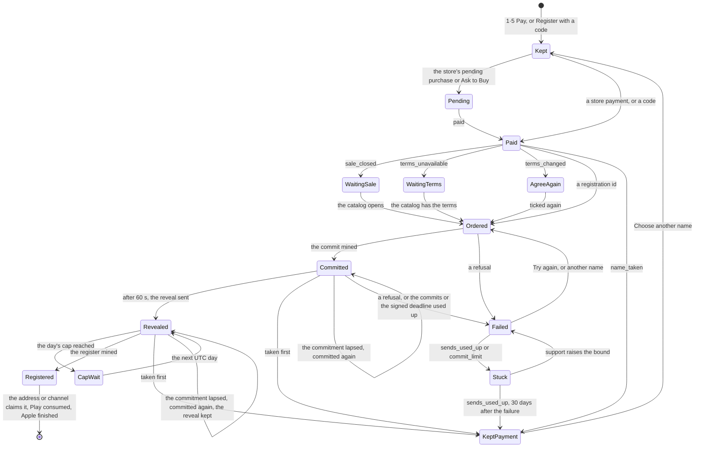

- **1·8** as drawn; Close → the address, its name's row with the footer "Registered until 31 Dec 2028.", or the channel's info.
- **The reminder:** from the key's creation until Copy or Show on 1·4a, 1·8, 3·3 and 1·11 add "You can still save your recovery key." with "Save your key" → 1·4a, titled "Your recovery key", then back. On 1·8 it ends the notice and "Save your key" is the secondary under Close. A paired desktop shows none.
- **1·9** the name's row under "Your SimpleX name"; alerts never appear over another screen:

| Row | Opens |
|---|---|
| "Registering" | 1·7 in its state |
| "Waiting for approval" (Play: "Waiting for your payment") | 1·7 |
| "Waiting for the sale" | 1·7 |
| "Waiting to order" | 1·7 |
| "Not registered · Try again" | 1·7 |
| "Terms changed · Agree again" | 1·7 |
| "Taken first · Choose another name" | 1·7 |
| "Your kept payment · Find a name" | 1·10 |
| "Your kept code · Find a name" | 2·2 with the code |
| "Moving" | 3·2 |
| A browser payment: "Waiting for your payment", "Confirming your payment", "No payment arrived", "Payment needs the SimpleX team", "Payment can't be used" | 4·2 in its state; "Confirming your payment": 1·7 |
| The name alone, with "Registered until 31 Dec 2028." as the footer under it | 1·11 |

- **1·10** as drawn; "Register with your payment" → 1·5.
- **1·11** as drawn; the key row → 1·4a, "Your recovery key", with its check on Copy and Show.
  - The key row shows once the app has a key, and stays.
  - The reminder until Copy or Show.
  - A name the profile shows that the app doesn't hold (today's Save): "Bring it into the app" → 2·1.
  - A name paid in the browser: the row "Payment" with its reference, and "Contact SimpleX team", whose draft holds the reference and the code's second hash.

Support drafts add "This reference links this chat to the payment"; the contact flow offers an incognito connection. On row 4 every "Contact SimpleX team" button and "contact the SimpleX team" link opens a draft with the reference and the code's second hash, never the code: on 4·2's waiting state and its other states, 1·7 and 1·8 in every state, 1·9's row, and 1·11's "Payment" row.

#### Row 2, a prepaid code. Stage 1

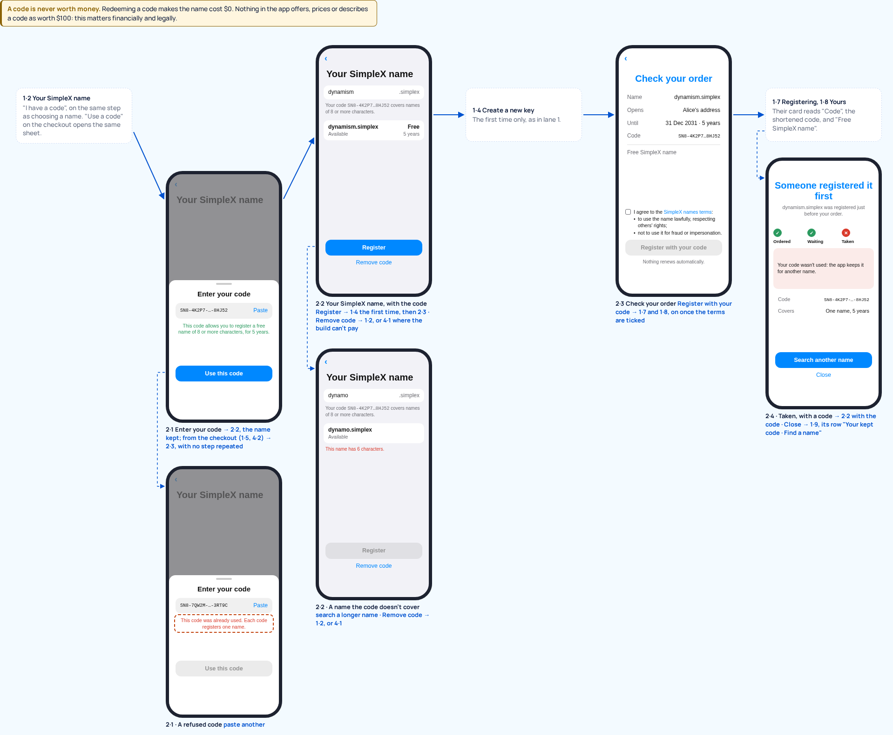

- **2·1** a half-screen sheet: over 1·2 from "I have a code" and any "Register with code"; over 1·2's "Opens your address" from "Bring it into the app"; over 4·1 on iOS outside the US; over 1·5 and 4·2 from "Use a code".
  - Paste only: the app scans no code anywhere.
  - One field takes an owner code (`SN-` and 30 characters) or a prepaid code (`SN<length>-` and 20); `parseNameCode` tells them apart on the device.
  - A prepaid code goes as it is to the service's code check. A name code stays on the device: the app derives its wallet and sends only that wallet's signatures, to the owner-signed `find`, and reads the chain (`codeOrderOf`, `webapp/src/flow.ts:236-245`; `findHandler`, `StoreService/Web/Names/Owner.hs:44-59`).
  - `find` lists a code's registered order after its name has moved (3·1 · Refused relies on it): the service deletes a registration only when creating it fails, or when it was never paid and its invoice expired (`StoreService/Names/Store.hs:532-556, 855-894`).
  - "Use this code" → 2·2 with the name kept; from a checkout, back to 2·3 with no step repeated. An owner code: "Continue" → 3·1. Only an order uses the code.
  - "Checking…" in the result's place; offline "Can't check the code. Check your connection.", the button off; before a paste, off; swiped away, nothing changes.
  - Refusals, the button off:

| Title | Line under it |
|---|---|
| "This code is not valid" | "Check it for a mistyped character." |
| "This code is being used for a name now" | "Each code registers one name; this one is held by an unfinished registration." |
| "This code was already used" | "Each code registers one name." |
| "This code is not valid: SimpleX withdrew it" | |
| "This code has expired" | "It can no longer register a name." |
| "This code is not paid for yet" | "It works once its payment is confirmed." |
| "This code is not valid: SimpleX did not issue it" | |
| "This is not a SimpleX names code" | "Check it and try again." |
| "The code could not be checked" | "Try again in a moment." |
| "Too many checks just now" | "Your code may be fine." |
| A badge code: "This is a badge code. Redeem it in Support SimpleX." | |

- **2·2** the code shortened; "Remove code" → 1·2, or 4·1, a kept code staying on its row; from 4·1 on iOS outside the US, 2·2 waits for a name. A name shorter than the code covers, here or from a checkout: the error under the answer, Register off.
- **2·3** 1·5 with the code: Until is the code's term ("31 Dec 2031 · 5 years"; a community name 2 years, with "A community name is registered for 2 years, not your code's 5."); "Nothing renews automatically." under the button; → 1·7 and 1·8 with the code's card.
- **2·4** taken, as drawn: Close leaves the row "Your kept code · Find a name". A failed registration: "Not registered", "Your code is kept. Trying again uses nothing more.", "Try again". A code no longer usable: "Your code can no longer be used for it, so trying again cannot register it.", its reason, main "Search a name". A code another registration holds: "Your code is held by another registration; try again later".

#### Row 3, a name bought on the site. Stage 1, except what is marked

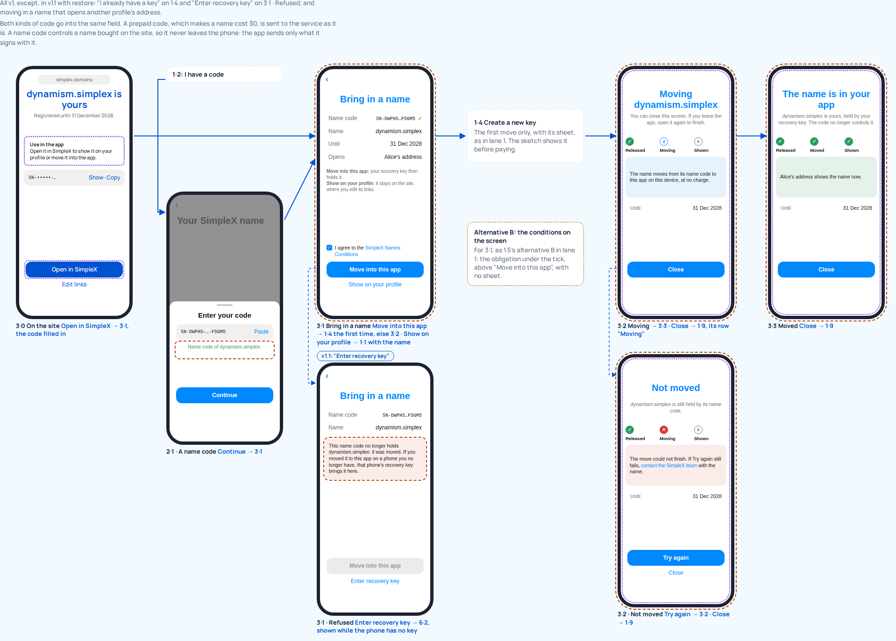

The path: the tick on 3·1 → 1·4 the first time → 3·2 → 3·3.

- **3·0** the site's change (P47), as drawn; on a computer the main button is "Copy", for 2·1.
- **3·1** a sheet, as the badges' link sheet, Cancel at its top; nothing moves or shows until a tap.
  - Its text is drawn; from stage 2: "Move into this app: it attaches to Alice's address, and your recovery key holds it and brings it back on a new phone. Show on your profile: it stays on the site, where you edit its links."
  - The terms block (6.6) is for moving only: "Move into this app" stays off until ticked; "Show on your profile" (today's Save, `APISetUserDomain`) signs nothing.
  - A name that opens a channel of this profile shows on that channel; one that opens an address and a channel has two Opens rows.
  - A name that opens another address: in stage 1, "Move into this app" off until its links are set on the site, "Show on your profile" off, with "It opens an address that isn't this profile's. Set its links on the site first, or switch to the profile whose address it opens." From stage 2 moving attaches it here.
  - Proposed, for a moved name's edge cases: a link that isn't this profile's, or no links (the site's "Skip for now"), takes the path of another address; with no links, "It opens nothing yet. Set its links on the site first."; from stage 2, a profile without an address reads 1·5's "Create an address first" before moving attaches the name.
  - Before anything moves: past expiry, "dynamism.simplex expired on" its date and "Renewing isn't available in this version yet."; a code without a registered name, "This code holds no registered name yet. Finish its order on the site, then open the code here again."; already held by this profile (active profile's accounts), "dynamism.simplex is already in this app.", "Close"; a hidden profile, "A hidden profile can't add a name. Switch to another profile, then open the link again."; a reserved name says it can't be renewed; terms unreadable, "Names can't be ordered right now. Nothing changed. Try again later."
  - Refused, read from the code's order and the chain: "This name code no longer holds dynamism.simplex: it was moved." With a key on the phone: "The name is in the app on the phone you moved it to."; without one, from stage 2: "If you moved it to this app on a phone you no longer have, that phone's recovery key brings it here.", "Enter recovery key" → 6·2.
- **3·2** as drawn, in 1·7's layout. The core records the move with the ticked terms before the first relay and resumes it at start and on the return to the foreground until the claim lands; a move whose terms changed waits here with 3·1's tick back. Offline: "No connection.". Not moved: "Try again"; "Close".
- **3·3**, proposed: a name that moved but can't show (its links changed during the move, or the step failed) keeps "The name is in your app", "Shown" unticked, "It doesn't show on Alice's address yet." and "Try again"; changed links need stage 2's "Set what it opens". The line names what the name opens: "#Bakery Deals shows the name now." or "Alice's address and #Bakery Deals show the name now.". The reminder until Copy or Show.
- In stage 1 a name moves in once, within the yearly bound.

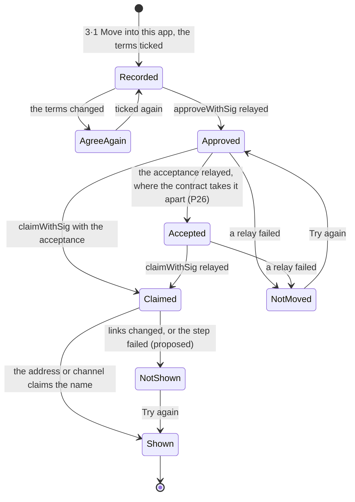

#### Row 4, builds that can't pay in the app, and "Buy in browser". Stage 1

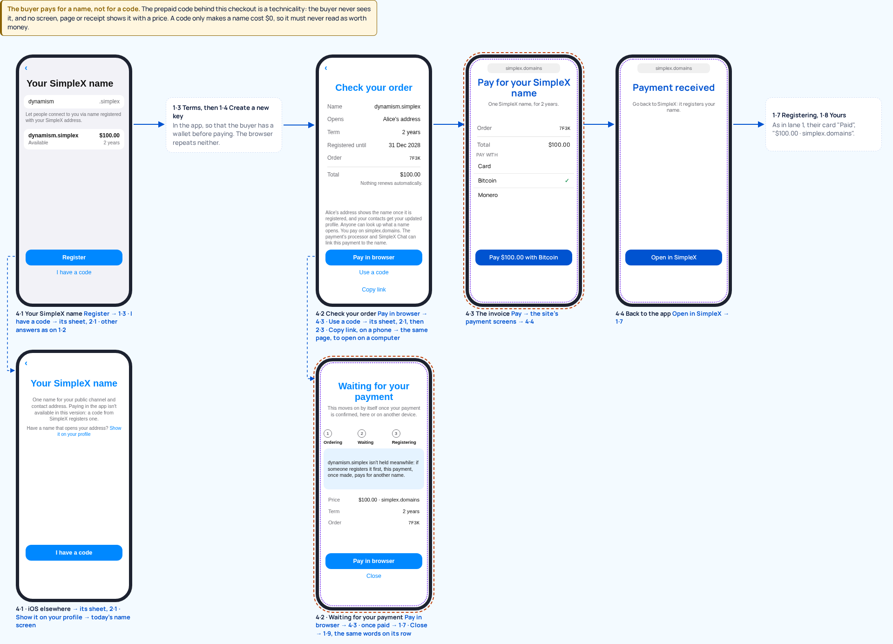

The path: search → key the first time → checkout with the terms tick → the invoice in the browser → back in the app → registering → yours. The browser repeats none of the app's steps and shows no code (D24). Mechanics: 6.8.

- **4·1** 1·2 priced from the catalog; "Register" → 1·4 the first time, else 4·2; "I have a code" → 2·1; the third slot empty.
  - Before the sale or under codes-only, "Register with code" in Register's place; the day's cap keeps this path open.
  - A name that already opens this address: 1·2's answer, with "Show on your profile".
  - Offline, the search and 2·1 wait for the connection.
  - In these builds 1·1's "Get SimpleX name" and, from stage 2, the hub's "Register a name" open 4·1.
- **4·1 on iOS outside the US**, its payment hidden, as drawn: no search; "Show it on your profile" → today's name screen; "I have a code" → 2·1; no site named.
- **4·2** 1·5 priced from the catalog, with the terms block.
  - "Pay in browser" → 4·3, and 4·2 then shows its waiting state; "Use a code" → 2·1 then 2·3. "Pay in browser" stays off until the terms are ticked.
  - 1·5's re-check runs before the link opens.
- **4·2's waiting state**, as drawn, once "Pay in browser" has recorded the order and opened its code for payment; the name fixed:
  - "Pay in browser" opens the same invoice;
  - "Remove order" while nothing reached an invoice: the code closed at the service, the order and its code dropped → the address screen, its row "Get SimpleX name" (1·1);
  - ‹ → 1·9, its row "Waiting for your payment".
  - In the other states below, the state's lines replace the note.
  - The full amount on the invoice → 1·7 at "Confirming your payment.", then "Paid", "$100.00 · simplex.domains".
  - Money on an earlier, closed invoice while another is open adds "A payment also reached a closed invoice. For a refund, contact the SimpleX team.", linking the draft.
  - **No payment arrived:** title "No payment arrived"; "No payment has reached this order. Pay in browser to try again, or remove this order."; "Pay in browser" opens the code for payment again; "Remove order" as above.
  - **Your payment reached a closed invoice:** "It didn't pay for this order. Contact the SimpleX team with the reference for a refund."; a row "Reference"; main "Contact SimpleX team"; "Close", which becomes "Remove order" once that draft is sent.
  - **Payment can't be used:** 1·7's Revoked words; a row "Reference"; "Contact SimpleX team"; "Remove order".
- **4·3** the site's change (P60), as drawn: the site's ways to pay, Bitcoin selected first (`webapp/src/screens/checkout.ts:149`, `views/search.ts:220`), without "Pay with ETH"; the main button names the selected way (`views/checkout.ts:41`) → the site's payment screens → 4·4.
  - Opened twice, the link shows the one open invoice; another way to pay ends the open one first; after an expired empty invoice, Pay makes a new one; money on a closed invoice shows as a line with the reference; past the code's time, "Open this again from SimpleX."
  - An invoice refused by the shared limit (`invoicesLimit`, 3.3): "Too many payments are starting right now. Try again in a minute.", Pay in place.
- **4·4** as drawn, with "Reference"; more than the price: "More than the price arrived." and 4·3's refund line; main "Open in SimpleX" → 1·7, a link holding no code. On a computer, in the button's place: "Now open SimpleX on the device you ordered from. It carries on by itself."
- A name paid with ETH through the dApp registers to a wallet the app doesn't know: searched here it reads "Opens your address" once its link is set to this address, and "Show on your profile" confirms it; until then it reads "Taken".

#### Row 5, SimpleX names. Stage 2

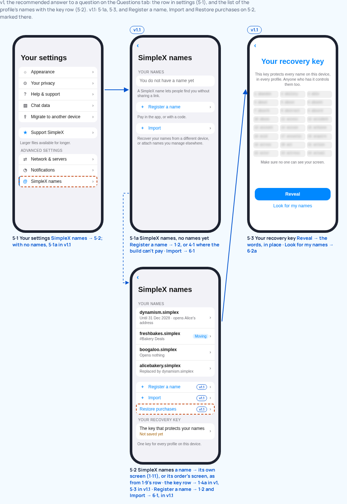

- **5·1** the row under Advanced settings, after Network & servers and Notifications → 5·2, or 5·1a without names. A desktop paired to a phone reads "Use SimpleX names on the phone."
- **5·1a** "Register a name" → 1·2, or 4·1; "Import" → 6·1.
- **5·2** rows as on 1·9, each with one line and a chip; a name the site still holds reads "On the site"; "Restore purchases" in store builds only (6.5); the key row's "Not saved yet", in orange, from the key's creation until Copy or Show.
  - Each profile has its own list; started here, the name opens the active profile's address, with no picker, and Close returns here.
  - Another key entered on a phone that has one: "This device already has a recovery key, and a device holds one key.", "Show the key" → 5·3; no name named.
- **5·3** the words as placeholders until Reveal's check; Reveal shows them in place, with 1·4a's protections; "Look for my names" → 6·2a. Both ask for 1·4a's check, without the exception. Reveal sets the record that Copy or Show sets. ‹ → 5·2.
- **A name's own screen:** 1·11, with "Set what it opens" (6.10).

#### Row 6, a new phone. Stage 2

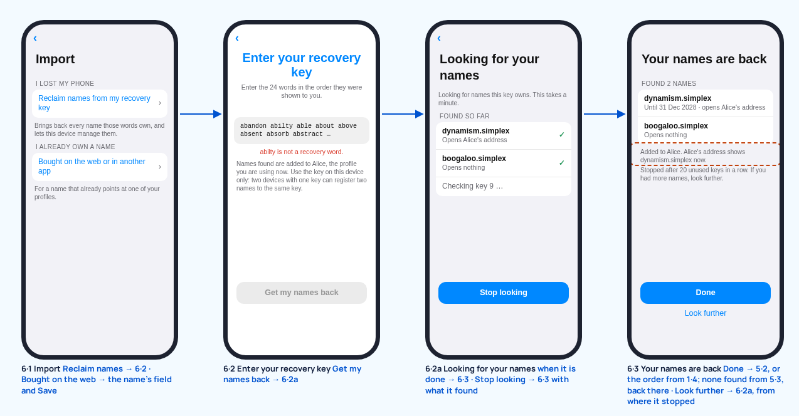

- **6·1** "Bought on the web or in another app" → the name's field and Save.
- **6·2** each word checked on the device as typed: "11 of 24 words.", "abilty is not a recovery word.", "These 24 words do not make a key: check their order.", "24 words."; "Get my names back" after 1·4a's check. A key entered here counts as saved: no reminder.
- **6·2a** from 6·2, 5·3's "Look for my names", or "Look for your names again". Offline: "No connection.", looking again when back online.
- **6·3** "Added to Alice" names only newly bound names; "Done" → 5·2, or the order from 1·4; "Look further" → 6·2a from where it stopped.
  - None found, entered from the hub: "No names found"; "No names for this key. It may be a key from another app, or its names expired and were taken. Keep it as this phone's key, or try another."; "Try another key" → 6·2; "Keep this key" (Q1).
  - From 1·4: a key without names becomes this phone's key and the order goes on.
  - From 5·3 or "Look for your names again": "No names for this key yet.", "Done" → back there, "Look further".
  - A hidden profile: "Alice is hidden, and hidden profiles cannot own names. Switch to another profile first."
- A phone migrated with its database needs no restore. After restoring an older database: "Look for your names again", "needed before registering", Register a name off until it has run; it asks for 1·4a's check.

### 6.7 Departures from the sketches and the site

- Start: the address or channel opens the search; the hub comes in stage 2.
- Search: on today's name screen; "I have a code" under Register, above "Buy in browser".
- A taken name: "What it's used for" (Q18).
- Opens: the address or channel it started from (Q12).
- Terms: one tick on the checkout for each order, with two obligations and a third for a community name; its link opens one document, as onboarding's conditions of use.
- Recovery key: after the search, before the checkout; one screen and a sheet; the device's check when opened later; stage 1's own words.
- Registering: "Ordered · Waiting (countdown) · Registering"; the site's keep-the-app-open warning until the reveal; Close only leaves; reopening continues without asking.
- Done: a screen; a quiet key reminder; 1·11's key row.
- Taken and failed: a refund contact.
- A code: a sheet, paste only.
- Row 4: one price; an invisible code; the browser shows only the invoice.
- Row 3: a site-bought name moves in with its name code.
- Row 5: under Advanced settings; each name's date and state; Restore purchases.
- Row 6: a found name attaches to this phone's address; a key that finds nothing is kept after a warning (Q1).
- Words: "SimpleX does not hold this key."; "SimpleX servers … together they can see them"; "this app on this device"; a refusal naming no name; a Play pending purchase reads "Waiting for your payment"; an unused code is "kept", never "spent".
- Left out from the site: "Pay with ETH", transaction rows and explorer links, the "Use in the app" card, name code and QR on 1·8, "Being registered" on the search answer.
- Added from the site: the order's rows; the name looked up again right before the store sheet.

### 6.8 The browser path

Row 4: F-Droid and desktop always; iOS in the US while its payment is hidden; "Buy in browser" on Google Play and iOS in the US (`badgeBrowserAllowed`, reused). Built as Q24's recommended answer.

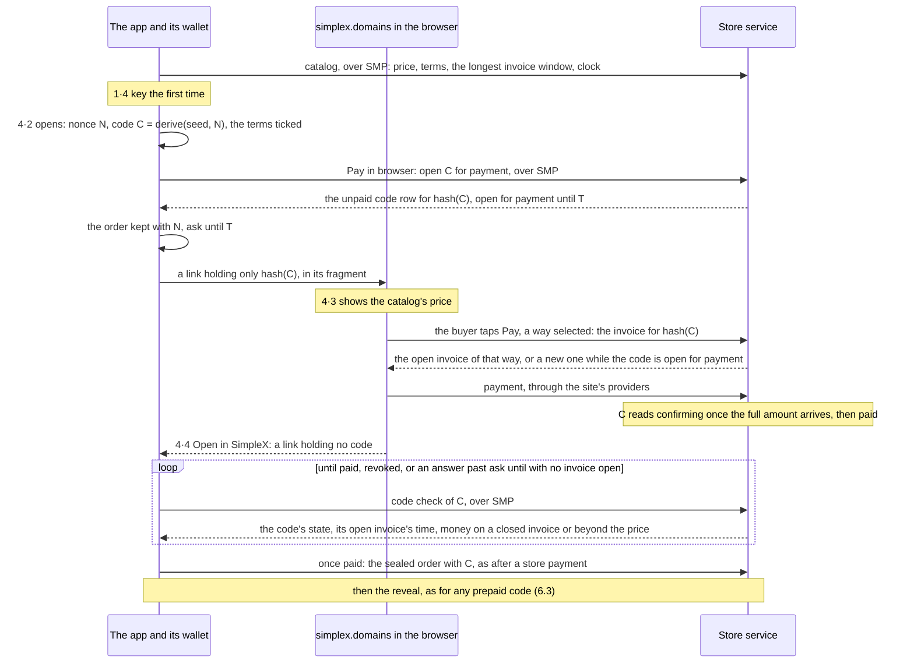

- **The code:** when 4·2 opens, the core makes a nonce and the prepaid code C from the seed (6.1), under the browser code's info string, without a token (`/_name browser`). "Pay in browser" opens C for payment and records the order (the name, what it opens, the ticked terms, the nonce); while it waits, the command returns the same code.
- **The link:** P60's path on simplex.domains, holding only C's hash in its fragment; the page clears it from the address before any provider's script loads.
- **The reference:** the first 12 characters of C's hash in the codes' alphabet; the app computes it from C, the page from the link. It shows where a screen asks to contact the SimpleX team (1·7, 4·2's closing states), on 4·3's line about money on a closed invoice, on 4·4 and in support drafts; `//name-invoice` takes it.
- **Open for payment (P59):** the core sends C over SMP, in a command beside the code check. In the code's turn the service writes or finds the unpaid code row for C's hash (any name of 6 or more characters, 2 years, marked as a browser code), sets its "pay until" to now plus the longest invoice window (60 minutes by default, `StoreService/Config.hs:226-234`), and stores C's second hash, under its own info string, the proof a crypto refund asks for.
- **Close:** "Remove order" sends C to close it first: the service cancels an open invoice at its provider, refuses while money has reached it, and sets "pay until" to now; the app drops C after that answer.
- **The invoice (P59):** the page asks for an invoice of C's hash when the buyer taps Pay, per way to pay; the service makes one only while the code is open for payment, else the page reads "Open this again from SimpleX."; written in the code's turn at the catalog's price (P58), by card, Bitcoin or Monero, marking the code row. One open invoice per code row:
  - the same hash and way: the open invoice;
  - another way: the open invoice cancelled at its provider first, as the site's reorder does (`webapp/src/views/order.ts:908-937`); refused while money has reached it;
  - after an empty invoice expires: a new one only on Pay, while the code is open;
  - money on an expired or cancelled invoice: the page shows the open invoice, if one is, and "For a refund, contact the SimpleX team from SimpleX: from your order, or from your name's screen once it is registered. Without the device you ordered from, a card payment can still be refunded: write to chat@simplex.chat with this reference." (`CONTACT_EMAIL`, `webapp/src/views/shell.ts:10`);
  - a paid hash: its paid invoice, the page showing 4·4, with the same line when more than the price arrived; a revoked one says it can no longer be used;
  - a hash held by another kind's code row (operator-issued, store-paid): refused.
- New in the service: finding an invoice again by its hash (badges refuse a known hash, `createInvoiceHandler`, `StoreService/Web/Server.hs:407-428`); the "confirming" state; the paid time on the code row (`PrepaidCode`, `StoreService/Names/Store.hs:382-394`), from which a refund without a draft counts.
- A short payment leaves the code unpaid; the page shows what is still due.
- Money reaching a paid code invoice later, and the part above the price, are recorded with the code row and alert the operator; today a paid invoice's status stays as it is (`decide ISPaid _ = Nothing`, `StoreService/Orders.hs:56`), and only name invoices alert (`moneyAfterPaid`, `StoreService/Poller.hs:235-246`).
- Unpaid rows no money reached are swept once their "pay until" and invoice windows pass (`cleanupUnpaid`, `StoreService/Poller.hs:317-328`).
- Refused under codes-only, as the site's name invoices are (`nameInvoiceHandler`, `StoreService/Web/Names/Orders.hs:88`).
- **The app notices payment** through the code check over SMP (P22), with or without the link back. It reports a prepaid code's state today (`codeState`, `StoreService/Names/Codes.hs:44-55`; `codeAnswer`, `StoreService/Web/Names/Codes.hs:37-39`); P59 adds, for a browser code, "confirming", the "pay until", the open invoice's expiry, and, apart from the state, money on a closed invoice and money beyond the price. The state's order: paid, confirming, revoked, unpaid.
  - **Ask until:** the "pay until" from opening the code, moved later by each answer with a later open invoice's expiry, and for crypto by the provider's late window.
  - **How often:** every 10 s while 4·2's waiting state or 1·7 at "Confirming your payment." is open; else at start and on the return to the foreground.
  - **Paid:** the core places the kept order with C; 1·7 follows it. When the name registers, the core asks once more; money on a closed invoice or beyond the price adds to 1·8's notice "More than this order's payment reached us. For a refund, contact the SimpleX team.", linking the draft. Later money: the page reports it; the refund is asked from 1·11's "Payment" row.
  - **Past "ask until"**, decided only on an answer received after it, with no invoice open and nothing confirming or paid: the asking stops; money on a closed invoice → "Your payment reached a closed invoice"; none → "No payment arrived".

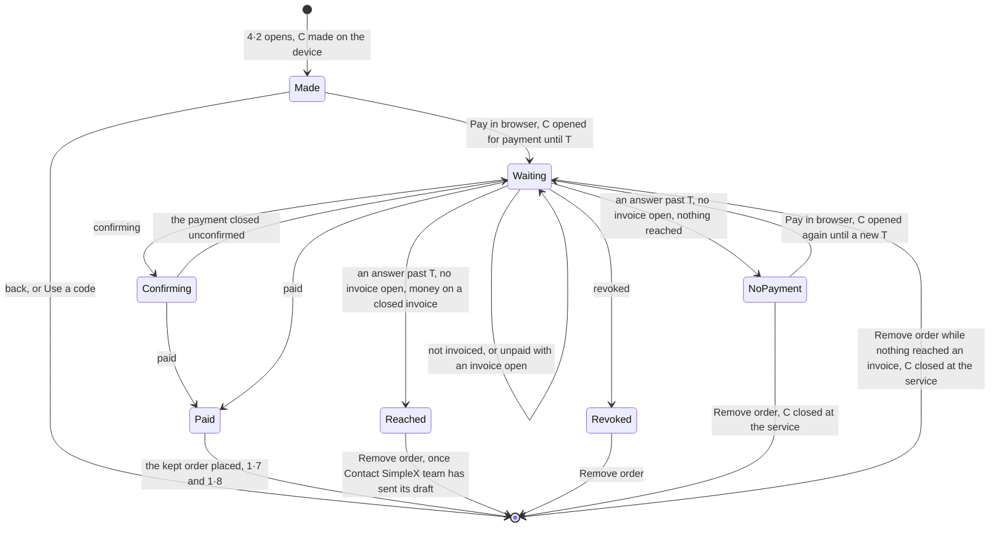

- **4·4's link back:** `https://simplex.chat/name/paid`, a verified https link of the app's, routed beside `/name/code`, holding no code; it brings the app forward to the waiting order.

**A name bought directly on the site** comes back through row 3 (3·0, P47):

- The link back: `https://simplex.chat/name/code#<code>`, a verified https link the app owns where the platform has one (Android App Links, iOS universal links), routed beside the badge's `/badge/code/`.
  - The website's association files (`apple-app-site-association`, Android's asset links) and the Android manifest gain the path.
  - The apps' link routers handle it before connection links.
  - The page at that address is a file of its own, outside the website's shared layouts, loading no third-party script, clearing the code from the address first, and telling a visitor without the app to paste it.
  - A release check confirms every host in the manifest serves the asset file (Android 11 and lower verify all hosts together).
  - On desktop the site shows the code to paste.

### 6.9 iOS and Apple's test environment

- The same code behind a build-time switch, as the badge buttons are at `names`: off in stage 1's release, on in the version submitted with the product.
- While off, iOS is a build that can't pay (row 4): the US storefront pays in the browser; elsewhere the screen offers a code, without a search.
- App Review's and TestFlight's purchases are test purchases, refused in production.
- Switching on adds a second, small store-service deployment (P56), recommended in Q5:
  - set to the `testing` namespace, Apple's sandbox host, crediting test purchases;
  - the app sends a transaction marked sandbox to that deployment's address;
  - `credit_test_purchases` there applies to name products only, or the deployment answers badge commands with `unsupported_version`;
  - it credits test purchases only while the operator has opened it for a build in review, registers a few names a day, and refuses the rest;
  - the reviewer completes the flow and receives `dynamism.testing`, shown as such.
- Until iOS sells names, its code path relies on App Review accepting it (3.1.3(b), 3.1.1) (Q5).

### 6.10 Stage 2 mechanics

- **The hub** (row 5) opens from Advanced settings; the address and a channel's info still open the search. Import's "Bought on the web" holds today's field and Save.
- **Restore:** `/_wallet import`, refused where a wallet exists, the counter set past the accounts found.
- **The scan** walks the wallet's accounts in order and asks what each owns over `ROWN` (P4; the resolver's `/v2/owned-by/<address>`, P3; the agent's `ownedSimplexNames`, each account's request to one relay, spread across them), until 20 unused accounts in a row, at most 200, with a start index for "Look further", progress events and a stop.
  - What it finds binds to the active profile.
  - A scan of this device's own key skips accounts bound to another profile and leaves this profile's accounts as they are, without a relayed edit.
  - More than 8 names per address stays open from https://github.com/simplex-chat/simplex-chat/pull/7561.
- **Attach:** a name moved in or restored that opens something else attaches to this profile's address or channel with one relayed record edit, signed by the account, within its yearly allowance.
- **Set what it opens**, on the name's own screen, as the site's Edit links:
  - any contact or channel link, also one outside the app, pasted, or this profile's address or channel offered; the service's record edit takes these two kinds (`recordKinds`, `StoreService/Web/Names/Records.hs:58, 76`);
  - what it opens now ("Opens nothing yet" when neither); "Replaces" or "Adds #Bakery Deals"; "Already opens Alice's address" with "Save" off; under "Save", "2 edits left this year.";
  - "Save" asks for 1·4a's check, sends one relayed edit, reads "Signing and sending…" in place, then returns to the row;
  - `record_reverted`, `rate_limited`: "The links were not saved.", "Try again in a moment.";
  - offline: "No connection.", "Save" off;
  - a lost answer or `edit_pending`: "No answer yet", "The change may still go through. Open this again in a few minutes to see whether it did before saving again.", "Save" off until the app reads the name again;
  - the year's edits used: "You can set what it opens again on 31 Mar 2027."
- **Give to another profile:** after 1·4a's check, the account is rebound to the other profile (a database change) and its record re-pointed at that profile's address (one relayed edit).

### 6.11 Stage 3 mechanics

- **Transfers to another person:** the move's relayed transactions (approve, claim, and the receiving account's acceptance where it is a transaction of its own), counted in the same allowance, 3 a year per name; the receiving account accepts the terms current for that name; refused during the grace period; sent after 1·4a's check.
- **Renewal:** "Add a year" one-time products, sold from the name's own screen and the expiry warning, to the owner during the term and the grace period; on desktop, F-Droid and the iOS US storefront, "Renew in browser" once the site sells it.
  - At least 365 days (`MIN_RENEWAL_DURATION`, `_renewCore`): whole years only.
  - The expiry stays at most one horizon ahead of the block: 1095 days for a paid renewal and a sponsored community name; 4015 days for another sponsored name (`_sponsoredHorizon`).
  - A reserved name is refused (`NameReserved`).
  - `renewWithCredit(label, duration, referrer)` takes no owner signature and spends the allowance: the service checks that the asking wallet holds the name and that the renewal stays within these bounds before crediting; a renewal it can't send is refunded through support.
  - The renewal screen carries the terms line.
- **Reminders:**
  - The row's footer reads "Registered until 31 Dec 2028." from stage 1, from the expiry stored beside each account, refreshed whenever the name is verified.
  - From 30 days before: the footer reads "Expires in 21 days"; a chat-list banner with a dismiss control, dismissible once a week, above promotional banners in the last 7 days; local notifications at 30 and 7 days.
  - Only the active profile's names show on the row, the hub and the banner; a notification is scheduled only for a profile with notifications on, removed when it is hidden or they are turned off; a hidden profile's names raise none; notifications follow the app's preview setting.
  - "Renew" only where a renewal can be bought; otherwise "Renewing isn't available in this version yet."
  - In the grace period: "Expired 31 Dec 2028"; the alert "Your name dynamism.simplex expired on 31 Dec 2028. Renew it before 31 Mar 2029.", with Renew where it can be bought; after the grace, "Re-register".
  - The app warns from the stored date, without the network.

### 6.12 Badges and names

Separate products, sold apart and without a discount; a name unlocks no feature and a badge pays for no name. They share the store service and its receipt verifiers; each app lane skips the other's products (6.5).

## 7. Compatibility and security

- **Protocol:** the store service's app protocol gains 6.3's name commands under one version bump, `currentStoreServiceVersion` to 2. Chat protocol and agent stay as they are in stage 1. P2 fills an optional field, at a router version it settles. Stage 2 adds `ROWN` to SMP at the next free version (P4).
- **Database, core** (SQLite and Postgres):
  - the order record (P15);
  - the purchase record (P19);
  - the browser payment's record, kept after its name registers, with the reference and the code's second hash, never the code (P62);
  - the wallet's record that its words were shown or copied (P11);
  - beside each wallet account, the name and its expiry (P11).
- **Database, service** (both backends):
  - prepaid codes: the paying payment, with a named unique index, as the payments migration does (P27a);
  - prepaid codes: the count of commits (P27c or P65);
  - registrations: the cap's count (P27c);
  - a row per UTC day (P27c);
  - browser code rows: "pay until", second hash, extra money, paid time (P59);
  - an invoice for a code, found by its hash (P59);
  - the code's confirming state (P59);
  - a refund record per code row, one per part of a payment (P66).
- **Older apps** never send the new commands; each lane skips the other's products; iOS reads open purchases from `Transaction.currentEntitlements` first (6.5).

**Threat model.** The design accepts and states the following (Q6).

The stores and the service:

- A store learns that an account bought "SimpleX name", when, at what price, from which device and network; never the name.
- The name registers minutes after the payment (hours on iOS while the buyer is away), and the purchase is consumed or finished at registration: a store, or anyone seeing the account's purchases or receipts, matches a purchase to its name by time, unless many register in those minutes.
- Google Play: if Play Console shows who paid for each order, as assumed (P27a checks the fields and states them here), SimpleX can find the names a Google account paid for, by searching its orders by the buyer's email address and hashing each purchase token to the payment key.
- Google Play: the service discards `orders.get`'s address fields.
- Google Play: a stolen service key can refund Play orders with revocation.
- App Store: `appTransactionId`, the same for one Apple Account in this app on every device, lets the service tell which names, and which addresses, one Apple Account paid for.
- The service reads the token and nothing else new from a receipt, as written, which users can't check; the token is new per purchase and random-looking, and links nothing for the store or the service and reveals nothing of the code.
- The service learns each purchase's transaction, product, store country (Apple's storefront, Play's billing region), from Apple the price and currency, the name's hash and length, testable against guesses, and the owner's address; at the reveal, the name and what it opens. SimpleX links each payment to its name, as on the site.
- The store and the service together: the transaction or order number joins who paid with the name; so does a support chat given the order number or reference.
- SimpleX can link every name and badge bought with one store account, in any profile.
- The service can withhold the terms text, never change what the user accepts; it can't have the owner sign for another resolver, sponsor or chain.
- As the registrar, the service can register an ordered name first, to any owner, hold the buyer's register, report an unsent commit, or let the commitment lapse; it can't make the buyer's signature register another name or owner, or move a name the buyer holds. The app's checks on it are later work (D23).
- The service's chain node, or a hosted RPC provider, sees each ordered name's hash.
- Each request names its reply queue's router, which identifies a self-hosting user across accounts; catalog reads and polls link by time, each order polling on its own schedule except after a return from the background.

The chain, the network and the browser:

- An order waiting for the app holds no name: anyone registering it first takes it, the payment kept; on iOS while the buyer stays away, across the service's re-commits.
- Chain observers see each name, its owner address, its records and their history, the terms acceptance, the registrar, and each move; consecutive registrations link by time; one account per name keeps one person's names on separate addresses.
- Once registered, the name shows on the address or channel it opens, contacts receive the updated profile, and anyone can look up what the name opens.
- A moved-in name keeps its previous owner's records and subnames; nothing is cleared on a move, and the owner changes them from stage 2 (6.10).
- The search: the answering router sees the name's hash and can test guesses; the service gets none; SimpleX runs preset name routers and the service.
- Over SMP the service process receives no IP address; the site, served by the same process, sees the browser's.
- With private routing (the apps' default; the CLI's for unknown routers) only the proxy and the reply queue's router see the device's IP.
- The reply queue's router is SimpleX's by preset (`Operators/Presets.hs`); the proxy is one of the user's enabled routers: about 4 in 7 of them are SimpleX's while Flux's are enabled, all of them while Flux's are off.
- SimpleX can link the device's IP to a request, its payment, its name, and the connection's other queues on that router.
- Tor hides the IP; one's own router removes the link only with private routing on and no SimpleX router used to receive or proxy.
- A code that support credits or the operator issues links its recipient to its name.
- Browser path: the page sees the browser's IP with the code's hash, the card processor the card holder; from the code's opening, the service links the invoice, the browser's IP and the card holder to the device, and after the order to the name.
- The code checks link the device's sessions at the reply queue's router while they run.
- The card processor, Bitcoin observers and link holders match the payment to the name by time.
- A card dispute after registration leaves the name registered.
- Writing to chat@simplex.chat with the reference links that address to the payment and its name.
- A link holds only the code's hash: the browser's history and the page hold neither the name nor the address; the hash pays the invoice only while the app keeps the code open, can't use the code, and pays for whichever code it names, with nothing on the page a payer can check against the app (Q7).
- A link holder without the support draft can't claim a crypto refund (Q21).
- A link holder can have an unspent code, paid 30 days ago and without an order at the service for 30 days, revoked and its price returned to the buyer's card (6.3); an order waiting in the app for the sale or a new tick writes nothing at the service, so its code counts as without an order.

Devices and keys:

- A paired device is refused every new wallet and name command and `export master`, and receives events with an order's id and phase only; a local client (the terminal, a bot, the local websocket server) has the app's full authority, the words included.
- The 24 words control and list every name of every profile, hidden ones included, in the app or other wallet software; a key is never replaced, so a copy stays valid for every name it later holds.
- Without saved words or a chat backup, a lost device loses the names until the words are found, and stage 2's restore reads them; a held payment is then only refunded.
- Whoever passes the device's check (passcode, face, finger) reads the words.
- Show checks nothing where the device has no lock, on Android 8, and on desktop without an app passcode.
- SimpleX Lock checks only when the app returns after its delay, 30 seconds by default.
- Q14's checks cover the console, exports and migration.
- Someone holding an unlocked phone without a key can, at no cost, on every build but iOS outside the US, create the key, copy its words without a check (Q22) and end the reminder: the phone owner's first order then shows neither 1·4 nor the reminder, and the hub no "Not saved yet".
- The copy controls whatever the key registers, in the app or outside it with ether for gas; signing as the owner, it reads the key's open orders and moves a failed order's payment.
- Every profile sees whether the device has a recovery key; the key step creates a wallet for anyone who stops at the checkout.
- Copied words are readable by other apps while they stay on the clipboard (Q17):
  - iOS: 60 seconds, kept off the user's other devices;
  - Android 13 and newer: cleared an hour after the last copy or read, by default; the sensitive mark only hides them where the clipboard is shown;
  - Windows: kept out of the clipboard's history and sync;
  - Android 8 to 12 and macOS: until replaced; macOS's Universal Clipboard can pass them to the user's other Apple devices;
  - Linux: until the app quits, unless a clipboard manager kept them.
- A database backup holds the seed.

Payments:

- The service binds a store payment with a token to its wallet, against anyone else on the store account, offline or pending, short of a search of 2^64 hashes (Q9); a tokenless purchase goes to whoever presents it, or asks support, first.
- Anyone on the store account can have a payment refunded to that account; a store refund goes undetected at launch; on Apple, a refund is seen only in the transaction presented.
- A forged receipt is refused; one transaction funds one code; the product decides the years.
- A stolen code pays someone else's name before registration; the service sees it at the order.
- A refund after registration costs SimpleX the chain price and the gas, and leaves the name registered for two years; the global daily cap bounds the loss per day.
- Buying and refunding names can close the store sale for everyone each day, while the stores grant refunds (Q10).
- An order placed and never revealed holds a cap place across its re-commits, up to its 5 commitment windows; orders revealed late count on their send day, so one batch closes a second day.
- The operator revokes abusers' codes; prepaid codes and the site stay open.
- A flood over SMP denies its lane, buyers included, while it lasts, and loses no money; invented Play tokens spend only the names' Play bound.
- Apple test purchases never register a `.simplex` name; the test deployment credits no badge (6.9).

Owner codes and the scan:

- Whoever has an owner code owns the name until the move lands; after it, the code still opens the site's order and any balance on it.
- An owner code opened in a browser stays in its history; on Android 11 and lower a failed link verification opens a chooser, where another app can receive it.
- A link for someone's name that opens a victim's public address runs `find` and chain reads on opening; nothing moves or shows before the victim taps.
- The stage-2 scan and `find` after a reinstall link a person's accounts by time and proxy session.
- Blind-signed codes, with registration at a time unrelated to the payment, are later work.

Hidden profiles:

- A hidden profile can't buy or register a name.
- Open store purchases are matched against every profile's records and continue only in the profile that made them; a held payment is offered only there, a hidden profile's waiting until it is shown.
- "Restore purchases" answers another profile's purchase and another wallet's with the same line.
- A purchase no profile records (a reinstall) is offered in the active profile, never a hidden one.
- Whatever another profile holds gets only the store-account line (6.5); on a store account's only SimpleX device that line can only mean a profile here.
- Another profile's name reads as taken on 1·2; 3·1 and the key's refusal name no name.

## 8. Pull requests

Each line: number, title and content · size (the diff a reviewer reads, moved lines apart) · risk (signing, money, the database, transfers and protocol are high) · the pull requests it follows; under it, how it is tested (9.1 names the places). Each core pull request carries its CLI form and a terminal test (D8); each user-visible one updates `docs/guide`. An agent builds, tests and verifies each pull request alone; what only a person can check closes each release.

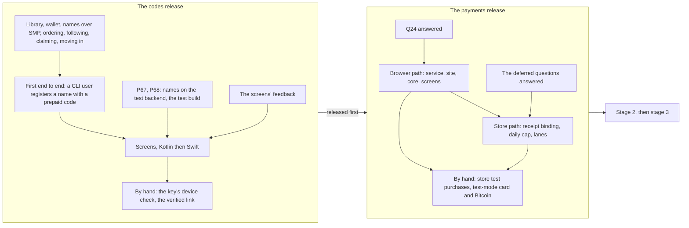

### The codes release

It starts now, its screens after the lead's feedback on the screens. If Q12 is answered yes, P15 also orders a name without links, and P18 skips its claim.

The dev setup, first (9.2):

- P67 `ci: names on the app test backend`: a local chain with the names contracts, simplexmq's resolver on it behind a second SMP server, and the store service on that chain, on all three runners · medium · low · https://github.com/simplex-chat/simplex-chat/pull/8038
  - Tested: a run with `--backend` per platform: the second server resolves an available name and a seeded one from the chain; the service's code check answers an issued code unused.
- P68 `names: point a test build at a dev store service`: `ChatConfig.storeServiceDev`, false in every shipped config, as `badgeDevRequests` (`src/Simplex/Chat.hs:78`); `/_store service <address>` sets the address for the running app, refused without it and from a paired device; the commit that sets it stays on the fork's `f/test-names-dev`, never merged · small · high
  - Tested: terminal: refused with the shipped config and from a paired device; set, a CLI client reaches a second test service at its address.

Library and types:

- P5 `names: move the registration encoding into the library`: `Simplex.Chat.Names.Registration`, the ABI encoding, the commitment, the `commit` and `registerWithCredit` calldata, the `RegisterName` intent, the acceptance digest (`acceptanceDigest`, `policyDomain`, `termsKind`); the service imports it · move · low
  - Tested: the service's registration tests on the moved code; vectors against viem and the deployed ABIs.
- P6 `names: move the order messages into the library`: `Simplex.Chat.Names.Order`, the order, `find`, another-name and spend messages, the signature format, and the EIP-191 digest (the service's `personalDigest`) · move · low
  - Tested: the service's order and signature tests on the moved code; the digest's vectors against viem.
- P13 `names: the store service's name commands`: request and response types, the two-part purchase answer; types only · medium · high
  - Tested: each command and answer encoded and parsed back.

The wallet:

- P8 `wallet: sign a message with an account`: a library function, EIP-191, 65 bytes, low `s` · small · high · P6
  - Tested: its vector against viem.
- P9 `wallet: sign typed data with an account`: a library function, EIP-712: the `RegisterName` intent, the acceptance of a registration and of a claim, the record-edit and transfer intents · small · high · P5
  - Tested: each intent's vector against viem.
- P11 `wallet: the names an account holds`: the migration, `/_wallet names`, the expiry refreshed on verification, the record that Copy or Show was used · medium · high
  - Tested: terminal: `/_wallet names`; the Copy-or-Show record survives a restart and a migration.

Names over SMP, in the store service:

- P22 `store: names over SMP — the catalog, the terms text and the code check`: the dispatch, the two names lanes, the per-lane bound at routing, the catalog's cache and its size check at start, the version; the harness the later terminal tests share: the service with names on the fake chain node (`testWorkerBoot`, `tests/Bots/StoreService/GroupIntegrationTests.hs:392`) and a CLI client set to its address (`withStoreServiceVerifierIO`, `BotTests.hs:397-421`) · medium · high · P13
  - Tested: service tests: each rule of 6.3's lanes, bounds and sizes for its commands; terminal: a CLI client reads the catalog and checks a code.
- P23 `store: names over SMP — the code order and the view` · medium · high · P22
  - Tested: service tests: 6.3's sizes for both; the SMP and web forms answer alike.
- P24 `store: names over SMP — the reveal, Try again, find and another name`, with `sends_used_up` and the view reporting it; the worker commits a lapsed commitment again (6.3) · medium · high · P23
  - Tested: service tests: 6.3's sends per order; the SMP and web forms answer alike; on the fake chain node, a lapse committed again and the name then registered with no app action, with and without a stored reveal, and the order failed once its commits or its deadline run out.
- P26 `store: names over SMP — the name code's approve and claim`: their yearly bound and chain reads; the receiving account's acceptance, in the claim's call or relayed before it, its typed-data form and place read from the contract · medium · high · P9, P23
  - Tested: service tests with the fake chain node: each owner-code relay rule of 6.3.

Ordering in the core, each tested in the terminal against the test servers, the service and the fake chain node:

- P14 `names: the catalog and the terms text`: `/_name catalog`, the clock offset, the terms text checked against its link and hash · medium · high · P13, P22
  - Tested: each catalog and terms-text check of 6.3 refuses its mismatch, a `termsZstd` frame without a declared size included; the catalog, the search and the terms text create no wallet (AC8).
- P15 `names: order a name with a prepaid code`: the order record and its migration, the secret, the commitment, the signed order, `/_name order` · large · high · P5, P6, P8, P9, P13, P14, P22, P23
  - Tested: 6.3's `bad_request` rebuild places once; a late `code_reserved` or `code_used` finds the order; each order signed with its name's kind, general or community.
- P16 `names: follow an order`: the worker in the main app, the poll, the reveal with the acceptance, kept and resent unchanged, progress events, recovery after a restart or a suspension · large · high · P11, P15, P23, P24
  - Tested: the first end-to-end result; recovery from a restart and from a suspension in each phase; a lapse while the app is away, registered after its return with no Try again; the intent signed with the deadline 6.3 sets; the reveal resent unchanged; progress events free of codes, secrets, `sealed` and receipts; terms or a community listing changed between the commit and the reveal sign nothing before the new tick; taken and a lost answer.
- P17 `names: Try again, another name, and the kept code` · medium · high · P16, P24
  - Tested: a timed-out Try again reads the view first; `commit_limit` reads Failed once the bound is raised; `sends_used_up` shows its state; taken, then another name; failed, then Try again.
- P18 `names: claim a registered name`: the address and the channel claim it once registered · small · low · P16
  - Tested: an address and a channel each claim a registered name.
- P20 `names: import a name code`: the code's wallet; its names read with `find` and the chain; the transfer by `approveWithSig` and `claimWithSig`, with the acceptance relayed before the claim where P26 finds it so; only a name that opens this profile's address or channel · large · high · P9, P16, P26
  - Tested: AC5 with a name code made as the site makes one; another address refused; changed terms before a resumed claim; recovery of a move from a restart and a suspension in each phase.

The first end-to-end result follows P5, P6, P8, P9, P11, P13, P14, P15, P16, P18, P22, P23 and P24: a CLI user with a prepaid code registers a name, and the address claims it.

The resolver, the site and the docs:

- P2 simplexmq `resolver: the terms of an available name`: the resolver reads the name policy's terms link and community list and fills `nameTerms`; name routers run a release with it; until they do, the app reads the catalog's community texts (6.3) · medium · low
  - Tested: the resolver's tests (`uv run pytest` in `scripts/resolver/service`).
- P47 simplex.domains `webapp: Open in SimpleX on the is-yours page`: 3·0's card and button · small · low · P34
  - Tested: the webapp's end-to-end cases for the "is yours" page.
- P57a `docs: names through the store service`: the registrar in `docs/protocol/names-overview.md`, names data and retention in `PRIVACY.md`, the wallet RFC's hidden-profile line, as properties from section 7 · small · low · P23
  - Tested: read against section 7 in its review.

The screens, after the lead's feedback on them, each tested on snapshots and the runners (9.1); each has a Swift copy, a pull request of its own after it (P39 and P41 to P45, one for each of P30 to P36a), tested on `ios-sim` the same way:

- P30 `ui: search a name`: on today's name screen, the field, the checks while typing, the answer's states, the paired-desktop state, the three controls kept across states, "Register with code" and the codes release's "Buy in browser", every link of 3.4 replaced or gated by storefront; 2·2 with its uncovered-name state; 4·1 on iOS outside the US · medium · low · P11, P14, P15, P17, P68
  - Tested: runners: an available, a taken and a reserved name from the local chain; equal frames of the three controls across the states.
- P35a `ui: the recovery key`: 1·4; 1·4a with Copy, Show and their check; the clipboard marks per platform with the desktop's Win32 binding; 1·11 with its key row and the reminder · medium · high · P30
  - Tested: runners: "Create a new key" creates one key, ‹ creates none, Show and Copy right after creation ask nothing; snapshots of 1·4a's states.
- P32 `ui: Check your order with the terms tick`: 1·5's card, Opens row, Until row, terms block with its community line and its sheet, and "Use a code"; 2·3; 1·5's Pay is wired to the store in P37 and P46 · medium · low · P30, P35a; follows Q25
  - Tested: runners: 2·3's button off until ticked, the order signed with the ticked kind; snapshots of a community name and of changed terms.
- P33 `ui: registering, done, taken and failed`: 1·7 and its states for an order with a code, 2·4, 1·9's row, the reminder on 1·8 · large · low · P16, P17, P18, P32
  - Tested: runners: AC13 from 1·2 to 1·8 with an issued code; a name a CLI peer registers first ends at 2·4; equal frames of 1·7 and 1·8 across their states.
- P34 `ui: the code sheet, and Bring in a name`: 2·1, opened by P30's "I have a code" and "Register with code"; 3·1; the verified link back `/name/code`, with the website's association files and page, and the release check of the manifest's hosts; 3·2 and 3·3 with the reminder; every build · large · high · P20, P30, P32, P33, P35a
  - Tested: runners: an issued code on 2·1; the backend's name-code name moved in from 3·1 to 3·3; the routers take the verified link before connection links; the page clears the code first.
- P36a `ui: the expiry date` as the footer under the name's row · small · low · P11, P30
  - Tested: runners: a registered name's footer reads its expiry.

By hand, at the codes release's end:

- P35a: 1·4a's device check, its exception, capture protection and the clipboard marks on an iPhone, an Android phone, Android 8, Windows and macOS: with SimpleX Lock on and off, in both modes, after a new app passcode, without a device lock, from a channel's info.
- P34, P47: the verified link from the site's "is yours" page into the app on a phone, once the website serves the association files.
- The core's Postgres tests and the query plans, on the host.
- Claude sessions on the runners, only on the user's word.

### The payments release

It starts once Q24 is answered for the browser path, and once the deferred questions are for the store path: receipt binding (Q9), the daily cap (Q10), the Apple product type (Q8), the release of iOS payment (Q5), the console and export check (Q14). Its runner tests also need three stand-ins, each built in the pull request whose code it stands in for: the mock verifier's name purchases (P27a), opened codes paid in dev mode (P59), and the store stubs of test builds (P37, P46).

- P7 `names: prepaid codes from the wallet`: the code derived from a seed and a nonce or a store reference, under the store's info string, on the existing `NamePrepaidCode`; the token; the wallet RFC's section and the crypto registry's info string · small · high
  - Tested: vectors against viem: a code from a nonce, a code from a reference, the token.

The browser path:

- P58 `store: the price in the names catalog`: one name's chain price for the catalog's years in its cache, and the longest invoice window, on the web and over SMP · small · low · P22
  - Tested: service tests: the catalog's price equals a 6-character name's chain price on the fake chain node.
- P59 `store: an invoice for a name's prepaid code`: the service's part of 6.8 (opening and closing a code for payment, the invoice per way to pay, the confirming state, settlement, money on a closed invoice or beyond the price, the code check's answers, the sweep), with its migration on both backends; in dev mode, `[dev] pay_opened_codes_after_seconds`: a mock provider pays an opened code in full that long after, with no page, refused beside `[stripe]` or `[btcpay]` and without `accept_unverified_store_receipts` · large · high · P58
  - Tested: service tests with the fake BTCPay and Stripe: each rule of 6.8's open, close, invoice and code-check bullets; two concurrent requests for one hash make one invoice; late or short crypto credited to no balance (Q20); the dev setting refused beside a real provider.
- P65 `store: browser-paid codes in the code order`: `sale_closed` under codes-only for an invoice-marked code; its commits counted and bounded across orders, in the column it shares with P27c · small · high · P59
  - Tested: service tests: browser-paid codes in the code order (6.3).
- P66 `store: the operator command for a browser payment`: `//name-invoice` as in 6.3; the refund record and its migration on both backends · small · high · P59, P65
  - Tested: service tests: each branch of the refund diagram (6.3), one refund per part of a payment.
- P60 simplex.domains `webapp: the invoice for a code, and Payment received`: 4·3 and 4·4 as in 6.6 and 6.8 · medium · high · P59
  - Tested: the webapp's end-to-end cases for 4·3 and 4·4.
- P62 `names: pay in the browser`: the browser code's info string and the reference, with vectors; `/_name browser` as in 6.8, its record and migration on both backends · medium · high · P7, P15, P16, P22, P58, P59
  - Tested: terminal with the fake chain node and the fake BTCPay: each rule of 6.8's "The code", "Close", "The app notices payment" and "ask until"; the code made on 4·2 with nothing recorded, the same code while the order waits, "Remove order" dropping it; the drafts holding the reference and the second hash, never the code; AC7 with no link back.
- P61 `ui: pay in the browser, and a paid order's screens`: 1·2's priced states; 4·1 priced from the catalog; 4·2, its waiting state with "Remove order" and its three other states; 1·7's paid states that store payments share, and 1·10; 1·9's rows; 1·11's "Payment" row; the drafts with the reference and the second hash; the verified link back `/name/paid`, routed to the waiting order; its Swift copy P63 · large · low · P30, P32, P33, P34, P35a, P62
  - Tested: runners (desktop and the F-Droid Android build), the service paying opened codes: 4·1 to 1·8 with no link back; snapshots of every state of 4·2 and of a paid 1·7.

The store path:

- P27a `store: a name code bought in a store`: the product; the purchase command with a hash alone; the payment column; the migration; keying by `originalTransactionId`; the token's check; which buyer details Play Console shows; the mock verifier reads the token from a test receipt (Apple: the payload's `appAccountToken`; Play: a test token `test.<token>.<random>`) · medium · high · P7, P13
  - Tested: service tests with the fake Play and App Store verifiers: each step of 6.3's payment part and each row of its table; repeats at any age; 6.1's token rules; promo, retired-product, refunded-receipt and test-purchase cases; a 6- and a 63-character name (AC3); the mock's token from both stores.
- P27b `store: the order in the purchase request`: the order part, its answers, the names' Play bound · medium · high · P23, P27a
  - Tested: service tests: each row of 6.3's order-part table; a refused order keeps the code; codes-only, then open; changed terms before the order and before the reveal; `move_limit` and the 30-day release.
- P27c `store: the sale's gates for store-paid codes`: `sale_closed` with its gate; the counts in the Sender's save with their columns and row; the worker's wait in `sendRegister`, oldest first; the commits' bound at the requests · medium · high · P27a
  - Tested: service tests: each rule of 6.3's daily cap and commits, concurrent registers at the cap and a restart between the save and the phase's write (counted once) included.
- P28 `store: the operator command for a store payment`: `//store-payment` as in 6.3 · medium · high · P27a, P27c
  - Tested: service tests: each action of `//store-payment`; a Try again after the operator's revoke answered `code_invalid`.
- P19 `names: pay with a store receipt, in one request`: the purchase record; the code and token before the sheet; the signed order kept and sent with the receipt; resends after a lost answer; the size check; the answers to a used or revoked receipt · large · high · P7, P16, P17, P27b
  - Tested: terminal with the fake verifiers: each rule of 6.3's repeats and sizes on the core's side; 6.5's open-purchase, token and hidden-profile rules; recovery of a purchase from a restart and a suspension in each phase; a credited "Not confirmed" purchase shown without a restart.
- P37 `android: the Play purchase lane`: first the badge lane skips name products; then the product, 1·5's Pay and 1·6, pending purchases, the store-only states of 1·7, the store-account lines, acknowledge and consume; a test switch for products and purchases, false in every shipped build, as `useBadgeTestProducts` (`BadgeStore.kt:102`) · medium · high · P19, P35a, P61
  - Tested: `android-emu` building the Google Play flavor on the test branch: AC1 with a stubbed purchase the mock verifier credits; each lane skips the other's products.
- P46 `ios: the App Store purchase lane`: first the badge lane skips name products, in every build; then the lane behind the build-time switch; a test switch that makes a signed transaction the mock verifier reads, false in every shipped build · medium · high · P19, P35a, P61
  - Tested: `ios-sim` with the build-time switch and the test switch on: a stubbed purchase from 1·5 to 1·8; each lane skips the other's products.
- P35c `ui: the chat console, a database export and migration ask with the lock off` (Q14); its Swift copy P64 · small · high · P35a
  - Tested: snapshots of the prompts; on devices by hand (below).
- P57b `docs: payment linking`: the stores and payment linking in `PRIVACY.md` and `docs/protocol/names-overview.md`, as properties from section 7 · small · low · P27c
  - Tested: read against section 7 in its review.

By hand, at the payments release's end:

- P37: a Play test purchase by a licence tester, on a build from the internal track.
- P46: an Apple sandbox run of 6.5's undocumented cases, the switch on, with 6.3's size of a real transaction and the longest short link the app makes.
- P59, P60: a card payment in Stripe's test mode and a Bitcoin payment through BTCPay on a test network, through the page.
- P35c: Q14's checks on devices, with the lock off and in passcode mode, desktop's floating console included.
- P37, P46, by the operator: each store's product as 6.2 sets it.
- The operator's chain operation M13 (`setPrices`, one base price), before the sale.
- The core's Postgres tests and the query plans, on the host.

### Stage 2

P3, P4, P10 and P12 can start at any time.

- P3 simplexmq `resolver: the names an address owns`: `/v2/owned-by/<address>` · medium · low
  - Tested: the resolver's tests.
- P4 simplexmq `smp: ROWN, the names an address owns`: the command, server, client, the agent's `ownedSimplexNames`, each account's request to one relay, spread across them, at the next free SMP version · large · high · P3
  - Tested: simplexmq's server, client and agent tests.
- P10 `wallet: restore from the recovery phrase`: `/_wallet import`, refused where a wallet exists and from a paired device, the counter set past the accounts found, the shown-words record set · medium · high
  - Tested: terminal: each refusal; the counter past the accounts found.
- P12 `wallet: find the names a phrase owns`: the scan over ROWN with a gap limit, a start index, progress events and a stop; an `ArchiveConfig` field set only by the database import screen, never by device migration, kept in preferences until the next start, so "Look for your names again" asks before registering · large · high · P4, P10
  - Tested: terminal against the local simplexmq: 6.10's scan rules; a reinstall recovering an open purchase by its token without "Restore purchases"; AC10.
- P25 `store: names over SMP — the record edit` · small · high · P22
  - Tested: service tests: the SMP and web forms answer alike.
- P21 `names: set what a name opens`: the relayed record edit, the edits left this year · medium · high · P9, P25
  - Tested: terminal: AC11's edit, to this profile's address and to a link outside the app, within the yearly allowance.
- P48 `names: attach a name on move or restore`: one relayed edit to this profile's address or channel; moving in a name that opens something else · small · high · P20, P21
  - Tested: terminal: a moved-in name that opens something else attaches with one edit.
- P49 `names: give a name to another profile`: the account rebound, the record re-pointed · small · high · P21
  - Tested: terminal: the account rebound, the record re-pointed.
- P29 `ui: the names hub`: the Advanced settings row; the empty and full hub; its paired-desktop state; a name's own screen; the key row; Restore purchases with the lanes' part; Import with "Bought on the web" · medium · high · P30, P35a, P36a, P37
  - Tested: runners: the hub's row for each order state; snapshots.
- P35b `ui: enter the 24 words`: the field, the scan with its progress, found and none found, 5·3 with Reveal and "Look for my names", "Look for your names again" · large · high · P10, P12, P29
  - Tested: runners, once simplex-chat/simplexmq has P4: the 24 words bring back the backend's names; snapshots.
- P50 `ui: set what it opens`, to any contact or channel link, and giving a name to another profile · medium · low · P21, P29, P49
  - Tested: runners: a name set to a link outside the app; snapshots.
- P38, P51: the screens of P29, P35b and P50 in Swift · as the Kotlin pull requests · low · P29, P35b, P50
  - Tested: `ios-sim`, as the Kotlin pull requests.
- P56 `store: the test-purchase deployment` (6.9), with the App Store product submitted, when iOS is switched on: after stage 2's restore (Q5) · small · high · P27a, P46
  - Tested: service tests: the deployment refuses badge commands, or credits name products only.

By hand, at stage 2's end: 1·4a's stage-2 checks on devices (P35b); Restore purchases with real store accounts (P29); App Review with the test deployment (P56).

### Stage 3

- P52 `store, names: transfers to another person`: the relay, its allowance, the receiving account's acceptance · medium · high · P26
  - Tested: service tests with the fake chain node: AC12's transfer within 6.11's rules.
- P53 `store: renew a name`: the renewal products, `renewWithCredit`, 6.11's checks · medium · high · P27a
  - Tested: service tests: each of 6.11's checks refuses its case.
- P54 `names: renew a name`: the core command · medium · high · P53
  - Tested: terminal: AC12's store-paid renewal reaches the chain.
- P36b `ui: reminders`: the row's warning, the banner, the notifications per profile, Kotlin then Swift · medium · low · P36a
  - Tested: snapshots of each reminder state; a core test of the stored expiry.
- P55 `ui: transfer and renew`, Kotlin then Swift · large · low · P52, P54
  - Tested: runners: a transfer, and a renewal with the stubbed store; snapshots.

By hand, at stage 3's end: a renewal bought in each store's test environment.

### Reviews

- A lean review after each high-risk pull request, P37's on its own; one review loop over each release and stage at its end.
- Reviewed together, as money: P19 and P27a to P27c; P58 to P62, P65 and P66.

## 9. Test plan

"Each rule" in section 8 means one test per bullet or table row of the section named.

### 9.1 Where a pull request is tested

- The core: its CLI form and a terminal test, in the container, against the test servers; a test that needs the store service starts it with names on the fake chain node, its client set to the service's address (P22's harness).
- The store service: its tests with the fake Play and App Store verifiers, the fake BTCPay and Stripe and the fake chain node (`tests/Bots/StoreService/Fake*.hs`), on Postgres too in the fork's reduced build (`test-store-postgres`).
- simplexmq and its resolver: their tests, in simplexmq's clone. A simplex-chat pull request that needs an unmerged simplexmq change is tested in the container against that clone (`use-local-simplexmq`), and on the runners once simplex-chat/simplexmq has the change.
- The site: the webapp's end-to-end cases.
- The apps:
  - snapshot previews, references committed (iOS `previewScenes()` in `SimpleX Snapshots`; Kotlin `SnapshotTest.kt` up to the largest font scale), of every screen and state of 6.6, the store-account lines and the hub's rows: light and dark; shortest and longest names, 1·7 and 3·1 with 63 characters; smallest and largest widths; largest text size; storefronts in and outside the US; one list layout;
  - equal frames, asserted by the snapshot tests, of 1·2's three controls across its states, and of 1·7's main button, stages and card across its states and 1·8, with and without the reminder, at the default and largest text sizes;
  - the app test workflows (`ci-run desktop-linux`, `android-emu` and `ios-sim`, with `--backend`), on a test branch: the pull request's branch with `f/test-names-dev` merged, its scripted cases added to the feature tests of https://github.com/simplex-chat/simplex-chat/pull/8038, on the names test backend (9.2);
  - Claude sessions on the runners only on the user's word.
- Every pull request: each digest, calldata, derived wallet, code and token it adds matches its vector against viem and the deployed ABIs; each wallet or name command it adds is refused from a paired device; the schema dump and the API docs regenerated where needed; the fork's reduced build passes on its final commit.

### 9.2 The names test backend and the test build

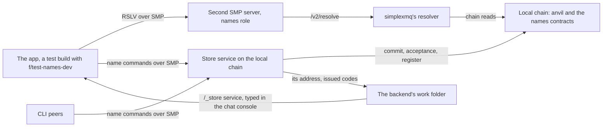

- P67 adds to the test backend (`backend.sh`; Android uses desktop's, iOS has its own):
  - `simplex-store-service`, built by `build-backend.sh` beside the CLI;
  - a local chain: anvil and the names contracts, compiled from the namespace contract at the commit the site's dev image pins (`webapp/dev/Dockerfile` in simplex.domains), deployed with their terms server by the site's `dev/deploy.ts`, as `scripts/store-service/dev/chain.sh` does: the contracts land at the same addresses in every run, with the deploy's seeded names;
  - simplexmq's resolver (`scripts/resolver/service/snrc-resolve.py`, at the commit `cabal.project` pins) on that chain, behind a second SMP server whose names role asks it; the first names server and `names-resolver.py` stay for the cases that use them;
  - the store service on that chain, configured as `scripts/store-service/dev/contract-run.sh` configures it; codes issued with `//issue name` in `--run-cli` before it starts;
  - a name held by a name code, registered through the site's order API by a script that signs as the site does, with viem from the webapp's dependencies;
  - the service's address, the second server's address and the codes, written to the work folder.
- The test build: the commit on `f/test-names-dev` sets `storeServiceDev` (P68) and the local chain's id, addresses and namespace; the test's setup types `/_store service <address>` in the chat console. The payments release adds to that commit the store test switches (P37, P46), iOS's build-time switch, the Google Play flavor for `android-emu`, and the local service's names site as the browser path's site.
- The payments release adds to the backend's service `[dev] accept_unverified_store_receipts = on`, whose mock verifier credits the test builds' purchases (P27a), and `[dev] pay_opened_codes_after_seconds` (P59).

## 10. Risks

Besides those 6.5's sandbox run settles, section 7 states, and the questions leave open:

- The wallet's known limit 5: a database restored from an older backup can reuse an account, so two names share an owner address and are linked publicly; stage 2's "Look for your names again" covers a database imported on the app's database screen, not a file restored outside the app.
- One price on chain: until `setPrices` holds one, a short name costs the registration budget more than the store takes.
- The contract source is private: a registration one day under the 730-day minimum, refused, joins the store's end-to-end tests; the renewal rules are rechecked when stage 3 is built.
- Store policy: Apple allows in-app purchase "to sell and sell services related to non-fungible tokens (NFTs), such as minting, listing, and transferring", and viewing them "provided that NFT ownership does not unlock features or functionality within the app" (3.1.1); Google requires the Tokenized Digital Asset marking and declaration; whether a key-holding app is a "software wallet" under Google's cryptocurrency policy is for the names work to settle before the codes release, the first to hold the key ("my app is a non-custodial software wallet").
- Refund abuse after registration: a day's loss is at most the daily cap, 50 store-paid registrations by default, each its chain price and gas; watched by hand in the stores' reports.

## 11. Open questions, for the lead

Each line: the question, then the answer this plan builds on; approving the plan approves building on these answers, and a different answer changes the pull requests that follow it. Options and their costs are on the decision page.

Answer first; the codes release starts without them, Q12's answer changes P15, P18 and the codes screens, and Q24's starts the browser path:

- **Q24.** Pay in the browser as row 4 draws it? → Yes, as drawn (6.8): the site's ways to pay, a link with only the code's hash, the name straight into the app's wallet, support refunds per Q20 and Q21.
- **Q12.** Register a name that opens nothing in v1? → The plan builds on no (D15); the recommendation is yes, with a stage-1 list of the profile's names (5·2 without Register, Import and Restore purchases).

Decided on 11 Nov 2026:

- **Q16.** A codes-only release before paying in the app? → Yes: codes first, then payments, as separate pull requests and releases within the beta (D22, section 8).
- **Q23.** Clear a moved-in name's earlier records and subnames? → No: nothing is cleared; at most a notice of what the name holds, not in v1.

The other questions:

- **Q1.** Keep a recovery key that finds no names on a new phone? → Yes, after a warning (6·3).
- **Q2.** The word for your own name coming into the app? → "Move"; "transfer" for someone else.
- **Q3.** Deferred. Does the app say buyers must be 18 or older? → No; the terms say it.
- **Q4.** Deferred. The app's own purchase terms, besides the names terms? → None at launch; the store's terms apply.
- **Q5.** Deferred. When iOS store payment is switched on? → Once a sandbox run passes and stage 2's restore has shipped, with the test deployment (6.9).
- **Q6.** Deferred. Linking a payment to its name? → Register at once; `PRIVACY.md` states it (section 7, P57b), the screens don't.
- **Q7.** Detail of Q24. What the invoice's link holds? → The code's hash alone; no order code shows (decided on 11 Nov).
- **Q8.** Deferred. Apple product type? → Non-renewing subscription.
- **Q9.** Deferred. Bind a receipt to its wallet with the token? → Yes.
- **Q10.** Deferred. The daily cap? → Counted when a register is sent; the gate counts orders in flight; the stores' reports watched by hand.
- **Q14.** Deferred. Once a wallet exists, do the console, a database export and migration ask with SimpleX Lock off? → Yes (P35c): the stop, an export from a stopped chat and migration ask for the device's check, any answer but `SEWalletNotFound` counting as a wallet; the console asks on `/_wallet`, `/sql`, `/db` and `/_db` (`consoleSendMessage`, `sendCommand`), the lock's check with the lock on, the device's with it off.
- **Q17.** Copy on the key sheet? → Copy and Show on 1·4a, the copy marked as 1·4a says.
- **Q18.** A taken name's use as text on 1·2? → The plan builds on D16's button; the recommendation is text in the row, "Taken, used by address and channel".
- **Q19.** Show a kept payment as a code with Copy? → No, not in v1.
- **Q20.** Detail of Q24. Browser money that arrives late, short or beyond the price? → Support refunds it through `//name-invoice`, without a revoke or a balance.
- **Q21.** Detail of Q24. A phone lost after paying in the browser? → A card payment refunded through `//name-invoice` after the 30-day conditions; crypto isn't. A different answer that changes the nonce is due before P62.
- **Q22.** Deferred. Ask for the device's check on Copy and Show straight after the key is created? → The plan builds on no (1·4a's exception); the recommendation is yes.
- **Q25.** The terms on the checkout: the obligations under the tick (A), or one tick line whose link opens a half-screen sheet with the obligations and Agree (B)? → A (6.6's terms block).

## 12. Out of scope (noticed, not doing)

- A reminder before an unfinished order's last commitment lapses.
- "Add to calendar" on the name's success.
