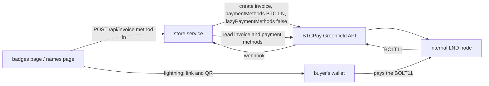
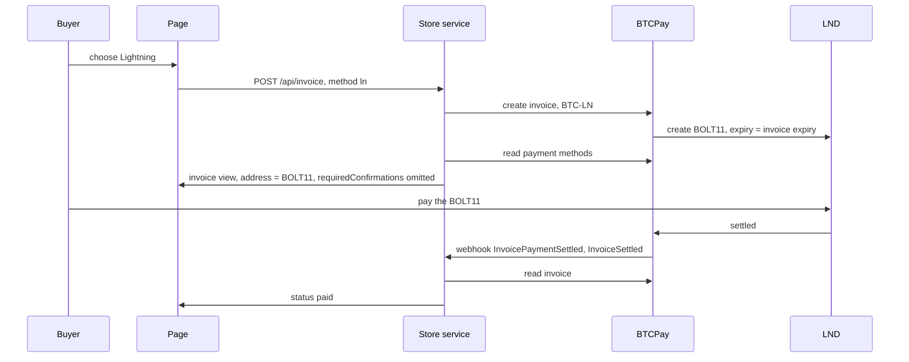
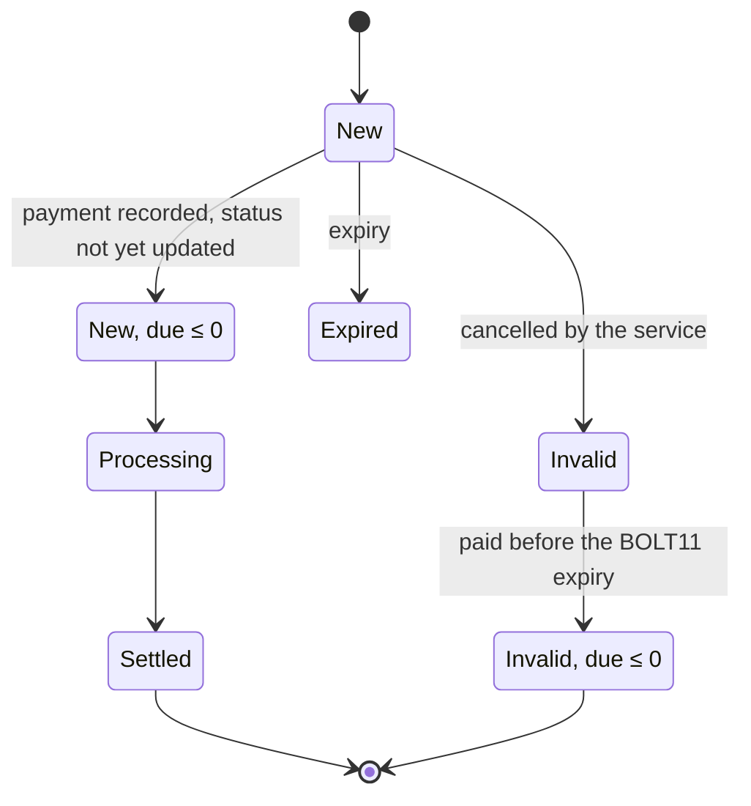

# Bitcoin over Lightning in the badges and names stores

Pull requests:
- simplex-chat/simplex-chat#8225: store service, badges page, docs, end-to-end tests
- simplex-chat/simplex.domains#21: names page

## Decisions

| Decision | Choice |
|---|---|
| Stores | badges and names |
| Data model | a third value of `CryptoCurrency`: `CCLn`, wire text `ln` |
| Checkout | a fourth method button: Lightning |
| Invoice kind | BOLT11 only; LNURL is not supported |
| QR code | the `lightning:` link of the wallet button |
| Cancellation | the order is closed at BTCPay (`Invalid`); the buyer is warned not to pay |
| Provider | BTCPay Server 2.4.4 with its internal LND node |
| Inbound liquidity | a channel from BTCPay's "Get Lightning Channel" plugin |
| End-to-end tests | a dispatch-only workflow against BTCPay on regtest |

## Parts

## Payment

## Invoice signal for `CCLn`

| BTCPay status | Due | Signal |
|---|---|---|
| `New` | > 0 | `SigFunded … PaidInPart`, only with money received |
| `New` | ≤ 0 | `SigFunded … PaidInFull` |
| `Processing` | any | `SigFunded … PaidInFull` |
| `Settled` | any | `SigSettled` |
| `Expired`, `Invalid` | > 0 | `SigClosed … PaidInPart` |
| `Expired`, `Invalid` | ≤ 0 | `SigClosed … PaidInFull` |

Settlement rules:
- `settlesOnReceipt CCLn = True`: payments are credited under every speed policy.
- Units: millisatoshi, `unitDecimals CCLn = 11`.
- Rate: `BTC_<currency>`.

## Closed order paid afterwards

| Order | Result |
|---|---|
| Name | credited to the order's balance as late money |
| Badge | unpaid; an error is logged for a refund by support |

## Pages

| Page | Lightning |
|---|---|
| Checkout | button "Lightning" |
| Pay screen | BOLT11 labelled "Lightning invoice", shown as its first 14 and last 8 characters; Copy: all of it; QR and wallet button: `lightning:<bolt11>` |
| Confirming screen | the confirmation count is omitted |
| Cancel confirmation, badges | the BOLT11 stays payable until it expires |
| Closed screen, badges | "Do not pay its Lightning invoice" |
| Closed screen, names | "can still be paid until HH:MM" while the expiry, by the service's clock, is ahead |

## Tests

| Level | Cases |
|---|---|
| Haskell, fake BTCPay | signals under every speed policy; New, closed and cancelled-then-paid invoices; create body; enabled methods; rate |
| Haskell, recorded bodies | settled; cancelled then paid |
| Haskell, BTCPay on regtest | badge paid by webhook; badge paid by poller; badge cancelled then paid; name paid; startup log |
| Badges page | screens; QR; cancel; history |
| Names page | screens; QR; BOLT11 check; browser specs |
