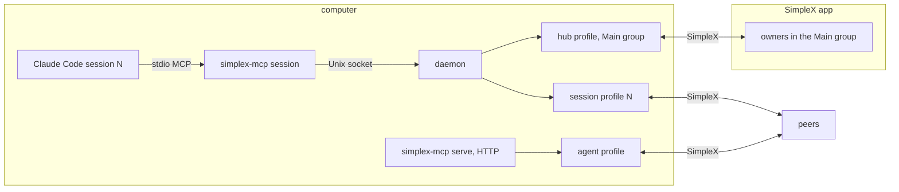
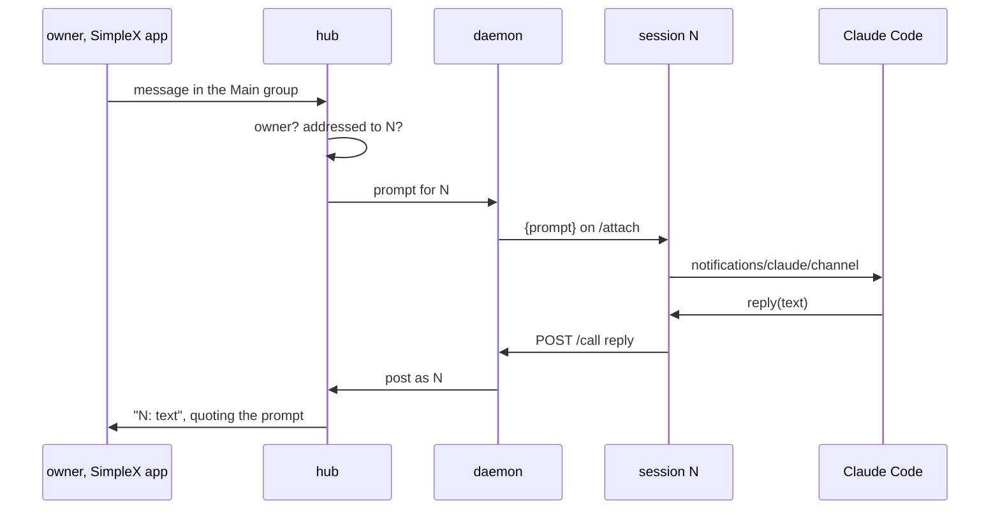
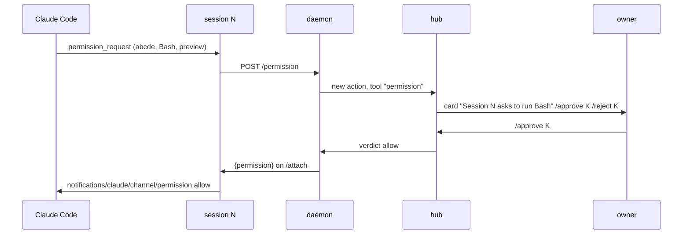
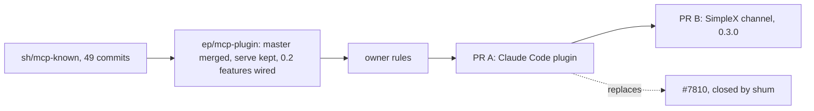

# SimpleX MCP 0.3.0: Claude Code plugin and SimpleX channel

Status: draft for review. Code references: master `2abd48450` (MCP 0.2.0); #7810 at `a7953a767`. Claude Code references: https://code.claude.com/docs/en/channels, https://code.claude.com/docs/en/channels-reference.

Outcome:
- Claude Code users install SimpleX with `/plugin install`, scan one QR code and join one group.
- Each Claude Code session has its own SimpleX profile for its own chats.
- Owners prompt any running session from the SimpleX app; the session receives the prompt without polling.
- Owners approve the session's tool use (`Bash`, `Write`, `Edit`) in the SimpleX app.
- `simplex-mcp serve` keeps serving other MCP hosts over HTTP.

## Decisions

Agreed on 2026-11-06:
1. `serve`, `register` and HTTP stay.
2. #7810's code is adopted with `serve` kept; shum reviews the result.
3. The plugin is released as 0.3.0.

Design:
4. One code base: `serve` and the plugin share `Control`, `Actions` and `AgentTools`.
5. Prompts, approvals and tool-use verdicts are accepted only from owners of the Main group.
6. The owner link reaches the person only: the `systemMessage` of the SessionStart hook and `simplex-mcp link` in a terminal; hook context and tool results never contain it.
7. A session's approval mode changes to `host` only after an owner approves a card in the Main group.
8. While owners exist, an owner reset runs only after an owner approves a card in the Main group; without owners it runs from a terminal.
9. The launcher runs `npx` with the plugin folder as its working folder.
10. Refused paths cover the whole data root.
11. Standing approvals of closed sessions are listed by `/list` and removed by `/revoke`.
12. The channel is part of the plugin's session server; the daemon pushes events on the session's `/attach` stream.
13. The SimpleX profile of a session is created at its first SimpleX tool call; the session is known to the hub from its start.

Open, with recommendations:
- D0 building on #7810: (a) branch `ep/mcp-plugin` from `sh/mcp-known` in the agents' fork, master merged into it, PR A against master replacing #7810, and the channel as PR B on top, recommended; (b) a PR into `sh/mcp-known`, merged by shum, then #7810 merged; (c) five PRs on master that copy #7810's code.
- D1 prompt addressing: (a) reply or `N:` prefix in the Main group, recommended; (b) one group per session.
- D2 tool-use approvals relayed to SimpleX: (a) every tool prompt, recommended; (b) SimpleX actions only.
- D3 profile name seen by peers: (a) `Claude Code N` unless the person names it, recommended; (b) the project folder name.
- D4 files in prompts: (a) in the channel PR, recommended; (b) text only in 0.3.0.
- D5 request to Anthropic for the channel allowlist: (a) after 0.3.0 is published, recommended; (b) now.

## Components



```
process               runs                                   holds
simplex-mcp session   one per Claude Code session, stdio     tools, channel capability
daemon                one per data root, Unix socket          hub, session profiles, actions
hub                   inside the daemon                       Main group, owners, cards
session profile       inside the daemon, from the first tool  the session's chats and files
simplex-mcp serve     one per agent, HTTP 127.0.0.1           agent profile, control chat
```

## Channel

Session server capabilities:
```
capability                                  value
experimental.claude/channel                  {}
experimental.claude/channel/permission       {}   only with D2 (a)
tools                                       {}
```

Daemon to session, lines on `/attach`:
```
line                                         sent when
{prompt: {text, from, item, file?}}          an owner's message is routed to the session
{permission: {requestId, behavior}}          an owner decides a tool-use card
```

Session to Claude Code:
```
notification                                 params
notifications/claude/channel                 content: text
                                             meta.session: N
                                             meta.from: owner name
                                             meta.item: Main group item ID
                                             meta.file: path, D4 (a)
notifications/claude/channel/permission      request_id
                                             behavior: allow | deny
```

Claude Code to session, then session to daemon:
```
notification                                       route
notifications/claude/channel/permission_request    POST /permission {id, requestId, toolName, description, inputPreview}
```

New tool:
```
tool    input                       action
reply   text, file?, reply_to?      posts to the Main group as "N: text", quoting the prompt item; no card
```

Server instructions, added: messages in a `simplex` channel are the owners' prompts; the session answers them with `reply`.

A prompt to a session started without the channel flag is dropped by Claude Code; the hub cannot detect it.

### Prompt flow



Addressing, D1 (a):
```
owner message in the Main group          goes to
reply to a post or card of session N      session N
"N: text"                                 session N
other text, one session attached          that session
other text, several sessions attached     none; the hub replies "Reply to a session's message, or start with N:."
"/command"                                owner command, as now
```

The hub posts `Session N started: NAME` when a session attaches; owners reply to it.

Files, D4 (a): an owner's file in a prompt is received by the hub without a card into `ROOT/sessions/<id>/files/main/<file ID><extension>`; `meta.file` is its path. `reply` with `file` sends it to the Main group under the refused-path rules of `send`.

### Tool-use approval



```
PermissionAction
  number          action number in the Main group
  session         session number
  requestId       five letters from Claude Code
  toolName
  description
  inputPreview
  state           pending | allowed | denied | ended
  decidedBy       owner name
```

```
state     next
pending   allowed | denied | ended
allowed   final
denied    final
ended     final
```

```
on permission_request(r):    action = permission(session, r); post card
on /approve K by owner:      if action K pending: state = allowed; push {permission: allow}
on /reject K by owner:       if action K pending: state = denied; push {permission: deny}
on session detached:         for each pending permission of the session: state = ended; edit card
```

An answer at the terminal wins; Claude Code drops the later remote verdict.

## Launch

```
state                         command
listed by Anthropic           claude --channels plugin:simplex@simplex-chat
before the listing            claude --dangerously-load-development-channels plugin:simplex@simplex-chat
Team and Enterprise plans     an admin adds simplex@simplex-chat to allowedChannelPlugins
```

The development flag works in interactive sessions only. Without either flag the plugin works without prompts and tool-use relay.

## Pull requests

D0 (a):


```
PR  branch                               base           commits
A   ep/mcp-plugin                        master         #7810's 49 commits
                                                        merge of master: serve, register and HTTP kept; 0.2 features addressed by S:CHAT
                                                        owner rules, decisions 5-13
B   ep/mcp-channel                       ep/mcp-plugin  channel, reply tool, tool-use relay, files in prompts, version 0.3.0
```

Size budgets, source lines written on top of `sh/mcp-known`, without tests:
```
PR  budget
A   600
B   300
```

PR B is based on master after PR A merges.

D0 (c), five PRs on master, source lines without tests:
```
PR  title                                                      budget
1   mcp: actions with a session and their own timers           150
2   mcp: hub and session agents, S:CHAT owner commands         450
3   mcp: daemon, Unix socket and stdio session                 900
4   mcp: Claude Code plugin                                    250
5   mcp: SimpleX channel for Claude Code                       300
```

Sources ported from #7810 under D0 (c):
```
PR 1
  src/actions.ts
PR 2
  src/hub.ts
  src/agent.ts
  src/core.ts
  src/control.ts
PR 3
  src/daemon.ts
  src/socket.ts
  src/client.ts
  src/session.ts
  src/protocol.ts
  src/config.ts
  src/files.ts
PR 4
  .claude-plugin/
  hooks/
  skills/
  plugin/
  src/hook.ts
  src/owner.ts
PR 5
  none
```

Each PR keeps `serve` and its end-to-end tests passing. The channel PR sets the version to 0.3.0; `build.yml` publishes it after the merge.
