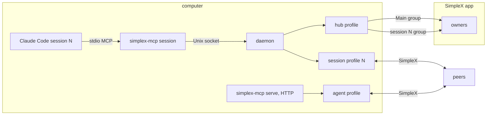
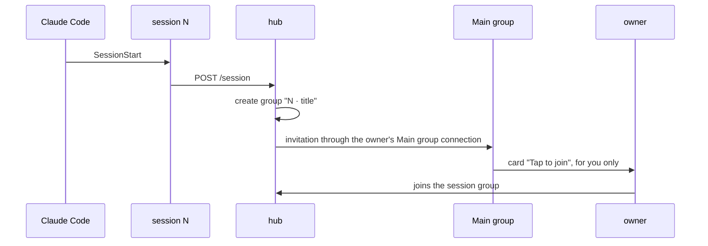
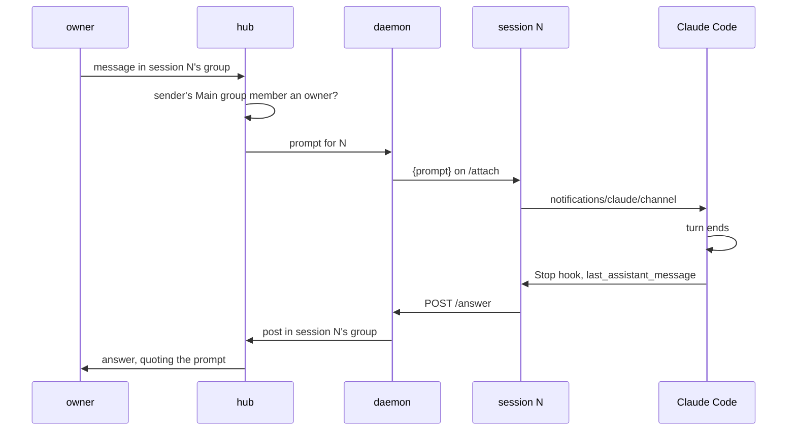
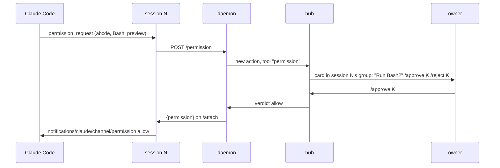
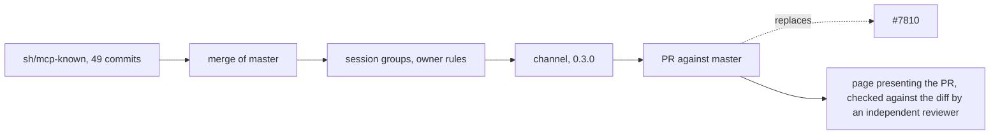

# SimpleX MCP 0.3.0: Claude Code plugin and SimpleX channel

Status: draft for review. Code references: master `2abd48450` (MCP 0.2.0); #7810 at `a7953a767`. Claude Code references: https://code.claude.com/docs/en/channels, https://code.claude.com/docs/en/channels-reference.

Outcome:
- Claude Code users install SimpleX with `/plugin install`, scan one QR code and join the Main group.
- Each Claude Code session has its own group with its owners, and its own SimpleX profile for its chats.
- Owners prompt a running session in its group; the session receives the prompt without polling.
- Owners approve the session's tool use (`Bash`, `Write`, `Edit`) in its group.
- `simplex-mcp serve` keeps serving other MCP hosts over HTTP.

## Decisions

Agreed on 2026-11-06:
1. `serve`, `register` and HTTP stay.
2. #7810's code is adopted with `serve` kept; shum reviews the result.
3. The plugin is released as 0.3.0.

Decided on 2026-11-07:
4. One PR: branch `ep/mcp-plugin` from `sh/mcp-known` in the agents' fork, against master; it replaces #7810.
5. The PR reaches the user as one page that presents it; an independent reviewer checks the page against the diff before the user sees it.
6. D1 (b): one group per session. The hub invites the Main group's owners to it through the Main group; other members of the Main group join it by `/join N`.
7. D2 (a): every tool prompt of a session is relayed to its group.
8. D3 (a): peers see the session profile as `Claude Code N` unless the person names it.
9. D4 (a): files in prompts and in replies are in this PR.
10. D5 (a): the user asks Anthropic to list the channel after 0.3.0 is published.
11. D6 (a): the hub, the plugin's main profile, speaks for Claude: it posts the session's answers and cards in the session's group.

Design:
12. One code base: `serve` and the plugin share `Control`, `Actions` and `AgentTools`.
13. Prompts, approvals and tool-use verdicts count only from session group members whose Main group member is an owner.
14. The owner link reaches the person only: the `systemMessage` of the SessionStart hook and `simplex-mcp link` in a terminal; hook context and tool results never contain it.
15. A session's approval mode changes to `host` only after an owner approves a card in the session's group.
16. While owners exist, an owner reset runs only after an owner approves a card in the Main group; without owners it runs from a terminal.
17. The launcher runs `npx` with the plugin folder as its working folder.
18. Refused paths cover the whole data root.
19. Standing approvals of closed sessions are listed by `/list` and removed by `/revoke` in the session's group.
20. The channel is part of the plugin's session server; the daemon pushes events on the session's `/attach` stream.
21. The SimpleX profile of a session is created at its first SimpleX tool call; the session and its group exist from its start.
22. Claude's final answer of every turn is posted by the hub from the Stop hook's `last_assistant_message`; the `reply` tool sends files only.

Open, with a recommendation:
- D7 prompts typed in the terminal: (a) posted in the session's group by a local profile `Terminal`, one per data root, a member of every session group, recommended; (b) posted by the hub, marked as typed in the terminal; (c) not posted.

## Components



```
process               runs                                   holds
simplex-mcp session   one per Claude Code session, stdio     tools, channel capability
daemon                one per data root, Unix socket          hub, session profiles, actions
hub                   inside the daemon                       Main group, session groups, owners, cards
session profile       inside the daemon, from the first tool  the session's chats and files
simplex-mcp serve     one per agent, HTTP 127.0.0.1           agent profile, control chat
```

## Groups

```
group            host  members                                     holds
Main group       hub   owners and other members                    QR link, invitation cards, /join, /sessions, owner reset
session N group  hub   Main group owners, invited by the hub       prompts, replies, action and tool-use cards of session N
                       Main group members who sent /join N
```

```
preference         Main group                  session N group
history            on                          on
direct messages    on, role owner              off
commands           /join, /sessions            /approve, /reject, /receive, /forward, /revoke, /pending, /list, /leave, /delete
name               the plugin's main_group     N · session title or project folder
```

Direct messages in the Main group are on for the owner role, because the core sends an invitation through a member connection only where direct messages are allowed (`docs/rfcs/2026-10-10-invite-member-via-group.md`). Joining needs a SimpleX app with chat version 22: v7.1.0 or later.

Session group custom data:
```
SessionGroupData
  session          session number
  invited          list of InvitedMember
InvitedMember
  groupMemberId    member in the session group
  mainMemberId     member in the Main group it was invited through
```

```
on session start (new id):   create the session group; for each Main group owner: apiAddMemberViaGroup(group, main, owner, owner); record InvitedMember
on owner joined Main group:  for each open session: invite the owner as above
on "/join N" by member m:    if session N exists: apiAddMemberViaGroup(group N, main, m, role of m in the Main group); record InvitedMember
on message in group N:       m = InvitedMember of sender; if m and Main group member m.mainMemberId is an owner: handle; else ignore
on session resume:           reuse the group recorded in session.json
```

Commands in a session group take no session prefix: `/approve 7`, `/receive @3 9`, `/leave #2`.

### Session start



## Channel

Session server capabilities:
```
capability                                  value
experimental.claude/channel                  {}
experimental.claude/channel/permission       {}
tools                                       {}
```

Daemon to session, lines on `/attach`:
```
line                                         sent when
{prompt: {text, from, item, file?}}          an owner's message arrives in the session group
{permission: {requestId, behavior}}          an owner decides a tool-use card
```

Session to Claude Code:
```
notification                                 params
notifications/claude/channel                 content: text
                                             meta.from: owner name
                                             meta.item: session group item ID
                                             meta.file: path
notifications/claude/channel/permission      request_id
                                             behavior: allow | deny
```

Claude Code to session, then session to daemon:
```
notification                                       route
notifications/claude/channel/permission_request    POST /permission {id, requestId, toolName, description, inputPreview}
```

New tool:
```
tool    input                       action
reply   file, text?                 sends the file to the session group, text as its caption; no card
```

Server instructions, added: messages in a `simplex` channel are the owners' prompts; the final answer of the turn reaches them; `reply` sends them files.

## Terminal mirroring

Hooks of the plugin (https://code.claude.com/docs/en/hooks):
```
hook               input used                 action
UserPromptSubmit   prompt                     D7 (a): the Terminal profile posts it in the session group
                                              D7 (b): the hub posts it, marked as typed in the terminal
Stop               last_assistant_message     the hub posts it in the session group, quoting the turn's prompt
```

```
on UserPromptSubmit(p):  if p equals a prompt the daemon pushed to this session in the last 60 s: skip; else post p
on Stop(m):              post m; if the turn's prompt came from the group: quote it
```

The docs do not state whether a channel prompt fires UserPromptSubmit; the skip covers both cases.

Terminal profile, D7 (a):
```
TerminalProfile
  folder           ROOT/_terminal
  name             Terminal
  contact          the hub, connected once at the first start
  groups           every session group, added by the hub through the contact, joins automatically
  visible to       session group members only
```

The hub ignores the Terminal member's messages as prompts: its member was not invited through a Main group owner (decision 13).

A prompt to a session started without the channel flag is dropped by Claude Code; the hub cannot detect it.

Files: an owner's file in a prompt is received by the hub without a card into `ROOT/_sessions/<id>/files/group/<file ID><extension>`; `meta.file` is its path. `reply` with `file` sends it to the session group under the refused-path rules of `send`.

### Prompt flow



### Tool-use approval



```
PermissionAction
  number          action number
  session         session number
  requestId       five letters from Claude Code
  toolName
  description
  inputPreview
  state           pending | allowed | denied | ended
  decidedBy       owner name
```

```
state     next
pending   allowed | denied | ended
allowed   final
denied    final
ended     final
```

```
on permission_request(r):    action = permission(session, r); post card in the session group
on /approve K by owner:      if action K pending: state = allowed; push {permission: allow}
on /reject K by owner:       if action K pending: state = denied; push {permission: deny}
on session detached:         for each pending permission of the session: state = ended; edit card
```

An answer at the terminal wins; Claude Code drops the later remote verdict.

## Launch

```
state                         command
listed by Anthropic           claude --channels plugin:simplex@simplex-chat
before the listing            claude --dangerously-load-development-channels plugin:simplex@simplex-chat
Team and Enterprise plans     an admin adds simplex@simplex-chat to allowedChannelPlugins
```

The development flag works in interactive sessions only. Without either flag the plugin works without prompts and tool-use relay.

## Pull request



```
branch   ep/mcp-plugin, from sh/mcp-known, in the agents' fork
base     master
commits  #7810's 49 commits
         merge of master: serve, register and HTTP kept; 0.2 features in session groups
         session groups and owner rules: decisions 6, 11, 13-19
         channel and mirroring: decisions 7, 9, 20-22, D7, reply tool, version 0.3.0
```

Size budget, source lines written on top of `sh/mcp-known`, without tests:
```
part                                  budget
merge, session groups, owner rules    750
channel and mirroring                 450
```

`serve` and its end-to-end tests keep passing. `build.yml` publishes 0.3.0 after the merge.
