# SimpleX MCP 0.3.0: Claude Code plugin and SimpleX channel

Status: draft for review. Code references: master `2abd48450` (MCP 0.2.0); #7810 at `a7953a767`. Claude Code references: https://code.claude.com/docs/en/channels, https://code.claude.com/docs/en/channels-reference.

Outcome:
- Claude Code users install SimpleX with `/plugin install`, scan one QR code and join the Main group.
- Each Claude Code session has its own group with its owners; one `Claude` profile holds the chats of all sessions.
- Owners prompt a running session in its group; the session receives the prompt without polling.
- Owners approve the session's tool use (`Bash`, `Write`, `Edit`) in its group.
- `simplex-mcp serve` keeps serving other MCP hosts over HTTP.

## Implementation goal

One PR that publishes `@simplex-chat/mcp` 0.3.0: Claude Code users install the plugin, join one Main group, and run each Claude Code session from its own SimpleX group, with prompts from the phone, the session mirrored, and tool use approved there; `serve` is unchanged for other hosts.

Done when:
```
#   criterion                                                                                   checked by
1   /plugin install; first session shows the QR code in the terminal, never in Claude's context  unit test of the hook output; real session
2   an owner joins the Main group and gets a "Tap to join" card for each session's group          end-to-end test
3   an owner's message in a session group reaches the running session as a channel event          real session with the development flag
4   Claude's answer is posted by Claude; a prompt typed in the terminal is posted by User          end-to-end test of the hooks; real session
5   a Bash prompt becomes a card; /approve runs the tool, /reject refuses it                      real session
6   connect, send, download and leave cards in the session group; chats owned by sessions; /give  end-to-end tests
7   the group description shows the model and effort and follows a change                         unit test; real session
8   decisions 17-23 hold                                                                          unit tests
9   serve: all 0.2 unit and end-to-end tests pass unchanged                                      CI
10  feature complete and tested; the source lines are an estimate, not a limit                     review report
11  one page presents the PR; an independent reviewer confirms it matches the diff               review report
```

Real-session checks run in an interactive Claude Code session started with `--dangerously-load-development-channels plugin:simplex@simplex-chat`; the user runs them or allows them.

## Decisions

Agreed on 2026-11-06:
1. `serve`, `register` and HTTP stay.
2. #7810's code is adopted with `serve` kept; shum reviews the result.
3. The plugin is released as 0.3.0.

Decided on 2026-11-07:
4. One PR: branch `ep/mcp-plugin` from `sh/mcp-known` in the agents' fork, against master; it replaces #7810.
5. The PR reaches the user as one page that presents it; an independent reviewer checks the page against the diff before the user sees it.
6. D1 (b): one group per session. The hub invites the Main group's owners to it through the Main group; other members of the Main group join it by `/join N`.
7. D2 (a): every tool prompt of a session is relayed to its group.
8. D3 (a), replaced by D8 (a): peers see `Claude`, or an incognito name in a chat connected incognito.
9. D4 (a): files in prompts and in replies are in this PR.
10. D5 (a): the user asks Anthropic to list the channel after 0.3.0 is published.
11. D6 (a): the hub, the plugin's main profile, speaks for Claude: it posts the session's answers and cards in the session's group. Its profile name is `Claude`.
12. D7 (a): prompts typed in the terminal are posted in the session's group by a local profile named `User`, one per data root, a member of every session group.
13. D8 (a): one `Claude` profile, in the daemon's one process, serves all sessions of a data root: it hosts the Main group and the session groups and holds the chats with peers. A chat belongs to the session that connected it; tools of other sessions do not show it; owners hand it to another session with `/give CHAT N` in the session's group.
14. D9 (a): the session group's description shows the model and the effort level and is updated when they change; they are changed in the terminal or from the Claude app by Remote Control.
15. D10 (b): 0.3.0 ships with a group per session; the plugin moves each session group into a session of the Main group when the apps support group sessions. A UX proposal for group sessions is prepared separately, now.

Design:
16. One code base: `serve` and the plugin share `Control`, `Actions` and `AgentTools`.
17. Approvals and tool-use verdicts count from the session group members who came through the hub, whatever their role: the members invited through the Main group at the session's start or by `/join N`. Prompts count from every member but `User` (rewritten on 2026-11-08 by the [trust model](#trust-model) and decision 72).
18. The owner link reaches the person only: the `systemMessage` of the SessionStart hook and `simplex-mcp link` in a terminal; hook context and tool results never contain it.
19. A session's approval mode changes to `host` only after an owner approves a card in the session's group.
20. While owners exist, an owner reset runs only after an owner approves a card in the Main group; without owners it runs from a terminal.
21. The package ships `npm-shrinkwrap.json`; the plugin's server, hooks and skills run `node ${CLAUDE_PLUGIN_ROOT}/dist/cli.js`, and Node resolves its modules from the plugin's folder (replaces npx in the plugin folder, 2026-11-08).
22. Refused paths cover the whole data root.
23. Standing approvals of closed sessions are listed by `/list` and removed by `/revoke` in the session's group.
24. The channel is part of the plugin's session server; the daemon pushes events on the session's `/attach` stream.
25. The session and its group exist from the session's start.
26. Claude's final answer of every turn is posted by `Claude` from the Stop hook's `last_assistant_message`; the `reply` tool sends files only.

Decided on 2026-11-08:
27. UserPromptSubmit, Stop and PostModelSwitch post to one daemon route, `POST /turn`.
28. A tool-use card is an action of tool `permission`; allowed is `performing` then `done`, denied is `rejected`, ended is `expired` with the last line `Ended.`.
29. Open tool-use cards of a session end at each prompt and each answer whose hook started after their creation, and when the session detaches.
30. A decided tool-use action leaves the session's actions at once.
31. The effort level is read from the Stop hook only.
32. The three mirroring hooks run with `"async": true`.
33. Answers and terminal prompts are posted in parts that each fit one message, measured as the core measures it: `fitsMessage` on the encoded message, with the quote. An answer quotes the prompt only when the quote fits with the answer's first character (rewritten on 2026-11-08).
34. A prompt in the group of a session without an attached Claude Code gets the reply `Session N is not running.`
35. A UserPromptSubmit prompt is not posted by `User` when a channel tag of this server in it holds a pushed prompt with its item ID, when it equals a prompt pushed in the last 60 s, when it is made only of this server's channel tags, or when it is a one-line `/` command.

Decided on 2026-11-08, review round 1:
36. The hooks and the session server of one Claude Code process share one session: the hooks send `CLAUDE_PID`, the session server its parent PID. The daemon maps a session ID without `session.json` to the session of that process and records the alias in `session.json`. A hook of an ID with `session.json` goes to the session attached from its process, without an alias. A title of a new ID from a process without a known session, or with a held title, waits for the session server of that process to register, up to 10 s; the turn hooks repeat a refused turn up to 15 times, 1 s apart. A daemon stop keeps the held titles for the next start.
37. When `/attach` ends or a start fails, the session server starts the daemon if needed and attaches again: after 1 s, twice as late after each failure, at most 30 s apart, until its stdin closes or the daemon speaks another protocol.
38. A pending connection of `connect` is recorded in the session group's data for one day; its chat becomes the session's when it connects within that day. A `connect` to a known chat without an owner gives it to the session.
39. Owners' prompts are kept until a turn's prompt matches them, at most 20. Each prompt hook records its start time with the oldest prompt it matched, or none, unless it started before an answer already handled. An answer, also an empty one, quotes the newest record whose hook started before its own; without one, it quotes the oldest kept prompt not quoted yet, and that prompt stays kept for its prompt hook.
40. A session in mode `host` posts its mode card when its group has an approver: at the session start or after a membership event. A rejected card is recorded in `session.json`; the card is posted again only after a session start with `requests`. A change to `requests` ends a pending mode card.
41. Replaced on 2026-11-08 by decision 70. It was: an owner's one-line `/` message is a prompt when its keyword is not a command of the session group.
42. The daemon is spawned with an allowlist of environment variables, `NODE_OPTIONS` among them.
43. For 30 s after a daemon start, an owner's prompt to a session without an attachment waits for the session to attach; the reply `Session N is not running.` follows only when it does not.
44. The published `package.json` and `npm-shrinkwrap.json` hold the production dependencies only: 41 packages and 9 MB to download in place of 317 and 25 MB. The repository keeps the development dependencies; the pack strips them, restores the files after it, and heals a failed pack first; the launch test checks the packed files.

Decided on 2026-11-08, review round 2:
45. An owner's prompts reach the session in arrival order. A prompt waits for the file of an earlier one, and gets `Session N is not running.` when the session detached meanwhile.
46. Texts that name an npx command name the plugin's version: `npx -y @simplex-chat/mcp@VERSION link`.
47. A spawned daemon with a held lock checks it for up to 15 s: a released lock starts it; an answering socket reports `running`; otherwise it reports the lock's error and exits with 1.
48. A group profile update keeps the custom data of the group in memory.
49. The launch test installs the packed plugin with the command of Claude Code 2.1.319, `npm ci --ignore-scripts --workspaces=false --no-audit --no-fund`, within 60 s.

Decided on 2026-11-08, review round 3:
50. Claude posts an answer or a reply without its quote when the core refuses the quote, as for a deleted prompt, or refuses the post with the quote as too large, `largeMsg` (amended on 2026-11-08, review round 6).
51. The turn hook cuts a prompt or an answer over 250,000 characters there, ending with `…`.
52. `User` posts no empty terminal prompt.
53. Replaced on 2026-11-08 by decision 71. It was: the commands reply of a session group lists `/give`.
54. A Stop request posts the answer before it updates the group's short description.
55. An existing token file is made private only when the user owns it.

Decided on 2026-11-08, review round 4:
56. The lock and the token are created by linking a complete private temporary file into place; where links fail, by an exclusive write.
57. The lock of a stopped process is taken over through a claim, `lock.PID.claim`, which only one starter creates: a link of the lock, or where links fail an exclusive write; the claimer replaces the lock when the lock still holds that PID.
58. A Stop request updates the short description also when its posts fail.
59. A title's rename writes `session.json` as read after the group's rename.

Proposed on 2026-11-08, each in its own commit, until the user decides:
60. A run whose `CLAUDE_CODE_ENTRYPOINT` is `sdk-cli` (`claude -p`), `sdk-ts` or `sdk-py` (the Agent SDK), or whose `CLAUDE_CODE_SESSION_ATTENDED` is `0`, gets no session and no group; kept by the user's answer R1 B. Amended on 2026-11-08: the SessionStart hook of a run with `CLAUDE_CODE_SESSION_ATTENDED` `0` and another entrypoint marks its Claude Code process with `/title` `unattended`; the daemon refuses `/session` from that process with 403 within 10 s of the mark; the refused session server answers every call with the text of a run that is not interactive. Removed by the user's rule on reviews: the deletion of the group of a session closed for 7 days.
61. The approved mode is kept in the session group's custom data, not in `session.json`. `GET /status` returns the owners without the Main group link; `GET /link` returns the link. These protections hold against Claude's tools, not against a shell running as the same user.
62. Removed by the user's rule on reviews; rule 4 of the [trust model](#trust-model) holds. It was: leaving, removal or demotion in the Main group is applied to every session group.
63. Removed by the user's rule on reviews; rule 5 of the [trust model](#trust-model) holds. It was: `reply` posts a file without a card only while every member is Claude, `User`, gone or an owner; the card shows the file's name and size only.

Decided on 2026-11-08, review round 5:
64. Removed with the deletion of decision 60. It was: a resume during the deletion of its group waits for it; a failed deletion is logged.
65. Removed with the deletion of decision 60. It was: `User` posts in the newest group of the session where its membership is current.
66. Claude Code sets `CLAUDE_CODE_SESSION_ATTENDED` for the hooks of a run; its MCP servers get only the value of the session whose command started the run. `0` makes a run non-interactive; otherwise the entrypoint decides. A real-session check in TESTING records the values.
67. `serve` lists its tools with the metadata of 0.2.

Proposed on 2026-11-08 with the round 5 fixes, until the user decides:
68. `list` returns the session's actions without its tool-use and mode cards.

Decided on 2026-11-08, after round 5:
69. A unit test holds the session server's answers to Claude Code 2.1.319: `server/discover` gets `Method not found`, and `initialize` negotiates the revision 2025-11-25. That Claude Code registers no channel for a server in the modern MCP era, 2026-07-28; `McpServer` of the SDK 2.3.1 stays out of it by default.

Decided by the user on 2026-11-08:
70. A message that starts with `//` reaches Claude without its first `/`. A message that starts with `/!` reaches Claude without its `/` from a member whose member in the Main group is an owner; from another member it gets `Only owners of the Main group can send ! commands to Claude.` A message that starts with `!` gets `Messages starting with ! reach Claude only from owners, as /!command.`
71. A one-line `/` text that is not a command of the session group gets `Unknown command.` in place of the list of commands; the text is a placeholder until the user decides it.
72. Guests' messages are prompts. Approvals stay with the members who came through the hub until the user decides whether guests approve. The guest's join post keeps its text until the user decides it.
73. The plugin option `approve_guest_files`, a boolean, on by default: on, a file of `reply` to a group with a guest waits for an approval; off, it is sent at once. `/approve N all` stays. Its title `Approve Claude's files for guests` and its description are proposals.

Decided on 2026-11-08, review round 6:
74. The control of a session group drops the commands of `User`, in the order of the other commands.
75. Each part of a post is searched among the next 15602 characters, the most one message holds.
76. `reply` refuses a caption too long for a message with the file's preview, as `send` does, before its post and its card: `text: too long for a message with this TYPE; shorten it.`
77. Each new unattended mark removes the marks of 10 s ago and older.

The user's rule on reviews, 2026-11-08: "reviewers should have no discretion to drive product changes - the UX was approved, and it must not be changing simply because security reviewers said so."

Pack of the package (decision 44):
```
prepack:   build; strip-dev.js
             .orig copies present: restore both files from them
             save package.json and npm-shrinkwrap.json as .orig
             package.json: delete devDependencies
             npm-shrinkwrap.json: drop the entries marked dev and the root's devDependencies
pack:      the tarball, from the stripped files
postpack:  strip-dev.js --restore: both files from their .orig copies
check:     launch test: the packed package.json has no devDependencies; the shrinkwrap has no dev entry,
           its root lists the dependencies of package.json; the command of Claude Code (decision 49) installs
           the tarball within 60 s; the checkout is restored
```

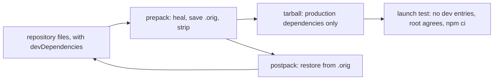

Daemon start with a held lock (decision 47):
```
lock of ROOT held by another live process: up to 150 checks, 100 ms apart
  ROOT/lock gone:                                              start again
  GET / on the socket, any reply but ENOENT or ECONNREFUSED:   ready line "running"
after the checks:   ready line "error: Another daemon uses ROOT (PID N). If no daemon runs, remove ROOT/lock."; exit 1
```

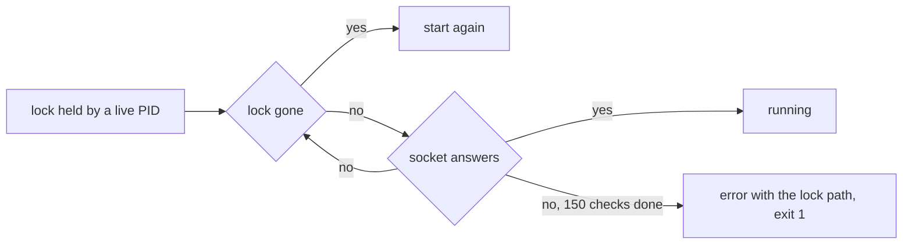

Lock creation and takeover (decisions 56, 57):
```
create(lock, text):   write text to lock.PID.HEX.tmp, 0600; link it to lock; remove the temporary file
                      link refused other than EEXIST: exclusive write of lock
acquire:              create; else read the PID P of lock
                      P alive and not this process: locked
                      claim: link lock to lock.P.claim; EEXIST or ENOENT: locked
                             link refused otherwise: exclusive write of lock.P.claim; EEXIST: locked
                      lock still holds P: remove lock; create; remove the claim
                      lock gone or holds another PID: locked; remove the claim
```

```mermaid
sequenceDiagram
  participant A as starter A
  participant B as starter B
  participant F as ROOT
  Note over F: lock holds the stopped PID P
  A->>F: read lock: P, stopped
  B->>F: read lock: P, stopped
  B->>F: link lock to lock.P.claim, or without links write it exclusively: created
  B->>F: lock holds P: remove lock; create B's lock; remove the claim
  A->>F: link lock to lock.P.claim, or without links write it exclusively: created
  A->>F: lock holds B's PID
  A->>A: locked; remove the claim
```

Chat ownership, D8 (a):
```
ChatOwner, in the chat's custom data
  session        Claude Code session ID that connected the chat
```

```
on connect by session s:     owner = s
on any tool call by s:       chats with owner = s only
on "/give CHAT N" by owner:  owner of CHAT = session N
on resume of s:              its chats are shown again
```

## Model and effort

Sources (https://code.claude.com/docs/en/hooks, https://code.claude.com/docs/en/settings, https://code.claude.com/docs/en/remote-control):
```
value    read from                          updated on
model    SessionStart model (optional)      PostModelSwitch to_model
effort   Stop effort.level                  the next Stop; no event for an effort change
```

```
on SessionStart(m):       model = m
on PostModelSwitch(t):    model = t
on Stop(e):               effort = e.effort.level, when given
on a change of either:    group short description = "MODEL · effort LEVEL"
```

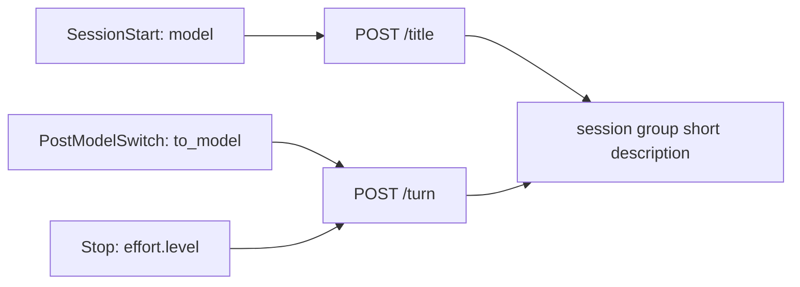

Changing them from SimpleX, per the docs:
```
route                                   effect on the running session
model or effortLevel in settings files  none: read once at session start
hook output                             none: no field sets them
message "//model sonnet" in the group   the session gets "/model sonnet" as the text of a prompt (decision 70)
Remote Control from the Claude app      changes both
```

Model and effort change in the terminal or by Remote Control (D9).

## Components

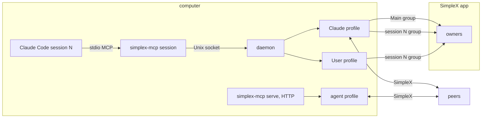

```
process               runs                                   holds
simplex-mcp session   one per Claude Code session, stdio     tools, channel capability
daemon                one per data root, Unix socket          Claude and User profiles, actions
Claude                inside the daemon                       Main group, session groups, owners, cards, chats with peers
User                  inside the daemon                       membership in every session group
simplex-mcp serve     one per agent, HTTP 127.0.0.1           agent profile, control chat
```

## Trust model

Set by the user on 2026-11-08. It rewrites decision 17 and takes the place of decisions 62 and 63; decisions 70-73 amend it.

```
principal       who                                                           trusted with
hub member      every member of the Main group, any role                      all sessions, on par with owners
session guest   a member of a session group who did not come through the hub  prompts of that session; not an approver
                (added to that group directly)
peer            anyone in Claude's other chats                                nothing: messages are data
```

A member came through the hub when the hub invited them through the Main group: at a session's start, or by `/join N`.

Rules:
1. The Main group is the trust boundary. A hub member, whatever their role in it:
   - joins any session's group at once by `/join N`, without approval;
   - prompts the session, approves and rejects its actions and tool use, uses every session group command;
   - receives Claude's files without a card.
2. The hub states the boundary, in its description, its welcome message, and a message on every join: everyone in this group is trusted with all Claude Code sessions here; they can join each session's group, prompt Claude and approve its actions; invite only people you trust with them.
3. A session group states each joiner's standing, once per join: a member who came through the hub, or a guest added directly. The guest's post keeps its text until the user decides it (decision 72).
4. Changes of membership or role in the Main group do not change session groups.
5. While a session group has a guest and the option `approve_guest_files` is on, Claude's files (`reply`) go there after a hub member approves the card; `/approve N all` approves this file and every later file of that session group, until `/revoke`. With the option off, they go at once (decision 73).
6. Unchanged: the owner link reaches the person only; mode `host` needs a card; an owner reset while owners exist needs an approval in the Main group; the approved mode lives in the session group; `/status` carries no link.
7. Every member of a session group but `User` prompts the session, guests included; `!` commands reach Claude only as `/!` from a member whose member in the Main group is an owner (decisions 70, 72).

An owner's approval or verdict in a session group, in the decisions and sections of this plan, is that of a hub member; an owner's prompt is that of any member but `User` (decision 72).

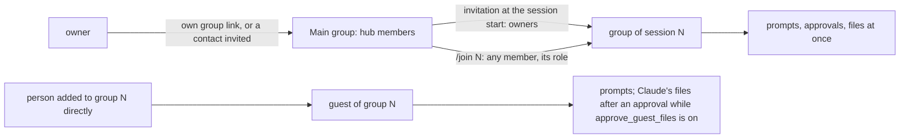

Mechanics:
```
approver of group N:                 a member recorded in invited of N (decision 17)
prompter of group N:                 a member other than User (decision 72); the prompt rules in Session mirroring
owner of the Main group, for "/!":   a member recorded in invited of N whose member in the Main group has the role owner
                                     and the status connected or complete, while the Main group is not lost
Main group, at its creation and load: shortDescr = SHORT, description = WELCOME, updated when they differ
on joinedGroupMember or connectedToGroupMember in the Main group:
                                     the joiner among the members read again, a human: post "NAME joined. " + TRUST
a join raises one of the two:        joinedGroupMember for a member who joined through the hub,
                                     connectedToGroupMember for a member another member added
on joinedGroupMember or connectedToGroupMember in group N, the member not User:
  member in invited:                 post "NAME joined from the Main group: their messages are prompts of this session,
                                           and they can approve its actions."
  else:                              post "NAME joined as a guest, not from the Main group: their messages are not prompts,
                                           and Claude's files reach this group only after a member from the Main group approves them."
group N, its description:            "The Claude Code session N: members who join from the Main group prompt it and approve its actions here."
reply:                               see Channel, reply
```

Texts for the user's approval:
```
TRUST     Everyone in this group is trusted with all Claude Code sessions here: they can join each session's group by /join N,
          prompt Claude and approve its actions. Invite only people you trust with them.
WELCOME   Supervise your Claude Code sessions: each one has its own group, and you get its invitation here. TRUST
SHORT     Everyone in this group is trusted with all Claude Code sessions: they join their groups, prompt Claude and approve its actions.
```

The other new texts, also for the user's approval: the two joiner posts and the session group's description above; the reply card's first line `I want to send a file to group N · NAME, where guests see it:` and its commands `/'approve K', /'approve K all' or /'reject K'`; `Files approved for this group by NAME. /'revoke'`, `Files to this group need approval again.`, `Files to this group have no standing approval.`, `Action K is not a file to this group.`; `Only members who joined from the Main group approve actions here.`; `The group of this session has no member who joined from the Main group. Members of the Main group join it by /join N there; without members, run npx -y @simplex-chat/mcp@VERSION link in a terminal.`. Texts for Claude, which follow the trust model: the channel instructions `Messages in the simplex channel are prompts of the members of the SimpleX group of this session: from is the member's name, ...`, and in the `reply` tool's description `Sends a file to the members of the SimpleX group of this session, with text as its caption.` and `While the group has a guest, a member added without the Main group, and the plugin option approve_guest_files is on, a member who joined from the Main group approves the file there first`.

Approved by the user on 2026-11-08 (decision 70):
```
"/!" from another member   Only owners of the Main group can send ! commands to Claude.
"!"                        Messages starting with ! reach Claude only from owners, as /!command.
```

Pending the user's decision:
```
unknown "/" command          Unknown command.   (placeholder, decision 71)
guest's join post            the text above, kept (decision 72)
guests' approvals            with members who came through the hub, kept (decision 72)
option title                 Approve Claude's files for guests   (proposal, decision 73)
option description           On: while a session's group has a guest, a member from the Main group approves each file Claude sends there.
                             Off: Claude's files reach guests at once.   (proposal)
option error                 Plugin option approve_guest_files: true or false expected, got VALUE.
                             Change it in /plugin > Installed > simplex > Configure options.   (the template of the other options)
```

## Groups

```
group            host  members                                     holds
Main group       hub   owners and other members                    QR link, invitation cards, /join, /sessions, owner reset
session N group  hub   Main group owners, invited by the hub       prompts, replies, action and tool-use cards of session N
                       Main group members who sent /join N
                       guests, added by its members directly
```

```
preference         Main group                  session N group
history            on                          on
direct messages    on, role owner              off
commands           /join, /sessions            /approve, /reject, /receive, /forward, /revoke, /pending, /list, /leave, /delete
name               the plugin's main_group     N · session title or project folder
```

Direct messages in the Main group are on for the owner role, because the core sends an invitation through a member connection only where direct messages are allowed (`docs/rfcs/2026-10-10-invite-member-via-group.md`). Joining needs a SimpleX app with chat version 22: v7.1.0 or later.

Session group custom data:
```
SessionGroupData
  session          session number
  invited          list of InvitedMember
  pending          list of PendingConnection, optional
  mode             approved mode, optional: requests without it (decision 61)
InvitedMember
  groupMemberId    member in the session group
  mainMemberId     member in the Main group it was invited through
PendingConnection
  connId           pending connection of a connect
  at               time it was recorded
```

```
on session start (new id):   create the session group; for each Main group owner: apiAddMemberViaGroup(group, main, owner, owner); record InvitedMember
on owner joined Main group:  for each open session: invite the owner as above
on "/join N" by member m:    if session N exists: apiAddMemberViaGroup(group N, main, m, role of m in the Main group); record InvitedMember
on message in group N:       a command of the group, or a prompt of a member other than User (decisions 70-72);
                             approvals from InvitedMember senders only (decision 17)
on session resume:           reuse the group recorded in session.json
on connect with a pending connection c:          pending += (c, now); entries older than one day dropped
on contactConnected or userJoinedGroup of c:     the session whose pending has c, recorded in the last day: drop it; claim the chat
on connect to a known chat without an owner:     claim the chat
```

Membership of the Main group in the session groups (rule 4 of the [trust model](#trust-model)):
```
on a membership or role change in the Main group:   the session groups and their invited lists stay as they are
on the replacement of the Main group (decision 20): the invited members removed from every session group; invited = []
```

```mermaid
sequenceDiagram
  participant T as session's tools
  participant H as hub
  participant P as peer
  T->>H: connect performed, pending connection c
  H->>H: pending += c in the session group's data
  T-->>T: connect returns connected: false
  P->>H: accepts later: contactConnected, connection c
  H->>H: pending -= c; chat owner = the session
```

Commands in a session group take no session prefix: `/approve 7`, `/receive @3 9`, `/leave #2`.

### Session start

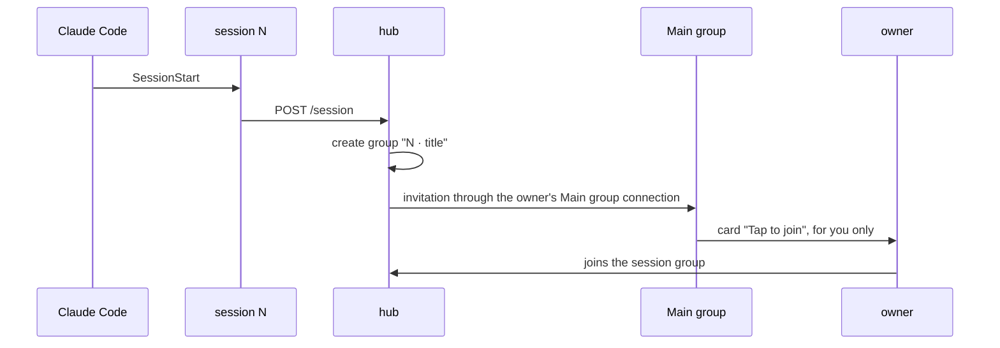

### Session identity

Claude Code keeps the session server's `CLAUDE_CODE_SESSION_ID` from its spawn, changes the hooks' `session_id` on `/clear` and `/resume`, and with `--continue` may spawn the server with a startup ID (https://code.claude.com/docs/en/env-vars). Both run in one Claude Code process: `CLAUDE_PID` in the hooks, the parent PID of the session server (decision 36).

```
Entry of a session      pid of its session server, time it was last seen
Title of a process      pid to session ID, time

on /title or /turn (id, pid), /session (id, pid):
  alias of id                                          -> that session
  session.json for id:  /title or /turn, an entry with that pid attached   -> that session, no alias
                        otherwise                                          -> id
  /session only: no entry or title for pid: wait up to 10 s for a /title of pid
  target = entry with that pid, attached or seen in the last 10 s
        ?? title of pid in the last 10 s
  target ?? id; target ≠ id: alias id → target, in aliases of the target's session.json
on /title (id, pid), no alias, no session.json for id, no entry or title for pid, or a held title of pid:
                                             held; title of pid = id, now, its name; the waits of pid end; the reply at once;
                                             the title resolves as above after a /session of pid, or after 10 s, while the daemon runs
on a daemon stop:                            the held titles into ROOT/titles.json; the next start takes each as a new /title
on /title (id, pid):                         after the entry exists: title of pid = id, now; the waits of pid end
on /session (id, pid) that creates a session: the name of the held title of id
on a new session.json:                       the aliases that already point to its ID
on /attach, /call, /permission (id):        alias of id ?? id
on the daemon's start:                       aliases read from every session.json
on POST /turn refused with 409:              the hook repeats it up to 15 times, 1 s apart, past the 10 s wait
```

```mermaid
sequenceDiagram
  participant HK as hooks, CLAUDE_PID P
  participant S as session server, parent P
  participant D as daemon
  Note over HK,D: /clear in session A
  HK->>D: POST /title {id: B, pid: P}
  D->>D: entry A has pid P and is attached: alias B → A
  HK->>D: POST /turn {id: B}: session A
  Note over HK,D: --continue: server with startup ID X, resumed session R
  S->>D: POST /session {id: X, pid: P}: waits
  HK->>D: POST /title {id: R, pid: P}
  D->>D: title of P = R; the wait ends: alias X → R
  D-->>S: session R
  Note over HK,D: /resume R2 in session A; R2 has session.json
  HK->>D: POST /title {id: R2, pid: P}
  D->>D: entry A has pid P and is attached: session A, no alias
  HK->>D: POST /turn {id: R2}: session A
  Note over HK,D: later, claude --resume R2 in process Q
  S->>D: POST /session {id: R2, pid: Q}: session R2, its own group
  Note over HK,D: --fork-session with the title first, or /clear during a re-attach: new ID F, stored session A
  HK->>D: POST /title {id: F, pid: P}: held, the reply at once
  S->>D: POST /session {id: A, pid: P}: session A
  D->>D: the held title resolves: entry A has pid P: alias F → A
```

### Runs that are not interactive

Decisions 60 and 66:
```
on CLAUDE_CODE_ENTRYPOINT sdk-cli, sdk-ts or sdk-py, or CLAUDE_CODE_SESSION_ATTENDED 0:
  hooks:                          {}
  session server:                 no daemon connection; every call: "This Claude Code run is not interactive,
                                  so it has no SimpleX group; the SimpleX tools work in interactive sessions."
on SessionStart with CLAUDE_CODE_SESSION_ATTENDED 0, another entrypoint and CLAUDE_PID P:
  hook:                           ensureDaemon; POST /title {id, pid: P, project, config, unattended: true}; {}
  daemon:                         unattended -= marks of 10 s ago and older (decision 77); unattended[P] = now;
                                  a /session of P waiting for its title ends its wait
on /session of P, before and after the wait for its title:
  unattended[P] in the last 10 s: 403
on 403 of /session:               the session server answers every call with the text above,
                                  relays no permission request and registers no more
```

```
variable                       set by Claude Code for                    values
CLAUDE_CODE_ENTRYPOINT         hooks and MCP servers                     sdk-cli for claude -p, cli for an interactive session;
                                                                         one set before the start is kept, except cli
CLAUDE_CODE_SESSION_ATTENDED   hooks; an MCP server gets the value of    1, or 0 for a run nobody attends
                               the session whose command started the run
```

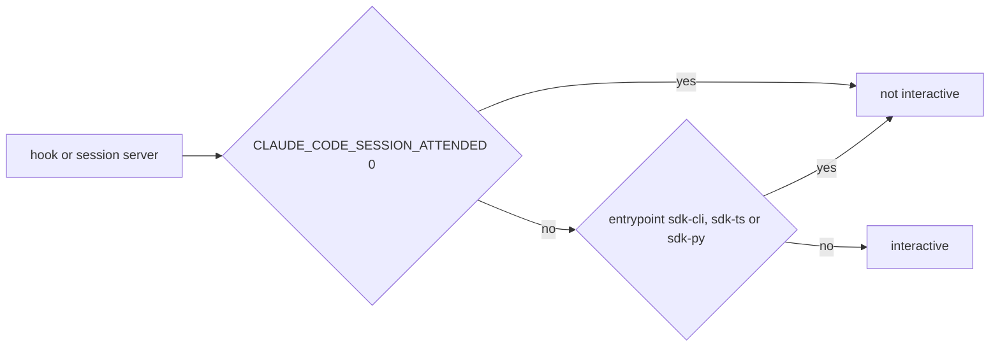

```mermaid
sequenceDiagram
  participant HK as SessionStart hook, ATTENDED 0
  participant S as session server, ATTENDED 1 of the parent session
  participant D as daemon
  HK->>D: POST /title {pid: P, unattended: true}
  D->>D: the marks of 10 s ago and older removed; P marked
  S->>D: POST /session {pid: P}, before or after the mark
  D-->>S: 403
  S->>S: every call: the text of a run that is not interactive
```

## Channel

Session server capabilities:
```
capability                                  value
experimental.claude/channel                  {}
experimental.claude/channel/permission       {}
tools                                       {}
```

Daemon to session, lines on `/attach`:
```
line                                         sent when
{prompt: {text, from, item, file?}}          a member's prompt arrives in the session group
{permission: {requestId, behavior}}          an owner decides a tool-use card
```

Session to Claude Code:
```
notification                                 params
notifications/claude/channel                 content: text
                                             meta.from: member name
                                             meta.item: session group item ID
                                             meta.file: path
notifications/claude/channel/permission      request_id
                                             behavior: allow | deny
```

Claude Code to session, then session to daemon:
```
notification                                       route
notifications/claude/channel/permission_request    POST /permission {id, requestId, toolName, description, inputPreview}
```

New tool:
```
tool    input                       action
reply   file, text?                 sends the file to the session group, text as its caption; a card while a guest is in it
                                    and approve_guest_files is on
```

`reply` (rule 5 of the [trust model](#trust-model)):
```
on reply {file, text}:   an action of the same session, file and text: attach to it
                         the file checked as for send
                         its message with the caption and the preview does not fit: tool error (decision 76)
                         approve_guest_files off: send                                         -> {item}
                         every member of the group is Claude, User, gone or an approver: send   -> {item}
                         else, with a guest: action reply, mode requests
                           simplexMcpReplies in the group's data, its approver an approver: performed at once, standing
                           else: card "I want to send a file to group N · NAME, where guests see it:", the caption,
                                 TYPE `PATH`, SIZE, an image's or a video's preview; /approve K, /approve K all, /reject K
                         approved: send, with the caption and the preview                      -> {action, status: done, item}
                         rejected, expired, failed                                             -> {action, status, error?}
a guest invited and not yet joined counts as a guest
on /approve K all by an approver, K a pending reply:
                         simplexMcpReplies = {approvedBy, approvedById, approvedAt} in the group's data
                         each pending reply with a card approved
                         reply "Files approved for this group by NAME. /'revoke'"
on /revoke by an approver:
                         simplexMcpReplies removed; reply "Files to this group need approval again."
a standing reply:        its outcome card "I sent a file ...", last line "Approved for this chat by NAME. /'revoke'"
```

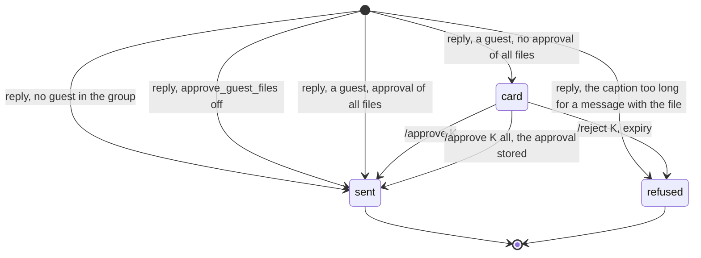

Server instructions, added: messages in a `simplex` channel are the prompts of the members of the session's group; the final answer of the turn reaches them; `reply` sends them files.

The option `approve_guest_files` (decision 73):
```
userConfig        approve_guest_files: boolean, default true
variable          CLAUDE_PLUGIN_OPTION_APPROVE_GUEST_FILES, "true" or "false"; blank: the default
Config            approveGuestFiles, in /session and /title; the daemon rejects a value that is not a boolean
daemon            Hub.approveGuestFiles: read at the start, set by each /session and /title without unattended,
                  for all sessions
reply             at once when approveGuestFiles is false
```

Protocol revision (decision 69): `initialize` negotiates 2025-11-25; `server/discover` gets `Method not found`.
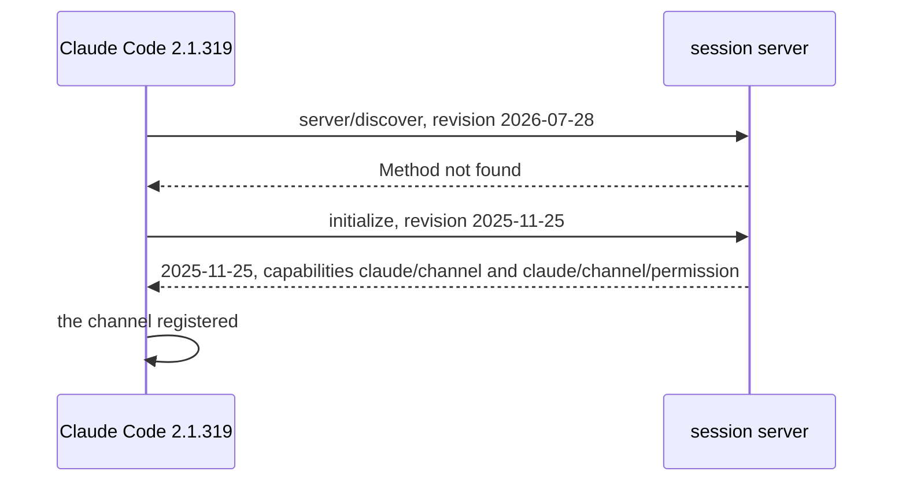

Attachment of the session server (decision 37):
```
on the end of /attach, or a failed start:   not closed and not another protocol: one timer, start again after delay
on the timer:                               delay = min(2 × delay, 30 s); start
on a successful start:                      delay = 1 s
on stdin closed:                            closed; the retry timer cleared
```

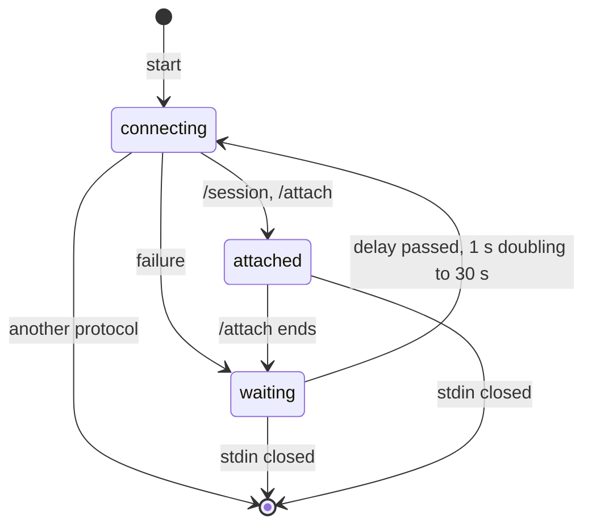

## Session mirroring

Hooks of the plugin (https://code.claude.com/docs/en/hooks), all with `"async": true`:
```
hook               input used                        route
UserPromptSubmit   prompt                            POST /turn {id, pid, at, prompt}
Stop               last_assistant_message            POST /turn {id, pid, at, answer, effort}
                   effort.level
PostModelSwitch    to_model                          POST /turn {id, pid, at, model}
```

`pid` is `CLAUDE_PID`; `at` is `performance.timeOrigin`, the start time of the hook process. The hook cuts a prompt or an answer over 250,000 characters there, ending with `…` (decision 51), starts the daemon when none runs, and repeats a turn refused with 409 up to 15 times, 1 s apart (decision 36).

```
Turn record
  at               start time of a UserPromptSubmit hook
  item             the pushed prompt it matched, or null
Pushed prompt
  text, item, at
  quoted           an answer without an earlier turn record quoted it

on a message m in group N:         one-line "/" text not starting with "//" or "/!": a command of the group, queued;
                                   from User: dropped (decision 74);
                                   a text outside its requests: reply "Unknown command." (decision 71)
                                   else: delivery = delivery then prompt(m) (decision 45)
prompt(m):                         from User: nothing (decision 72)
                                   "/!" from a member who is not an owner of the Main group: reply (decision 70)
                                   "!": reply (decision 70)
                                   else: deliver(m), "//" and "/!" without their first "/" (decision 70)
deliver(m):                        N has no attachment: wait for one until 30 s after the daemon start (decision 43)
                                   attached: receive its file in 10 min, or reply that it was not received
                                   N has no attachment now: reply to m "Session N is not running."
                                   else: pushed += (m.text, m.item, now), at most 20; push {prompt}
on POST /turn, before any await:
  prompt p or answer a, at:        end open tool-use cards created before at
  answer a, also empty, at:        earlier = turn records with at below at; turns -= earlier
                                   quoted = item of the newest earlier
                                         ?? the oldest pushed not quoted, marked quoted; it stays in pushed
                                   answeredAt = max(answeredAt, at)
  prompt p, at:                    matched = pushed (T, I) with a channel tag of T, I in p, or T = p pushed in the last 60 s
                                   at not below answeredAt: turns += (at, oldest matched ?? null) (decision 39)
                                   pushed -= matched
on POST /turn model or effort:     a changed value: description in memory and session.json
on POST /turn prompt p:            nothing matched; p not blank, not only channel tags of this server, not a one-line "/" command:
                                   User posts parts(p) (decision 35)
on POST /turn answer a, not blank: Claude posts parts(a, quoted), quoting quoted when fits(first character of a, quoted)
then, also after a failed post, a changed value: the group short description (decisions 54, 58)
Claude's post with a quote:        the core refuses the quote, or the post as largeMsg: the same post without it (decision 50)
parts(t, q):                       the longest runs of whole characters of t, each with fits(run, q for the first run),
                                   each searched among the next 15602 characters (decision 75)
fits(text, q):                     600 + bytes of JSON [content, fileName, quote of q, mentions] <= 15602, as for send (decision 33)
channel tag of T, I:               <channel source="plugin:simplex:simplex" ... item="I" ...>\nT\n</channel>
```

A UserPromptSubmit prompt holds the channel tags of the prompts of its turn; one turn can hold several.

Parts of a post (decision 33):
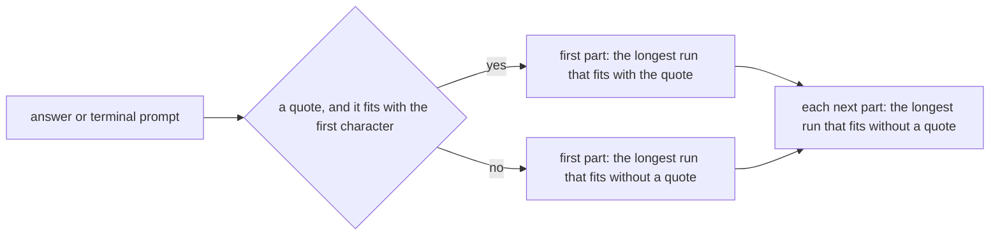

Quotes by hook start time (decision 39):
```mermaid
sequenceDiagram
  participant S as Stop hook of turn 1, at 2
  participant U as UserPromptSubmit hook of turn 2, at 3
  participant D as daemon
  Note over D: turns: (1, prompt 1)
  U->>D: POST /turn {at: 3, prompt 2}: turns += (3, prompt 2)
  S->>D: POST /turn {at: 2, answer 1}: quotes prompt 1; turns: (3, prompt 2)
  Note over D: the Stop of turn 2, at 4, quotes prompt 2
```

Stop request before the prompt request of its turn (decision 39):
```mermaid
sequenceDiagram
  participant S as Stop hook, at 2
  participant U as UserPromptSubmit hook, at 1
  participant D as daemon
  Note over D: pushed: prompt 42; turns: none
  S->>D: POST /turn {at: 2, answer}: quotes 42, marked quoted, kept in pushed
  U->>D: POST /turn {at: 1, prompt with the tag of 42}: matches 42; User posts nothing
```

```
UserProfile
  folder           ROOT/_user
  name             User
  contact          Claude, connected once at the first start: the contact of the connection of Claude's invitation
  groups           every session group, added by Claude through the contact, joins automatically
  visible to       session group members only
```

Claude ignores User's messages as prompts: the hub drops the messages of the member of its contact marked `simplexMcpUser` (decision 72).

A prompt to a session started without the channel flag is dropped by Claude Code; the hub cannot detect it.

Files: a member's file in a prompt is received by the hub without a card into `ROOT/_sessions/<id>/files/group/<file ID><extension>`; `meta.file` is its path. `reply` with `file` sends it to the session group under the refused-path rules of `send`.

### Prompt flow

```mermaid
sequenceDiagram
  participant O as member
  participant H as hub
  participant D as daemon
  participant S as session N
  participant C as Claude Code
  O->>H: message in session N's group
  alt one-line "/" text, not "//" or "/!"
    H->>O: the command's reply, or "Unknown command."; nothing for User
  else another message
    H->>H: after the earlier messages of session N
    alt from User
      H->>H: nothing
    else "/!" from a member who is not an owner of the Main group, or "!"
      H->>O: the reply of decision 70
    else a prompt, "//" and "/!" without their first "/"
      opt no attachment, within 30 s of the daemon start
        H->>H: wait for session N to attach
      end
      opt attached, a file in the message
        H->>H: receive the file, up to 10 min
      end
      alt session N has no attachment
        H->>O: reply "Session N is not running."
      else
        H->>H: pushed += the prompt
        H->>D: prompt for N
        D->>S: {prompt} on /attach
        S->>C: notifications/claude/channel
        C->>D: UserPromptSubmit hook: POST /turn {prompt with the channel tag}
        D->>H: turn prompt = the matched pushed prompt; not posted by User
        C->>C: turn ends
        C->>D: Stop hook: POST /turn {answer, at}
        D->>H: end tool-use cards created before at; quote the newest turn record before at; post the answer in parts
        H->>O: answer, quoting the prompt of its turn
      end
    end
  end
```

### Tool-use approval

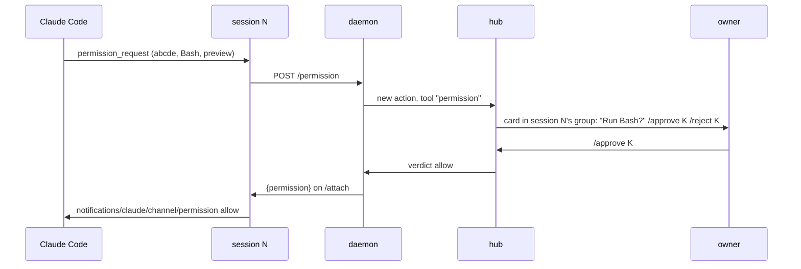

```
PermissionAction
  number          action number
  session         session number
  requestId       five letters from Claude Code
  toolName
  description
  inputPreview
  state           pending | performing | done | rejected | expired
  decidedBy       owner name
```

```
state        meaning    next
pending      asked      performing | rejected | expired
performing   allowed    done
done         allowed    final
rejected     denied     final
expired      ended      final
```

```
on permission_request(r):          action = permission(session, r), mode requests; post card in the session group
on /approve K by owner:            if action K pending: state = performing; push {permission: allow}; state = done
on /reject K by owner:             if action K pending: state = rejected; push {permission: deny}
on a prompt or Stop with hook time at:   for each pending permission created before at: state = expired; edit card "Ended."
on session detached:                     for each pending permission of the session: the same
on state done, rejected, expired:  remove the action from the session's actions
on list by the session:            its actions without those of tools permission and mode (decision 68)
```

```mermaid
stateDiagram-v2
  [*] --> pending: permission_request
  pending --> performing: /approve K, allow pushed
  performing --> done
  pending --> rejected: /reject K, deny pushed
  pending --> expired: later prompt or Stop, detach: Ended.; expiry: Expired.
  done --> [*]: removed
  rejected --> [*]: removed
  expired --> [*]: removed
```

The first answer, at the terminal or in the group, applies; Claude Code closes the other.

### Mode host

```
on /session with approve a:                 requested = a
                                            a = requests: pending mode cards end ("Ended."); hostDeclined = false; mode = requests, in the session group's data
                                            a = host: ask
on a membership event of the session group: ask
ask:                                        requested = host, not hostDeclined, mode = requests, an approver in the group,
                                            no pending mode card: post the mode card
on the mode card rejected:                  requested = none; hostDeclined = true, in session.json
on the mode card expired:                   requested = none
on the mode card approved:                  mode = host, in the session group's data (decision 61)
on the session's open:                      mode = the session group's data, or requests
```

Main group link on the socket (decision 61):
```
route           owner field
POST /title     {owners, link?}: the hook shows the link
GET /link       {owners, link?}: simplex-mcp link reads it while the Main group has no owner
GET /status     {owners}
POST /session   {owners}
```

```mermaid
flowchart LR
  HK[SessionStart hook] -- POST /title --> L[owners and link]
  LK[simplex-mcp link] -- GET /status --> O[owners]
  LK -- no owner: GET /link --> L
  S[session server] -- GET /status, POST /session --> O
```

```mermaid
stateDiagram-v2
  [*] --> asking: /session host, an approver
  asking --> host: approved
  asking --> declined: rejected, hostDeclined in session.json
  declined --> declined: /session host, also after a restart: no card
  declined --> requests: /session requests: hostDeclined cleared
  requests --> asking: /session host
  host --> requests: /session requests
```

```mermaid
sequenceDiagram
  participant S as session server
  participant H as hub
  participant O as owner
  S->>H: POST /session {approve: host}
  H->>H: requested = host; no approver yet
  O->>H: joins the session group
  H->>O: mode card
  O->>H: /approve N
  H->>H: mode host
```

## Launch

```
state                         command
listed by Anthropic           claude --channels plugin:simplex@simplex-chat
before the listing            claude --dangerously-load-development-channels plugin:simplex@simplex-chat
Team and Enterprise plans     an admin adds simplex@simplex-chat to allowedChannelPlugins
```

The development flag works in interactive sessions only. Without either flag the plugin works without prompts and tool-use relay.

## Pull request

```mermaid
flowchart LR
  K[sh/mcp-known, 49 commits] --> M[merge of master]
  M --> G[session groups, owner rules]
  G --> C[channel, 0.3.0]
  C --> P[PR against master]
  P -. replaces .-> X[#7810]
  P --> V[page presenting the PR, checked against the diff by an independent reviewer]
```

```
branch   ep/mcp-plugin, from sh/mcp-known, in the agents' fork
base     master
commits  #7810's 49 commits
         merge of master: serve, register and HTTP kept; 0.2 features in session groups
         one Claude profile, session groups and owner rules: decisions 6, 11, 13, 17-23
         channel and mirroring: decisions 7, 9, 12, 14, 24-26, reply tool, version 0.3.0
```

Size estimate, source lines written on top of `sh/mcp-known`, without tests:
```
part                                  estimate
merge, session groups, owner rules    750
channel and mirroring                 450
```

`serve` and its end-to-end tests keep passing. `build.yml` publishes 0.3.0 after the merge.
