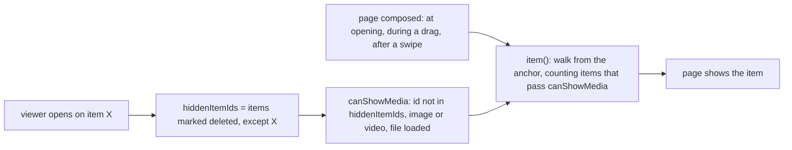

# Fullscreen viewer: skip media of messages marked deleted

## Problem

In the fullscreen media viewer, swiping to the next or previous media shows images and videos of messages that the chat shows as "marked deleted", "moderated by X", "blocked" or "blocked by admin" (deleted for everyone by the sender or a moderator, or blocked by an admin, when full deletion is off; or sent by a member the user blocked).

## Cause

The core keeps the content and the file of a message marked deleted, and sets `itemDeleted`. The chat hides such a message unless the user reveals it. The viewer selects neighbouring media by content type and downloaded file only:

- Android: `canShowMedia` in `providerForGallery` (ChatView.kt).
- iOS: `chatItemImage` in FullScreenMediaView.swift, the map passed to `nextChatItemData`.

## Fix

- Android: `providerForGallery` computes the ids of the items marked deleted when the viewer opens, except the opened item, and `canShowMedia` excludes them.
- iOS: `chatItemImage` requires `itemDeleted` to be absent.

## Scope

- Android and iOS: the platforms where the viewer changes media by swiping.
- Desktop: the same Kotlin filter; its viewer shows only the opened image or video.
- A revealed message opens in the viewer. On Android it stays reachable by swiping until the viewer closes; on iOS swiping back to it skips it.
- Swiping skips other revealed messages on both platforms.
- Media marked deleted while the viewer is open: on Android it stays reachable until the viewer closes or the activity is recreated (e.g. rotation recomposes the viewer and recomputes `hiddenItemIds`); on iOS swiping skips it.
