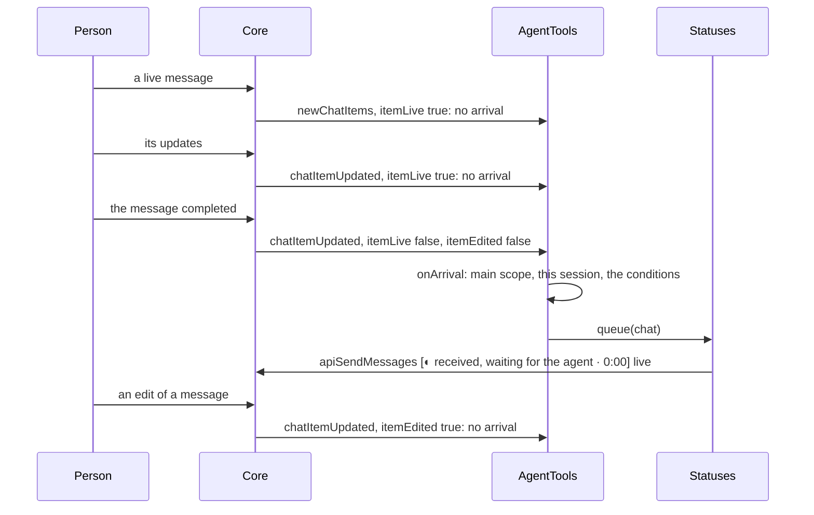

# SimpleX MCP server 0.3.0: Claude Code activity in the status message

Status: draft for review. Design of 2026-11-11; decisions 6 and 7 by the user; decision 8 of 2026-11-12 and decision 9 of 2026-11-13 at the user's request; decision 10 of 2026-11-13 after an end-to-end test; decisions 11 and 12 of 2026-11-14 at the user's request, after end-to-end tests with Claude Code 2.1.281. Code: stacked on the live status (`plans/2026-11-10-mcp-live-status.md`) at `0fa30e4f34`. Hook events: the Claude Code hooks reference (code.claude.com/docs/en/hooks.md) of 2026-11-11, and of 2026-11-14 for `Notification`; the idle notification after a refusal: the code of Claude Code 2.1.281.

Dependencies:
1. The status message of `plans/2026-11-10-mcp-live-status.md`.
2. Claude Code command hooks with `args` (exec form) and `async: true`, for the 15 events of section Events.
3. curl 7.55.0 or later on the PATH of Claude Code, for `-H @file`.

## Decisions

1. Transport: Claude Code runs curl as an async command hook, as in section Transport, and curl posts each event to `/hook` with the token of `/mcp`.
2. Labels: the permission prompts, compaction, running tools and subagents of Claude Code, ranked as in section Labels; names only in code spans, after their patterns; the same labels in every status message of the process.
3. Sessions: labels are changed only by events of agent sessions; at most 16 agent sessions are kept.
4. `register` writes the hooks into the Claude Code settings file of its scope: `CONFIG/settings.json` for `user`, `PROJECT/.claude/settings.local.json` for `local`.
5. Notes: in the `receive` description, a note is requested in the same response as the tool call of a step that takes minutes.
6. Scope, decided by the user: notes (option 1) and Claude Code hooks (option 2) in one pull request, stacked on the pull request of the live status.
7. Source budget, decided by the user: about 150 changed lines in `src`, up to 20% above; the user accepted the 267 changed lines after the review rounds.
8. Arrival, 2026-11-12, at the user's request: after a `receive` with `typing: true` in a chat, the status is started at once at a message received there, as in section Arrival; about 25 changed lines in `src`.
9. Every approved chat, 2026-11-13, at the user's request: `typing` is removed from `receive` (decision 23 of `plans/2026-11-10-mcp-live-status.md`); the status is queued at each message received in a chat that meets the conditions of status messages, by the chat of the event, as in section Arrival.
10. Live arrival, 2026-11-13: a received live message queues the status at the update that completes it, with `itemLive` false and `itemEdited` false; edits queue none, as in section Arrival.
11. Turn end, 2026-11-14: at a `Stop`, `StopFailure` or `SessionEnd` after which no agent session runs a turn, the statuses other than waiting ones are ended while no call of the agent runs, as in section Turn end; `serve` without the hooks is unchanged.
12. Idle notification, 2026-11-14: `register` adds a hook of `Notification` without a matcher; a `Notification` with `notification_type` `idle_prompt` ends the turn of its session as `Stop` does, as in section Turn end. After a refusal in the permission prompt, Claude Code 2.1.281 sends no other end event.

## Transport

Hook handler, written by `register` for each event of section Events:

```
{"type": "command", "command": "curl", "args": ["-q", "--noproxy", "*", "-s", "-m", "2", "-o", NULL_DEVICE, "-H", "@DIR/hook-headers", "-H", "Content-Type: application/json", "--data-binary", "@-", "http://127.0.0.1:PORT/hook"], "async": true}
```

- Exec form: Claude Code spawns curl from PATH with `args` as the argument vector, without a shell.
- `-q` first: curl reads no curlrc file. `--noproxy "*"`: curl ignores the proxy variables of the hook environment.
- `-s -m 2 -o NULL_DEVICE`: at most 2 s per event, output discarded; NULL_DEVICE is `/dev/null`, or `NUL` on Windows.
- `-H @DIR/hook-headers`: one line `Authorization: Bearer TOKEN`, written 0600 by `writeHeadersFile` at every start, next to `headers.json`.
- `--data-binary @-`: the event JSON, from the stdin of the hook.
- `async: true`: Claude Code continues without waiting; completion notices of async hooks are hidden by default.

## Endpoint

```
item             rule
path             POST /hook on the listener of /mcp (http.ts)
checks           Host, Origin and token, as for /mcp; before the ready check of /mcp
method           other than POST: 405 with Allow: POST
Content-Length   absent: 411; above 4 MiB: 413
body             parsed as JSON; invalid: 400
success          Activity.record(body); 204 without a body
error            the connection destroyed
```

- The body is discarded after `Activity.record`; the endpoint logs nothing.

## Events

Agent sessions:
- A session is an agent session from its first event whose `tool_name` has the prefix `mcp__simplex-NAME__`, NAME being the agent name. The tool names of this server, at most 55 characters long with a 32-character NAME, are accepted by the `tool_name` pattern below.
- Events of other sessions are discarded; Claude Code runs the hooks of the user scope in every session of the user.
- At most 16 agent sessions are kept; the oldest is dropped with its activity.

Fields read, each only as a string; other fields are discarded:

```
field                      use
hook_event_name            the event
session_id                 the session
tool_name                  the tool; kept when matched by ^[\w-]{1,64}$
tool_use_id                the tool call
tool_input.file_path       its base name; kept when matched by ^[\w.+@-]{1,64}$
tool_input.notebook_path   its base name when file_path is absent or not a string; the same pattern
agent_id                   the subagent; absent in events of the main agent
agent_type                 the subagent type; kept when matched by ^[\w-]{1,64}$
notification_type          the type of a Notification; only idle_prompt is used (decision 12)
```

```
Activity (activity.ts), one per process
sessions     agent sessions, in join order; at most 16
tools        tool_use_id → {session, agent, name, file}, in start order; at most 64
subagents    agent_id → {session, name}, in start order; at most 64
ended        tool_use_ids of end events without an entry in tools; the last 256
asking       sessions with a permission prompt
compacting   sessions compacting
idle         sessions whose turn ended (decision 11)
turnsEnded   the function called when every agent session is in idle (decision 11)
```

```
event                effect, for the session of the event
PreToolUse           main agent: compacting cleared; tools[tool_use_id] set, unless tool_use_id is absent or in ended, or the tool
                     is this server's or Agent
PostToolUse          asking cleared; tools[tool_use_id] deleted, or tool_use_id added to ended
PostToolUseFailure   as PostToolUse
PermissionDenied     as PostToolUse
PostToolBatch        asking cleared; the tools of its agent_id deleted
PermissionRequest    asking set
SubagentStart        subagents[agent_id] = {session, agent_type}
SubagentStop         subagents[agent_id] deleted
PreCompact           compacting set
PostCompact          compacting cleared
UserPromptSubmit     tools, subagents, asking, compacting and idle of the session cleared
Stop                 as UserPromptSubmit; then idle set; every agent session in idle: turnsEnded() (decision 11)
StopFailure          as Stop
SessionEnd           as Stop
Notification         notification_type idle_prompt: as Stop; another type: none (decision 12)
```

```
state()      read by the labels
asking       a session in asking
compacting   a session in compacting
tool         the last entry of tools
subagent     the last entry of subagents
```

## Labels

```
rank  state                                           label
1     --inference: loading, prompt or output          loading …, reading the prompt …, generating …
2     an action pending with open > 0                 waiting for approval
3     a Claude Code permission prompt                 waiting for permission in Claude Code
4     a call of this server other than receive        using TOOL
5     compaction                                      compacting the conversation
6     the latest running Claude Code tool             the tool labels below
7     the latest running subagent                     running subagent `TYPE`, or running a subagent
8     --inference: idle                               working
9     otherwise                                       thinking
```

```
tool           label
Bash           running a command
PowerShell     running a command
Monitor        running a command
Read           reading `FILE`, or reading a file
Edit           editing `FILE`, or editing a file
Write          editing `FILE`, or editing a file
MultiEdit      editing `FILE`, or editing a file
NotebookEdit   editing `FILE`, or editing a file
Grep           searching files
Glob           searching files
WebSearch      searching the web
WebFetch       searching the web
another tool   using `TOOL`, or using a tool
```

- Rows 3, 5, 6 and 7 are new; the others are unchanged.
- FILE is the base name of the file, TOOL the tool name without the `mcp__SERVER__` prefix of an MCP tool, TYPE the subagent type. The second form is shown when FILE, TOOL or TYPE is absent or rejected by its pattern of section Events.
- Only text accepted by those patterns, free of backticks and spaces, is put in a code span.
- The same labels are shown in every status message of the process, as `using TOOL` is; the process has one Activity and one AgentTools.

## register

```
scope   settings file
user    CONFIG/settings.json; CONFIG: CLAUDE_CONFIG_DIR, or ~/.claude when it is unset or empty
local   PROJECT/.claude/settings.local.json; PROJECT: projectRoot(), the folder of the local MCP entry
```

```
step   rule
1      claude mcp remove, then claude mcp add-json, as before; claude missing, or a failed add-json: exit 1, the settings file
       unchanged
2      the settings file read and parsed; absent: {}
3      the file not a JSON object, a hooks value other than an object or null, or one of the 15 events with a value other
       than an array: exit 1, "Added to Claude Code: scope SCOPE, server simplex-NAME. FILE is not a valid settings file;
       add these status hooks to it: HOOKS"; the file unchanged
4      in the groups of the 15 events: the handlers with "@DIR/hook-headers" in args removed; groups left without handlers removed
5      one group {hooks: [handler]} per event appended, without a matcher; other keys, events and groups kept
6      the folder created; the file written with 2-space indentation and a final newline
7      reply: "Added to Claude Code: scope SCOPE, server simplex-NAME, status hooks in FILE."
```

- HOOKS: `{"hooks": ...}` with the 15 groups, as compact JSON.
- The location of the MCP entry for the manual entry text and the settings file of a scope are both given by `scopeLocations`.
- A second `register` writes the same text.

## Notes

```
receiveDescription, last sentence
before   For steps that take minutes, send a short note with live: true; it is shown in the status message.
after    For a step that takes minutes, call send with live: true and a short note in the same response as the step's tool
         call; the note is shown in the status message.
```

- Each tool description is checked against 2048 characters by `http.test.ts`.

## Arrival

```
item             rule
arrival          AgentTools.onArrival: a received message (rcvMsgContent) in the main scope (chatRef) of a chat of this
                 session that meets the conditions by the chat of the event: Statuses.queue(chat)
arrival calls    onNewItems: an item that is not live; onEvent at chatItemUpdated: an item that completes a live message,
                 itemLive false and itemEdited false (completesLive); an edit sets itemEdited (decision 10)
queue(chat)      no status of the chat, not stopping: a status created with the label "received, waiting for the agent";
                 its first tick at once
start(chat)      queue(chat); a waiting status taken: label "thinking", rendered at once while 0 < renders < 59
start calls      receive that returns messages, when the chat read of the call meets the conditions; sendResult with
                 responses, when the chat of the first one meets them, after markRead and the abort check
waiting label    kept at the ticks of a waiting status; the label read only for other labels
frozen line      ◌ received, waiting for the agent since YYYY-MM-DD HH:MM UTC for a waiting status;
                 ◌ working since YYYY-MM-DD HH:MM UTC otherwise
lifetime         unchanged: the eligibility read at each tick; the deletion at the answer, at a receive of the chat that
                 waits, at 23 h, when idle in the frozen phase, and at stop; kept at the end of the turns (decision 11)
```

- At a message received while the chat has a status, the status is kept unchanged.
- The waiting label consists of letters, a comma and spaces.

Live message, decision 10:



## Turn end

Decisions 11 and 12.

```
item             rule
turn             from the join of the session and from its UserPromptSubmit, until its Stop, StopFailure, SessionEnd or
                 idle notification (idle set); other events leave idle unchanged
turnsEnded       Statuses.turnsEnded, bound in startAgent
condition        at an end event: every agent session in idle
effect           no running call of the agent: end(chat) for each status whose label is not the waiting label
waiting status   kept: a message received while the agent is idle stays shown as received
without hooks    no end event, so serve is unchanged
```

```
Activity.endTurn(session):
  clear(session)
  idle.add(session)
  every session of sessions in idle: turnsEnded()

Statuses.turnsEnded():
  a running call: return
  for each status whose label is not "received, waiting for the agent": end(chat)
```

```mermaid
sequenceDiagram
  participant CC as Claude Code hooks
  participant H as HTTP /hook
  participant Y as Activity
  participant L as Statuses
  participant C as Core
  Note over CC,C: receive returned "stop" in @3; the status S of @3 is "thinking"
  CC->>H: POST /hook {Stop, S1}
  H->>Y: record: clear(S1), idle.add(S1)
  Y->>Y: every agent session in idle
  Y->>L: turnsEnded()
  L->>L: no running call
  L->>C: apiDeleteChatItems @3 [S] broadcast
```

Refusal in the permission prompt, decision 12; Claude Code 2.1.281 runs the idle timer after every turn, an aborted one included, and sends the notification when its terminal received no input and no dialog is open:

```mermaid
sequenceDiagram
  participant P as Person at Claude Code
  participant CC as Claude Code hooks
  participant H as HTTP /hook
  participant Y as Activity
  participant L as Statuses
  CC->>H: POST /hook {PermissionRequest, S1, Bash}
  H->>Y: asking.add(S1): "waiting for permission in Claude Code"
  P->>CC: No in the permission prompt
  Note over CC: the turn ends; no PostToolUse, PostToolUseFailure, PermissionDenied, PostToolBatch or Stop
  Note over CC: 60 s later, without input in the terminal
  CC->>H: POST /hook {Notification, S1, notification_type: idle_prompt}
  H->>Y: endTurn(S1): asking, tools and subagents of S1 cleared; idle.add(S1)
  Y->>L: turnsEnded(), when every agent session is in idle
```

## Threat model

```
actor                              capability                                        mitigation
a local process of the same user   posts fake activity to /hook                      the token, as for /mcp; labels only from fixed texts and filtered names
other Claude Code sessions         their tool events and prompts sent to the         labels changed only by events of agent sessions; each body discarded
                                   server                                            after the fields of section Events
file names of the workspace        shown to the members of a status chat             base names only, filtered; stated in the README
a large hook body (Write content)  memory                                            4 MiB by Content-Length
a missing end event                a stale label                                     cleared at the next PostToolBatch of its agent, or at UserPromptSubmit,
                                                                                     Stop, StopFailure, SessionEnd or the idle notification of its session
a proxy from the environment,      receives the token and every event body           curl with -q first and --noproxy "*"
  or a curlrc file
```

## Limits

```
item                 limit
hook body            4 MiB, by Content-Length
curl                 2 s per event
agent sessions       16; the oldest dropped with its activity
running tools        64; the oldest dropped
subagents            64; the oldest dropped
ended tool_use_ids   256; the oldest dropped
file base name       ^[\w.+@-]{1,64}$, in a code span
tool name            ^[\w-]{1,64}$, in a code span
agent type           ^[\w-]{1,64}$, in a code span
```

## Changes

```
file           function or item      change
activity.ts    Activity              new
               ActivityState         new
http.ts        HttpOptions           hook
               maxHookBody           new: 4 MiB
               startHttp             /hook before the ready check
               receiveHook           new
files.ts       hookHeadersFile       new
               writeHeadersFile      also DIR/hook-headers
register.ts    hookEvents            new: the 14 events
               register              parameter configFolder; the status hooks after claude mcp add-json; the settings file in the reply
               statusHooks           new, exported
               scopeLocations        new
               manualEntryText       the location as a parameter
               settingsOf            new
               withStatusHooks       new
               withoutHandlers       new
               isObject              new
status.ts      Statuses              agent.activity; its state passed to statusLabel
               statusLabel           the activity state; the loading label by named
               otherLabel            the Claude Code rows
               toolLabel             new
               named                 new
               toolLabels            new
               fileVerbs             new
               waitingLabel          new, decision 8
               queue                 new, decision 8: the waiting status
               start                 decision 8: queue, then the take of a waiting status
               created               decision 8: parameter label, "thinking" by default
               tick                  decision 8: the label read skipped for a waiting status
               statusText            decision 8: the frozen line of a waiting status
inference.ts   sample                the model by textOf
               textOf                new, exported, in place of modelName
               fieldOf               exported
serve.ts       startAgent            Activity of NAME; Agent.activity; the hook of startHttp
               listen                hook
tools.ts       Agent                 activity
               receiveDescription    the note sentence
               onNewItems            decisions 8, 9 and 10: onArrival for an item that is not live
               onArrival             new, decision 10: the queue of decisions 8 and 9
               onEvent               decision 10: onArrival at the update that completes a live message
               sendResult            decisions 8 and 9: the abort check after markRead; start at responses in a chat
                                     that meets the conditions
messages.ts    completesLive         new, decision 10: itemLive false and itemEdited false
activity.ts    Activity              decision 11: idle; the parameter turnsEnded
               record                decision 11: Stop, StopFailure and SessionEnd by endTurn
               clear                 decision 11: idle cleared
               endTurn               new, decision 11
status.ts      turnsEnded            new, decision 11
serve.ts       startAgent            decision 11: Activity with tools.statuses.turnsEnded
activity.ts    record                decision 12: Notification with notification_type idle_prompt by endTurn
register.ts    hookEvents            decision 12: Notification
```

- `actions.ts`, `cli.ts`, `control.ts` and `log.ts` are unchanged; `messages.ts` only by decision 10.
- Lines in `src`: 239 added, 115 of them in `activity.ts`, and 28 removed. `status.ts` has 211 lines (decision 18 of `plans/2026-11-10-mcp-live-status.md`: 192, up to 20% above).
- Decision 8: 22 lines added and 6 removed in `src`; `status.ts` has 220 lines.
- Decision 10: 12 lines added and 2 removed in `src`.
- Decision 11: 19 lines added and 3 removed in `src`.
- Decision 12: 4 lines added and 1 removed in `src`.

## Tests

- `test/unit/activity.test.ts` (new): agent sessions from the first event with a tool of this server, other sessions and the servers of other agents ignored; the latest running tool, this server's tools and Agent left out; the tools of one session and agent dropped at its PostToolBatch; a PreToolUse after its end event ignored, also after Stop; the permission prompt until a tool of its session ends, fails or is denied, a batch ends or the turn stops; compaction until PostCompact or a PreToolUse of the main agent; the latest subagent until its SubagentStop; a session cleared at UserPromptSubmit, Stop, StopFailure and SessionEnd, other sessions kept; 16 sessions; 64 tools, 64 subagents, 256 ended IDs; the patterns of file base names, tool names and agent types; bodies that are not objects, and fields of other types.
- `test/unit/status.test.ts`: the nine ranks of section Labels; each tool label, with the file base name or the tool name in a code span, or the second form; a plugin subagent type in the second form.
- `test/unit/http.test.ts`: `/hook`: the parsed body passed on and 204 without a body, also before ready; a 4 MiB body; 413 above it; 411 without Content-Length; 401, 403, 405 with Allow, 400 for invalid JSON, the hook not called; the `receive` description.
- `test/unit/register.test.ts`: the hook group of every event, with `NUL` on Windows; the user settings file with 2-space indentation, without the token; `CLAUDE_CONFIG_DIR`, and `~/.claude` when it is unset or empty; the local settings file; this agent's handlers replaced, other settings, hooks and groups kept, the same text at a second register; invalid settings files reported after the entry is added, and left unchanged; no status hooks after a failed add; the reply line.
- `test/unit/files.test.ts`: `DIR/hook-headers`: its line, mode 0600, rewritten at a start, and its mode set again.
- Decision 8, `test/unit/status.test.ts`: one queued status per chat, the waiting label at its ticks, `thinking` at once at the start, the labels after it; a start before the first post, posted as `thinking` after the eligibility read; the frozen waiting line, and the frozen working line at a later start; no queued status after the stop.
- Decisions 8 and 9, `test/unit/messages.test.ts`: one waiting status for several messages received in an approved chat, `thinking` at once when a `receive` returns them; none, and no chat read, for an own or live message, a member support chat, a chat without the approval, or a chat with a bot; the waiting status of responses taken by their `send`.
- Decision 10, `test/unit/messages.test.ts`: the waiting status at the update that completes a live message received in an approved chat; none while it is live, at its later edit, or at an edit of an older message. `test/unit/fixtures.ts`: `item` with `edited`.
- Decision 11, `test/unit/activity.test.ts`: `turnsEnded` at each Stop, StopFailure or SessionEnd after which no agent session runs a turn; none for a session that is not an agent session, while another agent session runs a turn from its join or its UserPromptSubmit, or for an end event of a tool after Stop; a session dropped during its turn left out. `test/unit/status.test.ts`: with an `Activity` bound as in `startAgent`, no deletion while another session runs a turn or a call runs; then the statuses of a taken message and of a note deleted, and the waiting status kept.
- Decision 12, `test/unit/activity.test.ts`: the idle notification clears the permission prompt and the running tools of its session and ends its turn; a notification of another type, or with a type that is not a string, changes nothing. `test/unit/register.test.ts`: the group of `Notification` with the other events, and a user's own `Notification` group kept before it.
- Decisions 8 and 9, `test/e2e/scenarios.test.ts`: in the direct chat and in the group, the live item `◐ received, waiting for the agent · 0:00` at the prompt; in the direct chat, its update with `thinking` when `receive` returns the prompt.

## Docs

- `README.md`: the status hooks written by `register`, curl on the PATH, the Claude Code labels, and file base names shown to the members of a status chat.
- `REFERENCE.md`: the Claude Code labels; `register` with its settings files; `/hook`; `DIR/hook-headers`.
- `TESTING.md`: a step with Claude Code.
- `PLAN.md`: scope; files; the data folder; register; the labels; processing of the Claude Code activity; tests; decisions of 2026-11-11.
- `spec/`: `api.md`, `architecture.md`, `flows.md` and `README.md`; anchors remapped from `git diff -U0 0fa30e4f34`.
- Decision 8: `README.md`, one sentence; `REFERENCE.md`, the start of a status and the labels table; `TESTING.md`, a step after `stop`; `PLAN.md`, the status message, `receive`, `send`, processing, tests and decisions of 2026-11-12; `spec/`, the rows of the waiting status, and anchors of `tools.ts` and `status.ts` remapped from `git diff -U0 e831b8e5c9`.
- Decision 10: `REFERENCE.md`, the start of a status; `TESTING.md`, step 8 of the status messages; `plans/2026-10-19-mcp-server.md`, the status message, processing and decisions of 2026-11-13; `spec/`, the arrival rows, and anchors of `tools.ts` and `messages.ts` remapped from `git diff -U0 dc27ee21a`.
- Decision 11: `REFERENCE.md`, the deletions of a status message, the turn of a followed session and the events table of the status hooks; `TESTING.md`, step 8 of the status messages with Claude Code's work; `plans/2026-10-19-mcp-server.md`, the deletions, the Claude Code activity and decisions of 2026-11-14; `spec/`, the deletion row, the events of `/hook`, the rows of `endTurn` and `turnsEnded`, and flow 38.
- Decision 12: `REFERENCE.md`, the events of `register`, the permission label, the fields and events of the status hooks, and the remaining limit after a refusal; `TESTING.md`, the count of events and step 9 of the status messages with Claude Code's work; `plans/2026-10-19-mcp-server.md`, the count of events, the Claude Code activity and decisions of 2026-11-14; `spec/`, the events of `register` and of `/hook`, the field `notification_type`, the deletion row, the security row and flow 38.

## Pull request

- One draft pull request into `simplex-chat/simplex-chat` master, stacked on the pull request of the live status, with a link to this file. Its description has a GIF animation of the status message.
- Changed paths: `packages/simplex-chat-mcp/**` and `plans/`; the reduced build runs the `mcp` scope.
