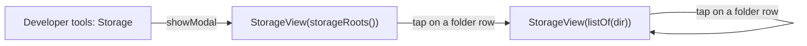

# Android, desktop: folder sizes inside the Storage screen

## Problem

The Storage screen in Developer options shows the size of each top-level entry of the app's storage folders. On Android, `files` contains sent and received files (`app_files`), the core's temporary files (`temp_files`) and wallpapers (`assets`). "Delete all files" deletes only the files directly inside `app_files`. When `files` stays large after it, the screen cannot show which folder or file inside `files` holds the space.

## Cause

`StorageView` lists only the entries of `storageRoots()`, and its rows are not clickable.

## Fix

- `StorageView` takes the directories to list, `storageRoots()` by default.
- For an entry that is a directory and not a symlink, `EntryUsage.dir` is set to its `Path` from `Files.newDirectoryStream`; a tap on its row opens `StorageView` for that directory.
- The rows of `appFilesDir`, `tmpDir`, `remoteHostsDir`, `databaseExportDir` and of folders inside them are not clickable; this list is the default of the `closedDirs` parameter of `rootUsage`.
- The listing of each screen is stored in its `ModalData` under "usage"; after Back, the parent's listing is shown without a new walk.
- A folder shows its 200 largest entries; the other entries are one row "… +N" with their total size.
- `rootUsage`, `RootUsage` and `EntryUsage` are `internal`; `StorageViewTest` passes its own `closedDirs`.

## Scope

The iOS Storage screen (`apps/ios/Shared/Views/UserSettings/StorageView.swift`) is unchanged.
