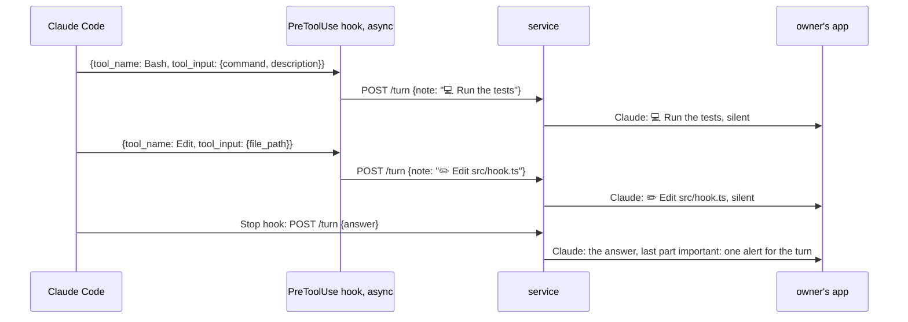
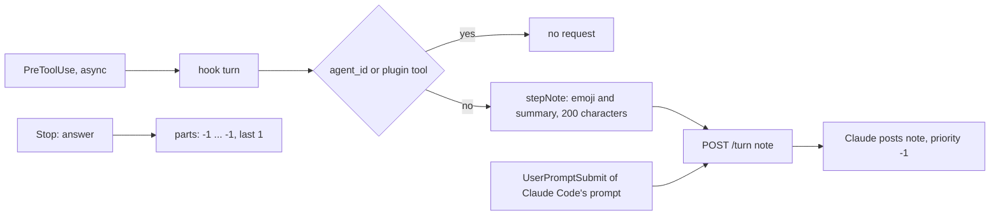

# What Claude is doing: one line per step

Status: draft for review. Code references: master `9d3241b06` (MCP 0.3.0) and `ep/mcp-harness-notes` at `9c78e6276`, on which this item is built. Claude Code references: version 2.1.322, its binary at the offsets given, a `claude -p` run of 2026-11-12 with logging tool hooks (R3), and the transcripts of one machine.

## 1. Goal

Roadmap lines, `packages/simplex-chat-mcp/ROADMAP.md`:
- `:18` "See what Claude is doing while it works, with its code changes as diffs." This item covers the steps; the diffs are question Q3.
- `:13` "Alerts come only for messages that need you, such as answers and approval requests." This item marks the steps and the notes silent; `ep/mcp-silent-messages` makes receivers honour it.

The user's words, 2026-11-12:

> "what claude is doing" is very much needed... It's like in the vacuum without it.

Choosing one line per step over one status message edited live:

> that's ok, it means we'll need to add both silent and important messages, and send these messages as silent, and last message in a turn as important. Silent could be easier. I don't like editing, better amend first, I will see how it looks. If too noisy, we'll switch to editing indeed.

## 2. What users see

During a turn, Claude posts one line in the session's group for each tool use of the main conversation, when the tool use starts. Lines and the notes of Claude Code's own prompts are silent. Claude's answer ends the turn; its last part is important, and the parts before it are silent.

```
step                 line                                                         example from this machine's transcripts
Bash                 💻 DESCRIPTION, or the command's first line without one        💻 List branches
Read                 📖 Read PATH                                                   📖 Read src/Simplex/Messaging/Protocol.hs
Edit                 ✏️ Edit PATH                                                   ✏️ Edit tests/XFTPServerTests.hs
Write                📝 Write PATH                                                  📝 Write rfcs/2026-09-11-proof-of-work.md
WebFetch             🌐 Fetch URL                                                   🌐 Fetch https://spec.torproject.org/hspow-spec/common-protocol.html
WebSearch            🔎 Search QUERY                                                🔎 Search "hs_pow.c" tor source "pow_worker" OR "hs_pow_verify" effort estimation "hs_service" pow_state
Agent                🤖 Agent: DESCRIPTION                                          🤖 Agent: Review pass 6 usage stats
another tool         🔧 TOOL, and ": VALUE" with the first of description, query,  🔧 ToolSearch: select:Monitor
                     url, file_path, path, pattern and command that is a string
```
- PATH is relative to the session's folder when it is inside it, and absolute otherwise.
- A line has at most 200 characters, cut to 199 and `…`, as the notes of `ep/mcp-harness-notes`.
- Tools of this plugin get no line: their cards are in the group already. Tool uses of subagents get no line: the Agent line and the subagent's report note show them.

Priority of Claude's posts:
```
post                                   now        with this item
step line                              -          silent (-1)
note of Claude Code's prompt           normal     silent (-1)
answer, parts before the last          normal     silent (-1)
answer, last part                      normal     important (1); normal until receivers support it
tool-use and action cards              normal     normal
User's prompts, rights posts, replies  normal     normal
```



Before receivers support silent messages, every line alerts, as a normal message does (Q2).

## 3. Questions for the user

Q1. When is a step's line posted?
- A, recommended: when the step starts (PreToolUse). A long step, such as a build, shows at once. A step that is then refused still has its line, and a step that needs approval shows its line next to its card.
- B: when the step ends (PostToolUse and PostToolUseFailure), with ✅ or ❌ and its duration. Nothing shows while a long step runs.

Q2. Ship before receivers support silent messages?
- A, recommended: yes. The lines are marked silent from the start; they alert until the plugin's core libraries and the owner's app have `ep/mcp-silent-messages`. You see how it looks now.
- B: merge after the core and app releases with silent messages.

Q3. The code changes as diffs of the roadmap line:
- A, recommended: a later pull request. An Edit or a Write is followed by a silent message with the diff as a `diff` code block, after "read more" folds long messages.
- B: in this pull request, cut to one message.

## 4. Decisions

Facts:
1. Claude Code 2.1.322 runs PreToolUse hooks with `{tool_name, tool_input, tool_use_id}` (binary offset 296946842), PostToolUse with `tool_response` and `duration_ms` (296947681), and PostToolUseFailure with `error`, `is_interrupt` and `duration_ms` (296948156). Every hook input has `session_id`, `transcript_path`, `cwd`, `prompt_id` and `effort` (`Ip`, 296962410); a subagent's tool use adds `agent_id` and `agent_type`. R3 recorded these fields for Bash and Agent in the main conversation and for Bash in a subagent, with `async: true` hooks and the matcher `*`.
2. In R3 the PreToolUse hook of `sleep 2; echo two` logged its input 2.0 s before the PostToolUse hook.
3. Tool uses in the main conversations of this machine: 136,893; Bash 57.1%, Edit 19.5%, Read 11.5%, Write 3.3%, WebFetch 1.7%. Bash has `description` in 73,980 of 78,204 uses. A turn with tool uses has a median of 6, a 90th percentile of 42 and a 99th of 161 of them.
4. The plugin's PreToolUse entry runs `plugin/allow.js` for its own tools (`hooks/hooks.json:4`). Its turn hooks are async and post through `POST /turn` (`hooks.json:5-7`, `src/hook.ts`).
5. `ep/mcp-harness-notes` sends `note`, a line Claude posts without a quote, in `POST /turn` (`src/hook.ts:117-118` and `src/hub.ts:195` at `9c78e6276`).
6. A core before `ep/mcp-silent-messages` ignores `priority` of a composed message (`src/Simplex/Chat/Controller.hs:1957-1968`). The plugin's core libraries are the release pinned by `packages/simplex-chat-nodejs/src/release.ts:3`, `core-7.1.3.0`.

Choices:
7. A second PreToolUse entry, matcher `*`, `async: true`, runs `hook turn` (Q1 A).
8. The hook makes the line of a PreToolUse input and sends it as `note` with `{id, pid, at}`. It sends nothing for an input with `agent_id`, or for a tool whose name starts with `mcp__plugin_simplex_simplex__`.
9. The hub posts every `note` with `priority: -1`. The refusal subject becomes `Claude's note was not posted: ` for the notes of both items.
10. An answer of several parts is sent with `priority: -1` on all parts but the last, and `priority: 1` on the last.
11. Lines are posted in the order their requests arrive. Parallel tool uses of one model response may appear in any order among themselves; consecutive steps are at least one tool run apart.
12. The plugin sends `priority` before its pinned core supports it (Q2 A). `ComposedMessage` of `@simplex-chat/types` 7.1.3 has no `priority`; the hub's message objects carry it as an extra property until the types package is updated.
13. Tool-use cards, action cards, `User`'s prompts, rights posts and replies keep normal priority. Which of them become silent later is decided with the roadmap line `:13`.

## 5. Design

Options:
```
option                                   producer                         consumer        wire                cost
A. PreToolUse async hook, note (chosen)  hook: one line per tool use      posts note      note, as notes       one hook entry, one function
B. PostToolUse hook with outcome         hook after the step              posts note      note                 nothing while a step runs (Q1)
C. one status message, edited            hook                             edits an item   new field           the user prefers lines (2.)
D. Stop hook reads the turn's tool uses  hook at the turn's end           posts lines     notes               shows nothing while Claude works
```

Changes, on top of `ep/mcp-harness-notes`:
```
file              function                change
hooks/hooks.json  PreToolUse              second entry: matcher *, node dist/cli.js hook turn, async
src/hook.ts       TurnInput               + tool_name, tool_input, cwd, agent_id
                  turn                    PreToolUse: note = stepNote(input), unless agent_id or this plugin's tool
                  stepNote                the line of section 2, cut by shortened
src/hub.ts        Session.turn            note posted with priority -1; refusal subject "Claude's note was not posted"
                  Session.answer, post    priority per part: -1 for all parts but the last, 1 for the last
```



## 6. Compatibility

- Older receivers: every line alerts until the owner's app has silent messages (Q2).
- An older core in the plugin ignores `priority` (fact 6); the core release with silent messages makes the sends silent.
- Claude Code without `PreToolUse` input fields posts nothing: the line needs `tool_name`.
- Older services: the hook of this version stops an older service first (`src/client.ts:37-40`).

## 7. Acceptance and tests

Done when:
```
#  criterion                                                                    checked by
1  each tool of section 2 gives its exact line, paths relative to cwd           unit: hook
2  no line for a subagent's tool use or this plugin's tool                      unit: hook
3  the hub posts a note with priority -1 and an answer's last part with 1       unit: sessions
4  a PreToolUse entry with async true and matcher * runs hook turn              unit: plugin files test
5  a real session shows one silent line per step and one alert per turn         TESTING check, with an app that has silent messages
```

Tests:
- `test/unit/hook.test.ts`: PreToolUse inputs of R3 and of the transcripts' tool inputs, with paths replaced; lines; none with `agent_id` or for `mcp__plugin_simplex_simplex__send`. Fails on master: no line.
- `test/unit/sessions.test.ts`: the `priority` of each sent part.
- `test/unit/plugin.test.ts`: the hooks file.
- `test/e2e/service.test.ts`: a PreToolUse hook posts its line as Claude.

## 8. Docs to change

- `README.md:36`: Claude's steps appear as silent lines.
- `REFERENCE.md`, "Prompts and answers": the step lines, the priorities.
- `ROADMAP.md:18`: stays until the diffs ship (Q3 A).
- `spec/flows.md`: a flow of a turn with steps; `spec/api.md`: the hook and `POST /turn`; `spec/architecture.md`: `stepNote`, the priorities.
- `TESTING.md`: the tests and the real-session check.

## 9. Conflict areas with the other items

```
file                       where                                   items
src/hook.ts                turn, TurnInput, the note functions     mcp-harness-notes (base of this item)
src/hub.ts                 Session.turn, answer, post             mcp-harness-notes, mcp-replies, mcp-reactions
hooks/hooks.json           PreToolUse                              none
REFERENCE.md, spec         "Prompts and answers", 8.6, flow 21    mcp-harness-notes, mcp-replies, mcp-reactions
README.md:36               the sentence of the group's posts       mcp-harness-notes
```

## 10. Estimate

About 80 lines of source and 120 of tests, half a day after `ep/mcp-harness-notes` merges. Receivers stop alerting after the core and app releases of `ep/mcp-silent-messages`; the plugin then pins the new core libraries.
