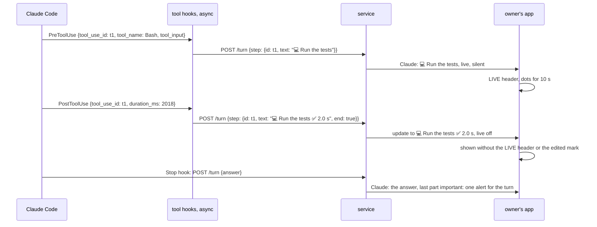
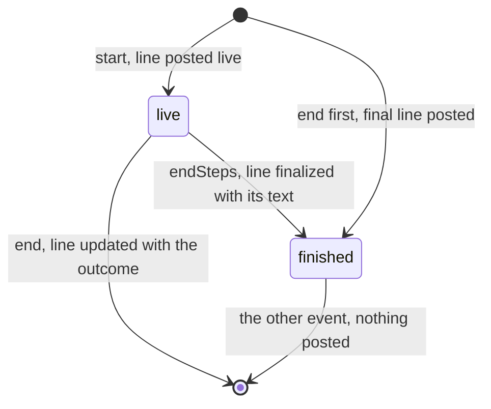
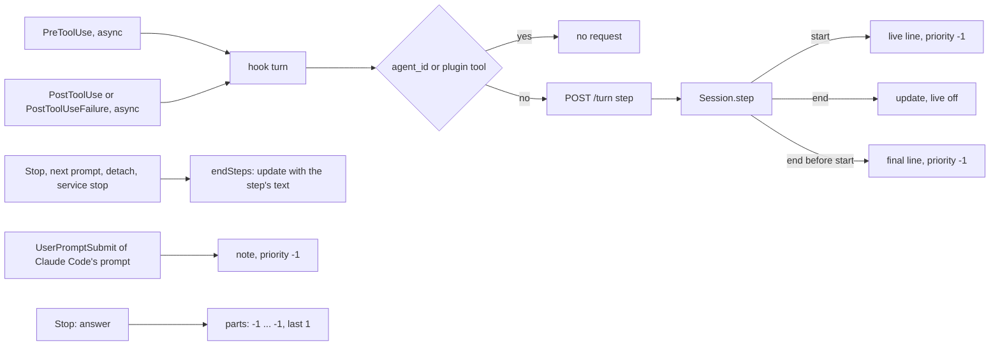

# What Claude is doing: one line per step

Status: Q1, Q2 and Q3 answered A on 2026-11-12; the plan was approved and is implemented on `ep/mcp-activity`. Code references: master `9d3241b06` (MCP 0.3.0) and `ep/mcp-harness-notes` at `ef93ce0dd`, on which this item is built; it was merged as master `97bbbd9ac`. Claude Code references: version 2.1.322, its binary at the offsets given, two `claude -p` runs of 2026-11-12 with logging tool hooks (R3 and R4), and the transcripts of one machine.

## 1. Goal

Roadmap lines, `packages/simplex-chat-mcp/ROADMAP.md`:
- `:18` "See what Claude is doing while it works, with its code changes as diffs." This item is about the steps; the diffs are left to a later pull request (Q3).
- `:13` "Alerts come only for messages that need you, such as answers and approval requests." With this item, Claude marks the steps and the notes silent; with `ep/mcp-silent-messages`, receivers honour the mark.

The user's words, 2026-11-12:

> "what claude is doing" is very much needed... It's like in the vacuum without it.

Choosing one line per step over one status message edited live:

> that's ok, it means we'll need to add both silent and important messages, and send these messages as silent, and last message in a turn as important. Silent could be easier. I don't like editing, better amend first, I will see how it looks. If too noisy, we'll switch to editing indeed.

On Q1:

> end of the step then can be posted as edit, if claude reports both - does it make sense?

## 2. What users see

During a turn, Claude posts one line in the session's group for each tool use of the main conversation, when the tool use starts. The line is a live message: the apps show it under the LIVE header, with animated dots during its first 10 seconds. When the step ends, Claude finalizes the line with the step's outcome and duration. The apps then show it without the LIVE header or an "edited" mark. Lines and the notes of Claude Code's own prompts are silent. Claude's answer is the turn's last post; its last part is important, and the parts before it are silent.

The text of a step:
```
step                 text                                                         example from this machine's transcripts
Bash                 💻 DESCRIPTION, or the command's first line without one        💻 List branches
Read                 📖 Read PATH                                                   📖 Read src/Simplex/Messaging/Protocol.hs
Edit                 ✏️ Edit PATH                                                   ✏️ Edit tests/XFTPServerTests.hs
Write                📝 Write PATH                                                  📝 Write rfcs/2026-09-11-proof-of-work.md
WebFetch             🌐 Fetch URL                                                   🌐 Fetch https://spec.torproject.org/hspow-spec/common-protocol.html
WebSearch            🔎 Search QUERY                                                🔎 Search "hs_pow.c" tor source "pow_worker" OR "hs_pow_verify" effort estimation "hs_service" pow_state
Agent                🤖 Agent: DESCRIPTION                                          🤖 Agent: Review pass 6 usage stats
another tool         🔧 TOOL, and ": VALUE" with the first of description, query,  🔧 ToolSearch: select:Monitor
                     url, file_path, path, pattern and command that is a string
```

The final line:
```
end of the step                                final line
PostToolUse                                    💻 Run the tests ✅ 2.0 s
PostToolUseFailure                             💻 Run the tests ❌ 39 ms
PostToolUseFailure with is_interrupt true      💻 Run the tests ⏹️ 4 min 12 s
none: the step was refused                     💻 Run the tests, finalized when the turn ends
```

The duration:
```
duration       shown as
under 1 s      41 ms
under 10 s     2.0 s
under 1 min    42 s
under 1 h      4 min 12 s
1 h or more    1 h 5 min
```

- PATH is relative to the session's folder when it is inside it, and absolute otherwise.
- The text of a step has at most 200 characters, cut to 199 and `…`, as the notes of `ep/mcp-harness-notes`. The outcome and the duration are appended to it.
- Claude posts no line for the tools of this plugin, whose cards are in the group already, and for the tool uses of subagents, which are shown by the Agent line and the note of the subagent's report.
- Claude Code reports the end of a step run in the background, such as a Bash command or an agent with `run_in_background`, when the step is launched (fact 4). Its completion is reported by the note of its task notification.
- A line without an end is finalized with its text unchanged when the turn ends, when a prompt starts the next turn, when Claude Code detaches, or when the service stops.

Priority of Claude's posts:
```
post                                   now        with this item
step line                              -          silent (-1)
note of Claude Code's prompt           normal     silent (-1)
answer, parts before the last          normal     silent (-1)
answer, last part                      normal     important (1); normal until receivers support it
tool-use and action cards              normal     normal
User's prompts, rights posts, replies  normal     normal
```



Before receivers support silent messages, the owner's app alerts for each line when it is posted, as for a normal message (Q2). For the end of a line, only the Android and desktop apps alert, and only in another profile (fact 10).

## 3. Questions for the user

Q1. When is a step's line posted? Answered A: when the step starts. The user's note asked whether the end can update the line when Claude Code reports both. It can:
- Claude Code reports the start (PreToolUse) and the end (PostToolUse or PostToolUseFailure) of a tool use with one `tool_use_id` (facts 1 and 2).
- The line is posted as a live message and finalized at the end. The core does not mark a live message edited when it is updated, so the apps show no "edited" mark (fact 9).
- Claude Code reports no end of a refused step (fact 3). Its line is finalized with its text when the turn ends.

The result is in section 2, the mechanics in decisions 13 to 20.

Q2. Merge before receivers support silent messages? Answered A.

Q3. The code changes as diffs of the roadmap line? Answered A: a later pull request. The user's note:

> we probably can't ship without diff and silent messages support, but we can merge this PR for sure - just not release it yet. I will update from code.

This pull request is merged. The plugin is released with this item after the diffs and receivers' support of silent messages. Until then, the user runs the plugin built from the source.

## 4. Decisions

Facts:
1. Claude Code 2.1.322 runs PreToolUse hooks with `{tool_name, tool_input, tool_use_id}` (binary offset 296946842), PostToolUse with `tool_response` and `duration_ms` (296947681), and PostToolUseFailure with `error`, `is_interrupt` and `duration_ms` (296948156). Every hook input has `session_id`, `transcript_path`, `cwd`, `prompt_id` and `effort` (`Ip`, 296962410); a subagent's tool use adds `agent_id` and `agent_type`. These fields were recorded in R3 for Bash and Agent in the main conversation and for Bash in a subagent, with `async: true` hooks and the matcher `*`.
2. In R3 the PreToolUse hook of `sleep 2; echo two` logged its input 2.0 s before the PostToolUse hook, and the two hooks of `echo one` logged theirs 58 ms apart. In R4 Claude Code ran PostToolUseFailure for `false` with `error: "Exit code 1"`, `is_interrupt: false` and `duration_ms: 39`, 58 ms after its PreToolUse. It ran PostToolUseFailure for a Read of a missing file too.
3. For a refused tool use, Claude Code returns the error result and runs neither PostToolUse nor PostToolUseFailure. It runs the PermissionDenied hook only for refusals of the auto-mode classifier (binary offset 297515603). In R4 only the PreToolUse hook was run for `ls /nonexistent-r4`, refused by the permission check. For a tool call that throws, Claude Code runs PostToolUseFailure, with `is_interrupt` set for an interruption (297536998).
4. Claude Code returns the result of a tool run in the background when it is launched: the result of a background Bash is "Command running in background with ID ..." in the transcripts of this machine.
5. Tool uses in the main conversations of this machine: 136,893; Bash 57.1%, Edit 19.5%, Read 11.5%, Write 3.3%, WebFetch 1.7%. Bash has `description` in 73,980 of 78,204 uses. A turn with tool uses has a median of 6, a 90th percentile of 42 and a 99th of 161 of them.
6. Claude Code runs `plugin/allow.js` for the plugin's own tools from its PreToolUse entry (`hooks/hooks.json:4`). The turn hooks run async and post through `POST /turn` (`hooks.json:5-7`, `src/hook.ts:113-134`).
7. With `ep/mcp-harness-notes`, the hook sends `note`, a line Claude posts without a quote, in `POST /turn` (`src/hook.ts:118-119` and `src/hub.ts:195` at `ef93ce0dd`).
8. A core before `ep/mcp-silent-messages` ignores `priority` of a composed message (`src/Simplex/Chat/Controller.hs:1957-1968`). The plugin's core libraries are the release pinned by `packages/simplex-chat-nodejs/src/release.ts:3`, `core-7.1.3.0`.
9. Live messages in `simplex-chat` 7.1.3: `apiSendMessages(chat, messages, liveMessage)` and `apiUpdateChatItem(chatType, chatId, chatItemId, msgContent, liveMessage)` (`packages/simplex-chat-nodejs/src/api.ts:448`, `:488`). The core accepts one message in a live send (`Library/Commands.hs:5073-5082`). An update of a live item is sent and applied also with unchanged text (`Commands.hs:834`, `:865`; receivers `Library/Subscriber.hs:2098`, `:2373`). In such an update the core keeps `item_edited` false, `edited = itemLive /= Just True` (`Commands.hs:842`, `:877`; `Subscriber.hs:2104`, `:2379`). `itemStatus` is unchanged in `updatedChatItem`, and neither `item_ts` nor `created_at` is set by the update (`Store/Messages.hs:2578-2593`, `:2606`, `:2813`).
10. The core sends an update without the SMP notification flag: `hasNotification` is `False` for `x.msg.update` (`Protocol.hs:1339-1348`). In the active profile, the apps notify an update only when it creates the item (`SimpleXAPI.kt:3832-3842`, `SimpleXAPI.swift:3213-3218`). Android and desktop also notify an update in another profile (`SimpleXAPI.kt:3829-3830`); decision 11 of `ep/mcp-silent-messages` applies to it.
11. The apps show a live item under the LIVE header (`FramedItemView.swift:75-76`, `FramedItemView.kt:320-321`), with animated dots until 10 s after its `updatedAt` (`MsgContentView.swift:64-99`, `TextItemView.kt:264-291`; `recent` at `ChatTypes.swift:4460`, `ChatModel.kt:4048`). A live item cannot be deleted for oneself (`canBeDeletedForSelf`, `ChatTypes.swift:4182-4183`, `ChatModel.kt:3691-3692`).
12. Messages of `LiveMessage` in the library are sent without `priority`, and its updates are limited to one per interval, for streamed text (`api.ts:1134-1214`).

Choices:

13. Claude Code runs `hook turn` from three hook entries with the matcher `*` and `async: true`: a second PreToolUse entry, a PostToolUse entry and a PostToolUseFailure entry.
14. The hook sends `{id, pid, at, effort, step}` for each event of a tool use; `effort` is taken as from the other turn hooks. At PreToolUse, `step` is `{id: tool_use_id, text}`, with the text of section 2. At PostToolUse and PostToolUseFailure, `step` is `{id, text, end: true}`, where `text` is the text of the step, its outcome and its duration. The hook sends nothing for an input with `agent_id`, or for a tool whose name starts with `mcp__plugin_simplex_simplex__`.
15. The hub posts the start of a step as a live message with `priority: -1`. It keeps the step's start time, its text and the promise of the item's ID, stored before the send is awaited.
16. At the end of a known step, the hub removes the step and updates its item with the final text and `liveMessage: false`. When the start was not posted, the hub posts nothing at the end.
17. For an end before its start, the hub posts the final text as a message with `priority: -1` and adds the step's ID to the finished IDs; it then posts nothing for the start. In fact 2 the two hooks are 58 ms apart, so the end can arrive first.
18. `Session.endSteps(before)` finalizes each live step started before `before` with its text unchanged and adds its ID to the finished IDs; the hub then posts nothing for its end. `Session.turn` calls it next to `endPermissions(at)`: at Stop, and at a prompt that starts a turn. The service calls it at the last detach (`service.ts:315-323`), and `Hub.stop` calls it for every session before the core closes. Every line is finalized, because the apps keep a live item from deletion (fact 11).
19. The hub keeps the last 100 finished IDs and drops the oldest first. For an event of a finished ID, the hub removes the ID and posts nothing.
20. The hub sends with `apiSendMessages` and `apiUpdateChatItem`, not with `LiveMessage`, because messages of `LiveMessage` are sent without priority (fact 12).
21. The hub posts every `note` with `priority: -1`. For a refused start, the hub posts the refusal once, with the subject `Claude's note was not posted`, which it uses for the notes of both items.
22. An answer of several parts is sent with `priority: -1` on all parts but the last, and `priority: 1` on the last.
23. Lines are posted in the order their starts arrive. Parallel tool uses of one model response may be posted in any order among themselves.
24. The plugin sends `priority` before its pinned core supports it (Q2 A). `ComposedMessage` of `@simplex-chat/types` 7.1.3 has no `priority`; the hub's message objects have it as an extra property until the types package is updated.
25. Tool-use cards, action cards, `User`'s prompts, rights posts and replies are posted with normal priority. Which of them become silent later is decided with the roadmap line `:13`.
26. The pull request is merged before the release. The plugin is released with this item after the diffs and receivers' support of silent messages (Q3).

## 5. Design

Options:
```
option                                     producer                          consumer                     wire                 cost
A. live line at start, finalized at end    PreToolUse, PostToolUse and       posts a live line,           step {id, text,      three hook entries, a step map,
   (chosen)                                PostToolUseFailure hooks          updates it at the end        end}                 two messages per step
B. line at the start only                  PreToolUse hook                   posts a line                 note                 the outcome is missing
C. line at the end only                    PostToolUse hooks                 posts a line                 note                 nothing shows while a step runs
D. one status message, edited              tool hooks                        edits one item               step                 the user prefers lines (section 1)
E. Stop hook reads the turn's tool uses    Stop hook                         posts lines                  notes                nothing shows while Claude works
```

Changes, on top of `ep/mcp-harness-notes`:
```
file              function              change
hooks/hooks.json  PreToolUse            second entry: matcher *, node dist/cli.js hook turn, async
                  PostToolUse           new entry: matcher *, the same command, async
                  PostToolUseFailure    new entry: matcher *, the same command, async
src/protocol.ts   TurnRequest           + step: {id, text, end?}
src/hook.ts       TurnInput             + cwd, agent_id, tool_name, tool_input, tool_use_id, duration_ms, is_interrupt
                  turn                  tool events: {id, pid, at, effort, step}; nothing for agent_id or this plugin's tools
                  stepOf                {id, text} at the start; the text, the outcome and the duration, end: true at the end
                  stepText              the text of section 2, cut by shortened in stepOf
                  displayPath           a path relative to cwd when it is inside it
                  duration              the format of section 2
src/hub.ts        Session.turn          step: Session.step; endSteps(at) next to endPermissions(at)
                  Session.step          new: decisions 15 to 17 and 19
                  Session.endSteps      new: decision 18
                  Session.post          + a priority per part; the live line is sent by Session.step
                  Session.answer        priority per part: -1 for all parts but the last, 1 for the last
                  note posts            priority -1; refusal subject "Claude's note was not posted"
                  Hub.stop              endSteps of every session before the core closes
src/service.ts    SessionLike           + endSteps
                  onAttach              endSteps at the last detach
```

State of the hub:
```
field             type                         content
Session.steps     Map<string, Step>            live steps by tool_use_id
Step.at           number                       start time of the start's hook process
Step.text         string                       text of the step
Step.item         Promise<number | undefined>  ID of the live line; undefined when it was not posted
Session.finished  Set<string>                  last 100 finished tool_use_ids
```

```
step({id, text, end}, at):
  if finished has id: finished.delete(id); return
  known = steps.get(id)
  if not end:
    item = post([text], priority -1, live) → item ID, or undefined after a refusal
    steps.set(id, {at, text, item})
    await item
  else if known is undefined:
    remember(id)
    await post([text], priority -1)
  else:
    steps.delete(id)
    finalize(await known.item, text)

endSteps(before):
  for each [id, step] of steps with step.at < before:
    steps.delete(id)
    remember(id)
    finalize(await step.item, step.text)

finalize(item, text):
  if item is not undefined: apiUpdateChatItem(group, item, text, liveMessage false)

remember(id):
  finished.add(id); drop the oldest beyond 100
```





## 6. Compatibility

- Older receivers: the owner's app alerts for each line when it is posted, until it has silent messages (Q2). For the end of a line, only the Android and desktop apps alert, and only in another profile (fact 10).
- An older core in the plugin ignores `priority` (fact 8); with the core release with silent messages, the sends are silent.
- When Claude Code gives these hook inputs without `tool_use_id` or `tool_name`, the hook sends nothing.
- Older services: the hook of this version stops an older service first (`src/client.ts:37-40`).

## 7. Acceptance and tests

Done when:
```
#   criterion                                                                                   checked by
1   the hook makes the exact text of each tool of section 2, paths relative to cwd              unit: hook
2   the hook appends the outcome and duration of each end in the format of section 2            unit: hook
3   the hook sends nothing for a subagent's tool use or this plugin's tool                      unit: hook
4   the hub posts a start live with priority -1 and updates it with live off at its end         unit: sessions
5   for an end before its start, the hub posts the final line once and nothing for the start    unit: sessions
6   the hub finalizes live steps at Stop, a turn's first prompt, last detach and service stop   unit: sessions, unit: service
7   the hub posts nothing for an end after endSteps, and one refusal for a refused start        unit: sessions
8   the hub posts a note with priority -1, an answer's last part with 1, earlier parts with -1  unit: sessions
9   Claude Code runs hook turn from three entries with async true and matcher *                 unit: plugin
10  a real session shows one silent live line per step, finalized at its end                    TESTING check, with an app that has silent messages
```

Tests:
- `test/unit/hook.test.ts`, new, in "turn hooks", with the tool inputs of R3, R4 and the transcripts:
  - "send a step at the start of each tool use of the main conversation, with its text from the tool's input and paths relative to the session's folder". On master the requests have no `step`.
  - "send a step at the end of each tool use with its outcome and duration, and nothing for a tool use of a subagent or of this plugin". On master the requests have no `step`, and the skipped tool uses are sent.
- `test/unit/sessions.test.ts`, new, in "session channel":
  - "posts the start of a step as a silent live line and updates it with the step's end, and posts the end that arrives before its start as a silent line, and nothing for that start".
  - "ends the live lines of steps without an end with their text at an answer, at a prompt that starts a turn, at the last detach and at the hub's stop, not at a prompt added to the running turn, and posts nothing for their later ends".
  - "posts the note of Claude Code's prompt and the parts of an answer but the last as silent, and the last part of an answer as important".
  - "posts that Claude's note was not posted, naming the preference, once for a note and once for a step, and nothing at the step's end", in "while a preference of the session group refuses a post", replacing the test of the old subject.
- `test/unit/service.test.ts`, changed: "passes permission requests and turns to the session, and its lines to the attachments while they exist, and ends its permissions and steps at the last detach".
- `test/unit/plugin.test.ts`, changed: "runs the hooks from the plugin's own build, allows the plugin's tools, and runs the turn hook at the start and the end of every tool use".
- `test/e2e/service.test.ts`, changed: the mirroring test ends with a PreToolUse hook and a PostToolUse hook of Bash, whose line is posted live as Claude and finalized, not edited.
- The sessions and service tests use the new `step` of `TurnRequest` and `endSteps`, so they compile only with this change.

## 8. Docs to change

- `README.md:36`: Claude's steps appear as silent lines, finalized with their outcome.
- `REFERENCE.md`, "Prompts and answers": the step lines, their ends, the priorities.
- `ROADMAP.md:18`: stays until the diffs ship (Q3 A).
- `spec/flows.md`: flow 32, the steps of a turn, with the order rules; `spec/api.md`: the hook entries and `step` of `POST /turn`; `spec/architecture.md`: 8.3, the steps and finished IDs; 8.6, the step lines and the priorities.
- `TESTING.md`: the tests and the real-session check.

## 9. Conflict areas with the other items

```
file                       where                                          items
src/hook.ts                turn, TurnInput, the note functions            mcp-harness-notes (base of this item)
src/hub.ts                 Session.turn, answer, post, Hub.stop           mcp-harness-notes, mcp-replies, mcp-reactions
src/service.ts             onAttach, SessionLike                          mcp-fixes changes runService in this file
hooks/hooks.json           PreToolUse, PostToolUse, PostToolUseFailure    none
REFERENCE.md, spec         "Prompts and answers", 8.3, 8.6, flows 21, 31  mcp-harness-notes, mcp-replies, mcp-reactions
README.md:36               the sentence of the group's posts              mcp-harness-notes
```

## 10. Estimate

About 110 lines of source and 200 of tests, one day after `ep/mcp-harness-notes` merges. Claude sends two messages per step, 12 in a median turn. Receivers stop alerting after the core and app releases of `ep/mcp-silent-messages`; the plugin then pins the new core libraries.
