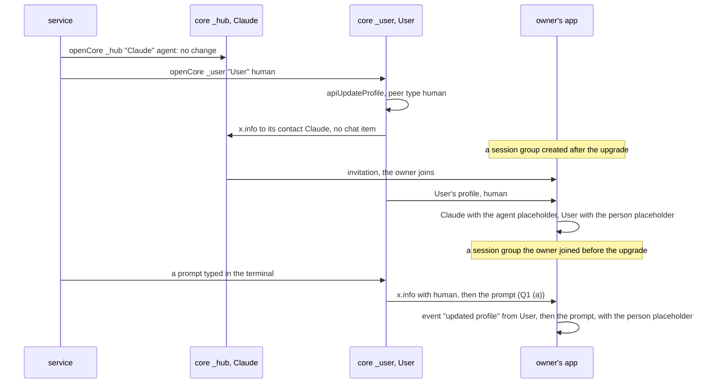
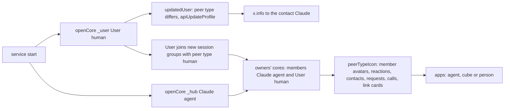

# Claude as an agent, User as a person

Status: approved by the user on 2026-11-13 at `7c0da7fef`, with the answers Q1 (b) and Q2 (b); implemented on `ep/mcp-agent-profile` after the merge of master `97bbbd9ac`. On 2026-11-13 the user changed the answer to Q1 to (a), as Q3 A of the plans page: the core sends a change of the peer type alone to groups. Code references: master `9d3241b06`.

Outcome:
- The apps choose the placeholder of another person's profile by its peer type: in groups, in contact lists, in reactions, in calls, for contact requests and on link cards. Claude gets the agent placeholder in its session groups and in the Main group.
- `User`, the profile that posts the prompts typed in the terminal, is given the peer type `human` and keeps the person placeholder.
- In a data folder of 0.3.0, `User` is changed at the service start, without user action.
- The core sends a change of the peer type alone to groups, before the next message there (Q1 (a)). Owners who joined a session group before the upgrade see `User` as a person after its next post there, once the plugin bundles a core with this change.

## 1. Goal

Roadmap line, `packages/simplex-chat-mcp/ROADMAP.md:8`: "Claude appears as an agent, with the agent avatar."

The user's words, 2026-11-11: "correct default avatar placeholders for claude (we have agent) and correct peer type for claude user".

"we have agent" names the agent placeholder, which the apps show for contacts with peer type `agent` since #7738. "claude user" is read as the plugin's profile `User`. Claude's profile has the peer type `agent` already, and so does `User` (decision 6). For a profile that posts only prompts a person typed, `agent` is wrong (decision 11). The other reading, Claude's profile, needs no change.

Done when:
```
#  criterion                                                                          checked by
1  a member without an image and with peer type agent has the agent placeholder in       snapshot tests of the desktop and iOS apps
   every place of decision 8
2  every other placeholder of another profile, in the places of decision 20, is chosen  the same snapshot tests for link cards and contact
   by its peer type                                                                       requests; review of the diff for the other places
3  a profile with peer type bot has the cube placeholder; a profile of another peer      the same snapshot tests
   type, or of none, keeps the person placeholder of its place
4  the plugin's User has peer type human; Claude and the agents of serve keep agent      unit tests of core.ts; e2e test of the service
5  after a service start on a data folder of 0.3.0, User has peer type human             the same e2e test: prepareRoot makes User agent
6  an owner who joins a session group sees Claude as agent and User as human             the same e2e test
7  docs state the peer types; the roadmap line is removed                                review
8  a change of the peer type alone is sent to each group before the next message there,  core test, fails on master
   and members see `updated profile` once
```

## 2. What users see

The placeholder of another person's profile without an image, after the change:
```
profile                                           before     after
Claude, in its session groups and the Main group   person     agent
an agent of serve, in its agent control chat       person     agent
User, in session groups created or joined after    person     person
  the upgrade
User, in session groups joined before the upgrade  person     agent until User's next post there, then person (Q1 (a))
a profile with peer type agent                     person     agent, in every place below
a profile with peer type bot                       person     cube, in every place below
a profile of another peer type, or of none         person     person
a profile with an image                            the image  the image
```

Places that change, in both apps unless one is named:
```
place                                                           drawn by
member avatars (decision 8):
  message rows of groups, classic and flat layout, received      MemberProfileImage
  and own; member list; member info; message info: read
  receipts and delivery; member support chats and their
  toolbar; channel members and channel relays; mention list
  (iOS; the Android and desktop mention list has no avatars)
lists of reactions, of members and of contacts                   the reaction menu
contact list and contact cards (iOS; Android and desktop          ContactListNavLink
  choose by peer type already)
contact requests: chat list, chat info, contact list (iOS)       ChatInfoImage, chatIcon, ContactListNavLink
contacts to add to a group                                       AddGroupMembersView
share and forward list (Android and desktop; iOS chooses by      ShareListNavLinkView
  peer type already)
call screen; on desktop, the call button and the active call     CallView, ActiveCallView, ChatListView.desktop
  card in the chat list
contact and invitation link cards: in messages, in the compose   MsgChatLink icons
  bar, in the chat list preview; their small icons in quotes
  and in the compose context
```

Places that stay as they are:
```
place                                                         shows
chat list and chat info of a contact                           agent, cube or person by peer type, as now
chat list and chat info of a group                             the group placeholder; a group has no peer type
a business chat seen by the business                           the person placeholder of the customer: a group profile has no
                                                               peer type (src/Simplex/Chat/Types.hs:915)
the user's own profiles: user picker, settings, own rows        the person, as now
notifications                                                  the app icon when the profile has no image, as now
apps without this change                                       person in every place above
```

Agent placeholder: `ic_agent.svg` on Android and desktop, `agent` of `SharedAssets.xcassets` on iOS, three dots. Cube: `ic_cube` and `cube.fill`. The person keeps its form in each place: the filled circle for avatars, `person.crop.circle` in iOS reaction menus, `ic_person` and `person` for small link icons. The placeholder keeps its description `profile image placeholder` on Android and desktop.

The only text is a group event of the core, `updated profile` (`src/Simplex/Chat/Messages/CIContent.hs:374`). Owners who joined a session group before the upgrade see it from `User` once, above `User`'s next post there (Q1 (a)).



## 3. Questions for the user

Q1. A peer type change in existing groups. Answered on 2026-11-12: (b); changed on 2026-11-13 to (a), as Q3 A of the plans page.
- (a), the answer: the core counts a peer type change as a change of the member profile, 3 changed lines at `src/Simplex/Chat/Store/Profiles.hs:374-376`, with the test of [Acceptance](#7-acceptance-and-tests). The profile is sent to each group before the next message there, as after a name change. Owners see `updated profile` from `User` once, above `User`'s next terminal prompt, and then the person placeholder. Every client gets the change: a bot or an agent that changes its peer type sends it to its groups. The plugin gets it with the core release that follows, when `release.ts` pins it and the plugin's lock is updated (decision 16).
- (b), the first answer: no core change. In session groups joined before the upgrade, updated apps show `User` with the agent placeholder. New groups and later joiners see a person.
- The user's note: "I don't understand why core has to change - if our plugin correctly updates profile, the update will be sent on the next message."
- The answer. The plugin updates the profile correctly: at each start, `updatedUser` calls `apiUpdateProfile` with the peer type `human` (decision 14). The core then sends the profile by three routes:
  ```
  route                                          User's new profile reaches                      code
  x.info to each contact, at once                the hub's contact of User                       Commands.hs:4134-4169
  introductions by the host and the profiles     every member who joins a session group after    Internal.hs:1355-1365;
  sent at each new member connection             the update                                      Subscriber.hs:519
  x.info to a group before the next message      no group: the core sends it only after a        Internal.hs:2717-2739;
  there                                          change of the name, full name, short             Store/Profiles.hs:369-376
                                                 description, description or image
  ```
  So on master the update is not sent with the next message: before a message, the core sends the profile to a group only when `user_member_profile_updated_at` is later than the group's last send, and a change of the peer type alone leaves that time as it is. With (a), that time is updated for the peer type too, so the update is sent with the next message, as the user expected.

Q2. Placeholders of contacts on other screens. Answered on 2026-11-12: (b).
- (b), the answer: every placeholder of another person's profile is chosen by its peer type: the 18 sites of the first draft and 6 more found in the search for every site (decision 20).
- (a), the first recommendation: only `MemberProfileImage`.
- The user's note: "you mean in app UI we don't show bot or agent? why is that I wonder? can you understand?"
- The answer. The apps show the peer type only where it was added for direct chats with bots. #5360, `4811d663e`, 2025-08-07, added the peer type to identify bots: the cube of a bot contact in the chat list and chat info, and the bot's commands menu (`Contact.chatIconName`, `isBot`). #7738, `77f9f4a46`, 2026-10-17, added `agent` at the same places through `peerTypeIcon`, and in the alerts of links. Neither pull request changed `MemberProfileImage`, which draws every member avatar and dates from 2024 (`b04f15997`, `7a418918d`, blurred images of blocked members), nor the other screens of decision 20. So members, contact lists, reactions, calls, contact requests and link cards kept the person placeholder for every peer type.

## 4. Decisions

Core:
1. A profile's peer type is `ChatPeerType`: `human`, `bot`, `business`, `agent`, or another text kept as received (`src/Simplex/Chat/Types.hs:753-779`). It is stored in `contact_profiles.chat_peer_type` (`src/Simplex/Chat/Store/Profiles.hs:391`, `src/Simplex/Chat/Store/Direct.hs:741`).
2. The peer type of a user's own profile is set at creation by `CreateActiveUser` and later by `APIUpdateProfile`, `/_profile USER_ID JSON` (`src/Simplex/Chat/Library/Commands.hs:1626`, `:6807`). The plugin calls `apiCreateActiveUser` and `apiUpdateProfile` (`packages/simplex-chat-nodejs/src/api.ts:1047`, `:1087`).
3. A change is sent to contacts at once: `sendUpdateToContacts` sends `x.info` to each contact whose profile as sent changes, and that profile includes the peer type (`src/Simplex/Chat/Library/Commands.hs:4134-4169`, `:4158`, `src/Simplex/Chat/Types.hs:809-813`). The contact's core stores it and creates no chat item for a peer type change (`src/Simplex/Chat/Library/Subscriber.hs:2770-2787`, `:2806-2814`).
4. A change is sent to a group only before the user's next message there, and only when `user_member_profile_updated_at` is later than the group's last send (`src/Simplex/Chat/Library/Internal.hs:2706-2739`). That time is updated for a change of the name, full name, short description, description or image, and not for a peer type change (`src/Simplex/Chat/Store/Profiles.hs:369-376`). So a peer type change is never sent to the members of existing groups. Peer type `bot` is set by this path by `/set bot commands` and by the directory service (`src/Simplex/Chat/Library/Commands.hs:3666-3670`, `apps/simplex-directory-service/src/Directory/Service.hs:223-228`).
5. The core of a member that receives `x.info` in a group stores the profile with its peer type (`redactedMemberProfile` keeps it, `src/Simplex/Chat/Library/Internal.hs:1367-1369`). It creates the event `updated profile` for any change of content, the peer type included (`src/Simplex/Chat/Library/Subscriber.hs:2911-2944`, `:2953-2966`, `src/Simplex/Chat/Types.hs:794-796`).

Plugin today:

6. Claude, `User` and the agents of `serve` have peer type `agent`. `openCore` creates each profile with `agent` and `updatedUser` sets `agent` at each start (`packages/simplex-chat-mcp/src/core.ts:24`, `:29`, `:54-59`). `serve` does the same (`src/serve.ts:89`, `:93`). A data folder of 0.3.0, read on 2026-11-12: `_hub` Claude `agent`, `_user` User `agent`, two agents of `serve` `agent`. In the hub's session group 1, the member Claude is `agent`, User `agent`, and the owner has no peer type.

Apps today:

7. Both apps choose a contact's placeholder by its peer type with `peerTypeIcon`: bot the cube, agent the agent placeholder, any other the person (`apps/multiplatform/common/src/commonMain/kotlin/chat/simplex/common/model/ChatModel.kt:1989-1990`, `:2260-2265`; `apps/ios/SimpleXChat/ChatTypes.swift:313-319`, `:2685-2687`). The chat list and chat info use it for contacts (`.../views/helpers/ChatInfoImage.kt:47-56`; `apps/ios/SimpleXChat/ChatUtils.swift:95-103`). A group gets the group placeholder from `GroupInfo.chatIconName` (`ChatModel.kt:2704-2711`; `ChatTypes.swift:3077-3087`).
8. Both apps draw a member's avatar with `MemberProfileImage`, which passes no icon, so a member without an image gets the person placeholder (`.../views/chat/group/GroupMemberInfoView.kt:931-947` with the default of `ChatInfoImage.kt:73`; `apps/ios/Shared/Views/Chat/Group/GroupMemberInfoView.swift:826-839` with the default of `apps/ios/Shared/Views/Helpers/ProfileImage.swift:15`). The callers of `MemberProfileImage`:
   ```
   Android and desktop                              iOS
   ChatView.kt:2882 MemberImage, used by            ChatView.swift:2088 classic rows
     ChatView.kt:2126 classic rows                  ChatView.swift:2205, :2225 flat rows, own rows
     TerminalItemView.kt:344, :351 flat rows        GroupChatInfoView.swift:515 member list
   GroupChatInfoView.kt:1138 member list            GroupMemberInfoView.swift:519 member info
   GroupMemberInfoView.kt:756 member info           ChatItemInfoView.swift:503 message info
   ChatItemInfoView.kt:380 message info             GroupMentions.swift:240 mention list
   MemberSupportView.kt:230                         MemberSupportView.swift:171
   MemberSupportChatView.kt:135                     MemberSupportChatToolbar.swift:20
   ChannelMembersView.kt:136                        ChannelMembersView.swift:81
   ChannelRelaysView.kt:149                         ChannelRelaysView.swift:131
   ```
9. Peer type `agent` exists from app 7.1.0-beta.7 (#7738, `77f9f4a46`); that pull request changed only the placeholders of contacts. Joining a session group needs app 7.1.0 or later (plan `2026-11-07-mcp-claude-code-channel.md`, section Groups). Every owner's app therefore decodes `agent`.

Changes:

10. `MemberProfileImage` passes `peerTypeIcon` of the member's peer type in both apps. So every place of decision 8 shows the placeholder of the member's peer type, and a bot member gets the cube, as a bot contact does.
11. `User` is given the peer type `human`. `User` posts only prompts a person typed (`packages/simplex-chat-mcp/src/hub.ts:195`, decision 121 of the 0.3.0 plan). No consumer distinguishes `human` from an absent peer type: `peerTypeIcon` returns the person for both, and the core's views test only `bot` (`src/Simplex/Chat/View.hs:671-673`, `:1589`, `:1599`). With `human`, the role is stated in the profile.
12. Claude and the agents of `serve` keep `agent`.
13. `openCore` and `updatedUser` take the peer type. The hub and `serve` pass `agent`; `User.open` passes `human`.
14. A data folder is upgraded by `updatedUser` at each start: it compares the display name and the peer type with the stored profile and updates them when either differs (`src/core.ts:56-57`). In a data folder of 0.3.0, `User` is changed at the first start of the new version. No marker file is written.
15. Q1 (a): `userMemberProfileChanged` also compares the peer type (`src/Simplex/Chat/Store/Profiles.hs:374-376`). Contacts get a peer type change at once already (decision 3). A business chat gets the profile of its business or customer member by the same group path; a change of that member's peer type updates no field of the chat's group profile, which has no peer type (`src/Simplex/Chat/Store/Groups.hs:2823-2829`).
16. The plugin bundles `simplex-chat` 7.1.3 (`packages/simplex-chat-mcp/package-lock.json:4321-4322`), which loads the libraries of `core-7.1.3.0` (`packages/simplex-chat-nodejs/src/release.ts:3`). A core change would reach the plugin only through a core release, its pin in `release.ts` and an update of the plugin's lock.
17. Nothing is posted in any group for the update of `User`. The hub's contact of `User` gets no chat item (decision 3), and the plugin's event handlers ignore `contactUpdated` and `groupMemberUpdated` (`src/tools.ts:665-691`, `src/control.ts:656-670`, `src/user.ts:50-57`).
18. Session groups are never listed by Claude's tools, so the `from_type` of `User`'s messages appears in no tool result (`src/tools.ts:578`, `:1523`).
19. The apps' evidence is a snapshot of each new preview, compared with a committed reference: desktop by `SnapshotTest` (`apps/multiplatform/common/src/desktopTest/kotlin/chat/simplex/app/SnapshotTest.kt:59`, `:137`), iOS by `snapshots.sh` with `previewScenes` (`apps/ios/SimpleX Snapshots/SnapshotTests.swift:205`) and `check-previews.py`.
20. Q2 (b): the other places of another person's profile, found by a search of every `ProfileImage`, `ProfileImageForActiveCall`, profile menu item, person icon and chat link icon in both apps. The first draft listed 18 sites; the search found 6 more, the invitation link cards and the small link icons:
   ```
   place                          Android and desktop                          iOS
   reaction lists                  ChatItemView.kt:175 members, :189 contacts,  ChatView.swift:2984 contacts, :3278 members,
                                   drawn at :221                                drawn by profileMenuItem, :3301
   contact list, contact cards     (chooses by peer type already)               ContactListNavLink.swift:170, :265
   contact requests                ChatInfoImage.kt:53                          ChatUtils.swift:100; ContactListNavLink.swift:318
   contacts to add to a group      AddGroupMembersView.kt:354                   AddGroupMembersView.swift:222
   share and forward list          ShareListNavLinkView.kt:105                  (chooses by peer type already)
   call screen                     CallView.android.kt:398                      ActiveCallView.swift:329
   call on the lock screen         CallActivity.kt:386 (android module), found  -
                                   by the review
   call in the chat list           ChatListView.desktop.kt:66, :128             -
   link cards, contact             ChatModel.kt:5272                            ChatTypes.swift:5724
   link cards, invitation          ChatModel.kt:5273                            ChatTypes.swift:5726
   small link icons, contact       ChatModel.kt:5279                            ChatTypes.swift:5735
   small link icons, invitation    ChatModel.kt:5280                            ChatTypes.swift:5737
   ```
   The link icons are used by `ComposeChatLinkView.kt:32`, `CIChatLinkHeader.kt:34`, `ChatPreviewView.kt:365`, `ContextItemView.kt:84`, `:95` and `FramedItemView.kt:227`; on iOS by `ComposeChatLinkView.swift:14`, `CIChatLinkHeader.swift:54`, `ChatPreviewView.swift:447`, `ContextItemView.swift:88` and `FramedItemView.swift:333`.
21. Excluded, with their reasons: the user's own profiles; notifications, which show the app icon without an image (`apps/multiplatform/android/src/main/java/chat/simplex/app/model/NtfManager.android.kt:111-115`, `.../desktopMain/.../NtfManager.desktop.kt:105-109`); the customer of a business chat seen by the business, because a group profile has no peer type (`ChatModel.kt:2710`, `ChatTypes.swift:3084`).
22. `peerTypeIcon` takes the person icon of its place, by default the filled circle. The iOS reaction menus pass `person.crop.circle`; the small link icons pass `ic_person` on Android and desktop and `person` on iOS. So people keep the icon of each place, and one function chooses by peer type.
23. Kotlin `ChatItemReactionMenuItem` gets an `icon`, the person by default; members and contacts pass the icon of their peer type. iOS `profileMenuItem` takes the peer type.
24. Kotlin `ProfileImageForActiveCall` takes an `icon`, the person by default. The person keeps its drawing, enlarged by 14 dp to hide the circle's inner padding (`ChatInfoImage.kt:305-333`); another icon is drawn at the image size, as `ProfileImage` draws it.
25. In the Kotlin share list, a chat other than a note folder or a group is drawn with `ChatInfoImage(chat.chatInfo, 42.dp)`. Its size and color equal those of `ShareListNavLinkView.kt:105` (`ChatInfoImage.kt:47-56`).
26. iOS `MsgChatLink.iconName` and `smallIconName` become `icon` and `smallIcon(agent:)` of type `Image`, because the agent placeholder is an image asset, not a system symbol. Their 5 callers pass the image. The helpers `image` of `ContextItemView.swift:93` and `ciQuoteIconView` of `FramedItemView.swift:386` take an `Image`; their other callers pass `Image(systemName:)`.
27. In text, a system symbol scales with the font and an image asset keeps its own size, 21.41 × 24 points for `agent`. So the compose context line draws the agent placeholder at the height of the symbol `person` of the body font, which `peerTypeIcon` and `smallIcon` take as `agent` (found by the review). The quote of a link sizes its icon to 18 points, as before.
28. The lock-screen call of a contact without a name preview, `NotificationPreviewMode.HIDDEN`, keeps the person placeholder, so the lock screen shows nothing of the caller's profile.

## 5. Design

Options for the placeholders:
```
option                                     producer   each consumer                              older apps        wire
A1 each place passes the icon of the       none       one argument at each place; Contact        person, as now    none
   profile's peer type, with peerTypeIcon             .chatIconName and .chatIcon where a
   and the existing contact helpers                   contact exists
A2 ProfileImage takes a peer type in       none       every caller of ProfileImage gains a       person, as now    none
   place of an icon                                   second way to choose its icon, groups,
                                                      notes and links included
A3 the plugin sets an image in Claude's    an image   only Claude changes; contacts, bots and    the image         the image in every
   profile                                            other agents keep the person                                 profile message
```
A1 is chosen. With A2, the icon of a group or a note folder and the peer type of a profile are passed through one function in two ways. With A3, the placeholder that the user asked for is replaced by a fixed image, and only for Claude.

Options for the form of the person:
```
option                                       consumers
P1 peerTypeIcon takes the person of its      one function chooses by peer type; each place keeps its person
   place, by default the filled circle
P2 a function for each form of the person    the choice by peer type repeated in each function
P3 the filled circle everywhere              the person changes in iOS reaction menus and small link icons
```
P1 is chosen.

Options for `User`:
```
option          what the apps show           consumers
U1 human        person                       no consumer distinguishes it from U2 (decision 11)
U2 none         person                       the same
U3 agent        agent, after A1              wrong for prompts a person typed
```
U1 is chosen: the role is stated in the profile.

Options for groups that owners joined before the upgrade:
```
option                                   producer                            members                   older apps      wire
G1 the core counts a peer type change    3 changed lines in updateUserProfile one event `updated profile`  the same        one x.info per group,
   as a member profile change                                                                                          before the next message
G2 the plugin changes a visible field    two profile updates at each such    two events per group      the same        two x.info per group
   and restores it                       start, a workaround
G3 nothing                               none                                User stays agent          the same        none
```
G1 is Q1 (a), the answer; G3 is Q1 (b). G2 is a workaround with two visible changes for a field that the core skips.

Options for the upgrade:
```
option                                   cost
D1 updatedUser at each start             2 changed lines; runs at every start, as for the display name now
D2 a one-time migration with a marker    a marker file, its read, and its write
```
D1 is chosen.

Changes per file, the core (Q1 (a)):
```
file                                                   change
src/Simplex/Chat/Store/Profiles.hs                     updateUserProfile: userMemberProfileChanged also compares peerType
tests/ChatTests/Groups.hs                              "change of peer type alone is sent on next message", in "membership profile updates"
```

Changes per file, Android and desktop (`apps/multiplatform/common/src`):
```
file                                                   change
commonMain/.../model/ChatModel.kt                      peerTypeIcon(peerType, person = ic_account_circle_filled);
                                                       MsgChatLink.iconRes and smallIconRes of Contact and Invitation by peerTypeIcon,
                                                       smallIconRes with person = ic_person; business keeps ic_work_filled_padded and ic_work
commonMain/.../views/chat/group/GroupMemberInfoView.kt MemberProfileImage: icon = peerTypeIcon(mem.memberProfile.peerType);
                                                       preview PreviewPeerTypePlaceholders
commonMain/.../views/helpers/ChatInfoImage.kt          ChatInfoImage: ContactRequest by peerTypeIcon of the request's profile;
                                                       ProfileImageForActiveCall: icon (decision 24)
commonMain/.../views/chat/item/ChatItemView.kt         ChatItemReactionMenuItem.icon; members and contacts pass theirs; drawn at 221
commonMain/.../views/chat/group/AddGroupMembersView.kt  ProfileImage(36.dp, contact.image, contact.chatIconName)
commonMain/.../views/chatlist/ShareListNavLinkView.kt  ChatInfoImage(chat.chatInfo, 42.dp) for a chat that is neither a note folder nor a group
androidMain/.../views/call/CallView.android.kt         icon = call.contact.chatIconName
desktopMain/.../views/chatlist/ChatListView.desktop.kt icon = call.contact.chatIconName at 66 and at 128
desktopTest/.../SnapshotTest.kt                        scene GroupMemberInfoView.PreviewPeerTypePlaceholders
desktopTest/.../PeerTypeIconTest.kt                    link card icons and small link icons by peer type
desktopTest/snapshots/                                 2 references, light and dark
```

Changes per file, iOS (`apps/ios`):
```
file                                                   change
SimpleXChat/ChatTypes.swift                            peerTypeIcon(_ peerType, person: Image = the filled circle);
                                                       MsgChatLink.icon and smallIcon in place of iconName and smallIconName
SimpleXChat/ChatUtils.swift                            chatIcon: contactRequest by peerTypeIcon of the request's profile
Shared/Views/Chat/Group/GroupMemberInfoView.swift      MemberProfileImage: icon: peerTypeIcon(mem.memberProfile.peerType)
Shared/Views/Chat/ChatView.swift                       profileMenuItem takes the peer type: peerTypeIcon(peerType, person:
                                                       person.crop.circle); its 3 callers pass it
Shared/Views/Contacts/ContactListNavLink.swift         icon: contact.chatIcon at 170 and 265; icon: chatIcon(chat.chatInfo) at 318
Shared/Views/Chat/Group/AddGroupMembersView.swift      icon: contact.chatIcon
Shared/Views/Call/ActiveCallView.swift                 icon: call.contact.chatIcon
Shared/Views/ChatList/ChatPreviewView.swift,           icon: chatLink.icon
  Chat/ComposeMessage/ComposeChatLinkView.swift,
  Chat/ChatItem/CIChatLinkHeader.swift
Shared/Views/Chat/ComposeMessage/ContextItemView.swift image takes an Image; chatLink.smallIcon
Shared/Views/Chat/ChatItem/FramedItemView.swift        ciQuoteIconView takes an Image; chatLink.smallIcon
Shared/Views/Helpers/ProfileImage.swift                PeerTypePlaceholders_Previews
SimpleX Snapshots/SnapshotTests.swift                  scene PeerTypePlaceholders_Previews, in the sorted list
SimpleX Snapshots/References/                          2 references, light and dark
```

Changes per file, the plugin (`packages/simplex-chat-mcp`):
```
file                                                   change
src/core.ts                                            openCore(folder, displayName, peerType); updatedUser(chat, user, displayName, peerType)
src/hub.ts                                             Hub.open: openCore(hubFolder(root), profileName, T.ChatPeerType.Agent) (368)
src/user.ts                                            User.open: openCore(join(root, "_user"), userName, T.ChatPeerType.Human) (17)
src/serve.ts                                           startAgent: updatedUser(..., T.ChatPeerType.Agent) (93)
test/unit/core.test.ts                                 tests of updatedUser, with a fake of their own
test/e2e/service.test.ts                               test of decisions 11 and 14
```

`peerTypeIcon`, after the change:
```
peerTypeIcon(peerType, person = the filled circle):
  bot:    the cube
  agent:  the agent placeholder
  else:   person
```

`updatedUser`, after the change:
```
updatedUser(chat, user, displayName, peerType):
  displayName and peerType equal to the stored profile's:  user
  else:  apiUpdateProfile(the stored profile with displayName and peerType); the active user read again
```



## 6. Compatibility

```
case                                         result
apps without this change                      the person placeholder in every place of decisions 8 and 20, as now
apps with this change                         every place by peer type; people keep the icon of each place
older plugin data folders (0.3.0)             User is changed from agent to human at the first start; Claude unchanged
session groups joined before the upgrade      User's profile is sent with User's next post there, shown as `updated profile` once, when the
                                              plugin bundles a core with Q1 (a); with core-7.1.3.0, User stays agent there
a later downgrade of the plugin               0.3.0's updatedUser sets User back to agent at its start (core.ts:56-57 of 0.3.0)
agents of serve                               unchanged: agent at creation and at each start
older Claude Code versions                    unaffected: the change touches no hook, tool or channel
other clients                                 a peer type change of a user is sent to its groups before its next message there; members
                                              see `updated profile` once; the protocol is unchanged
```

## 7. Acceptance and tests

The criteria are those of [Goal](#1-goal). Tests:
```
test                                                          kind     fails on master
tests/ChatTests/Groups.hs, "membership profile updates",       core     yes: the member record keeps no peer type
  "change of peer type alone is sent on next message"
packages/simplex-chat-mcp/test/unit/core.test.ts:              unit     does not compile on master: updatedUser takes 3 arguments
  "updates a profile whose peer type differs"
  "keeps a profile with its name and peer type"
packages/simplex-chat-mcp/test/e2e/service.test.ts:            e2e      yes: User stays agent
  "a data folder of 0.3.0 starts with User as a person, and an owner sees Claude as an agent and User as a person"
apps/multiplatform/.../desktopTest/.../PeerTypeIconTest.kt:     unit     yes: master returns the person for every peer type
  "linkCardsShowThePeerType"
  "smallLinkIconsShowThePeerType"
GroupMemberInfoView.PreviewPeerTypePlaceholders, desktop       snapshot uses the new icon of ProfileImageForActiveCall
PeerTypePlaceholders_Previews, iOS                             snapshot uses the new icon and smallIcon of MsgChatLink
```

The e2e test runs `linkSession`, whose `prepareRoot` creates `User` with `agent` as 0.3.0 does (`test/e2e/helpers.ts:30-35`), and checks:
```
User's own profile, hub.user["user"]           peerType human
the hub's contact of User, userContact          peerType human, within the test timeout
Alice's member Claude in the session group      peerType agent
Alice's member User in the session group        peerType human
```

In each preview, one column is drawn for each of no peer type, `human`, `agent` and `bot`, and one row for each kind of place:
```
row                       Android and desktop                              iOS
member avatar             MemberImage                                      MemberProfileImage at 38 points
contact request           ChatInfoImage of a ContactRequest                ChatInfoImage of a contactRequest
contact link card         ProfileImage with MsgChatLink.Contact.iconRes    ProfileImage with MsgChatLink.contact icon
small link icon           Icon of MsgChatLink.Contact.smallIconRes         MsgChatLink.contact smallIcon
reaction menu item        -                                                profileMenuItem
active call card          ProfileImageForActiveCall                        -
compose context line      -                                                ContextItemView with a contact link, one line for each
                                                                           peer type
```
The references are recorded from a run with the change. Both previews use parameters that the change adds, so they compile only after it; the failure on master is shown by the unit tests of the plugin and of the Kotlin link icons. At each other place of decision 20, one argument is added, checked in the diff.

CI:
- The reduced build runs the changed scopes: kotlin (`:common:desktopTest`, which fails for a preview without a scene), ios (build and `check-previews.py`), mcp (unit and e2e tests).
- The app test workflows once each, with the app uploaded: `desktop-linux` (the snapshot comparison), `ios-sim` (the snapshot comparison), `android-emu` (the smoke test of the APK with the changed common code).

Not covered by tests: the creation of `User` with `human` in a new data folder, because every e2e test prepares the root with the test servers. The code of that path is one argument of `apiCreateActiveUser`.

The core test is "change of peer type alone is sent on next message" in "membership profile updates" (`tests/ChatTests/Groups.hs`). After `createGroup2 "team" alice bob` and the deletion of their contact, as in `testMembershipProfileUpdateContactDeletedPeerType`, alice sends `/_profile 1 {"displayName": "alice", "fullName": "", "shortDescr": "Alice", "peerType": "agent"}`, `#team hello` and `#team hello again`. Then `memberAddressPeerType bob "alice"` is `[(Nothing, Just CPTAgent)]`, `[(Nothing, Nothing)]` on master, and bob's group has one `updated profile (signed)` item. The plugin's e2e tests load the pinned `core-7.1.3.0`, so the members already in a group are covered by the core test only.

## 8. Docs to change

```
file                                                  change
packages/simplex-chat-mcp/ROADMAP.md:8                the line removed
packages/simplex-chat-mcp/REFERENCE.md:581            after "User is a second profile ...": Claude's profile has the peer type agent, and the
                                                      app shows it with the agent placeholder; User's profile has the peer type human
packages/simplex-chat-mcp/spec/api.md:723, :826       the members Claude, peer type agent, and User, peer type human
packages/simplex-chat-mcp/spec/architecture.md:126    updatedUser: the display name and the given peer type
packages/simplex-chat-mcp/spec/architecture.md:904    openCore: a new profile with the given peer type
packages/simplex-chat-mcp/spec/flows.md:790, :793     openCore with agent and with human; a note on the upgrade of User at each start
packages/simplex-chat-mcp/TESTING.md:188              the e2e test above
packages/simplex-chat-mcp/TESTING.md, real session    a check: in the app, Claude's posts show the agent placeholder and User's the person one
apps/multiplatform/spec/client/chat-view.md:375       MemberProfileImage: the member's image, otherwise the placeholder of its peer type
apps/ios/spec/client/chat-view.md:564                 the same, in the section of the member list; both lines are outside the flat layout's
                                                      sections, which flat-sessions changes
```
README.md is unchanged: it names no peer type.

## 9. Conflict areas with the other items

```
file or function                                              items
packages/simplex-chat-mcp/ROADMAP.md:7-8                      line 7 is removed by flat-sessions and line 8 by this item: adjacent lines
packages/simplex-chat-mcp/src/hub.ts Hub.open (369)           other functions of hub.ts are changed by reactions and replies
packages/simplex-chat-mcp/test/e2e/service.test.ts            this item's test is added before "a new session has no chats"; tests of other
                                                              items are added at the end of the file
packages/simplex-chat-mcp/TESTING.md, the list of e2e tests   an entry of every item is added there
packages/simplex-chat-mcp/REFERENCE.md:578-596, sessions      flat-sessions (layout of session groups), replies, reactions
packages/simplex-chat-mcp/spec/flows.md flow 17, :790-827     flat-sessions (group profile at creation)
GroupMemberInfoView.kt, GroupMemberInfoView.swift             MemberProfileImage, also changed by flat-sessions for the flat rows: one added
  MemberProfileImage                                          argument here, icon = peerTypeIcon(mem.memberProfile.peerType)
apps .../SnapshotTest.kt previewScenes, iOS previewScenes      flat-sessions, if it adds previews: adjacent lines of sorted lists
apps/ios/Shared/Views/Chat/ChatView.swift                      flat-sessions changes the rows (2000-2240); this item changes profileMenuItem
                                                              and the reaction menus (2984, 3278, 3301)
apps/ios/Shared/Views/Chat/ChatItem/FramedItemView.swift       flat-sessions, if it changes quotes of the flat layout: ciQuoteIconView (386)
apps/multiplatform/.../views/chat/item/ChatItemView.kt         flat-sessions, if it changes items: the reaction menu (61, 175-221)
TerminalItemView.kt, ChatView.swift rows                      changed by flat-sessions only; the previews of this item do not depend on the
                                                              layout
```

## 10. Estimate

```
part                         lines of code     lines of tests        other
apps, Android and desktop    about 15          about 25 in previews  1 scene line, 2 references
apps, iOS                    about 25          about 25 in previews  1 scene line, 2 references
plugin                       about 8           about 40
docs                         about 15
```
Agent time: about 3 hours of work. CI: the reduced build, about 1 hour. The first run of each app workflow on the branch builds its core: `desktop-linux` about 35 minutes, `android-emu` about 40 minutes, `ios-sim` about 60 minutes plus the wait for a macOS runner (`scripts/ci/README.md`, "How long a run takes"). Later runs reuse that core. One run of each app records the references.

Commits: `ui: show the peer type placeholder of members and contacts`, `mcp: User has the peer type of a person`.
