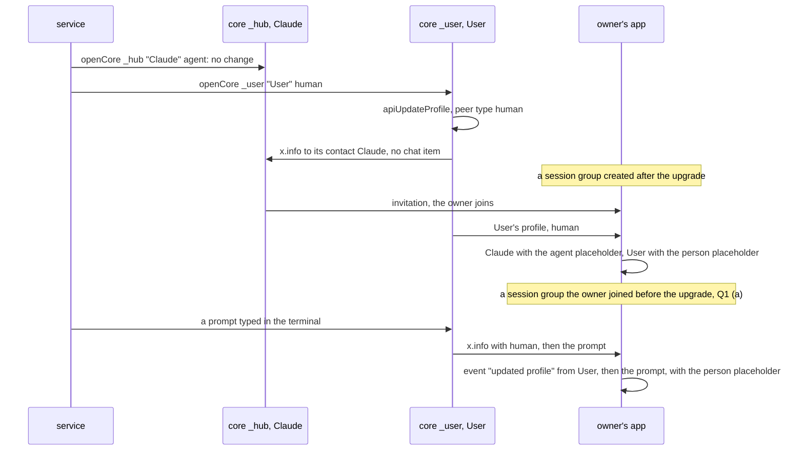
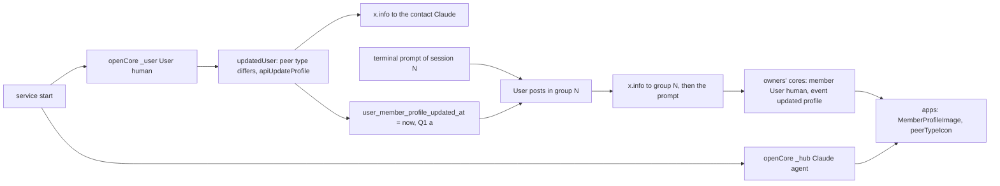

# Claude as an agent, User as a person

Status: draft for review. Code references: master `9d3241b06`. Branch `ep/mcp-agent-profile`.

Outcome:
- The apps show a group member without an image by the placeholder of its peer type. Claude gets the agent placeholder in its session groups and in the Main group.
- `User`, the profile that posts the prompts typed in the terminal, is given the peer type `human` and keeps the person placeholder.
- In a data folder of 0.3.0, `User` is changed at the service start, without user action.
- With Q1 (a), a peer type change of a profile is sent to its groups. Owners who joined a session group before the upgrade then see `User` as a person after its next post there.

## 1. Goal

Roadmap line, `packages/simplex-chat-mcp/ROADMAP.md:8`: "Claude appears as an agent, with the agent avatar."

The user's words, 2026-11-11: "correct default avatar placeholders for claude (we have agent) and correct peer type for claude user".

"we have agent" names the agent placeholder, which the apps show for contacts with peer type `agent` since #7738. "claude user" is read as the plugin's profile `User`. Claude's profile has the peer type `agent` already, and so does `User` (decision 6). For a profile that posts only prompts a person typed, `agent` is wrong (decision 11). The other reading, Claude's profile, needs no change.

Done when:
```
#  criterion                                                                          checked by
1  a member without an image and with peer type agent has the agent placeholder in       snapshot tests of the desktop and iOS apps
   every place of decision 8
2  a member with peer type bot has the cube placeholder; a member of another peer        the same snapshot tests
   type, or of none, keeps the person placeholder
3  the plugin's User has peer type human; Claude and the agents of serve keep agent      unit tests of core.ts; e2e test of the service
4  after a service start on a data folder of 0.3.0, User has peer type human             the same e2e test: prepareRoot makes User agent
5  an owner who joins a session group sees Claude as agent and User as human             the same e2e test
6  with Q1 (a): a peer type change is sent to each group before the next message there   core test, fails on master
7  docs state the peer types; the roadmap line is removed                                review
```

## 2. What users see

The placeholder of a group member without an image, after the change:
```
member of a group                               before     after
Claude, in its session groups and the Main group  person     agent
an agent of serve, in its agent control chat      person     agent
User, in session groups                           person     person
a member with peer type bot                       person     cube, as for a bot contact
any other member                                  person     person
a member with an image                            the image  the image
```

Places that draw a member's avatar with `MemberProfileImage` (decision 8):
```
message rows of groups, classic and flat layout, received and own
member list of a group
member info
message info: read receipts and delivery
member support chats and their toolbar
channel members and channel relays
mention list on iOS; the Android and desktop mention list has no avatars
```

Places that stay as they are:
```
place                                                         shows
chat list and chat info of a contact                           agent, cube or person by peer type, as now
chat list and chat info of a session group or the Main group   the group placeholder; a group has no peer type
lists of reactions, of members and of contacts                  person, as now (Q2)
other screens with a contact's placeholder                     person, as now (Q2)
apps without this change                                       person for every member
```

Agent placeholder: `ic_agent.svg` on Android and desktop, `agent` of `SharedAssets.xcassets` on iOS, three dots. Cube: `ic_cube` and `cube.fill`. The placeholder keeps its description `profile image placeholder` on Android and desktop.

The only text is a group event of the core, `updated profile` (`src/Simplex/Chat/Messages/CIContent.hs:374`). The apps show it as an event of the member: `updated profile` (`apps/multiplatform/common/src/commonMain/moko-resources/base/strings.xml:1850`, `apps/ios/SimpleXChat/ChatTypes.swift:6457`). It appears only with Q1 (a), once in each session group that an owner joined before the upgrade, above the next post of `User` there:
```
session group                                         what an owner's app shows for User
created after the upgrade                              person
joined by the owner after the upgrade                  person
joined by the owner before the upgrade, Q1 (a)         agent until User's next post there; then the event `updated profile`
                                                       from User, above that post; person from then on
joined by the owner before the upgrade, Q1 (b)         agent
```



## 3. Questions for the user

Q1. A peer type change in existing groups.
- (a), recommended: the core counts a peer type change as a change of the member profile (`src/Simplex/Chat/Store/Profiles.hs:374`, decision 15). The profile is sent to each group before the next message there, as after a name change. In a session group joined before the upgrade, owners see `updated profile` from `User` once, above `User`'s next terminal prompt, and then the person placeholder. Every client gets the change: a bot or an agent that changes its peer type sends it to its groups, and their members see `updated profile` once. The plugin gets it with the core release that follows this pull request (decision 16).
- (b): no core change. In session groups joined before the upgrade, updated apps show `User` with the agent placeholder. New groups and later joiners see a person.

Q2. Placeholders of contacts on other screens.
- (a), recommended: only `MemberProfileImage` is changed, one line in each app. Claude appears in the plugin's groups as a member only, and Claude sends no reactions.
- (b): every other placeholder of another person's profile is chosen by its peer type as well. These are the lists of reactions, the iOS contact list, the lists to add members and to share or forward, call screens, contact requests and contact link cards: 18 call sites in the two apps, listed in [Design](#5-design).

## 4. Decisions

Core:
1. A profile's peer type is `ChatPeerType`: `human`, `bot`, `business`, `agent`, or another text kept as received (`src/Simplex/Chat/Types.hs:753-779`). It is stored in `contact_profiles.chat_peer_type` (`src/Simplex/Chat/Store/Profiles.hs:391`, `src/Simplex/Chat/Store/Direct.hs:741`).
2. The peer type of a user's own profile is set at creation by `CreateActiveUser` and later by `APIUpdateProfile`, `/_profile USER_ID JSON` (`src/Simplex/Chat/Library/Commands.hs:1626`, `:6807`). The plugin calls `apiCreateActiveUser` and `apiUpdateProfile` (`packages/simplex-chat-nodejs/src/api.ts:1047`, `:1087`).
3. A change is sent to contacts at once: `sendUpdateToContacts` sends `x.info` to each contact whose profile as sent changes, and that profile includes the peer type (`src/Simplex/Chat/Library/Commands.hs:4134-4169`, `:4158`, `src/Simplex/Chat/Types.hs:809-813`). The contact's core stores it and creates no chat item for a peer type change (`src/Simplex/Chat/Library/Subscriber.hs:2770-2787`, `:2806-2814`).
4. A change is sent to a group only before the user's next message there, and only when `user_member_profile_updated_at` is later than the group's last send (`src/Simplex/Chat/Library/Internal.hs:2706-2739`). That time is updated for a change of the name, full name, short description, description or image, and not for a peer type change (`src/Simplex/Chat/Store/Profiles.hs:369-376`). So on master a peer type change is never sent to the members of existing groups. Peer type `bot` is set by this path by `/set bot commands` and by the directory service (`src/Simplex/Chat/Library/Commands.hs:3666-3670`, `apps/simplex-directory-service/src/Directory/Service.hs:223-228`).
5. The core of a member that receives `x.info` in a group stores the profile with its peer type (`redactedMemberProfile` keeps it, `src/Simplex/Chat/Library/Internal.hs:1367-1369`). It creates the event `updated profile` for any change of content, the peer type included (`src/Simplex/Chat/Library/Subscriber.hs:2911-2944`, `:2953-2966`, `src/Simplex/Chat/Types.hs:794-796`).

Plugin today:
6. Claude, `User` and the agents of `serve` have peer type `agent`. `openCore` creates each profile with `agent` and `updatedUser` sets `agent` at each start (`packages/simplex-chat-mcp/src/core.ts:24`, `:29`, `:54-59`). `serve` does the same (`src/serve.ts:89`, `:93`). A data folder of 0.3.0, read on 2026-11-12: `_hub` Claude `agent`, `_user` User `agent`, two agents of `serve` `agent`. In the hub's session group 1, the member Claude is `agent`, User `agent`, and the owner has no peer type.

Apps today:
7. Both apps choose a contact's placeholder by its peer type with `peerTypeIcon`: bot the cube, agent the agent placeholder, any other the person (`apps/multiplatform/common/src/commonMain/kotlin/chat/simplex/common/model/ChatModel.kt:1989-1990`, `:2260-2265`; `apps/ios/SimpleXChat/ChatTypes.swift:313-319`, `:2685-2687`). The chat list and chat info use it for contacts (`.../views/helpers/ChatInfoImage.kt:47-56`; `apps/ios/SimpleXChat/ChatUtils.swift:95-103`). A group gets the group placeholder from `GroupInfo.chatIconName` (`ChatModel.kt:2704-2711`; `ChatTypes.swift:3077-3087`).
8. Both apps draw a member's avatar with `MemberProfileImage`, which passes no icon, so a member without an image gets the person placeholder (`.../views/chat/group/GroupMemberInfoView.kt:931-947` with the default of `ChatInfoImage.kt:73`; `apps/ios/Shared/Views/Chat/Group/GroupMemberInfoView.swift:826-839` with the default of `apps/ios/Shared/Views/Helpers/ProfileImage.swift:15`). The lists of reactions are the exception: there members are drawn with a placeholder of their own (`.../views/chat/item/ChatItemView.kt:175`, `:221`; `apps/ios/Shared/Views/Chat/ChatView.swift:3278`, `:3301`). The callers of `MemberProfileImage`:
   ```
   Android and desktop                              iOS
   ChatView.kt:2882 MemberImage, used by            ChatView.swift:2088 classic rows
     ChatView.kt:2126 classic rows                  ChatView.swift:2205, :2225 flat rows, own rows
     TerminalItemView.kt:344, :351 flat rows        GroupChatInfoView.swift:515 member list
   GroupChatInfoView.kt:1138 member list            GroupMemberInfoView.swift:519 member info
   GroupMemberInfoView.kt:756 member info           ChatItemInfoView.swift:503 message info
   ChatItemInfoView.kt:380 message info             GroupMentions.swift:240 mention list
   MemberSupportView.kt:230                         MemberSupportView.swift:171
   MemberSupportChatView.kt:135                     MemberSupportChatToolbar.swift:20
   ChannelMembersView.kt:136                        ChannelMembersView.swift:81
   ChannelRelaysView.kt:149                         ChannelRelaysView.swift:131
   ```
9. Peer type `agent` exists from app 7.1.0-beta.7 (#7738, `77f9f4a46`). Joining a session group needs app 7.1.0 or later (plan `2026-11-07-mcp-claude-code-channel.md`, section Groups). Every owner's app therefore decodes `agent`.

Changes:
10. `MemberProfileImage` passes `peerTypeIcon` of the member's peer type in both apps. So every place of decision 8 shows the placeholder of the member's peer type, and a bot member gets the cube, as a bot contact does.
11. `User` is given the peer type `human`. `User` posts only prompts a person typed (`packages/simplex-chat-mcp/src/hub.ts:195`, decision 121 of the 0.3.0 plan). No consumer distinguishes `human` from an absent peer type: `peerTypeIcon` returns the person for both, and the core's views test only `bot` (`src/Simplex/Chat/View.hs:671-673`, `:1589`, `:1599`). With `human`, the role is stated in the profile.
12. Claude and the agents of `serve` keep `agent`.
13. `openCore` and `updatedUser` take the peer type. The hub and `serve` pass `agent`; `User.open` passes `human`.
14. A data folder is upgraded by `updatedUser` at each start: it compares the display name and the peer type with the stored profile and updates them when either differs (`src/core.ts:56-57`). In a data folder of 0.3.0, `User` is changed at the first start of the new version. No marker file is written.
15. With Q1 (a): `userMemberProfileChanged` also compares the peer type (`src/Simplex/Chat/Store/Profiles.hs:374-376`).
16. The plugin bundles `simplex-chat` 7.1.3 (`packages/simplex-chat-mcp/package-lock.json:4321-4322`), which loads the libraries of `core-7.1.3.0` (`packages/simplex-chat-nodejs/src/release.ts:3`). Decision 15 takes effect in the plugin when a core release with it is pinned there and the plugin's lock is updated. Until then, owners see `User` as a person only in groups created or joined after the upgrade.
17. Nothing is posted in any group for the update of `User`. The hub's contact of `User` gets no chat item (decision 3), and the plugin's event handlers ignore `contactUpdated` and `groupMemberUpdated` (`src/tools.ts:665-691`, `src/control.ts:656-670`, `src/user.ts:50-57`).
18. Session groups are never listed by Claude's tools, so the `from_type` of `User`'s messages appears in no tool result (`src/tools.ts:578`, `:1523`).
19. The apps' evidence is a snapshot of each new preview, compared with a committed reference: desktop by `SnapshotTest` (`apps/multiplatform/common/src/desktopTest/kotlin/chat/simplex/app/SnapshotTest.kt:59`, `:137`), iOS by `snapshots.sh` with `previewScenes` (`apps/ios/SimpleX Snapshots/SnapshotTests.swift:205`) and `check-previews.py`.

## 5. Design

Options for the apps:
```
option                                   producer          each consumer                       older apps          wire
A1 MemberProfileImage passes the icon    none              one changed line in each app; all   person, as now      none
   of the member's peer type                               member avatars follow
A2 each caller of MemberProfileImage     none              8 changed lines on Android and       person, as now      none
   passes the icon                                         desktop, 11 on iOS; a new caller
                                                           repeats the rule
A3 the plugin sets an image in           an image in its   every app shows the image, the       the image           the image in every
   Claude's profile                      profile           same in every theme                                      profile message
```
A1 is chosen. With A2, one rule is repeated at every caller. With A3, the placeholder that the user asked for is replaced by a fixed image.

Options for `User`:
```
option          what the apps show           consumers
U1 human        person                       no consumer distinguishes it from U2 (decision 11)
U2 none         person                       the same
U3 agent        agent, after A1              wrong for prompts a person typed
```
U1 is chosen: the role is stated in the profile.

Options for groups that owners joined before the upgrade:
```
option                                   producer                            members                   older apps      wire
G1 the core counts a peer type change    3 changed lines in updateUserProfile one event `updated profile`  the same        one x.info per group,
   as a member profile change                                                                                          before the next message
G2 the plugin changes a visible field    two profile updates at each such    two events per group      the same        two x.info per group
   and restores it                       start, a workaround
G3 nothing                               none                                User stays agent          the same        none
```
G1 is Q1 (a); G3 is Q1 (b). G2 is a workaround with two visible changes for a field that the core skips.

Options for the upgrade:
```
option                                   cost
D1 updatedUser at each start             2 changed lines; runs at every start, as for the display name now
D2 a one-time migration with a marker    a marker file, its read, and its write
```
D1 is chosen.

Changes per file:
```
file                                                              change
src/Simplex/Chat/Store/Profiles.hs                                 Q1 (a): updateUserProfile, userMemberProfileChanged also compares peerType (374-376)
tests/ChatTests/Groups.hs                                          Q1 (a): test of decision 15, in "membership profile updates" (233-241)
apps/multiplatform/.../views/chat/group/GroupMemberInfoView.kt      MemberProfileImage: icon = peerTypeIcon(mem.memberProfile.peerType);
                                                                   preview PreviewMemberProfileImages
apps/multiplatform/common/src/desktopTest/.../SnapshotTest.kt      scene GroupMemberInfoView.PreviewMemberProfileImages
apps/multiplatform/common/src/desktopTest/snapshots/               2 references, light and dark
apps/ios/Shared/Views/Chat/Group/GroupMemberInfoView.swift          MemberProfileImage: icon: peerTypeIcon(mem.memberProfile.peerType);
                                                                   MemberProfileImage_Previews
apps/ios/SimpleX Snapshots/SnapshotTests.swift                      scene MemberProfileImage_Previews, after MemberAdmissionView (286)
apps/ios/SimpleX Snapshots/References/                              2 references, light and dark
packages/simplex-chat-mcp/src/core.ts                               openCore(folder, displayName, peerType); updatedUser(chat, user, displayName, peerType)
packages/simplex-chat-mcp/src/hub.ts                                Hub.open: openCore(hubFolder(root), profileName, T.ChatPeerType.Agent) (368)
packages/simplex-chat-mcp/src/user.ts                               User.open: openCore(join(root, "_user"), userName, T.ChatPeerType.Human) (17)
packages/simplex-chat-mcp/src/serve.ts                              startAgent: updatedUser(..., T.ChatPeerType.Agent) (93)
packages/simplex-chat-mcp/test/unit/core.test.ts                    tests of updatedUser, with a fake of their own
packages/simplex-chat-mcp/test/e2e/service.test.ts                  test of decisions 11 and 14
```

`updatedUser`, after the change:
```
updatedUser(chat, user, displayName, peerType):
  displayName and peerType equal to the stored profile's:  user
  else:  apiUpdateProfile(the stored profile with displayName and peerType); the active user read again
```

Q1 (a), the core:
```
userMemberProfileChanged:  name, full name, short description, description, image or peer type differs
on a change:               user_member_profile_updated_at = now
before a message in group G, by sendGroupProfileUpdate:
  user_member_profile_updated_at later than G's last send:  x.info with the profile, then the message
```

Q2 (b), the other sites, unchanged by Q2 (a):
```
Android and desktop                                     iOS
ChatItemView.kt:175, :189 reaction list (drawn at :221) ChatView.swift:2984, :3278 reaction list (profileMenuItem, :3301)
AddGroupMembersView.kt:354 contacts to add              ContactListNavLink.swift:170, :265 contact list
ShareListNavLinkView.kt:105 share and forward list      ContactListNavLink.swift:318 contact request
CallView.android.kt:398 call screen                     AddGroupMembersView.swift:222 contacts to add
ChatListView.desktop.kt:66, :128 call button and card   ActiveCallView.swift:329 call screen
ChatInfoImage.kt:53 contact request                     ChatUtils.swift:100 contact request
ChatModel.kt:5272 contact link card                     ChatTypes.swift:5724 contact link card
```



## 6. Compatibility

```
case                                         result
apps without this change                      the person placeholder for every member, as now
apps with this change                         members by peer type; contacts as now
an owner's app receives User's x.info         the event `updated profile`, in any app version that joins session groups
older plugin data folders (0.3.0)             User is changed from agent to human at the first start; Claude unchanged
a later downgrade of the plugin               0.3.0's updatedUser sets User back to agent at its start (core.ts:56-57 of 0.3.0)
agents of serve                               unchanged: agent at creation and at each start
the plugin with core-7.1.3.0                  new groups and later joiners see User human; owners already in a group see
                                              agent until a core release with decision 15 is pinned and the lock is updated
older Claude Code versions                    unaffected: the change touches no hook, tool or channel
other clients, Q1 (a)                         a peer type change is sent to their groups before their next message there
```

## 7. Acceptance and tests

The criteria are those of [Goal](#1-goal). Tests:
```
test                                                          kind     fails on master
tests/ChatTests/Groups.hs, "membership profile updates",       core     yes: the member record keeps no peer type
"peer type change alone is sent on next message"
packages/simplex-chat-mcp/test/unit/core.test.ts:              unit     does not compile on master: updatedUser takes 3 arguments
  "updates a profile whose peer type differs"
  "keeps a profile with its name and peer type"
packages/simplex-chat-mcp/test/e2e/service.test.ts:            e2e      yes: User stays agent
  "a data folder of 0.3.0 starts with User as a person, and an owner sees Claude as an agent and User as a person"
GroupMemberInfoView.PreviewMemberProfileImages, desktop        snapshot yes: the references show agent and cube, master draws the person
MemberProfileImage_Previews, iOS                               snapshot yes: the same
```

The core test, after `createGroup2 "team" alice bob` and the deletion of their contact, as in `testMembershipProfileUpdateContactDeletedPeerType` (`tests/ChatTests/Groups.hs:7564-7582`):
```
alice: /_profile 1 {"displayName": "alice", "fullName": "", "shortDescr": "Alice", "peerType": "agent"}
alice: #team hello;  bob receives it
memberAddressPeerType bob "alice"  ==  [(Nothing, Just CPTAgent)]
bob's #team items contain "updated profile (signed)"
```
On master, `memberAddressPeerType` returns `[(Nothing, Nothing)]`.

The e2e test runs `linkSession`, whose `prepareRoot` creates `User` with `agent` as 0.3.0 does (`test/e2e/helpers.ts:30-35`), and checks:
```
User's own profile, hub.user["user"]           peerType human
the hub's contact of User, userContact          peerType human, within the test timeout
Alice's member Claude in the session group      peerType agent
Alice's member User in the session group        peerType human
```
The pinned `core-7.1.3.0` is loaded by the e2e tests (`scripts/ci/README.md`, section mcp), so an owner who joined before the upgrade is covered by the core test only.

In the desktop preview, `MemberImage` is drawn in one row for `GroupMember.sampleData` with no peer type, `human`, `agent` and `bot`. In the iOS preview, `MemberProfileImage` is drawn for the same four members at 38 points. The references are recorded from a run with the fix. Each preview, its scene and its references are committed before the fix, so a run of that commit fails the comparison, and a run after the fix passes.

CI:
- The reduced build, dispatched with `/membership profile updates/`, also runs the changed scopes: kotlin (`:common:desktopTest`, which fails for a preview without a scene), ios (build and `check-previews.py`), mcp (unit and e2e tests).
- The app test workflows once each, with the app uploaded: `desktop-linux` (the snapshot comparison), `ios-sim` (the snapshot comparison), `android-emu` (the smoke test of the APK with the changed common code).

Not covered by tests: the creation of `User` with `human` in a new data folder, because every e2e test prepares the root with the test servers. The code of that path is one argument of `apiCreateActiveUser`.

## 8. Docs to change

```
file                                                  change
packages/simplex-chat-mcp/ROADMAP.md:8                the line removed
packages/simplex-chat-mcp/REFERENCE.md:581            after "User is a second profile ...": Claude's profile has the peer type agent, and the
                                                      app shows it with the agent placeholder; User's profile has the peer type human
packages/simplex-chat-mcp/spec/api.md:723, :826       the members Claude, peer type agent, and User, peer type human
packages/simplex-chat-mcp/spec/architecture.md:126    updatedUser: the display name and the given peer type
packages/simplex-chat-mcp/spec/architecture.md:904    openCore: a new profile with the given peer type
packages/simplex-chat-mcp/spec/flows.md:790, :793     openCore with agent and with human; a note on the upgrade of User at each start
packages/simplex-chat-mcp/TESTING.md:188              the e2e test above
packages/simplex-chat-mcp/TESTING.md, real session    a check: in the app, Claude's posts show the agent placeholder and User's the person one
apps/multiplatform/spec/client/chat-view.md:130       MemberImage: the member's image, otherwise the placeholder of its peer type
apps/ios/spec/client/chat-view.md:361                 the same for the avatar of a row
```
README.md is unchanged: it names no peer type.

## 9. Conflict areas with the other items

```
file or function                                              items
packages/simplex-chat-mcp/ROADMAP.md:7-8                      line 7 is removed by flat-sessions and line 8 by this item: adjacent lines
packages/simplex-chat-mcp/src/core.ts openCore, updatedUser   harness-notes, if option B adds a third profile: its peer type is passed there
packages/simplex-chat-mcp/src/hub.ts Hub.open (368)           harness-notes option B; other functions of hub.ts are changed by reactions and replies
packages/simplex-chat-mcp/test/e2e/service.test.ts            a test of every item is added at the end of the file
packages/simplex-chat-mcp/TESTING.md, the list of e2e tests   an entry of every item is added there
packages/simplex-chat-mcp/REFERENCE.md:578-596, sessions      flat-sessions (layout of session groups), replies, reactions
packages/simplex-chat-mcp/spec/flows.md flow 17, :790-826     harness-notes, flat-sessions (group profile at creation)
apps .../SnapshotTest.kt previewScenes, iOS previewScenes      flat-sessions, if it adds previews: adjacent lines of sorted lists
apps .../GroupMemberInfoView.kt, GroupMemberInfoView.swift    MemberProfileImage: no other item, as far as their briefs state
TerminalItemView.kt, ChatView.swift rows                      changed by flat-sessions only; the previews of this item do not
                                                              depend on the layout
```

## 10. Estimate

```
part                         lines of code     lines of tests        other
core, Q1 (a)                 3                 about 20
apps                         2                 about 25 in previews  2 scene lines, 4 references
plugin                       about 8           about 40
docs                         about 15
```
Agent time: about 2 hours of work. CI: the reduced build with the core, about 1 hour; `desktop-linux` and `android-emu` with the core rebuilt, about 40 minutes each; `ios-sim` with the core rebuilt, about 70 minutes, plus a run that records the references of each app.

Commits: `core: send a peer type change to groups` (Q1 (a)), `ui: show the peer type placeholder of group members`, `mcp: User has the peer type of a person`.
