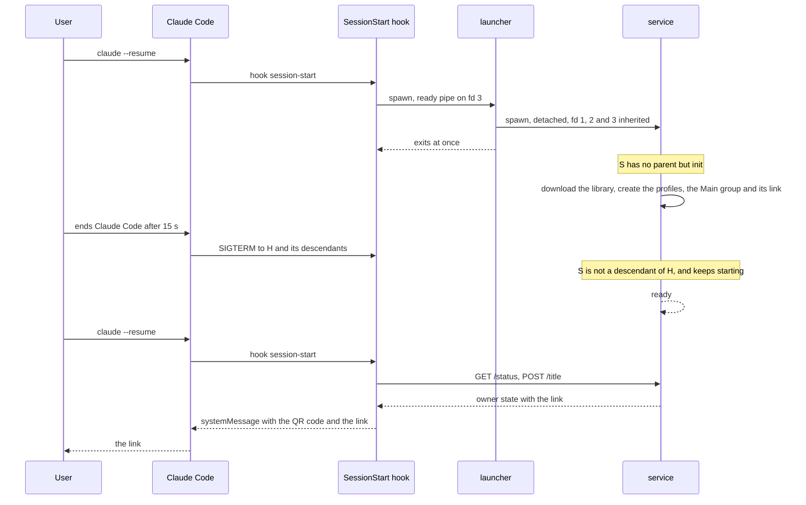
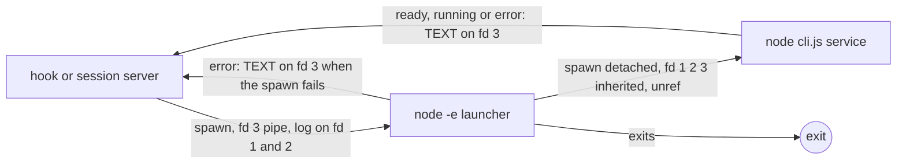
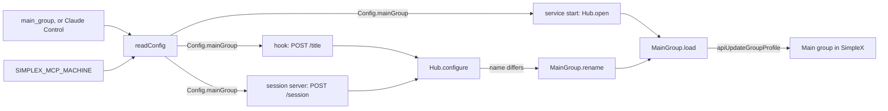

# SimpleX MCP plugin: the Main group link at every session start, and the name "Claude Control"

Status: plan for review. Code references: master `9d3241b06` (MCP 0.3.0). Claude Code references: the binary of Claude Code 2.1.322, by byte offset. Transcript references: `~/.claude/projects/-code-simplex-chat-6/b1295fd0-28a0-4201-ae91-d58f97685f75.jsonl`, by line, and the session registry `~/.claude/sessions/258681.json`.

## Goal

Three changes of the next release, ahead of the roadmap items:

1. Link race. The user's words: "link race". The session start shows the Main group link while the Main group has no owner, or shows the error.
2. Main group name. The user's words: "SimpleX MCP as the name for control chat in SimpleX (!) makes no sense. I'd call it "Claude Control". Can we differentiate them via plugin somehow? e.g. I'd pass some parameter and chat is named "Claude Control - ..."?" Approved on 2026-11-12: the default name is `Claude Control`; an optional environment variable `SIMPLEX_MCP_MACHINE`, set per machine or container, gives `Claude Control - VALUE`.
3. Roadmap line, approved on 2026-11-12, under "In the app": `The desktop app works fully from the keyboard, with shortcuts, including Ctrl+U to delete to the start of the line, and \ then Enter for a new line, as in Claude Code.`

Done when:
```
#   criterion                                                                                   checked by
1   the service started by a SessionStart hook keeps running when Claude Code ends the hook     unit test that fails on master;
    with its process tree                                                                       end-to-end test that fails on master
2   after such an end, the next session start shows the link at once                            end-to-end test; TESTING.md check
3   a fresh Main group is named Claude Control                                                  unit tests; end-to-end test
4   SIMPLEX_MCP_MACHINE=laptop names it Claude Control - laptop; main_group Team gives            unit tests
    Team - laptop
5   an existing group named SimpleX MCP is renamed at the first start of the new version         end-to-end test
6   an invalid SIMPLEX_MCP_MACHINE is shown at the session start and in every tool result       unit tests
7   the roadmap has the approved line under "In the app"                                         review
```

## The link race: what happened

On 2026-11-12 the user installed the plugin in a container where it had never run, and resumed session `b1295fd0` there four times in four minutes. No session start showed the link. The transcript and the session registry show four Claude Code processes:

```
process   started (UTC)   ended (UTC)        evidence
P1        21:07:56        21:08:11.98        artifact monitors re-armed at 21:07:58 (lines 18563-18568); cost-state +14.75 s and
                                             pr-link at 21:08:11.976 at its exit (lines 18574-18576)
P2        21:08:28        about 21:08:58     re-armed at 21:08:28 (lines 18579-18584); cost-state +29.76 s (line 18586)
P3        21:09:05        about 21:10:50     re-armed at 21:09:05 (lines 18588-18593); cost-state +104.83 s (line 18595)
P4        21:12:14        running            ~/.claude/sessions/258681.json: startedAt 1794517933985; the first prompt
                                             from its session group arrived at 21:15:29 (line 18603)
```

The only SessionStart record is P1's, written at 21:08:12.207, 230 ms after P1's exit records (line 18578):

```
"type":"hook_non_blocking_error", "hookName":"SessionStart:resume", "exitCode":1, "durationMs":15051,
"stdout":"", "stderr":"Failed with non-blocking status code: No stderr output"
```

The cause, in order:

1. The first start of the service in a data folder is slow. The service downloads the SimpleX core library when its cache lacks it (`resolveLibsDir`, `node_modules/simplex-chat/dist/libs.js`), creates the profiles `Claude` and `User`, creates the Main group and its link on the network, and connects `User` to `Claude` ([hub.ts:367-385](../packages/simplex-chat-mcp/src/hub.ts#L367-L385)). The session starts that showed the link in the two other containers took 18626 ms and 22328 ms (hook records at 22:21:15 in `-code-simplex-chat-7/020a13ef…` and at 21:17:42 in `-code-security/ce22e3c0…`). With prepared profiles and a local test server, the same start took 2.8 s.
2. The hook waits for that start: it spawns the service and reads its ready line ([client.ts:35-47](../packages/simplex-chat-mcp/src/client.ts#L35-L47), [:71-92](../packages/simplex-chat-mcp/src/client.ts#L71-L92)). The service is a child of the hook. `detached: true` gives it its own session but keeps the hook as its parent.
3. The user ended P1 after 15 seconds. At its exit Claude Code sends SIGTERM to a running hook and to every descendant of the hook. Measured with Claude Code 2.1.322: a SessionStart hook's detached child got SIGTERM in the same millisecond as the hook, and was gone 15 seconds later although it ignored SIGTERM. A detached child of an MCP server survived. The kill with SIGKILL after a grace time is in the shell command class of the binary (offset 293526757, `process.kill(-r,"SIGKILL")` at 293531168).
4. The service has no SIGTERM handler until its start completes ([service.ts:436](../packages/simplex-chat-mcp/src/service.ts#L436), [:452-453](../packages/simplex-chat-mcp/src/service.ts#L452-L453)), so the start ends at once. Its lock and its socket file stay behind, and so does the temporary folder of a download in progress.
5. Claude Code records a hook killed by a signal with exit code 1: the exit status is `status:qr??1` (offset 296987643), and `qr`, the exit code, is null after a signal. The plugin has no path that exits 1 without output: every error of `sessionStart` becomes a `systemMessage` ([hook.ts:65-76](../packages/simplex-chat-mcp/src/hook.ts#L65-L76)), and `main` writes every other error to stderr ([cli.ts:253-261](../packages/simplex-chat-mcp/src/cli.ts#L253-L261)).

So the 15 seconds are the user's wait, not a timeout of the plugin. The 15-second lock wait of the service ([service.ts:21-22](../packages/simplex-chat-mcp/src/service.ts#L21-L22), [:478-485](../packages/simplex-chat-mcp/src/service.ts#L478-L485)) ends with an error that the hook shows. Measured at master, with a lock held by a live process that is not the service: two hooks took 15.8 s and showed `SimpleX MCP: Another service uses ROOT (PID N). If no service runs, remove ROOT/service.lock.`, with exit code 0. Six hooks started at once on a new data folder with prepared profiles all showed the link after 2.8 s, and four sessions with their hooks and session servers all showed it after 5.4 to 7.0 s. Concurrent starts are not the cause.

P2, P3 and P4 have no SessionStart record. A hook that ran there and ended would have a record, as P1's has. Their hooks are unexplained by the transcript; the service log of that container would show whether a service started.

Reproduced at master with a local test server: the built hook ran on a new data folder with prepared profiles. 300 ms after the service took its lock, the hook and its descendants got SIGTERM, as Claude Code sends it. The service was in the hook's process tree and ended during its start, leaving its lock. The hook ended by the signal, with no output, which Claude Code records as exit code 1. The next hook started a second service, which took over the lock, and showed the link after 2.3 s. In a fresh container that second start repeats the download and the network steps. Tests 1 and 6 below check this.

## What users see

### Link

Before, at master:
```
event                                                     terminal                                       service
first session start in a fresh data folder; the user      once the service starts (18.6 s and 22.3 s     starts, then runs
waits                                                     above): "SimpleX MCP: scan this QR code ..."
                                                          with the QR code and the link
the same; the user ends Claude Code before the link       nothing; the transcript records the hook       ended during its start
shows                                                     with exit code 1 and no output
the next session start                                    the link once the service starts again, if     starts again from the
                                                          the user waits                                 beginning
```

After:
```
event                                                     terminal                                       service
first session start in a fresh data folder; the user      once the service starts: the link, as before   starts, then runs
waits
the same; the user ends Claude Code before the link       nothing                                        keeps starting
shows
the next session start                                    the link, within a second of the service's     already running
                                                          start
```

The hook's texts are unchanged.



### Name

Before, at master: the Main group is `SimpleX MCP` unless the plugin option `main_group` names it.

After:
```
main_group           SIMPLEX_MCP_MACHINE      the Main group
not set              not set                  Claude Control
not set              laptop                   Claude Control - laptop
Team                 not set                  Team
Team                 laptop                   Team - laptop
not set              my.laptop                unchanged; the session start shows the error below
```

An existing group named `SimpleX MCP` is renamed at the first start of the new version. Its members see the new name and the event `group profile updated`. A `main_group` that a user set to `SimpleX MCP` keeps that name.

Texts:
- The session start, unchanged in form: `SimpleX MCP: scan this QR code with the SimpleX app and tap Join to supervise your agents in "Claude Control - laptop":`.
- An invalid machine name, at the session start after `SimpleX MCP: ` and in every tool result: `SIMPLEX_MCP_MACHINE: a valid SimpleX name, such as mylaptop expected, got my.laptop. Change it in the environment of this machine.` When no character is valid: `SIMPLEX_MCP_MACHINE: a valid SimpleX name expected, got VALUE. Change it in the environment of this machine.`
- A combined name over 50 characters, or with an invalid joint: `Plugin option main_group with SIMPLEX_MCP_MACHINE: a valid SimpleX name of at most 50 characters expected, got NAME. Change one of them.`
- The option's description in `/plugin` > Installed > simplex > Configure options: `Name of the SimpleX group where you join the groups of your sessions. On a machine with SIMPLEX_MCP_MACHINE set, " - " and its value follow.`

The welcome message, the short description and Claude's greeting in the Main group do not name it ([main-group.ts:13-18](../packages/simplex-chat-mcp/src/main-group.ts#L13-L18)), so they are unchanged.

## Questions for the user

None. The decisions below follow from the approved design.

## Decisions

Link race:
1. The service is spawned through a launcher process that spawns it and exits at once. The service then has no parent but init, so Claude Code's kill of a hook's descendants does not reach it. Evidence: measured with Claude Code 2.1.322, a child spawned through such a launcher had PPID 1 before the kill and kept running after it; a child spawned directly got SIGTERM.
2. The launcher is `process.execPath -e LAUNCHER COMMAND ARGS`, a string constant in `client.ts`. It passes fd 1, 2 and 3 to the service, so the log and the ready pipe are unchanged. Evidence: `node -e CODE A B` gives `process.argv` `[node, A, B]` (measured); a ready line written by the grandchild on fd 3 reached the hook (measured).
3. The launcher writes `error: MESSAGE` on fd 3 when the service command cannot be spawned. The error text of a missing command stays `spawn COMMAND ENOENT`, as the unit test at [client.test.ts:36-39](../packages/simplex-chat-mcp/test/unit/client.test.ts#L36-L39) expects.
4. The session server keeps the same spawn path. Its children survive Claude Code's exit already (measured), and one spawn function serves both callers ([session.ts:161](../packages/simplex-chat-mcp/src/session.ts#L161), [hook.ts:69](../packages/simplex-chat-mcp/src/hook.ts#L69)).
5. The lock wait of 15 seconds stays. It ends with an error that the session start shows (measured at master).
6. The service gets no SIGTERM handler during its start. After decision 1 Claude Code no longer signals it; a start ended by another signal leaves a lock of a dead process, which the next start takes over ([files.ts:108-114](../packages/simplex-chat-mcp/src/files.ts#L108-L114), [:206-221](../packages/simplex-chat-mcp/src/files.ts#L206-L221)).

Name:

7. The default of `main_group` is `Claude Control`, in `defaultConfig` and in `plugin.json`. Claude Code passes the `plugin.json` default when the user has not set the option: the running session server of this machine has `CLAUDE_PLUGIN_OPTION_MAIN_GROUP=SimpleX MCP`, and no stored value exists in `~/.claude`. The unit test at [plugin.test.ts:15](../packages/simplex-chat-mcp/test/unit/plugin.test.ts#L15) keeps the two equal.
8. `readConfig` reads `SIMPLEX_MCP_MACHINE`. When it is set and not blank, the Main group name is `MAIN - MACHINE`, where MAIN is `main_group` or its default. All three readers of the configuration get the full name: the hook ([hook.ts:67](../packages/simplex-chat-mcp/src/hook.ts#L67)), the session server ([session.ts:47](../packages/simplex-chat-mcp/src/session.ts#L47)) and the service ([service.ts:436](../packages/simplex-chat-mcp/src/service.ts#L436)).
9. The variable reaches all three. Claude Code passes its environment to hooks and MCP servers: the session server of this machine has `HOME`, `PATH`, `CLAUDE_CODE_SESSION_ID` and the `env` of the shared settings. `spawnService` passes every `SIMPLEX_` variable to the service ([client.ts:13](../packages/simplex-chat-mcp/src/client.ts#L13), [:78](../packages/simplex-chat-mcp/src/client.ts#L78)).
10. The variable is set in the environment of each machine or container, not in the `env` of shared Claude Code settings, which every container reads.
11. The machine part is checked with `validName` alone first, so its error names the variable and suggests a valid value ([messages.ts:341-363](../packages/simplex-chat-mcp/src/messages.ts#L341-L363)). The full name is checked next: at most 50 characters ([messages.ts:12](../packages/simplex-chat-mcp/src/messages.ts#L12)) and a valid joint.
12. The service renames an existing Main group when the configured name differs: at its start, `MainGroup.load` sets the name ([main-group.ts:57-66](../packages/simplex-chat-mcp/src/main-group.ts#L57-L66)), and each `/title` and `/session` calls `configure` ([hub.ts:396-400](../packages/simplex-chat-mcp/src/hub.ts#L396-L400)). No new code renames `SimpleX MCP`.
13. Members see `group profile updated` for a rename ([CIContent.hs:371](../src/Simplex/Chat/Messages/CIContent.hs#L371)).
14. The terminal prefix `SimpleX MCP:` of the hook's messages stays: it names the plugin in Claude Code, not the group.

Roadmap:

15. The approved line is added as the last line of "In the app" in `ROADMAP.md`.

Found in implementation:

16. The service drops its ready line when the hook that waited for it is gone. With the launcher alone, the service kept starting after the hook ended, wrote `ready` to the closed pipe, got `EPIPE` and exited 1: its log ended with `simplex-mcp: EPIPE: broken pipe, write`, and the next session start showed `SimpleX MCP: read ECONNRESET`. `writeReady` ignores `EPIPE` ([service.ts:499-513](../packages/simplex-chat-mcp/src/service.ts#L499-L513)).

## Design

### Link race

Options:
```
option                                     cost at the hook                cost at the service        cost elsewhere
A  launcher spawns the service and exits   one short process per spawn     none                       a code string in client.ts
B  only the session server spawns; the     waits for a socket it does not  none                       no link when the session
   hook waits for the socket               start                                                      server is off or late
C  the service ignores SIGTERM in start    none                            a handler before start     Claude Code sends SIGKILL
                                                                                                      after the grace time
D  sh -c 'node cli.js service &'           none                            none                       no Windows path
E  a file launch.ts compiled to dist       one short process per spawn     none                       unit tests run from src, where
                                                                                                      no launch.js exists
```

A is chosen. B removes the hook's own start and leaves the first session start without a link when the session server starts later or is turned off. C fails because Claude Code escalates to SIGKILL. D needs a second path for Windows. E breaks the unit tests of `spawnService`, which pass fake service commands.

Change:
- `client.ts`: a constant `launcher` with the launcher's code. `spawnService` spawns `[process.execPath, ["-e", launcher, command, ...args]]` with the same options. `serviceCommand` and `firstLine` are unchanged.
- `service.ts`: `readyChannel` writes through `writeReady`, which ignores `EPIPE` (decision 16).



### Name

Options:
```
option                                          cost at the readers          cost at the service        compatibility
A  readConfig combines main_group and           none                         none                       older services accept the
   SIMPLEX_MCP_MACHINE into Config.mainGroup                                                            full name: validConfig
                                                                                                        checks validName only
B  a new field Config.machine, combined in      three readers pass it        Hub and MainGroup          an older service ignores the
   the service                                                               combine it                 field and names the group
                                                                                                        without the machine
C  a new plugin option                          none                         none                       options are shared by all
                                                                                                        containers
```

A is chosen. B adds a field that every reader and the hub carry for one string. C cannot differ per container.

Change:
- `config.ts`: `defaultConfig.mainGroup` is `Claude Control`. A constant `machineVariable = "SIMPLEX_MCP_MACHINE"`. `readConfig` passes `env[machineVariable]?.trim()` to `mainGroup`, which returns `MAIN - MACHINE` after the checks of decision 11.
- `.claude-plugin/plugin.json`: the default and the description of `main_group`.



## Compatibility

- Older SimpleX apps: a group rename is a group profile update, which every app version shows.
- Older Claude Code versions: unchanged. Claude Code runs the same hook and session server commands.
- Older plugin data folders: a Main group named `SimpleX MCP` is renamed to `Claude Control` at the first start of the new version. A running older service is stopped by the newer plugin as before ([client.ts:37-40](../packages/simplex-chat-mcp/src/client.ts#L37-L40)).
- A session of the older plugin on the same data folder sends `SimpleX MCP` with each `/title` and `/session`, and the service renames the group back. The name changes with each session start until the sessions of the older plugin end.

## Acceptance and tests

Unit tests:
1. `client.test.ts`, "the service is not a child of the process that spawns it": a fake service writes `process.ppid` and the ready line; the test expects a parent other than its own process. Fails on master: the parent is the test process.
2. `client.test.ts`: the existing tests pass unchanged through the launcher, the missing command included. `service.test.ts`, "keeps running when the process that waited for its ready line is gone": `EPIPE` on the ready line leaves `runService` running. Fails on master with `EPIPE: broken pipe, write`.
3. `config.test.ts`: the default `Claude Control`; `laptop` gives `Claude Control - laptop`; `Team` with `laptop` gives `Team - laptop`; a blank variable is ignored; `my.laptop` gives the error with `mylaptop`; `...` gives the error without a suggestion; a 40-character machine name gives the length error.
4. `plugin.test.ts`: unchanged; it checks the `plugin.json` default against `defaultConfig`.
5. `session.test.ts`: an invalid `SIMPLEX_MCP_MACHINE` is returned by every tool call.

End-to-end tests (`npm run test:e2e`, test servers):

6. `service.test.ts`, "a session start ended with its process tree leaves the service starting": the test runs the built hook, `node dist/cli.js hook session-start`, on a prepared data folder; once `service.lock` exists it sends SIGTERM to the hook and to every descendant, as Claude Code does; the service of the lock keeps running; a second hook shows the link. Fails on master: the service ends.
7. `service.test.ts`: a data folder whose Main group is `SimpleX MCP` gets `Claude Control` after a service start with the default configuration; the reset texts at [service.test.ts:591](../packages/simplex-chat-mcp/test/e2e/service.test.ts#L591) and [:598](../packages/simplex-chat-mcp/test/e2e/service.test.ts#L598) name `Claude Control`.

TESTING.md, real sessions:

8. First start in a fresh data folder: end Claude Code before the QR code shows; start it again: the QR code shows within seconds.
9. `SIMPLEX_MCP_MACHINE=laptop claude ...`: the Main group is `Claude Control - laptop`.

No app changes, so no app test workflows run.

## Docs to change

- README: the group name `Claude Control`; `SIMPLEX_MCP_MACHINE` in one sentence; the first start downloads the SimpleX core library, so the QR code can take a minute, and a later session start shows it if Claude Code ended before.
- REFERENCE: the Main group example and texts; the options table (default `Claude Control`, the variable); the recovery table: the first start continues after Claude Code ends.
- ROADMAP: the approved line under "In the app".
- spec/api.md, spec/architecture.md, spec/flows.md: the default, the variable and the launcher.
- TESTING.md: checks 8 and 9; the group name in the existing checks.

## Conflict areas with the other items

- `ROADMAP.md`, "In the app": this PR adds a line; flat-sessions and agent-profile remove lines there.
- `REFERENCE.md`, "The Main group", "Options" and "Plugin recovery"; `README.md`, steps 2 and 3.
- `src/config.ts` and `.claude-plugin/plugin.json`: agent-profile may touch the plugin manifest.
- `src/client.ts`, `spawnService`: no other item changes it.
- `test/e2e/service.test.ts` and `TESTING.md`: every item adds tests and checks.
- `spec/api.md` and `spec/architecture.md`: tables that several items extend.

## Estimate

About 40 lines of code (launcher 8, configuration 20, manifest 2), about 90 lines of tests (unit 40, end-to-end 50) and about 30 lines of docs. Two to three hours with one end-to-end run.
