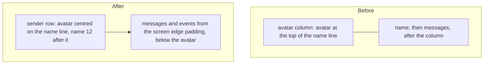
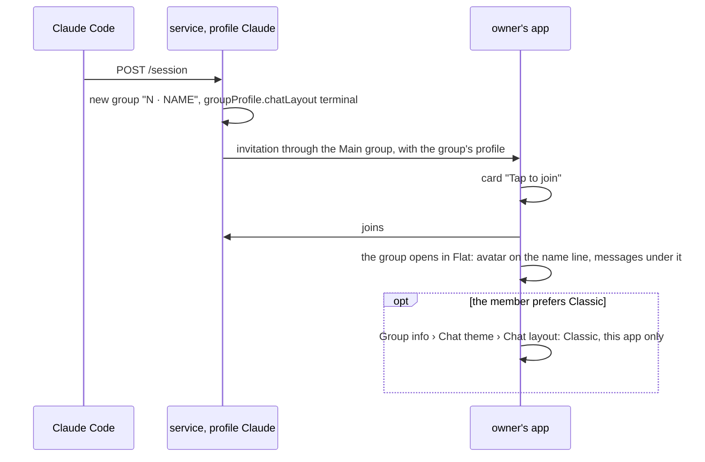
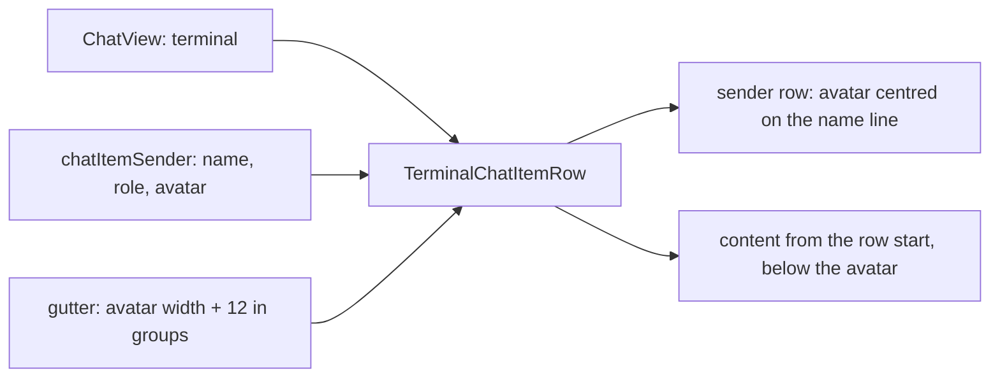

# Flat layout for session groups, with the avatar on the name line

Status: questions answered by the user on 2026-11-12; the exact design of the rows waits for the user's approval before the app code. Code references: master `9d3241b06`.

Outcome:
- The group of each new Claude Code session opens in the Flat layout in the SimpleX app. The Main group and `serve`'s agent control chat keep the members' own layout.
- In every Flat chat with avatars, a 12.5% smaller avatar is centred on the line of the sender's name, and messages are laid out in the full width under it.
- In every Flat chat, a wide image takes the row less 12 on each side, at most 500, on both platforms; a tall or square one takes 0.75 of that.

## 1. Goal

Roadmap line: "Sessions open in a flat layout by default, with the avatar raised and the text using the full width."

The user's words, 2026-11-11:
> - default sessions to flat layout, with option
> - improve flat layout to shift avatar a bit higher and avoid left gap by shifting text under avatar in flat layout

The user's answers, 2026-11-12:
> just default all new plugin session chats to flat layout, but not control chats, no settings are needed. Users will be discovering flat layout this way - that's what it was created for.

> yes, all flat layouts, that's what users want. Need to see exact design before it's implemented.

The user's review of the first design images, 2026-11-12:
> Images widths are somewhat messy. I don't see why horizontal images (however we define them) can't take full screen width, as on android, and limited on desktop. ... Also, large channels images than in groups make sense in bubbles layout, but not in flat - that looks like a mistake in iOS tbh.

> Also, it looks like avatars need to be reduced like 12.5%

The user's review of the second design images:
> it feels like there should be a bit larger gap under name/avatar on ios. Also, the padding around the avatar, especially on the right on android is a bit too large. Make it precise

The target is the README mockup, `packages/simplex-chat-mcp/images/session.png`: the avatar on the name line, the message text under the avatar at the left padding.

One pull request: branch `ep/mcp-flat-sessions`, against master.

## 2. What users see

### 2.1 In the SimpleX app: the plugin's groups

```
group                                    before                                   after
group of a new session                   the member's own default layout,          Flat
                                         Classic unless they chose Flat
Main group                               the member's own default layout          the same
serve's agent control chat               the member's own default layout          the same
groups created by 0.3.0                  the member's own default layout          the same
```

Group info › `Chat theme` › `Chat layout` of a new session's group:

```
entry          before                after
default        Classic (default)     Flat (chat)
the other one  Flat                  Classic
```

`Classic` there changes the layout for this member's app only. Claude Code, the plugin's options and Claude's posts stay as they are.

### 2.2 In the SimpleX app: every Flat chat with avatars

This applies to groups and channels in the Flat layout, also outside the plugin; the media widths apply to direct chats in the Flat layout too. The Classic layout stays as it is. Values at the default text size, 402 wide: iOS 17 pt body, 23.4 pt name line; Android and desktop 16 sp body, 22 dp name line.

```
element                          before                                       after
avatar size                      34 pt iOS; Android and desktop a 37 dp box   30 pt iOS; 27 dp Android and desktop, drawn to
                                 with a 30.8 dp circle in it                  the edge of its box
avatar, vertical                 its top on the top of the name line          centred on the name line: 3.3 pt above it on iOS,
                                                                              2.5 dp on Android and desktop
avatar, horizontal               its box 12 from the screen edge              the visible avatar 12 from the screen edge
name and role                    58 pt iOS, 61 dp Android and desktop         12 after the visible avatar: 54 pt iOS,
                                                                              51 dp Android and desktop
message text, horizontal         after the avatar column: 58 pt iOS,          12 from the screen edge
                                 61 dp Android and desktop
message top                      the bottom of the name line                  half the level step below the avatar: 2.5 pt on iOS,
                                                                              2.4 dp on Android and desktop
rows without a name              58 pt iOS, 61 dp Android and desktop         12 from the screen edge
events, such as carol connected  58 pt iOS, 61 dp Android and desktop         12 from the screen edge
gap above a name row             7.8 pt iOS, 7.3 dp Android and desktop       the same
the same, below a date           0                                            the avatar's part above the name line
separator or the chat banner,
and for the oldest loaded item
wide image                       iOS: 272 pt in groups, 332 pt in channels,   the row less 12 on each side, at most 500:
                                 after the avatar column; Android and         378 on both platforms
                                 desktop: the row after the column less
                                 12 dp on each side, 329 dp
tall or square image             0.75 of the wide width on iOS; 0.75 of the   0.75 of the wide width: 283.5 on both platforms
                                 window less 100 dp on Android and desktop
link preview card on iOS         the classic width                            the wide image width
time of an image without         over the image when the image and the        the same rule: over a wide image on a phone, beside
caption                          time are wider than the row                  a tall or square one, and beside a 500 image in a
                                                                              row of about 600 or more (desktop, iPad)
```

Each line of text is 46 pt wider on iOS and 49 dp wider on Android and desktop.

Visible distances at the default text size, measured between shapes and glyphs, not boxes: the avatar's visible edge, the box of the name's first letter, the baseline of the line above, the capitals of the message's first line.

```
distance                                              iOS now   iOS proposed   Android, desktop now   Android, desktop proposed
screen edge to the avatar                             12        12             15.1                   12
avatar to the name                                    12        12             15.1                   12
line above to the avatar: its baseline to the top     12.5      9.2            14.8                   9.2
avatar to the message: the bottom to the capitals     beside    9.2            beside                 8.3
name to the message: its baseline to the capitals     11.4      17.2           10.4                   15.2
gap above a name row: box to box                      7.8       7.8            7.3                    7.3
message text from the screen edge                     58        12             61                     12
```

A photo with the default corner radius, 22.5, is drawn at 0.964 of the circle's size on both platforms, so its gaps are 0.5 larger on each side (`ImageUtils.swift:502`; `ChatInfoImage.kt:298`). The guides of the design images mark these distances on the second name row.

The exact design is drawn for both platforms, before and after, and approved by the user before the app code. The drawings follow the code's geometry; their agreement with the apps is checked against the snapshot references of master.



### 2.3 Order of events



## 3. Questions for the user

Answered on 2026-11-12:
- Q1 (b): the plugin has no option for the layout; new session groups are created Flat.
- Q2 (a): the new geometry applies to every Flat layout. The exact design is approved before the app code.
- Q3 (b): the Main group keeps the members' own layout.

## 4. Decisions

The layout in the core and the apps:

1. A group's layout is `chatLayout` of its group profile; `terminal` is the layout the apps name Flat (`src/Simplex/Chat/Types.hs:924`; `packages/simplex-chat-client/types/typescript/src/types.ts:1906-1909`, `:3235`; `apps/ios/SimpleXChat/ChatTypes.swift:278`; `ThemeModeEditor.kt:541` with `chat_layout_flat` "Flat" at `moko-resources/base/strings.xml:2316`).
2. The core stores the field when a group is created and when an invitation arrives, and sends the group's profile in an invitation through a group (`Store/Groups.hs:385`, `:409-413`, `:483`, `:491-492`; `Library/Commands.hs:4402-4413`). A member invited with a Flat profile gets Flat (`tests/ChatTests/Profiles.hs:3862-3871`).
3. The plugin's core supports it: the field was added in core 7.1.0.14 (`7810fc475`, `simplex-chat.cabal` there), and the plugin runs `core-7.1.3.0` (`packages/simplex-chat-nodejs/src/release.ts:3`; `packages/simplex-chat-mcp/package-lock.json:4321-4322`).
4. Apps from v7.1.0 read the field: `git tag --contains` lists v7.1.0 for `7810fc475` (Android, desktop) and `c3c733e0d` (iOS). A member joins a session group through the Main group only with chat version 22 (`Protocol.hs:149-150`, `Commands.hs:2885`), which is v7.1.0 or later (0.3.0 plan, line 535).
5. A member's own choice for a chat comes first, then the group's layout, then the member's profile and app settings (`ChatModel.kt:1871-1887`; `ChatTypes.swift:2455-2477`).
6. A member makes that choice in Group info › `Chat theme` › `Chat layout` (`GroupChatInfoView.kt:744`; `ChatInfoView.kt:1313-1333`; `GroupChatInfoView.swift:198-201`; `ThemeModeEditor.swift:459-478`). The default entry reads `Flat (chat)` when the group sets Flat (`ChatInfoView.kt:1316-1319`; `ThemeModeEditor.swift:466-473`).
7. The apps send a group's stored profile back whole when owners edit it, so its layout stays (`GroupPreferencesView.swift:238-240`; `GroupPreferences.kt:48`, a copy of `GroupProfile`, whose fields include `chatLayout`, `ChatModel.kt:2819-2829`).

The plugin:

8. Claude writes `terminal` once, in the profile of a new session group (`createSessionGroup`, `hub.ts:477-489`). Claude's later profile updates start from the group's current profile, so the layout stays, also after an owner's `/set layout` (`control.ts:632-640`). This follows decision 103 of the 0.3.0 plan for the Main group's texts.
9. The Main group (`createMainGroup`, `main-group.ts:195-205`) and `serve`'s agent control chat (`createControlChat`, `control.ts:614-623`) keep their profiles (Q3 (b); premise 4 of the 0.3.0 plan).
10. Groups created by 0.3.0 keep their profiles; a resumed session reuses its group (`hub.ts:414-416`).

The Flat layout in the apps:

11. The new geometry applies to every Flat row with an avatar, in groups and channels, also outside the plugin (Q2 (a)).
12. The avatar is centred on the name line (mockup source: `.avatar { top: calc(var(--line) / 2 - var(--avatar) / 2) }`).
13. Messages, events and rows without a name start at the row's start; their text is at the text edge, `CHAT_ITEM_TEXT_PADDING`, 12 (mockup: `.content { padding: 0 var(--pad) }`).
14. A message starts below the name line, and half the level step below the avatar: `terminalHeadingBottomGap`, 2.5 pt (`TerminalItemView.swift:18`), and `TERMINAL_HEADING_BOTTOM_GAP`, 2.4 dp (`TerminalItemView.kt:66`). When it starts with a card, the paragraph gap is added below the lower of the two, as below the name now (`TerminalItemView.kt:431`; `TerminalItemView.swift:404`). The user: "there should be a bit larger gap under name/avatar on ios". Without it, the first line's capitals were 6.7 pt below the avatar on iOS: its line box starts at the avatar's bottom, and SF Pro's capitals sit 6.7 pt into a 23.4 pt line. With it, they are 9.2 pt below, as far as the avatar is from the baseline of the line above, 9.2 pt. On Android and desktop the same constant gives 8.3 dp, because Inter's capitals sit 6 dp into a 22 dp line. Equal numbers would need a value for Android alone, 3.25 dp, or a gap computed from the fonts; the shared constant keeps one rule, with gaps of 0.54 and 0.52 of the body size.
15. The name stays 12 after the visible avatar, by the user's rule of one 12 padding (I26: `plans/2026-10-13-flat-chat-layout-ui.md:39`; `apps/ios/spec/client/chat-view.md:360`). With the 30 pt avatar the name is at 54 pt, where the README mockup has it; the README image is drawn again with the 30 pt avatar (section 8).
16. The gap above a row is at least the avatar's part above the name line. `terminalRowGap` is 0 below a date separator, below the chat banner and for the oldest loaded item (`TerminalItemView.kt:138-139`; `TerminalItemView.swift:130-135`); there the avatar's part sets the gap, so the avatar stays inside its own row.
17. In the Flat layout both platforms size media by one width, W = min(500, row width − 24), in groups, channels and direct chats (the user, 2026-11-12: "horizontal images ... take full screen width, as on android, and limited on desktop"). A wide image, video or link preview image is W wide; a tall or square one is 0.75 W. Each platform keeps its test of wide: width > height on iOS (`CIImageView.swift:101`, `CIVideoView.swift:204`), width × 0.97 > height on Android and desktop (`CIImageView.kt:111`). Heights keep their rule, at most 2.33 of the width (`ImageUtils.swift:425-427`; `CIImageView.kt:193`).
   - iOS: `terminalItemRow` passes `min(500, listWidth − leading − 24)` in place of `min(maxWidth, listWidth − leading − gutter − 24)` (`ChatView.swift:2172`), so flat rows stop using the classic `maxWidth` with its 0.84 factor and its group and channel widths (`ChatView.swift:936-944`). Images, videos, link previews and chat link cards follow it, as they read `maxWidth` (`ChatItemView.swift:105-121`, `FramedItemView.swift:227-237`). 500 is a new iOS constant, equal to `DEFAULT_MAX_IMAGE_WIDTH` (`Theme.kt:668`).
   - Android and desktop: a wide image already asks for 500 dp inside 12 dp paddings on both sides (`CIImageView.kt:111`, `FramedItemView.kt:57`). A tall or square image, video or link preview in a flat row takes 0.75 of min(500 dp, the width it is given), measured in its layout, in place of 0.75 of the window less 100 dp (`CIImageView.kt:111`, `:135`, `:146`, `:189`, `:279-282`; `CIVideoView.kt:46`, `:239`, `:299`, `:424`, `:589`; `LinkPreviews.kt:206`).
   - Message text takes the full row: on iOS its frame is the row (`ChatView.swift:2360`); on Android and desktop the message is measured in the full width by decision 13, in place of the width less the gutter (`TerminalItemView.kt:427`).
18. The time's placement keeps its rule: over an image without caption only when the image and the time are wider than the row (`TerminalItemView.kt:294`, `TerminalItemView.swift:330`). On a 402 phone, 12 + 378 + about 72 for the time box is more than 402, so the time stays over a wide image; a tall or square one, 283.5, has its time beside it. In a row of about 600 or more, as on desktop and iPad, the time is beside a 500 image.
19. Flat avatars are 12.5% smaller than the visible classic ones, rounded to whole units (the user: "avatars need to be reduced like 12.5%"): iOS 30 pt, from 34 pt; Android and desktop 27 dp, from the 30.8 dp circle in the 37 dp box. iOS scales it as the classic one, 30 × profileImageSize of the text size ÷ 63, at most 35.7 pt (`ChatView.swift:15-19`, `ChatListNavLink.swift:22-37`); Android and desktop 27 dp × the square root of the font scale (`MEMBER_IMAGE_SIZE` 37 dp × `fontSizeSqrtMultiplier`, `ChatView.kt:2878`, `Utils.kt:674`). Classic keeps 34 pt and 37 dp. The avatar's part above the name line is (30 − 23.375) ÷ 2 = 3.3 pt and (27 − 22) ÷ 2 = 2.5 dp, less than the gap above a name row (7.8 pt, 7.3 dp), so name rows keep their places except where decision 16 applies.
20. `gutter` stays the avatar column, now 30 + 12 = 42 pt and 27 + 12 = 39 dp, and places only the name (`TerminalItemView.kt:392-394`; `ChatView.swift:2152`).
21. On Android and desktop a flat avatar is drawn to the edge of its box, as on iOS, so the box is the visible avatar and the gaps around it are the 12 dp of the layout. The user: "the padding around the avatar, especially on the right on android is a bit too large". Today both kinds of avatar leave 1/12 of the box on each side: the placeholder icon draws its circle from 2 to 22 of 24 (`CustomIcons.kt:14-19`, filled at the box size, `ChatInfoImage.kt:90-95`), and a photo is padded by size ÷ 12 (`ProfileIconModifier`, `ChatInfoImage.kt:285-301`). In flat rows the placeholder icon is drawn at 1.2 of the box, centred, so its circle fills the box, and a photo uses `ProfileIconModifier(size, padding = false)`, an existing parameter. The channel icon's circle is 0.82 of its 24 units (`ic_bigtop_updates_circle_filled.svg`), so at 1.2 it is 0.3 dp short of the box. The other way, a 32.4 dp box shifted left by its inset, keeps the 1/12 inset in every layout calculation; the drawn-to-edge avatar keeps one geometry on both platforms. iOS draws the placeholder and a round photo to the box edge (`clipProfileImage`, `ImageUtils.swift:495-506`).

## 5. Design

Structurally different options, one line each:

```
part     option                                            cost
profile  P1 chatLayout in the profile of a new group       one field; apps from v7.1.0 read it; older apps ignore the key; one key in the profile JSON
         P2 /set layout after creating the group           one more command per group, one more x.grp.info and a "group profile updated" item
         P3 each member's own choice                       written only by that member's app
rows     R1 one geometry for every Flat row with avatar     TerminalChatItemRow on each platform; snapshot references recorded again
         R2 a second Flat geometry for some chats          a flag from the profile or the peer type through ChatView, two geometries,
                                                           twice the tests
         R3 the avatar raised, the message column kept     keeps the left gap the user asked to remove
media    M1 one flat width, min(500, row − 24), for both   iOS: one expression in terminalItemRow and a constant; Android and desktop:
            platforms                                      the tall-image width at 8 sites from the given width; recorded references
         M2 each platform's current rule                   iOS keeps the classic 0.84 widths with group and channel sizes; the user
                                                           called them a mistake in the Flat layout
avatar   A1 a flat avatar size on each platform            one constant and its scaling per platform; the gutter follows
         A2 smaller avatars in both layouts                changes Classic, which the user did not ask for
```

Chosen: P1, R1, M1 and A1. P2 costs a second command and an item for the same result. P3 requires an action of each member. R2 adds a second geometry beyond the request. With R3 the left gap stays. M2 keeps the widths the user rejected. A2 changes the Classic layout.

### 5.1 Plugin

```
hub.ts
  createSessionGroup     profile.chatLayout = T.ChatLayout.Terminal
```


### 5.2 Android and desktop

`apps/multiplatform/common/src/commonMain/kotlin/chat/simplex/common/views/chat/item/TerminalItemView.kt`, `TerminalChatItemRow`:

```
measure        avatar
               name, in the width less gutter
               message, in the full width
avatarOffset   (name height − avatar height) / 2, negative for an avatar taller than the name line
nameTop        max(topGap, −avatarOffset)
avatarTop      nameTop + avatarOffset
messageTop     a card first: max(nameTop + name height, avatarTop + avatar height) + TERMINAL_PARAGRAPH_GAP
               otherwise: max(nameTop + name height, avatarTop + avatar height + TERMINAL_HEADING_BOTTOM_GAP), the gap
               with an avatar only
avatar at      (CHAT_ITEM_TEXT_PADDING, avatarTop)
name at        (gutter, nameTop)
message at     (0, messageTop)
height         messageTop + message height
modifier       padding(top = topGap) replaced by nameTop in the layout
```

Without a sender, the avatar and the name measure 0 × 0, so the message is at `topGap`, as now. Callers in `ChatView.kt:2058-2063` and `Appearance.kt:310` stay.

```
TerminalItemView.kt
  TERMINAL_MEMBER_IMAGE_SIZE   27.dp
  terminalGutter(chatInfo)     TERMINAL_MEMBER_IMAGE_SIZE × fontSizeSqrtMultiplier + CHAT_ITEM_TEXT_PADDING in groups
  chatItemSender               avatars of TERMINAL_MEMBER_IMAGE_SIZE × fontSizeSqrtMultiplier, drawn to the edge
  flatMediaWidth(given, wide)  min(DEFAULT_MAX_IMAGE_WIDTH, given) × (1 when wide, else 0.75)
ChatView.kt
  MemberImage(member, size, toEdge)   the size given; classic rows pass MEMBER_IMAGE_SIZE × fontSizeSqrtMultiplier
ChatInfoImage.kt, GroupMemberInfoView.kt
  ProfileImage, MemberProfileImage    toEdge: the placeholder icon at 1.2 of the box, centred; a photo with
                                      ProfileIconModifier(size, padding = false); otherwise as now
CIImageView.kt, CIVideoView.kt, LinkPreviews.kt
  tall or square media         flat rows: flatMediaWidth of the width the layout is given; classic rows as now
```

### 5.3 iOS

`apps/ios/Shared/Views/Chat/ChatItem/TerminalItemView.swift`, `TerminalChatItemRow`:

```
body          VStack, leading
                sender row: HStack, centred
                  gutter column: ZStack, the avatar chatItemTextPadding from the start
                  name and role, chatItemTextPadding from the column
                  below it: terminalParagraphGap when contentStartsWithCard, otherwise terminalHeadingBottomGap
                  with an avatar
                content
top padding   max(0, topGap − overhang)
overhang      with an avatar: max(0, (gutter − chatItemTextPadding − terminalLineHeight(body font)) / 2); otherwise 0
```

The sender row is as tall as the taller of the avatar and the name line, so the content starts below both. The top padding less the overhang keeps the name line `topGap` below the row above. Callers in `AppearanceSettings.swift:396`, `:399` stay.

```
TerminalItemView.swift
  terminalMaxMediaWidth          500
  terminalMediaWidth(row)        min(terminalMaxMediaWidth, row − 2 × chatItemTextPadding)
  terminalMemberImageSize(font)  30 × dynamicSize(font).profileImageSize ÷ dynamicSize(.large).profileImageSize
ChatView.swift, terminalItemRow
  gutter                         terminalMemberImageSize + chatItemTextPadding in groups
  maxWidth of chatItemWithMenu   terminalMediaWidth(listWidth − leading)
  chatItemSender, groupSenderImage   avatars of terminalMemberImageSize
```



## 6. Compatibility

```
party                                       what it sees
apps from v7.1.0 to the release before      Flat session groups, with the avatar at the top of the name line and the messages after the avatar column
this change
apps with this change                       Flat session groups with the new geometry
apps before v7.1.0                          ignore chatLayout and show bubbles; they join session groups only when a member adds them directly
Claude Code                                 unchanged
plugin data folders of 0.3.0                Main group and session groups unchanged; session.json unchanged; new session groups get Flat
core and protocol                           unchanged; chatLayout is part of the group profile since core 7.1.0.14
serve                                       unchanged
```

## 7. Acceptance and tests

Done when:
```
#   criterion                                                                                   checked by
1   the user approves the exact design of the rows, both platforms, before and after            design images
2   a new session's group has chatLayout terminal; the Main group has none                      unit tests; e2e test
3   an owner's copy of the session group has chatLayout terminal                                e2e test
4   Flat rows: 30 pt or 27 dp avatar centred on the name line, messages from the row start,     desktop test; snapshot references
    half the level step below it
5   the visible distances of section 2.2: 12 to the avatar, 12 to the name, the avatar drawn    FlatAvatarTest; snapshot references
    to the edge of its box on Android and desktop
6   the name and the gap above it are unchanged where the gap covers the avatar                 desktop test; snapshot references
7   flat media: wide min(500, row − 24), tall or square 0.75 of that, on both platforms         unit tests; snapshot references
8   the apps build and pass their workflows                                                     android-emu, desktop-linux, ios-sim
9   the session group opens in Flat; Chat theme shows Flat (chat)                               real session (TESTING)
```

Tests that fail on master and pass after the change:
- `test/unit/sessions.test.ts`, "are created at the session start, ...": `chat.newGroups` holds `chatLayout: "terminal"`.
- `TerminalChatItemRowTest`, `messagesStartAtRowStartBelowAvatar`: with gutter 39 and a 27 px avatar, the message is at x 0 and `TERMINAL_HEADING_BOTTOM_GAP` below the avatar's bottom. On master it is at x 39, at the name's bottom.
- The snapshot references recorded on the branch: master renders differ, and `snapshots-compare.py` fails.

Media widths, unit tests of the new functions:
- `apps/multiplatform/common/src/commonTest/kotlin/chat/simplex/app/TerminalItemViewTest.kt`, `flatMediaWidth`: 402 − 24 gives 378 wide and 283.5 tall; 1000 gives 500 and 375.
- `apps/ios/SimpleX Snapshots/SnapshotTests.swift`, a test next to `testTerminalSpacing`: `terminalMediaWidth(402)` is 378, `terminalMediaWidth(1000)` is 500; `terminalMemberImageSize` is 30 at `.large`.

Unit tests, `packages/simplex-chat-mcp/test/unit/sessions.test.ts`: the test above; the Main group of `createMainGroup` and of `reset-owners` has no `chatLayout`; a rename keeps an owner's `/set layout`.

End-to-end tests, `test/e2e/service.test.ts`, "an owner joins the Main group and each session's group, ...": Alice's copy of "1 · one" has `chatLayout` `terminal`, and her copy of the Main group has none.

Android and desktop, `apps/multiplatform/common/src/desktopTest/kotlin/chat/simplex/app/TerminalChatItemRowTest.kt`:
- `messagesStartAtRowStartBelowAvatar`, above.
- `avatarCentredOnNameLine`: the avatar's centre is on the centre of the name line, measured against a row without an avatar.
- `gapAboveNameCoversAvatar`: with `topGap` 20, the avatar's top is at 20 less its part above the name line; with `topGap` 0, it is at 0.
- `cardBelowAvatarTakesParagraphGap`: a card starts the paragraph gap below the avatar.
- `textWithoutAvatarTakesNoGap`: a sender row without an avatar, as in a direct chat, keeps the text right below the name.
- The three existing tests pass unchanged.

Android and desktop, a new `apps/multiplatform/common/src/desktopTest/kotlin/chat/simplex/app/FlatAvatarTest.kt`: a 27 dp placeholder and a round photo drawn to the edge cover their box from 0 to 27, measured on the rendered pixels; drawn as now, they cover 2.25 to 24.75.

Snapshot references, recorded on the branch with `scripts/ci/snapshots-remote.py desktop record` and `ios record` against the fork:
- desktop: `ChatView.PreviewGroupChatLayoutTerminal`, light and dark, fonts 100, 140 and 150: 6 files.
- iOS: `TerminalAvatars`, `TerminalNames` and `TerminalSpacing` at three sizes, `TerminalOverviewGroup`, `TerminalOverviewChannel`, `TerminalOverviewDirect` and `TerminalMedia` at large, light and dark: 26 files. The two direct scenes change by their media widths.
- Expected equal: `TerminalQuoteThumbnail`, `TerminalRuleOnly`, `TerminalRightToLeft` and every classic scene. A reference that the compare step lists beyond these is checked by eye before it is recorded.

CI on the fork branch: the reduced build with the `kotlin`, `ios` and `mcp` scopes; then `android-emu`, `desktop-linux` and `ios-sim` once each, with the app uploaded (`scripts/ci/README.md`, "Starting a run"). `desktop-linux` and `ios-sim` compare the snapshots.

## 8. Docs to change

```
file                                                  change
packages/simplex-chat-mcp/REFERENCE.md                Sessions and their groups: the group is created Flat; each member can choose another
                                                      layout in the group's Chat theme
packages/simplex-chat-mcp/ROADMAP.md                  the line "Sessions open in a flat layout by default, ..." removed
packages/simplex-chat-mcp/spec/api.md                 4.3: a chat layout row in the session group's profile table
packages/simplex-chat-mcp/spec/architecture.md        the row of createSessionGroup
packages/simplex-chat-mcp/TESTING.md                  automated tests: the layout of the session group; real session: Flat and Flat (chat)
packages/simplex-chat-mcp/images/session.png          drawn again from the mockup source with the 30 pt avatar, the name 12 after it
packages/simplex-chat-mcp/README.md                   unchanged
apps/multiplatform/spec/client/chat-view.md           section 10, Row Layout, and the rows of terminalGutter and TerminalChatItemRow
apps/ios/spec/client/chat-view.md                     section 9, Rows: avatar size, sender row, media width
apps/multiplatform/product/views/chat.md              Terminal Layout: the avatar on the name line, messages under it
apps/ios/product/views/chat.md                        Terminal Layout: the same
```

## 9. Conflict areas with the other items

```
file                                         this item                                          other items
packages/simplex-chat-mcp/src/hub.ts         createSessionGroup                                 harness-notes: Session.turn, Session.post
                                                                                                reactions, replies: Hub.onEvent, Session.onMessage, Session.deliver
                                                                                                agent-profile: possibly Hub.open; core.ts, user.ts
test/unit/sessions.test.ts                   session groups and Main group tests                every item: new tests in the same describe blocks
test/e2e/service.test.ts                     one existing test                                  every item: assertions in the same tests
REFERENCE.md                                 Sessions and their groups                          harness-notes, reactions, replies: Prompts and answers
ROADMAP.md                                   line 7                                             agent-profile: line 8, next to it
TESTING.md                                   the automated tests list                           every item
spec/api.md                                  4.3                                                every item
apps: TerminalItemView.kt, .swift,           TerminalChatItemRow, terminalItemRow,              agent-profile, if it changes the avatar of an agent member:
ChatView.kt, .swift                          chatItemSender, MemberImage, terminalGutter        MemberImage, MemberProfileImage, chatItemSender
apps: CIImageView.kt, CIVideoView.kt,        the width of tall or square media in flat rows     —
LinkPreviews.kt
snapshot references (PNG)                    32 files                                           agent-profile, if its avatars appear in these scenes: record again after the merge
package version files                        —                                                  the release
```

## 10. Estimate

```
part                                    lines                    work
plugin source                           1                        createSessionGroup
plugin tests                            15                       unit and e2e
Kotlin                                  55 changed               TerminalChatItemRow, avatar size and edge drawing, flat media
                                                                 widths at 8 sites
Kotlin tests                            80                       TerminalChatItemRowTest, FlatAvatarTest, flatMediaWidth
Swift                                   30 changed               TerminalChatItemRow, terminalItemRow, avatar size, media width
Swift tests                             10                       terminalMediaWidth, terminalMemberImageSize
snapshot references                     32 files                 one record run per platform, one check run
docs                                    30                       section 8
CI                                      reduced build; android-emu 15 min; desktop-linux 12 min; ios-sim 25 min, twice
total                                   about half a working day of an agent after the design approval, with the CI runs
```
