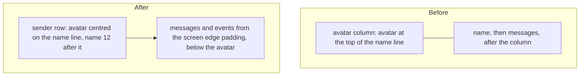
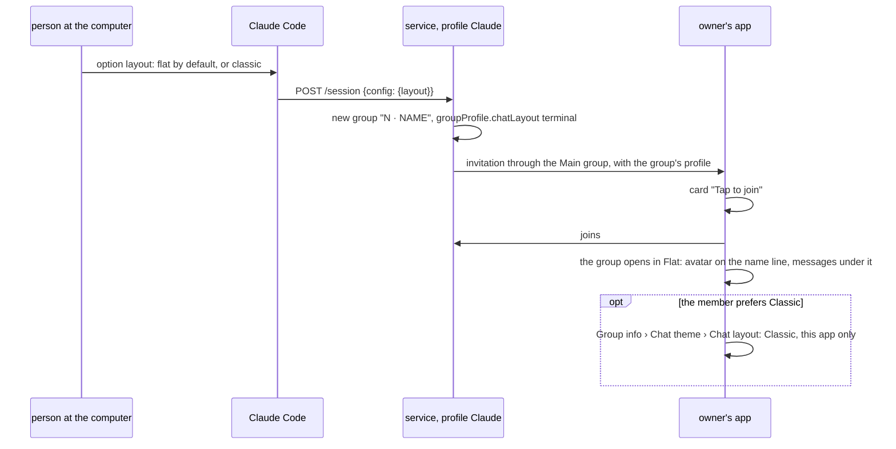
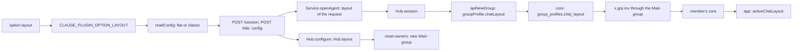
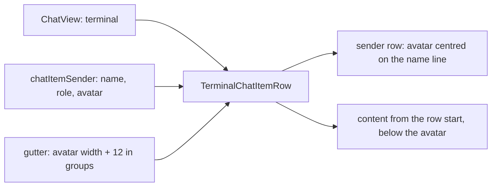

# Flat layout for session groups, with the avatar on the name line

Status: draft for review. Code references: master `9d3241b06`. Claude Code references: the binary of 2.1.322, by byte offset.

Outcome:
- The groups that Claude creates open in the Flat layout in the SimpleX app.
- The person at the computer chooses Flat or Classic for them in a plugin option; each member can still choose for themselves.
- In every Flat chat with avatars, the avatar is centred on the line of the sender's name, and messages are laid out in the full width under it.

## 1. Goal

Roadmap line: "Sessions open in a flat layout by default, with the avatar raised and the text using the full width."

The user's words, 2026-11-11:
> - default sessions to flat layout, with option
> - improve flat layout to shift avatar a bit higher and avoid left gap by shifting text under avatar in flat layout

The target is the README mockup, `packages/simplex-chat-mcp/images/session.png`: the avatar on the name line, the message text under the avatar at the left padding.

One pull request: branch `ep/mcp-flat-sessions`, against master.

## 2. What users see

### 2.1 In Claude Code

With Q1 A, `/plugin` > Installed > simplex > Configure options shows a fourth option:

```
key           layout
title         Chat layout
description   Layout of the groups Claude creates in the SimpleX app: flat or classic. Each member can choose another one in the group's Chat theme.
values        flat (default)
              classic
```

A value other than `flat` and `classic` is written only by a hand edit of the settings. The session start then shows `SimpleX MCP: Plugin option layout: flat or classic expected, got VALUE. Change it in /plugin > Installed > simplex > Configure options.`, and the session's group is created with the Flat layout (decision 17).

The row of REFERENCE.md, section Options:

```
option    layout
default   flat
values    flat
          classic
effect    The chat layout of the groups Claude creates: each new session's group, and the Main group when it is created or
          replaced. Each member can choose another layout for a group in its Chat theme.
```

### 2.2 In the SimpleX app: the plugin's groups

```
group                                    before                                   after
group of a new session                   the member's own default layout,          Flat with option flat
                                         Classic unless they chose Flat           Classic with option classic
Main group, when created or replaced     the member's own default layout          the layout of the option at that moment
groups created by 0.3.0                  the member's own default layout          the same
```

Group info › `Chat theme` › `Chat layout` of a group created with Flat:

```
entry          before                after
default        Classic (default)     Flat (chat)
the other one  Flat                  Classic
```

`Classic` there changes the layout for this member's app only. Claude's posts stay as they are.

### 2.3 In the SimpleX app: every Flat chat with avatars

This applies to groups and channels in the Flat layout, also outside the plugin. Direct chats and note folders, drawn without avatars, stay as they are. Values at the default text size: iOS 17 pt body, 23.4 pt name line, 34 pt avatar; Android and desktop 16 sp body, 22 dp name line, 37 dp avatar.

```
element                          before                                       after
avatar, vertical                 its top on the top of the name line          centred on the name line: 5.3 pt above it on iOS,
                                                                              7.5 dp on Android and desktop
avatar, horizontal               12 from the screen edge                      the same
name and role                    12 after the avatar                          the same
message text, horizontal         after the avatar column: 58 pt iOS,          12 from the screen edge
                                 61 dp Android and desktop
message top                      the bottom of the name line                  the bottom of the avatar: 5.3 pt lower on iOS,
                                                                              7.5 dp lower on Android and desktop
rows without a name              58 pt iOS, 61 dp Android and desktop         12 from the screen edge
events, such as carol connected  58 pt iOS, 61 dp Android and desktop         12 from the screen edge
gap above a name row             7.8 pt iOS, 7.3 dp Android and desktop       at least the avatar's part above the name line:
                                                                              7.8 pt iOS, 7.5 dp Android and desktop
the same, below a date           0                                            the avatar's part above the name line
separator or the chat banner,
and for the oldest loaded item
media and cards                  their widths                                 the same widths, 12 from the screen edge
```

Each line of text is 46 pt wider on iOS and 49 dp wider on Android and desktop.



### 2.4 Order of events



## 3. Questions for the user

Q1. How does a person choose Classic for the plugin's groups? The user's words: "default sessions to flat layout, with option".
- A, recommended: a plugin option `layout`, `flat` by default or `classic`, set at the computer, for the groups Claude creates afterwards. Members keep their own choice per group in the app. Cost: about 35 source lines in the plugin and a row of REFERENCE.
- B: only the app's choice per group: Group info › `Chat theme` › `Chat layout`. Nothing to build. A member who prefers Classic switches each new session's group, because each session has its own group until sessions become topics of one group. Owners set a group's own layout only with the core's commands (decision 7), so with B the groups stay Flat for every member who makes no choice.

The work proceeds on A until the answer. With B, the plugin writes `terminal` in both profiles, and decisions 9, 14, 15, 16 and 17 are dropped.

## 4. Decisions

The layout in the core and the apps:
1. A group's layout is `chatLayout` of its group profile; `terminal` is the layout the apps name Flat (`src/Simplex/Chat/Types.hs:924`; `packages/simplex-chat-client/types/typescript/src/types.ts:1906-1909`, `:3235`; `apps/ios/SimpleXChat/ChatTypes.swift:278`; `ThemeModeEditor.kt:541` with `chat_layout_flat` "Flat" at `moko-resources/base/strings.xml:2316`).
2. The core stores the field when a group is created and when an invitation arrives, and sends the group's profile in an invitation through a group (`Store/Groups.hs:385`, `:409-413`, `:483`, `:491-492`; `Library/Commands.hs:4402-4413`). A member invited with a Flat profile gets Flat (`tests/ChatTests/Profiles.hs:3862-3871`).
3. The plugin's core supports it: the field was added in core 7.1.0.14 (`7810fc475`, `simplex-chat.cabal` there), and the plugin runs `core-7.1.3.0` (`packages/simplex-chat-nodejs/src/release.ts:3`; `packages/simplex-chat-mcp/package-lock.json:4321-4322`).
4. Apps from v7.1.0 read the field: `git tag --contains` lists v7.1.0 for `7810fc475` (Android, desktop) and `c3c733e0d` (iOS). A member joins a session group through the Main group only with chat version 22 (`Protocol.hs:149-150`, `Commands.hs:2885`), which is v7.1.0 or later (0.3.0 plan, line 535).
5. A member's own choice for a chat comes first, then the group's layout, then the member's profile and app settings (`ChatModel.kt:1871-1887`; `ChatTypes.swift:2455-2477`).
6. A member makes that choice in Group info › `Chat theme` › `Chat layout` (`GroupChatInfoView.kt:744`; `ChatInfoView.kt:1313-1333`; `GroupChatInfoView.swift:198-201`; `ThemeModeEditor.swift:459-478`). The default entry reads `Flat (chat)` when the group sets Flat (`ChatInfoView.kt:1316-1319`; `ThemeModeEditor.swift:466-473`).
7. The apps' layout controls write the member's own choice (`ChatInfoView.kt:1382-1384`; `ChatInfoView.swift:984-987`). A group's own layout is written by `/_group`, `/_group_profile` and `/set layout #<group>` (`Commands.hs:3700`, `:7064`).
8. The apps send a group's stored profile back whole when owners edit it, so its layout stays (`GroupPreferencesView.swift:238-240`; `GroupPreferences.kt:48`, a copy of `GroupProfile`, whose fields include `chatLayout`, `ChatModel.kt:2819-2829`).

The plugin:
9. With Q1 A, the option `layout` takes `flat` or `classic`, default `flat`, from `CLAUDE_PLUGIN_OPTION_LAYOUT`, with the error text of the other options (`config.ts:14-20`, `:49-53`, `:62-64`). `flat` is written as `terminal`, `classic` as `classic`.
10. Claude writes the layout once, in the profile of a new group: a session's group (`createSessionGroup`, `hub.ts:477-489`) and the Main group (`createMainGroup`, `main-group.ts:195-205`). Claude's later profile updates start from the group's current profile, so the layout stays, also after an owner's `/set layout` (`control.ts:632-640`; `main-group.ts:60-63`). This follows decision 103 of the 0.3.0 plan for the Main group's texts.
11. The Main group gets the layout too. The Flat layout was made for chats with agents and service bots (`7810fc475`: "terminal chat layout for LLM and service bot chats"), and the Main group is Claude's group of invitations and commands. A person sees it first, so both kinds of groups look like the README image.
12. Groups created by 0.3.0 keep their profiles; a resumed session reuses its group (`hub.ts:414-416`).
13. `serve`'s agent control chat keeps the profile of 0.2 (premise 4 of the 0.3.0 plan; `control.ts:614-623`).
14. A session's group is created with the layout of the request that opens the session. The service passes the request's `layout` to `Hub.session`, because the group is created inside it (`service.ts:401`, `hub.ts:415`) before `configure` runs (`service.ts:211-213`, `:258-259`).
15. The hub keeps the layout of the last request that has one, from `Hub.open` and each `configure`. Claude creates the Main group of `reset-owners`, and the group of a session opened without a request, with that layout (`hub.ts:367-385`, `:396-404`).
16. A request without `layout` is valid. A client stops a running service only when the service is older (`client.ts:35-40`), so a session of 0.3.0 keeps sending requests without `layout` to a newer service (`validConfig`, `service.ts:487-491`).
17. Claude Code 2.1.322 fills an unset or invalid option with its default for the MCP server (`ymt` at offset 288929804, used for MCP servers at 297353357), and passes only saved options to hooks (`QH` and `Pt` at 288921330). `readConfig` takes a missing variable as the default (`config.ts:35-38`). So an existing install is given `flat` without a step.

The Flat layout in the apps:
18. The new geometry applies to every Flat row with an avatar, in groups and channels, also outside the plugin. The user's words: "improve flat layout ... in flat layout".
19. The avatar is centred on the name line (mockup source: `.avatar { top: calc(var(--line) / 2 - var(--avatar) / 2) }`).
20. Messages, events and rows without a name start at the row's start; their text is at the text edge, `CHAT_ITEM_TEXT_PADDING`, 12 (mockup: `.content { padding: 0 var(--pad) }`).
21. A message starts below the lower of the name line and the avatar. When it starts with a card, the paragraph gap is added below that, as below the name now (`TerminalItemView.kt:431`; `TerminalItemView.swift:404`).
22. The name stays 12 after the avatar, by the user's rule of one 12 padding (I26: `plans/2026-10-13-flat-chat-layout-ui.md:39`; `apps/ios/spec/client/chat-view.md:360`). The mockup has 8 px there; the README image is drawn again with 12 (section 8).
23. The gap above a row is at least the avatar's part above the name line. `terminalRowGap` is 0 below a date separator, below the chat banner and for the oldest loaded item (`TerminalItemView.kt:138-139`; `TerminalItemView.swift:130-135`); there the avatar's part sets the gap, so the avatar stays inside its own row.
24. Media and cards keep their widths. On iOS the gutter is removed from the media limit `listWidth − leading − gutter − 24` (`ChatView.swift:2172`), and the classic `maxWidth` stays (`ChatView.swift:936-944`). On Android and desktop media widths are fixed (`CIImageView.kt:111`).
25. `gutter` keeps its value on both platforms, the avatar column, and now places only the name (`TerminalItemView.kt:392-394`; `ChatView.swift:2152`). Callers stay as they are.

## 5. Design

Structurally different options, one line each:

```
part     option                                            cost
profile  P1 chatLayout in the profile of a new group       one field in two profiles; apps from v7.1.0 read it; older apps ignore the key;
                                                           one key in the profile JSON
         P2 /set layout after creating the group           one more command per group, one more x.grp.info and a "group profile updated" item
         P3 each member's own choice                       written only by that member's app
choice   A plugin option layout (Q1)                       about 35 source lines, a row in REFERENCE
         B the app's choice per group only                 nothing to build; a member's choice repeats for each new session's group
rows     R1 one geometry for every Flat row with avatar     TerminalChatItemRow on each platform; snapshot references recorded again
         R2 a second Flat geometry for some chats          a flag from the profile or the peer type through ChatView, two geometries,
                                                           twice the tests
         R3 the avatar raised, the message column kept     keeps the left gap the user asked to remove
```

Chosen: P1, A (Q1), R1. P2 costs a second command and an item for the same result. P3 requires an action of each member. R2 adds a second geometry beyond the request. With R3 the left gap stays.

### 5.1 Plugin

```
config.ts
  Config.layout          flat | classic
  defaultConfig.layout   flat
  configVariables.layout CLAUDE_PLUGIN_OPTION_LAYOUT
  optionNames.layout     layout
  readConfig             layout(value("layout")); error "flat or classic"
  chatLayoutOf(layout)   flat: T.ChatLayout.Terminal
                         classic: T.ChatLayout.Classic
.claude-plugin/plugin.json
  userConfig.layout      type string, title, description, default flat, options flat and classic (section 2.1)
.mcp.json
  env                    CLAUDE_PLUGIN_OPTION_LAYOUT: ${user_config.layout}
service.ts
  HubLike.session        (id, stored, layout?)
  Service.openAgent      hub.session(id, stored, request?.config.layout)
  validConfig            layout absent, flat or classic
hub.ts
  Hub.layout             Hub.open: config.layout; configure: config.layout when present
  Hub.session            (id, stored, layout = Hub.layout); a new group: createSessionGroup(stored, layout)
  createSessionGroup     profile.chatLayout = chatLayoutOf(layout)
  Hub.open               createMainGroup(chat, userId, config.mainGroup, config.layout)
  Hub.resetOwners        main.replace(Hub.layout)
main-group.ts
  createMainGroup        (chat, userId, displayName, layout); profile.chatLayout = chatLayoutOf(layout)
  MainGroup.replace      (layout); createMainGroup(…, layout)
```



### 5.2 Android and desktop

`apps/multiplatform/common/src/commonMain/kotlin/chat/simplex/common/views/chat/item/TerminalItemView.kt`, `TerminalChatItemRow`:

```
measure        avatar
               name, in the width less gutter
               message, in the full width
avatarOffset   (name height − avatar height) / 2, negative for an avatar taller than the name line
nameTop        max(topGap, −avatarOffset)
avatarTop      nameTop + avatarOffset
messageTop     max(nameTop + name height, avatarTop + avatar height) + card gap when a card starts the message
avatar at      (CHAT_ITEM_TEXT_PADDING, avatarTop)
name at        (gutter, nameTop)
message at     (0, messageTop)
height         messageTop + message height
modifier       padding(top = topGap) replaced by nameTop in the layout
```

Without a sender, the avatar and the name measure 0 × 0, so the message is at `topGap`, as now. Callers in `ChatView.kt:2058-2063` and `Appearance.kt:310` stay.

### 5.3 iOS

`apps/ios/Shared/Views/Chat/ChatItem/TerminalItemView.swift`, `TerminalChatItemRow`:

```
body          VStack, leading
                sender row: HStack, centred
                  gutter column: ZStack, the avatar chatItemTextPadding from the start
                  name and role, chatItemTextPadding from the column
                  below it: terminalParagraphGap when contentStartsWithCard
                content
top padding   max(0, topGap − overhang)
overhang      with an avatar: max(0, (gutter − chatItemTextPadding − terminalLineHeight(body font)) / 2); otherwise 0
```

The sender row is as tall as the taller of the avatar and the name line, so the content starts below both. The top padding less the overhang keeps the name line `topGap` below the row above. `terminalItemRow` (`ChatView.swift:2172`) passes `min(maxWidth, listWidth - leading - 2 * chatItemTextPadding)`. Callers in `AppearanceSettings.swift:396`, `:399` stay.



## 6. Compatibility

```
party                                       what it sees
apps from v7.1.0 to the release before      Flat session groups, with the avatar at the top of the name line and the messages after the avatar column
this change
apps with this change                       Flat session groups with the new geometry
apps before v7.1.0                          ignore chatLayout and show bubbles; they join session groups only when a member adds them directly
Claude Code 2.1.322                         the option row; an unset option reads as flat (decision 17)
a session of plugin 0.3.0                   its requests are accepted without layout; its new group is created with the hub's layout
plugin data folders of 0.3.0                Main group and session groups unchanged; session.json unchanged; new session groups get the layout
core and protocol                           unchanged; chatLayout is part of the group profile since core 7.1.0.14
serve                                       unchanged
```

## 7. Acceptance and tests

Done when:
```
#   criterion                                                                                   checked by
1   a new session's group and a new Main group have chatLayout terminal; classic with classic   unit tests; e2e test
2   an owner's copy of the session group and of the Main group has chatLayout terminal          e2e test
3   the option is read, validated, defaulted and listed in plugin.json and .mcp.json            unit tests
4   a request without layout is accepted; a session's group gets the layout of its request      unit tests of the service
5   Flat rows: avatar centred on the name line, messages from the row start below it            desktop test; snapshot references
6   the name and the gap above it are unchanged where the gap covers the avatar                 desktop test; snapshot references
7   the apps build and pass their workflows                                                     android-emu, desktop-linux, ios-sim
8   the session group opens in Flat; Chat theme shows Flat (chat)                               real session (TESTING)
```

Tests that fail on master and pass after the change:
- `test/unit/sessions.test.ts`, "are created at the session start, ...": `chat.newGroups` holds `chatLayout: "terminal"`.
- `TerminalChatItemRowTest`, `messagesStartAtRowStartBelowAvatar`: with gutter 49 and a 36 px avatar, the message is at x 0 and at the avatar's bottom. On master it is at x 49, at the name's bottom.
- The snapshot references recorded on the branch: master renders differ, and `snapshots-compare.py` fails.

Unit tests, `packages/simplex-chat-mcp/test/unit`:
- `sessions.test.ts`: the test above; a session group created after `configure` with `classic` has `classic`; `createMainGroup` writes the layout; `reset-owners` creates the Main group with the hub's layout; a rename keeps an owner's `/set layout`.
- `config.test.ts`: default `flat`; `classic` read; `wide` refused with `Plugin option layout: flat or classic expected, got wide. Change it in /plugin > Installed > simplex > Configure options.`
- `plugin.test.ts`: `userConfig` keys `main_group`, `approve`, `expire_hours`, `layout`; default `flat`; `.mcp.json` maps `CLAUDE_PLUGIN_OPTION_LAYOUT`.
- `service.test.ts`: `/session` without `layout` is accepted; `layout: "wide"` gets 400 `Invalid config.`; the fake hub gets the request's layout in `session`.

End-to-end tests, `test/e2e/service.test.ts`:
- "an owner joins the Main group and each session's group, ...": Alice's copies of the Main group and of "1 · one" have `chatLayout` `terminal`.
- "a member of the Main group joins a session's group by /join ...": after `reset-owners`, the new Main group has `terminal`.

Android and desktop, `apps/multiplatform/common/src/desktopTest/kotlin/chat/simplex/app/TerminalChatItemRowTest.kt`:
- `messagesStartAtRowStartBelowAvatar`, above.
- `avatarCentredOnNameLine`: the avatar's centre is on the centre of the name line, measured against a row without an avatar.
- `gapAboveNameCoversAvatar`: with `topGap` 20, the avatar's top is at 20 less its part above the name line; with `topGap` 0, it is at 0.
- `cardBelowAvatarTakesParagraphGap`: a card starts the paragraph gap below the avatar.
- The three existing tests pass unchanged.

Snapshot references, recorded on the branch with `scripts/ci/snapshots-remote.py desktop record` and `ios record` against the fork:
- desktop: `ChatView.PreviewGroupChatLayoutTerminal`, light and dark, fonts 100, 140 and 150: 6 files.
- iOS: `TerminalAvatars`, `TerminalNames` and `TerminalSpacing` at three sizes, `TerminalOverviewGroup`, `TerminalOverviewChannel` and `TerminalMedia` at large, light and dark: 24 files.
- Unchanged and still equal: the direct chat scenes, such as `TerminalOverviewDirect`, `TerminalQuoteThumbnail`, `TerminalRuleOnly` and `TerminalRightToLeft`, and every classic scene.

CI on the fork branch: the reduced build with the `kotlin`, `ios` and `mcp` scopes; then `android-emu`, `desktop-linux` and `ios-sim` once each, with the app uploaded (`scripts/ci/README.md`, "Starting a run"). `desktop-linux` and `ios-sim` compare the snapshots.

## 8. Docs to change

```
file                                                  change
packages/simplex-chat-mcp/REFERENCE.md                Options: a row for layout; The Main group: Claude sets the chat layout at creation;
                                                      Sessions and their groups: the group's layout and the member's own choice
packages/simplex-chat-mcp/ROADMAP.md                  the line "Sessions open in a flat layout by default, ..." removed
packages/simplex-chat-mcp/spec/api.md                 4.2 and 4.3: a chat layout row in each group profile table; 4.8: the option row;
                                                      the variables of .mcp.json
packages/simplex-chat-mcp/spec/architecture.md        the rows of createSessionGroup, createMainGroup and readConfig
packages/simplex-chat-mcp/TESTING.md                  automated tests: the layout of the groups; real session: Flat and Flat (chat)
packages/simplex-chat-mcp/images/session.png          drawn again from the mockup source with the name 12 after the avatar
packages/simplex-chat-mcp/README.md                   unchanged
apps/multiplatform/spec/client/chat-view.md           section 10, Row Layout, and the rows of terminalGutter and TerminalChatItemRow
apps/ios/spec/client/chat-view.md                     section 9, Rows: avatar, sender row, media width
apps/multiplatform/product/views/chat.md              Terminal Layout: the avatar on the name line, messages under it
apps/ios/product/views/chat.md                        Terminal Layout: the same
```

## 9. Conflict areas with the other items

```
file                                         this item                                          other items
packages/simplex-chat-mcp/src/hub.ts         Hub.open, Hub.configure, Hub.resetOwners,           harness-notes: Session.turn, Session.post
                                             Hub.session, createSessionGroup                    reactions, replies: Hub.onEvent, Session.onMessage, Session.deliver
                                                                                                agent-profile: possibly Hub.open; core.ts, user.ts
packages/simplex-chat-mcp/src/main-group.ts  createMainGroup, MainGroup.replace                 —
packages/simplex-chat-mcp/src/service.ts     HubLike.session, Service.openAgent, validConfig    —
config.ts, .claude-plugin/plugin.json,       the option layout                                  any item that adds an option
.mcp.json
test/unit/sessions.test.ts                   session groups and Main group tests                every item: new tests in the same describe blocks
test/e2e/service.test.ts                     two existing tests                                 every item: assertions in the same tests
REFERENCE.md                                 Options, The Main group, Sessions and their groups  harness-notes, reactions, replies: Prompts and answers
ROADMAP.md                                   line 7                                             agent-profile: line 8, next to it
TESTING.md                                   the automated tests list                           every item
spec/api.md                                  4.2, 4.3, 4.8                                      every item
apps: TerminalItemView.kt, .swift,           TerminalChatItemRow, terminalItemRow               agent-profile, if it changes the avatar of an agent member:
ChatView.swift                                                                                  MemberImage, MemberProfileImage, chatItemSender
snapshot references (PNG)                    30 files                                           agent-profile, if its avatars appear in these scenes: record again after the merge
package version files                        —                                                  the release
```

## 10. Estimate

```
part                                    lines                    work
plugin source                           35                       config, service, hub, main group, plugin files
plugin tests                            80                       unit and e2e
Kotlin                                  15 changed               TerminalChatItemRow
Kotlin tests                            50                       TerminalChatItemRowTest
Swift                                   20 changed               TerminalChatItemRow, terminalItemRow
snapshot references                     30 files                 one record run per platform, one check run
docs                                    40                       section 8
CI                                      reduced build; android-emu 15 min; desktop-linux 12 min; ios-sim 25 min, twice
total                                   about one working day of an agent, with the CI runs
```
