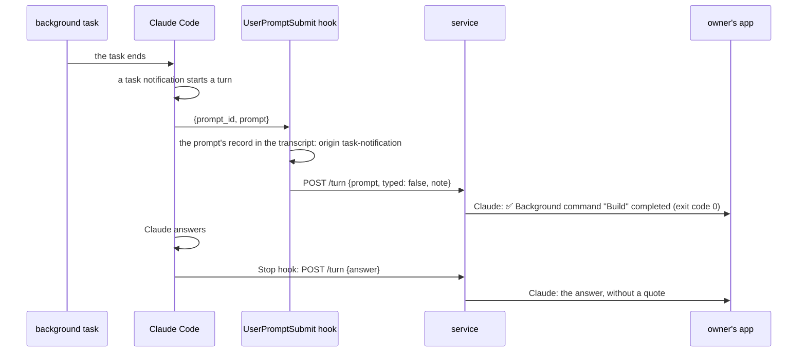
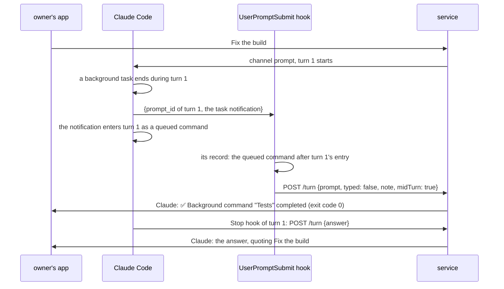
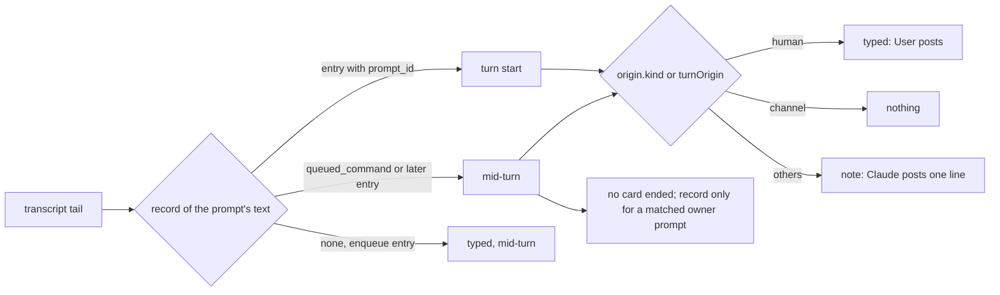

# SimpleX MCP: notes of Claude Code's own prompts

Status: implemented on `ep/mcp-harness-notes`. Q1 was answered A by the user on 2026-11-12. Code references: master `9d3241b06` (MCP 0.3.0). Claude Code references: version 2.1.322 and its binary at the offsets given; the transcripts of one machine, Claude Code 2.1.186 to 2.1.322; and two interactive sessions of Claude Code 2.1.322, recorded on 2026-11-12 with a UserPromptSubmit hook that logs its input. R1 has task notifications, a background subagent and a scheduled prompt. R2 has prompts that arrive during running turns. Decisions of the 0.3.0 plan are cited as "0.3.0 decision N".

## 1. Goal

Roadmap line, [ROADMAP.md:18](../packages/simplex-chat-mcp/ROADMAP.md): "See what Claude is doing while it works, with its code changes as diffs." This pull request covers its first part, Claude Code's own prompts. The diffs stay on the roadmap.

The user's words, 2026-11-12:

> I think it's in line with "show what claude is doing improvements, and maybe they could be one-line messages from claude itself?

> the this should be like the next PR, because I don't want to trade bad notifications for no notifications for a long time - they are kind of helpful even in their broken state

> agreed, and I propose add some emojis per type to differentiate them from the normal responses. Maybe this should be not "claude" (model) but "claude code" user (harness)? though it's more complex.

Before 0.3.0 decision 121, `User` posted Claude Code's own prompts whole, such as `<task-notification>` blocks. 0.3.0 posts nothing for them ([the 0.3.0 plan](2026-11-07-mcp-claude-code-channel.md)).

Outcome:
- Each of Claude Code's own prompts appears in the session's group as one line, with an emoji for its kind.
- Prompts typed in the terminal and messages of the group post nothing new.
- A prompt that reaches a running turn is classified by its own record: `User` posts it when a person typed it, and Claude posts its note otherwise.

## 2. What users see

Claude posts one line in the session's group for each prompt of Claude Code itself. The line has no quote. When the prompt starts a turn, Claude's answer follows as before, without a quote.

Lines, each from a real prompt of Claude Code 2.1.295 to 2.1.322 in the transcripts or in R1:

```
kind                     line
task completed           ✅ Background command "Rebuild tests and show errors or UsageStats warnings" completed (exit code 0)
                         ✅ MCP task kb5cik1y2 (simplex-demo/receive) completed.
task failed              ❌ Background command "Run agent and XFTP agent test suites" failed with exit code 1
task stopped or killed   ⏹️ Background shell command didn't finish before the previous session ended
monitor event            📡 Monitor event: "Exit status of each of the 4 flag-combination builds": serverpg exit 0
other task notification  🔔 Goal check-in: background work still running
message of a session     ✉️ Message from mcp-impl2: I read the channel-verify evidence, and it confirms your fact. I will record it in TESTING check 6 after round 6, with Claude Code 2.1.319, and I hold code changes until th…
subagent report          📋 Report from subagent ios-terminal: ## iOS terminal layout: owner decisions and screenshot tests
teammate's message       ✉️ Message from lookalikes-builder: X Ads look-alike seed file written
plain task notification  🔔 3 background agents were stopped by the user: "Duarte drafts the ad post", "Miller drafts the ad post", "Heath brothers draft the ad post".
scheduled prompt         ⏰ Scheduled prompt: Reply with the single word tick.   (R1)
automatic prompt         🔄 Automatic prompt: Your claude.ai usage limit has reset. Continue the task you were working on when the limit was reached; do not repeat work that is already complete.
another kind             ⚙️ Claude Code: FIRST LINE   (no sample in the main transcripts)
```

Rules of the line:
```
task notification:       EMOJI SUMMARY, and ": EVENT" when the notification has an event
  SUMMARY                the first line of <summary>, with &lt; &gt; &amp; decoded; "Task notification" without one
  EVENT                  the first non-blank line of <event>, decoded the same way
  EMOJI                  <status> completed ✅, failed ❌, stopped or killed ⏹️;
                         without <status>: 📡 with an event, 🔔 without
  without a block        🔔 and the first non-blank line of the prompt
message of a session     ✉️ Message from NAME: the first non-blank line of the message
subagent report          📋 Report from subagent NAME: the first non-blank line of the report
teammate's message       ✉️ Message from NAME: its summary, or the first non-blank line of the message,
                         from the first tag that is not an idle notification; nothing for idle notifications only
scheduled prompt         ⏰ Scheduled prompt: the first non-blank line of the prompt
automatic prompt         🔄 Automatic prompt: the first non-blank line of the prompt
another kind             ⚙️ Claude Code: the first non-blank line of the prompt
length                   at most 200 characters; a longer line keeps 199 and ends with …
```

Nothing new is posted for:
- a prompt typed in the terminal: `User` posts it, as in 0.3.0;
- a channel prompt, such as a message of the group: it is already in the group;
- a prompt whose record is not in the transcript within 60 s, as in 0.3.0.

Before and after:
```
prompt                                   0.3.0                                        this pull request
task notification at a turn's start      nothing                                      Claude: one line
task notification during a turn          User: the whole block in a typed turn;       Claude: one line
                                         nothing in another turn
prompt typed during a turn               User: the prompt in a typed turn;            User: the prompt
                                         nothing in another turn
message of a session, subagent report    nothing                                      Claude: one line
scheduled or automatic prompt            nothing                                      Claude: one line
```

When a group preference refuses the line, as "SimpleX links" refuses a line with a SimpleX link, Claude posts in its place:
```
A note on Claude Code's prompt was not posted: NAME are off in the group of this session; its owners can turn them on in the group's preferences.
```



During a turn, Claude Code adds a prompt to the running turn. The note appears then, before the turn's answer, and the answer still quotes the owner's prompt of the turn:



## 3. Questions for the user

Q1. Who posts these lines? Answered A by the user on 2026-11-12.
- A, recommended: Claude. Claude is in every session group already, so the lines appear in existing groups after the update. Claude's answers and the notes share one sender; the emoji tells them apart. Cost: the hook and one call in the hub, about 100 source lines.
- B: a new member "Claude Code". It separates the harness from the model, as the user proposed. It adds a third profile of the service in `ROOT/_code`, with its own database and SimpleX connections, connected to Claude once, like `User`. Claude adds it to every new session group, and to each existing group at the first start after the update; it joins by itself. The hub drops its messages and leaves it out of approvers and rights posts. A group preference limited to roles above its own refuses its posts, with a text that names it. Each member sees one more member in every session group, and each member's app keeps one more connection per group. A member can hide all notes in the app with "Block member". Cost: about 150 more source lines and 150 more test lines than A, a change of the data folder, and conflicts with the agent profile item, which changes the profiles. B can follow A later without changing the lines.

## 4. Decisions

Facts:
1. The UserPromptSubmit hook runs for every prompt that queries the model, Claude Code's own prompts included: `processUserInput` skips the hooks only when the prompt does not query, for a poll event, or with `skipSubmissionHooks` (binary 2.1.322 at 303247461: `!x.shouldQuery&&!as||y==="bash"||...||le===!0||$e===void 0`); `skipSubmissionHooks` is set only for poll events, empty dispatches, the repeated question of a closed card, orphaned permissions in remote sessions and the print loop's owed call (offsets 313424654, 313449609, 313560117, 313627254, 313694316, 322663513). R1 recorded the hook for task notifications, a scheduled prompt and typed prompts.
2. A task notification that only records a result does not query, so it runs no hook: after a subagent's hand-back, its `Agent "..." finished` notification has no `turnOrigin` and no answer (a transcript of 2026-10-30).
3. Claude Code adds a prompt that arrives during a turn to that turn as a `queued_command` attachment. It runs the UserPromptSubmit hooks then for a prompt whose hooks have not run ("prompt.submit at the fold", binary 302897343: `if(R??=SXo(n),!Wr(v)||!R)` and `fl`). The transcript entry has `type: attachment` and `attachment: {type: "queued_command", prompt, origin, commandMode}`, without `promptId` (builder at 296820244). Of 4,318 task-notification records in the main transcripts, 1,235 are such attachments.
4. The hook's `prompt_id` is the current turn's prompt ID, `requestJournal.promptId()` (binary 296962410 `prompt_id:_F()`, 283172287). For a prompt added to a running turn, it is the running turn's ID. R2 recorded `prompt_id` of the running turn for a task notification added to a typed turn and for prompts typed during a typed turn and during a notification turn.
5. Claude Code runs the hook of a typed prompt when the person submits it, also during a turn; it runs the hook of its own prompt only when the prompt is taken, at a turn's start or when added to a running turn (`Wr` at binary 302895135 skips a queued command with `promptSubmitted`. In R2 the hook of "Also say the word bravo." logged its input 41 ms after the prompt's `queue-operation` `enqueue` entry; the hook of a task notification logged it 22 s after the notification's `enqueue` entry, when the running tool ended).
6. A prompt's record carries its text: the entry with `promptId` for a turn's start, the `queued_command` attachment for a prompt added to a turn, and a later entry with a new `promptId` for a typed prompt that waits for its own turn. In R1, R2 and the channel run recorded for 0.3.0 (TESTING.md, check 6), each hook's `prompt` equals the text of exactly one record, 16 prompts in all. One prompt ID can have several entries: the channel run has a meta `<system-reminder>` entry before the prompt's entry with the same `promptId`.
7. The origin kinds in 2.1.322 are `human`, `task-notification`, `peer`, `channel`, `auto-continuation`, `coordinator`, `observer`, `observer-activity`, `slack-ping`, `unclassified`, `voice-call` and `plugin` (`RCi` at binary 295246396). A scheduled prompt has no `origin`; its entry has `turnOrigin: "scheduled"`, `scheduledTaskId` and `isMeta: true` (R1; 452 entries in the transcripts).
8. Task notifications: `<summary>` in 4,318 of 4,318; `<status>` `completed`, `failed`, `stopped` or `killed`; `<event>` in monitor events and artifact watches; one block per prompt. `<summary>` and `<event>` contain only the entities `&amp;`, `&gt;` and `&lt;` (transcripts).
9. A message of another session has `origin: {kind: "peer", from, name, senderTaskId, body}`, with `body` equal to the text in `<agent-message from="...">` or `<cross-session-message ...>`. A subagent's hand-back adds `handback: true` and, since 2.1.302, `handbackReportText`, the report without its frame. `name` is the agent's name, or its type, such as `general-purpose`, for an unnamed agent (transcripts). `<agent-message>` has no `summary` attribute. A message of a teammate in an agent team has no `origin`: its prompt is `Another Claude session sent a message:` and a `<teammate-message teammate_id="NAME" color="..." summary="...">` tag, with an optional `summary` escaped as XML (binary 292849344). Of 2,096 teammate message tags in the transcripts, 1,762 hold an idle notification, a JSON body with `"type":"idle_notification"`.
10. `auto-continuation` is the origin of the usage-limit continuation (binary 308243173) and of other automatic prompts, such as "Implement the following plan:" after plan mode (324005632) and a command's next input (324147282).
11. 0.3.0 finds the entry with `prompt_id` and takes the first one ([hook.ts:172](../packages/simplex-chat-mcp/src/hook.ts#L172)), whatever its text. So a task notification added to a typed turn is marked typed, and `User` posts the block; a prompt typed during a notification or channel turn is not typed, and `User` does not post it.
12. 0.3.0 adds a turn record with the hook's `at` for every prompt request, and ends open tool-use cards created before it ([hub.ts:181](../packages/simplex-chat-mcp/src/hub.ts#L181), [:185](../packages/simplex-chat-mcp/src/hub.ts#L185)). A record without an item, added during a turn, takes the place of that turn's prompt in its answer's quote ([hub.ts:266-275](../packages/simplex-chat-mcp/src/hub.ts#L266-L275)).

Choices:

13. Claude posts the notes (Q1 A). `User`'s posts keep meaning prompts a person typed (0.3.0 decision 121).
14. The hook composes the line and sends it as `note` in `POST /turn`; the hub posts it unchanged as one message of Claude, without a quote ([hub.ts:289-295](../packages/simplex-chat-mcp/src/hub.ts#L289-L295)).
15. The hook finds the prompt's record by its text, so that a prompt added to a running turn gets its own origin. The record is the newest of these whose text is the prompt: the entry with `prompt_id`, and the records after the first entry with `prompt_id`, both user entries and `queued_command` attachments. Until an entry with `prompt_id` is in the tail, the hook waits for it, so that an older prompt with the same text is not taken; at the last read it takes any record of the tail. User entries of subagents and tool results are skipped, as in 0.3.0. Without `prompt_id`, the newest such record at once. The hook reads up to 600 times, 100 ms apart, as in 0.3.0.
16. After the last read without a record, a `queue-operation` `enqueue` entry with the prompt's text after the entry with `prompt_id` makes the prompt typed and mid-turn: by fact 5, only a submitted prompt runs its hook while it waits. Otherwise the prompt is typed when an entry with `prompt_id` has the origin `human`, past a meta entry without origin, and it gets no note.
17. A prompt is mid-turn when its record is not an entry with `prompt_id`. The hook sends `midTurn: true` for it.
18. A mid-turn prompt ends no tool-use card, and adds a turn record only when it matched a pushed prompt. So the answer of the turn quotes the turn's prompt, or an owner's prompt added to the turn, as in 0.3.0. It amends 0.3.0 decisions 29 and 39.
19. The kind comes from the record's `origin.kind`, and from `turnOrigin: "scheduled"` without `origin`. `human` is typed. `channel` gets no note: its messages are in the group, or come from another channel's people, and Claude's answer is posted. A record without `origin` and not scheduled gets no note.
20. The note of a subagent's report uses `handbackReportText`, and `body` without it.
21. A line has at most 200 characters, counted in code points; a longer line keeps 199 and ends with `…`. Control and format characters become spaces, as in [log.ts:33-35](../packages/simplex-chat-mcp/src/log.ts#L33-L35). Of 5,127 notes computed from this machine's transcripts, 1,279 are cut.
22. A note refused by a group preference is replaced by Claude's post `A note on Claude Code's prompt was not posted: ` and PREF OFF, by the path of 0.3.0 decision 114 ([hub.ts:283-287](../packages/simplex-chat-mcp/src/hub.ts#L283-L287)).
23. Notes are posted when their request arrives, in the order of the hooks' requests, as answers and `User`'s prompts are. A turn's UserPromptSubmit hook starts before its Stop hook; a mid-turn prompt's hook starts during the turn.
24. The protocol version stays 1: `note` and `midTurn` are optional, and a service without them posts nothing for them, as 0.3.0.

Decided after review round 1 of `9c78e6276`:

25. A teammate's message gets `✉️ Message from NAME: `, as a message of another session, and its `summary`, or the first line of the message without one, cut to 200. The note is made from the first tag that is not an idle notification, and a prompt of idle notifications only gets no note (fact 9, decision 31). The user, 2026-11-12, on the first emoji of this note: "👥 this looks horrible".
26. The first entry with `prompt_id` is any user entry of the main conversation with that ID, a tool result included: a long turn's first entry can be more than 1 MiB back, and its tool results carry its ID. The `enqueue` fallback of decision 16 also applies when no entry with `prompt_id` is in the tail.
27. While an `enqueue` entry with the prompt's text follows the found record, the hook waits: the prompt is a later one with the text of the turn's own prompt, still queued. An `enqueue` entry precedes the record of every queued prompt in R2.
28. A task notification without a `<task-notification>` block, such as `3 background agents were stopped by the user: ...`, gets 🔔 and its first line. A `queued_command` attachment without `origin` and with the `commandMode` `task-notification` is a task notification.

Decided after review round 2 of `ef93ce0dd`:

29. At the last read, the hook classifies a record still followed by an `enqueue` entry with its text by the record, and marks a typed record mid-turn. Claude Code runs the hook of its own prompt only when the prompt is taken (fact 5), so at the last read the queued prompt is a later one with the same text, such as a repeated monitor event. Before, the hook marked such a prompt typed, and `User` posted its block. The fallback of decision 16 applies only without a record.
30. The wait of decision 27 stays. The hook of Claude Code's own prompt added to a turn can read the transcript before the fold's entries are written, and without the wait it would take the record of an earlier prompt with its text. In R2 the hook of the task notification started with a transcript of 292,045 bytes, before the tool result, the `remove` entries and the `queued_command` attachment. So when a later prompt with the text of a turn's own prompt is added to that turn within the reads, the hook of the turn's prompt takes the later record. Its note is the same line, it is mid-turn, and the turn gets no turn record: the answer then quotes the oldest pushed prompt not quoted yet, when there is one ([hub.ts:269-273](../packages/simplex-chat-mcp/src/hub.ts#L269-L273)).
31. A teammate's prompt can have several `<teammate-message>` tags, separated by blank lines. Of 1,903 teammate prompts in the transcripts, 204 have several tags, and 54 of these have an idle notification first and a message after it; 1,084 have only idle notifications.

## 5. Design

Options for where the line is made:
```
option                                producer (hook)               consumer (hub)                   wire                            older parts
H. hook composes, sends note          parses the record and the     posts note                       + note, + midTurn               old hook: no note, as 0.3.0
   (chosen)                           prompt: about 90 lines
S. hook sends origin, hub composes    sends origin, turnOrigin      parses the prompt and origin;    + origin with body: a message   old hook: no note, as 0.3.0
                                                                    learns Claude Code's formats     twice, up to 250,000 each
M. Claude writes the line             none                          none                             none                            channel instructions; tokens
                                                                                                                                     on every prompt
```
S costs more at the consumer and on the wire for the same lines. M costs tokens on every prompt and depends on the model following an instruction.

Options for finding the record of a prompt added to a running turn:
```
option                                   cost
text match among records (chosen)        one pass over the tail's records; exact by fact 6
prompt ID only, as 0.3.0                 wrong origin for every mid-turn prompt (fact 11)
the prompt's text decides the kind       a typed prompt that starts with <task-notification> becomes a note; no name or report
entry time against the hook's start      Claude Code writes entries before and after the hook (R1, R2): no reliable bound
```

Options for who posts: Q1.

Changes:
```
file                      function                     change
src/protocol.ts           TurnRequest                  + note?: string, + midTurn?: boolean
src/hook.ts               TranscriptEntry              + turnOrigin, attachment {type, prompt, origin}, operation, content
                          turn                         typed, note and midTurn from promptKind
                          promptTyped -> promptKind    the record (decisions 15-17); typed, note, midTurn
                          promptEntry -> promptRecord  records by text; the last read applies decision 16
                          findInTranscript             find gets the last read's flag
                          noteOf, taskNote, firstLine  the line (section 2, decisions 19-21)
src/hub.ts                Session.turn                 endPermissions and the turn record skip mid-turn prompts (decision 18);
                                                       post note as Claude, PREF OFF on refusal (decision 22)
```

Hook:
```
on UserPromptSubmit {prompt_id, prompt, transcript_path}:
  text = trimmed prompt; blank: typed false, no note
  read the tail up to 600 times, 100 ms apart:
    records   = user entries without isSidechain and tool results, and queued_command attachments
    first     = the first entry with promptId = prompt_id
    record    = the newest record whose text is text: at or after first, or anywhere without first
    found, and no enqueue entry of content text after it: stop
    first absent and prompt_id given: wait, except at the last read
  last read, a record with an enqueue entry of content text after it:
    the record's kind; a typed record is also mid-turn
  last read, no record:
    an enqueue entry of content text after first: typed true, midTurn true, no note
    else: typed = an entry with promptId = prompt_id has origin.kind human; no note
  typed   = record.origin.kind = human
  midTurn = record is not an entry with promptId = prompt_id
  note    = noteOf(record, prompt), cut to 200
POST /turn {id, pid, at, prompt, typed, note?, midTurn?, effort}
```

Hub:
```
on POST /turn, before any await:
  prompt and not midTurn, or answer:   end tool-use cards created before at
  prompt, at not below answeredAt, and (not midTurn, or matched):
                                       turns += (at, the oldest matched or null)
then:
  note:                                Claude posts [note], no quote; refused by NAME: Claude posts
                                       "A note on Claude Code's prompt was not posted: " + PREF OFF
  typed prompt:                        User posts it, as in 0.3.0
  answer:                              Claude posts it, as in 0.3.0
```



## 6. Compatibility

- Older SimpleX apps: notes are text messages with emoji, shown by every version.
- Older Claude Code: without `origin`, nothing is posted, as in 0.3.0, except a teammate's message, found by its tag. Without `prompt_id`, the record is the newest one with the prompt's text. Before 2.1.302 a report's note shows the first line of `body`, the frame's first line. Without `queued_command` attachments, the fallback of decision 16 applies.
- Older plugin data folders: no data changes. A service of this version with an older hook gets no `note` and no `midTurn`, and behaves as 0.3.0. The hook stops a service only when its version is older ([client.ts:37-40](../packages/simplex-chat-mcp/src/client.ts#L37-L40)), so an older service with this hook does not occur once the release bumps the version. `package.json` stays at 0.3.0 here; the release pull request bumps it.
- `serve`: unchanged.

## 7. Acceptance and tests

Done when:
```
#  criterion                                                                                     checked by
1  each kind of section 2 gives its exact line, cut at 200                                        unit: hook
2  a typed prompt, a channel prompt and a missing record give no note                             unit: hook
3  a task notification added to a typed turn is a note and not typed; User does not post it       unit: hook; e2e
4  a prompt typed during a notification turn is typed and mid-turn; User posts it                 unit: hook
5  the entry with prompt_id is taken by its text, past a meta entry with the same ID              unit: hook
6  a typed prompt still queued after the reads is typed and mid-turn                              unit: hook
7  Claude posts the note without a quote; the answer of a notification turn has no quote          unit: sessions; e2e
8  a mid-turn note keeps the turn's quote and its open tool-use cards                             unit: sessions
9  a refused note is replaced by the PREF OFF post                                                unit: sessions
10 a request without note and midTurn behaves as in 0.3.0                                         existing unit and e2e tests unchanged
11 real session: a background command, a subagent and a scheduled prompt show their lines          TESTING check
12 the note of Claude Code's prompt is sent while a repeat of its text is queued after the reads  unit: hook
13 a teammate's message after idle notifications in one prompt gets its note                      unit: hook
```

Tests:
- `test/unit/hook.test.ts`, new: "sends a one-line note for each kind of Claude Code's prompt, from its transcript record, and none for typed and channel prompts": entries of R1 and of this machine's transcripts, with paths replaced. It fails on master, which sends no `note`.
- `test/unit/hook.test.ts`, new: "finds a prompt added to a running turn by its queued command after the turn's entry, and marks it mid-turn": the R2 records. With master, the notification in the typed turn is typed and "Say the word charlie." is not, so it fails.
- `test/unit/hook.test.ts`, new: the meta entry before the prompt's entry, an older prompt with the same text, and the queued typed prompt after the reads.
- `test/unit/hook.test.ts`, round 2: a monitor event whose repeat is queued after the reads keeps its note, and is typed and mid-turn on `ef93ce0dd`; a teammate's prompt with an idle notification before a message gets the message's note, and no note on `ef93ce0dd`.
- The tests build the records of R1 and R2 in their own code, so the test of 0.3.0 decision 121 stays unchanged and no fixture file is added.
- `test/unit/sessions.test.ts`, new: "posts the note of Claude Code's prompt as Claude without a quote, and the turn's answer without a quote" (fails on master: nothing is posted); "keeps the turn's quote and tool-use cards for a mid-turn prompt" (fails on master: the answer loses the quote and the card ends); "replaces a refused note with the preference's text".
- `test/e2e/service.test.ts`, changed: the mirroring test adds a summary to its notification, expects Claude's line and no post of `User`, and adds a notification as a queued command of the typed turn `p1`.
- Run: `npm test --prefix packages/simplex-chat-mcp` for unit tests, and the end-to-end tests as TESTING.md states. The reduced build runs them in CI. No app changes, so no app test workflows.

## 8. Docs to change

- `README.md:36`: Claude Code's own prompts appear as one line each.
- `REFERENCE.md`, "Prompts and answers" (603-617): the lines, the kinds, the cut, the refusal text; `User` posts typed prompts also when typed during a turn.
- `ROADMAP.md:18` stays as it is: the line also names the diffs.
- `spec/flows.md`: flow 21 notes; a new flow, a prompt of Claude Code at a turn's start and during a turn.
- `spec/api.md`: 4.3 (Claude's posts), 4.6 (`POST /turn` with `note` and `midTurn`), the hook's record rules (1020).
- `spec/architecture.md`: 8.2 (`promptKind`, `promptRecord`, `noteOf`), 8.6 (the wire and the turn rules).
- `TESTING.md:156`, `:173`: the new tests; a real-session check of the three kinds.

## 9. Conflict areas with the other items

```
file                              where                                    items
src/hub.ts                        Session.turn (180-201)                   mcp-replies (quotes, pushed prompts), mcp-reactions
src/protocol.ts                   TurnRequest (48-57), AttachLine (59-62)  mcp-replies, mcp-reactions (AttachLine)
test/unit/sessions.test.ts        turn tests (630-760)                     mcp-replies, mcp-reactions
test/e2e/service.test.ts          the mirroring test (351-412)             mcp-replies, mcp-reactions
REFERENCE.md                      "Prompts and answers" (603-617)          mcp-replies, mcp-reactions
spec/flows.md, api.md,            flows 20-21, 4.3, 4.6, 8.6               mcp-replies, mcp-reactions
architecture.md
ROADMAP.md                        lines 18-20, adjacent                    mcp-reactions (19), mcp-replies (20)
src/user.ts, Hub.open,            only with Q1 B                           mcp-agent-profile
createSessionGroup
```

## 10. Estimate

```
part                    source lines   test lines
hook.ts                 90             150, and the fixture
hub.ts, protocol.ts     10             90
docs                    60 lines of text
```
About one working day, with two review rounds. Q1 B adds about 150 source lines, 150 test lines and a day.
