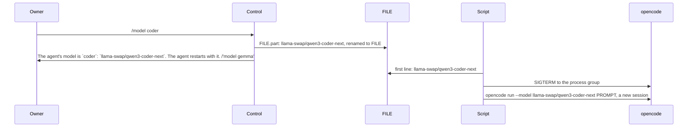

# SimpleX MCP server: the agent's model

Status: implemented. Decided on 2026-11-12. Code references: `49bf0127a9`, on master `b7b05a2618`. Budget: about 75 changed lines in `src`, at most 90; used: 80 added and 9 deleted lines.

## Decisions

1. Two serve options, `--models` and `--model-file`: both or neither.
2. Each item of `--models` is `NAME=PROVIDER/MODEL`; owners type NAME.
3. The file of `--model-file`, FILE, is the only store of the selection. The server reads it at start.
4. `/model` is an owner command. Approvers send it, in both approval modes.
5. M1: the agent restarts at once. The script that runs opencode restarts it when FILE changes.
6. M2: the script starts a new opencode session at each switch.
7. M3: the example list is gemma, the default, and coder, both through llama-swap, then large, a hosted model.
8. The server only writes FILE; the script reads it and restarts opencode.

## /model

```
command        effect
/model         the selected model, then one tappable command per other model
/model NAME    NAME of --models selected
```

- `ownerRequest` parses keyword `model` with 0 or 1 word as `{type: "model", name?}` (`control.ts:743`).
- With 2 or more words, the commands reply is sent.

Replies:
```
request                reply
/model                 The agent's model is `gemma`: `llama-swap/gemma-4-26b`.
                       /'model coder'
                       /'model large'
/model coder           The agent's model is `coder`: `llama-swap/qwen3-coder-next`. The agent restarts with it. /'model gemma'
/model gemma           The agent's model is already `gemma`.
```

- `/model`: one line per other model, in the order of `--models`. With one model, only the first line.
- The command at the end of a switch reply selects the previous model.
- Names and models are code spans.

Refusals, in the order of the checks:
```
situation                 reply
sender not an approver    Only owners approve actions.
                          with --owners: Only the owners listed in --owners approve actions.
server without --models   This server runs without --models.
NAME outside --models     No such model. /model shows the models.
```

- A PROVIDER/MODEL value is refused as unlisted.
- NAME is left out of the refusal.
- In a plugin session group, `/model` and `/model NAME` of an admin or owner get `This server runs without --models.`

Commands reply: `Commands: /approve, /reject, /receive, /forward, /revoke, /leave, /delete, /pending, /list, /model. Each card shows its commands.`

Menu entry: `{type: "command", keyword: "model", label: "The agent's model"}`, appended with `--models`. `load` replaces the menu when it differs; after a start without `--models`, the menu has no `/model`.



## Options

```
option              value                                        error, exit code 2
--models MODELS     NAME=PROVIDER/MODEL items, comma-separated    --models: NAME=PROVIDER/MODEL,... expected, got VALUE
--model-file FILE   a path, resolved as --data                    --model-file: a file in a folder disjoint from the data folder expected, got FILE
the pair            one option without the other                  --models and --model-file: both expected.
```

Items:
```
part             rule
NAME             ^[a-z][a-z0-9-]{0,15}$
PROVIDER/MODEL   ^[A-Za-z0-9][\w.-]{0,31}/[\w.:/+@-]{1,64}$
names            unique
PROVIDER/MODEL   unique
default          the first item
```

- The folder of FILE is not the data folder, not inside it, and does not contain it.
- `ServeOptions.model?: {models, file}`; absent by default.

Help text:
```
  --models MODELS        opencode models NAME=PROVIDER/MODEL, comma-separated;
                         /model NAME selects one in the agent control chat;
                         the first is the default; requires --model-file
  --model-file FILE      file with the selected PROVIDER/MODEL for the script
                         that runs opencode; in a folder disjoint from the
                         data folder
```

## FILE

```
item      value
content   PROVIDER/MODEL, then "\n"
mode      0644, set again except on Windows
write     FILE.part, then renamed to FILE
writer    the server
reader    the script that runs opencode: the first line
```

State:
```
event                                       FILE                             selection
start, first line a listed PROVIDER/MODEL   kept                             that item
start, FILE missing or not listed           the first item written           the first item
/model NAME                                 NAME's PROVIDER/MODEL written    NAME
/model NAME, the write fails                unchanged                        unchanged
server restart                              as start                         as start
```

- At start, FILE is handled after `writeHeadersFile`, before `ChatApi.init` (`serve.ts:73`).
- An error at start releases the lock; the process exits with code 1.
- After a failed write at `/model NAME`, no reply is sent, and the error is logged as `control chat command: ERROR`.

Logging, stdout:
```
event          line
start          Model: gemma (llama-swap/gemma-4-26b), in /run/agent-model/model
/model coder   Model set to coder (llama-swap/qwen3-coder-next) by Alice.
```

- The sender's name is folded to one line.

## Deployment contract

```
item      rule
mount     FILE's folder, read-only, in the agent's container; not FILE (moby/moby#15793)
run       opencode run --model "<first line of FILE>"
watch     the first line of FILE, every 5 s
switch    the first line differs from the running model: opencode stopped, then started with it
session   a new session after a switch: no --continue
models    each PROVIDER/MODEL of --models defined in opencode's configuration
```

Script:
```
constants
  FILE      /run/agent-model/model
  DEFAULT   $MODEL_DEFAULT
  PATTERN   ^[A-Za-z0-9][A-Za-z0-9_.-]{0,31}/[A-Za-z0-9_.:/+@-]{1,64}$
  POLL      5 s
  GRACE     30 s

selected():
  line ← first line of FILE; "" when FILE is missing
  line matches PATTERN → line
  otherwise → DEFAULT

fresh ← false
loop forever:
  model ← selected()
  continue ← "--continue" unless fresh
  fresh ← false
  start in a new process group, in the background:
    opencode run $continue --model "$model" PROMPT
  switched ← false
  while opencode runs:
    wait POLL
    selected() ≠ model:
      SIGTERM to the process group
      opencode still running after GRACE: SIGKILL to the process group
      switched ← true
      fresh ← true
  reap opencode
  switched is false: wait 10 s
```

At a switch, in the server:
- A waiting `receive` of the stopped run is aborted when its request closes. The call returns before `markRead`, and the chat's unread messages stay unread (`tools.ts:1134`, `:1141-1143`).
- The actions of the stopped run stay in memory; `list` returns them (`tools.ts:1156`).

## Threat model

```
actor                           capability                           mitigation
approver                        selects an item of --models          the operator sets the list at start
operator                        sets --models                        items checked at start, exit code 2
member who is not an approver   sends /model                         refused
the agent                       posts /model in the control chat     its own items ignored (groupSnd, control.ts:178)
                                                                     the control chat refused by its tools (tools.ts:1116, :1171)
the agent                       writes FILE                          the folder mounted read-only in its container
the agent                       reads FILE                           the content is only PROVIDER/MODEL
peer in another chat            sends "/model NAME" there            commands read only in the control chat (serve.ts:137)
any sender                      injects through NAME                 NAME equal to a name of --models
                                                                     NAME left out of the replies
                                                                     the script checks PATTERN and passes one argument
the agent's container           reads the data folder by FILE's      FILE's folder disjoint from the data folder, exit code 2
                                mount
a remote provider               receives the agent's session         a new session at each switch
```

## Changes

```
file         function          change
cli.ts       helpText          --models
                               --model-file
             serveOptions      the two options
                               the pair check
                               the folder check
             modelList         new: the items of --models
files.ts     ModelEntry        new: {name, model}
             ModelOptions      new: {models, file}
             ModelSelection    new: ModelOptions with selected
             modelAtStart      new: the item of FILE's first line; otherwise the first item, written
             writeModelFile    new: FILE.part, mode 0644, renamed to FILE
serve.ts     ServeOptions      model, optional
             startServer       modelAtStart after writeHeadersFile
                               the start line
                               the selection passed to startAgent
             startAgent        ControlOptions.model
control.ts   modelCommand      new: the menu entry
             commandsReply     /model
             ControlOptions    model, optional
             OwnerRequest      {type: "model", name?}
             load              the menu with modelCommand under --models
             ownerCommand      case model
             switchModel       new: the replies, the write, the log line
             ownerRequest      /model with 0 or 1 word
```

## Tests

`test/unit/options.test.ts`:
```
case                                   expected
--models with --model-file             model read; FILE an absolute path
items at the length limits             read
item without "="                       refused
item without "/"                       refused
leading "-" in NAME or PROVIDER        refused
upper-case NAME                        refused
NAME of 17 characters                  refused
PROVIDER of 33 characters              refused
MODEL of 65 characters                 refused
space or backtick in MODEL             refused
empty item                             refused
repeated name                          refused
repeated PROVIDER/MODEL                refused
empty value                            refused
--models without a value               --models: a value expected.
one option without the other           refused, both ways
FILE in, at or above the data folder   refused
FILE in a sibling folder               read
"reads every option"                   both options
help                                   both help entries
```

`test/unit/files.test.ts`:
```
case                                   expected
writeModelFile                         one line; mode 0644; FILE.part gone
private FILE and FILE.part             replaced; mode 0644
modelAtStart, listed first line        that item; FILE unchanged
modelAtStart, FILE missing             the first item written
modelAtStart, unlisted lines           the first item written
modelAtStart, folder missing           ENOENT
```

`test/unit/commands.test.ts`:
```
case                                   expected
/model, three models                   the selected model and two commands
/model, one model                      the selected model only
/model coder, then /model gemma        FILE written each time
                                       the replies
                                       the log line, the name on one line
/model gemma, selected                 "already"; FILE unwritten
six unlisted names                     refused; FILE unwritten
server without --models                refused
non-approver                           refused; FILE unwritten
owner outside --owners                 refused; FILE unwritten
mode host                              the same replies
/model with two words                  the commands reply
menu with --models                     /model last
start, FILE's folder missing           ENOENT; no chat database; lock released
```

`test/e2e/scenarios.test.ts`: the start prints the model line.

`test/unit/sessions.test.ts`: `/model sonnet` of an owner in a session group gets `This server runs without --models.`

## Docs

```
file           change
README.md      a paragraph in "Only Claude Code, for now"
REFERENCE.md   the /model command row
               section "The agent's model": the replies
               section "The agent's model": FILE
               section "The agent's model": the script contract
               the help copy
               the data folder line
               the security line
TESTING.md     one step in "Stop and restart"
               the tests of 0.2: the 4 tests of the commands reply excepted
plans/2026-10-19-mcp-server.md
               options
               owner commands
               start
               state
               log lines
               tests
               decisions of 2026-11-12
spec/          /model replies
               options
               exit codes
               terminal lines
               modules
               state
               the model file rules
               flow 32
               flow 20: /model in a session group
               links into the changed files remapped
```
