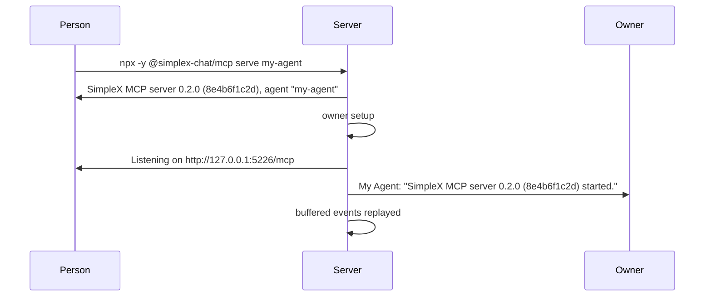

# SimpleX MCP server: restart notice

Status: draft for review. Decided on 2026-11-12, decision 1 amended by the owner on 2026-11-24. Code references: master `c6e7549b12`.

## Decisions

1. At each start, after the owner setup, the server posts a notice with its version and the commit of its build in the agent control chat only. The owner, on 2026-11-24, of the chats approved for all messages: "Control chat only".
2. Text: `SimpleX MCP server VERSION (COMMIT) started.`; ` (COMMIT)` is left out when the build has no commit.
3. COMMIT: `git rev-parse --short=10 HEAD`, written to `dist/commit.txt` by the `prepack` script; with git missing, or outside a git repository, no file is written. `dist/commit.txt` is left unchanged by `npm run build`.
4. The same version is in the start line: `SimpleX MCP server VERSION (COMMIT), agent "NAME"`.
5. The server posts the notice itself, without an action, a card or a copy in the agent control chat beyond its own notice.
6. A failed post is logged as `restart notice: ERROR`, and the server continues the start.
7. Its own pull request from master, not stacked.
8. Budget: about 40 changed lines in `src` and `package.json`, at most 20% more.

## Notice

```
item       rule
when       once per start: after control.start() and the log line "Listening on ...", before the buffered events are replayed
           none while the agent control chat is lost
where      the agent control chat only, in both modes
text       SimpleX MCP server VERSION (COMMIT) started.
           without dist/commit.txt: SimpleX MCP server VERSION started.
post       apiSendTextMessage([Group, the control chat's ID], text), awaited
failure    the error is returned to startAgent: logError("restart notice")
log        none for a posted notice
```

- The package version alone is in the MCP server info: `McpServer({name: "simplex-mcp", version})`.

## Version

```
script     step
prepack    dist deleted; tsc; node -e: dist/commit.txt = the output of git rev-parse --short=10 HEAD, stdio pipe; any error caught, no file
postpack   dist/commit.txt deleted
build      tsc; no file written, an earlier one kept
```

```
name                 value
versionWithCommit    file exists: "VERSION (" + its content trimmed + ")"; otherwise VERSION
fullVersion          versionWithCommit(join(__dirname, "commit.txt")), at module load: dist/commit.txt for dist/serve.js
start line           SimpleX MCP server FULLVERSION, agent "NAME"
notice               SimpleX MCP server FULLVERSION started.
```

## Changes

```
file          function            change
package.json  prepack             dist/commit.txt after tsc
              postpack            new: dist/commit.txt deleted
serve.ts      fullVersion         new
              versionWithCommit   new, exported
              startServer         the start line with fullVersion
              startAgent          control.postRestartNotice after "Listening on ...", awaited; an error logged as "restart notice"
control.ts    postRestartNotice   new
```



## Threat model

```
actor                                 capability                                                     mitigation
members of the agent control chat     the server's version, its commit and the time of each start   none: they see the agent's cards in the same chat
```

## Tests

- `test/unit/commands.test.ts`, "restart notice":
  - the agent control chat only, with chats approved for all messages present
  - a lost control chat: none
  - a failed post: the call rejected with its error
  - `versionWithCommit` with and without the commit file
- `test/unit/fixtures.ts`: `apiSendTextMessage` of `FakeChat` from the library.
- `test/e2e/mcp.test.ts`, after the restart: `SimpleX MCP server VERSION started.` in the owner's agent control chat; the start line in the log.

## Docs

- `REFERENCE.md`: section "Restart notice"; the notice in the quick start; each marked as of the next version.
- `TESTING.md`: the notice at the first join; a restart step; `prepack` and `postpack`.
- `plans/2026-10-19-mcp-server.md`: section Restart notice; the scope, package, first start, other lines, start sequence, scenarios and tests; decisions.
- `plans/2026-11-07-mcp-claude-code-channel.md`: decision 119 and the pack of the package, amended with `dist/commit.txt` and `postpack`.
- `spec/`: api, architecture, flows and README, with functions named and files linked without line numbers; each new declaration in an anchored row of architecture, with a `// spec` comment above it (README, "Code references"); the flow of the notice is flow 44.
- `package.json`, `package-lock.json`, `.claude-plugin/plugin.json`: version unchanged, 0.3.1; the notice comes with the next version.
