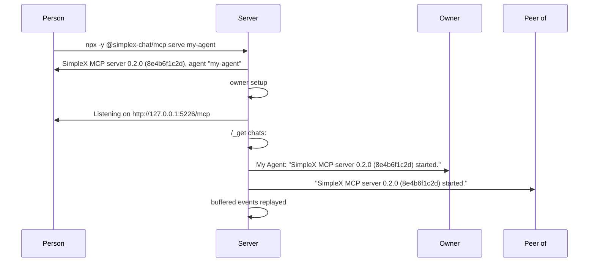

# SimpleX MCP server: restart notice

Status: draft for review. Decided on 2026-11-12. Code references: master `c6e7549b12`.

## Decisions

1. At each start, after the owner setup, the server posts a notice with its version and the commit of its build in the agent control chat and in each chat with a standing approval of messages where the agent can post as itself; in no other chat.
2. Text: `SimpleX MCP server VERSION (COMMIT) started.`; ` (COMMIT)` is left out when the build has no commit.
3. COMMIT: `git rev-parse --short=10 HEAD`, written to `dist/commit.txt` by the `prepack` script; with git missing, or outside a git repository, no file is written. `dist/commit.txt` is left unchanged by `npm run build`.
4. The same version is in the start line: `SimpleX MCP server VERSION (COMMIT), agent "NAME"`.
5. The server posts the notice itself, without an action, a card or a copy in the agent control chat beyond its own notice.
6. A failed post is logged as `restart notice to CHAT: ERROR`, and the server continues the start.
7. Its own pull request from master, not stacked.
8. Budget: about 40 changed lines in `src` and `package.json`, at most 20% more.

## Notice

```
item       rule
when       once per start: after control.start() and the log line "Listening on ...", before the buffered events are replayed
           none while the agent control chat is lost
where      the agent control chat, first
           then each chat of agentChats(), in the order of apiGetChats, with:
             standingApprover(chatInfo, "messages") set: mode requests, member approvedById an approver
             isConnected(chatInfo)
             readOnlyRole(chatInfo) unset: a contact, or a group where the agent's role is neither observer nor relay
             chatSubject(chatInfo).incognito false
text       SimpleX MCP server VERSION (COMMIT) started.
           without dist/commit.txt: SimpleX MCP server VERSION started.
post       apiSendTextMessage([chat type, chat ID], text), awaited, one chat at a time
failure    a post: logError("restart notice to CHAT"); the notice still posted in the remaining chats
           the read of agentChats: logError("restart notice") in startAgent; no notice
log        none for a posted notice
```

- Mode host: `standingApprover` returns undefined, so the notice is posted in the agent control chat only.
- The package version alone is in the MCP server info: `McpServer({name: "simplex-mcp", version})`.

## Version

```
script     step
prepack    dist deleted; tsc; node -e: dist/commit.txt = the output of git rev-parse --short=10 HEAD, stdio pipe; any error caught, no file
postpack   dist/commit.txt deleted
build      tsc; no file written, an earlier one kept
```

```
name                 value
versionWithCommit    file exists: "VERSION (" + its content trimmed + ")"; otherwise VERSION
fullVersion          versionWithCommit(join(__dirname, "commit.txt")), at module load: dist/commit.txt for dist/serve.js
start line           SimpleX MCP server FULLVERSION, agent "NAME"
notice               SimpleX MCP server FULLVERSION started.
```

## Changes

```
file          function            change
package.json  prepack             dist/commit.txt after tsc
              postpack            new: dist/commit.txt deleted
serve.ts      fullVersion         new
              versionWithCommit   new, exported
              startServer         the start line with fullVersion
              startAgent          control.postRestartNotice after "Listening on ...", awaited; an error logged as "restart notice"
control.ts    postRestartNotice   new
tools.ts      readOnlyRole        new, exported: observer or relay, the agent's group roles that can't post
              send                readOnlyRole in place of its own role check; the error text unchanged
```



## Threat model

```
actor                                 capability                                                     mitigation
peer of a chat approved for all       the server's version, its commit and the time of each start   the approval of an approver, /approve CHAT all; /revoke CHAT ends it
messages
peers of incognito chats              linking the chats by the time and text of the notice          no notice in incognito chats
```

## Tests

- `test/unit/commands.test.ts`, "restart notice":
  - the agent control chat, then the approved chats where the agent can post as itself; none in unapproved, incognito (contact and group), observer (group and channel), relay and unconnected chats
  - mode host: the agent control chat only
  - a lost control chat: none
  - a failed post: `restart notice to @4: no connection` on stderr, the other chats posted, the call resolved
  - `versionWithCommit` with and without the commit file
- `test/unit/fixtures.ts`: `apiSendTextMessage` of `FakeChat` from the library.
- `test/e2e/mcp.test.ts`, after the restart: `SimpleX MCP server VERSION started.` in the owner's agent control chat; the start line in the log.

## Docs

- `REFERENCE.md`: section "Restart notice"; a paragraph in "Prompt the agent from the app"; the notice in the quick start; the security line of `/approve #N all`; each marked as of the next version.
- `TESTING.md`: the notice at the first join; a restart step; `prepack` and `postpack`.
- `plans/2026-10-19-mcp-server.md`: section Restart notice; the scope, package, first start, other lines, start sequence, peers, scenarios and tests; decisions.
- `plans/2026-11-07-mcp-claude-code-channel.md`: decision 119 and the pack of the package, amended with `dist/commit.txt` and `postpack`.
- `spec/`: api, architecture, flows and README, with line anchors remapped to the merged source; the flow of the notice is flow 32.
- `package.json`, `package-lock.json`, `.claude-plugin/plugin.json`: version unchanged, 0.3.0; the notice comes with the next version.
