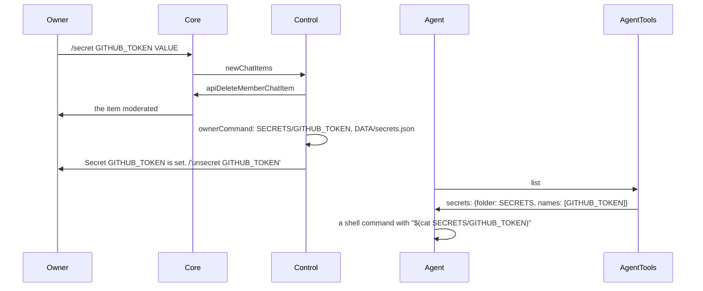

# SimpleX MCP server: agent secrets

Status: implemented, for review. Decisions of 2026-11-12. Code references: master `b7b05a261`; core references: `src/Simplex/Chat` of master; opencode references: opencode 1.19.5, `packages/opencode/src`. Size: 128 changed lines in `src`, 48 lines of the plugin.

## Decisions

1. Threat: accidental exposure of values to the model provider. A prompt injection that sends a value away by reference is out of scope; the docs state it as a limit.
2. Owners: every current owner can see a `/secret` message until the server deletes it.
3. Revocation: none. A secret stays until `/unsecret NAME`, also when its setter is no longer an approver.
4. Values: one line, as owner commands are parsed; 8 characters or more.
5. Redaction: an opencode plugin in the package, `opencode/simplex-secrets.ts`, with its install step in the docs. Claude Code: no redaction; the docs state it.
6. Discovery: `list` returns the names and the folder, never the values; its description states the use in commands, as `"$(cat FOLDER/NAME)"`.
7. `send` and `connect` texts are not checked for values; the approval cards are the control.
8. Budget: about 110 changed lines in `src`, at most 132; the plugin counted separately, 30 to 50 lines.

## Option

```
option             value     default
--secrets-folder   folder    absent
```

- The folder is resolved to an absolute path, SECRETS below.
- Refused with exit code 2, `--secrets-folder: a folder disjoint from the data folder expected, got SECRETS`, when SECRETS is the data folder, is inside it or contains it; compared as resolved paths.
- Without it: the secret commands get `Secrets are off: the server runs without --secrets-folder.`; `list` leaves out `secrets`.

Help text, after `--qr-code`:

```
  --secrets-folder DIR   folder of the secrets that owners set with /secret,
                         one file per name; disjoint from the data folder
```

Changes:

```
file       function       change
cli.ts     helpText       the two lines of --secrets-folder
           serveOptions   --secrets-folder resolved; refused unless disjoint from the data folder
serve.ts   ServeOptions   secrets: the folder, optional
           startAgent     Secrets(SECRETS, DATA/secrets.json) before the user is read; passed to AgentTools and Control
```

## Storage

```
path                 contents                                     mode
SECRETS/             the folder                                   0700 when the server creates it; the mode of an existing folder unchanged
SECRETS/NAME         the value, as sent, without a newline        0600
SECRETS/NAME.part    the value during its write, renamed to NAME  0600
DATA/secrets.json    the records                                  0600
```

Records:

```
{
  NAME: {
    setBy: string      display name of the setter
    setById: number    groupMemberId of the setter
    setAt: string      ISO 8601 time
  }
}
```

- NAME: `^[A-Z][A-Z0-9_]{0,63}$`.
- The secrets are the files of SECRETS whose names match NAME, sorted; a file written by hand is one, without a record.
- `remove` deletes only a name among the secrets: `../x` deletes nothing.

Changes:

```
file       function       change
files.ts   SecretRecord   new: setBy, setById, setAt
           secretName     new: the NAME rule
           Secrets        new: the folder created with mode 0700; names; records; set through NAME.part; remove of a listed name
```

## Control chat

```
command              reply                                                   quote
/secret NAME VALUE   Secret NAME is set. /'unsecret NAME'                    none: a new message
/unsecret NAME       Secret NAME is removed.                                 the command
/secrets             one line per secret, or No secrets.                     the command
```

`/secrets` line:

```
with a record        NAME  set by SETTER  YYYY-MM-DD HH:MM UTC
without a record     NAME
```

Replies to `/secret`, first match:

```
condition                                     reply
several lines, any sender                     usage
sender not an approver                        Only owners approve actions. (--owners: Only the owners listed in --owners approve actions.)
no --secrets-folder                           Secrets are off: the server runs without --secrets-folder.
NAME not matching, VALUE below 8 characters   usage
otherwise                                     Secret NAME is set. /'unsecret NAME'
```

- usage: `Usage: /secret NAME VALUE on one line. NAME: capital letters, digits and _, starting with a letter, up to 64 characters. VALUE: 8 characters or more.`
- VALUE: the params without their first word and the whitespace after it; characters counted as code points.
- `/unsecret NAME` of a name outside the secrets: `No such secret. /secrets lists them.`
- `/unsecret` and `/secrets` get the approver and folder replies as `/secret`; other forms of them get the commands reply.
- Log lines, without values: `Secret NAME set by SETTER.`, `Secret NAME removed by SETTER.`
- The commands work in both modes.

Receipt of a message, `onMessage`:

```
step                                           effect
the control chat lost                          ignored
secret = text matches ^\s*/secret(\s|$), any letter case
a member support chat                          secret: deletion queued after the earlier owner commands; otherwise ignored
command = parseCommand(text)
no command and not secret                      ignored
queued after the earlier owner commands:
  1. secret: apiDeleteMemberChatItem(group, [item]), for any sender
  2. reply = no command ? usage : ownerCommand(sender, command)
  3. secret: the reply posted as a new message; otherwise a reply to the command
  a failure at any step: logged as "control chat command: <error>"; the later steps skipped
```

Full deletion:

```
item                 value
fullDelete           {enable: "on"} in the group preferences
createControlChat    groupPreferences: history on, fullDelete, the menu
createSessionGroup   groupPreferences: history on, direct messages off, fullDelete, the menu
load                 the profile updated when the display name, the menu or fullDelete.enable differ, in the agent control chat and in session groups
```

- The deletion is a moderation: the core replaces the item with a moderated item and deletes its `messages` rows, at the agent (`delGroupChatItems`, `Library/Commands.hs:4294-4297`; `updateGroupChatItemModerated`, `Store/Messages.hs:2857-2875`) and at each member that has the item (`Library/Subscriber.hs:2490-2499`). A member who receives the message after the deletion creates it moderated (`Library/Subscriber.hs:2228-2232`, `:2268-2274`).
- The apps show the item as `moderated by` the agent's display name (`MarkedDeletedItemView.kt:91-92`).
- The menu: `{type: "command", keyword: "secrets", label: "Secrets"}`, after `leave`.
- The commands reply: `Commands: /approve, /reject, /receive, /forward, /revoke, /leave, /delete, /pending, /list, /secret, /unsecret, /secrets. Each card shows its commands.`



Changes:

```
file        function            change
control.ts  controlCommands     the secrets entry
            fullDelete          new
            commandsReply       /secret, /unsecret, /secrets
            secretsOff          new
            secretUsage         new
            ControlOptions      secrets: Secrets, optional
            OwnerRequest        secret, unsecret, secrets
            load                fullDelete in the check and the update
            onMessage           the deletion of /secret messages, also in member support chats; the reply of a /secret posted
            ownerCommand        secret, unsecret, secrets; the off reply without the folder
            setSecret           new
            removeSecret        new
            secretsText         new
            createControlChat   fullDelete
            ownerRequest        secret, unsecret, secrets
hub.ts      createSessionGroup  fullDelete
serve.ts    events              newChatItems of the control group in any scope to onMessage
```

## list and send

`list`, with `--secrets-folder`:

```
field            value
secrets.folder   SECRETS, the server's path
secrets.names    the names of the secrets
```

- The `list` description adds: `secrets, when present, has the folder and the names of the secrets your owners set; use a secret only inside a shell command, as "$(cat FOLDER/NAME)" with its folder and name; never print, read or send its value.`
- `send` refuses a file under SECRETS, by the real path of the folder, with the reason of private keys.
- A sandbox of the agent mounts SECRETS at the server's path and runs with the server's user ID.

Changes:

```
file       function          change
tools.ts   Agent             secrets: Secrets, optional
           listOutput        secrets
           listDescription   the secrets line
           isRefused         SECRETS
           listChats         secrets
```

## opencode plugin

```
item           value
file           opencode/simplex-secrets.ts, TypeScript source
package.json   files: dist, README.md, .claude-plugin, .mcp.json, hooks, plugin, opencode
test config    test/tsconfig.json includes ../opencode
folder         SIMPLEX_MCP_SECRETS of the opencode process
```

Install, by the user who runs opencode:

```
npm pack @simplex-chat/mcp
tar -xzf simplex-chat-mcp-*.tgz package/opencode/simplex-secrets.ts
mkdir -p ~/.config/opencode/plugins
mv package/opencode/simplex-secrets.ts ~/.config/opencode/plugins/
```

Loading:

- opencode loads `{plugin,plugins}/*.{ts,js}` of its config folders, `$XDG_CONFIG_HOME/opencode` and `.opencode` of the project included (`config/plugin.ts:18-30`, `config/config.ts:430-478`, `config/paths.ts:23-41`).
- A default export with `id` and `server` is a V1 plugin; a path plugin requires `id` (`plugin/shared.ts:272-323`, `plugin/index.ts:114-125`).

Exports:

```
default        {id: "simplex-secrets", server}; server returns the hook experimental.chat.messages.transform
replacements   the forms of the values of a folder, each with its mark [secret NAME], longest first
redacted       a value with each form replaced by its mark
```

Hook:

```
folder = SIMPLEX_MCP_SECRETS; unset: throw
seen = the forms read since the process started; the forms of the folder added at each call
each message: parts = redacted copies of the parts, the longest form first
```

Forms of each value:

```
form                 rule
value                the file without trailing newlines; fewer than 8 characters: throw
URL                  encodeURIComponent(value)
base64, base64url    after 0, 1 and 2 leading bytes, without padding and without the characters at both ends that hold bits of the adjacent bytes
```

Mechanics in opencode:

- opencode calls the hook in each step, before the conversion of the messages and the model request (`session/prompt.ts:1255`, `:1262`, `:1272`), and before the request of a compaction summary (`session/compaction.ts:379`, `:380`, `:425`).
- The messages are read from the database at each step (`session/prompt.ts:1092`); the values remain in the stored parts.
- When the hook throws, the step fails with a defect, and opencode sends no request for it (`plugin/index.ts:294`).

Sent without the plugin:

```
item                                       source
the first user message, in the title       session/prompt.ts:1134, :193-253
  request
system text                                session/llm/request.ts:56-72
forms other than those above               hex, other percent-encodings, + for spaces, escaped, split or partial values
one character at each end of a base64      at most 4 bits of the value
  form
values removed or replaced before an       earlier outputs, as stored
  opencode restart
tool results of workflow models            session/llm.ts:118-146
```

Changes:

```
file                          change
opencode/simplex-secrets.ts   new
package.json                  files: opencode
test/tsconfig.json            include: ../opencode/**/*
```

## Limits

- Every process of the server's user can read the files.
- The owners' apps show a `/secret` message until the deletion reaches them; while the server is stopped, until its next start.
- Edits and the later text of live messages are neither deleted nor run: `onMessage` is called at `newChatItems` only.
- After the control chat is lost, `/secret` messages are neither deleted nor run.
- The agent forwards the messages of the control chat to members as an owner (`isUserGrpFwdRelay`, `Library/Subscriber.hs:3793-3796`); the forwarded message is stored with its delivery job in the chat database until the job is done and 7 days old (`Store/Delivery.hs:251-263`, `:400-409`; `Library/Commands.hs:6555-6558`).
- An owner can turn full deletion off in the app; the server turns it on at its next start.
- The hook is experimental in opencode.

## Tests

- `test/unit/options.test.ts`: `--secrets-folder` resolved; refused when it is the data folder, inside it or contains it, in either order of the options; a sibling whose name starts with the data folder's name accepted; the help lines.
- `test/unit/files.test.ts`: the folder mode 0700, an existing folder's mode kept; the value file mode 0600, `NAME.part` absent, a second value in place of the first; the index mode 0600 and its records; the names of matching files only, sorted; `remove` of unknown names and `../x` deletes nothing.
- `test/unit/commands.test.ts`: `/secret` deleted before its reply, stored, the reply posted without a quote, the log line without the value; a member who is not an approver; several lines, `/Secret`, `/SECRET`, invalid names, a value of 7 characters, `/secret` alone; without `--secrets-folder`; `/secrets` with setters, times, a file without a record and `No secrets.`; `/unsecret` of a secret, of an unknown name and of `../x`; other forms of `/unsecret` and `/secrets`; mode host, with the spaces around the value removed; a member support chat; a failed deletion; the menu and full deletion of a new and of an existing control chat.
- `test/unit/messages.test.ts`: `list` with the folder and the names, without values, and without the folder; a file of the secrets folder refused, also through a symbolic link.
- `test/unit/opencode.test.ts`: a value replaced raw, URL-encoded, and in base64 and base64url at each alignment, `Basic` authorization included; a longer value before a value it contains; the names that the server lists, trailing newlines ignored; values of fewer than 8 characters refused; the hook on texts, tool inputs, outputs, errors and metadata, the info kept; values of removed and replaced secrets kept, also in a new server instance; a rejection without the folder and with a missing folder.
- `test/unit/fixtures.ts`: `FakeChat.apiDeleteMemberChatItem` records each call with the count of messages sent before it.
- `test/e2e/scenarios.test.ts`: the owner's `/secret`: `chatItemsDeleted` at the owner, the reply without a quote, the value in the file, the agent's control chat items without it, `list` with the folder and the name.
- `test/unit/plugin.test.ts`, `test/e2e/launch.test.ts`: `opencode` in `files` and in the tarball's top-level entries.
- `test/unit/sessions.test.ts`: full deletion in the preferences of a new session group.

## Docs

- `README.md`: a paragraph on secrets.
- `REFERENCE.md`: section Secrets; the commands, the help text, the data folder, security.
- `TESTING.md`: section Secrets, with the opencode plugin.
- `plans/2026-10-19-mcp-server.md`: the option, the storage, the commands and replies, section Secrets, `list`, the refused paths, tests, decisions of 2026-11-12.
- `spec/`: the anchors into the changed files remapped; the secret commands, `list`, the option, the plugin and section 6.8 Secrets of the architecture.
