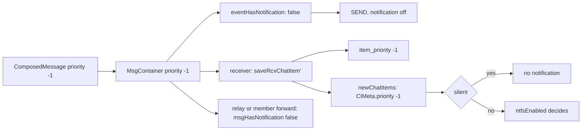

# Silent messages

Status: draft for review. Code references: master `9d3241b06`. simplexmq at the commit of `cabal.project`, `71179c4d4`. Related plans: `2026-10-13-message-priority.md` (approved on 2026-10-13, not implemented), `2026-10-13-forwarded-notification-flag.md` (implemented by #7706).

## 1. Goal

Roadmap line, `packages/simplex-chat-mcp/ROADMAP.md:13`: "Alerts come only for messages that need you, such as answers and approval requests."

The user's words, 2026-11-12, choosing one message per step of Claude's work:

> that's ok, it means we'll need to add both silent and important messages, and send these messages as silent, and last message in a turn as important. Silent could be easier.

A sender marks a message silent. Receiving apps show it in the chat and count it as unread, without a notification, a sound or a push. This pull request is the core, the apps, the API and the libraries; the plugin uses it in `ep/mcp-activity`.

## 2. What users see

```
receiver                         normal message                     silent message
app in "All" mode                notification, sound                no notification, no sound
app in "Mentions" mode           notification for a mention         no notification
app with the chat muted          no notification                    no notification
iOS, app in background           push wakes the app, notification   no push; the message arrives with the next push or when the app opens
chat list, chat view, icon badge item shown, unread                 the same
terminal CLI                     desktop notification               none
receiver before this release     notification                       notification, as a normal message
```

Senders: the API and the libraries, with `"priority": -1` in a composed message. The apps send normal messages. The message itself has no mark in the chat.

```
/_send #1 json [{"msgContent": {"type": "text", "text": "Ran the tests"}, "priority": -1}]
```

```mermaid
sequenceDiagram
  participant B as bot or plugin
  participant C as its core
  participant S as SMP server
  participant R as receiver's core
  participant A as receiver's app
  B->>C: /_send #1 json [{msgContent, priority: -1}]
  C->>S: SEND, notification flag off
  Note over S: no push for this message
  S->>R: the message, when the app runs or the next push wakes it
  R->>A: newChatItems, CIMeta.priority -1
  A->>A: item shown, unread; no notification
```

## 3. Questions for the user

Q1. Is a silent message priority −1 of the approved message-priority model?
- A, recommended: yes. One wire field, `priority`, serves silent now and important later. The approved plan said "Notifications are created for every message, as now"; −1 becomes silent instead. Silent is accepted from every sender in every chat, because it only removes alerts; the group preference of the approved plan stays for high priority.
- B: a separate boolean `silent`. A second field and a second concept next to priority.

Q2. When does "important" come?
- A, recommended: in the next pull request, as priority 1 of the approved plan, unchanged: an attention item that alerts also in "Mentions" mode, with a bell on the chat, its list label and the item. The plugin sends its answers with priority 1 from `ep/mcp-activity` on; until then receivers treat 1 as normal, and in "All" mode an answer already alerts.
- B: in this pull request. It adds the bell, the counters, the list labels and the preference on three platforms.

Q3. Does a silent message count as unread?
- A, recommended: yes. The chat shows it as new, and the unread counters and the icon badge include it; only the alert is removed.
- B: it arrives as read.

## 4. Decisions

Facts:
1. The SMP command `SEND` has `MsgFlags {notification :: Bool}`; the server pushes to the recipient's notification server only for `True` (simplexmq `71179c4d4`, `Protocol.hs:600`, `:928-945`). The chat core sets it from the event tag: `hasNotification` is `True` for `x.msg.new` and six other events (`src/Simplex/Chat/Protocol.hs:1339-1348`).
2. The flag of a send is `any hasNotification` of its events: direct sends `Library/Internal.hs:2255`, group sends `:2755`, one-member sends `deliverMessage` `:2557-2560`. Forwarded group messages use `msgHasNotification` of the verified message (`Protocol.hs:1350-1353`): relays' delivery tasks `Library/Subscriber.hs:4234`, `:4249`, and a member's forward `Library/Internal.hs:2910`. Introductions and the pending messages of a member who connects later are sent with `True` (`Internal.hs:2458-2466`, `:2913-2917`).
3. Apps decide a notification per received item. Android and desktop: `notifyMessageReceived` requires `cItem.showNotification && cInfo.ntfsEnabled(cItem)` (`apps/multiplatform/common/src/commonMain/kotlin/chat/simplex/common/platform/NtfManager.kt:39-49`), for new items (`model/SimpleXAPI.kt:3072-3099`) and for updates in another profile (`:3825-3844`). iOS app: `NtfManager.notifyMessageReceived` requires `ntfsEnabled` (`apps/ios/Shared/Model/NtfManager.swift:253-258`); the NSE requires `ntfsEnabled && showNotification` (`apps/ios/SimpleX NSE/NotificationService.swift:1034`). `ntfsEnabled` is `All`, or `Mentions` with `userMention` (`apps/ios/SimpleXChat/ChatTypes.swift:2403-2413`, `ChatModel.kt:1819-1826`). The terminal requires `chatDirNtf ... isUserMention` (`src/Simplex/Chat/Terminal/Output.hs:179`).
4. The default of a chat's `enableNtfs` is `MFAll` (`src/Simplex/Chat/Types.hs:639-644`).
5. `MsgContainer` has the optional fields `ttl`, `live`, `scope` and `asGroup`, omitted when absent (`Protocol.hs:692-707`, JSON at `:926`); a parser ignores unknown fields. `ComposedMessage` has `fileSource`, `quotedItemId`, `msgContent` and `mentions`, and its parser reads only those (`Controller.hs:1355-1360`, `:1957-1968`).
6. The libraries pass `ComposedMessage` as typed: `apiSendMessages(chat, messages: T.ComposedMessage[])` (`packages/simplex-chat-nodejs/src/api.ts:448`); the TypeScript types are generated (`packages/simplex-chat-client/types/typescript/src/types.ts:2135-2140`). The Node.js library pins the core libraries `core-7.1.3.0` (`packages/simplex-chat-nodejs/src/release.ts:3`).
7. The approved plan `2026-10-13-message-priority.md` defines `priority` as an integer, −1 low, 0 normal, 1 high, with the column `chat_items.item_priority`; it was decided on 2026-10-13, after the silent messages plan was rejected that day.

Choices:

8. Q1 A: `MsgContainer.priority :: Maybe Int`, JSON `"priority"`, omitted when absent; a received value of −1 or below is low, 0 normal, 1 or above high, limited to −1 .. 1 when stored. In this pull request, low is silent, and high is stored and treated as normal.
9. The SMP notification flag is set by `eventHasNotification :: ChatMsgEvent e -> Bool`: `False` for `x.msg.new` with low priority, otherwise `hasNotification` of its tag. It replaces the tag check at `Internal.hs:2255`, `:2755` and in `deliverMessage`, which takes the event in place of its tag (callers `:2342`, `:2901`), and inside `msgHasNotification`, so relays and members forward a silent message silently. Pending messages keep `True` (fact 2): a batch there can hold normal messages, and it is sent once, when the member connects.
10. The received item's `CIMeta.priority :: Maybe Int` is set from the container in `saveRcvChatItem'` (`Internal.hs:3048-3098`), `Nothing` for 0. A sent item has the priority of its composed message.
11. Stored as `chat_items.item_priority INTEGER NOT NULL DEFAULT 0`, as the approved plan, so that a reloaded item and an updated item carry it; an update of a silent item does not notify in another profile (fact 3).
12. Apps: `CIMeta.priority`; `silent` is `priority <= -1`. `notifyMessageReceived` (Kotlin and iOS) and the NSE check `!silent`. Unread counters are unchanged (Q3 A). The terminal skips `sendNtf` for a silent item.
13. `ComposedMessage.priority :: Maybe Int`, parsed with `.:? "priority"`. Direct sends set it in the container (`Library/Commands.hs:4958`), group sends through a new parameter of `prepareGroupMsg` (`Internal.hs:213-234`; callers `Commands.hs:5037`, and `Internal.hs:1557` with the stored priority of the item).
14. Every chat type, every sender (Q1 A). A blocked member's silent message is silent.
15. `x.msg.update` is unchanged: an update does not notify, except in another profile, where fact 3 and decision 11 apply.

## 5. Design

Options:
```
option                                producer (sender's core)        consumers (receivers' cores, apps)          wire                  older apps
A. priority -1 in x.msg.new (chosen)  container field, SMP flag off   CIMeta.priority, one check per notifier     + "priority": -1      ignore the field: alert
B. SMP flag off only                  SMP flag off                    none                                        none                  -
C. a new event x.msg.silent           new event                       new handlers for every content path         new event             unknown event: no item
D. receiver mutes a member            none                            member setting                              none                  -
```
B removes only the iOS push: Android, desktop and an iOS app woken by another message still alert. C duplicates every path of `x.msg.new`. D is the receiver's choice, not the sender's. A costs one optional field.

Changes:
```
file                                   change
Protocol.hs                            MsgContainer.priority; mcSimple: Nothing; limitPriority; cmPriority; eventHasNotification;
                                       msgHasNotification through eventHasNotification
Controller.hs                          ComposedMessage.priority and its parser
Messages.hs                            CIMeta.priority; mkCIMeta, dummyMeta
Library/Commands.hs                    direct prepareMsgs (:4958) sets priority; group prepareMsgs (:5037) passes it;
                                       other ComposedMessage values: priority Nothing
Library/Internal.hs                    prepareGroupMsg priority parameter; sendHistory with the item's priority;
                                       eventHasNotification at :2255, :2755; deliverMessage takes the event;
                                       NewSndChatItemData.priority; saveSndChatItems; saveRcvChatItem'; mkChatItem_
Store/Messages.hs                      createNewChatItem_ writes item_priority; ChatItemModeRow (:2288) and the item queries
                                       (:2721, :3115, :3228) read it; toLocalChatItem, toDirectChatItem, toGroupChatItem
Store/SQLite|Postgres/Migrations       M20261113_item_priority: ADD COLUMN item_priority, default 0
Terminal/Output.hs                     :179 not silent
bots API types, TS and Python types    generated by tests/APIDocs.hs
apps (Kotlin, iOS, NSE)                CIMeta.priority, silent; three notification checks
docs/protocol/simplex-chat.md, schema  "priority" in x.msg.new
bots/README.md                         silent messages
```



## 6. Compatibility

- Older receivers ignore `priority` and alert. A receiver of this release with an older sender gets no field: normal.
- Older relays and hosts forward a signed message as its bytes, with `priority`, and set the flag from the tag: a push is sent. An unsigned message forwarded by an older host is encoded again without `priority`.
- An older core ignores `priority` of a composed message (fact 5): a library of this release with an older core sends normal messages.
- Remote desktop: an older controller ignores `CIMeta.priority`; an older host sends none.
- Downgrade: the column is dropped; items are normal.

## 7. Acceptance and tests

Done when:
```
#  criterion                                                                  checked by
1  /_send with "priority": -1 sends with the SMP flag off, direct and group    core test with lastSndMsgFlags
2  the receiver's item has priority -1, stored and reloaded                    core tests, ChatTests/Groups.hs and Direct.hs
3  a relay and a member forward it with the flag off                          core test, ChatTests/ChatRelays.hs and Groups.hs
4  apps show no notification for it, also in "All" mode; unread counts it     Kotlin desktop test of the notification check;
                                                                               iOS test; manual check on a device
5  older receivers alert; the field is ignored by an older core               protocol test of parsing
```

Tests:
- `tests/ProtocolTests.hs`: `x.msg.new` with `"priority": -1` and `1` encoded and decoded; without the field: `Nothing`.
- `tests/ChatTests/Groups.hs`, `Direct.hs`, `ChatRelays.hs`: silent send; the receiver's item priority; the SMP flag of the send and of the forward, read with `lastSndMsgFlags`, as `testGroupMsgForwardNotification` and `testChannels1RelayDeliverNotification` read it (`tests/ChatTests/Groups.hs:206`, `:295`, `:6141`). They fail on master: the field is dropped and the flag is `T`.
- Kotlin `common/src/desktopTest`: `notifyMessageReceived` is not called for a silent item.
- The reduced build with the Haskell tests above, and the app test workflows `desktop-linux`, `android-emu` and `ios-sim` with a silent message sent by the test backend.

## 8. Docs to change

- `docs/protocol/simplex-chat.md` and `docs/protocol/simplex-chat.schema.json`: `priority` of `x.msg.new`.
- `bots/README.md`: silent messages.
- `apps/ios/spec`, `apps/multiplatform/spec`: the notification checks.
- `plans/2026-10-13-message-priority.md`: −1 is silent, by Q1.
- The MCP package's docs change in `ep/mcp-activity`.

## 9. Conflict areas with the other items

```
file                                     items
src/Simplex/Chat/Protocol.hs             none of the MCP items; core branches that add container fields
Library/Internal.hs, Commands.hs         core branches in progress (send paths)
Store/Messages.hs, migrations            any branch with a migration: the migration order
apps CIMeta, NtfManager                  mcp-agent-profile (peer type), mcp-flat-sessions (layout) touch other app files
packages/simplex-chat-nodejs, types      regenerated types: any branch that changes API types
```

## 10. Estimate

About 250 lines of Haskell, 40 of Kotlin and Swift, generated types, and 150 lines of tests; two to three days with reviews. Then a core release and an app release before receivers stop alerting.
