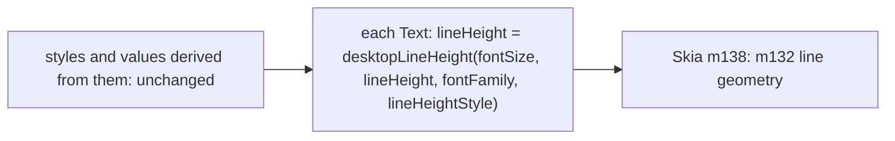

# Linux: crash on text that needs a fallback font in a bitmap or WOFF2 format

## Problem

On Linux the desktop app ends with SIGSEGV in `libskiko-linux-x64.so SkTypeface_fontconfig::onOpenStream(int*) const+0x21` when it lays out a character that the text's own font lacks and whose best fontconfig match is a PCF, BDF, PFR, Windows FNT, Type 42 or WOFF2 font that contains the character.

## Cause

Compose 1.8.2 uses Skiko 0.9.4.2, built with Skia m132. Its fontconfig font manager:
- accepts any readable file that fontconfig lists (`FontAccessible`);
- creates `SkTypeface_fontconfig` with `fProxy` from Skiko's FreeType without a null check;
- forwards `onOpenStream` and the other font-data calls to `fProxy`.

Skiko's FreeType has only the TrueType (with WOFF 1.0), CFF, Type 1 and CID drivers, so `fProxy` is null for the formats above, and the first forwarded call reads address 0.

Fontconfig lists such a font only from a cache written with the system FreeType, as `fc-cache` writes it: a cache that the app writes omits it.

## Fix

`apps/multiplatform/build.gradle.kts` resolves every `org.jetbrains.skiko` module requested at 0.9.4.2 to 0.9.24 (Skia m138), where:
- `FontAccessible` also requires that the font scanner loads the file;
- `SkTypeface_fontconfig::Make` returns null when it does not.

0.9.24 keeps the `SkiaLayerProperties` constructor that Compose 1.8.2 calls for every window; 0.9.37.3 removes it.

## Line heights on Skia m138

m138 adds the paragraph's empty metrics, computed from the text's default style, to every line. They are scaled by the rounded font height `R = round(descent - ascent + leading)` of a font without the text's rasterization settings. When `R` is below the exact height `I`, they exceed the runs' metrics and the line is laid out unlike m132: taller, with another baseline.

`desktopLineHeight` returns the line height for which m138 lays out the line as m132 did with the requested one.

| Line height style | `R >= I` | `R < I` |
|---|---|---|
| Proportional | `H` | `(H - leading) * R / (descent - ascent)` |
| Top, Center, Bottom | `H` | `H - I + R` |

The adjusted value is passed only to `Text`, `BasicText` and `BasicTextField`; spacers, heading and code line heights in `MarkdownBlocks` keep using the unadjusted style.

## Scope

- Desktop builds on all OSes use Skia m138; Android APKs are unchanged.
- `desktopLineHeight` returns the line height unchanged on Android, and on desktop for fonts other than Inter and the fonts Compose resolves for `FontFamily.Monospace` and `FontFamily.Default`.
- Every text that sets a line height uses it.
- The rule applies only to 0.9.4.2, so a Compose update that brings another Skiko version is not overridden.
- Tests:
  - `FallbackFontTest` builds a fontconfig cache for one BDF font with `fc-cache`, then lays out U+2603 in a child JVM.
  - `BubbleLayoutTest.timeDrawnOnTextBaseline` checks the drawn rows of text and time at font scales 0.7 to 1.5.
  - `BubbleLayoutTest.linesDrawnWholeLineHeightApart` checks that two lines are drawn the whole-pixel line height apart at the same scales.
  - The desktop snapshots are compared with the references rendered with m132.
- `Dockerfile.build` installs `fontconfig`, which provides `fc-cache` to the test in CI.
