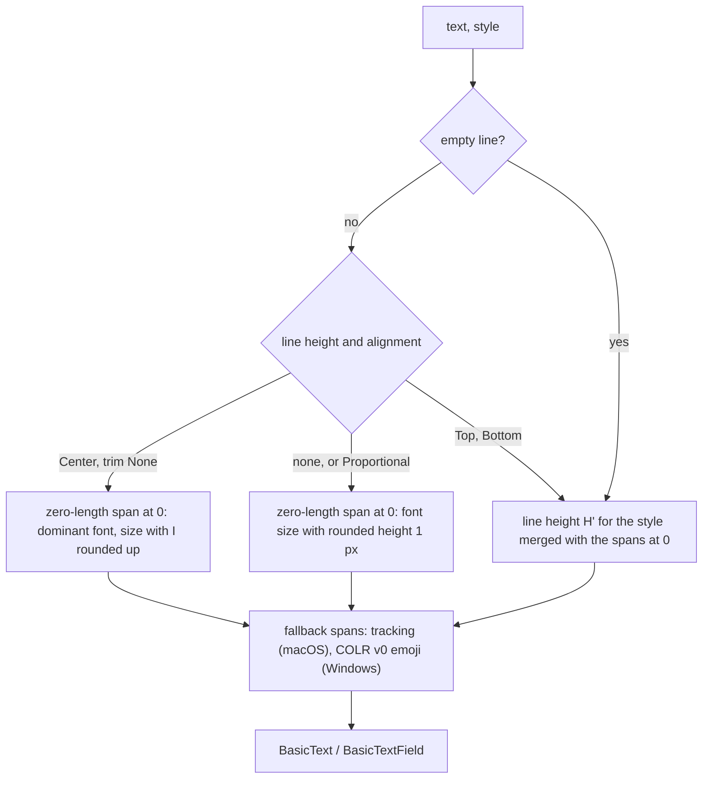

# Linux: crash on text that needs a fallback font in a bitmap or WOFF2 format

## Problem

On Linux the desktop app ends with SIGSEGV in `libskiko-linux-x64.so SkTypeface_fontconfig::onOpenStream(int*) const+0x21` when it lays out a character that the text's own font lacks and whose best fontconfig match is a PCF, BDF, PFR, Windows FNT, Type 42 or WOFF2 font that contains the character.

## Cause

Compose 1.8.2 uses Skiko 0.9.4.2, built with Skia m132. Its fontconfig font manager:
- accepts any readable file that fontconfig lists (`FontAccessible`);
- creates `SkTypeface_fontconfig` with `fProxy` from Skiko's FreeType without a null check;
- forwards `onOpenStream` and the other font-data calls to `fProxy`.

Skiko's FreeType has only the TrueType (with WOFF 1.0), CFF, Type 1 and CID drivers, so `fProxy` is null for the formats above, and the first forwarded call reads address 0.

Fontconfig lists such a font only from a cache written with the system FreeType, as `fc-cache` writes it: a cache that the app writes omits it.

## Fix

`apps/multiplatform/build.gradle.kts` resolves every `org.jetbrains.skiko` module requested at 0.9.4.2 to 0.9.24 (Skia m138), where:
- `FontAccessible` also requires that the font scanner loads the file;
- `SkTypeface_fontconfig::Make` returns null when it does not.

0.9.24 keeps the `SkiaLayerProperties` constructor that Compose 1.8.2 calls for every window; 0.9.37.3 removes it.

## Text layout on Skia m138

Changes in m138 and in its fonts, and what restores the m132 result:

| Change | Effect | Restored by |
|---|---|---|
| Every line also takes the empty metrics of the paragraph's default style (`breakShapedTextIntoLines`, `TextWrapper::breakTextIntoLines`) | lines with fallback fonts, smaller spans or a line height are laid out taller or shifted | a zero-length span at offset 0 with a font size whose rounded height is 1 px |
| HarfBuzz applies the `trak` table of fonts that also have `STAT` (macOS: PingFang, the system font) | wider glyphs | letter spacing minus the tracking, measured on one sample glyph, on characters set in such a font |
| Segoe UI Emoji is drawn from its COLR v1 table (Windows) | emoji in text have gradients | a span with a copy of the font whose COLR version is 0 |
| FreeType 702e4a1d (Linux) | other pixels in `ñ`, `ç`, `Ц`, `Щ` and dots | none |

Compose merges every span that starts at offset 0 into the paragraph's default style (`ParagraphBuilder.makeOps`), and Skia takes the empty metrics from that style. A zero-length span at offset 0 ends at offset 0, so spans that start there merge into the style its end creates instead.

With a line height and Center alignment (Material's default style, trim None), Skia sizes the empty metrics to the whole line height around the default font's own offset, so a minimal default font shifts them instead of shrinking them. The zero-length span then takes the text's dominant font (the font of most characters) at the size where its height `I_d = ceil(I) - 0.49` rounds up; the empty metrics then lie inside that font's run box. A dominant font with a line gap is replaced by a copy whose `hhea` and `OS/2` line gaps are 0. Top and Bottom alignments take `H'`.

`H'` (empty lines take the empty metrics, so a minimal default would collapse them):

| Line height style | `R >= I` | `R < I` |
|---|---|---|
| Proportional | `H` | `(H - leading) * R / (descent - ascent)` |
| Top, Center, Bottom, custom | `H` | `H - I + R` |

- `R = round(descent - ascent + leading)`, `I` the exact value.
- A result for `H` above the font size `F` stays at least `1.0001 * F`, and for `H` at or below `F` at most `F`: Compose lays out a line height at or below the font size with `HeightMode.DISABLE_ALL`.
- An empty text keeps `H`: Compose lays it out from its own metrics.
- A line height at or below the font size with a trim other than `Both` takes `H'` instead of the span.

`Text` in `chat.simplex.common.platform` applies the transform with the parameters of `androidx.compose.material.Text`; every file that calls `Text` imports it. `ClickableText`, `SelectableText` and the text fields (`platformTextFieldStyle`, through a visual transformation) apply it too.

## Scope

- Desktop builds on all OSes use Skia m138; Android behaviour is unchanged: `Text` delegates to the Material one, and `platformText` and `platformTextFieldStyle` return their inputs.
- Fonts with known metrics: Inter, the bundled emoji font, and the fonts Compose resolves for `FontFamily.Monospace` and `FontFamily.Default`. Segments in other fonts take no span.
- An empty text with any alignment other than Proportional, outside text fields, takes Proportional alignment: m132 computed empty-paragraph metrics with the strut's proportional ratio.
- An empty line is a segment between Skia's hard breaks (LF, VT, FF, U+2028, U+2029) that is empty or a single CR. Text fields skip the check.
- Text fields take no zero-length span with a font size: Compose sizes the caret and the trimmed first and last lines from the paragraph's default font size (`SkiaParagraph.getCursorRect`). A field with a line height takes `H'`.
- The font of a grapheme (Skia's ICU character breaks) mirrors Skia's `OneLineShaper`. A font covers a grapheme when it covers each of its characters, where:
  - characters of types Cc, Cf, Zl, Zp and the default ignorables that HarfBuzz hides need no glyph;
  - the spaces U+00A0, U+2000–200A, U+202F, U+205F, U+3000 take the font's U+0020, and U+2011 its U+2010, as in HarfBuzz;
  - a grapheme whose NFC or NFD form the font covers is covered, as HarfBuzz decomposes and recomposes;
  - U+0890–0891 and U+13439–1343F count as Cf, as in ICU 74 (JDK 17 has Unicode 13);
  - inline content placeholders (`INLINE_CONTENT_TAG`) take no font: Compose adds no text for them to the paragraph.
  - the first installed font of the text's family that covers the grapheme (`FontFamily.Default`, `SansSerif` and `Monospace` resolve to Compose's alias lists, `GenericFontFamiliesMapping`);
  - otherwise the first fallback font already found in the same segment that covers it;
  - otherwise the first fallback, for its characters in order, that covers it: an emoji sequence start (Unicode 15.1 Emoji and Emoji_Component, as ICU 74 in Skia m138) takes the emoji fallback (`und-Zsye`, Apple Color Emoji on macOS), any other character the system fallback for its weight and slant;
  - when the system has none, Inter, the bundled emoji font, then the typefaces the transform registered with Compose in the order it created them, as Skiko's `TypefaceFontProviderWithFallback::fallbackForChar`.
- The fallback search for a grapheme skips typefaces and code points already tried, as Skia's `alreadyTriedTypefaces` and `alreadyTriedCodepoints`; found typefaces and misses are kept in LRU caches of 4096 keys each, and the transform's results for texts outside fields in an LRU cache of 128 texts, as Skia's paragraph cache (`ParagraphCache`, 128 entries).
- Each grapheme is normalised at most once; runs of regional indicators are paired in one pass.
- Fonts are resolved once per text, for the dominant font and the fallback spans; graphemes are found only for a segment that its first font does not cover entirely.
- An emoji run (Windows) continues over ZWJ, variation selectors, keycap, tags, skin tones, hair components and the second regional indicator of a pair; a segment in a font with unknown metrics ends it.
- A measured tracking below 1/4096 px counts as 0: Skia rounds HarfBuzz advances to 1/65536 px, and HarfBuzz applies `trak` only with a `STAT` table.
- On macOS, a tracking span on text with positive letter spacing whose spacing becomes 0 or negative also sets `liga 0`: Skia turns ligatures off only for positive spacing.
- The COLR v0 copy is made only when the font's COLR table has another version and v0 base glyph records.
- Segments are found by one sweep over span bounds; active spans merge in the order of their starts, then of their indexes, as in `ParagraphBuilder.makeOps`.
- Text fields keep the original visual transformation on Linux, where the transform adds no span, and for passwords, which Compose recognises by the `PasswordVisualTransformation` type (context menu, semantics). On macOS a password field takes the tracking compensation of its mask character in the field style.
- `Text(String)` keeps Compose's String path when the transform adds no span.
- Font copies are kept as native typefaces only.
- The dominant font counts each segment in its own family and skips emoji continuation characters.
- A text without a font family is measured with the typeface Skia finds for `sans-serif`; the default font size is 16 sp, as in Compose's `ParagraphBuilder`. Metrics take the first installed font of a family.
- A copy without line gap is made only for fonts up to 8 MB; larger fonts take `H'`.
- Font sizes and line heights in em resolve against 16 sp and the merged size; the app sets none in em.
- Remaining differences:
  - a blank line in a text with a line height, by the rounding of `R`;
  - Center alignment with a line height: a line without the dominant font, by the distance between the centres of the two fonts (0.35 px for Inter and Noto Color Emoji);
  - texts with a blank line, and text fields: a line set entirely in a fallback font, by up to the difference of its height from the default font's;
  - Proportional alignment with trim Both: Compose's first-line ascent and last-line descent (`getLineTop`, `getLineBottom`, cursor rects) are computed from the marker's font size; the drawing is unchanged;
  - macOS: glyphs of fonts with `trak` and `STAT` tables, half the tracking (0.17 px at 16 px) to the right;
  - normalisation cases HarfBuzz handles otherwise: shortest partial decompositions, Hebrew presentation forms, Indic characters it does not decompose, clusters with a variation selector;
  - Windows: emoji in bold text, by DirectWrite's bold simulation of the system emoji font; ❤️ in text set in the system font;
  - macOS: a tracked cluster of several glyphs (a base and an uncomposed mark), by the tracking for each extra glyph: Skia adds letter spacing per glyph, HarfBuzz tracking per cluster;
  - macOS: letter spacing at or below 0 in a font with negative tracking turns ligatures off (Skia adds `liga 0` for positive spacing after the span's features);
  - the fallback search walks one grapheme at a time and keeps a fallback only when it covers the grapheme it was found for; Skia walks the whole unresolved block, offers every tried font to later blocks, also queries characters that need no glyph, and tests every position for an emoji sequence start;
  - the last-resort list has Inter Regular, not every Inter weight Compose loaded;
  - every inline-content annotation counts as a placeholder; Compose draws U+FFFD for an id missing from the map;
  - a fallback font reused across segments in Skia (same font attributes, different colour or link) is found again per segment here;
  - a zero-length span at offset 0 in the input text cancels the marker; the app creates none;
  - Linux glyph pixels;
  - labels of Compose's text context menu (Copy, Cut, Paste, Select all), drawn by foundation's own `BasicText`.
- The rule applies only to 0.9.4.2, so a Compose update that brings another Skiko version is not overridden.
- Tests:
  - `FallbackFontTest` builds a fontconfig cache for one BDF font with `fc-cache`, then lays out U+2603 in a child JVM.
  - `BubbleLayoutTest.timeDrawnOnTextBaseline` checks the drawn rows of text and time at font scales 0.7 to 1.5.
  - `BubbleLayoutTest.linesDrawnWholeLineHeightApart` checks that two lines are drawn the whole-pixel line height apart at the same scales.
  - `FieldCaretTest` checks that the caret keeps the font height in text fields.
  - `FallbackSearchTest` lays out one grapheme of 20 000 combining marks and a mark no font covers with them within 10 s; the search without skipping tried fonts took 63 s. It also lays out 1000 distinct characters no font covers twice; without the miss cache the second layout took 2.1 s, with it under 1 s.
  - The desktop snapshots are compared with the references rendered with m132.
- `Dockerfile.build` installs `fontconfig`, which provides `fc-cache` to the test in CI.
