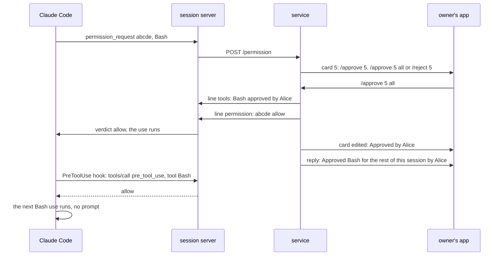
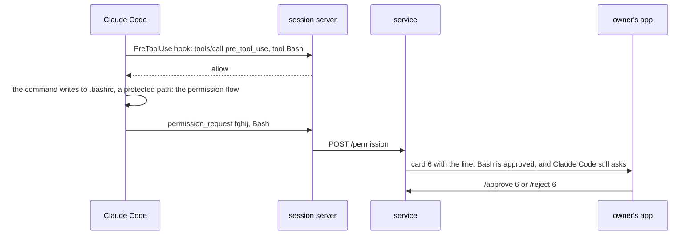
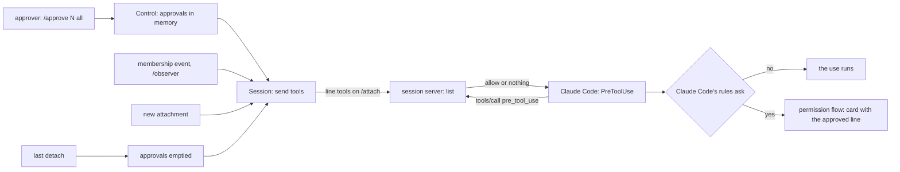
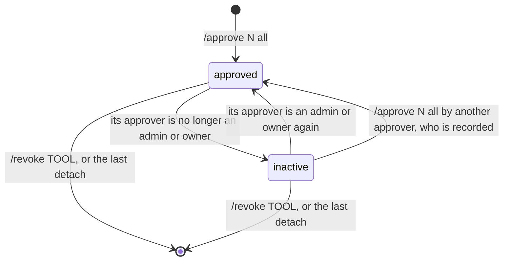

# SimpleX MCP: approve a tool for the rest of a session

Status: approved by the user on 2026-11-13 and implemented on `ep/mcp-allow-tool`, stacked on `ep/mcp-activity`; decisions 29 to 32 were made in the implementation. Code references: master `97bbbd9ac` (MCP 0.3.0 with #8157). Claude Code references: version 2.1.322 and its binary at the offsets given, the documentation pages quoted, and three `claude -p` runs of Claude Code 2.1.323, recorded on 2026-11-13 (R1 to R3). Decisions of the 0.3.0 plan are cited as "0.3.0 decision N".

The runs used a test MCP server whose tool `pre_tool_use` answers a PreToolUse hook of type `mcp_tool`, with `--setting-sources project --permission-mode default`. A `-p` run refuses a call that would show a prompt, so a refusal there stands for a prompt in an interactive session.
- R1: the hook answered `allow` for Bash and Write. `echo one > a.txt` with Bash ran, and a Write of `notes.txt` ran. A Write of `.bashrc` was refused: "Claude requested permissions to edit .../.bashrc which is a sensitive file." The server logged three calls, `{"tool":"Bash"}`, `{"tool":"Write"}` and `{"tool":"Write"}`.
- R2: the hook answered with empty text. Bash and Write were refused, and no file was written. The run's final answer failed with an API error after the refusals.
- R3: the server and the hook were in a test plugin loaded with `--plugin-dir`, and the hook named the server `plugin:gatep:gate`. The hook answered `allow` for Bash only. Bash ran, and Write was refused.

## 1. Goal

Roadmap line, [ROADMAP.md:23](../packages/simplex-chat-mcp/ROADMAP.md): "Allow a tool for the rest of a session with one tap." The user's feature list of 2026-11-11 has no other words on it.

Outcome:
- A tool-use card has a third command, `/approve N all`. One tap allows this use and every later use of its tool in the session.
- Later uses of that tool run without a card and without a terminal prompt.
- Claude Code still asks where its own rules require it, also for an approved tool, and that prompt comes as a card.
- `/list` shows the approval. `/revoke TOOL` removes it before the session ends.

## 2. What users see

Before, in 0.3.0:
```
Claude: I want to use `Bash`: `List files`
        `PREVIEW`
        /approve 5 or /reject 5
```

After:
```
Claude: I want to use `Bash`: `List files`
        `PREVIEW`
        /approve 5, /approve 5 all or /reject 5
Alice:  /approve 5 all
Claude: (replying to Alice) Approved `Bash` for the rest of this session by Alice. /revoke Bash
```

The card is edited to `Approved by Alice.` as after `/approve 5`. PREVIEW is the input preview of Claude Code, one code span per line, as in 0.3.0. The app shows each `/'...'` command as a command that one tap sends.

Texts, as the code writes them:
```
where                                    text
commands of a tool-use card              /'approve N', /'approve N all' or /'reject N'
reply to /approve N all                  Approved `TOOL` for the rest of this session by NAME. /'revoke TOOL'
card of a use Claude Code still asks     I want to use `TOOL`: `DESCRIPTION`
for, while TOOL is approved              PREVIEW lines
                                         `TOOL` is approved for this session, and Claude Code still asks for this use.
                                         /'approve N' or /'reject N'
reply to /revoke TOOL                    Uses of `TOOL` need approval again.
reply to /revoke TOOL, no approval       Uses of `TOOL` have no standing approval.
/list, a line per approved tool          `TOOL`  approved for this session by NAME
reply to /approve N all, N not a tool    Action N is not a tool use.
use
```

Before and after:
```
event                                    0.3.0                                this pull request
Claude Code asks for a tool use          card: /approve N or /reject N        card: /approve N, /approve N all or /reject N
/approve N all                           Unknown command.                     the use runs; the reply above
a later use of the approved tool         card and terminal prompt             runs: no card, no terminal prompt
a later use Claude Code still asks for:  card and terminal prompt             card with the line above, and terminal prompt
  a matching ask rule, a write to a
  protected path such as .bashrc or
  .git, plan mode, the auto mode
  classifier
/revoke TOOL                             Unknown command.                     the reply above; later uses ask again
/list                                    chats                                chats, then approved tools
the session ends                         cards end                            cards and approvals end
```

Rules:
- An approval covers every later use of its tool in the Claude Code session, by subagents too.
- It counts while its approver is an admin or owner of the group, as a standing approval of a chat does (0.3.0 decision 93).
- It is dropped when the session's last attachment to the service closes, as when Claude Code exits or the service restarts.
- One tap approves its own card only. The other pending cards of the same tool stay pending.
- The terminal shows nothing at the approval. Claude Code's `/permissions` does not list it, because the plugin keeps it.
- With `ep/mcp-activity`, each use that runs has its step line in the group.



A use that Claude Code asks for by its own rules:


## 3. Questions for the user

None. The rules of the 0.3.0 plan decide who approves: rule 3 of its trust model gives approvals of tool use to admins and owners. The roadmap line decides the scope, a tool, and the lifetime, the rest of a session. Every other choice is a decision below.

## 4. Decisions

Facts:
1. A channel verdict has only `request_id` and `behavior`, `allow` or `deny` (binary 308442958: `params:u({request_id:o(),behavior:B(["allow","deny"])})`). Claude Code applies a channel `allow` to the one call: it records `permanent: false` and allows the input as asked, with no permission update (320830192 to 320830575). The documentation: "Neither verdict affects future calls." (https://code.claude.com/docs/en/channels-reference, "Permission request fields"). An answer of Remote Control can carry `updatedPermissions` (320828195); a channel verdict can't.
2. The terminal has no option that allows a whole tool for the session. Its "Yes, and don't ask again" for a Bash command adds a rule for that command to `.claude/settings.local.json`, the destination `localSettings` (binary 283896153). For file edits it switches the session to `acceptEdits` (289605509). The permissions page: "Bash commands ... Permanently per repository and command"; "File modification ... Until session end" (https://code.claude.com/docs/en/permissions).
3. A PermissionRequest hook gets `tool_name`, `tool_input` and `permission_suggestions`, without `tool_use_id` (binary 296949420). The hooks page: "PermissionRequest hooks receive tool_name and tool_input fields like PreToolUse hooks, but without tool_use_id." The request ID of the channel is five random letters (`adi`, 313061500). Nothing links a PermissionRequest hook to a card.
4. When a PermissionRequest hook answers `allow` with `updatedInput` and Claude Code asks again, it removes the channel's handler of that prompt before it shows the prompt again (`"reprompted"in q`, 320831909). The card of that prompt can then no longer answer it.
5. A PreToolUse hook's `allow` skips the prompt only where Claude Code's rules allow it. Claude Code re-checks the call: a deny rule refuses it, and an ask rule, a safety check, such as a write to a protected path, or plan mode sends it through the full permission flow (binary 297460810: "but an ask rule, a safety check, a ToolHost's person-only ask or plan mode requires the full permission pipeline"; the check `zx` at 296504842 returns any safety-check ask, `il` at 296516350). The hooks page: `"allow"` "skips the permission prompt, except for actions no mode auto-approves ... Deny and ask rules are still evaluated regardless of what the hook returns". The permission modes page: "permissions.allow rules in settings files do not pre-approve protected-path writes." In auto mode the classifier decides the call (297461722). The full permission flow relays the prompt to the channel. R1: under the hook's `allow`, the Write of `.bashrc` was refused.
6. A hook of type `mcp_tool` calls a tool of an MCP server with `tools/call`, without a look-up in the server's tool list (binary 296921422), and reads its text as the output of a command hook. `${tool_name}` in its input is replaced from the hook's input (R1). A plugin names its own server `plugin:PLUGIN:SERVER` (hooks page; R3). An empty text is no decision (R2). Claude Code has had `mcp_tool` hooks since 2.1.118 (CHANGELOG: "Hooks can now invoke MCP tools directly via `type: "mcp_tool"`"), and the plugin needs 2.1.214 or later ([REFERENCE.md:472](../packages/simplex-chat-mcp/REFERENCE.md)).
7. The plugin's server is `plugin:simplex:simplex`: it is the `source` of its channel tags ([hub.ts:27](../packages/simplex-chat-mcp/src/hub.ts#L27)).
8. The MCP SDK 2.3.1 lists every registered and enabled tool and answers `tools/call` only for them (`node_modules/@modelcontextprotocol/server/dist/mcp-BumlNux0.cjs:1763-1780`). A second handler of `tools/call` is refused (`assertCanSetRequestHandler`, `src-BhnGYybN.cjs:6902-6904`). So the tool that the hook calls is listed to Claude.
9. Tool names match `^[a-zA-Z0-9_-]{1,128}$` (Messages API, the `name` of a tool).
10. In 0.3.0, `/approve N all` and `/revoke TOOL` get `Unknown command.` in a session group ([control.ts:846-861](../packages/simplex-chat-mcp/src/control.ts#L846-L861), [sessions.test.ts:1163-1171](../packages/simplex-chat-mcp/test/unit/sessions.test.ts#L1163-L1171)).
11. A standing approval of a chat counts only while its approver is an approver ([control.ts:167-170](../packages/simplex-chat-mcp/src/control.ts#L167-L170)); after `/observer`, the members are read again ([control.ts:384-385](../packages/simplex-chat-mcp/src/control.ts#L384-L385)).
12. Tool-use cards end at the last detach ([service.ts:315-323](../packages/simplex-chat-mcp/src/service.ts#L315-L323), [hub.ts:204-208](../packages/simplex-chat-mcp/src/hub.ts#L204-L208)).
13. `ep/mcp-activity` posts a step line for each tool use of the main conversation (its plan, section 2).
14. With Claude Code before 2.1.299, a PreToolUse `allow` ran writes in plan mode (CHANGELOG 2.1.299: "Fixed plan mode running a write ... that a `PreToolUse` hook ... allowed"). The re-check of fact 5 is in the binaries of 2.1.303 to 2.1.323 on this machine.

Choices:

15. `/approve N all` on a pending tool-use card approves its use and records the approval of its tool. It follows `/approve CHAT all` and `/receive CHAT N all`, where `all` adds the later ones.
16. A PreToolUse hook of type `mcp_tool` applies the approval (section 5). Claude Code's own rules keep asking (fact 5).
17. Admins and owners approve and revoke, as for every approval (0.3.0 trust model, rule 3). An approval counts while its approver is an admin or owner of the group, and counts again when that member becomes one again (fact 11).
18. The approvals are kept in memory and dropped at the last detach, when the cards are ended (fact 12). They are not stored: a stored approval would outlive the Claude Code process that it was given for.
19. `/approve N all` approves card N only. Other pending cards of the tool stay pending: Claude Code may ask for them by its own rules (fact 5).
20. A card of an approved tool has the line of section 2 before its commands, and no `all` command. The line is fixed when the card is created.
21. The texts are those of section 2. `/revoke TOOL` accepts a name of letters, digits, `_` and `-` (fact 9), so it never matches a chat reference. `/list` puts the tool lines after the chat lines; `No chats.` stays only when both are empty.
22. No post for a use that the approval allows. The step lines show it (fact 13).
23. The session server has the tool `pre_tool_use`, input `{tool}`. It answers from its own list, without a request to the service, and never with an error: also before the service attaches, in a run that is not interactive and with an invalid option. The answer is the text `{"hookSpecificOutput":{"hookEventName":"PreToolUse","permissionDecision":"allow","permissionDecisionReason":"Approved for this session by NAME in the session's SimpleX group."}}`, or an empty text. Claude Code writes the reason of an `allow` to its debug log only (hooks page).
24. Its description, which Claude sees: `Answers the plugin's PreToolUse hook before each tool use: allow for a tool that an admin or owner of the SimpleX group of this session approved for the rest of the session, and nothing otherwise. You never need to call it.`
25. The service sends the approved tools as an `/attach` line `{tools: [{tool, approvedBy}]}`. It sends it to each new attachment, and when the list changes: at an approval, at a revocation, after a membership event and after `/observer`. The session server replaces its list at each such line, and empties it when its attachment ends.
26. The hook's timeout is 5 s. A hook that times out does not block the call (hooks page: "a timed-out command, http, or mcp_tool hook doesn't block the tool call").
27. The protocol version stays 1. `tools` is optional; a session server of 0.3.0 ignores the line, because `channelNotification` returns nothing for it ([session.ts:197-201](../packages/simplex-chat-mcp/src/session.ts#L197-L201)).
28. The service logs `TOOL approved for the rest of session N by NAME.` and `TOOL needs approval again in session N.` Replaced by decision 29.

Decided in the implementation:

29. The log lines name the group, as the other log lines of `Control` do: `TOOL approved for the rest of the session in "N · NAME" by MEMBER.` and `TOOL needs approval again in "N · NAME".` `Control` has the group's name and not the session's number.
30. After a membership event, the hub sends the approved tools right after `Control` reads the members again, before the rights post. A refused rights post then can't keep a demoted approver's tools in the session server's list.
31. The session server keeps the list of each attachment apart and answers from the list of the current one. A list is then dropped also when the session server drops its attachment after a failed call, which ends the stream without the end handler of the current attachment.
32. The docs cite the new code by file and function name, by the user's rule of 2026-11-13 that line numbers create churn. The line citations of other code in `spec/`, which this change shifts in `control.ts`, `hub.ts`, `session.ts`, `service.ts` and `protocol.ts`, are not renumbered; the move of the specs to function names replaces them.

## 5. Design

Options:
```
option                                producer                       consumers                          Claude Code's rules     cost
P. PreToolUse hook of type mcp_tool   the hub keeps the approvals    the session server keeps a list    kept (fact 5)           about 75 source lines; one tool
   (chosen)                           and sends them on /attach      and answers the hook; Claude Code                          listed to Claude (fact 8); one
                                                                     calls it in process                                        stdio call per tool use
S. the hub answers later prompts      the hub keeps the approvals    none                               bypassed                about 45 source lines; the
   of the tool at once                and answers the channel                                                                   terminal prompt opens and closes
                                                                                                                                at each use
H. PermissionRequest hook adds a      the hub keeps the approvals    a hook process per prompt waits    kept, then the card     about 140 source lines
   Claude Code session rule           and answers the hook           for the card's decision            can't answer (fact 4)
C. PreToolUse hook of type command    as P                           a node process per tool use        kept                    about 50 ms per tool use
```

Under S, the hub answers every prompt of the tool, also the prompts that an allow rule never skips, such as a write to `.bashrc` or `.git/hooks` and a match of the person's ask rules. Under H, no field links a hook's prompt to its card (fact 3), and after a re-ask the card no longer answers the prompt (fact 4); a rule in Claude Code can't be revoked from the group either. C needs a process for every tool use of every session. Under P, Claude Code's rules stay in force, the running session server answers, and a revocation applies at once. The tool that P adds is visible to Claude, because an unlisted tool would need the SDK's private handler map (fact 8).

Changes:
```
file                  function                         change
hooks/hooks.json      PreToolUse                       + {"matcher": "*", "hooks": [{"type": "mcp_tool", "server": "plugin:simplex:simplex",
                                                         "tool": "pre_tool_use", "input": {"tool": "${tool_name}"}, "timeout": 5}]}
src/protocol.ts       AttachLine                       + tools?: ApprovedTool[]
                      ApprovedTool                     new: {tool, approvedBy}
src/session.ts        startSession                     registers pre_tool_use with the description of decision 24
                      ServiceLink                      + its list: replaced at a tools line, emptied when its /attach ends; approvedBy(tool)
                      hookOutput                       new: the allow JSON of decision 23, or ""
src/actions.ts        PermissionAction                 + toolApproved: boolean
src/control.ts        SessionOptions                   + toolsChanged
                      OwnerRequest, ownerRequest       + approveTool {action}: "approve N all"; + revokeTool {tool}: "revoke TOOL"; session groups only
                      ownerCommand                     approveTool, in the action requests after the pending check: a tool use, else
                                                       "Action N is not a tool use."; revokeTool
                      approveTool, revokeTool          new: record or delete, log, toolsChanged, the replies of section 2
                      approvedTools                    new: the approvals whose approver is an approver now
                      endToolApprovals                 new: empties the approvals
                      setObserver                      toolsChanged after the members are read again
                      chatsText                        + a line per approved tool
                      requestLines, commandsLine       permission: the line of an approved tool; the all command otherwise
src/hub.ts            Session constructor              + toolsChanged: () => this.sendTools()
                      onLine setter                    a new attachment gets the approved tools
                      permission                       toolApproved from control.approvedTools()
                      sendTools                        new: the tools line when the list differs from the one sent
                      endToolApprovals                 new: control.endToolApprovals(), then sendTools()
                      Hub.onEvent                      the control events of a session group end with session.sendTools()
src/service.ts        SessionLike, onAttach            + endToolApprovals(), called at the last detach after endPermissions()
```

Service:
```
on /approve N all by approver A:     action N pending, with a card, of tool permission; else the replies of section 2
                                     approvals[TOOL] = {A's name, A's member ID, now}
                                     log; send tools
                                     approve N: allow pushed, card "Approved by A."
                                     reply "Approved `TOOL` for the rest of this session by A. /'revoke TOOL'"
on /revoke TOOL by an approver:      approvals has TOOL: delete it, log, send tools, reply "Uses of `TOOL` need approval again."
                                     otherwise: reply "Uses of `TOOL` have no standing approval."
approved tools:                      the approvals whose member is an admin or owner of the group now, other than Claude and User
send tools:                          approved tools differ from those last sent: line {tools} to the attachments
on a new attachment:                 last sent = []; send tools
on a membership event, /observer:    send tools
on the last detach:                  cards ended (0.3.0); approvals emptied; last sent = []
on permission_request of TOOL:       card, as in 0.3.0; TOOL among the approved tools: the line of section 2 and no all command
```

Session server and Claude Code:
```
on a line {tools}:                   list = tools
on the end of its /attach:           list = []
on PreToolUse(tool_name):            the mcp_tool hook calls pre_tool_use {tool: tool_name}
                                     list has tool: allow, with the reason of decision 23
                                     otherwise: no decision
Claude Code, on allow:               runs the call, unless a deny or ask rule, a safety check, plan mode or the auto mode
                                     classifier sends it through the permission flow; that prompt is relayed as a card
```





## 6. Compatibility

- Older SimpleX apps: text messages with command links, as in 0.3.0.
- Older Claude Code: `mcp_tool` hooks exist in every version the plugin supports (fact 6). With Claude Code before 2.1.299, an approved tool also runs writes in plan mode (fact 14); REFERENCE says so.
- Older plugin data folders: nothing is stored. A session server of 0.3.0 with this service ignores the tools line (decision 27). A service of 0.3.0 with this session server sends no tools line, so the hook gets no decision. The plugin stops an older service when it starts one of its own ([client.ts:37-40](../packages/simplex-chat-mcp/src/client.ts#L37-L40)), so such a pair runs only until then. `package.json` stays at 0.3.0; the release bumps it.
- `serve`: unchanged. Its control chat parses neither request ([control.ts:857-858](../packages/simplex-chat-mcp/src/control.ts#L857-L858)), and it has no hooks.

## 7. Acceptance and tests

Done when:
```
#  criterion                                                                                   checked by
1  a tool-use card offers /approve N all; the tap allows the use and replies with /revoke TOOL  unit: sessions; e2e
2  the session server answers the hook with allow for an approved tool, nothing otherwise       unit: session
3  the approval reaches the session at once, and a new attachment gets it                      unit: sessions, service
4  an approval counts only while its approver is an admin or owner, also after /observer        unit: sessions; e2e
5  /revoke TOOL ends it, /list shows it, /approve N all of another action is refused            unit: sessions
6  the last detach ends the approvals, and the session server empties its list                  unit: sessions, service, session
7  a card of an approved tool has the line and no all command                                  unit: sessions, cards
8  hooks.json has the mcp_tool hook; tools/list has pre_tool_use                                unit: plugin, session; e2e launch
9  real session: an approved Bash runs without a prompt; a write to .bashrc still asks         TESTING check
10 serve and the other 0.3.0 tests pass unchanged, but for the tool list and the commands line  npm test, e2e
```

Tests:
- `test/unit/sessions.test.ts`, "session channel":
  - new "approves a tool for the rest of the session by /approve N all: the use runs, the reply names the tool and /revoke, the session gets the approved tools, and a later card of the tool says that Claude Code still asks for it". It fails on master, which replies `Unknown command.`
  - new "counts an approved tool only while its approver is an admin or owner, after a role change and after /observer, and sends each change to the session".
  - new "revokes an approved tool by /revoke TOOL, lists approved tools after the chats in /list, and answers /approve N all of an action that is not a tool use".
  - new "ends the approvals of tools at the last detach, and sends the approved tools to each new attachment".
  - changed: the cards test (559-577) and the preview test (589-598) expect the new commands line. The test of 1163-1171 keeps the bare `/revoke` as unknown and drops `/approve N all`.
- `test/unit/session.test.ts`, "session server": new "answers the PreToolUse hook's call with allow for a tool that the service approved, and with an empty text for other tools, after its /attach ends and in a run that is not interactive". It fails on master: there is no `pre_tool_use`. The tool list of 209 adds `pre_tool_use`.
- `test/unit/service.test.ts`: the fake session records `endToolApprovals`; the test of 599-621 expects it after `ended`.
- `test/unit/cards.test.ts`: the permission card with and without `toolApproved`.
- `test/unit/plugin.test.ts`: the hooks test (41-47) expects the `mcp_tool` entry.
- `test/e2e/service.test.ts`: the test of 426 adds `/approve N all` from the owner: the stream gets the tools line and `allow`, and the owner gets the reply. The test of 618 adds the tools line `[]` after `/observer` of the admin who approved Bash. The tool list of 714 adds `pre_tool_use`.
- `test/e2e/launch.test.ts:66`: the tool list adds `pre_tool_use`.
- Run: `npm test --prefix packages/simplex-chat-mcp`, and the end-to-end tests as TESTING.md states, in the reduced build of CI. No app changes, so no app test workflows.
- TESTING.md, check 7 of a real session, extended: tap `/approve N all` on a Bash card; ask for `pwd` with Bash, which runs without a card or a terminal prompt; ask Claude to append a line to `.bashrc` in the project with Bash, which gets a card with the line of section 2; send `/revoke Bash`, after which Bash asks again; exit, start with `--continue`, and Bash asks again.

## 8. Docs to change

- `README.md:36`: one tap can also approve a tool for the rest of the session. Safety: an approved tool runs without asking until the session ends or `/revoke`, and Claude Code still asks where its own rules require.
- `REFERENCE.md`: "Tool use" (644-654): the commands, the rules of section 2, `/revoke TOOL`, `/list`, the minimum version for plan mode. "Sessions and their groups" (594): the new commands. The parts table (495): the `mcp_tool` hook and the tool `pre_tool_use`. "Plugin security" (708-720): an approved tool skips the terminal prompt, and Claude Code's own rules still apply to it.
- `ROADMAP.md:23`: the line is removed.
- `spec/api.md`: 4.1 (the tool `pre_tool_use`), 4.3 (the requests, the replies and the permission card), 4.6 (the tools line of `/attach`), 4.8 (the hook in `hooks.json`).
- `spec/architecture.md`: 8.2 (`session.ts`, `hub.ts`, `control.ts`), 8.3 (the approvals in memory), 8.5 (the rule and the state machine of section 5).
- `spec/flows.md`: flow 22 notes; a new flow 32, a tool approved for the rest of a session, with both diagrams of section 2.
- `TESTING.md`: the automated tests summary (147-190) and check 7.

## 9. Conflict areas with the other items

```
file                          where                                                   items
hooks/hooks.json              PreToolUse                                              mcp-activity adds a "*" entry; the two "*" entries merge into one
src/protocol.ts               AttachLine (262-265)                                    mcp-replies (prompt.replyTo), mcp-reactions
src/session.ts                startSession (52-57), ServiceLink.open (160-185),      mcp-replies (channelInstructions, channelNotification),
                              channelNotification (197-201)                           mcp-live-answers
src/service.ts                SessionLike (36-48), onAttach close (315-323)           mcp-activity (endSteps)
src/hub.ts                    Session constructor (98-103), onLine (114-117),         mcp-activity (turn, post), mcp-replies, mcp-session-list
                              permission (169-178), Hub.onEvent (519)
src/control.ts                ownerRequest, ownerCommand, chatsText, requestLines,   mcp-session-list, if it reads cards or adds commands
                              commandsLine
test/unit/sessions.test.ts    session channel (538-1171)                              mcp-activity, mcp-replies, mcp-reactions
test/unit/session.test.ts     tool list (209), channel test (212-238)                 mcp-replies
test/unit/service.test.ts     fake session (82-84), 599-621                           mcp-activity
test/unit/plugin.test.ts      hooks test (41-47)                                      mcp-activity
test/e2e/service.test.ts      tests of 426, 618, 695                                  mcp-activity, mcp-replies, mcp-agent-profile, mcp-fixes
REFERENCE.md                  Tool use, parts table, Plugin security                  mcp-activity, mcp-fixes
ROADMAP.md                    line 23, adjacent to 22                                 mcp-context-summary
spec/*                        api 4.1, 4.3, 4.6, 4.8; architecture 8.2-8.5; flow 22   every item
```

## 10. Estimate

```
part                                          source lines   test lines
control.ts, actions.ts                        40             90 (sessions, cards)
hub.ts, service.ts                            15             60 (sessions, service)
session.ts, protocol.ts, hooks.json           20             40 (session, plugin)
e2e                                                          30
docs                                          about 70 lines of text
```
About one working day, with two review rounds.
