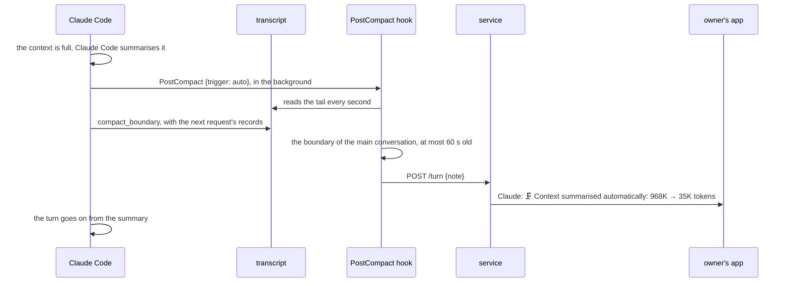
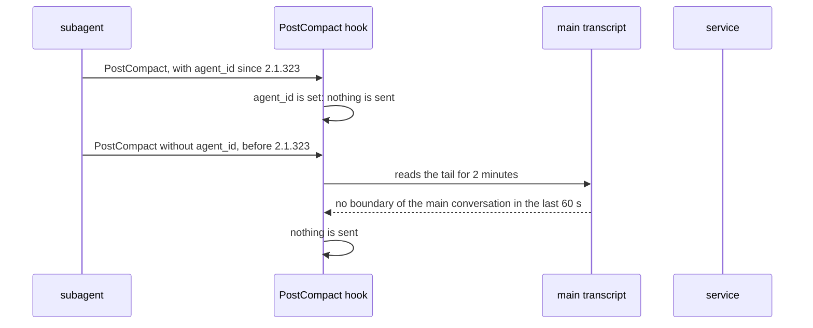
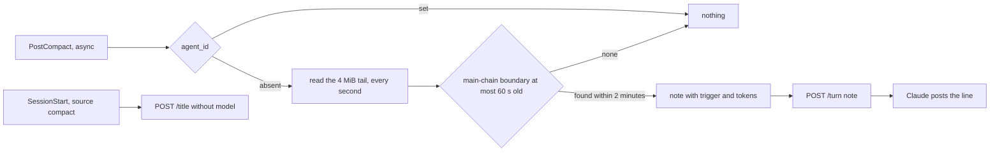

# SimpleX MCP: a line when a session's context is summarised

Status: plan, for approval. Code references: master `97bbbd9ac` (MCP 0.3.0 with the notes of Claude Code's own prompts). Claude Code references: the binaries of 2.1.322 and 2.1.323 at the offsets given, the changelog of 2.1.322, and the transcripts of one machine, Claude Code 2.1.251 to 2.1.322, with 298 compactions: 226 of main conversations and 72 of subagents. Decisions of the notes plan, [2026-11-12-mcp-harness-notes.md](2026-11-12-mcp-harness-notes.md), are cited as "notes decision N".

## 1. Goal

Roadmap line, [ROADMAP.md:22](../packages/simplex-chat-mcp/ROADMAP.md): "See when a session's context is summarised."

Claude Code summarises a session's conversation when its context is full, when the session is idle, and on `/compact`. Claude then works from the summary, so it can lose details of the earlier conversation. The members of the session's group see nothing of it today: Claude stops posting for a median of 90 s, and its later answers may miss what was said before.

Outcome:
- When Claude Code summarises the session's conversation, Claude posts one line in the session's group.
- A subagent's compaction posts nothing.
- A subagent's compaction no longer puts the subagent's model in the group's description.

## 2. What users see

Claude posts one line, without a quote, when the summary has replaced the conversation:

```
compaction                                  line
at the context limit, during a turn         🗜️ Context summarised automatically: 968K → 35K tokens
in an idle session                          🗜️ Context summarised automatically: 546K → 11K tokens
/compact, or "Summarize from here"          🗜️ Context summarised on request: 399K → 25K tokens
without token counts in its record          🗜️ Context summarised automatically
a subagent's compaction                     nothing
```

The numbers are from real compactions on this machine (Claude Code 2.1.322, 2.1.295 and 2.1.310). The first number is the size of the context before the compaction, and the second is its size after it.

Before and after:
```
event                                  0.3.0                                   this pull request
compaction of the session              nothing                                 Claude: one line
compaction of a subagent               nothing                                 nothing
the group's description                the model of the compacted              unchanged
after a compaction                     conversation, also a subagent's
```



A subagent's compaction runs the same hook. Its boundary is written to the subagent's own transcript, so the hook finds no new boundary of the main conversation and posts nothing:



## 3. Questions for the user

Q1. When does the line appear?
- A, recommended: once, when the summary is in place, with the token counts. The line is exact in every version of Claude Code. Members see the pause of the compaction only afterwards: its median is 90 s, and the longest on this machine took 4 minutes. Cost: about 40 source lines.
- B: a live line from the start, `🗜️ Summarising the context`, finalized at the end, as the step lines of `ep/mcp-activity`. Members see the compaction while it runs. Claude Code before 2.1.323 gives no `agent_id` at the start of a subagent's compaction, so there a subagent's compaction also shows a live line in the session's group. A failed compaction leaves the line without an outcome until the turn ends. Cost: a PreCompact hook entry and about 40 more source lines, built on `ep/mcp-activity` after it merges.

Q2. Does Claude also post the summary itself?
- A, recommended: no. The line is the only post.
- B: yes, as Claude's message after the line. Members read what Claude kept. The summary restates tool results that members do not see today, such as the contents of files and the output of commands. A summary has a median of 21,400 characters and at most 39,157 on this machine, so it is posted as two or three messages after each compaction.

## 4. Decisions

Facts:
1. Claude Code runs the PostCompact hooks after each compaction, with `{session_id, transcript_path, cwd, prompt_id, hook_event_name: "PostCompact", trigger, compact_summary}`; `trigger` is `manual` or `auto` (2.1.322, binary offset 296928091). Four paths run it: a full compaction (call at 295862014), a partial one from the message selector (295868083), the compaction after a request too large for the context (295550888) and one replaced by a hook (295554444). The hook was added in Claude Code 2.1.76 (changelog), and the plugin needs 2.1.214 or later ([REFERENCE.md:472](../packages/simplex-chat-mcp/REFERENCE.md)).
2. A subagent's compaction runs the same hooks. The runner skips them only for a delegated observer, `Js(agentContext)` (296927978, `Js` at 287257564). In 2.1.322 the input is built by `Ip(e, Sy())` without the agent, so it has no `agent_id` (296961915). 2.1.323 adds `agent_id` and `agent_type` (312819433, `Hm` at 312853987). On 2026-11-13 the plugin's SessionStart hook ran for the compaction of subagent `ainv-captcha-file`: its transcript has a `hook_success` record `SessionStart:compact` with the plugin's command.
3. Each compaction creates an entry `{type: "system", subtype: "compact_boundary", content: "Conversation compacted", timestamp, compactMetadata: {trigger, preTokens, postTokens, durationMs, ...}}` (`b5` at 298681900). In each of the four paths the entry is created before the PostCompact hook runs (295550390, 295554177, 295860047, 295867131). A subagent's entry has `isSidechain: true` and is written to the subagent's transcript, `subagents/agent-ID.jsonl`.
4. Of the 226 compactions of main conversations, 225 are `auto` and 1 is `manual`. For `auto`: `preTokens` has a median of 967,931, `postTokens` a median of 22,484, and `durationMs` a median of 89,849, a 90th percentile of 128,658 and a maximum of 239,168.
5. Claude Code compacts an idle conversation of 200K tokens or more after about 54 minutes, before its prompt cache expires (changelog 2.1.299). The idle compaction of 2026-10-12 on this machine has `trigger: auto`, 546,209 → 11,244 tokens, and the record `Compacted while idle, before the prompt cache expired` after it.
6. Claude Code writes the boundary with the records of the next request after the compaction. In the transcripts, records with later timestamps precede the boundary in the file by up to 4.7 s in 2.1.316 to 2.1.322, and by up to 99.7 s in one session of 2.1.302. The boundary of `/compact` follows the command's records at once (2.1.310).
7. The records written with a boundary, up to the next `last-prompt` entry, have a median of 197 KB. The largest since 2.1.283 has 1,009,289 bytes; in 2.1.281 and 2.1.282 two have 5.2 and 6.6 MB.
8. Compactions of one main conversation are at least 4,979 s apart. No subagent's compaction ended within 60 s after a compaction of its main conversation, and 2 of 72 ended within 600 s.
9. After a compaction, Claude Code runs the SessionStart hooks with `source: "compact"` and `model` of the compacted conversation's context (`Vce(n.session, "compact", {model: n.options.mainLoopModel, ...})` at 295880283). For a subagent, that context is the subagent's. The plugin's SessionStart hook sends `model` in `/title` ([hook.ts:93](../packages/simplex-chat-mcp/src/hook.ts#L93)), and the service shows it in the group's description ([service.ts:261](../packages/simplex-chat-mcp/src/service.ts#L261)).
10. A plain text message without a SimpleX link, a file, a voice message or a report is never refused by a group preference ([Internal.hs:401-408](../src/Simplex/Chat/Library/Internal.hs#L401-L408), the only refusal of a group message, [Commands.hs:4991](../src/Simplex/Chat/Library/Commands.hs#L4991)). So the refusal text of a note ([hub.ts:195](../packages/simplex-chat-mcp/src/hub.ts#L195)) never applies to the line.
11. On this machine, a read of a 4 MiB transcript tail with a scan for boundaries takes 41.6 ms, and of a 1 MiB tail 10.8 ms.

Choices:

12. One line, when the summary is in place (Q1 A). The summary is not posted (Q2 A).
13. `hooks/hooks.json` gets a PostCompact entry without a matcher: `node "${CLAUDE_PLUGIN_ROOT}/dist/cli.js" hook turn`, with `async: true`, as the other turn hooks.
14. For an input with `agent_id`, the hook sends nothing.
15. Otherwise the hook reads the transcript's tail of 4 MiB, up to 120 times, 1 s apart. The boundary is the last entry of type `system` and subtype `compact_boundary`, without `isSidechain: true`, whose timestamp is no earlier than 60 s before the hook started (`at`). The tail is four times the largest batch of fact 7 since 2.1.283. The 2 minutes cover the delays of fact 6. A subagent's compaction before 2.1.323 costs at most 120 reads, about 5 s of processor time over the 2 minutes (fact 11).
16. Without such a boundary after the reads, the hook sends nothing. So before 2.1.323 a subagent's compaction posts nothing (facts 3 and 8).
17. The line is `🗜️ Context summarised `, then `on request` for `trigger: manual` and `automatically` otherwise, then `: PRE → POST tokens` when `preTokens` and `postTokens` are numbers. The numbers are formatted by `Intl.NumberFormat("en", {notation: "compact"})`: 967,558 is `968K`, 4,595 is `4.6K` and 850 is `850`. 🗜️ is the emoji of compression; it differs from the emojis of the notes.
18. The hook sends `{id, pid, at, note}` in `POST /turn`. The hub posts `note` unchanged as Claude, without a quote, as the notes of Claude Code's prompts ([hub.ts:195](../packages/simplex-chat-mcp/src/hub.ts#L195)). The hub and the protocol do not change, and the protocol version stays 1. With `ep/mcp-activity`, every note is posted silent, this line included.
19. The SessionStart hook sends no `model` for `source: "compact"` (fact 9). The Stop hook sends the model of each answer, and PostModelSwitch the new model, so the description stays current.

## 5. Design

Options:
```
option                                   producer                          consumer       wire          cost
L. PostCompact hook reads the boundary   hook entry; the hook finds the    posts note     note          about 40 source lines; exact in every
   (chosen)                              boundary and composes the line                                 version; the line follows the boundary's
                                                                                                        write by up to 1 s
P. PostCompact input only                hook entry; trigger and agent_id  posts note     note          about 10 lines; before 2.1.323 a subagent's
                                                                                                        compaction posts the line in the session's
                                                                                                        group; no token counts
H. hook sends the boundary's fields,     hook entry; the hook finds the    composes the   + compaction  the same reads as L, and the hub learns
   hub composes                          boundary                          line           fields        Claude Code's format; notes decision 14
                                                                                                        keeps the lines in the hook
G. SessionStart with source compact      the existing hook                 posts note     note          no trigger and no agent_id in any version:
                                                                                                        each subagent's compaction posts the line
V. live line from PreCompact to          two hook entries, step lines      step lines     step          Q1 B
   PostCompact
```
P is cheaper than L, but with Claude Code 2.1.322 and earlier it would post the line for each of the 72 subagents' compactions among the 298 on this machine. H costs more at the consumer for the same line, and G posts the line for subagents' compactions in every version.

Changes:
```
file               function             change
hooks/hooks.json   PostCompact          new entry: node dist/cli.js hook turn, async
src/hook.ts        SessionStartInput    + source
                   sessionStart         no model in /title when source is compact
                   TurnInput            + agent_id
                   turn                 PostCompact: note from compactionNote; nothing is sent without a note
                   compactionNote       new: the boundary of decision 15 and the line of decision 17
                   findInTranscript     takes the tail's size in bytes instead of a text
                   answerModel,         pass 1 MiB plus twice the text's bytes, as before
                   promptKind
src/cli.ts         helpText             the hook turn line names compactions
```

Hook:
```
on SessionStart {source, model, ...}:
  POST /title {..., model: source = compact ? none : model}

on PostCompact {session_id, transcript_path, agent_id}:
  agent_id set or no transcript_path: nothing
  read the last 4 MiB of the transcript up to 120 times, 1 s apart:
    boundary = the last entry with type system, subtype compact_boundary,
               without isSidechain, with timestamp >= at - 60 s
    found: stop
  none: nothing
  note = "🗜️ Context summarised " + (trigger = manual ? "on request" : "automatically")
         + (preTokens and postTokens are numbers ? ": " + compact(preTokens) + " → " + compact(postTokens) + " tokens" : "")
  POST /turn {id, pid, at, note}
```

The reads use the existing `findInTranscript` and `readTail` ([hook.ts:153-174](../packages/simplex-chat-mcp/src/hook.ts#L153-L174)). The interval is 10 times the `readMs` of `turn`, so 1 s by default and shorter in tests.



## 6. Compatibility

- Older SimpleX apps: the line is a text message with an emoji.
- Older Claude Code: every supported version runs PostCompact (fact 1). Before 2.1.323 a subagent's compaction has no `agent_id`, and the hook reads for 2 minutes and posts nothing (decision 16). A boundary without `postTokens` gives the line without the token counts.
- Older plugin data folders: no data changes.
- Older services: the hook of this version stops an older service first ([client.ts:37-40](../packages/simplex-chat-mcp/src/client.ts#L37-L40)). A service of this version gets no requests for compactions from an older hook, as in 0.3.0. `package.json` stays at 0.3.0; the release pull request bumps it.

## 7. Acceptance and tests

Done when:
```
#  criterion                                                                                checked by
1  a compaction of the main conversation gives its line, with the trigger and token counts  unit: hook
2  the line is sent after the boundary is written, also 30 reads after the hook started     unit: hook
3  an input with agent_id, a sidechain boundary or one older than 60 s sends nothing         unit: hook
4  Claude posts the line in the session's group, without a quote                            e2e: service
5  the SessionStart hook of a compaction sends no model                                     unit: hook
6  hooks.json runs hook turn for PostCompact, in the background                             unit: plugin
7  real session: /compact and an automatic compaction show their lines, a subagent's        TESTING check
   compaction shows none, and the description keeps the session's model
```

Tests:
- `test/unit/hook.test.ts`, new, in "turn hooks": "post one line for a compaction of the session's conversation, from its boundary in the transcript after the boundary is written, with its trigger and token counts, and nothing for a subagent's compaction, a boundary of a subagent or a boundary older than 60 s". It fails on master: master sends `{id, at}` without `note` for each PostCompact input.
- `test/unit/hook.test.ts`, changed, in "SessionStart hook": "starts the session with its title, folder, model, Claude Code process and the time the hook started, without the model after a compaction, and stays quiet when the Main group has an owner". It fails on master, which sends the model of the compaction.
- `test/unit/plugin.test.ts`, changed: PostCompact joins the events that run `hook turn` with `async: true` ([plugin.test.ts:46](../packages/simplex-chat-mcp/test/unit/plugin.test.ts#L46)). It fails on master, which has no PostCompact entry.
- `test/e2e/service.test.ts`, changed: the mirroring test ([service.test.ts:351-425](../packages/simplex-chat-mcp/test/e2e/service.test.ts#L351-L425)) appends a boundary to its transcript, runs the PostCompact hook with `trigger: manual`, and expects Claude's line `🗜️ Context summarised on request: 399K → 25K tokens`.
- Run: `npm test --prefix packages/simplex-chat-mcp` for unit tests, and the end-to-end tests as TESTING.md states. The reduced build runs them in CI. No app changes, so no app test workflows.
- TESTING check: in a session with the plugin, run `/compact`; start a subagent from an `--agents` definition with the smallest `autoCompactWindow` Claude Code accepts, and let it compact; look at the session's group and its description.

## 8. Docs to change

- `README.md:36`: Claude posts a line when Claude Code summarises the session's context.
- `REFERENCE.md`, "Prompts and answers" (603-624): the lines, the triggers, the token counts, and that a subagent's compaction posts nothing. `REFERENCE.md:496`: PostCompact in the table of hooks.
- `ROADMAP.md:22`: the line is removed.
- `spec/flows.md`: flow 21, the hooks of `hook turn`; a new flow, a compaction of the session's context, after flow 31.
- `spec/api.md:950`, `:1010`: PostCompact in the rows of `hook turn` and `hooks/hooks.json`; the reads of the boundary.
- `spec/architecture.md:717`, `:940`, `:1116` and 8.2: PostCompact, `compactionNote`, and `note` of a compaction.
- `TESTING.md:126`, `:156`: the hooks and the new tests; a real-session check, as in section 7.

## 9. Conflict areas with the other items

```
file                          where                                           items
src/hook.ts                   turn, TurnInput (agent_id), findInTranscript    mcp-activity (agent_id, the early return in turn), mcp-session-usage
src/hook.ts                   sessionStart, the model of /title               mcp-session-usage
hooks/hooks.json              the entries after PreToolUse                    mcp-activity (PostToolUse, PostToolUseFailure)
src/cli.ts:20                 the hook turn line of helpText                  mcp-activity
test/unit/hook.test.ts        "SessionStart hook", "turn hooks"               mcp-activity, mcp-fixes
test/unit/plugin.test.ts:46   the events of hook turn                         mcp-activity
test/e2e/service.test.ts      the mirroring test (351-425)                    mcp-activity, mcp-replies, mcp-reactions, mcp-fixes
REFERENCE.md                  "Prompts and answers", the hooks table          mcp-activity, mcp-replies, mcp-reactions
spec/flows.md                 flow 21, the number of the new flow             mcp-activity (flow 32)
spec/api.md, architecture.md  the rows of hook turn and hooks.json, 8.2, 8.6  mcp-activity
ROADMAP.md                    line 22, adjacent lines                         mcp-session-usage (line 21)
```
The hub and the protocol are unchanged, so the items that change `Session.turn`, `post` and `TurnRequest` do not conflict in code.

## 10. Estimate

```
part                          source lines   test lines
hook.ts, hooks.json, cli.ts   40             90
docs                          30 lines of text
```
About half a working day, with one review round. Q1 B adds about 40 source lines, 60 test lines and half a day, after `ep/mcp-activity` merges.
