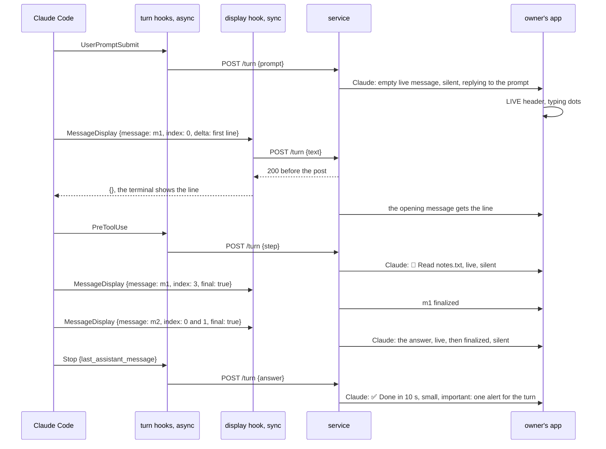
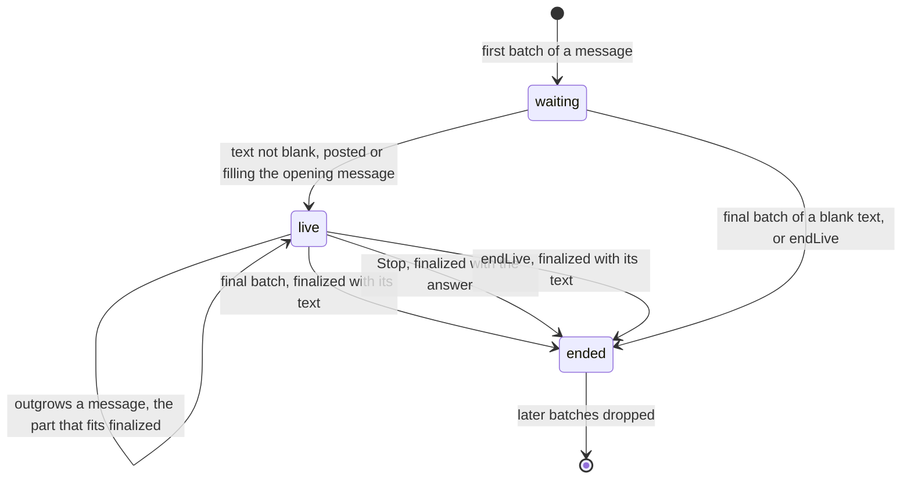
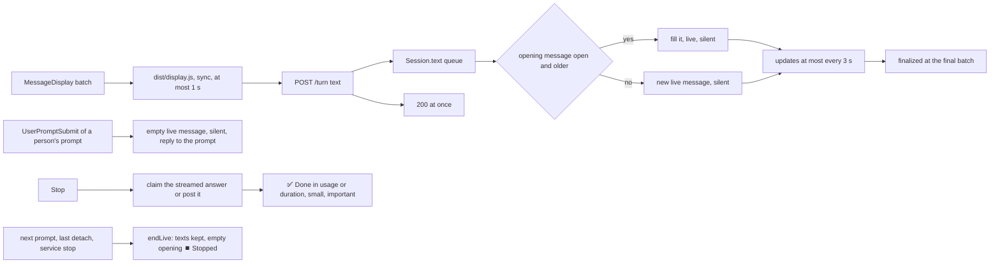

# Answers appear live as Claude writes them

Status: Q1 and Q2 answered A on 2026-11-13. The end line and the usage line of `ep/mcp-session-usage` are one message (decision 36). The plan waits for the user's approval before implementation. Code references: master `97bbbd9ac` and `ep/mcp-activity` at `559bac9c0`, on which this item builds. Claude Code references: version 2.1.322, its binary at the offsets given, run L1 of 2026-11-13, the transcripts of one machine, and the hooks reference (code.claude.com/docs/en/hooks.md, read on 2026-11-13).

## 1. Goal

Roadmap line, `packages/simplex-chat-mcp/ROADMAP.md:12`: "Answers appear live as Claude writes them, from the moment it starts working."

The user's words, 2026-11-11:

> use live messages for streamed replies, and start live message as soon as claude acknowledges the message or as soon as it starts working on reply - not sure if channel can handle it.

The channel cannot: Claude Code sends a channel server only permission requests (fact 1). Claude Code 2.1.322 passes Claude's text to a MessageDisplay hook while the text streams, one batch of whole lines at a time (facts 2 to 7).

## 2. What users see

When a person's prompt starts a turn, Claude posts an empty live message at once. The apps show it under the LIVE header, with typing dots. It replies to the prompt when the prompt came from the group. The turn's first post fills this opening message: the first line of Claude's text, or the first step.

Each later text of Claude is a new live message from its first line. Claude's texts are its remarks before steps, such as `I'll read the hook first.`, and its answer. The terminal shows all of them; the group sees only the answer now. A text grows by whole lines, with an update at most every 3 seconds, and is finalized when Claude ends it. Steps are posted as in `ep/mcp-activity`. After a non-blank answer, Claude posts the end line in small print, which is the turn's alert (Q1). With `ep/mcp-session-usage`, the same line shows the turn's usage and the plan's usage, so the turn ends with one line after the answer.

Run L1, times from the prompt's hook:
```
time     in the group                                                    Claude Code event
0.0 s    the member's prompt, or User's post of a typed prompt           UserPromptSubmit
         Claude: empty live message, typing dots, replying to the prompt
5.0 s    the opening message: A lighthouse is a tower on which ...       MessageDisplay, message 1, batch 0
5.3 s    the same message, 3 lines                                       batches 1 and 2
6.4 s    Claude: 📖 Read notes.txt, live                                  PreToolUse
6.5 s    the line gets ✅ and the step's duration                         PostToolUse
6.7 s    Claude: 📖 Read of a second file, live, finalized at 6.9 s       PreToolUse, PostToolUse
6.8 s    message 1 finalized with its 4 lines                            batch 3, final
10.7 s   Claude: 1. Seawater has an average salinity ..., live            message 2, batch 0
10.7 s   message 2 finalized with its 12 lines                           batch 1, final
10.7 s   Claude: ✅ Done in 10 s, in small print                          Stop
```

Texts:
```
post                                 text                                       live   priority    reply to
opening message                      empty                                      yes    silent      the prompt from the group
Claude's text                        its whole lines so far                     yes    silent      -
end line                             !- ✅ Done in DURATION!                    no     important   -
end line with ep/mcp-session-usage   !- ✅ Done in USAGELIMITS!                 no     important   -
end line, start of the turn unknown  !- ✅ DoneLIMITS!                          no     important   -
opening message at the end of a      ⏹️ Stopped                                 no     silent      kept
turn without Stop
opening message at a blank answer    !- ✅ Done in DURATION!                    no     silent      kept
```

- `!- TEXT!` is small text: the apps show TEXT smaller and in the secondary color (fact 11 of `ep/mcp-session-usage`), and a notification shows TEXT without the marks (`Notifications.swift:200-214`, `NtfManager.kt:134-145`).
- DURATION is the time from the prompt's hook to the Stop hook, in the format of the step lines: `41 ms`, `2.0 s`, `42 s`, `4 min 12 s`, `1 h 5 min`.
- USAGE is the usage text of `ep/mcp-session-usage`, which the Stop hook reads from the transcript: `2 min 51 s · 16.0k output tokens · 673k in context`. Without a usage text, as when the transcript has no entry of the turn yet (fact 9), the line keeps DURATION.
- LIMITS is the plan's usage of `ep/mcp-session-usage`, from its status line command: ` · 5 h: 34%` and ` · week: 61%`, each when known and not reset. The hub appends it after USAGE, after DURATION, or after `Done`. Without it, LIMITS is empty.
- An example: `!- ✅ Done in 2 min 51 s · 16.0k output tokens · 673k in context · 5 h: 34% · week: 61%!`. Without the turn's figures: `!- ✅ Done · 5 h: 34% · week: 61%!`.
- A blank answer gets no end line, so it gets no alert. An answer that a group preference refuses gets its refusal text, and then the end line.
- A text longer than one message is finalized at the part that fits, measured as for answers, and continues in a new live message.
- A turn that ends without Stop, after an interruption or an API error, gets no end line. Its live texts are finalized with their text, as steps are, and an empty opening message gets `⏹️ Stopped`.
- The opening message is not posted for a prompt added to the running turn, for a `/` command, or for Claude Code's own prompts, whose note line starts their turn.
- When a group preference refuses a text, as a SimpleX link while links are off, its message keeps the text accepted last, and Claude posts `Claude's text was not posted: SimpleX links are off in the group of this session; its owners can turn them on in the group's preferences.`

Priority of Claude's posts:
```
post                                   ep/mcp-activity          with this item
opening message                        -                        silent (-1)
Claude's text, a remark                not posted               silent (-1)
Claude's text, the answer              last part 1, others -1   silent (-1)
end line, with the usage                -                        important (1); normal until receivers support it
step line, note                        silent (-1)              silent (-1)
```

The terminal (Q2): while the plugin is enabled, Claude Code shows Claude's text in the terminal by whole lines. It holds each batch until the plugin's hook returns, about 0.1 s on this machine (fact 15).

The channel instructions tell Claude that its text reaches the group as it writes: `Your text of each turn reaches them in that group as you write it; reply sends them a file.`



## 3. Questions for the user

The user answered both questions A on 2026-11-13.

Q1. Which post alerts at the end of a turn? Answered A. A live message alerts when it is created. A streamed text is created at its first line, before Claude Code reports whether it is a remark or the answer (facts 3 and 8).

- A (recommended): the end line `✅ Done in 2 min 14 s` after the answer, important. Every text is silent. This keeps the rule approved for `ep/mcp-activity`: the last message of a turn is important. A turn gets one more message.
- B: each text of Claude alerts at its first line, and no end line is posted. A turn with steps alerts at each remark: 49% of such turns have remarks, 5 or more in 10% of them (fact 13). The opening message is dropped, because it is silent and the turn's first text fills it.

Q2. May the plugin stream Claude's text, given what the terminal shows? Answered A.

- A (recommended): stream by the MessageDisplay hook. The terminal shows Claude's text by whole lines, about 0.1 s later, and no longer word by word (facts 5 and 15). Claude's remarks between steps reach the group.
- B: keep the terminal as it is, without the hook. The opening message is filled by the first step, or by the answer at Stop. Answers do not stream, and remarks are not posted: the transcript has a text only after its response ends (fact 9).
- C: a mod, a plugin module that Claude Code runs in its own process, streams without the terminal change. The plugin's code then runs inside Claude Code with access to the whole session, and it needs a new path to the service. It takes several days more (fact 10).

## 4. Decisions

Facts:

1. Claude Code 2.1.322 has three channel methods: `notifications/claude/channel` from the server, a prompt; `notifications/claude/channel/permission_request` to the server; and `notifications/claude/channel/permission` from the server, the verdict. The binary has no other `notifications/claude/` method (153214616 and a search of the binary). The channels reference lists the same three. Claude's text never reaches a channel server.
2. Claude Code runs MessageDisplay hooks with the common input and `turn_id`, `message_id`, `index`, `final` and `delta` (296931321), with `forceSyncExecution: true`. Such an execution runs a hook with `async: true` in the foreground (`_H`, 296975203), and it waits for a hook that answers async: "Detected async hook but forceSyncExecution is true, waiting for completion" (296986506). The common input has `prompt_id` (296962410), and a MessageDisplay input has no `agent_id` or `effort` (run L1).
3. In the terminal, the turn controller of the main conversation passes each model response to the display queue (324210203): `begin` at `message_start` (298600591), `delta` for each `text_delta` (298601874), and `finalize` at `message_stop` (298600654). Thinking and tool input are not passed. A response that has only tool calls runs no hook (hooks reference).
4. The queue sends a batch when it has a new whole line, at most every 100 ms, with up to 3 hooks in flight and a timeout of 10 s (312502919, 312504716). The last batch, at `message_stop`, has `final: true` and the rest of the text, also a part of a line. The hooks reference: "Always whole lines, except the final batch which may end mid-line", "Each message has exactly one final batch", and the final batch's delta is empty when the message ends on a newline.
5. With a command hook on MessageDisplay, the terminal shows the hooks' batches in place of the raw stream: the queue shows the raw stream only while no such hook exists (312505465), the streamed text is reset at the response's start (312505878), and each batch is shown once its hook returns (`applyTransformedStreamingText`, 324177657). The hooks reference: "Claude Code holds each batch until your hook returns, so keep the hook fast."
6. In `claude -p` and Agent SDK runs, MessageDisplay runs once per message after it completes, with `index` 0, `final` true and the whole text (312507990, hooks reference).
7. Run L1: Claude Code 2.1.322 in a pseudo-terminal, Sonnet, with hooks that log their input for UserPromptSubmit, PreToolUse, PostToolUse, MessageDisplay and Stop. Each batch of the first response had one line, at 5.0, 5.2 and 5.3 s, and its final batch came at 6.8 s, 0.36 s after the PreToolUse of that response's tool. The 12-line answer came in two batches 26 ms apart, the second final. The Stop hook's process started 33 ms after the final batch's. Every MessageDisplay input had the UserPromptSubmit's `prompt_id`. The answer's deltas started with the first 120 characters of the Stop's `last_assistant_message`, which the log kept.
8. The Stop input's `last_assistant_message` is the trimmed text of Claude's last assistant entry (296941801). Stop does not run after a user interrupt, and API errors run StopFailure (hooks reference).
9. The transcript has a response's text only after the response ends. In a transcript of this machine, the text entry of one response is stamped 2.4 s before its tool_use entry and records `stop_reason: tool_use`, which the API sends at the end of a response. In run L1 the transcript file did not exist at any of the twelve hook events.
10. A mod's `turn.step` hook gets the model's response as it streams, in Claude Code's own process, and the terminal shows the stream unchanged (mods documentation, "Follow a turn"). A mod can read and write files, start processes and see every prompt and tool call; administrators and the built-in guard can stop user-installed mods.
11. Claude Code 2.1.322 skips an unknown event of a plugin's `hooks.json` (297743181). MessageDisplay exists in versions 2.1.303, 2.1.316, 2.1.319, 2.1.322 and 2.1.323, with the same flush constants in 2.1.323.
12. SimpleX live messages: `LiveMessage` of the library updates at most once per 3 s (`packages/simplex-chat-nodejs/src/api.ts:1152`), the iOS app every 3 s (`SendMessageView.swift:12`, `:417-420`), and the Android and desktop apps every 3 s (`SendMsgView.kt:546-549`). The core checks only that a sent content is no report (`Commands.hs:4894-4897`), and the iOS app sends an empty live message when it replies to one (`ComposeView.swift:1310-1319`). The apps show a live item with typing dots after its text while it was updated in the last 10 s (fact 11 of `ep/mcp-activity`). The core refuses the update of an item older than a day (decision 27 of `ep/mcp-activity`).
13. Turns in the main conversations of this machine, 30 days to 2026-11-13, 11,856 turns: the first output came a median 5.9 s after the prompt, 34 s at the 90th percentile; the first text, 20.5 s and 102 s. Of 8,427 turns with tool uses, 49% had remarks, with a 90th percentile of 5 per turn and a median length of 121 characters. Answers had a median of 904 characters and 10 lines, 2,710 and 30 at the 90th percentile. A turn took a median of 40 s.
14. Today Claude posts only the Stop hook's `last_assistant_message` of a turn (decision 75 of `plans/2026-11-07-mcp-claude-code-channel.md`, `src/hub.ts:197`).
15. A Node script that reads a hook input and posts it to a Unix socket took a median of 112 ms, from 81 to 168 ms, in 20 runs on this machine; `node -e 0` took 67 ms. Loading `dist/hook.js` of master took a median of 261 ms, against 162 ms for the Node modules alone, in 15 runs at a load average of 23. `files.ts` loads `log.ts`, which loads `simplex-chat`.
16. `POST /turn` answers after `Session.turn` returns (`src/service.ts:148-152`). The service answers 409 for a session it does not know (`src/service.ts:395`).

Choices:

17. Claude Code runs `node "${CLAUDE_PLUGIN_ROOT}/dist/display.js"` for MessageDisplay, with `timeout` 2, without `async`, which Claude Code ignores for this event (fact 2).
18. `display.ts` loads only Node modules and two new modules, `paths.ts` and `service-request.ts`, because the terminal waits for it (facts 5 and 15). `dataRoot`, `socketPath` and the token file's name move from `files.ts` to `paths.ts`, and `files.ts` exports them as before. `service-request.ts` has `postToService`, one request to the running service within a time limit, without starting it. The status line command of `ep/mcp-session-usage`, `status-line.ts`, uses both modules too. So `paths.ts` and `service-request.ts` import only Node modules and each other: no `simplex-chat`, and no module that loads it, such as `files.ts`, `log.ts`, `socket.ts`, `client.ts`, `config.ts` or `messages.ts`. A unit test holds this rule for the imports of the three modules.
19. The display hook sends `{id, pid, at, text: {message, index, final, delta}}` with `postToService`, waits at most 1 s, and prints `{}`. It starts no service, makes no retry and logs nothing. It does not check whether the run is interactive: for a `claude -p` or Agent SDK run, the service has no session and answers 409 (facts 6 and 16).
20. `Session.turn` queues a text batch and returns, so the service answers before the post, and the hook holds the terminal only for its request.
21. At a prompt that starts a turn, after `User`'s post of a typed prompt, the hub posts the opening message: empty, live, silent, replying to the member's message that the prompt matched. The prompt is one that `User` posts or that matches a member's prompt; the hub posts none for a prompt added to the running turn, a `/` command or Claude Code's own prompt. When the core refuses the reply, as for a deleted prompt, the hub posts the message without it, as for answers (decision 50 of `plans/2026-11-07-mcp-claude-code-channel.md`).
22. The turn's first post fills the opening message: the first text, a step's start, the first part of an answer posted at Stop, or the end line of a blank answer. Only a post whose hook started after the prompt's hook fills it, so a late Stop of the previous turn posts its own messages.
23. The hub applies a message's batches in index order. It posts a live silent message at the first text that is not blank, updates it at most once per 3 s (fact 12), and finalizes it at the final batch at once.
24. When a text outgrows one message, measured as `textParts` measures, the hub finalizes the live message with the part that fits and continues the rest in a new live message.
25. At Stop, the hub first applies the queued batches. The answer's message is Claude's newest text whose first batch's hook started before the Stop hook, when its trimmed text starts the trimmed answer. The hub finalizes it with the answer when the texts differ, as after a lost batch. Without such a message, the hub posts the answer as today, in silent parts.
26. After a non-blank answer, the hub posts the end line in small print with priority 1, in a send of its own after the answer. DURATION runs from the newest turn record before the Stop hook to the Stop hook. Without a turn record, the line is `!- ✅ Done!`, or `!- ✅ Done LIMITS!` with `ep/mcp-session-usage`. The end line also follows an answer that a group preference refuses, after its refusal text, because it is the turn's alert.
27. `endSteps(before)` becomes `endLive(before)`: it finalizes the steps and texts that started before `before` with their text, and an empty opening message with `⏹️ Stopped`. It runs at a prompt that starts a turn, at the last detach and at the hub's stop. At Stop it runs for steps and texts, after the claim of decision 25.
28. The hub drops a batch of an ended text, and the first batch of a text whose hook started before the last answer (fact 7). It keeps the last 100 ended message IDs.
29. The opening message, Claude's texts and an answer posted at Stop are silent; the end line is important. This replaces decision 22 of `ep/mcp-activity`.
30. The channel instructions and the description of `reply` say that Claude's text of each turn reaches the group as Claude writes it (`src/session.ts:21`, `src/tools.ts:464`).
31. Texts and the opening message get no expiry timer. A text ends with its response, and the opening message ends at the turn's first post, long before the core's limit of a day.
32. The updates of texts and of the opening message join the session's `finalizing` promise, so the hub's stop waits for them (decision 29 of `ep/mcp-activity`).
33. `duration` moves from `src/hook.ts` to `src/messages.ts`, for the step lines and the end line.
34. Texts are posted in the order their first batches arrive, among themselves and with the steps.
35. When the core refuses a text's send or update with a group preference, as for a SimpleX link while links are off (`Commands.hs:853-854` for an update), the hub posts `Claude's text was not posted: PREF OFF` once for that text. It finalizes the text's message with the text accepted last and drops the text's later batches. An answer posted at Stop keeps the subject `Claude's answer was not posted`.
36. The end line and the usage line of `ep/mcp-session-usage` are one message: `!- ✅ Done in FIGURESLIMITS!`, important, the turn's last post after a non-blank answer, with every part of the answer silent. FIGURES is the Stop hook's usage text when it has one, and DURATION of decision 26 otherwise. LIMITS is ` · 5 h: N%` and ` · week: N%` for the windows of the plan's newest usage not reset, which the hub appends after FIGURES, also after DURATION. Without FIGURES, the line is `!- ✅ DoneLIMITS!`. Both items build on `ep/mcp-activity`, and either can merge first. The first one adds the line in this form with its own parts: this item with DURATION, in a send of its own after the claimed or posted answer; `ep/mcp-session-usage` with its usage text and LIMITS, as the last message of the answer's send. The second one adds its parts to that line: this item, the line after a streamed answer and DURATION when the hook sends no usage; `ep/mcp-session-usage`, its usage text in place of DURATION, and LIMITS. So no release posts two lines after an answer. `ep/mcp-session-usage` takes this as its decision 19 (commit `3cc99fad0`).

## 5. Design

Options:
```
option                           producer                       hub                          terminal              cost
A. MessageDisplay command hook   a Node process per batch,      order, throttle, post,       whole lines, ~0.1 s   chosen
   (chosen)                      ~0.1 s                         claim at Stop                later
B. transcript read by the        the transcript, written after  one post per response        unchanged             text only after its response ends, answers
   service                       each response (fact 9)                                                            not streamed, a file watch per session
C. mod with turn.step            Claude Code's process          as A                         unchanged             plugin code inside Claude Code, a new path
                                                                                                                   to the service, mod policies
D. HTTP hook                     Claude Code, no process        as A                         whole lines, ~0 s     a TCP listener: any local process posts as
                                                                                                                   Claude, without the token file
E. Stop only                     the Stop hook                  opening message, answer      unchanged             no streaming: the roadmap line is not met
```

Changes, on top of `ep/mcp-activity`:
```
file                 function                     change
hooks/hooks.json     MessageDisplay               new entry: node dist/display.js, timeout 2
src/paths.ts         new                          dataRoot, socketPath and serviceTokenFile, moved from files.ts
src/files.ts         dataRoot, socketPath,        imported from paths.ts; dataRoot and socketPath exported as before
                     serviceToken
src/service-request.ts  new                       postToService: one request within a time limit, no service start (decision 18)
src/display.ts       new                          the MessageDisplay hook (decision 19)
src/protocol.ts      TurnRequest                  + text: TextBatch {message, index, final, delta}
src/messages.ts      duration                     moved from hook.ts
src/hook.ts          duration                     imported from messages.ts
src/hub.ts           Session.turn                 text: Session.text, queued; the opening message; at Stop the claim and the end line
                     Session.text                 new: decisions 23, 24, 28, 34 and 35
                     Session.answer               parts silent; posted only without a claimed text (decisions 25 and 29)
                     startLine                    + reply to an item; fills the opening message (decision 22)
                     endSteps → endLive           steps, texts and the opening message (decision 27)
                     Hub.stop                     endLive
src/service.ts       SessionLike, onAttach        endSteps → endLive
src/session.ts       channelInstructions          decision 30
src/tools.ts         replyTool.description        decision 30
```

State of the hub, added:
```
field                type                          content
Session.opening      LiveLine | undefined          the turn's empty live message, until the turn's first post
LiveLine.at          number                        start of the prompt's hook process
LiveLine.item        Promise<number | undefined>   its item ID; undefined when it was not posted
Session.texts        Map<string, LiveText>         Claude's live texts by message_id
LiveText.at          number                        start of the first batch's hook process
LiveText.batches     string[]                      deltas by index
LiveText.next        number                        first index not applied
LiveText.last        number | undefined            index of the final batch
LiveText.text        string                        applied text of the current part
LiveText.item        Promise<number | undefined>   the live part's item ID
LiveText.sent        string                        text of the last send or update
LiveText.timer       timer | undefined             the next update
Session.lastText     {at, text, item} | undefined  the newest text, kept after it ends, for the claim at Stop
Session.ended        Set<string>                   last 100 ended message_ids
Session.streaming    Promise<void>                 queue of the text work
```

```
text({message, index, final, delta}, at):            queued on streaming, POST /turn answers at once
  if ended has message: return
  live = texts.get(message)
  if live is undefined:
    if at < answeredAt: remember(message); return
    live = {at, batches: [], next: 0}; texts.set(message, live)
  live.batches[index] = delta; if final: live.last = index
  while live.batches[live.next] is defined: live.text += live.batches[live.next++]
  if live.last is defined and live.next > live.last: endText(message, live, live.text)
  else show(live)

show(live):
  if live.text is blank: return
  parts = textParts(live.text, quote when the part fills the opening message)
  if parts has more than one: finalize live.item with parts[0], post the middle parts final and silent,
                              live.text = the last part, live.item = undefined
  if live.item is undefined: live.item = startLine(live.text, at), filling the opening message (decision 22)
  else if no timer: timer at sent time + 3 s: update live.item with live.text, live

endText(message, live, text):
  clear the timer; texts.delete(message); remember(message); lastText = {at, text, item}
  finalize live.item with text, or post text final and silent when no item was posted

Stop(answer, at):
  await streaming
  newest = the newest of lastText and the live texts, with at < Stop.at
  claimed = newest, when its trimmed text starts the trimmed answer
  if claimed and its text differs from the answer: finalize its item with the answer
  endLive(at) for steps and texts; the turn records and the reply as today
  if not claimed and answer is not blank: post the answer in silent parts, the first filling the opening message
  if answer is not blank: post !- ✅ Done in FIGURESLIMITS!, priority 1, FIGURES = usage ?? DURATION (decision 36)
  else if the opening message is open: finalize it with !- ✅ Done in DURATION!

prompt that starts a turn (at):
  endLive(at); after User's post: opening = {at, item: startLine("", at, reply to the member's prompt)}

endLive(before):
  steps and texts with at < before: finalized with their text
  opening with at < before: finalized with ⏹️ Stopped
  return finalizing
```





## 6. Compatibility

- Older SimpleX apps show live messages and typing dots, as for step lines. Before receivers support priorities, every post alerts, the end line included; with silent messages, only the end line does (decision 29).
- Claude Code without MessageDisplay runs no display hook. The opening message is then filled by the first step or the answer at Stop, and the end line follows. Version 2.1.322 skips unknown events of `hooks.json` (fact 11).
- In `claude -p` and Agent SDK runs, the display hook runs once per message, and the service answers 409, because such runs have no session (facts 6 and 16).
- Older services: the turn hooks of this version stop an older service first (`src/client.ts:37-40`), at the prompt, before any batch.
- Data folders: the texts and the opening message are kept in the service's memory. After a service restart during a text, that text stays live, and the answer is posted at Stop.

## 7. Acceptance and tests

Done when:
```
#   criterion                                                                                    checked by
1   Claude Code runs dist/display.js for MessageDisplay, synchronous, with a 2 s timeout           unit: plugin
2   the display hook posts each batch with the session, the process and the batch, prints {},     unit: display
    starts no service, and gives up after 1 s; display.ts, paths.ts and service-request.ts
    import only Node modules and each other
3   POST /turn answers a batch before the hub posts it                                            unit: service
4   a prompt that starts a turn gets an empty silent live message, replying to an owner's prompt, unit: sessions
    and the turn's first post fills it
5   each text streams into a silent live message from its first line, in index order, updated     unit: sessions
    at most every 3 s and finalized at its final batch
6   a text that outgrows a message continues in a new live message                                unit: sessions
7   at Stop the streamed answer is finalized with the Stop's text, posted again only without a    unit: sessions
    streamed text, and !- ✅ Done in DURATION! follows as important, also after a refused answer
8   late batches are dropped, and endLive finalizes texts and an empty opening message at the      unit: sessions, unit: service
    next prompt, the last detach and the hub's stop
9   the display hook process takes a median within 60 ms of node -e 0, measured in the same runs  TESTING measurement
10  a real session streams Claude's remarks and answer, then the end line                         e2e, TESTING check
```

Tests:
- `test/unit/display.test.ts`, new: "posts each batch of Claude's text to the service with the session, the process and the batch, and prints {}" and "prints {} at once and starts no service when none runs, and after 1 s when the service does not answer", and "loads only Node modules, paths.ts and service-request.ts", which reads the imports of the three modules. On master the modules do not exist.
- `test/unit/plugin.test.ts`, changed: "runs the hooks from the plugin's own build, allows the plugin's tools, runs the turn hook at the start and the end of every tool use, and runs the display hook synchronously for MessageDisplay". It fails on master, whose `hooks.json` has no MessageDisplay.
- `test/unit/sessions.test.ts`, new, in "session channel":
  - "opens an empty silent live message at a prompt that starts a turn, replying to the owner's prompt and after User's post of a typed prompt, and none for a prompt added to the running turn, a command or Claude Code's own prompt".
  - "fills the opening message with the turn's first text or step, only from a hook that started after the prompt's hook".
  - "streams each text of Claude into a silent live message from its first line that is not blank, in index order, updated at most every 3 s, and finalized at its final batch".
  - "continues a text that outgrows a message in a new live message after the part that fits, for Latin, Cyrillic and CJK texts".
  - "finalizes the streamed answer with the Stop hook's text when it differs, posts the answer only when no text of Claude starts it, and then posts the end line in small print as important, also after the refusal of an answer".
  - "posts no end line for a blank answer and finalizes an empty opening message with the end line's text".
  - "drops the later batches of an ended text and the first batch of a text whose hook started before the last answer".
  - "finalizes live texts with their text and an empty opening message with ⏹️ Stopped at a prompt that starts a turn, at the last detach and at the hub's stop, which waits for their updates".
  - Changed: "posts the note of Claude Code's prompt and every part of an answer as silent, and the end line as important".
  - New, in "while a preference of the session group refuses a post": "posts that Claude's text was not posted, naming the preference, once for a text, and finalizes its message with the text accepted last".
- `test/unit/service.test.ts`, changed: "passes text batches to the session and answers before its posts, and ends its live posts at the last detach".
- `test/unit/hook.test.ts` and `files.test.ts` stay as they are: they test `duration` through the step lines, and `dataRoot` and `socketPath` through the exports of `files.ts`.
- `test/e2e/service.test.ts`, changed: the mirroring test runs `dist/display.js` with the inputs of run L1 and then the Stop hook. The owner's app receives the opening message, its updates and its finalization, not edited, and `!- ✅ Done in` with the time.
- With `ep/mcp-session-usage` merged first, the tests of the end line expect its usage text, and its e2e test expects `!- ✅ Done in 2.0 s · 861 output tokens · 35.6k in context · 5 h: 34% · week: 61%!`.
- `TESTING.md`: the real-session check in the terminal and the app, and the time of the display hook process.
- The sessions tests use `text` of `TurnRequest` and `endLive`, so they compile only with this change. No app changes, so no app test workflows.

## 8. Docs to change

- `README.md:36`: Claude's text appears live as Claude writes it, and the turn ends with one line in small print that alerts.
- `REFERENCE.md`, "Prompts and answers": the opening message, the texts, the end line, the priorities and the terminal's display by lines.
- `ROADMAP.md:12`: removed.
- `spec/flows.md`: a flow of a turn's texts with the order rules; `spec/api.md`: the MessageDisplay entry, `dist/display.js` and `text` of `POST /turn`, the channel instructions; `spec/architecture.md`: the texts, the opening message, the end line, `paths.ts` and `service-request.ts`.
- `TESTING.md`: the tests and the measurement.

## 9. Conflict areas with the other items

```
file                        where                                               items
src/hub.ts                  Session.turn, answer, startLine, endSteps,          mcp-activity (base), mcp-replies, mcp-reactions,
                            post, Hub.stop                                      mcp-session-list (turn states)
src/service.ts              SessionLike, onAttach                               mcp-activity, mcp-fixes (runService)
src/hook.ts                 duration                                            mcp-activity, mcp-session-usage (shares it in hook.ts)
src/messages.ts             duration, added                                     mcp-replies (ReplyTo, quoteLine), mcp-fixes (maxNameLength)
src/files.ts, paths.ts      dataRoot, socketPath, serviceToken                  mcp-session-usage (status-line.ts imports paths.ts)
src/service-request.ts      postToService                                       mcp-session-usage (status-line.ts posts its limits with it)
hooks/hooks.json            MessageDisplay                                      mcp-activity
src/session.ts              channelInstructions                                 mcp-replies (the reply_to sentences)
src/tools.ts                replyTool.description                               mcp-replies
src/hub.ts, the end line    Session.answer, the line after the answer           mcp-session-usage: one line, decision 36
src/protocol.ts             TurnRequest                                         mcp-activity (step), mcp-session-usage (usage, switched,
                                                                                limits)
REFERENCE.md, spec          "Prompts and answers", the turn flows               mcp-activity, mcp-replies, mcp-reactions
```

## 10. Estimate

About 230 lines of source and 360 of tests, one and a half days after `ep/mcp-activity` merges. A median turn of this machine gets one more message, the end line, and one update of the opening message. Each text adds a send, an update per 3 s while it streams, and its finalization.
