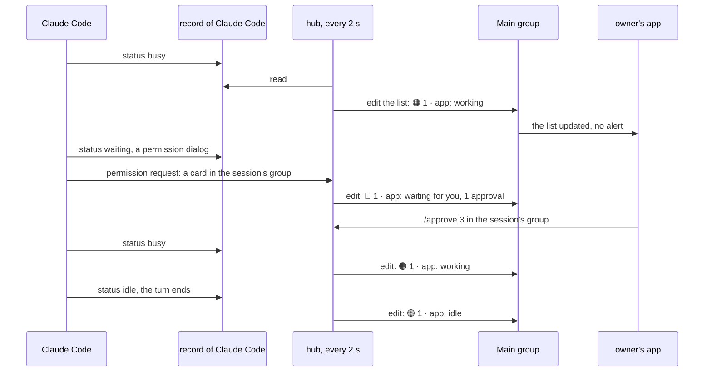
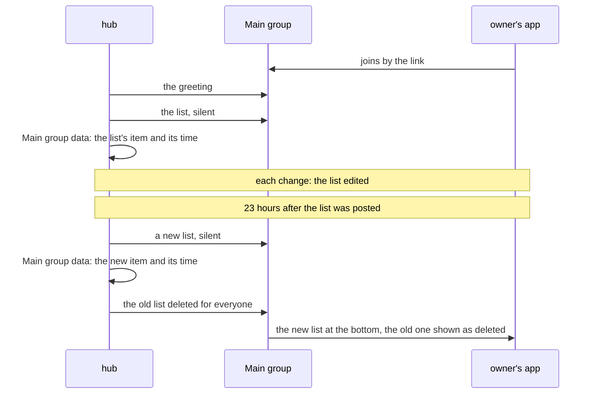
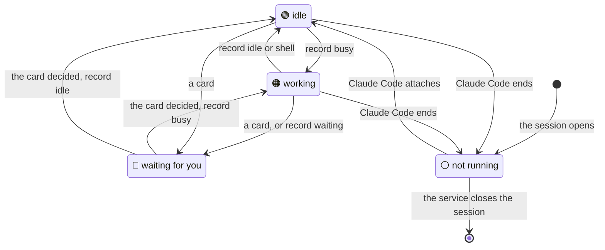
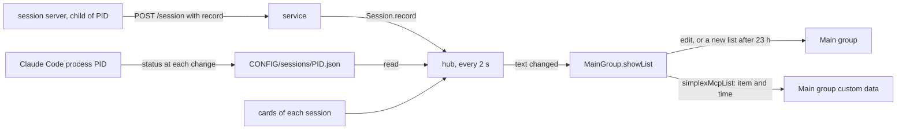

# SimpleX MCP: the list of sessions in the Main group

Status: plan for review. Code references: master `97bbbd9ac`. Claude Code references: version 2.1.322 and its binary at the byte offsets given, and the 27 session records of Claude Code 2.1.260 to 2.1.322 on this machine, read on 2026-11-13. Decisions of the 0.3.0 plan are cited as "0.3.0 decision N".

## 1. Goal

Roadmap line, [ROADMAP.md:17](../packages/simplex-chat-mcp/ROADMAP.md): "One list in the Main group shows every session and its state: working, waiting for you or idle."

The user's words, 2026-11-11, on the lead's proposal "`/sessions` showing each session as running, waiting for approval or idle":

> 5 - yes, via message editing, so main group is a list of sessions with their status (including "waiting") - we already use it for support group, and it doesn't require reposting. Or we could add protocol support for moving messages down, it would help support bot too (though a bit of re-engineering with not so much value)

On a separate post for waiting sessions, in the same message:

> I think we have an idea of "important messages" to indicate waiting, and limit alerts to them only. A separate "waiting" seems wrong.

Outcome:
- Claude keeps one message in the Main group with a line for each session and its state, and edits it when a state changes.
- The states are those of Claude Code itself: working, waiting and idle. A session also waits for you while a card in its group waits for a decision.
- `/sessions` lists every session with its state, in the same lines.

## 2. What users see

After the first owner joins the Main group, Claude posts its greeting, as in 0.3.0, and then the list. The list has one line per session, by session number:

```
🟠 1 · openclaw: working
🔵 2 · simplex-chat: waiting for you, 2 approvals
🔵 3 · website: waiting for you in Claude Code
🟢 4 · docs: idle
⚪ 5 · bio: not running
```

Without a session to show, the list is `No session is running.`

Lines:
```
line                                        when, the first that applies
🔵 N · NAME: waiting for you, K approvals    K cards wait for a decision in the session's group; "1 approval" for one
⚪ N · NAME: not running                     no Claude Code is attached to the session, or the service is stopping
🔵 N · NAME: waiting for you in Claude Code  Claude Code waits for an answer in its own window, such as a dialog
🟠 N · NAME: working                         Claude Code works: a turn, or a subagent or another delegated task
🟢 N · NAME: idle                            Claude Code waits for the next prompt, also while a background command runs
▶️ N · NAME: running                         Claude Code is attached, and its state can't be read
```

- The emojis have the colors of Claude Code's own state indicator: green for Idle, orange for Working…, blue for Waiting.
- A tool-use card counts only while Claude Code shows its permission dialog, or while its state can't be read. When someone answers the dialog in the terminal, the card stays in the group until the turn ends (0.3.0 decision 29), and the line shows the session working again.
- The list shows the sessions whose Claude Code runs, the ended ones until the service closes them 10 minutes later, and any session with cards waiting (Q2).
- Claude edits the list within 2 seconds of a change. An edit alerts nobody, and the apps mark the message "edited".
- Messages posted after the list, such as each owner's invitation to a new session's group, move it up (Q1).
- When the list is 23 hours old, Claude posts a new list at the bottom and deletes the old one for everyone. The core lets Claude edit a message only within 24 hours.
- The list's own posts are silent once receivers support silent messages (`ep/mcp-silent-messages`). Until then a new list alerts as a normal message.
- When the service stops, Claude edits the list once more: every session in it is not running.

`/sessions` replies with the line of every session of the data folder, ended ones included, or `No sessions.` without any:
```
⚪ 1 · openclaw: not running
🟠 2 · simplex-chat: working
```

Before and after:
```
moment                                  0.3.0                                 this pull request
the first owner joins the Main group    the greeting                          the greeting, then the list
a session starts                        the owners' invitations               the invitations; the session's line in the list
Claude works on a turn                  nothing in the Main group             🟠 working
a card waits in the session's group     the card                              the card; 🔵 waiting for you, 1 approval
a dialog waits in Claude Code           nothing                               🔵 waiting for you in Claude Code
a turn ends, or is interrupted          the answer in the session's group     🟢 idle
Claude Code ends                        nothing                               ⚪ not running; the line goes 10 minutes later
/sessions                               N · NAME, and ", closed"              EMOJI N · NAME: STATE
the list is 23 hours old                -                                     a new list at the bottom; the old one deleted
```

A turn with a tool-use card:



The first owner joins, and the list is replaced after 23 hours:



## 3. Questions for the user

Q1. Where does the list stay as it changes?
- A, recommended: Claude edits one message in place. Edits alert nobody. Messages posted after it move it up: each session start sends every owner an invitation in the Main group, and each command gets a reply there. Claude posts a new list at the bottom once a day, because the core edits a message only within 24 hours. Cost: one new message a day while the service runs.
- B: Claude keeps the list as the last message. When another message follows it, Claude posts the list again at the bottom at the next change and deletes the old one, as the support bot does with its cards ([cards.ts:257-287](../apps/simplex-support-bot/src/cards.ts#L257-L287)). The Main group's chat-list preview then shows the list. Cost: a new message at about every session start, because of the invitations, and a deleted message left in place each time.
- C: a core and app change that moves an edited message down, as the user proposed for the support bot too. It is a later pull request; A applies until then.

Q2. Which sessions does the list show?
- A, recommended: the sessions whose Claude Code runs, the ended ones until the service closes them 10 minutes later, and any session with cards waiting. `/sessions` lists every session with its state. The list holds as many lines as sessions run at once.
- B: every session of the data folder, ended ones as not running. A data folder keeps every session, and session numbers only grow, so the list grows with every session ever started, up to the size of one message.

## 4. Decisions

Facts:
1. Today `/sessions` replies with one line per session of the hub, `N · NAME`, with `, closed` for a session the service has no entry for ([hub.ts:431-434](../packages/simplex-chat-mcp/src/hub.ts#L431-L434), [main-group.ts:112](../packages/simplex-chat-mcp/src/main-group.ts#L112)). The hub opens every stored session at its start ([hub.ts:378](../packages/simplex-chat-mcp/src/hub.ts#L378), [files.ts:65-72](../packages/simplex-chat-mcp/src/files.ts#L65-L72)), and a new session gets the next number ([service.ts:89](../packages/simplex-chat-mcp/src/service.ts#L89), [:398](../packages/simplex-chat-mcp/src/service.ts#L398)).
2. Claude Code keeps a record of each running process in `CONFIG/sessions/PID.json`. CONFIG is "the Claude Code config directory ($CLAUDE_CONFIG_DIR or ~/.claude)" (binary text at 151817147); the folder is `Owe` (286261242), and `Bn` writes `${process.pid}.json` there (287247536).
3. Claude Code writes `status` and `waitingFor` to its record at each change of either (`Ftt({status:bn,waitingFor:fo})` at 324103663, `Ftt` at 287249749). `status` is `waiting` while a dialog, an elicitation, a worker request or a sandbox request waits for the person; otherwise it is `busy` while a query runs or delegated work is active, and `idle` else (`mEe` and `$$o`, 324091852 and 324092046). `idle` is written as `shell` while a background Bash task runs (324103201, `Rmo` at 291522871). The terminal shows the three states as Idle in green, Working… in orange and Waiting in blue (`q$o` at 324091373).
4. Claude Code writes the record in place with `writeFile` of `fs/promises` (import at 287237817), so a read during a write can return a partial file.
5. All 27 records on this machine, of Claude Code 2.1.260 to 2.1.322, have `status`: 18 `idle`, 4 `busy`, 4 `waiting` (`permission prompt` twice, `dialog open`, `input needed`) and 1 `shell`. The record of the lead's session, `4044369.json` of 2.1.322, said `busy` at 08:44 UTC on 2026-11-13 while its background agents worked.
6. The session server sends its parent process as `pid` in `POST /session` ([session.ts:53](../packages/simplex-chat-mcp/src/session.ts#L53)). On this machine the plugin's session server 4044485 has the parent 4044369, `claude --resume ...`, whose record is `~/.claude/sessions/4044369.json`. Its environment has `CLAUDE_CONFIG_DIR`, as Claude Code's has; Claude Code passes its environment to MCP servers (`ep/mcp-fixes` decision 9).
7. Claude Code runs no Stop hook after a user interrupt: "Does not run if the stoppage occurred due to a user interrupt. API errors fire StopFailure instead." (https://code.claude.com/docs/en/hooks, Stop). A typed prompt runs its UserPromptSubmit hook when it is submitted, also during a turn, and can wait for its own turn (`plans/2026-11-12-mcp-harness-notes.md`, facts 5 and 6).
8. The core edits a sent message only within one day of its time: `editable = deletable && isNothing itemForwarded`, with `deletable` true while `currentTs - itemTs < nominalDay` ([Messages.hs:538-550](../src/Simplex/Chat/Messages.hs#L538-L550)). An edit of another item is refused with `invalidChatItemUpdate` ([Commands.hs:861](../src/Simplex/Chat/Library/Commands.hs#L861), [:883](../src/Simplex/Chat/Library/Commands.hs#L883)). Deletion for everyone is allowed for a day and 6 hours ([Commands.hs:956](../src/Simplex/Chat/Library/Commands.hs#L956)).
9. An update is sent without the notification flag ([Protocol.hs:1339-1348](../src/Simplex/Chat/Protocol.hs#L1339-L1348)). The apps alert for an update only when it creates the item ([SimpleXAPI.kt:3825-3843](../apps/multiplatform/common/src/commonMain/kotlin/chat/simplex/common/model/SimpleXAPI.kt#L3825-L3843), [SimpleXAPI.swift:3209-3219](../apps/ios/Shared/Model/SimpleXAPI.swift#L3209-L3219)), and the chat list shows the update of a chat's last item ([ChatModel.kt:679-681](../apps/multiplatform/common/src/commonMain/kotlin/chat/simplex/common/model/ChatModel.kt#L679-L681)). An edit of an item that is not live marks it edited ([Commands.hs:877](../src/Simplex/Chat/Library/Commands.hs#L877)).
10. Each new session group gets an invitation for each owner of the Main group ([hub.ts:421-423](../packages/simplex-chat-mcp/src/hub.ts#L421-L423)), sent over the Main group and saved there as an item ([Commands.hs:4416-4418](../src/Simplex/Chat/Library/Commands.hs#L4416-L4418)); "The invited member sees it in group A" ([2026-10-10-invite-member-via-group.md](../docs/rfcs/2026-10-10-invite-member-via-group.md)).
11. The service closes a session 10 minutes after its last attachment ends, later while the session has actions other than a mode card ([service.ts:17](../packages/simplex-chat-mcp/src/service.ts#L17), [:404-414](../packages/simplex-chat-mcp/src/service.ts#L404-L414), [hub.ts:119-121](../packages/simplex-chat-mcp/src/hub.ts#L119-L121)). Tool-use cards end at the next prompt or answer and at the last detach ([hub.ts:181](../packages/simplex-chat-mcp/src/hub.ts#L181), [:204-208](../packages/simplex-chat-mcp/src/hub.ts#L204-L208), [service.ts:321](../packages/simplex-chat-mcp/src/service.ts#L321)).
12. Actions cancelled by a stop stay `pending` with `interrupted` set, and their cards say `Cancelled: the server stopped.` ([actions.ts:284-295](../packages/simplex-chat-mcp/src/actions.ts#L284-L295), [control.ts:683-686](../packages/simplex-chat-mcp/src/control.ts#L683-L686)).
13. The Main group's custom data is `{simplexMcpMain: true}` ([main-group.ts:12](../packages/simplex-chat-mcp/src/main-group.ts#L12), [:202](../packages/simplex-chat-mcp/src/main-group.ts#L202)), and `findMainGroup` finds the group by that key ([main-group.ts:185-188](../packages/simplex-chat-mcp/src/main-group.ts#L185-L188)).

Choices:

14. The list is one message of Claude in the Main group, edited in place, with a new message when it is 23 hours old (Q1 A).
15. The list shows the sessions open in the service and the sessions with cards waiting, by number (Q2 A). `/sessions` replies with the line of every session.
16. The state of a session comes from Claude Code's record (facts 2-5), not from the hooks. A turn's end is not visible to the hooks after an interrupt, and a typed prompt that waits for its own turn runs its hook before the previous turn ends (fact 7).
17. The session server sends the path of its record in `POST /session` as `record`: `CLAUDE_CONFIG_DIR` or `~/.claude`, then `sessions`, then its parent's PID with `.json`. The service passes it to the session. A later `/session` of the session replaces it.
18. Every 2 seconds the hub reads the record of each listed session with an attachment, and renders the list. A record that does not parse keeps the last status read (fact 4). A missing path, a missing file or another status gives `running`.
19. The lines and their order are those of section 2. The cards are the session's pending actions without those cancelled by a stop (fact 12). A tool-use card counts while the record says `waiting`, or while the record can't be read.
20. Claude posts the first list only while the Main group has an owner, so it follows the greeting. The item and its time are kept in the Main group's custom data as `simplexMcpList: {item, at}`, next to `simplexMcpMain`, so a restarted service edits the same list.
21. Claude edits the list only when its text changed since the last post or edit; the first render after a start always edits.
22. Claude replaces a list that is 23 hours old, or whose edit the core refuses with `invalidChatItemUpdate` or `chatItemNotFound`: it posts the new list, saves its item and time, and deletes the old one for everyone. A refused deletion is logged; the old list then keeps its last text, as after a service stopped for over 30 hours.
23. Claude posts the list with `priority: -1`, the silent priority of `ep/mcp-silent-messages`, as `ep/mcp-activity` posts its step lines. The core and the apps ignore it until they support it.
24. At its stop, the hub renders the list once more before the cores close, with every session not running.
25. A reset of the owners creates a new Main group without the list; the list is posted there once an owner joins.
26. The protocol version stays 1. `record` is optional: an older service ignores it, and a session of an older session server shows `running`.
27. The greeting and the command menu stay: `/sessions` still lists the sessions.

## 5. Design

Options for the source of a session's state:
```
option                                 producer                         consumer: hub                    wire                  accuracy
R. Claude Code's record (chosen)       Claude Code writes it at each    reads small files every 2 s      + record in          Claude Code's own state: interrupts,
                                       change; the session server       of attached sessions             POST /session        queued prompts, dialogs, subagents
                                       sends its path
H. turn hooks                          + StopFailure and a              turn start and end times,        Stop and StopFailure  after an interrupt: idle only by an
                                       Notification hook for            ordering rules of async hooks    send answer ""        idle notice 60 s later; a typed prompt
                                       idle_prompt                                                                             with its own turn: idle while it runs;
                                                                                                                               dialogs: unseen
S. step hooks of ep/mcp-activity       depends on that pull request     a step means working             step                  a turn without tools: unseen
```
H costs more at the producer and the consumer, and is still wrong after interrupts and for queued typed prompts (fact 7). S misses turns without tool use and depends on another pull request. R reads an internal file of Claude Code, as 0.3.0 decision 121 reads its transcript; a change of its format shows `running`.

Options for the list:
```
option                                       messages                               edits                cost
L1. one message, edited in place (chosen)    one, and one a day                     one per change       the list moves up behind invitations (Q1 A)
L2. one message, kept last                   one per session start, deleted ones    one per change       Q1 B
L3. one message per session                  one per session start, N a day         one per change       N messages to scan; the old cards stay
L4. /sessions with states only               one reply per request                  none                 no overview without asking
L5. state in each session group's name       none in the Main group                 a profile update     a profile update to every member
                                                                                    per change           of a group for each change
```
L2 and L3 cost more messages and alerts; L4 does not show the state unasked; L5 is not in the Main group and costs a profile update per change.

Options for when the list is rendered:
```
option                                     cost
P. every 2 s, edit when the text changed   one timer; up to 2 s late
   (chosen)
E. on events                               a file watch per record, and a notification from Actions at each
                                           create and decision, from attach, detach, open, close and rename
```
E needs a watch of the records anyway, since Claude Code writes them without telling the plugin, and adds a call at seven places. P reads the same files and the hub's memory and catches every change.

Changes:
```
file               function or type               change
src/protocol.ts    SessionRequest                 + record?: string
src/session.ts     startSession                   the request gets record (decision 17)
src/service.ts     SessionLike                    + record?: string
                   onSession                      agent.record = request.record
src/hub.ts         constants                      listCheck = 2 s
                   Session                        + record, + claude: the last status read; readRecord(); line(running)
                   Hub.open                       starts the list timer, unref'd
                   Hub.showSessions, new          reads the records of the listed attached sessions; main.showList(text)
                   Hub.sessionsText               the line of every session; "No sessions." without any
                   Hub.stop                       clears the timer; waits for a running render; the last render before
                                                  the cores close
                   stateLine, new function        the line of section 2
src/main-group.ts  constants                      listKey simplexMcpList, listAge 23 h, "No session is running."
                   MainGroup                      + list {item, at} from the custom data; + shown text
                   MainGroup.showList, new        decisions 20-23, serialized with the group's events
                   MainGroup.replace              the list cleared with the old group
```

Session state:
```
readRecord():
  not attached or no record path: claude = undefined
  read and parse record: claude = its status
    no file: claude = undefined
    unparsable: claude unchanged

line(running):
  cards = actions.pending() without interrupted ones,
          and without permission cards when claude is known and not "waiting"
  cards > 0              🔵 N · NAME: waiting for you, K approval(s)
  not running            ⚪ N · NAME: not running
  claude = "waiting"     🔵 N · NAME: waiting for you in Claude Code
  claude = "busy"        🟠 N · NAME: working
  claude = idle, shell   🟢 N · NAME: idle
  otherwise              ▶️ N · NAME: running
  running = attached and the hub not stopping
```

Hub and Main group:
```
every 2 s, and once at the stop:
  listed = sessions that are open, or have cards; by number
  for each listed attached session: readRecord()
  text = lines of listed, or "No session is running."
  main.showList(text)

showList(text), after the group's earlier events:
  the group lost: nothing
  no list:  an owner in the group: post text, silent; list = {item, now}; save list; shown = text
  list older than 23 h: replace
  text = shown: nothing
  edit the list to text; shown = text
    refused with invalidChatItemUpdate or chatItemNotFound: replace

replace:
  post text, silent; old = list; list = {item, now}; save list; shown = text
  delete old for everyone; a refusal logged
save list: Main group custom data = {simplexMcpMain: true, simplexMcpList: list}
```



A session attached while its record can't be read is `▶️ running` in place of idle, working and waiting in Claude Code.



## 6. Compatibility

- Older SimpleX apps: every app version applies edits and deletions for everyone. Apps without silent messages alert for the list's posts: the first one and one a day.
- Older Claude Code: every record on this machine since 2.1.260 has `status` (fact 5). Without a readable record, attached sessions show `▶️ running`.
- Older session servers, of Claude Code sessions started before the update: their `/session` has no `record`, so their sessions show `▶️ running` until Claude Code restarts.
- Older services: a newer hook stops an older service ([client.ts:37-40](../packages/simplex-chat-mcp/src/client.ts#L37-L40)); an older service ignores `record`.
- Older data folders: the Main group has no `simplexMcpList`, so Claude posts a list at the first render while the group has an owner. In a group whose owner joined long ago, it follows the existing messages.
- `serve`: unchanged; it has no Main group.

## 7. Acceptance and tests

Done when:
```
#   criterion                                                                                checked by
1   after the greeting, Claude posts the list of the open sessions, silent                  unit: sessions; e2e
2   each line follows Claude Code's record: busy, waiting, idle, shell; an attached         unit: sessions
    session without a record is running; a partial record keeps the last state
3   cards count: tool-use cards only while the record says waiting or is unknown;           unit: sessions
    cancelled cards never
4   the list is edited only when its text changes; a restarted service edits the same       unit: sessions
    list, found in the Main group's data
5   a list 23 hours old, or whose edit is refused, is replaced and the old one deleted      unit: sessions
    for everyone; a refused deletion is logged
6   no list without an owner; after a reset of the owners, a new list once an owner joins   unit: sessions
7   at the stop, every listed session is not running                                         unit: sessions
8   /sessions lists every session with its line                                              unit: sessions; e2e
9   the session server sends record from CLAUDE_CONFIG_DIR or ~/.claude and its parent's    unit: session; unit: service
    PID, and the service passes it to the session
10  a real session: working, waiting for you with a card, waiting for you in Claude Code,   TESTING check
    idle after an interrupt, not running after an exit
```

Tests:
- `test/unit/sessions.test.ts`, in "Main group", new:
  - "posts the list of the open sessions after the greeting, silent, and edits it as Claude Code's records and the cards change: working, waiting for you, waiting for you in Claude Code, idle and not running". It calls `Hub.showSessions`, so it compiles only with this change; the e2e test below fails on master.
  - "counts a tool-use card only while Claude Code shows its dialog or its record is unknown, every other card, and no card cancelled by a stop".
  - "keeps a session's last state while its record is written, and shows running without a record, without its file or with another status".
  - "posts a new list and deletes the old one for everyone when the list is 23 hours old or its edit is refused, logs a refused deletion, and edits the list of the Main group's data after a restart".
  - "posts no list while the Main group has no owner, and a new one in the new Main group after a reset of the owners once an owner joins".
  - "shows every listed session as not running at the hub's stop".
- `test/unit/sessions.test.ts`, changed: "lists the sessions and invites a member to the group of a session as admin by /join" expects the new lines.
- `test/unit/session.test.ts`, changed: the registered request has `record`, with and without `CLAUDE_CONFIG_DIR`.
- `test/unit/service.test.ts`, changed: "/session passes its record to the session".
- `test/e2e/service.test.ts`, new: "the Main group shows the open sessions with their states from Claude Code's record and the cards, edited in place". A session with a record file attaches; the test writes `busy`, starts a `connect` whose card waits, approves it, and writes `idle`; Alice's app gets the list and its updates. It fails on master: no list arrives. The `/sessions` expectations of the first test are changed to the new lines.
- `TESTING.md`, a real-session check: two sessions show in the list. `sleep 20` with Bash shows 🟠. `Run ls with Bash.` from the group shows 🔵 with 1 approval; after `/approve N` it shows 🟠, and 🟢 when the turn ends. Esc during a turn shows 🟢 within 2 s. A question of Claude in the terminal, such as AskUserQuestion, shows 🔵 in Claude Code. Exiting Claude Code shows ⚪, and the line goes 10 minutes later. `/sessions` lists both.
- Run: `npm test --prefix packages/simplex-chat-mcp`, and the end-to-end tests as TESTING.md states; the reduced build runs them in CI. No app changes, so no app test workflows.

## 8. Docs to change

- `README.md:34`: step 3 says that the Main group lists the running sessions with their states.
- `REFERENCE.md`, "The Main group" (547-575): the list, its lines, edits, the daily replacement, the stop; the `/sessions` bullet with the new lines.
- `ROADMAP.md:17`: the line is removed.
- `spec/api.md` 4.2: the `/sessions` rows, a "Posts" row for the list, the custom data `simplexMcpList`; 4.6: `record` of `POST /session`.
- `spec/architecture.md` 8.2: `Hub.showSessions`, `sessionsText`, `stop`, `stateLine`, `Session.record`, `readRecord`, `MainGroup.showList`; 8.3: the memory rows of `Session.record`, `Session.claude` and `MainGroup.list`, the custom data row, and Claude Code's record among the files read.
- `spec/flows.md`: flow 17 ends with the list; a new flow, the list of sessions, with the replacement.
- `TESTING.md`: the automated tests and the real-session check.

## 9. Conflict areas with the other items

```
file                              where                                        items
src/hub.ts                        Session fields, Hub.open, Hub.stop           mcp-activity (steps, endSteps in Hub.stop),
                                                                               mcp-replies, mcp-live-answers
src/service.ts                    SessionLike, onSession                       mcp-activity (endSteps in SessionLike, onAttach),
                                                                               mcp-fixes (runService, readyChannel)
src/session.ts                    startSession request (53)                    mcp-replies (channelInstructions, channelNotification)
src/protocol.ts                   SessionRequest (21-27)                       mcp-replies (AttachLine), mcp-activity (TurnRequest)
src/main-group.ts                 MainGroup, showList                          mcp-threads, when sessions become threads
test/unit/sessions.test.ts        "Main group" (1380-1531)                     mcp-fixes (group name in texts)
test/e2e/service.test.ts          /sessions in the first test (217-229)        mcp-fixes (group name, link tests)
README.md:32-34                   steps 2-3                                    mcp-fixes (Claude Control)
REFERENCE.md "The Main group"     547-575                                      mcp-fixes (Claude Control)
ROADMAP.md                        line 17 and neighbours                       mcp-fixes adds a line; mcp-flat-sessions and
                                                                               mcp-agent-profile remove lines
spec/api.md 4.2, 4.6;             tables several items extend                  mcp-activity, mcp-replies, mcp-fixes
architecture.md 8.2, 8.3
priority of the list's posts      the silent priority                          mcp-silent-messages, mcp-activity
the line of a session             model, effort or usage in the line           mcp-session-usage, if it puts them there
Claude Code's record              the start of work                            mcp-live-answers, which can read the same status
```

## 10. Estimate

```
part                                        source lines   test lines
hub.ts, main-group.ts                       100            180 unit
session.ts, service.ts, protocol.ts         5              20 unit
e2e                                                        50
docs                                        60 lines of text
```
About one working day, with two review rounds.
