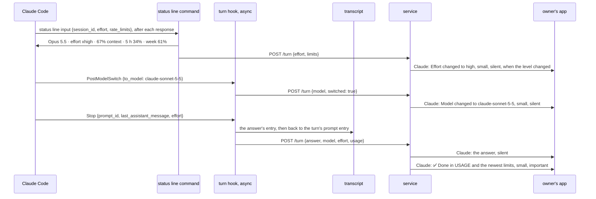
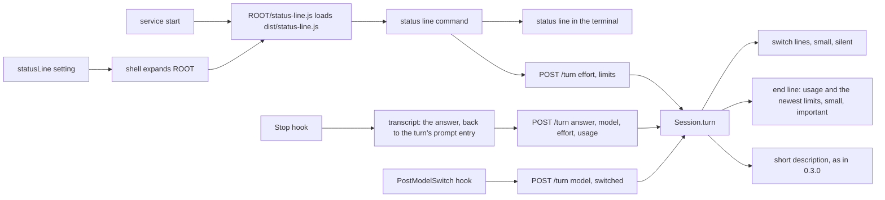

# SimpleX MCP: usage at the end of each turn, and model and effort switches

Status: Q1, Q2 and Q3 answered A by the user on 2026-11-13, with a note on Q1 that adds the subscription usage (section 1). The end line of `ep/mcp-live-answers` and the usage line are one message, as its decision 36 states (`e3be97007`), with the wording of section 2. Approved by the user on 2026-11-13, and implemented on `ep/mcp-session-usage` on top of `ep/mcp-live-answers`. Code references: master `97bbbd9ac`. Claude Code references: version 2.1.322 and its binary at the byte offsets given, version 2.1.323 where named; the transcripts of this machine; R1, the interactive session of 2026-11-12 recorded for `ep/mcp-harness-notes` with a hook that logs its input; R4, the `claude -p` run of 2026-11-12 recorded for `ep/mcp-activity` with logging tool hooks. Decisions of the 0.3.0 plan are cited as "0.3.0 decision N".

## 1. Goal

Roadmap line, [ROADMAP.md:21](../packages/simplex-chat-mcp/ROADMAP.md): "The model, effort and usage of each session show in its description, updated as they change."

The user's words, 2026-11-11, the source of that line:

> model in description - simple

> tracking usage as periodic updates, events for switching model and effort

The model and the effort level have been in the description since 0.3.0 (0.3.0 decisions 14, 31 and 122). This item adds the usage and the events.

The user's words on usage per turn, 2026-11-13:

> not in this PR, and I don't think it should be before the answer... I think it can be after the answer maybe, in small print?

> no, I'd rather send it as a separate message, so the answer can be copy-pasted in full

> it also won't clash with "read more" this way, if we implement it, though not so sure now if it's a good idea at all for flat layout... Will think about it

The user's note on Q1 A, 2026-11-13:

> can we maybe add subscription usage here too, not to include it in description?

Outcome:
- Each turn ends with one line in small print after the answer: `✅ Done in` and the turn's usage.
- A person who sets the plugin's status line command in Claude Code's settings also gets the plan's 5-hour and weekly usage in that line, and a status line in the terminal.
- A switch of the model or of the effort level gets its own line in small print.
- The description keeps the model and the effort level.

## 2. What users see

After each non-blank answer, Claude posts the end line in small print. It is the turn's alert, and every part of the answer is silent. With the status line setting:

```
!- ✅ Done in 2 min 51 s · 16.0k output tokens · 673k tokens in context · 5 h: 34% · week: 61%!
```

Without the setting:

```
!- ✅ Done in 2 min 51 s · 16.0k output tokens · 673k tokens in context!
```

The apps show the text between `!- ` and `!` smaller and in the secondary color. A notification shows it without the marks ([NtfManager.kt:134-145](../apps/multiplatform/common/src/commonMain/kotlin/chat/simplex/common/platform/NtfManager.kt#L134-L145), [Notifications.swift:200-214](../apps/ios/SimpleXChat/Notifications.swift#L200-L214)). These end lines are computed from turns of this machine's transcripts:

```
!- ✅ Done in 21 s · 1.6k output tokens · 689k tokens in context!
!- ✅ Done in 6 min 49 s · 17.6k output tokens · 751k tokens in context!
!- ✅ Done in 931 ms · 16 output tokens · 37.5k tokens in context!
```

```
part              meaning
DURATION          from the turn's first entry in the transcript to the answer's entry
OUTPUT            tokens Claude wrote in the turn's responses, thinking included, subagents excluded
CONTEXT           tokens of the context sent in the turn's last response: input, cache writes and cache reads
5 h, week         the plan's 5-hour and weekly usage, from the newest report of the status line command
```

Number formats:
```
duration       shown as            tokens           shown as        plan's usage   shown as
under 1 s      931 ms              under 1,000      861             34.7           34%
under 10 s     7.4 s               under 100,000    16.0k
under 1 min    21 s                under 1,000,000  673k
under 1 h      2 min 51 s          1,000,000 up     1.2M
1 h or more    1 h 5 min
```
The duration has the format of the step lines of `ep/mcp-activity`, by its `duration`, which `ep/mcp-live-answers` moves to `src/messages.ts`. Numbers are rounded down.

Other end lines:
```
case                                                       end line
the hook sends no usage                                    !- ✅ Done in DURATION · 5 h: 34% · week: 61%!, with DURATION of
                                                           ep/mcp-live-answers, from the prompt's hook to the Stop hook
the hook sends no usage, the turn's start unknown          !- ✅ Done · 5 h: 34% · week: 61%!
a 5-hour or weekly window whose reset time has passed      the window is left out
no report of the status line command since the service     no 5 h and week parts
started
a blank answer                                             no end line
an answer that a group preference refuses                  its refusal text, then the end line
```

The status line setting, in `~/.claude/settings.json`, one for every machine and container that shares `~/.claude`:

```json
{
  "statusLine": {
    "type": "command",
    "command": "node \"${SIMPLEX_MCP_HOME:-$HOME/.simplex-mcp}/status-line.js\""
  }
}
```

The shell expands the path to the plugin's data folder of each machine or container. The plugin's service writes `status-line.js` there at each start, pointing to its own version, so the setting stays the same across updates. Claude Code then shows this status line in the terminal:

```
Opus 5.5 · effort xhigh · 67% context · 5 h: 34% · week: 61%
```

Its parts are the model's display name, the effort level, the share of the context window in use and the plan's usage, each when Claude Code passes it. The setting replaces a status line command of the person's own.

When the model switches, or a known effort level changes, Claude posts one silent line in small print, before the other posts of that moment:

```
!- Model changed to claude-sonnet-5-5!
!- Effort changed to high!
```

The model line comes at the switch. With the status line setting, the effort line also comes at the change. Without it, the effort line comes at the end of the first turn with the new level, before its answer, or at the turn's first tool step with `ep/mcp-activity`. The first model and the first level of a session get no line.

The short description stays `MODEL · effort LEVEL`, updated as in 0.3.0. An answer no longer changes `claude-opus-5-5[1m]` there to `claude-opus-5-5` (decision 21).

Before and after:
```
moment                                  0.3.0                                  this pull request
the end of a turn                       the answer, its alert                  the answer, silent, then the end line, its alert
the chat list after a turn              the answer's last part                 the end line
/model in the terminal or Remote        "updated group profile"                the model line, then "updated group profile"
Control
/effort, with the status line setting   "updated group profile" after the      the effort line, then "updated group profile",
                                        next answer                            at the change
/effort, without it                     "updated group profile" after the      the effort line before the next answer, then
                                        next answer                            "updated group profile"
a session started with opus[1m]         "updated group profile" at the start   "updated group profile" at the start only
                                        and at the first answer
the terminal                            no status line                         the status line, with the setting
```

"updated group profile" is the event item the apps show for a change of the short description (fact 10).



## 3. Questions for the user

Answered on 2026-11-13:
- Q1 A: the figures of the transcript, plus the subscription usage by the user's note. The note is served by the status line command of option B, limited to the 5-hour and weekly usage, and opt-in.
- Q2 A: a line for each switch of the model or the effort level.
- Q3 A: the description keeps `MODEL · effort LEVEL`.

No questions are open.

## 4. Decisions

Facts:
1. Claude Code passes no usage, cost or plan limits to hooks. Every hook input is built by `Ip` (binary offset 296962410): `session_id`, `transcript_path`, `cwd`, `scratchpad_dir`, `prompt_id`, `permission_mode`, `agent_id`, `agent_type` and `effort`. Stop adds `stop_hook_active`, `last_assistant_message`, `background_tasks` and `session_crons` (296941801). PostModelSwitch adds `from_model`, `to_model`, `requested_model`, `source`, `context_tokens`, `prompt_cache_warm`, `cache_ttl`, `estimated_cache_write_usd` and `pricing` (296934919, `Ust` at 295491375). The hook events of 2.1.322 have no event for an effort change (list at 283694056).
2. The status line command gets the common input of `Ip`, `model.display_name`, `effort.level`, `cost.total_cost_usd`, `context_window` with `used_percentage`, and `rate_limits.five_hour` and `seven_day` with `used_percentage` and `resets_at` in Unix seconds (`$7r` at 297207490). A window's `used_percentage` is its utilization rounded to 0.1 and at most 100 (`FPe` at 284366090, `MEt` at 284366045). A window is present only while the API reports it and its `resets_at` has not passed (the status line documentation in the binary, 295778119). Claude Code runs the command after each response of the model, at changes of the model, the effort and other inputs (`H7r` at 297210007), and at the earliest `resets_at` (`U7r` at 297210449).
3. A plugin's `settings.json` may set only `agent` and `subagentStatusLine` in 2.1.322 (`F_s` at 288993052), and only `agent` in 2.1.323 (`DBs` at 303546152). The status line command comes from the person's settings or the managed settings (`KIt` at 294200853).
4. Claude Code runs the status line command as a hook command (`Llo` at 297086305, `MG` at 296975285): through a shell (`shell: true`), with the input on stdin, in the environment of Claude Code with `CLAUDE_PROJECT_DIR`, `CLAUDE_PID`, `CLAUDE_CODE_SESSION_ID` and `CLAUDE_EFFORT` (`Opt` at 291930737). It refuses a command with `${CLAUDE_PLUGIN_ROOT}` or `${CLAUDE_PLUGIN_DATA}` outside a plugin: "the hook is not associated with a plugin" (296978978). It replaces no other variable in a command of shell form, so the shell expands `${SIMPLEX_MCP_HOME:-$HOME/.simplex-mcp}`. Claude Code skips the command while the workspace is not trusted (297211958).
5. Claude Code installs each plugin version in its own folder, `~/.claude/plugins/cache/simplex-chat/simplex/VERSION` (`installed_plugins.json` of this machine). The plugin's data folder is `~/.simplex-mcp`, or `SIMPLEX_MCP_HOME` of the environment, one per machine or container (0.3.0 decision 120, [files.ts:31-34](../packages/simplex-chat-mcp/src/files.ts#L31-L34)). Every file of the data folder has a dot in its name (0.3.0 decision 116).
6. Each assistant entry of a transcript has `message.id` and `message.usage` with `input_tokens`, `cache_creation_input_tokens`, `cache_read_input_tokens` and `output_tokens`. Claude Code writes one entry per content block, and the entries of one response have one usage: in two transcripts of this machine, Claude Code 2.1.302 to 2.1.322, 57,556 entries of 23,092 responses, none differing. An entry of model `<synthetic>` is no response.
7. Every user entry of a turn has the turn's `promptId`: the prompt's entry, of any origin, a scheduled one included, and each tool result (R1 transcript). The Stop hook's `prompt_id` is the turn's: the 7 Stop inputs of R1, and the 3 of the `claude -p` runs recorded for 0.3.0 TESTING check 8, have the `promptId` of their turn's prompt entry.
8. The time from a turn's first entry with its `promptId` to its last assistant entry is within 2 s or 5% of Claude Code's own `turn_duration` in 1,379 of 1,519 turns, with a median ratio of 0.99 (the two transcripts of fact 6). Claude Code's figure is larger in the others: it waits for background work of the turn before it records the duration (324193302).
9. A turn's entries span more than 1 MiB in 1,176 of 8,146 turns of five transcripts of this machine, more than 16 MiB in 24, and at most 48.4 MB.
10. A change of a group's short description makes an item "updated group profile" for Claude and for every member: [Commands.hs:4242-4244](../src/Simplex/Chat/Library/Commands.hs#L4242-L4244), [Subscriber.hs:3846-3848](../src/Simplex/Chat/Library/Subscriber.hs#L3846-L3848), `sameGroupProfileInfo` compares all fields but the preferences ([Internal.hs:3338-3339](../src/Simplex/Chat/Library/Internal.hs#L3338-L3339)). The item is not counted as unread ([CIContent.hs:242](../src/Simplex/Chat/Messages/CIContent.hs#L242)).
11. `!- TEXT!` is small text: TEXT starts with a character other than a space or `!`, has no `!` and does not end with a space ([Markdown.hs:435-441](../src/Simplex/Chat/Markdown.hs#L435-L441), [:974](../src/Simplex/Chat/Markdown.hs#L974)). The apps render it since v6.5.0 (#6697); session groups need v7.1.0. Android and desktop draw it at the `body2` size in the secondary color ([ChatModel.kt:5356](../apps/multiplatform/common/src/commonMain/kotlin/chat/simplex/common/model/ChatModel.kt#L5356)).
12. Of the turn hooks, only Stop has `effort`. `Ip` adds it only when it gets the turn's options (296962410). The UserPromptSubmit inputs of R1 have none, and PostModelSwitch builds its input without the options (296934919). Tool hooks have it (R4).
13. SessionStart's `model` is the resolved initial model, and PostModelSwitch's `to_model` the resolved model (304240055, 303322971). Resolution keeps `[1m]` for the 1M context variant (`q$` at 286847171, `fY` at 286823298). The transcript's `message.model` has no suffix: on this machine the settings have `opus[1m]` and the transcript `claude-opus-5-5`. So in 0.3.0 the first answer after a start or a switch to `X[1m]` changes the description to `X` ([hub.ts:187-193](../packages/simplex-chat-mcp/src/hub.ts#L187-L193)).
14. Claude Code's record of a running process, `~/.claude/sessions/PID.json`, which `ep/mcp-session-list` reads, has no usage: its fields are `pid`, `sessionId`, `cwd`, `startedAt`, `version`, `kind`, `entrypoint`, `name`, `status` and their times (the records of this machine).
15. A Node script that reads a hook input and posts it to a Unix socket takes a median of 112 ms; loading `dist/hook.js` takes 261 ms, because `files.ts` loads `log.ts`, which loads `simplex-chat` (fact 15 of `ep/mcp-live-answers`).

Choices:

16. The Stop hook computes the usage text, `DURATION · OUTPUT output tokens · CONTEXT tokens in context`, the wording settled with `ep/mcp-live-answers`. It finds the answer's entry as `answerModel` does now ([hook.ts:137-145](../packages/simplex-chat-mcp/src/hook.ts#L137-L145)). The turn's first entry is the first user entry of the main conversation with `promptId` equal to the hook's `prompt_id` that is not a tool result. When the tail of the answer's read lacks it, the hook reads tails of 4, 16 and 64 MiB, in order, until one has it. Fact 9 puts every turn of this machine within 64 MiB. The hook parses only the lines with that prompt ID or of an assistant entry.
17. OUTPUT is the sum of `output_tokens` over the distinct `message.id` of the assistant entries after the first entry, without `isSidechain` and without `<synthetic>` (fact 6). CONTEXT is `input_tokens + cache_creation_input_tokens + cache_read_input_tokens` of the answer's entry, as Claude Code computes the context in use (`ngt` at 297207048). DURATION is the answer's `timestamp` minus the first entry's (fact 8).
18. The hook sends no usage when the input has no `prompt_id`, when the answer's entry is not found, is `<synthetic>` or has no `message.usage`, or when the first entry is not within 64 MiB.
19. The end line is decision 36 of `ep/mcp-live-answers`: `!- ✅ Done in FIGURES!`, priority 1, the turn's last post after a non-blank answer, also after the refusal text of a refused answer, with every part of the answer silent. FIGURES is the hook's usage text, or DURATION of `ep/mcp-live-answers` without it; without both, the line is `✅ Done`. The hub appends ` · 5 h: N%` and ` · week: N%` for the windows of the newest limits whose `resets_at` has not passed. This replaces the silent usage line of the plan's first version: the line is important and starts with `✅ Done in `, and every part of the answer is silent. Whichever of the two items merges first adds the line in this form, with its own figures: this item, as the last message of the answer's send, with the usage text, or `✅ Done` without it. The second adds its part.
20. The plugin's status line command, `dist/status-line.js`, reads its input, prints the status line of section 2, and then sends `{id: session_id, pid: CLAUDE_PID, at, effort, limits}` as `POST /turn` with `postToService` of `service-request.ts`. `limits` holds `fiveHour` and `week`, each `{percent, resetsAt}`, from `rate_limits`. It waits at most 1 s for the reply, starts no service, makes no retry and prints nothing about failures. It loads only Node modules, `paths.ts` and `service-request.ts`, the modules of decision 18 of `ep/mcp-live-answers`, which import only Node modules and each other (fact 15). When this item merges first, it adds the two modules as that decision describes them.
21. An answer's model equal to the shown model without `[1m]` keeps the shown model. So the description and `session.json` keep `claude-opus-5-5[1m]`, and no "updated group profile" follows the first answer (fact 13).
22. At each start, the service writes `ROOT/status-line.js`, which imports `status-line.js` of the service's own `dist` folder by its file URL and runs its `runStatusLine`. A dynamic import works also when an enclosing `package.json` makes the folder an ES module scope. It writes a temporary file and renames it into place, readable only by the user; a failed write is logged and the service runs on. A newer plugin's service rewrites it, so the setting of section 2 keeps working across updates (facts 4 and 5).
23. The hub keeps the limits of the newest request by `at`, in memory, per session. A window whose `resetsAt` has passed is left out of the end line, as Claude Code leaves it out of the status line input (fact 2).
24. Q2 A: the PostModelSwitch hook sends `switched: true`. The hub posts `Model changed to MODEL` for a switched model that differs from the shown one. It posts `Effort changed to LEVEL` when the shown level was known and the new one differs, from any request, the status line's included. A model of SessionStart gets no line, as it starts the session. A model of an answer gets none, as its format lacks `[1m]` (fact 13). The status line command sends no model.
25. The switch lines are one silent send in small print, before the note, the terminal prompt and the answer of the request. They follow the `at` rule of the description: a value older than the one taken last gets no line (0.3.0 decision 122).
26. A text with `!` is posted without the small style, as a model name with `!` would end it early (fact 11).
27. Q3 A: the short description stays `MODEL · effort LEVEL`. The limits never enter it.
28. The lines of `ep/mcp-session-list` stay without usage, and this item reads nothing from Claude Code's process record (fact 14).
29. A turn that a blocking Stop hook continues keeps its `prompt_id`, so its second end line counts from the turn's start.
30. The protocol version stays 1: `usage`, `switched` and `limits` are optional, and a service without them posts no lines for them.

## 5. Design

Where the figures of a turn come from:
```
option                                producer                      consumer (hub)          wire                    cost
T. Stop hook reads the transcript     the answer's read, and up     the text into the       + usage, a short text   one more read for 14% of turns
   (chosen)                           to 64 MiB back for the turn   end line
N. the hook sends numbers             as T                          formats them            + three numbers         the hub learns the formats, and
                                                                                                                    the end line of live-answers
                                                                                                                    takes a text
```

Where the plan's usage comes from:
```
option                                       setup                         cost
S. the person's status line setting runs     one setting, the same for     a Node process per status line update,
   the plugin's command (chosen)             every version                 about 0.1 s; replaces an own status line
P. the plugin sets the status line           none                          impossible: plugins can't set it (fact 3)
O. the service reads claude.ai with the      none                          reads the account's token: outside the
   account's token                                                         trust model (Q1 C, not chosen)
```

The command's path:
```
option                                                  cost
ROOT/status-line.js, written by the service (chosen)    the shell expands ROOT; the file follows the running version
${CLAUDE_PLUGIN_ROOT}/dist/status-line.js               refused outside a plugin (fact 4)
~/.claude/plugins/cache/.../VERSION/dist/...            changes at each update (fact 5)
npx -y @simplex-chat/mcp status-line                    a registry lookup at each update of the status line, and the
                                                        latest version, not the running one
```

How a model switch is known:
```
option                                        cost
the hook marks PostModelSwitch (chosen)       one boolean on the wire
every change of the shown model               a line at each answer that drops [1m] (fact 13)
```

Changes, on top of `ep/mcp-activity` and `ep/mcp-live-answers`:
```
file                  function             change
src/protocol.ts       TurnRequest          + usage?: string, + switched?: boolean,
                                           + limits?: {fiveHour?: Window, week?: Window}, Window {percent, resetsAt}
src/status-line.ts    new                  decision 20
src/service.ts        Service.start,       writes ROOT/status-line.js after the hub opens, from ServiceDeps.statusLine,
                      productionDeps       which productionDeps sets to dist/status-line.js (decision 22)
src/files.ts          writeStatusLine      the launcher, import(URL).then(module => module.runStatusLine()), through a
                                           temporary file
src/hook.ts           TranscriptEntry      + timestamp, message.id, message.usage
                      turn                 Stop: model and usage from answerRecord; PostModelSwitch: switched true
                      answerModel ->       the answer's entry as now, then turnUsage on the same tail, or on the
                      answerRecord         tails of 4, 16 and 64 MiB
                      lastAnswer           returns the entry's index with its text and model
                      turnUsage            the text of decisions 16 and 17, or undefined
                      tokens               the token format of section 2
                      duration             imported from src/messages.ts of ep/mcp-live-answers, or from
                                           hook.ts of ep/mcp-activity when this item merges first
src/hub.ts            Session.turn         the answer's model of decision 21; switch lines before the other posts;
                                           limits kept by at
                      end line             FIGURES from usage, then the windows of the limits (decision 19)
                      small                !- TEXT!, or TEXT with a !
```

Status line command:
```
on its input {session_id, model, effort, context_window, rate_limits}:
  print: model.display_name, "effort " + effort.level, used_percentage + "% context", "5 h: N%", "week: N%",
         the parts present, joined by " · "
  then:  postToService POST /turn {id: session_id, pid: CLAUDE_PID, at, effort: effort.level,
                                   limits: {fiveHour, week} from rate_limits}, at most 1 s; no service start, no retry
```

Hook, at Stop:
```
on Stop {transcript_path, prompt_id, last_assistant_message}:
  tail, answer = the last assistant entry of the tail whose text is the answer, up to 20 reads 100 ms apart
  model  = answer.message.model, not <synthetic>
  usage  = prompt_id and answer not synthetic:
             first = the first user entry with promptId = prompt_id, not a tool result, not a subagent's
             in tail, else in the tails of 4, 16, 64 MiB
             first found: DURATION · OUTPUT output tokens · CONTEXT tokens in context
POST /turn {id, pid, at, answer, model, effort, usage?}
on PostModelSwitch {to_model}: POST /turn {id, pid, at, model: to_model, switched: true}
```

Hub:
```
on POST /turn {at, answer, model, switched, effort, usage, limits}:
  answer given and shown model without [1m] = model:   model = shown model
  newModel, newEffort = the values not older than those taken last, as now
  limits not older than those kept:                     limits kept
  lines += "Model changed to " + newModel      when switched and newModel differs from the shown model
  lines += "Effort changed to " + newEffort    when the shown effort is known and newEffort differs
  description and session.json as now
  posts: small(lines), silent  ->  note  ->  User's prompt  ->  the answer, silent  ->
         answer not blank: small("✅ Done" + (" in " + FIGURES, when known) + windows not reset), important
         ->  the short description when it changed
```



## 6. Compatibility

- Older SimpleX apps: the members of session groups have v7.1.0 or later, which render small text (fact 11). Before receivers support priorities, every post alerts, as in `ep/mcp-activity`.
- Older Claude Code: a Stop input without `prompt_id`, or a transcript without `message.usage`, gives no usage; the end line keeps the duration of `ep/mcp-live-answers`. Without PostModelSwitch, no model line; the description follows the answers as in 0.3.0. A version without `rate_limits` in the status line input gives an end line without the plan's usage.
- Without the status line setting: no status line in the terminal, no plan's usage in the end line, and the effort line at the end of a turn.
- Older plugin data folders: `session.json` keeps its fields. A stored model without `[1m]` changes once to the suffixed one at the next session start that passes it. `status-line.js` appears at the first service start of this version.
- Older service: the hook of this version stops an older service ([client.ts:37-40](../packages/simplex-chat-mcp/src/client.ts#L37-L40)); an older service ignores `usage`, `switched` and `limits`.
- `serve`: unchanged.

## 7. Acceptance and tests

Done when:
```
#  criterion                                                                                       checked by
1  Stop sends the usage text of its turn: duration, output tokens of distinct responses, context    unit: hook
2  the turn's first entry is found past 1 MiB, and no usage is sent past 64 MiB                      unit: hook
3  no usage without prompt_id, for a synthetic answer, and without the turn's prompt entry          unit: hook
4  PostModelSwitch sends switched: true                                                            unit: hook
5  the status line command prints the line of section 2 and sends effort and limits                unit: status-line
6  the status line command loads only Node modules, paths.ts and service-request.ts, and prints    unit: status-line
   its line without a service
7  the service writes ROOT/status-line.js, which runs its own dist/status-line.js                  unit: service; e2e: launch
8  the end line has the usage and the windows of the newest limits not reset, small, important    unit: sessions
9  the switch lines: a switched model, a changed known effort, also from the status line; none     unit: sessions
   for first values or older at
10 an answer's model without [1m] keeps the shown model and the description                        unit: sessions
11 a group member receives the answer and the end line with the turn's and the plan's usage        e2e
12 real session with the setting: the status line, the end line with 5 h and week, the effort      TESTING check 8
   line at /effort; without the setting, the end line without them
```

Tests:
- `test/unit/hook.test.ts`, in "turn hooks", new: "pass the usage of a Stop hook's turn from its transcript: the time from the turn's prompt entry to the answer, the output tokens of its distinct responses and the context of the answer, also when the prompt entry is more than 1 MiB back, and none past 64 MiB, without a prompt ID or for a synthetic answer". The transcript has an earlier turn, a meta entry, entries of one response with one usage, a tool result and a subagent's entry. It fails on master, which sends no `usage`.
- `test/unit/hook.test.ts`, changed: "pass the prompt, the final answer with the effort, and the new model ..." expects `switched: true` for PostModelSwitch.
- `test/unit/status-line.test.ts`, new: "print the model, effort, context and the plan's usage of a status line input, and send the effort and the limits with the session ID and Claude Code's process", with a status line input built from the fields of fact 2; "print the line without a service and without rate limits"; "load only Node modules, paths.ts and service-request.ts", which reads the imports of `status-line.ts`, as the test of decision 18 of `ep/mcp-live-answers` reads those of its three modules.
- `test/unit/service.test.ts`, new: "write status-line.js into the data folder at the start, loading the status line command of its own build, in place of an older one".
- `test/unit/sessions.test.ts`, in "session channel", new:
  - "posts the end line with the turn's usage and the plan's usage of the newest status line report, leaving out a window whose reset time has passed, in small print as important after the silent answer".
  - "posts a line when the model switches and when a known effort level changes, also from the status line, before the other posts of the request, and none for a first value, a model of an answer or a value older than the one taken last". Its effort part compiles on master and fails there.
  - "keeps the shown model with [1m] and its description when an answer's model is that model without [1m]".
- `test/e2e/service.test.ts`, the mirroring test, changed: the transcript entries get timestamps, message IDs and usage, and Alice receives `!- ✅ Done in 2.0 s · 861 output tokens · 35.6k tokens in context!` after `Fixed.`. After a status line request with limits, the next turn's end line ends with ` · 5 h: 34% · week: 61%`. It fails on master.
- `test/e2e/launch.test.ts`, changed: `writeStatusLine` writes `status-line.js` for the unpacked package's `dist/status-line.js`, and the setting's command, run by `sh`, prints a status line from it, with `SIMPLEX_MCP_HOME` and with `~/.simplex-mcp`, without an install. The unit test of the service checks that `Service.start` writes the file.
- Run: `npm test --prefix packages/simplex-chat-mcp`, and the end-to-end tests as TESTING.md states, in the reduced build. No app changes, so no app test workflows.

## 8. Docs to change

- `README.md:36`: each turn ends with a line in small print with its time and tokens. A new optional step: the status line setting, for the plan's usage.
- `REFERENCE.md`: "Prompts and answers" (603-642), the end line; "Model and effort" (656-658) becomes "Model, effort and usage", with the switch lines, decision 21, and a part "Status line" with the setting, the terminal line and the cases of section 2; "Plugin data folder" (676-691), `status-line.js`.
- `ROADMAP.md:21`: removed.
- `spec/api.md`: 4.3, the posts table (772-781) and the group profile (818-832); 4.6, `POST /turn` (887); 4.8, the hook inputs (1018) and the status line command.
- `spec/architecture.md`: 8.2, `hook.ts` (914), `status-line.ts`, `Session.turn` (857); 8.3, the limits in memory and `status-line.js` among the files; 8.6, the wire (1116) and the rules (1138-1146).
- `spec/flows.md`: flow 21, the Stop request and its notes (986-1049); the model switch; a new flow, the status line command.
- `TESTING.md`: the automated tests (156, 173); check 8 (202), with the setting.

## 9. Conflict areas with the other items

```
file                          where                                          items
the end line                  text, priority, the answer's silent parts      mcp-live-answers: one line (its decision 36); the
                                                                             second to merge adds its part
src/hub.ts                    Session.turn, answer, post                     mcp-activity (priorities, steps), mcp-live-answers,
                                                                             mcp-replies, mcp-reactions
src/hook.ts                   turn, TurnInput, TranscriptEntry, lastAnswer,  mcp-activity (step text, duration), mcp-live-answers
                              answerModel                                    (duration moved to messages.ts), mcp-context-summary
src/paths.ts,                 dataRoot, socketPath, postToService            mcp-live-answers, which adds them (its decision 18)
src/service-request.ts
src/service.ts                runService                                     mcp-fixes (launcher, readyChannel), mcp-activity
src/protocol.ts               TurnRequest (48-59)                            mcp-activity (step), mcp-live-answers (text),
                                                                             mcp-replies, mcp-context-summary
test/unit/hook.test.ts        "turn hooks" (120-516)                         mcp-activity, mcp-live-answers
test/unit/sessions.test.ts    "session channel" (538-1378)                   mcp-activity, mcp-live-answers, mcp-replies,
                                                                             mcp-reactions
test/e2e/service.test.ts      the mirroring test (351-424)                   mcp-activity, mcp-live-answers, mcp-replies
REFERENCE.md, spec            "Prompts and answers", 4.3, 4.6, 8.6, flow 21  mcp-activity, mcp-live-answers, mcp-replies
ROADMAP.md                    line 21 and its neighbours                     mcp-session-list, mcp-context-summary
the line of a session         usage in the Main group's list                 mcp-session-list: none, by decision 28
```

This item uses the priorities of `ep/mcp-activity` and merges after it. It can merge before or after `ep/mcp-live-answers`: the first of the two adds the end line, `paths.ts` and `service-request.ts`, and the second uses them (decisions 19 and 20). `ep/mcp-live-answers` moves `duration` to `src/messages.ts`; this item imports it from there when it merges second, and from `src/hook.ts` otherwise.

## 10. Estimate

```
part                                 source lines   test lines
hook.ts                              70             90
status-line.ts, service.ts, files.ts 45             70
hub.ts, protocol.ts                  35             100
e2e                                                 30
docs                                 70 lines of text
```
About one and a half working days, with two review rounds.
