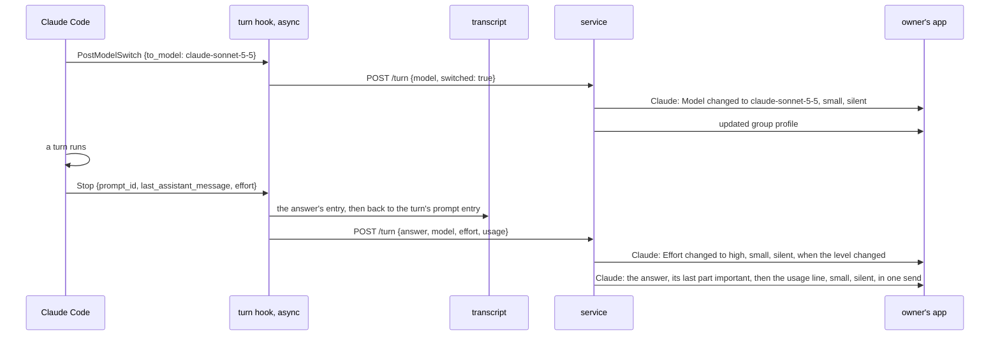
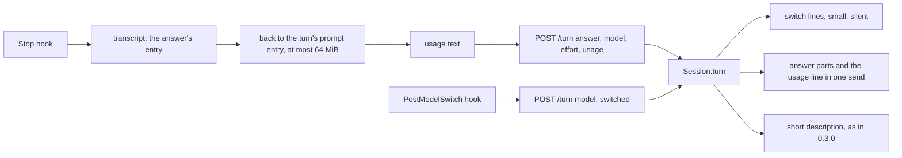

# SimpleX MCP: usage after each answer, and model and effort switches

Status: plan for review. Code references: master `97bbbd9ac`. Claude Code references: version 2.1.322 and its binary at the byte offsets given, version 2.1.323 where named; the transcripts of this machine; R1, the interactive session of 2026-11-12 recorded for `ep/mcp-harness-notes` with a hook that logs its input; R4, the `claude -p` run of 2026-11-12 recorded for `ep/mcp-activity` with logging tool hooks. Decisions of the 0.3.0 plan are cited as "0.3.0 decision N".

## 1. Goal

Roadmap line, [ROADMAP.md:21](../packages/simplex-chat-mcp/ROADMAP.md): "The model, effort and usage of each session show in its description, updated as they change."

The user's words, 2026-11-11, the source of that line:

> model in description - simple

> tracking usage as periodic updates, events for switching model and effort

The model and the effort level have been in the description since 0.3.0 (0.3.0 decisions 14, 31 and 122). This item adds the usage and the events.

The user's words on usage per turn, 2026-11-13:

> not in this PR, and I don't think it should be before the answer... I think it can be after the answer maybe, in small print?

> no, I'd rather send it as a separate message, so the answer can be copy-pasted in full

> it also won't clash with "read more" this way, if we implement it, though not so sure now if it's a good idea at all for flat layout... Will think about it

Outcome:
- After each answer, Claude posts one line in small print with the turn's usage.
- A switch of the model or of the effort level gets its own line in small print.
- The description keeps the model and the effort level (Q3).

## 2. What users see

After each posted answer, Claude posts one silent line in small print. These lines are computed from turns of this machine's transcripts:

```
!- 2 min 51 s · 16.0k output tokens · 673k tokens in context!
!- 21 s · 1.6k output tokens · 689k tokens in context!
!- 6 min 49 s · 17.6k output tokens · 751k tokens in context!
!- 931 ms · 16 output tokens · 37.5k tokens in context!
```

The apps show the text between `!- ` and `!` smaller and in the secondary color.

```
part              meaning
DURATION          from the turn's first entry in the transcript to the answer's entry
OUTPUT            tokens Claude wrote in the turn's responses, thinking included, subagents excluded
CONTEXT           tokens of the context sent in the turn's last response: input, cache writes and cache reads
```

Number formats:
```
duration       shown as            tokens           shown as
under 1 s      931 ms              under 1,000      861
under 10 s     7.4 s               under 100,000    16.0k
under 1 min    21 s                under 1,000,000  673k
under 1 h      2 min 51 s          1,000,000 up     1.2M
1 h or more    1 h 5 min
```
The duration has the format of the step lines of `ep/mcp-activity`. Numbers are rounded down.

When the model switches, or a known effort level changes, Claude posts one silent line in small print, before the other posts of that moment:

```
!- Model changed to claude-sonnet-5-5!
!- Effort changed to high!
```

The model line comes at the switch. The effort line comes at the end of the first turn with the new level, before its answer. With `ep/mcp-activity` it comes at the turn's first tool step. The first model and the first level of a session get no line.

The short description stays `MODEL · effort LEVEL`, updated as in 0.3.0. An answer no longer changes `claude-opus-5-5[1m]` there to `claude-opus-5-5` (decision 19).

Before and after:
```
moment                                  0.3.0                                  this pull request
an answer                               the answer                             the answer, then the usage line
the chat list after a turn              the answer's last part                 the usage line, the chat's last message
/model in the terminal or Remote        "updated group profile"                the model line, then "updated group profile"
Control
/effort, then a turn                    "updated group profile" after the      the effort line before the answer, then
                                        answer                                 "updated group profile"
a session started with opus[1m]         "updated group profile" at the start   "updated group profile" at the start only
                                        and at the first answer
a blank or refused answer               nothing, or the refusal text           the same, no usage line
```

"updated group profile" is the event item the apps show for a change of the short description (fact 10).



## 3. Questions for the user

Q1. Which figures does the usage line show?
- A, recommended: the turn's duration, its output tokens and the tokens in context, read from the session's transcript. They exist in every session, without setup. The context shows as tokens, not as a percentage: the context window of a model is decided inside Claude Code (fact 2).
- B: also the plan's 5-hour and weekly limits as percentages, the cost in USD and the context as a percentage. Claude Code gives these only to the status line command of a person's settings, and a plugin cannot set that command (facts 2 and 3). Each person would set `statusLine` to the plugin's command on each machine, in place of a status line of their own. The command's path names the plugin's version, so each update changes it. About 150 more source lines.
- C: the plan limits read by the plugin from claude.ai. The plugin would read the access token of the person's Claude account from Claude Code's credentials. Not recommended: it takes the plugin outside its trust model.

Q2. Does a switch of the model or the effort level get a line in the group?
- A, recommended: yes, `Model changed to MODEL` and `Effort changed to LEVEL`, small and silent. This is how this plan reads "events for switching model and effort". Cost: about 20 source lines.
- B: no. The description changes, and the apps show "updated group profile", which does not say what changed.

Q3. Does the usage also go into the group's description?
- A, recommended: no. The description keeps `MODEL · effort LEVEL`, which changes rarely. The usage is in the line after each answer.
- B: yes, for example `claude-opus-5-5[1m] · effort xhigh · 751k tokens in context`, updated after each answer. Each update adds "updated group profile" to the chat of every member and sends the group's profile to every member (fact 10). The description shows at the top of the chat and in the group's info, not in the chat list.

## 4. Decisions

Facts:
1. Claude Code passes no usage, cost or plan limits to hooks. Every hook input is built by `Ip` (binary offset 296962410): `session_id`, `transcript_path`, `cwd`, `scratchpad_dir`, `prompt_id`, `permission_mode`, `agent_id`, `agent_type` and `effort`. Stop adds `stop_hook_active`, `last_assistant_message`, `background_tasks` and `session_crons` (296941801). PostModelSwitch adds `from_model`, `to_model`, `requested_model`, `source`, `context_tokens`, `prompt_cache_warm`, `cache_ttl`, `estimated_cache_write_usd` and `pricing` (296934919, `Ust` at 295491375). The hook events of 2.1.322 have no event for an effort change (list at 283694056).
2. The status line command gets `cost.total_cost_usd`, `context_window` with `context_window_size` and `used_percentage`, and `rate_limits.five_hour` and `seven_day` with `used_percentage` (`$7r` at 297207490, `ngt` at 297207048). Claude Code runs it after each answer of the model and at changes of the model, effort and other inputs (`H7r` at 297210007). The context window size comes from `og` (286855732), which reads a model catalog, server flags and the environment.
3. A plugin's `settings.json` may set only `agent` and `subagentStatusLine` in 2.1.322 (`F_s` at 288993052), and only `agent` in 2.1.323 (`DBs` at 303546152).
4. Each assistant entry of a transcript has `message.id` and `message.usage` with `input_tokens`, `cache_creation_input_tokens`, `cache_read_input_tokens` and `output_tokens`. Claude Code writes one entry per content block, and the entries of one response have one usage: in two transcripts of this machine, Claude Code 2.1.302 to 2.1.322, 57,556 entries of 23,092 responses, none differing. An entry of model `<synthetic>` is no response.
5. Every user entry of a turn has the turn's `promptId`: the prompt's entry, of any origin, a scheduled one included, and each tool result (R1 transcript). The Stop hook's `prompt_id` is the turn's: the 7 Stop inputs of R1, and the 3 of the `claude -p` runs recorded for 0.3.0 TESTING check 8, have the `promptId` of their turn's prompt entry.
6. The time from a turn's first entry with its `promptId` to its last assistant entry is within 2 s or 5% of Claude Code's own `turn_duration` in 1,379 of 1,519 turns, with a median ratio of 0.99 (the two transcripts of fact 4). Claude Code's figure is larger in the others: it waits for background work of the turn before it records the duration (324193302).
7. A turn's entries span more than 1 MiB in 1,176 of 8,146 turns of five transcripts of this machine, more than 16 MiB in 24, and at most 48.4 MB.
8. Of the turn hooks, only Stop has `effort`. `Ip` adds it only when it gets the turn's options (296962410). The UserPromptSubmit inputs of R1 have none, and PostModelSwitch builds its input without the options (296934919). Tool hooks have it (R4), so with `ep/mcp-activity` a change is known at the next tool step.
9. SessionStart's `model` is the resolved initial model, and PostModelSwitch's `to_model` the resolved model (304240055, 303322971). Resolution keeps `[1m]` for the 1M context variant (`q$` at 286847171, `fY` at 286823298). The transcript's `message.model` has no suffix: on this machine the settings have `opus[1m]` and the transcript `claude-opus-5-5`. So in 0.3.0 the first answer after a start or a switch to `X[1m]` changes the description to `X` ([hub.ts:187-193](../packages/simplex-chat-mcp/src/hub.ts#L187-L193)).
10. A change of a group's short description makes an item "updated group profile" for Claude and for every member: [Commands.hs:4242-4244](../src/Simplex/Chat/Library/Commands.hs#L4242-L4244), [Subscriber.hs:3846-3848](../src/Simplex/Chat/Library/Subscriber.hs#L3846-L3848), `sameGroupProfileInfo` compares all fields but the preferences ([Internal.hs:3338-3339](../src/Simplex/Chat/Library/Internal.hs#L3338-L3339)). The item is not counted as unread ([CIContent.hs:242](../src/Simplex/Chat/Messages/CIContent.hs#L242)). The apps show the short description at the top of the chat ([ChatView.kt:2392-2397](../apps/multiplatform/common/src/commonMain/kotlin/chat/simplex/common/views/chat/ChatView.kt#L2392-L2397)) and in the group's info.
11. `!- TEXT!` is small text: TEXT starts with a character other than a space or `!`, has no `!` and does not end with a space ([Markdown.hs:435-441](../src/Simplex/Chat/Markdown.hs#L435-L441), [:974](../src/Simplex/Chat/Markdown.hs#L974)). The apps render it since v6.5.0 (#6697); session groups need v7.1.0. Android and desktop draw it at the `body2` size in the secondary color ([ChatModel.kt:5356](../apps/multiplatform/common/src/commonMain/kotlin/chat/simplex/common/model/ChatModel.kt#L5356)).
12. The chat list shows a chat's last item ([ChatPreviewView.kt:228](../apps/multiplatform/common/src/commonMain/kotlin/chat/simplex/common/views/chatlist/ChatPreviewView.kt#L228)).
13. One `apiSendMessages` sends its messages in order, with no limit on their number ([Commands.hs:4965-5010](../src/Simplex/Chat/Library/Commands.hs#L4965-L5010)). Two sends of one request can be separated by a post of another request ([sessions.test.ts:928-942](../packages/simplex-chat-mcp/test/unit/sessions.test.ts#L928-L942)).
14. Claude Code's record of a running process, `~/.claude/sessions/PID.json`, which `ep/mcp-session-list` reads, has no usage: its fields are `pid`, `sessionId`, `cwd`, `startedAt`, `version`, `kind`, `entrypoint`, `name`, `status` and their times (the records of this machine).

Choices:

15. Q1 A: the line is `DURATION · OUTPUT output tokens · CONTEXT tokens in context`, in the formats of section 2.
16. The Stop hook computes the line from the transcript. It finds the answer's entry as `answerModel` does now ([hook.ts:137-145](../packages/simplex-chat-mcp/src/hook.ts#L137-L145)). The turn's first entry is the first user entry of the main conversation with `promptId` equal to the hook's `prompt_id` that is not a tool result. When the tail of the answer's read lacks it, the hook reads tails of 4, 16 and 64 MiB, in order, until one has it. Fact 7 puts every turn of this machine within 64 MiB. The hook parses only the lines with that prompt ID or of an assistant entry.
17. OUTPUT is the sum of `output_tokens` over the distinct `message.id` of the assistant entries after the first entry, without `isSidechain` and without `<synthetic>` (fact 4). CONTEXT is `input_tokens + cache_creation_input_tokens + cache_read_input_tokens` of the answer's entry, as Claude Code computes `used_percentage` (`ngt`). DURATION is the answer's `timestamp` minus the first entry's (fact 6).
18. The hook sends no usage when the input has no `prompt_id`, when the answer's entry is not found, is `<synthetic>` or has no `message.usage`, or when the first entry is not within 64 MiB.
19. An answer's model equal to the shown model without `[1m]` keeps the shown model. So the description and `session.json` keep `claude-opus-5-5[1m]`, and no "updated group profile" follows the first answer (fact 9).
20. The hook sends the line's text as `usage` in `POST /turn`. The hub posts `!- usage!` as the last message of the answer's send, so it follows the answer's last part with nothing between (fact 13). It is silent, priority −1, with the priorities that `ep/mcp-activity` adds to `Session.post`. The answer's last part stays important. Without a posted answer, the line is not posted: a blank answer posts nothing, and a refused answer is replaced by its refusal text alone.
21. Q2 A: the PostModelSwitch hook sends `switched: true`. The hub posts `Model changed to MODEL` for a switched model that differs from the shown one. It posts `Effort changed to LEVEL` when the shown level was known and the new one differs. A model of SessionStart gets no line, as it starts the session. A model of an answer gets none, as its format lacks `[1m]` (fact 9).
22. The switch lines are one silent send in small print, before the note, the terminal prompt and the answer of the request. They follow the `at` rule of the description: a value older than the one taken last gets no line (0.3.0 decision 122).
23. A text with `!` is posted without the small style, as a model name with `!` would end it early (fact 11).
24. Q3 A: the short description stays `MODEL · effort LEVEL`.
25. The lines of `ep/mcp-session-list` stay without usage, and this item reads nothing from Claude Code's process record (fact 14).
26. A turn that a blocking Stop hook continues keeps its `prompt_id`, so its second answer's line counts from the turn's start.
27. The protocol version stays 1: `usage` and `switched` are optional, and a service without them posts no lines.

## 5. Design

Where the figures come from:
```
option                                producer                      consumer (hub)          wire                    cost
T. Stop hook reads the transcript     the answer's read, and up     posts the text          + usage, a short text   one more read for 14% of turns
   (chosen)                           to 64 MiB back for the turn
N. the hook sends numbers             as T                          formats them            + four numbers          the hub learns the formats; no
                                                                                                                    second consumer
S. a status line command              each person sets statusLine   formats them            + a new route           setup on each machine, version
                                      (Q1 B)                                                                        in the path, a process per update
O. claude.ai usage endpoint (Q1 C)    the service, with the         formats them            none                    reads the account's token
                                      account's token
```
T costs one extra read in 14% of turns (fact 7) and serves the line with the producer that already reads the transcript.

Where the line goes:
```
option                                        cost
last message of the answer's send (chosen)    one more message in a send that exists
a separate send after the answer              a post of another request can come between them (fact 13)
inside the answer's last part                 the answer can't be copied whole (the user's words)
the description (Q3 B)                        "updated group profile" in every member's chat after each answer
```

How a model switch is known:
```
option                                        cost
the hook marks PostModelSwitch (chosen)       one boolean on the wire
every change of the shown model               a line at each answer that drops [1m] (fact 9)
```

Changes:
```
file              function             change
src/protocol.ts   TurnRequest          + usage?: string, + switched?: boolean
src/hook.ts       TranscriptEntry      + timestamp, message.id, message.usage
                  turn                 Stop: model and usage from answerRecord; PostModelSwitch: switched true
                  answerModel ->       the answer's entry as now, then turnUsage on the same tail, or on the
                  answerRecord         tails of 4, 16 and 64 MiB
                  lastAnswer           returns the entry's index with its text and model
                  turnUsage            the line of decision 17, or undefined
                  tokens               the token format of section 2
                  duration             the format of ep/mcp-activity, shared
src/hub.ts        Session.turn         the answer's model of decision 19; switch lines before the other posts
                  Session.answer       + usage: the small line appended to the parts, priority -1
                  small                !- TEXT!, or TEXT with a !
```

Hook, at Stop:
```
on Stop {transcript_path, prompt_id, last_assistant_message}:
  tail, answer = the last assistant entry of the tail whose text is the answer, up to 20 reads 100 ms apart
  model  = answer.message.model, not <synthetic>
  usage  = prompt_id and answer not synthetic:
             first = the first user entry with promptId = prompt_id, not a tool result, not a subagent's
             in tail, else in the tails of 4, 16, 64 MiB
             first found: DURATION · OUTPUT output tokens · CONTEXT tokens in context
POST /turn {id, pid, at, answer, model, effort, usage?}
on PostModelSwitch {to_model}: POST /turn {id, pid, at, model: to_model, switched: true}
```

Hub:
```
on POST /turn {at, answer, model, switched, effort, usage}:
  answer given and shown model without [1m] = model:   model = shown model
  newModel, newEffort = the values not older than those taken last, as now
  lines += "Model changed to " + newModel      when switched and newModel differs from the shown model
  lines += "Effort changed to " + newEffort    when the shown effort is known and newEffort differs
  description and session.json as now
  posts: small(lines), silent  ->  note  ->  User's prompt  ->  answer parts and small(usage), the last answer part
         important, the usage line silent  ->  the short description when it changed
```



## 6. Compatibility

- Older SimpleX apps: the members of session groups have v7.1.0 or later, which render small text (fact 11). Before receivers support silent messages, each line alerts as a normal message (`ep/mcp-activity` Q2).
- Older Claude Code: a Stop input without `prompt_id`, or a transcript without `message.usage`, gives no usage line. Without PostModelSwitch, no model line; the description follows the answers as in 0.3.0.
- Older plugin data folders: `session.json` keeps its fields. A stored model without `[1m]` changes once to the suffixed one at the next session start that passes it.
- Older service: the hook of this version stops an older service ([client.ts:37-40](../packages/simplex-chat-mcp/src/client.ts#L37-L40)); an older service ignores `usage` and `switched`.
- `serve`: unchanged.

## 7. Acceptance and tests

Done when:
```
#  criterion                                                                                       checked by
1  Stop sends the usage text of its turn: duration, output tokens of distinct responses, context    unit: hook
2  the turn's first entry is found past 1 MiB, and no usage is sent past 64 MiB                      unit: hook
3  no usage without prompt_id, for a synthetic answer, and without the turn's prompt entry          unit: hook
4  PostModelSwitch sends switched: true                                                            unit: hook
5  the usage line follows the answer's last part in its send, small and silent                     unit: sessions
6  no usage line for a blank or a refused answer                                                   unit: sessions
7  the switch lines: a switched model, a changed known effort; none for first values or old at     unit: sessions
8  an answer's model without [1m] keeps the shown model and the description                        unit: sessions
9  a group member receives the answer and then the usage line in small print                       e2e
10 real session: the line after each answer, the model line after /model, the effort line          TESTING check 8
```

Tests:
- `test/unit/hook.test.ts`, in "turn hooks", new: "pass the usage of a Stop hook's turn from its transcript: the time from the turn's prompt entry to the answer, the output tokens of its distinct responses and the context of the answer, also when the prompt entry is more than 1 MiB back, and none past 64 MiB, without a prompt ID or for a synthetic answer". The transcript has an earlier turn, a meta entry, entries of one response with one usage, a tool result and a subagent's entry. It fails on master, which sends no `usage`.
- `test/unit/hook.test.ts`, changed: "pass the prompt, the final answer with the effort, and the new model ..." expects `switched: true` for PostModelSwitch.
- `test/unit/sessions.test.ts`, in "session channel", new:
  - "posts the usage line in small print as the last message of the answer's send, silent after the important last part, and no line for a blank or a refused answer".
  - "posts a line when the model switches and when a known effort level changes, before the other posts of the request, and none for a first value, a model of an answer or a value older than the one taken last". Its effort part compiles on master and fails there.
  - "keeps the shown model with [1m] and its description when an answer's model is that model without [1m]".
- `test/e2e/service.test.ts`, the mirroring test, changed: the transcript entries get timestamps, message IDs and usage, and Alice receives `!- 2.0 s · 861 output tokens · 35.6k tokens in context!` after `Fixed.`. It fails on master.
- Run: `npm test --prefix packages/simplex-chat-mcp`, and the end-to-end tests as TESTING.md states, in the reduced build. No app changes, so no app test workflows.

## 8. Docs to change

- `README.md:36`: after each answer, a line in small print shows the turn's time and tokens.
- `REFERENCE.md`: "Prompts and answers" (603-642), the usage line; "Model and effort" (656-658) becomes "Model, effort and usage", with the switch lines and decision 19.
- `ROADMAP.md:21`: removed.
- `spec/api.md`: 4.3, the posts table (772-781) and the group profile (818-832); 4.6, `POST /turn` (887); 4.8, the hook inputs (1018).
- `spec/architecture.md`: 8.2, the `hook.ts` row (914) and `Session.turn` (857); 8.6, the wire (1116) and the rules (1138-1146).
- `spec/flows.md`: flow 21, the Stop request and its notes (986-1049); the model switch.
- `TESTING.md`: the automated tests (156, 173); check 8 (202).

## 9. Conflict areas with the other items

```
file                          where                                          items
src/hub.ts                    Session.turn, answer, post                     mcp-activity (priorities, steps), mcp-replies,
                                                                             mcp-reactions, mcp-live-answers (the answer posted
                                                                             live: the usage line follows its final part)
src/hook.ts                   turn, TurnInput, TranscriptEntry, lastAnswer,  mcp-activity (step text, duration), mcp-live-answers,
                              answerModel                                    mcp-context-summary (compaction hooks in turn)
src/protocol.ts               TurnRequest (48-59)                            mcp-activity (step), mcp-replies, mcp-context-summary
test/unit/hook.test.ts        "turn hooks" (120-516)                         mcp-activity, mcp-live-answers
test/unit/sessions.test.ts    "session channel" (538-1378)                   mcp-activity, mcp-replies, mcp-reactions
test/e2e/service.test.ts      the mirroring test (351-424)                   mcp-activity, mcp-replies, mcp-reactions
REFERENCE.md, spec            "Prompts and answers", 4.3, 4.6, 8.6, flow 21  mcp-activity, mcp-replies, mcp-reactions
ROADMAP.md                    line 21 and its neighbours                     mcp-session-list, mcp-context-summary
the line of a session         usage in the Main group's list                 mcp-session-list: none, by decision 25
```

This item is built on `ep/mcp-activity`: it uses the priorities of `Session.post` and the `duration` of `hook.ts`, and merges after it.

## 10. Estimate

```
part                          source lines   test lines
hook.ts                       70             90
hub.ts, protocol.ts           25             80
e2e                                          15
docs                          45 lines of text
```
About one working day, with two review rounds. Q1 B adds about 150 source lines, 120 test lines and a day.
