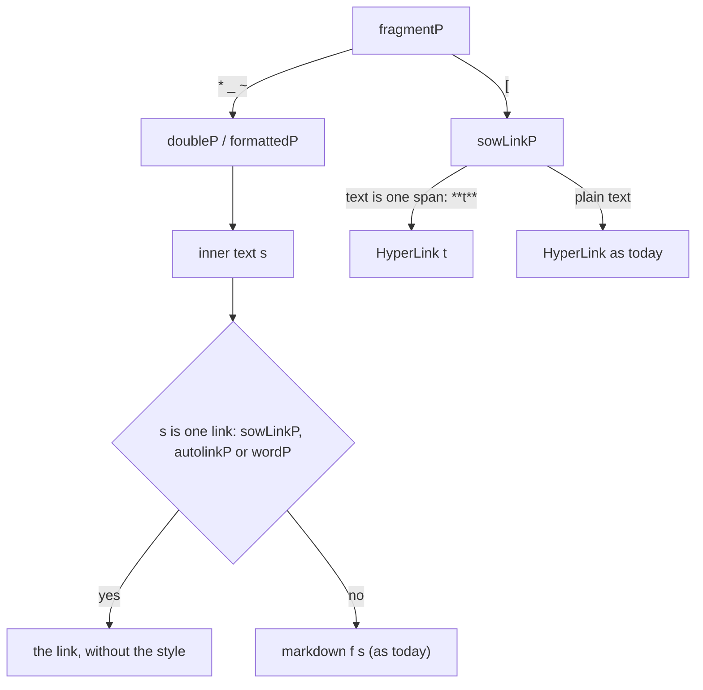
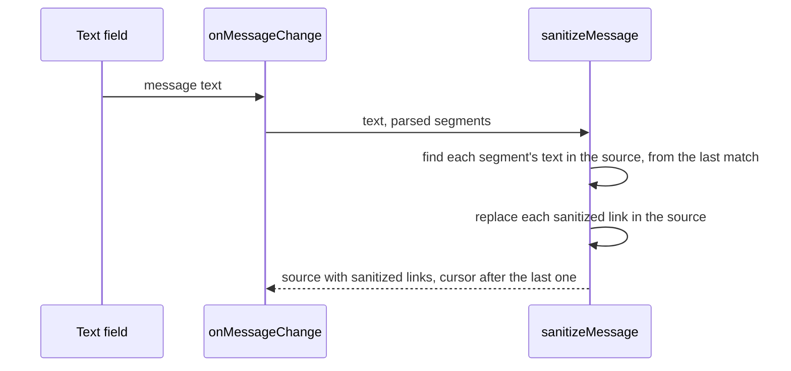

# Links inside bold, italic and strike-through

## Problem

`doubleP` and `formattedP` in `Markdown.hs` return the span's inner text as one segment and do not parse it again. A link inside a bold, italic or strike-through span stays styled source text. `sowLinkP` rejects link text with punctuation, so `[**t**](u)` is not a link either.

Parses on master, confirmed by a probe of the parser:

| Source | Parse | Display |
|---|---|---|
| `**[t](u)**` | `Bold "[t](u)"` | bold source text |
| `*[t](u)*` | `Bold {singleStar} "[t](u)"` | italic source text |
| `_[t](u)_` | `Italic "[t](u)"` | italic source text |
| `~~[t](u)~~` | `StrikeThrough "[t](u)"` | struck source text |
| `**see [t](u) now**` | `Bold "see [t](u) now"` | bold source text |
| `[**t**](u)` | `"[**t**]("`, `Uri "u"`, `")"` | source text, the URL alone clickable |
| `**https://x.com**` | `Bold "https://x.com"` | bold text, not clickable |
| `` **`x`** `` | `Bold "`x`"` | bold text with backticks |
| `- **[t](u)**` | list mark, `Bold "[t](u)"` | as in a paragraph |
| `## [t](u)` | heading, `HyperLink` | bold link, works |
| `**Note:** [t](u)` | `Bold "Note:"`, `HyperLink` | works |

## Options

| Option | Display | Cost |
|---|---|---|
| A: the link keeps the style | bold link | 4 h |
| B: the link drops the style | plain link | 1 h |
| C: general nesting | any combination | 12+ h |

Decision (user, 2026-11-14): B now. A is stage 2, parked on `ep/markdown-nested-links-styled`.

## Design (B)

Parser only. The wire format and the apps stay as they are.

| Source | Parse |
|---|---|
| `**[t](u)**`, `*[t](u)*`, `_[t](u)_`, `~~[t](u)~~` | `HyperLink t u`, text `**[t](u)**` |
| `**<u>**` | `HyperLink u u`, text `**<u>**` |
| `**https://x.com**` | `Uri`, text `https://x.com` |
| `**a@b.com**`, `**simplex link**` | `Email`, `SimplexLink`, text without the delimiters |
| `[**t**](u)`, `[_t_](u)`, `[~~t~~](u)` | `HyperLink t u`, text `[**t**](u)` |
| `**see [t](u)**`, `**https://x.com.**`, `` **`x`** `` | as today |

- `spanMD` gets the span's delimiter, format and inner text. It accepts only an inner text that parses whole as one link: `Uri`, `HyperLink`, `SimplexLink` or `Email`.
- A link with link text keeps the delimiters in its segment text, so `markdownText` stays exact. The apps show its link text.
- A bare link keeps only the link in its segment text: the apps open and show that text, and `displayedUri` marks its non-ASCII host.
- `unstyledText` removes one span around the link text of `sowLinkP` (`**t**`, `__t__`, `~~t~~`, `*t*`, `_t_`, `~t~`). The punctuation check applies to the text inside, so `[**x.com**](https://another.com)` stays plain.

## Link sanitizing keeps the markdown

`sanitizeMessage` (Kotlin `ComposeView.kt`, iOS `ComposeView.swift`) rebuilt the message from each segment's text, which lacks the delimiters of bold, italic, code and other formats. `**Note:** https://x.com/?utm_source=a` became `Note: https://x.com/`.

- The new message is the source text with each sanitized link replaced in place.
- Each segment's text is searched in the source from the previous match, so an earlier copy of the link, in code for example, stays.
- A hyperlink keeps its own text with the new URL after `](`.
- `sanitize` is a parameter with the core's `parseSanitizeUri` as the default, so the tests run without the core.

## Tests

- `MarkdownTests`, "links inside bold, italic and strike-through": each row of the design table, a link in a list item and spoofed link text.
- Kotlin `SanitizeMessageTest`, iOS `testSanitizeMessageKeepsMarkdown`: markdown around a sanitized link, hyperlinks inside a style, an earlier copy of the link, no sanitized link.
