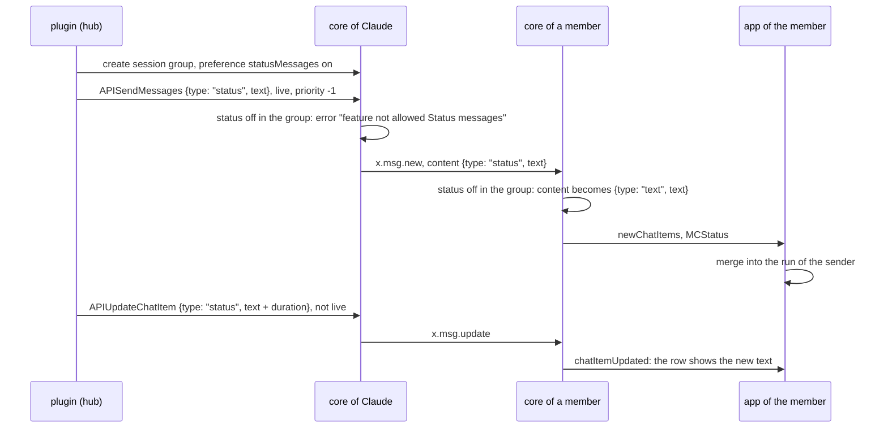
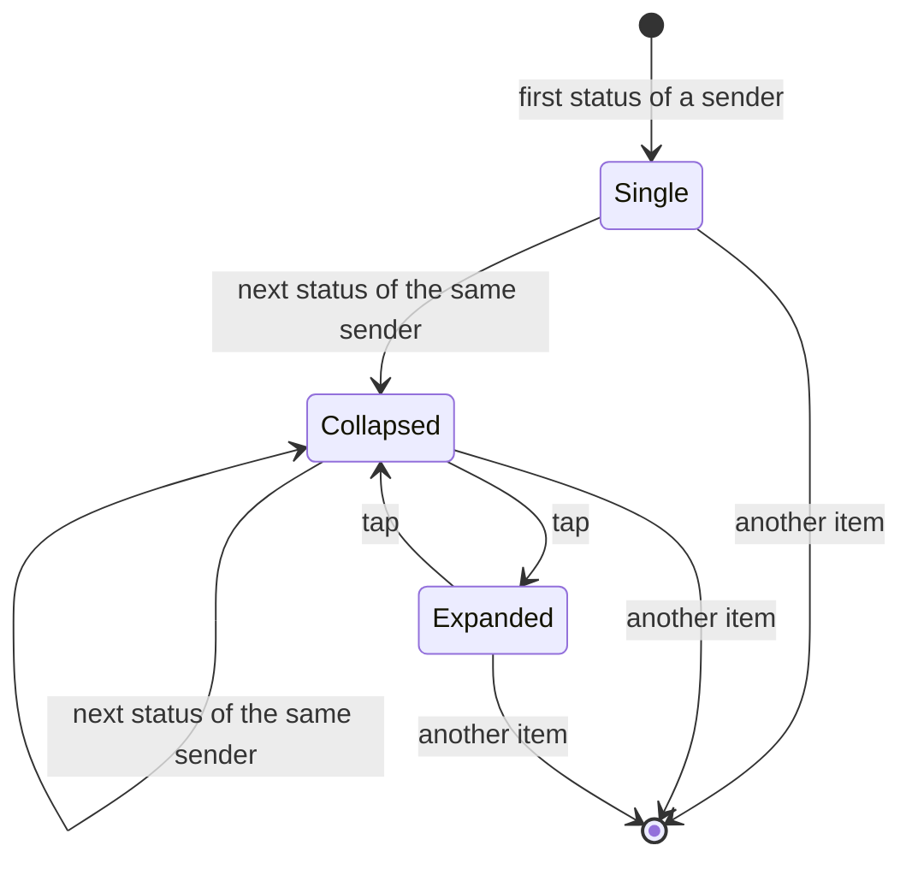

# Status messages

Status: decided 2026-11-14 (Q1 a, Q2 a, Q3 b, Q4 a, Q5 a), implemented in commit a4d9e64f9 on `ep/status-messages`.

A new message content type `status` carries status events, such as Claude's step lines. The apps merge consecutive status messages of one sender into one row. Silent text messages are never merged. A group preference `statusMessages`, off by default, allows status messages in a group. The preference has API and CLI (`/set status #GROUP on|off [ROLE]`), and no app UI.

## 1. Questions

Q1. Fields of `status`. Recommended: (a).

```
option  fields          collapsed row
(a)     text            newest status, count; the run's time span from the item times
(b)     text, duration  newest status, count, the sum of the durations
```

(a) keeps the type general: a status event without a duration, such as "Compacting context", needs no empty field. The step line already shows its duration in the text (`!- 2.1 s!`). The run's span, from the oldest item's time to the newest item's last update, gives a total without a field. An optional field can be added later: older parsers ignore unknown fields of the JSON object.

Q2. Toggle. Recommended: (a).

```
option  collapsed row              expanded rows
(a)     tap expands                tap on any row of the run collapses it
(b)     menu Expand, as events     menu Shrink, as events
```

Q3. Alerts. Decided: (b).

```
option  rule
(a)     the sender sets the priority; the plugin sends status messages with priority -1 (silent)
(b)     the core never alerts for a status message
```

A status message is sent without the notification flag (`eventHasNotification`), and the apps show no notification for it (`showNotification`), whatever its priority.

Q4. A status message received in a group with `statusMessages` off. Recommended: (a).

```
option  receiving core
(a)     saves it as a text message with the same text; the apps show it unmerged
(b)     rejects it, as other features: the item "Status messages: prohibited"
```

With (b), the apps get `rcvGroupFeatureRejected` with feature `status`. Their GroupFeature enums lack it, as they lack `sessions` and `comments`, so the item does not decode without an app change. With (a), a message sent before the sender's core received the change of the preference stays readable.

Q5. Direct chats. Recommended: (a).

```
option  rule
(a)     status messages are allowed in direct chats
(b)     a contact preference, off by default
```

A status message in a direct chat comes only from the contact, and a merged run holds only that contact's lines. With (b) and no app UI, a person can't turn it on, so the `serve` agents can't send status lines to their contacts.

The renders show (a) of Q1 without the span, and (a) of Q2.

## 2. Renders

Desktop, light theme, a group with a prompt, five status lines of Claude and its answer:

```
file                                                               layout   state
plans/2026-11-14-status-messages/status-run-collapsed.png          classic  collapsed
plans/2026-11-14-status-messages/status-run-expanded.png           classic  expanded
plans/2026-11-14-status-messages/status-run-collapsed-flat.png     flat     collapsed
plans/2026-11-14-status-messages/status-run-expanded-flat.png      flat     expanded
```

## 3. Design





A run is a list of consecutive status items of one sender. Any other item, including a text of the same sender, ends the run.

### 3.1 Content type

```
place                                      change
Protocol.hs MsgContentTag                  MCStatus_, "status"
Protocol.hs MsgContent                     MCStatus {text :: Text}
Protocol.hs msgContentText                 text
Protocol.hs msgContentTag                  MCStatus_
Protocol.hs FromJSON, ToJSON MsgContent    {"type": "status", "text": TEXT}, toJSON and toEncoding
Internal.hs quoteContent                   replaceContent False, as MCText
Commands.hs APIPlanForwardChatItems        hasContent True
docs/protocol/simplex-chat.schema.json     "status" with text
bots/api, types.ts, _types.py              regenerated by tests/APIDocs.hs
```

Unchanged paths:

```
path                                  behaviour for status
View.hs ttyMsgContent                 the CLI shows the text, as for MCText
Messages.hs parsedMsgContent          the text is parsed as markdown
Internal.hs msgContentHasLink         has_link from the markdown
Store/Messages.hs search              item_text matches
quotes and replies                    the quote keeps MCStatus and shows its text
APIUpdateChatItem, x.msg.update       any content replaces any content; live flag as for text
older cores                           MCUnknown {tag = "status", text}; the JSON passes to the app unchanged
older apps                            MCUnknown with the text: shown as a text message, unmerged
```

### 3.2 Group preference

```
StatusMessagesGroupPreference
  enable  GroupFeatureEnabled, default off
  role    Maybe GroupMemberRole
```

```
place                                         change
Preferences.hs GroupFeature, SGroupFeature    GFStatusMessages ("statusMessages"), "Status messages"
Preferences.hs GroupPreferences               statusMessages :: Maybe StatusMessagesGroupPreference
Preferences.hs FullGroupPreferences           statusMessages :: StatusMessagesGroupPreference
Preferences.hs defaultGroupPrefs              off, no role
Preferences.hs defaultBusinessGroupPrefs      off, no role
Preferences.hs selectors, merge, setters      the statusMessages rows, as comments
Preferences.hs GroupFeatureI, RoleI           GFStatusMessages with role
Preferences.hs allGroupFeatures               unchanged: GFStatusMessages is left out, so no feature items
Preferences.hs groupFeatureIn*                True, so the CLI command is accepted in groups and channels
Protocol.hs prohibitedStatus                  MCStatus and the role below the preference
Protocol.hs allowedGroupContent               prohibited MCStatus becomes MCText with the text
Protocol.hs eventHasNotification              False for x.msg.new with MCStatus; used for every notification flag
Protocol.hs isStatusMsgBody                   a stored message body is x.msg.new with MCStatus
Internal.hs prohibitedGroupContent            sent and prohibitedStatus: Just GFStatusMessages
Internal.hs sendPendingGroupMessages          no notification flag when all pending messages are status messages
Commands.hs APIUpdateChatItem, group          prohibitedStatus: the same error
Commands.hs APIForwardChatItems, to a group   allowedGroupContent with the user's role: forwarded as text where it is off
Subscriber.hs newGroupContentMessage content  allowedGroupContent with the sender's role, owner for a post as the group
Subscriber.hs groupMessageUpdate              allowedGroupContent
Terminal/Output.hs chatEventNotification      no notification and no active chat change for a status message, new or updated
Commands.hs parser                            /set status #GROUP on|off [ROLE]
View.hs viewGroupUpdated                      a change of statusMessages is shown in "updated group preferences:"
bots TypeInfo.hs                              StatusMessagesGroupPreference as RoleGroupPreference
bots/api, types.ts, _types.py                 statusMessages in GroupPreferences and FullGroupPreferences
```

```
chat            status allowed                 send                                          receive
group, on       member role >= role, or any    sent                                          MCStatus
group, off      never                          error "feature not allowed Status messages"   MCText with the text
direct chat     always                         sent                                          MCStatus
```

The apps get no UI and no item names the feature. The apps keep `statusMessages`, `sessions` and `comments` when they re-encode the group preferences after an edit (SimpleXAPI.kt and ChatTypes.swift GroupPreferences, FullGroupPreferences, toGroupPreferences), so an edit in the app does not turn them off.

### 3.3 Kotlin

```
place                                         change
ChatModel.kt MsgContent                       MCStatus(text), serializer "status"
ChatModel.kt CIMergeCategory                  Status
ChatModel.kt ChatItem.mergeCategory           Status for SndMsgContent and RcvMsgContent with MCStatus
ChatModel.kt mergesWith                       same category; for Status also the same sender
ChatItemsMerger.kt MergedItems.create         mergesWith in place of the category comparison
ChatModel.kt getPrevShownChatItem             mergesWith: delete and select of a collapsed run take only that run
ChatModel.kt getConnectedMemberNames          mergesWith
ChatView.kt gaps, selection                   mergesWith
ChatModel.kt ChatItem.showNotification        false for a received status message
ChatItemView.kt onClick                       tap toggles a run of more than one item
ChatItemView.kt ContentItem                   collapsed run: newest item and StatusRunCount
ComposeView.kt                                MCStatus branches of chatItemPreview and the edited content
TerminalItemView.kt textOnly                  MCStatus, as MCText
ChatView.kt previews, SnapshotTest.kt         four scenes, references
ChatItemsMerger.kt revealedStatusRuns        a new status of an expanded run is revealed too; ChatView reads MergedItems.revealedIds
ChatItemsMergerTest.kt                        runs split by sender and by a text item; an expanded run stays expanded
GroupPreferencesTest.kt                       an app round trip keeps statusMessages, sessions and comments
```

`LocalRevealedItems` sets the revealed items of a preview.

### 3.4 iOS

```
place                                          change
ChatTypes.swift MsgContent                     .status(text:), coding "status"
ChatTypes.swift CIMergeCategory, mergeCategory status
ChatTypes.swift mergesWith                     as Kotlin
ChatTypes.swift showNotification               false for a received status message, in the app and the NSE
ChatItemsMerger.swift MergedItems.create       mergesWith; revealedStatusRuns, as Kotlin
ChatView.swift ChatItemWithMenu.revealed       the revealed flag of the merged row
ChatModel.swift getPrevShownChatItem, names    mergesWith
ChatView.swift ranges, chatItemWithMenu        mergesWith; tap toggles; collapsed run with count
MarkedDeletedItemView.swift                    mergesWith
SnapshotTests.swift                            four scenes: Classic/TerminalStatusRunCollapsed/Expanded
```

### 3.5 Plugin

```
place                                    change
Hub.createSessionGroup                   groupPreferences.statusMessages = {enable: on}
step lines of ep/mcp-step-lines          {type: "status", text} when the session group has statusMessages on; {type: "text", text} otherwise
final update of a live step line         {type: "text", text} when the preference was turned off after the line started
```

The plugin bundles core 7.1.3, so these rows wait for a core release with `status`, in a later plugin commit.

## 4. Tests

```
test                                                                       place
JSON round trip of status; no notification flag                           tests/ProtocolTests.hs
allowedGroupContent: off, role below, role met; isStatusMsgBody            tests/ProtocolTests.hs
group: off refuses, /set status #team on owner, member refused, live and final update, off refuses again, forward as text   tests/ChatTests/Groups.hs
app round trip of statusMessages, sessions and comments                    GroupPreferencesTest.kt, SnapshotTests.swift
status in a direct chat                                                    tests/ChatTests/Direct.hs
regenerated API docs                                                       tests/APIDocs.hs
MergedItems: one run per sender, a text ends a run                         ChatItemsMergerTest.kt
four snapshot scenes in each app                                           desktop-linux, ios-sim
session group created with statusMessages on                               plugin tests, later
```

## 5. Estimate

```
part                                    agent hours
core content type and tests             1.5
core group preference and tests         1
Kotlin: remaining rows, test, refs      1.5
iOS                                     2.5
plugin after the core release           1
review and CI                           1
total                                   8.5
```
