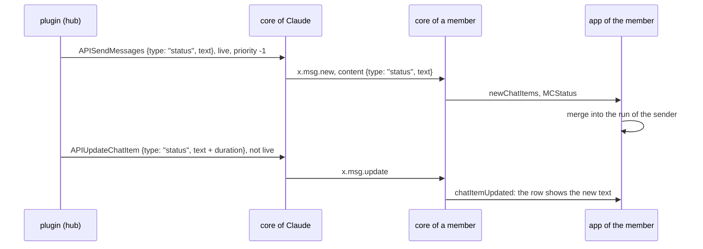
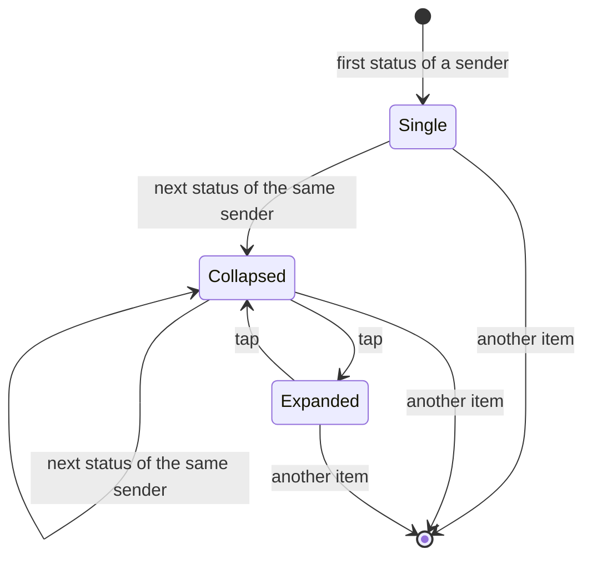

# Status messages

Status: plan for review, 2026-11-14. Branch `ep/status-messages`.

A new message content type `status` carries status events, such as Claude's step lines. The apps merge consecutive status messages of one sender into one row. Silent text messages are never merged.

## 1. Questions

Q1. Fields of `status`. Recommended: (a).

```
option  fields          collapsed row
(a)     text            newest status, count; the run's time span from the item times
(b)     text, duration  newest status, count, the sum of the durations
```

(a) keeps the type general: a status event without a duration, such as "Compacting context", needs no empty field. The step line already shows its duration in the text (`!- 2.1 s!`). The run's span, from the oldest item's time to the newest item's last update, gives a total without a field. An optional field can be added later: older parsers ignore unknown fields of the JSON object.

Q2. Toggle. Recommended: (a).

```
option  collapsed row              expanded rows
(a)     tap expands                tap on any row of the run collapses it
(b)     menu Expand, as events     menu Shrink, as events
```

Q3. Alerts. Recommended: (a).

```
option  rule
(a)     the sender sets the priority; the plugin sends status messages with priority -1 (silent)
(b)     the core never alerts for a status message
```

The renders show (a) of Q1 without the span, and (a) of Q2.

## 2. Renders

Desktop, light theme, a group with a prompt, five status lines of Claude and its answer:

```
file                                                               layout   state
plans/2026-11-14-status-messages/status-run-collapsed.png          classic  collapsed
plans/2026-11-14-status-messages/status-run-expanded.png           classic  expanded
plans/2026-11-14-status-messages/status-run-collapsed-flat.png     flat     collapsed
plans/2026-11-14-status-messages/status-run-expanded-flat.png      flat     expanded
```

## 3. Design





A run is a list of consecutive status items of one sender. Any other item, including a text of the same sender, ends the run.

### 3.1 Core

```
place                                      change
Protocol.hs MsgContentTag                  MCStatus_, "status"
Protocol.hs MsgContent                     MCStatus {text :: Text}
Protocol.hs msgContentText                 text
Protocol.hs msgContentTag                  MCStatus_
Protocol.hs FromJSON, ToJSON MsgContent    {"type": "status", "text": TEXT}, toJSON and toEncoding
Internal.hs quoteContent                   replaceContent False, as MCText
Commands.hs APIPlanForwardChatItems        hasContent True
docs/protocol/simplex-chat.schema.json     "status" with text
bots/api, types.ts, _types.py              regenerated by tests/APIDocs.hs
```

Unchanged paths:

```
path                                  behaviour for status
View.hs ttyMsgContent                 the CLI shows the text, as for MCText
Messages.hs parsedMsgContent          the text is parsed as markdown
Internal.hs msgContentHasLink         has_link from the markdown
Store/Messages.hs search              item_text matches
quotes and replies                    the quote keeps MCStatus and shows its text
APIUpdateChatItem, x.msg.update       any content replaces any content; live flag as for text
older cores                           MCUnknown {tag = "status", text}; the JSON passes to the app unchanged
older apps                            MCUnknown with the text: shown as a text message, unmerged
```

### 3.2 Kotlin

```
place                                         change
ChatModel.kt MsgContent                       MCStatus(text), serializer "status"
ChatModel.kt CIMergeCategory                  Status
ChatModel.kt ChatItem.mergeCategory           Status for SndMsgContent and RcvMsgContent with MCStatus
ChatModel.kt mergesWith                       same category; for Status also the same sender
ChatItemsMerger.kt MergedItems.create         mergesWith in place of the category comparison
ChatModel.kt getPrevShownChatItem             mergesWith: delete and select of a collapsed run take only that run
ChatModel.kt getConnectedMemberNames          mergesWith
MarkedDeletedItemView.kt, ChatView.kt gaps    mergesWith
ChatItemView.kt onClick                       tap toggles a run of more than one item
ChatItemView.kt ContentItem                   collapsed run: newest item and StatusRunCount
ComposeView.kt                                MCStatus branches of chatItemPreview and the edited content
TerminalItemView.kt textOnly                  MCStatus, as MCText
ChatView.kt previews, SnapshotTest.kt         four scenes, references
desktopTest                                   MergedItems test: runs split by sender and by a text item
```

Commit 7a51170ed has the rows for MsgContent, CIMergeCategory, mergeCategory, mergesWith, MergedItems.create, onClick, ContentItem, ComposeView, TerminalItemView and the previews. `LocalRevealedItems` sets the revealed items of a preview.

### 3.3 iOS

```
place                                          change
ChatTypes.swift MsgContent                     .status(text:), coding "status"
ChatTypes.swift CIMergeCategory, mergeCategory status
ChatTypes.swift mergesWith                     as Kotlin
ChatItemsMerger.swift MergedItems.create       mergesWith
ChatModel.swift getPrevShownChatItem, names    mergesWith
ChatView.swift item gaps, menus, ranges        mergesWith
MarkedDeletedItemView.swift                    mergesWith
ChatItemView.swift                             tap toggles; collapsed run with count
previews, SnapshotTests.swift                  the same four scenes, references; check-previews.py
```

### 3.4 Plugin

The step lines of `ep/mcp-step-lines` are sent with `{type: "status", text}` in place of `{type: "text", text}`. The plugin bundles core 7.1.3, so this waits for a core release with `status`.

## 4. Tests

```
test                                                     place
JSON round trip of status; unknown tag stays MCUnknown   tests/ProtocolTests.hs
send, live update and final update of a status in a group; the member's CLI shows the text   tests/ChatTests/Groups.hs
regenerated API docs                                     tests/APIDocs.hs
MergedItems: one run per sender, a text ends a run       desktopTest
four snapshot scenes                                     desktop-linux, ios-sim
```

## 5. Estimate

```
part                                    agent hours
core and tests                          1.5
Kotlin: remaining rows, test, refs      1.5
iOS                                     2.5
plugin after the core release           0.5
review and CI                           1
total                                   7
```
