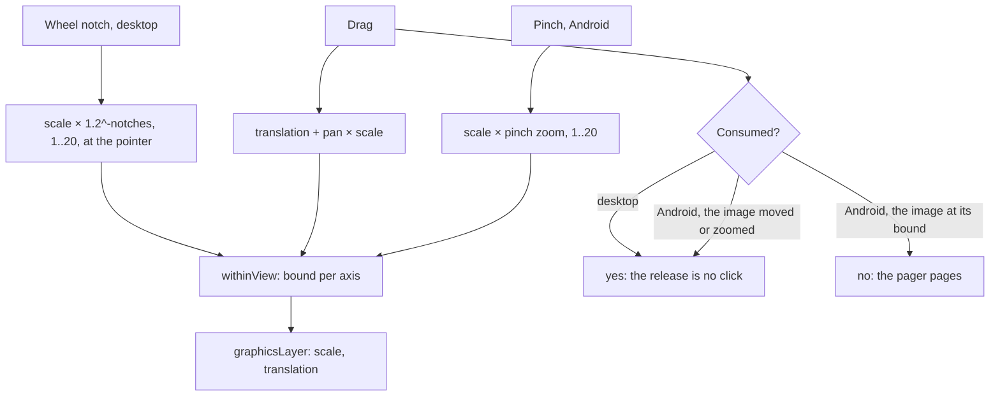

# Desktop: full-screen images zoom and pan

## Problem

On desktop, a full-screen image can't be zoomed. Android zooms it by a two-finger pinch, which a mouse can't make. To see an image at full detail, a desktop user saves the file and opens it in another app.

## Change

`ImageFullScreenView` (common code):

- Desktop: a mouse wheel notch zooms 1.2× at the pointer, from 1× to 20×. Every vertical scroll event acts as the wheel, a trackpad's included.
- Desktop: a drag pans the zoomed image, as on Android. A drag never closes the view; a click closes it, as before.
- Both platforms: the wheel and the drag keep the image inside one bound per axis, `withinView`: half the zoomed excess of the view's width and height. At 1×, the image returns to the centre.
- Android: the wheel handler is not added, so a mouse wheel acts as before.

`detectTransformGestures` (`GestureDetector.kt`) consumes a pan move whenever the view's predicate allows it. It no longer also requires a pinch, which a wheel zoom never makes.

## Android changes

- A vertical pan stops at the image's edge.
- A pan at the horizontal bound still moves the image vertically.
- At 1× after a pinch, the translation is zero, and swipes page the pager.

## Tests

`ImageFullScreenZoomTest` (desktopTest) renders the view in an 800×600 scene and checks pixels:

- wheel zoom at the pointer, drag pan, wheel back to fit, a drag at 1× that keeps the view open, a click that closes it;
- a drag beyond the horizontal bound, released and repeated, keeps the image at the bound and the view open;
- a vertical drag at the horizontal bound moves the image;
- a vertical drag after a zoom out at the horizontal bound moves the image;
- a vertical drag stops at the image's edge.
