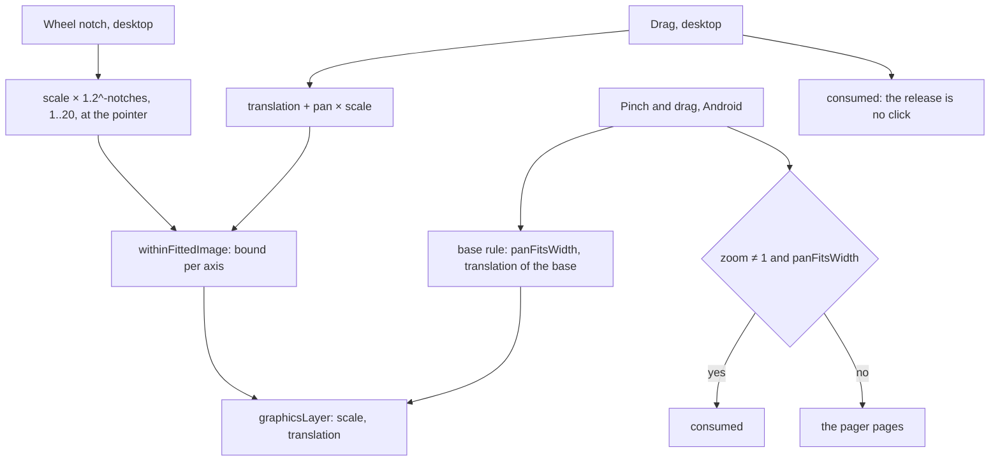

# Desktop: full-screen images zoom and pan

## Problem

On desktop, a full-screen image can't be zoomed. Android zooms it by a two-finger pinch, which a mouse can't make. To see an image at full detail, a desktop user saves the file and opens it in another app.

## Change

`ImageFullScreenView` (common code), on desktop:

- A mouse wheel notch zooms 1.2× at the pointer, from 1× to 20×. Every vertical scroll event acts as the wheel, a trackpad's included.
- A drag pans the zoomed image. A drag never closes the view; a click closes it, as before.
- The wheel and the drag keep the image within one bound per axis, `withinFittedImage`: half the excess of the fitted image's zoomed size over the view. The image covers the view in an axis where it is larger, and stays centred in an axis where it is smaller.

On Android, the gestures and the translation are those of the base. The wheel handler is not added.

`detectTransformGestures` (`GestureDetector.kt`) passes its zoom to the predicate. Android keeps its condition `zoom != 1f && allowTranslate`, and desktop consumes every drag past touch slop.

## Not in this change

The Android rule stays as on the base. A later master item fuses it with the desktop bound: a vertical bound, translation zero at 1×, and a predicate for mainly horizontal swipes.

## Tests

`ImageFullScreenZoomTest` (desktopTest) renders the view in an 800×600 scene and checks pixels:

- wheel zoom at the pointer, drag pan, wheel back to fit, a drag at 1× that keeps the view open, a click that closes it;
- a drag beyond the horizontal bound, released and repeated, keeps the image at the bound and the view open;
- a vertical drag at the horizontal bound moves the image within the vertical bound;
- the same after a zoom out at the horizontal bound;
- a long vertical drag keeps the zoomed image over the view;
- a letterboxed tall image stays in the view after two long drags.

`testAndroidPansOnlyWithinTheWidth` checks `panFitsWidth`, the base's Android rule: a swipe at 1× pans nothing, so the pager pages, also with vertical jitter. At the horizontal bound a swipe toward the bound pans nothing, and its vertical part is not an input.
