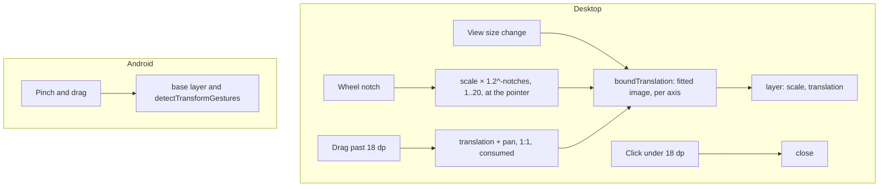

# Desktop: full-screen images zoom and pan

## Problem

On desktop, a full-screen image can't be zoomed. Android zooms it by a two-finger pinch, which a mouse can't make. To see an image at full detail, a desktop user saves the file and opens it in another app.

## Change

`ImageFullScreenView` (common code) builds the modifier of each media from its bitmap, with one platform dispatch.

Android: the chain of the base, unchanged: the layer, then `detectTransformGestures` with the base rule. `GestureDetector.kt` is unchanged.

Desktop: the handlers precede the layer, so they get view coordinates.

- A mouse wheel notch zooms 1.2× at the pointer, from 1× to 20×. Every vertical scroll event acts as the wheel, a trackpad's included.
- A drag pans the zoomed image with the pointer, 1:1, once it passes the touch slop of 18 dp. Then the drag is consumed, so its release closes nothing. A click whose pointer moves less than the slop closes the view, as before.
- The wheel, the drag and a change of the view's size keep the image within one bound per axis, `boundTranslation`: half the excess of the fitted image's zoomed size over the view. The image covers the view in an axis where it is larger, and stays centred in an axis where it is smaller.
- The fitted size of a video is that of its preview from the sender, or of the error bitmap when the preview fails to decode. The drawn frames are not available to the common code without a new path.

## Not in this change

The Android rule stays as on the base. A later master item fuses it with the desktop bound: a vertical bound, translation zero at 1×, and a predicate for mainly horizontal swipes.

## Questions for the user

1. Trackpad: a vertical two-finger scroll zooms at the pointer and never pans; a horizontal scroll does nothing. Panning takes a click and drag. The zoom follows the scroll direction the system reports, so macOS natural scrolling and momentum act on the zoom too; neither is checked on a Mac.
2. A click on a zoomed image closes the gallery, as a tap does on Android.

## Tests

`ImageFullScreenZoomTest` (desktopTest) renders the view in an 800×600 scene and checks pixels:

- wheel zoom at the pointer, drag pan, wheel back to fit, a drag at 1× that keeps the view open, a click that closes it;
- a drag beyond the horizontal bound, released and repeated, keeps the image at the bound and the view open;
- a vertical drag at the horizontal bound moves the image within the vertical bound;
- the same after a zoom out at the horizontal bound;
- a long vertical drag keeps the zoomed image over the view;
- a letterboxed tall image stays in the view after two long drags;
- at 4× a 60 px drag in 6 steps moves the image 60 px and keeps the view open;
- at 4× a click with 1 px of pointer jitter closes the view;
- a narrower view keeps the zoomed image over its edge.
