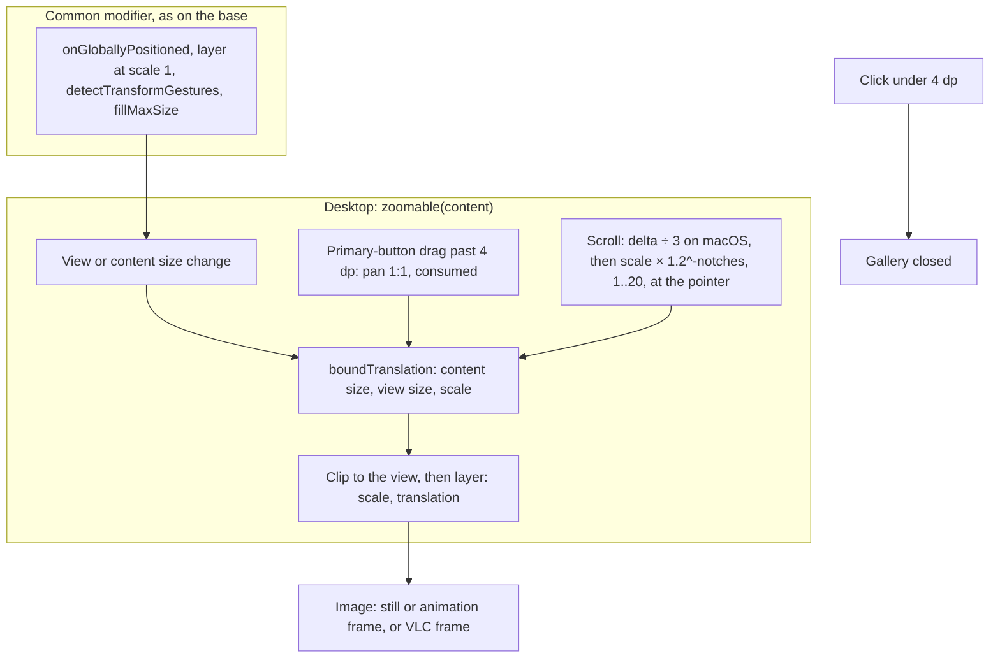

# Desktop: full-screen images zoom and pan

## Problem

On desktop, a full-screen image can't be zoomed. Android zooms it by a two-finger pinch, which a mouse can't make. To see an image at full detail, a desktop user saves the file and opens it in another app.

## Change

Common code is the base code: `ImageFullScreenView.kt` and `GestureDetector.kt` are unchanged, so Android behaviour is that of the base. Under a mouse, the view is left as it is by the common modifier: with one pointer, the zoom passed to the base rule by `detectTransformGestures` is 1, and under that rule scale 1 and translation 0 are kept.

In the desktop actuals of `ImageFullScreenView.desktop.kt`, `zoomable(content)` is appended to the common modifier. `content` is the drawn bitmap:

- `FullScreenImageView`: the still image or the current animation frame.
- `FullScreenVideoView`: the current VLC frame, passed through the new `frameModifier` parameter of `SurfaceFromPlayer`. The chat item player is called without it.

In `zoomable`, the scale and the translation of the shown media are remembered. The handlers are placed before the layer, so their coordinates are view coordinates. The state is read in the layer's block, so the view is redrawn without recomposition on each wheel or pan step.

- The image is zoomed 1.2× per wheel notch at the pointer on Windows and Linux, from 1× to 20×. Every vertical scroll event is taken as a wheel event, a trackpad's included.
- On macOS, every scroll delta is divided by 3 in `wheelNotches`, a wheel's included: a trackpad unit is a third of a notch, and the image is zoomed 1.2^(1/3), about 1.06×, per wheel click with a delta of 1.
- The zoomed image is panned 1:1 with the pointer by a primary-button drag once the pointer has moved more than 4 dp. The drag is then consumed, so the gallery stays open on its release, at 1× too. On the base, the gallery was closed on the release of any drag. The gallery is closed by a click whose pointer moves less than 4 dp, as on the base. Drags with other buttons are ignored.
- After each wheel step, drag step and change of the view's or the content's size, the translation is clamped per axis by `boundTranslation` to `max(0, (w·fit·s − W) / 2)`, with `fit = min(W/w, H/h)`, for content `w×h`, view `W×H` and scale `s`. In an axis where the zoomed content is larger than the view, the view is covered by it; in an axis where it is smaller, it is centred.
- The zoomed content is clipped to the view, so a zoomed video is kept out of its controls row.
- The handlers are started once, and the content's size is read from a state that is updated on each composition, so a drag is kept running when a new bitmap of any size is drawn: an animation frame, a VLC frame, or a decode of data read again.

## Not in this change

The Android rule is kept as on the base. In a later master item, it is fused with the desktop bound: a vertical bound, translation zero at 1×, and a predicate for mainly horizontal swipes.

## Tests

In `ImageFullScreenZoomTest` (desktopTest), the view is rendered in an 800×600 scene, and its pixels are checked after:

- wheel zoom at the pointer, drag pan and wheel back to fit; the view is kept open by a drag at 1× and closed by a click;
- two long drags of a letterboxed tall image: the image is kept in the view;
- a 60 px drag in 6 steps at 4×: the image is moved 60 px, and the view is kept open;
- the same with a new copy of a 2× larger image returned by the gallery before each step, so the content's size is changed at the first step and a new bitmap is drawn at each step; with handlers keyed by the content's size, the drag is lost and the view is closed on its release;
- a secondary-button drag: nothing is panned;
- a click with 1 px of pointer jitter at 4×: the view is closed;
- a narrower view: the zoomed image is kept over its edge;
- a zoom to 4.3× in a view padded at the bottom: nothing is drawn in the padding.

In the drag helper, a frame is rendered after each move. One data array is returned by the gallery unless a test replaces it.
