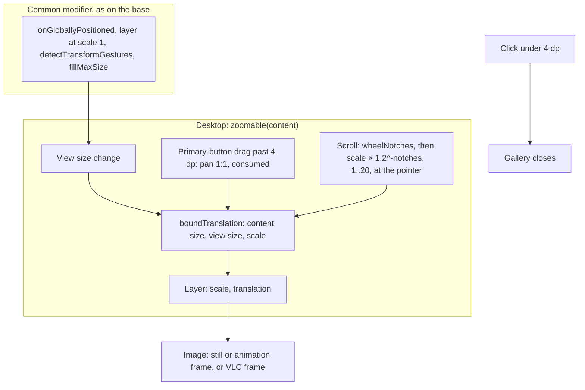

# Desktop: full-screen images zoom and pan

## Problem

On desktop, a full-screen image can't be zoomed. Android zooms it by a two-finger pinch, which a mouse can't make. To see an image at full detail, a desktop user saves the file and opens it in another app.

## Change

Common code is the base code: `ImageFullScreenView.kt` and `GestureDetector.kt` are unchanged, so Android behaves as on the base. Under a mouse, the common modifier leaves the view as it is: one pointer gives zoom 1 to `detectTransformGestures`, and the base rule keeps scale 1 and translation 0.

The desktop actuals in `ImageFullScreenView.desktop.kt` append `zoomable(content)` to the common modifier. `content` is the drawn bitmap:

- `FullScreenImageView`: the still image or the current animation frame.
- `FullScreenVideoView`: the current VLC frame, passed by the new `frameModifier` parameter of `SurfaceFromPlayer`. The chat item player passes none.

`zoomable` remembers the scale and the translation of the shown media. Its handlers precede its layer, so they receive view coordinates. The layer reads the state in its block, so a wheel or pan step redraws the view without recomposing it.

- The image is zoomed 1.2× per wheel notch at the pointer, from 1× to 20×. Every vertical scroll event is taken as the wheel, a trackpad's included.
- On macOS, a precise scroll event counts a third of a notch per unit, `wheelNotches`. Precise means `|preciseWheelRotation − wheelRotation| > 0.001`, as Compose detects it. A discrete notch counts one notch on every platform.
- A primary-button drag pans the zoomed image 1:1 with the pointer once it passes 4 dp. The drag is then consumed, so its release closes nothing. A click whose pointer moves less than 4 dp closes the view, as before. Other buttons pan nothing.
- The wheel, the drag and a change of the view's size keep the translation within one bound per axis, `boundTranslation`: `max(0, (w·fit·s − W) / 2)` with `fit = min(W/w, H/h)`, for content `w×h`, view `W×H` and scale `s`. The content covers the view in an axis where it is larger, and stays centred in an axis where it is smaller.
- The handlers are keyed by the content's size. A new bitmap of the same size keeps a drag running: an animation frame, a VLC frame, or a decode of data read again.

## Not in this change

The Android rule stays as on the base. A later master item fuses it with the desktop bound: a vertical bound, translation zero at 1×, and a predicate for mainly horizontal swipes.

## Questions for the user

1. Trackpad: a vertical two-finger scroll zooms at the pointer and never pans; a horizontal scroll does nothing. Panning takes a click and drag. The zoom follows the scroll direction the system reports, so macOS natural scrolling and momentum act on the zoom too.
   Speed, unmeasured on a Mac:
   - 1× to 20× takes 16.4 notches.
   - Windows: a notch scrolls a 600 px list by 90 px at the default 3 lines, so 16.4 notches equal 1479 px of scroll.
   - macOS: a trackpad unit scrolls a list by 10 points, and counts a third of a notch, so 1× to 20× takes 49 units, 493 points of scroll.
   - A classic Mac wheel sending fractional deltas would be taken as precise and zoom 3× slower.
2. A click on a zoomed image closes the gallery, as a tap does on Android.

## Tests

`ImageFullScreenZoomTest` (desktopTest) renders the view in an 800×600 scene and checks pixels:

- wheel zoom at the pointer, drag pan, wheel back to fit, a drag at 1× that keeps the view open, a click that closes it;
- a drag beyond the horizontal bound, released and repeated, keeps the image at the bound and the view open;
- a vertical drag at the horizontal bound moves the image within the vertical bound;
- the same after a zoom out at the horizontal bound;
- a long vertical drag keeps the zoomed image over the view;
- a letterboxed tall image stays in the view after two long drags;
- at 4× a 60 px drag in 6 steps moves the image 60 px and keeps the view open;
- the same while the gallery returns a new copy of the data before each step, so each step draws a new bitmap; with handlers keyed by the bitmap, the drag stops and its release closes the view;
- at 10× a 10 px drag moves the image and keeps the view open;
- a secondary-button drag pans nothing;
- at 4× a click with 1 px of pointer jitter closes the view;
- a zoomed image stays over the edge of a narrower view.

The drag helper renders a frame after each move, and the gallery returns one data array unless a test replaces it.

`wheelNotches`: a precise macOS event counts a third of its delta; a discrete macOS notch and a Windows event count their delta.
