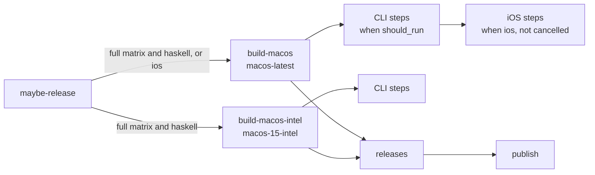

# CI: one macOS job for the CLI and iOS builds

Repository: simplex-chat/simplex-chat.
Branch: `ep/ci-one-macos-job`.
Base: master `24e206d9c`.

The user's words:

> Also, looking at tests in CI - macos latest ios and macos latest CLI, Desktop are different jobs. They must be different steps of the same job. Same for unit or e2e tests the agent would add. They should be steps, not jobs, to preserve runners capacity.

## Files

- `.github/workflows/build.yml`
- `scripts/ci/README.md`
- `scripts/ci/ios-sim/README.md`

## Terms

full matrix
- maybe-release output `reduced` is not `true`

haskell, ios
- maybe-release output of that name is `true`

## Jobs

build-macos
- runner: `macos-latest`, aarch64
- runs when:
  - full matrix and haskell
  - ios
- matrix field `should_run`: full matrix and haskell
- matrix field `ios`: ios
- name: `macos-latest (CLI,Desktop,iOS), GHC: <ghc>`
- steps: anchor `macos-steps`
- concurrency: anchor `macos-concurrency`

build-macos-intel
- runner: `macos-15-intel`, x86_64
- matrix entry: the second entry of the build-macos matrix, unchanged
- runs when: full matrix and haskell
- name: `macos-15-intel (CLI,Desktop), GHC: <ghc>`
- steps: alias of `macos-steps`
- concurrency: alias of `macos-concurrency`

build-ios
- removed

releases, publish
- `needs`: build-macos-intel in place of build-ios

## Steps of build-macos and build-macos-intel

"Checkout Code", "Point Command Line Tools SDK to Xcode SDK"
- always: each job runs only when its steps need the code

steps from "Compute toolchain cache key" to "Save -O0 build directory to cache"
- unchanged

"Check the previews listed in the snapshot tests"
- from build-ios
- when `ios` and the run is not cancelled

"Build iOS app"
- from build-ios
- when `ios` and the run is not cancelled

## Concurrency

group
- unchanged: `<workflow>-<ref>-macos-<os>-<libs_tag>`

cancel-in-progress
- pull request
- dispatch

## Runners per run

| Run | macos-latest | macos-15-intel |
|---|---|---|
| reduced, ios | iOS steps | not started |
| reduced, without ios | not started | not started |
| full matrix, haskell and ios | CLI steps, then iOS steps | CLI steps |
| full matrix, haskell | CLI steps | CLI steps |
| full matrix, ios | iOS steps | not started |

## Docs

scripts/ci/README.md
- build-ios replaced by build-macos
- section "ios": step "Build iOS app" and matrix field `ios` of build-macos
- section "Adding CI coverage": a macOS scope is a step of build-macos with a matrix field set from its maybe-release output

scripts/ci/ios-sim/README.md
- a `build.yml` run takes at most two macOS jobs
- `check-previews.py` is run by the iOS steps of build-macos

## Checks

- dispatch on `ep/ci-one-macos-job`, base master: build-linux runs; build-macos and build-macos-intel are skipped (fork run 43891835232)
- dispatch on a branch with one file added under `apps/ios` on top of `ep/ci-one-macos-job`, base `ep/ci-one-macos-job`: build-macos runs the iOS steps only; build-linux and build-macos-intel are skipped (fork run 43855049662)
- CLI steps, then iOS steps on one runner: dispatch on a branch with one file added under `apps/ios` and `should_run: true` in the build-macos matrix entry, on top of `ep/ci-one-macos-job`, base `ep/ci-one-macos-job` (fork run 43904674811: Build CLI 30 min, Run tests 24 min, Build iOS app 14 min, all passed)
- full matrix: from the expressions of the job conditions and matrix fields
