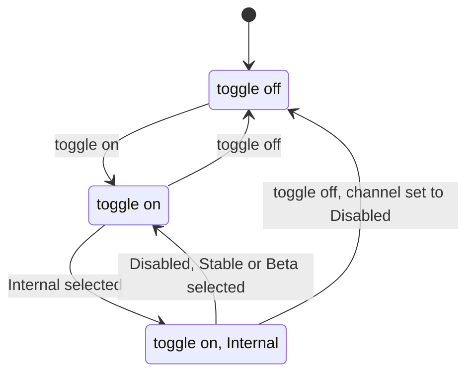
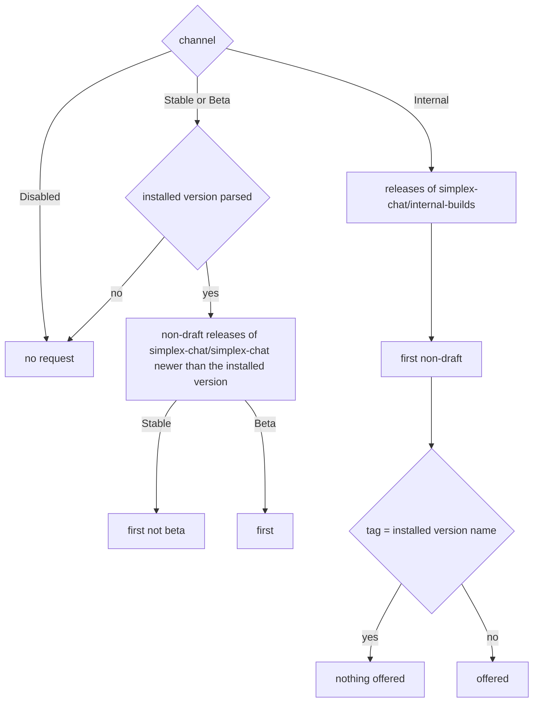

# Desktop: internal update channel

## Problem

Internal desktop builds are published as releases of the public repository simplex-chat/internal-builds. The desktop app reads releases of simplex-chat/simplex-chat only, so testers cannot be offered internal builds.

## Behaviour

- Developer options, desktop only: toggle "Allow internal builds", default off.
- Settings > app version > "Check for updates": "Internal" is listed while the toggle is on.
- The toggle turned off while "Internal" is selected: the channel is set to "Disabled", the preference default.
- Internal: the newest non-draft release of simplex-chat/internal-builds is offered when its tag differs from the installed version name.
- Stable and Beta: unchanged.

## Types

AppUpdatesChannel:

- DISABLED
- STABLE
- BETA
- INTERNAL (new)

AppPreferences:

| Field | Type | Key | Default |
|---|---|---|---|
| allowInternalBuilds | Boolean | AllowInternalBuilds | false |

## Toggle and channel

## Release choice

## Internal releases

| Field | Value |
|---|---|
| tag | the build's desktop.version_name |
| name | set |
| body | set |
| commit | one release per commit |
| asset names | as in simplex-chat/simplex-chat releases |

## Changes

| File | Change |
|---|---|
| AppCommon.kt | INTERNAL |
| SimpleXAPI.kt | allowInternalBuilds |
| AppUpdater.kt | releases read per channel |
| SettingsView.desktop.kt | channel list without INTERNAL while the toggle is off |
| DeveloperView.kt | toggle in the desktop developer options |
| base strings.xml | "Internal", "Allow internal builds" |
| smoke-test.sh | screenshots of developer options and update channels in both toggle states |
| spec/state.md, product/views/settings.md | channel and toggle |
