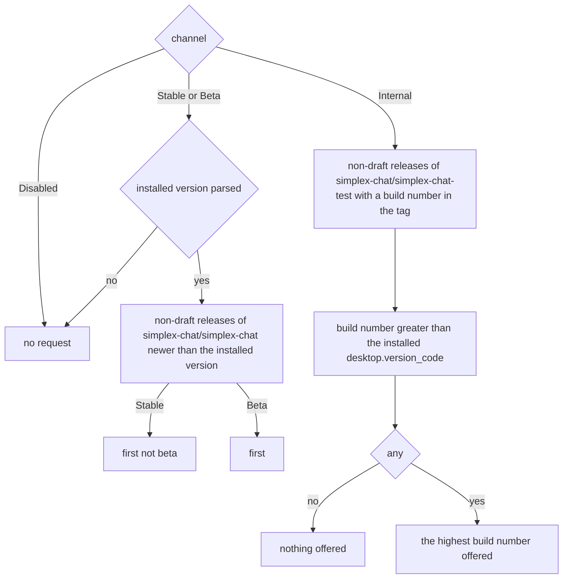

# Desktop: internal update channel

## Problem

Internal desktop builds are published as releases of the public repository simplex-chat/simplex-chat-test, which contains only releases and one commit per release. The desktop app reads releases of simplex-chat/simplex-chat only, so testers cannot be offered internal builds.

## Behaviour

- Developer options, desktop only: toggle "Allow internal builds", default off.
- Settings > app version > "Check for updates": "Internal" is listed while the toggle is on.
- The toggle turned off while "Internal" is selected: the channel is set to "Stable", and the update checker restarts on it; an internal build keeps the released version name, so Stable offers the next public release.
- Internal: of the non-draft releases of simplex-chat/simplex-chat-test, the one with the highest build number in its tag is offered when that number is greater than the installed desktop.version_code; a tag without a build number is skipped.
- Stable and Beta: unchanged.
- A check whose channel is changed during its request shows no alert.

## Types

AppUpdatesChannel:

- DISABLED
- STABLE
- BETA
- INTERNAL (new)

AppPreferences:

| Field | Type | Key | Default |
|---|---|---|---|
| allowInternalBuilds | Boolean | AllowInternalBuilds | false |

## Toggle and channel

## Release choice

## Internal releases

| Field | Value |
|---|---|
| tag | `<desktop.version_name>-<desktop.version_code>`, for example 7.1.4-176 |
| desktop.version_code | sequential, committed in master; a bump commit, daily or by a person, raises it and starts an internal release |
| desktop.version_name | as committed, unchanged by a bump commit |
| name | set |
| body | set |
| commit | one release per commit |
| asset names | as in simplex-chat/simplex-chat releases |

## Changes

| File | Change |
|---|---|
| AppCommon.kt | INTERNAL |
| SimpleXAPI.kt | allowInternalBuilds |
| AppUpdater.kt | releases read per channel; chooseStableRelease, chooseBetaRelease, chooseInternalRelease |
| AppUpdaterTest.kt | the three choices |
| SettingsView.desktop.kt | channel list without INTERNAL while the toggle is off |
| DeveloperView.kt | toggle in the desktop developer options |
| Platform.kt, Main.kt | desktopSetupUpdateChecker |
| base strings.xml | "Internal", "Allow internal builds" |
| smoke-test.sh | developer options and update channels in both toggle states; Internal selected, then reset to Stable by the toggle |
| spec/state.md, spec/architecture.md, product/views/settings.md, desktop-linux/README.md | channel, toggle, platform hook, smoke case |
