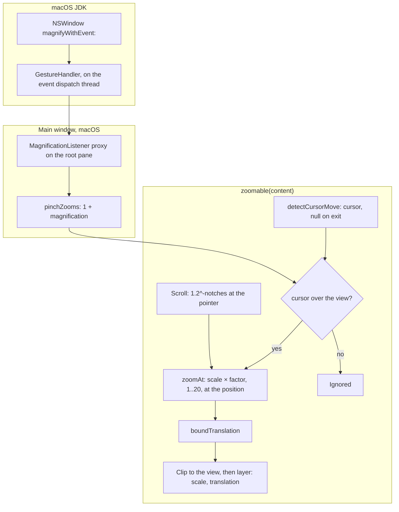

# Desktop: trackpad pinch zooms full-screen images and videos

## Problem

On desktop, a full-screen image or video is zoomed by the mouse wheel. On a macOS trackpad, a pinch leaves it as it is.

## Change

macOS:

- On a macOS build, `--add-exports=java.desktop/com.apple.eawt.event=ALL-UNNAMED` is added to `jvmArgs` in `desktop/build.gradle.kts`. The option is passed to the launcher of the packaged app and to `run`.
- After the main window is composed, `addPinchListener` adds a `MagnificationListener` to the window's root pane with `GestureUtilities.addGestureListenerTo`, by reflection. The JDK calls the listener on the event dispatch thread for each pinch step over the window.
- For each step, the zoom factor `1 + magnification` is emitted to `pinchZooms`.
- `com.apple.eawt.event` is a JDK-internal package of the macOS JDK. When its classes or the export are missing, a warning is logged, and pinch zoom is off.
- The listener's proxy answers `equals` by identity, `hashCode` by `System.identityHashCode` and `toString` by the interface name.

Full-screen view, `zoomable`:

- `zoomable` is applied to the full-screen image and to the frames of the full-screen video, as on the base.
- The pointer position over the view is kept by `detectCursorMove` and cleared when the pointer leaves the view.
- Each factor from `pinchZooms` zooms the view at the pointer by `zoomAt`. A factor received without a pointer over the view is ignored.
- The wheel zooms by the same `zoomAt`, with the factor `1.2^-notches`.
- In `zoomAt`, the scale is limited to 1×–20×, and the translation is clamped by `boundTranslation`, as for the wheel on the base.

Windows: a precision touchpad sends a pinch as Ctrl+wheel input, which is zoomed by the wheel handler, as on the base. Microsoft's [touchpad gesture implementation guide](https://learn.microsoft.com/en-us/previous-versions/windows/hardware/design/dn614021(v=vs.85)): "When processing a two-finger zoom, the touchpad device should: Issue Ctrl+vertical wheel input when the user performs the zoom gesture."

Linux: AWT receives the wheel only as X11 buttons 4 and 5, so a touchpad pinch leaves the view as it is, as on the base.

## Tests

In `ImageFullScreenZoomTest` (desktopTest), the pointer is moved to x = 200, and the factor 1.2³ is emitted to `pinchZooms`. The boundary between the red and blue halves is then checked where the wheel test checks it after three notches at the same pointer. Before the change, the factor is not collected, and the image stays at 1×.
