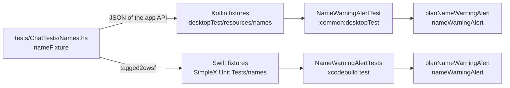

# Name alerts tested against core fixtures

Repository: simplex-chat/simplex-chat.
Branch: `ep/name-alert-fixtures`.
Base: master `88767bbc3` (#8220).

The user's words:

> Even these tests - can we maybe test views against data, and have a minimal e2e test?

> this is good. This way we decouple core testing from app testing, and don't have to run nix build for ios - right?

> excellent, no e2e tests, we produce fixtures in core tests, and then use it in UI tests if UI code changed or if UI fixtures changed. Works?

## Composition

## Fixtures

| Fixture | Test | User | Command |
|---|---|---|---|
| plan-known-expired | testPlanKnownNameStale | bob | `/_connect plan 1 @alice.simplex` |
| plan-own-expired | testPlanOwnNameExpired | alice | `/_connect plan 1 @alice.simplex` |
| plan-known-available | testPlanKnownNameAvailable | bob | `/_connect plan 1 @alice.simplex` |
| plan-own-available | testPlanOwnNameAvailable | alice | `/_connect plan 1 @alice.simplex` |
| plan-known-reserved | testPlanKnownNameReserved | bob | `/_connect plan 1 @alice.simplex` |
| plan-known-moved | testPlanKnownNameAddressChanged | bob | `/_connect plan 1 @alice.simplex` |
| error-available | testConnectByNameNotFound | bob | `/_connect plan 1 @nobody.simplex` |
| error-not-registered | testPlanNameReservedOther | bob | `/_connect plan 1 acme.simplex` |

Files
- Kotlin: `apps/multiplatform/common/src/desktopTest/resources/names/<fixture>.json`
- Swift: `apps/ios/SimpleX Unit Tests/names/<fixture>.json`

`nameFixture name cc cmd`, in tests/ChatTests/Names.hs
1. `chatSendCmd` of `Simplex.Chat.Mobile`: the response as the apps receive it.
2. `stableJSON`: values of volatile keys replaced.
3. `prettyJSON`: one object field or array element per line.
4. Swift form: `tagged2owsf`, checked by `owsf2tagged (tagged2owsf v) == v`.
5. `testGenerate` of tests/APIDocs.hs, for the Kotlin file, then, also after its failure (`finally`), the Swift file: the file written, the test failed when it differs.

`tagged2owsf`, in tests/ChatTests/Names.hs

| Tagged object | Swift form |
|---|---|
| `type` only | `_owsf`, `<type>: {}` |
| `type`, `data` of a value other than an untagged object | `_owsf`, `<type>: <data>` |
| `type`, other fields | `_owsf`, `<type>: {<other fields>}` |
| without `type` | unchanged |

`stableJSON` replacements
- `createdAt`, `updatedAt`, `chatTs`, `userMemberProfileUpdatedAt`: `1970-01-01T00:00:00Z`
- `agentConnId`, `xContactId`, `connFullLink`, `connShortLink`, `contactLink`, `linkOwnerId`, `presHeader`, `signature`, `welcomeSharedMsgId`, `requestSharedMsgId`: the key

`registerExpiredName`, in tests/NameResolver.hs
- `expires`: 2026-01-01 12:00 UTC
- `graceUntil`: 2099-01-01 12:00 UTC

## Alerts

`nameWarningAlert domain warning own chat`

| Warning | Own | Chat | Title | Action |
|---|---|---|---|---|
| expired | no | any | Name expired | none |
| expired | yes | any | Your name has expired | Renew |
| available | no | none | Name not registered | Register |
| available | no | a chat | Name no longer registered | Register |
| available | yes | any | Your name has expired | Re-register |
| reserved for community | any | any | Name not registered | Connect to SimpleX team |
| not registered | any | any | Name not registered | none |

Buttons
1. the action
2. Open chat, when the alert has a chat
3. OK

`planNameWarningAlert planSimplexName plan`
- `nameChange` lapsed, and `planSimplexName` present: `nameWarningAlert` with `isOwnLink` and `planChat` of the plan
- otherwise: none

`showNameWarningAlert` renders the alert; `planAndConnect` and the connect error alert compute it.

## Tests

| Fixture | Checked |
|---|---|
| plan-known-expired | expired, not own, Open chat, both dates |
| plan-own-expired | expired, own, Renew |
| plan-known-available | no longer registered, Register, Open chat |
| plan-own-available | own, Re-register |
| plan-known-reserved | reserved, Connect to SimpleX team, Open chat |
| plan-known-moved | no name alert; `localChats` include `knownChat` |
| error-available | not registered, Register, from `simplexDomainNotReady` |
| error-not-registered | not registered, no action, from `simplexDomainNotReady` |

Kotlin
- `NameWarningAlertTest`, in `apps/multiplatform/common/src/desktopTest`
- fixtures decoded by `json` with `API.serializer()`

iOS
- target `SimpleX Unit Tests`: unit tests without a host application, linked with SimpleXChat
- scheme `SimpleX Unit Tests`: the test action of the target
- sources: the tests, `Shared/Model/AppAPITypes.swift`, `Shared/Views/NewChat/NameWarningAlert.swift`
- `SimplexAddress.shareAddress`: in `Shared/Views/Helpers/ShareSheet.swift`, beside `showShareSheet`, in place of AppAPITypes.swift
- fixtures read from `names` beside the test file (`#filePath`), decoded by `decodeAPIResult`

iOS alert
- `NameWarningAlert.swift`: `NameWarningAction` (title), `NameWarningAlert`, `namePrice`, `nameWarningAlert`, `planNameWarningAlert`
- `NewChatView.swift`, `showNameWarningAlert`: the alert, and the effect of each action

| Action | Effect |
|---|---|
| renew, register, re-register | `openBrowserAlert` of simplex.domains |
| connect to team | `appOpenUrl` of `simplexTeamURL` |

## CI

Kotlin
- `:common:desktopTest` of build-linux, scope kotlin; `apps/multiplatform/**` includes the fixtures

iOS
- step "Run iOS unit tests" of build-ios, after "Build iOS app"; `apps/ios/**` includes the fixtures
- a new simulator: the runtime of the iphonesimulator SDK, its first iPhone device type
- `xcodebuild test` of the scheme `SimpleX Unit Tests`, with the settings of "Build iOS app"
- with `ep/ci-one-macos-job`: a step of build-macos, with the condition of its iOS steps

Core
- `/names tests/` writes and compares the fixtures
