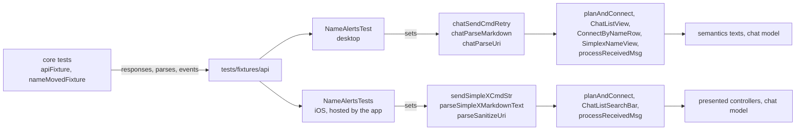

# App views tested on core responses

Repository: simplex-chat/simplex-chat.
Branch: `ep/name-alert-fixtures-2`.
Base: master `88767bbc3` (#8220).

The user's words:

> you must be testing on the view level, as much as possible, with mocked API. So the question that must have been answered is how to make existing views to use mocked api responses

> we need to cover as much of the app as possible, with as few app changes as possible, and without compiling the actual core library for the apps, because it's slow and complex. Instead we did fixtures that are tested against real haskell code. … I'd simply keep them in /tests fixtures, and have apps use them from there.

> you just replace func with var

## Composition



## Hooks

A function of the app that calls the core is a `var`; tests set it to a responder of recorded responses.

| App | Hook | Replaces |
|---|---|---|
| iOS | `sendSimpleXCmdStr` | `func sendSimpleXCmdStr` |
| iOS | `parseSimpleXMarkdownText` | `func parseSimpleXMarkdownText` |
| iOS | `parseSanitizeUri` | `func parseSanitizeUri` |
| Kotlin | `chatSendCmdRetry` | `external fun chatSendCmdRetry`, now `nativeChatSendCmdRetry` with `@JvmName("chatSendCmdRetry")` |
| Kotlin | `chatParseMarkdown` | `external fun chatParseMarkdown`, now `nativeChatParseMarkdown` with `@JvmName("chatParseMarkdown")` |
| Kotlin | `chatParseUri` | `external fun chatParseUri`, now `nativeChatParseUri` with `@JvmName("chatParseUri")` |

- The JNI symbols are unchanged.
- The call sites are unchanged, except the calls of `sendSimpleXCmdStr` and `parseSanitizeUri`, which lose their labels and default argument.
- Kotlin `processReceivedMsg` is `internal`, so tests process events.

## Fixtures

`tests/fixtures/api/<area>/<fixture>.json`, written in tests/ChatTests/Utils.hs by `apiFixture fixture user placeholders FixtureRequests {frMarkdown, frUris, frCommands}`, and by `nameFixture fixture user name` for one plan of a name:

```
{
  "commands": {"<command>": <response>},
  "markdown": {"<text>": <parse>},
  "uris": {"<uri>": <parse>}
}
```

- response: `chatSendCmd` of `Simplex.Chat.Mobile`, the JSON of the Kotlin app.
- parses: `chatParseMarkdown` and `chatParseUri` of `Simplex.Chat.Mobile`.
- placeholders: a link of the test replaced in keys and values, e.g. `CONTACT_LINK`.
- times replaced by 1970-01-01: `createdAt`, `updatedAt`, `chatTs`, `userMemberProfileSentAt`.
- random values replaced by their key: `agentConnId`, `xContactId`, `connFullLink`, `connShortLink`, `contactLink`, `groupLink`, `viaGroupLinkUri`, `simplexUri`, `memberId`, `memberPubKey`, `publicGroupId`, `businessId`, `customerId`.
- events: `nameMovedFixture`, the core's encoding of `CEvtNameMoved` for chats of the test.
- `registerExpiredName`: expiry 2026-01-01 12:00 UTC, grace until 2099-01-01 12:00 UTC.
- written with `testGenerate`: the test fails when its file differs.
- iOS: tagged objects converted to the single-field form when the test reads them.

| Fixture | Core test |
|---|---|
| names/plan-known-expired, plan-known-expired-no-grace, plan-known | known chat, resolved on every call |
| names/plan-own-expired, plan-own-expired-no-grace | own name, expired |
| names/plan-known-available | known chat, name now available |
| names/plan-own-available | own name, now available |
| names/plan-known-reserved | known chat and own name, name without link or reserved |
| names/plan-known-moved | known chat and own name, name moved to a new address |
| names/plan-moved-known | known chat and own name, name moved to another known chat |
| names/plan-moved-business, event-name-moved | known chat, name moved to a known business chat |
| names/plan-other-kind | bare name, the other kind's chat moved, offered |
| names/plan-channel-no-relays | no local chat, the channel has no relays |
| names/plan-own-channel-expired, plan-channel-moved, plan-old-channel | channel name moved |
| names/plan-known-failed | verify channel name, fail on re-point |
| names/search-team, plan-own-channel | local chats, before and after the name expired |
| names/error-available | connect by unregistered name reports it is available |
| names/error-not-registered | reserved for another reason |
| connect/contact-via-address | contact via address |

## Tests

Each test sets the hooks to the fixture and the current user, runs the app's flow and compares what the app shows.

| Test | Flow | Checked | Apps |
|---|---|---|---|
| plan alerts | `planAndConnect` of the name | texts of the alert, the plan's chats in the chat list and passed to `showLocalChats` | both |
| lapsed own channel, moved channel name | `planAndConnect` | the owner's alert with its chat; the new channel with the moved one listed | both |
| moved and failed verification | `planAndConnect` of the channel's link | the known channel's alert and its decoded verification | both |
| Renew, Register, Re-register | a press of the button | the alert to open https://simplex.domains/#testing | both |
| Open chat | a press of the button | the chat's load requested; iOS: the chat opened and `onOpen` called | both |
| Open new chat | a press of the button | the prepare command with the name's domain | both |
| OK | a press of the button | the alert closed and the cleanup called | Kotlin |
| Connect to SimpleX team | a press of the button | Kotlin: the plan of the team address requested; iOS: the team address opened | both |
| other kind | a press of "Connect to @team.simplex" | the plan of the other kind and its alert, or the alert of its error | both |
| own channel, contact via address | `planAndConnect` | the alert of the known chat | both |
| moved event | `processReceivedMsg` of the recorded event | the contact and group marked moved, its terminal label and details | both |
| search | "team.simplex" typed in the chat list search | the chats found by the local lookups listed, the connect row kept | Kotlin: `ChatListView`; iOS: `ChatListSearchBar` |
| connect by name | a press of `ConnectByNameRow` | the alert, the chats passed to `showLocalChats`, the search kept until a chat opens | Kotlin |
| name view | `SimplexNameView` of each verification | a press copies a verified name and verifies a failed, moved or unchecked one; a failed manual verification shows its reason | Kotlin |

A request without a recorded response fails the test, unless the test expects it.
iOS compares the texts of an alert without their order, because the order of two buttons depends on their widths.

Known gaps:
- iOS `SimplexNameView` and `ConnectByNameRow`: a SwiftUI tap is not reachable from a unit test.
- the chats of a pending connection (`connectingProhibit`): no core test plans one.
- the other kind's button in the ask, own-link and update-required alerts, and a price with cents: no core test records them.
- the connect row on Android mobile: not reachable from the desktop tests.
- colours and icons of `SimplexNameView`.

## iOS

- target `SimpleX Unit Tests`, hosted by the app, as `SimpleX Snapshots`.
- the CI stubs of `chat_migrate_init` and `chat_migrate_init_key` return an empty string, so the app opens its database error screen and calls the core no more.
- the alert is read from `getTopViewController()`.
- setUp and tearDown dismiss every presented controller.

## Core

- src/Simplex/Chat/View.hs: the arm of `CESimplexDomainNotReady` matches every `SimplexDomainError` in one `case`; GHC 8.10.7 of the full matrix rejected the arm of #8220 as incomplete.

## CI

- desktop: `:common:desktopTest` in the Kotlin step of build-linux.
- iOS: the step "Run iOS unit tests" after "Build iOS app".
- `tests/fixtures/api/**`, the core responses of all app tests, starts the kotlin and ios scopes.
