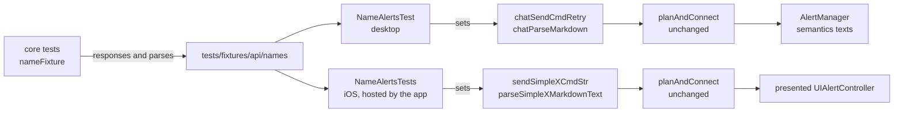

# App views tested on core responses

Repository: simplex-chat/simplex-chat.
Branch: `ep/name-alert-fixtures-2`.
Base: master `88767bbc3` (#8220).

The user's words:

> you must be testing on the view level, as much as possible, with mocked API. So the question that must have been answered is how to make existing views to use mocked api responses

> we need to cover as much of the app as possible, with as few app changes as possible, and without compiling the actual core library for the apps, because it's slow and complex. Instead we did fixtures that are tested against real haskell code. … I'd simply keep them in /tests fixtures, and have apps use them from there.

> you just replace func with var

## Composition



## Hooks

A function of the app that calls the core is a `var`; tests set it to a responder of recorded responses.

| App | Hook | Replaces |
|---|---|---|
| iOS | `sendSimpleXCmdStr` | `func sendSimpleXCmdStr` |
| iOS | `parseSimpleXMarkdownText` | `func parseSimpleXMarkdownText` |
| Kotlin | `chatSendCmdRetry` | `external fun chatSendCmdRetry`, now `nativeChatSendCmdRetry` with `@JvmName("chatSendCmdRetry")` |
| Kotlin | `chatParseMarkdown` | `external fun chatParseMarkdown`, now `nativeChatParseMarkdown` with `@JvmName("chatParseMarkdown")` |

- The JNI symbols are unchanged.
- The call sites are unchanged, except the two calls of `sendSimpleXCmdStr`, which lose the label and default argument.

## Fixtures

`tests/fixtures/api/names/<fixture>.json`, written by `nameFixture fixture user name` in tests/ChatTests/Names.hs:

```
{
  "commands": {"/_connect plan 1 <name>": <response>},
  "markdown": {"<name>": <parse>}
}
```

- response: `chatSendCmd` of `Simplex.Chat.Mobile`, the JSON of the Kotlin app.
- parse: `chatParseMarkdown` of `Simplex.Chat.Mobile`.
- volatile values replaced: `createdAt`, `updatedAt`, `chatTs`, `agentConnId`, `xContactId`, `connFullLink`, `connShortLink`, `contactLink`.
- `registerExpiredName`: expiry 2026-01-01 12:00 UTC, grace until 2099-01-01 12:00 UTC.
- written with `testGenerate`: the test fails when its file differs.
- iOS: tagged objects converted to the single-field form when the test reads them.

## Tests

Each test sets the hooks to the fixture, sets the current user, runs `planAndConnect` with the name, and compares the texts of the shown alert.

| Fixture | Title | Buttons |
|---|---|---|
| plan-known-expired | Name expired | Open chat, OK |
| plan-own-expired | Your name has expired | Renew, OK |
| plan-known-available | Name no longer registered | Register, Open chat, OK |
| plan-own-available | Your name has expired | Re-register, OK |
| plan-known-reserved | Name not registered | Connect to SimpleX team, Open chat, OK |
| plan-known-moved | the alert to open a new chat with cath, @alice.simplex | Open new chat, Cancel |
| error-available | Name not registered | Register, OK |
| error-not-registered | Name not registered | OK |

A request without a recorded response fails the test.

Known gaps:
- an expired name without a grace date.

## iOS

- target `SimpleX Unit Tests`, hosted by the app, as `SimpleX Snapshots`.
- the CI stubs of `chat_migrate_init` and `chat_migrate_init_key` return an empty string, so the app opens its database error screen and calls the core no more.
- the alert is read from `getTopViewController()`.

## CI

- desktop: `:common:desktopTest` in the Kotlin step of build-linux.
- iOS: the step "Run iOS unit tests" after "Build iOS app".
- `tests/fixtures/api/**`, the core responses of all app tests, starts the kotlin and ios scopes.
