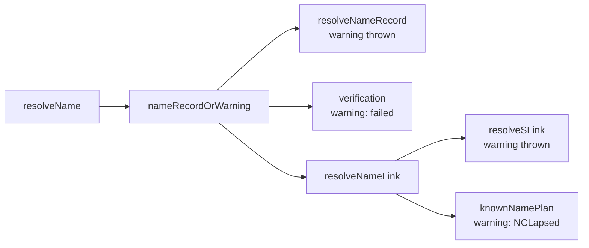
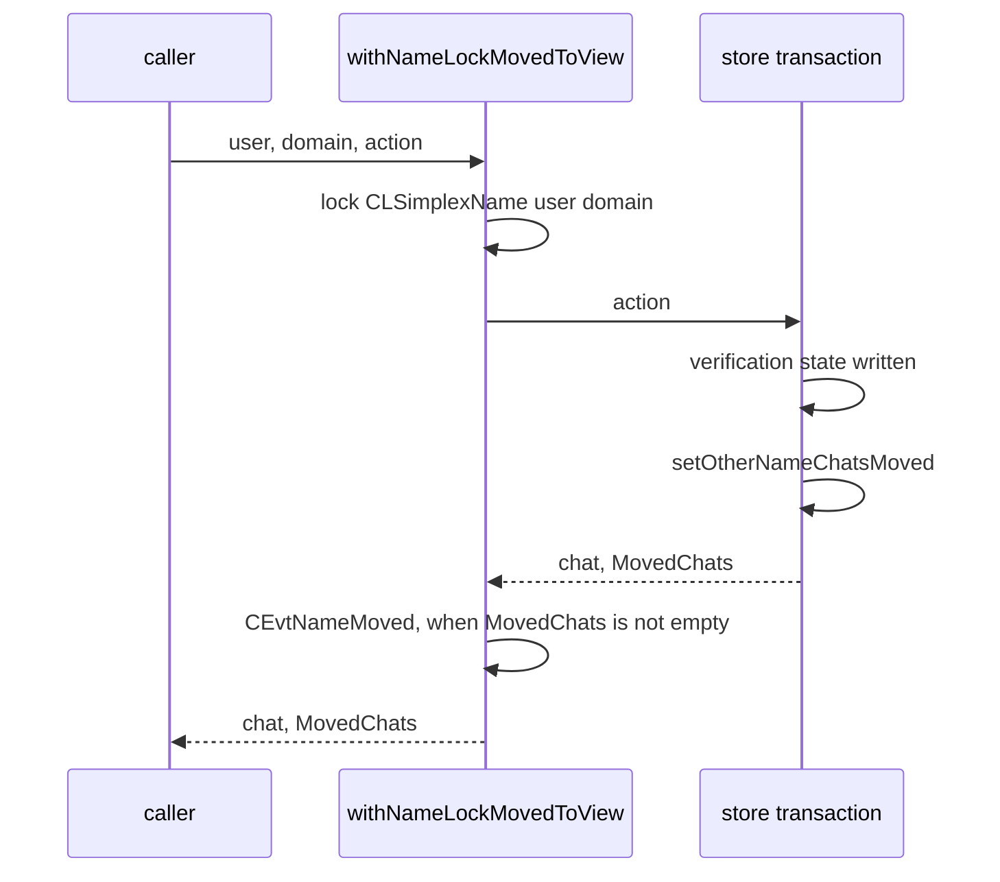
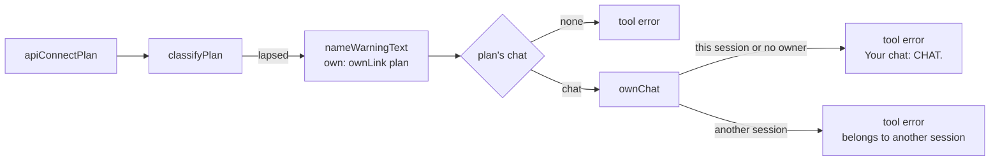

# Name lookup review fixes

Repository: simplex-chat/simplex-chat.
Branch: `ep/name-lookup-review-fixes`.
Base: master.

## Findings

| Finding | Change |
|---|---|
| A5-2 | mcp: verified names only, name warning texts, a lapsed name refused, a moved name reported |
| A5-4 | `ToField DomainVerification`; SQL compares with parameters; `NameVerified` |
| A5-5 | name warnings as values in the connection plan |
| A5-7 | `NCLapsed` includes the name's domain |
| A5-8 | one name lookup; an expired name refused everywhere |
| A5-9, A5-14, A5-15, A5-16 | the other chats of a verified chat's name marked moved in the same store transaction, under a lock per user and name |
| A5-10 | expiry compared with the registry's block time |
| A5-18 | one function for the name claimed by a group profile |
| A5-19 | the plan's name domain and the moved known chat bound once |
| A5-22 | a known business chat's name written only when changed |
| A5-24 | user guide |
| A5-26 | one check of the badge service address |
| 326cff68c | cherry-picked: a name warning matched in the same case |

Not changed: A5-1, A5-3, A5-6, A5-20, A5-21, A5-23.
In #8243, as their code is only on `names`: A5-13, A5-25.

## Name lookup

`resolveName user nm domain :: CM (Either NameWarning NameRecord)`
1. `resolveSimplexName` of the agent: `NameResponse`.
2. `nameRecordOrWarning now domain response`.

`nameRecordOrWarning`
- time: `fromMaybe now lastBlockTs`
- expired: `expires` before the time
- grace date: shown when not before the time

`resolveNameRecord user nm domain :: CM NameRecord`
- `resolveName`, a warning thrown as `CESimplexDomainNotReady domain (SDENameWarning w)`
- callers: setting the user's name, setting a channel's name, a service request to a name

The core creates no `NAME NOT_FOUND` error.

Verification of a contact's or channel's name:

| Answer | State | Reason |
|---|---|---|
| record, the chat's link, for a contact its proof | verified | — |
| record, another link | failed | the name does not resolve to ... |
| expired | failed | the name expired |
| available | failed | the name is not registered |
| reserved | failed | the name is not registered |
| not registered | failed | the name is not registered |
| `NAME NOT_FOUND` of a router before v22, channel | failed | the name is not registered |

## Connection plan

`connectPlan`, the name resolved before for a bare name:
- type: `Maybe (Either ChatError (Either NameWarning NameRecord))`
- value: `tryAllErrors (resolveName user nm d)`

`resolveNameLink ni :: CM (Either NameWarning ShortLinkContact)`
- the pre-resolved name, or `resolveName`
- the first link of the name's kind, or the error `SDENoValidLink`

`resolveSLink`: the warning of `resolveNameLink` thrown as `SDENameWarning`.

`knownNamePlan`, a chat known for the name:

| `resolveNameLink` | Plan |
|---|---|
| the chat's link | the known chat |
| another link | that link's plan, `NCMoved` |
| `NWNotRegistered` | the known chat |
| another warning | the known chat, `NCLapsed nameDomain w` |
| error | as before |

```haskell
data NameChange
  = NCLapsed {nameDomain :: SimplexDomain, nameWarning :: NameWarning}
  | NCMoved {knownChat :: AChatInfo}
```

Read from `NCLapsed`:
- View.hs: the warning line
- iOS `planAndConnect`
- Kotlin `planAndConnectTask`



## Verification state

`DomainVerification` in the database:

| Value | State |
|---|---|
| 0 | failed |
| 1 | verified |
| 2 | moved |

- `ToField DomainVerification` beside `FromField`.
- `*_domain_verified` compared with `DVVerified` and `DVMoved` as SQL parameters.

Store.Direct:
```haskell
type NameVerified = Bool

type MovedChats = ([ContactId], [GroupId])
```

`setOtherNameChatsMoved db user chat :: IO MovedChats`, in Store.Direct, for a verified chat:

| Chat | Name kind | Moved |
|---|---|---|
| contact | contact | other contacts, business chats |
| business chat | contact | contacts, other business chats |
| channel | channel | other non-business groups |
| other or not verified | — | none |

- contacts: one SELECT of the ids, one UPDATE
- groups: one UPDATE ... RETURNING

Store functions that call `setOtherNameChatsMoved`, with `MovedChats` in the result:
- `setContactDomainVerified`
- `setGroupDomainVerified`, and through it `setPreparedGroupDomain`, `createPreparedGroup`
- `createPreparedContact`, through `setContactDomainVerified`
- `updatePreparedContactUser`
- `updatePreparedGroupUser`

`withNameLockMovedToView user domain_ action :: CM (a, MovedChats)`, in Library.Internal:
- lock: `CLSimplexName userId (fullDomainName domain)` of `ChatLockEntity`, for a domain
- `CEvtNameMoved` for non-empty `MovedChats`

Callers:

| Command or function | User | Domain |
|---|---|---|
| APIPrepareContact | user | the verified domain |
| APIPrepareGroup | user | the verified domain |
| APIChangePreparedContactUser | new user | the contact's claim |
| APIChangePreparedGroupUser | new user | a business chat's domain, or the group's claim |
| APIVerifyContactDomain | user | the claim |
| APIVerifyGroupDomain | user | the claim |
| runUpdateGroupProfile | user | the new profile's claim |
| contactLinkPlan, a known business chat | user | the plan's domain |
| updateGroupFromLinkData | user | the resolved domain |
| updateContactFromLinkData | user | the link profile's claim |



## Other changes

- `groupClaim :: GroupProfile -> Maybe SimplexDomain`, in Simplex.Chat.Types, in place of:
  - `groupClaim` of Library.Internal
  - the local `groupClaim` of `updateGroupProfile`
  - the body of View `groupSimplexDomain`
  - the domain of a group plan in `groupLinkPlan`
  - the domain of Directory `verifiedGroupDomain`
- `planDomain` and `knownMoved` in the `where` of `CTShortContact`.
- A known business chat of a contact plan: its domain and verification written when they differ from the plan's domain and `DVVerified`.
- `requestBadgeIssue`: `requireBadgeService`.
- docs/guide/register-simplex-name.md: the moved indicator, the name warning alerts.

## Apps

- iOS `SimplexNameView`: the verified name and the cross of a failed or moved name as buttons, in place of tap gestures.
- iOS `ConnectByNameRow`: a button, in place of a tap gesture.
- The cross colour of a SimpleX name by its verification state, in one function:
  - iOS `SimplexNameView.crossColor`
  - Kotlin `simplexNameCrossColor`

## MCP server

packages/simplex-chat-mcp. Scope `mcp` of scripts/ci/scope-tests.sh runs `npm ci`, then `npx tsc` against `@simplex-chat/types` 7.1.3 of its package-lock.json.

| Function | Change |
|---|---|
| `simplexNameOf` | a name for `DomainVerification.Verified` only |
| `chatErrorTypeText` | `nameWarning`: `nameWarningText` |
| `nameWarningText` | the apps' words of the alerts, for the agent's own name or another user's; another user's available name of a known chat: "Name no longer registered" |
| `classifyPlan`, `planChat` | `lapsed`: the text of `nameWarningText`, own for an `ownLink` plan, and the plan's chat |
| `AgentTools.plan` | `lapsed`: a tool error, with ` Your chat: CHAT.` for the plan's chat after `ownChat` |
| `classifyPlan` | `moved`: `movedFrom`, the reference of the known chat |
| `planFields` | `moved_from` in the result of `connect` |



## Tests

Core, tests/ChatTests/Names.hs:
- `testNameRecordOrWarning`: the block time before and after `expires`.
- `testChannelDomainVerify`: an expired name not verified.
- `testSetNameExpired`: an expired name not set.
- New plans, recorded as fixtures:
  - `testPlanNameChannelUpdateRequired`
  - `testPlanOwnNameOtherKind`
  - `testPlanContactConnecting`
- Fixtures added to existing tests:
  - `testPlanKnownNameNewChatOpened`
  - `testPlanKnownNameMovedToKnownChat`
  - `testPlanLocalChats`
- `apiFixture`: a `/_prepare` command recorded without its JSON argument; `pccAgentConnId` replaced by its key.
- chat_query_plans.txt: the plans of the changed queries, from the save step of the full suite run outside CI.

Fixtures, tests/fixtures/api/names:
- Changed, with `nameDomain` in `nameChange`:
  - plan-known-available
  - plan-known-expired
  - plan-known-expired-no-grace
  - plan-known-reserved
  - plan-own-available
  - plan-own-channel-expired
  - plan-own-expired
  - plan-own-expired-no-grace
- Added:
  - plan-connecting-contact
  - plan-known-moved-prepared
  - plan-own-address-other-kind
  - plan-own-channel-other-kind
  - plan-update-required
  - search-moved-known

iOS, NameAlertsTests, added; a `/_prepare` command looked up in the mock without its JSON argument:
- testOnOpenAfterPrepareWithoutCheckingItsJSON
- testChannelUpdateRequired
- testOwnChannelOffersOtherKind
- testOwnAddressOffersOtherKind
- testContactConnecting
- testChatListRowShowsChatsOfName
- testConnectByNameRowShowsLocalChats
- testVerifiedNameIsCopied
- testFailedNameIsVerifiedAgain
- testMovedNameIsVerifiedAgain
- testCrossColorOfNameState

Android and desktop, NameAlertsTest, added:
- channelUpdateRequired
- contactConnecting
- chatListRowShowsChatsOfName
- crossColorOfNameState

mcp:
- name warning texts
- a lapsed name refused, with the known chat
- the agent's own lapsed name, of its address and of its channel
- the chat of a lapsed name claimed without an owner, refused of another session
- `movedFrom`
- `simplexName` of a verified chat only
