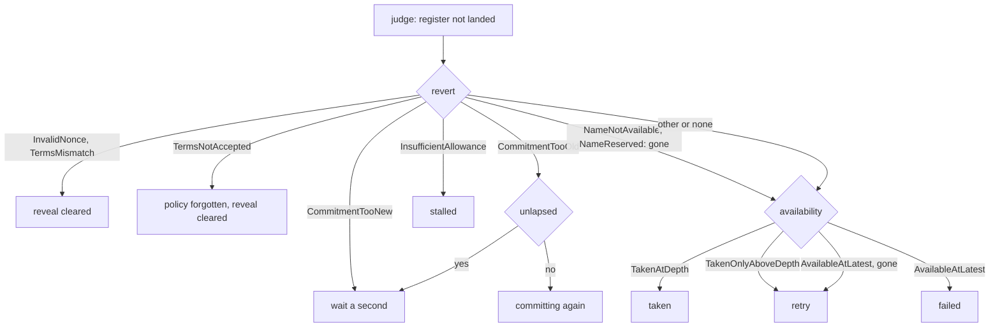
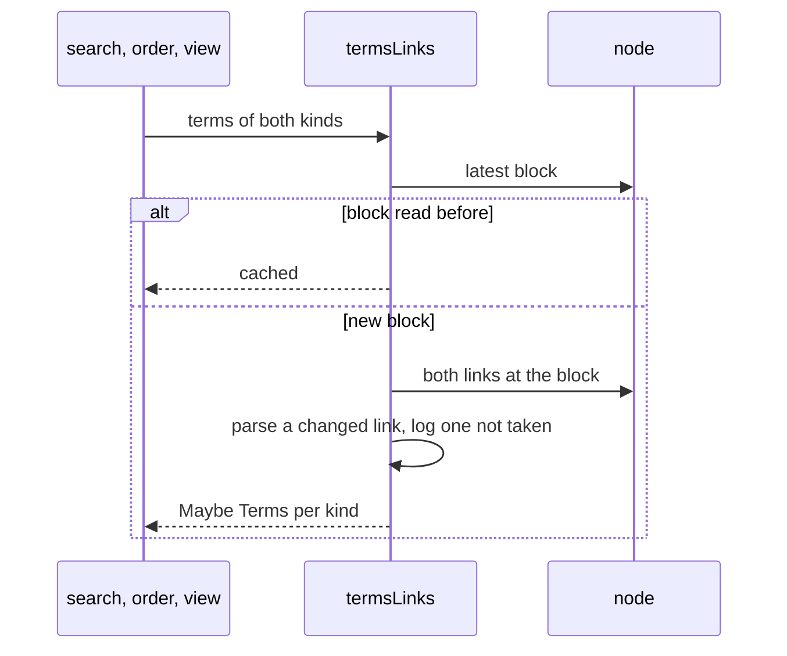
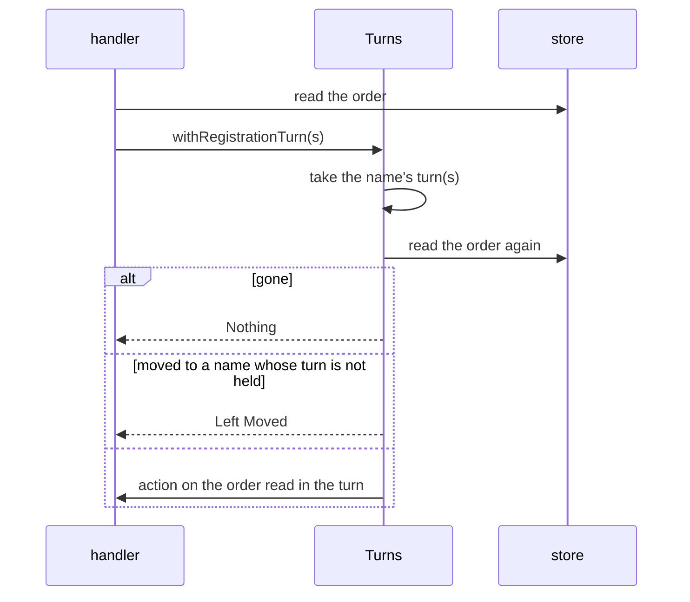
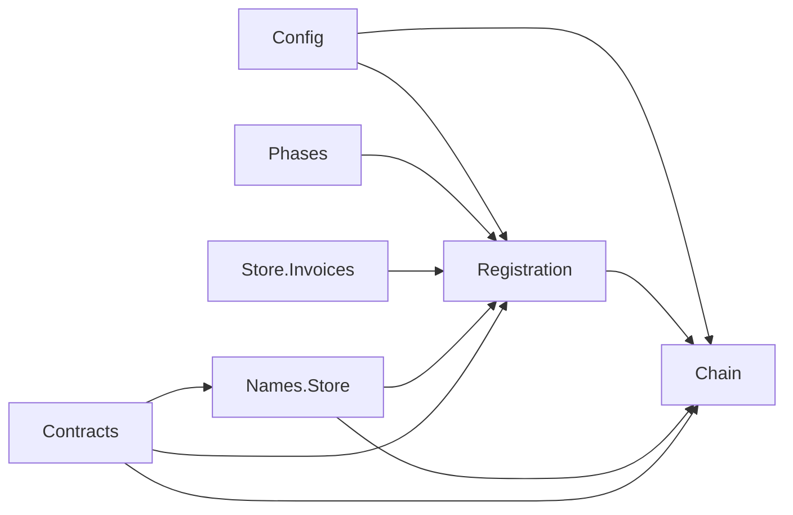

# Names service: A2 fixes (chain)

Branch `ep/names-fixes-a2`, from `ep/names-review-fixes` at 16114b784. Findings A2-1 … A2-38 of the review of https://github.com/simplex-chat/simplex-chat/pull/7703, decided by the user on 2026-11-16 under the type rule of plans/2026-11-16-names-review-fixes.md. Each finding is one commit, `store: <change>`.

## Errors and reverts

A2-1: `ChainUnderfunded Text` in ChainError, recognised once in `rpc` from the node's message; the sender logs it as an error by its constructor. The other contract states keep `ChainUnavailable` and the outage answers.

A2-2: reverts as one type, ChainReverted's payload.

```haskell
data RevertReason = RRWithoutData | RRNamed RevertName | RRUnnamed Text
```

- RNWithoutData goes; `revertSignature` and `revertText` are total.
- `decodeRevert`: empty data, a known selector, Error(string) by its message, any other selector in hex.
- A node message without data: "execution reverted" alone is RRWithoutData; its suffix is RRUnnamed.
- Data that is present but not hex: RRUnnamed with the node's message.
- `revertReasonText :: RevertReason -> Maybe Text` renders the revert column and the answer's revert field.

A2-33: requeue and the reveal's write fail on a refused write as a BrokenInvariant; only a changed version answers registration_changed.

A2-37: `StepFailure` in Retry and Stalled, compared by Eq, rendered only in follow's log line.

```haskell
data StepFailure
  = SFChain ChainError
  | SFSend SendError
  | SFWrite OrderRefusal
  | SFUnread
  | SFAllowanceUsedUp
  | SFTakenAboveDepth
  | SFGoneButAvailable
```

## Chain client

- A2-31: blockByNumber takes BlockTag; every tag is rendered by blockTagParam.
- A2-32: the sender counts depth by confirmedNumber.
- A2-34: Contracts exports `ctChain`; Worker, the census, Metrics and Records take the client from it. NamesEnv's chain client and Metrics' NamesSource go.
- A2-20: nameStatus and nameRecords read the latest block first and every call at it; resolverNonce takes the block tag.
- A2-21: a cached chain read is `(generation, Maybe a)`; forgetNamePolicy increments the generation, and a read completed after it is not kept.
- A2-22: commitment ages are Word64; fromCommitment adds them to the commitment's time, Nothing past 2^64 seconds.
- A2-19: `type ChainSeconds = Word64`, `chainTime` and `chainSeconds` in Chain, at every chain time and every signed deadline; RegistrarFunds built by record syntax.

## Transactions

- A2-4: Eip1559Tx is the request type; TxRequest goes. The sender's fees are Integer, narrowed once into Word128 under the fee cap.
- A2-5: one decoder, simplexmq's `decodeEip1559Tx`, under decodeSignedTx (newSender) and transactionSigner (the start check), one acceptance for both.
- A2-25: `data TxSettlement = TSMinedAt Word64 | TSRevertedAt Word64 | TSDroppedTx` in Store, the argument of recordTransactionOutcome, produced once per hash in settle; a hash whose row was not pending is logged.
- A2-26: `data TxFor = TxRegistration RegistrationTx RegistrationId | TxEdit RecordEditId`, `data RegistrationTx = RTCommit | RTAccept | RTRegister` with TextEncoding. The stored kind is `data TxKind = TKRegistration RegistrationTx | TKEdit` with its field instances; the predicates go. withinSends and sendsUsedUp keep their rules on mined commits.
- A2-3: simplexmq on evgeny-simplex/simplexmq ep/usdcents-instances: `rlpP` (canonical RLP), `decodeEip1559Tx` and `eip1559SigningHash` beside signEip1559Tx; decodeSignedTx and transactionSigner call them.

## Worker's judgment

A2-23, A2-24: judge has one arm per revert name, and the availability read returns one state.

```haskell
data Availability = AvailableAtLatest | TakenAtDepth | TakenOnlyAboveDepth
```



## Terms

A2-6: `type CommunityName = Bool` at every site of the terms kind, as AgreedTerms names it; `termsKindText` gives "general" or "community". The record TermsKind and termsKind stay, termsKind taking CommunityName.

A2-7, A2-8, A2-35: the terms link is parsed once, where termsLinks reads it.

- termsOf parses the link by a local attoparsec grammar, with the loopback chain check; a failed chain id read fails the terms read.
- `Terms {tmLink, tmHash, tmFetch :: (String, Maybe ByteString)}`; `termsOf :: Contracts -> Text -> IO (Either ChainError (Maybe Terms))`. A link the service does not fetch gives no terms, so no acceptance of it is asked; TRLink goes.
- termsLinks returns `(Maybe Terms, Maybe Terms)`, keeps each kind's link text with its terms, parses a link only when its text differs from the one read before, and logs a link the service does not take then.
- The cache is written by one atomicModifyIORef' that keeps an entry of the same or a newer block; only the read that writes logs, and only a link that differs from the entry it replaces.
- termsLinkAllowed goes; fetchTerms reads tmFetch; kindTerms moves beside termsLinks.



A2-38: fetchText moves to the terms code in Contracts, its only caller's module; its result stays the tuple. Chain exports httpFailure.

A2-36: namehash uses simplexmq's labelHash; `tldLabel` serves labelNode and the view's TLD.

## Reveal

- A2-12: `RevealRequest` with FromJSON, decoded once before the name's turn; SignedLabel, RevealFields, textField and integerField go.
- A2-13: intentOf is the one builder of a Registration; committedRegistration builds the NameReveal.
- A2-14: `checkReveal` returns the NameReveal its checks passed; the acceptance is required in the request and in NameReveal.
  - `RVBadRequest Text`: each refusal states its reason, logged with the refused request; the HTTP answer is unchanged.
  - The retry logs why it clears a stored reveal: the intent's check, the reveal margin or a moved sponsor nonce.
- A2-15: toRegistration checks the 32-byte columns; verifyRegisterIntent's length check goes.
- A2-16: `hexP` and `lowerHexP` in Abi read every 0x hash, the secret, the signature, the service key, the terms digest and AgreedTerms; Orders' `hexHash` and `hexSignature` serve the order, the reveal and the find. The node's JSON-RPC data and quantities keep their any-case rule.
  - A quantity is one parse, `0x` and attoparsec's `hexadecimal`, after a length check: over 66 characters is refused as "over 256 bits", any other failure as "not a quantity".
- A2-17: simplexmq exports `addressFromBytes`, `anyCaseAddressP`, `checksumAddressP` and `lowS`. parseAnyCaseAddress and parseChecksumAddress call the two parsers, their failures mapped to ADFormat and ADChecksum; parseSignature reads with deserializeSignature and lowS. SignatureError and AddressError stay.
- A2-12: a reveal that does not decode is logged with aeson's error.
- A2-11: `withRegistrationTurn` and `withRegistrationTurns` in Turns read the order again in its name's turn; `type Moved = ()`. The reveal, Try again, the close and the move use them.



## Census

A2-27, A2-28: Census.hs goes; its code is in Contracts.

- `registeredNames`, `RegisteredNames {rgBlock, rgNames}`, `NameEntry {enLevel, enLength, enRecords}`, `RecordsSet`.
- It reads the record keys, the text record (`textRecordAt`), the child node (`childNode` in Registration) and the zero address (`isZeroAddress`) as the other reads do.
- Chunks by simplexmq's toChunks. Metrics keeps its metric names and output.

## Modules

A2-29: after the other areas merge, Abi and Revert move into Chain, and Signatures with RegistrationId into Registration.

- ChainConfig is defined in Chain; Config re-exports it.
- chainSeconds is `floor . utcTimeToPOSIXSeconds`.
- Chain imports no service module.
- RegistrationId is imported from Registration; Phases does not export it.
- Abi.hs, Revert.hs and Signatures.hs are out of the cabal module lists; their deletion waits for the user, as Census.hs.



## Gaps recorded after the review

- No test fails eth_chainId for a loopback terms link (review 9).
- No test pins nameStatus's reservedNames read at the block (review 24).
