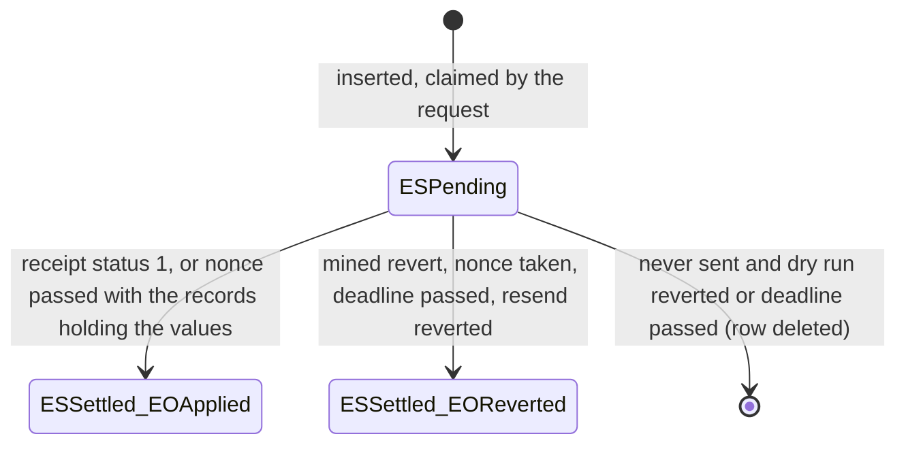
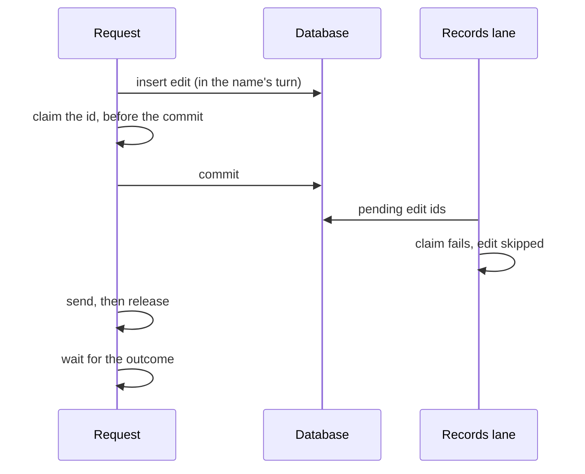

# Names service: fixes of the A3 findings (records and profiles)

Branch `ep/names-fixes-a3`, from `ep/names-review-fixes` at 16114b784. Decisions: the user's, 2026-11-16, and the type rule of `plans/2026-11-16-names-review-fixes.md`. Line references are at b13968b61.

Each finding is one commit, `store: <change>`, or `core: <change>` for src/.

## Links

A3-1, A3-2, A3-31 (links):
- Links.hs is removed. `LinkKind`, `linkMaxBytes` and the parser move into Names/Registration.hs, beside the record keys; `shortLinkHosts` moves into Names/Profiles.hs.
- `nameLink :: Text -> Maybe (LinkKind, ConnShortLink 'CMContact)`: the length bound, then `strDecode @(ConnShortLink 'CMContact)`; `CCTContact` is `LKContact`, `CCTChannel` is `LKChannel`, any other type is refused.
- `shortLinkP` and `parseShortLink` go. `previewHandler` and `recordLinks` pass the parsed link to `linkPreview` and `linkEntity`; `boundedProfile` takes it.
- The profile cache is keyed by `strEncode (simplexShortLink sl)`.
- An entity's `link` is the parsed link's encoding, its `deepLink` the `simplex:/` form; neither is null.

A3-13: `RCSetText LinkKind Text`.
- `TextEncoding LinkKind` spells `simplex.contact` and `simplex.channel`; `recordKey` gives the key's bytes.
- `contactRecordKey`, `channelRecordKey` and `recordKinds` go, replaced by `recordKey LKContact` and `recordKey LKChannel`; `setTextDigest` and `setTextWithSigCalldata` take the kind.
- The edit body's key is parsed into the kind with the other formats; the stored key text is unchanged.

A3-31 (label): `LabelError` and `validLabel` move into Names/Registration.hs; Label.hs is removed.

A3-18: the lowercase test goes; `domain == label` refuses an upper-case label, as `mkDomain` lowers the domain.

## Profiles

A3-3, A3-4, A3-5, A3-6:
- `data LinkData = LDContact ContactShortLinkData | LDChannel GroupShortLinkData`; `ChatKind`, `LinkProfile` and `planProfile` go.
- `type ProfileFetcher = LinkKind -> ConnShortLink 'CMContact -> IO (Either ChatError (Maybe LinkData))`; Nothing for link data that does not decode. The kind is the one `nameLink` gave; `chatProfile` decodes by it.
- `chatProfile cc user` reads the link data with `getShortLinkConnReq'` and `decodeLinkUserData`, in `CM` run by `runReaderT (tryAllErrors' …) cc`; the names env holds the bot's `User`.
- `boundedProfile` logs a failed read once; a non-temporary agent error or undecodable data is `ProfileUnavailable`, any other failure `ProfileUnread`.
- Preview JSON: `type` and `profile` always; with `ok`, `displayName`, `fullName` and `image` (data:image/ only), and `peerType` and `business` for an address, `groupType` and `publicMemberCount` for a channel. `kind` and `subscribers` go.
- Built in place of the two items above, after the text review: `ProfileOk` holds a `LinkProfile` of `kind` (`contact`, `business`, `bot` or `channel`), `displayName`, `fullName`, `image` (data:image/ only) and `subscribers` (a channel's `publicMemberCount`), made from the link data by `linkProfileOf`; the cache holds it, and the answer is `{"type": "ok", "linkProfile": …}`.
- `ContactShortLinkData` and `GroupShortLinkData` derive `Eq` (core).

```mermaid
sequenceDiagram
  participant P as Names page
  participant W as Web API
  participant C as Chat core
  participant M as SMP servers
  P->>W: POST /api/link/preview: link
  W->>W: nameLink: bound, chat core grammar, contact or channel
  W->>W: cache by the simplex:/ form
  W->>C: getShortLinkConnReq' (no plan, no database lookup)
  C->>M: link data
  C-->>W: ContactShortLinkData or GroupShortLinkData, or ChatError
  W-->>P: type, profile; with ok: the profile's fields
```

## Record edits

A3-9, A3-12: one outcome type.
- `data EditOutcome = EOApplied (Maybe TxHash) | EOReverted (Maybe Text)`; `EditState = ESPending | ESSettled EditOutcome`; `EditAnswer`'s `EASettled EditOutcome` replaces `EAApplied` and `EAReverted`.
- `settleRecordEdit` and `settle` take `EditOutcome`.
- `judge` returns `Judgment`, kept as it is. One `judgmentOutcome :: Judgment -> Maybe EditOutcome`, Nothing for `NonceFree`, replaces its two mappings. The request answers `fromMaybe (EOReverted name)`, the lane `maybe whenFree (settle …)`.
- A3-12 is superseded by A2-2: the revert is kept as `Maybe RevertName` (A2-2's `revertName`) and written to the column by its textEncode; the column keeps text.



A3-10: `insertEdit` adds the new id to `rsClaimed` inside its transaction, and removes it when the transaction fails; `newEdit` sends the claimed edit and releases it in one bracket, then waits unclaimed. `sendUnsent` keeps `forget`.



A3-11: the `ChainError` of `chainAccepts` and of the judging after a dry-run revert is logged as the send errors are; the answer stays 503.

A3-26: `insertEdit` reads the year's edit times once; the hour's are their suffix; the cap's wait is `listToMaybe (drop (editCap - 1) (reverse hour))`. `editsLeft` is the pure part of `nameEditsLeft`.

A3-28: `chainAccepts` returns `Maybe EditAnswer`, Nothing when accepted.
- `EARefused Text`: deadline too close, name not registered, signer not the owner, another resolver, signers differ, nonce held by another edit; answered `400 bad_request`, the reason logged by `recordsHandler`.
- `EAStaleNonce`: the first nonce is not the owner's next; answered `409 stale_nonce`, so the page reads the nonce again and signs again.

## Service

A3-7: StoreService.Safely is removed; each site catches by `catchOwn'` with its own log line, naming what runs next where a next pass or scan retries it; `webhookHandler`'s inline catch and `isAsync` use `catchOwn'` and `isAsyncCancellation`. `survive` and `logUncaught` stay, as they already catch by `catchOwn'`. No helper and no simplexmq change.

A3-8: `runMetrics` races the listener itself, so a failed bind ends the lanes as a web listener's does.

A3-19: X-Forwarded-For's last entry is parsed by `strDecode @TransportHost`; IPv4 only in its canonical encoding (bounds every octet), IPv6 as parsed; the socket address converts by `sockHost` (moved from Profiles.hs to Web/Http.hs); `hostKey` computes the key from the numbers. `isIPv4`, `isIPv6`, `groupCount`, `v6Groups`, `v4Key`, `v6Key`, `peerText`, `asciiDigit` and `asciiHexDigit` go.

A3-29: `namesRoutes` wraps the path segment in `RegistrationId`; the five handlers take it. The label hash parse stays in its two handlers.

A3-30: `recordsHandler` and `revealHandler` read at most `maxBodyBytes`.

## Not changed

- A3-17, A3-20, A3-25: dropped (proposed decisions).

## Tests

- NamesLinksTests: `nameLink` against the chat core's grammar: canonical base64url keys, a server required, contact and channel types only.
- NamesProfilesTests: the plan tests go; link data to preview JSON for each kind and read state; the fetch classification; the chat core read through `getShortLinkConnReq'`; the `simplex:/` spelling of a cached link answered from its entry.
- NamesRecordsTests: `EASettled`, `EARefused` reasons, `EAStaleNonce`; links of the core's grammar.
- WebTests: forwarded IPv4 in canonical form, bracketed IPv6 taken; a webhook whose verifier throws `StackOverflow` answered 200.
- MetricsTests: `runMetrics` ends when its port is taken.
- Route tables of the test modules wrap `RegistrationId`.

## Test gaps

- A3-10: the claim taken before the commit, and its release when the commit fails, are untested. A test needs a hook between the commit and the send, which Records.hs would gain for the test alone.
- A3-11: the two log lines, of failed chain checks and of a dry-run revert not judged, are untested; the tests assert the 503 answer.
- A3-28: `recordsHandler`'s refusal log line and the refusal of a nonce held by another edit are untested.
