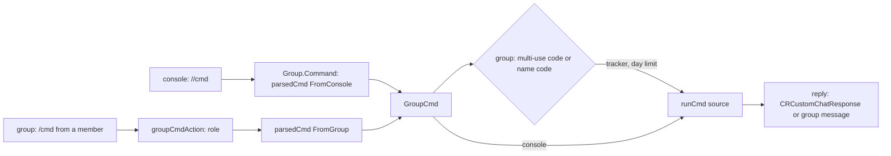
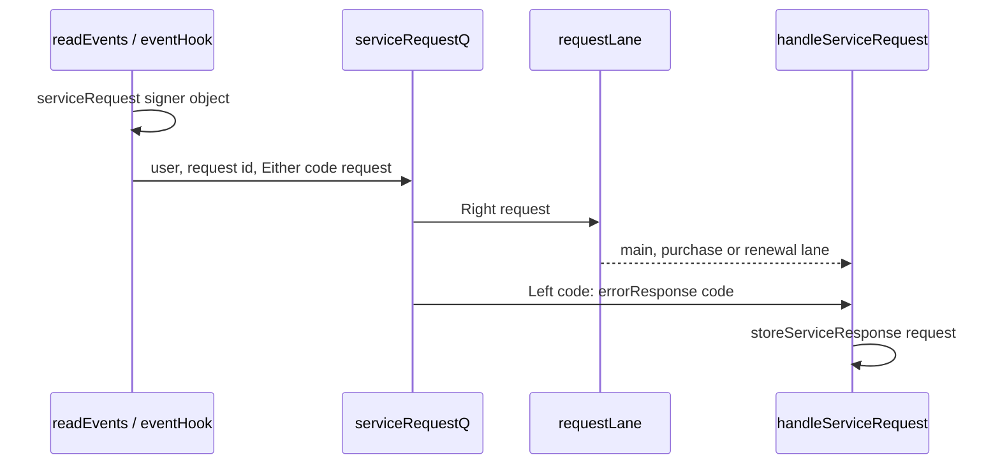

# Names service: fixes of the reviewed findings, A4

Branch `ep/names-fixes-a4`, from `ep/names-review-fixes` at 16114b784. Decisions: the user's, 2026-11-16, on the review of https://github.com/simplex-chat/simplex-chat/pull/7703, and the type rule of plans/2026-11-16-names-review-fixes.md. Line references are at b13968b61.

Each finding is one commit, `store: <change>`, `core: <change>` for src/, `ios, android, desktop: <change>` for the apps.

## Configuration

A4-4, the served sites:
- `ListenerConfig.lBadgesSite :: Maybe FilePath`, Just with `serve_webapp` on.
- `ListenerConfig.lNamesSite :: Maybe (Int, FilePath)`, the port and the build, Just with `[names]` and `serve_webapp` on.
- lServeWebapp, lBadgesStaticDir, lNamesStaticDir and lNamesPort go; WebEnv's weBadgesSite and weNamesSite go; newWebEnv, webListeners and checkSiteDirs read the two fields.

A4-5, the dev store checks:
- `ServiceConfig.devStoreChecks :: StoreChecks` in place of devCheckStoreDuringCoverage.
- credit_test_purchases with accept_unverified_store_receipts is refused, as the mock credits no test purchase.
- configureStoreVerifier sets `storeChecks = devStoreChecks` in both branches.

A4-6, A4-20, A4-21, the ini file:
- `iniSections :: Text -> Either String [(Text, [(Text, Text)])]`: the lines in file order, each a blank or comment line (`;`, `#`), a `[section]` header or a `key = value` setting read by an attoparsec grammar; the settings above the first header are the section "".
- Refused there, naming the line: any other line, the `key: value` form among them; a repeated section; a repeated key in a section.
- readText partitions `unknownKeys` once: the [names] and [chain] keys refuse the file, the others are warned of; parseConfig reads a Map built from the sections.
- Data.Ini, colonSetting, repeatedSetting, trailingNoise and the `ini` dependency go; `eitherToMaybe` reads the community count's config.

A4-7: each URL is parsed by http-client's `parseRequest` in Config; `secure` and `host` give the https and loopback rules of btcpay.host, apple.api_host, chain.rpc_url and the dev_keys BTCPay check; a malformed URL is refused at start; urlHost and requireHttps go; the fields stay text.

A4-17: `boundedDecimal :: Integral a => a -> a -> Parser a`, attoparsec's `decimal` read at Integer and checked against the bounds, in Config:
- every integer setting is read through it, with one message per setting: `<section>.<key> must be a whole number from L to H`, or `of at least L` for a setting without an upper bound, except for a whole number above the type's maximum;
- Group/Command's options, the names page's `length` and `seenVersion` parameters use it.

A4-19: stripeSection refuses keys of two modes; parseConfig binds whether the keys are test keys once, for the dev_keys and chain checks.

A5-13: `minNameYears = 2` moves beside minNameLength in Simplex.Chat.Badges.Code; nameRecordOrWarning prices the available name for it.

A4-22 (nCommunity keyed by LabelHash): A6 does it, after its simplexmq pin.

A4-16 (serviceKey): A2-16's hex parser covers it.

## Payments and the poller

A4-1: settleOrder returns the invoice status and throws BrokenInvariant for a missing invoice, code hash or registration; the poller counts that invoice as unread, and the cleanup keeps its order.

A4-3, one provider reference per invoice:
- The names migration, edited in place, adds `@invoices.product` and `@invoices.provider_ref` with one unique index, the reference filled from `@badge_code_invoices`, whose column stays; `@name_invoices` has none. The down migration drops both columns.
- Reads and the lookup by reference read `i.provider_ref`; providerRefColumn, the UNION ALL and ProviderRefConflict go.
- The invoice inserts write the reference: NewNameInvoice gains it, PaidOrder loses it.

A4-8: PaymentProvider and CryptoCurrency derive Ord; unpaidRefs decodes the provider, as overdueInvoices does; the listed and webhook times, the rates and the provider reads are keyed by PaymentProvider; metrics encode it as a label.

A4-23: badgeCounts reads BadgePurchaseStatus and SubscriptionState by their field instances; metrics encode them as labels.

A4-24: Apple's signedDate is read by `.:` as milliseconds, converted by `fromMillis`, which the subscription status reads too.

## Service

A4-2: the store service prints no database line, since the connection string is on its command line; redactPassword goes, and Postgres' `dbString` stays as on `names`.

A4-10, A4-11, one grammar and one dispatch of the commands:
- `CmdSource` names a command's origin and is defined in Names/Store beside `NewPrepaidCode`, where `names` defined `CodeIssuer`; Group/Command imports it; `CodeIssuer` goes, and the stored issuer `npcIssuer` is a `CmdSource`, written to `issued_in_group` as before; the grammar takes it: the console's commands arrive without their `//`, and take a payment status; the group's take `uses` and have `/bulk`; months are the keyword option in both, so the console's `//issue supporter 12` is `//issue supporter months 12`.
- `GroupCmd`: `GCIssue BadgeType Int Int BadgeCodePaymentStatus` and `GCIssueName NameLength Int BadgeCodePaymentStatus`; IssueCodeOpts and issueNameCmdP go.
- A malformed command is answered with its command's usage, an unknown console command with the list of commands, both derived from the options and their bounds.
- `runCmd` in Group answers both sources: a name code is refused without names, given as `type NamesOn = Bool`; a revoke names its code. The group posts the tracker of a multi-use code and limits name codes a day before it.
- runGroupLane takes `Maybe Int`, the name codes a day with names on, in place of the Bool and the Int.
- Not fixed, recorded: a group name code is gated on names twice, by runGroupCmd's `Maybe Int` and by runCmd's `NamesOn`.

A4-12: a request is decoded once where its event arrives, with the version and signer checks, into `Either StoreServiceErrorCode StoreServiceRequest`; requestLane and storeServiceResponse take the request; a refused one is answered with its code; the terminal shows the command's name.

A4-27: CFWriteRefused goes; refundTaken throws BrokenInvariant when the taken write is refused other than as changed.

A4-28: `--issuer-key-idx` and `--issuer-secret` are parsed together or not at all, so `issuerKey :: Maybe BadgeIssuerKey`.

A4-29: responseObject throws BrokenInvariant for a response that does not encode to an object.

A4-33: `--execute` / `-e` runs one console command in CLI mode and exits; contract-run.sh issues its codes by it.

## Deployment and apps

A4-31: the READMEs check out no branch.

A4-32: the dev `.env` sets BADGE_DB_CONN; compose.dev.yml repeats no command.

A5-25: the Swift and Kotlin mirrors are named StoreServiceErrorCode.

Dropped as decided: A4-9, A4-18, A4-25, A4-26, A4-30.
