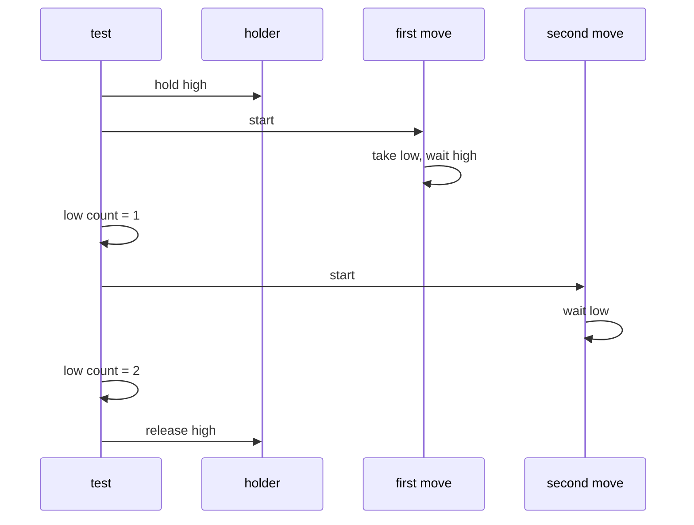

# Names service: fixes of the reviewed findings, area A6 and the A1 leftovers

Branch `ep/names-fixes-a6`, from `ep/names-review-fixes` at 16114b784. Decisions: the user's, 2026-11-16, on the review of https://github.com/simplex-chat/simplex-chat/pull/7703; the A6 lows take the proposed decisions. Line references are at b13968b61. Type rule and commit form: plans/2026-11-16-names-review-fixes.md.

## A1 leftovers

simplexmq: cabal.project pins evgeny-simplex/simplexmq e684f063a, which adds:
- USDCents: Num, Enum, Real, Integral, FromField and ToField;
- FromField and ToField for Address, LabelHash and RecoverableSignature;
- Ord LabelHash.

cabal.project then pins A2's 5cb1893c1, a fast-forward of e684f063a for A2-3 and A2-17, in lines identical to A2's.

scripts/nix/sha256map.nix changes once the commit is in simplex-chat/simplexmq; the reduced build reads no Nix map.

A1-21: the registration, record edit and change rows of Names/Store.hs hold Address, LabelHash and RecoverableSignature; decodeAddress and decodeSignature go.

A1-17: label turns keyed by LabelHash, code turns by CodeHash; withLabelTurns compares the hashes.

A4-22: `nCommunity :: Map LabelHash Text`, filled by labelHash; communityFor and logNamePolicy look it up by the LabelHash.

A1-14: USDCents for every cent amount of an order, a balance and a refund.

| Where | Cents as USDCents |
|---|---|
| Names/Store.hs | nrPrice, buUsed, poPrice, OTInvoice, spPrice, spBalance, blAmount, blCredited, blRefunded, lkPaid, lkFromBalance, CACard, caCents, lsReceivedCents, lsInvoiceAmount, lsCreditedCents, lfConfirmedCents, the balance writes |
| requests | the invoice order's price, the spend's price and balance, the refund command's cents |
| checks | chainPriceCents, checkPrice, ORCatalogChanged, ORPriceTooHigh |
| refunds | rdCents, RefundAmount |

- Parsed once from the request, within an invoice amount's range; the invoice asks `CurrencyAmount` of the order's amount, the one conversion.
- Kept as numbers: the price floor of the configuration, the held-cents metric, the sponsor allowance.
- One formatter of minor units, in Providers: BTCPay's decimal and the console's dollars are thin wrappers.
- Logs and texts print the number of cents, as before.

```mermaid
flowchart LR
  R[request JSON] -->|price, balance: USDCents| O[order checks]
  C[rentPriceUSD] -->|chainPriceCents: USDCents| O
  O --> S[(name_registrations, name_balances, name_late_credits)]
  O -->|CurrencyAmount| I[(invoices) / provider]
  I -->|amount: USDCents| S
  S --> V[view, console, logs]
```

The view of a failed, a taken and a requeued order: a test asserts each JSON object in full, as 16114b784 left it unchanged.

## A6. Tests

A6-1, A6-2, A6-3: done in 543dd1d4e.

A6-4, waits on the queue a test assumes:
- testMovesCross: after each move starts, the low hash's turn count reaches the moves started.
- testRevokeTakesCodeTurn: `codeTurnCount` beside balanceTurnCount; the revoke waits until the code turn has two requests.
- testSlotFreesInTime keeps its sleep.



A6-5, wider margins:
- testLongQuantity: the call's timeout 2 s, the bound 3 s.
- testSharedHostLookup: "at once" is below fetchTimeout.
- testConcurrentReads: the deadline 3 s.

A6-6: NamesPhasesTests' held, woken and prompt stay; NamesOwnerTests' held, woken and within, NamesRecordsTests' within and NamesSpendTests' heldPoll and pollSeconds go; their bounded waits use WebTests' bounded.

A6-7, each fixture once:
- FakeEthNode: unhex and address.
- NamesOrdersTests' exports: seconds, orderSeconds, keyA.
- NamesContractsTests' exports: alice, gracePeriod, otherResolver, registry.

A6-8, each JSON answer helper once, in WebTests:
- fieldOf: NamesOrdersTests' field, NamesRevealTests' field and NamesPhasesTests' key go; curried uses are sections of fieldOf.
- answerOf, decoding to the type the test reads.
- refusedWith, errorOnly inlined; the refused copies go.
- NamesSearchTests' answers are objects.

A6-9: coveredSpend and credit from NamesBalancesTests; stubRate from WebTests; invoice status by WebTests' invoiceStatus, as InvoiceStatus.

A6-10: dropped, as proposed.

A6-12:
- `RegistrationView`, a record of the view's 31 fields, its ToJSON derived with `dropPrefix "vw"` and omitNothingFields off; balance, latePayment, acceptance and community stay JSON values.
- registrationView returns it, built by the pure toRegistrationView; its consumers encode it.
- LateWait's ToJSON by textToJSON of its TextEncoding.
- testViewFields compares the view with an expected record; the invoice view keeps its key test.
